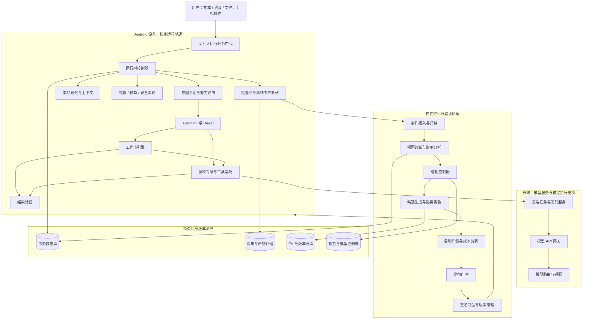
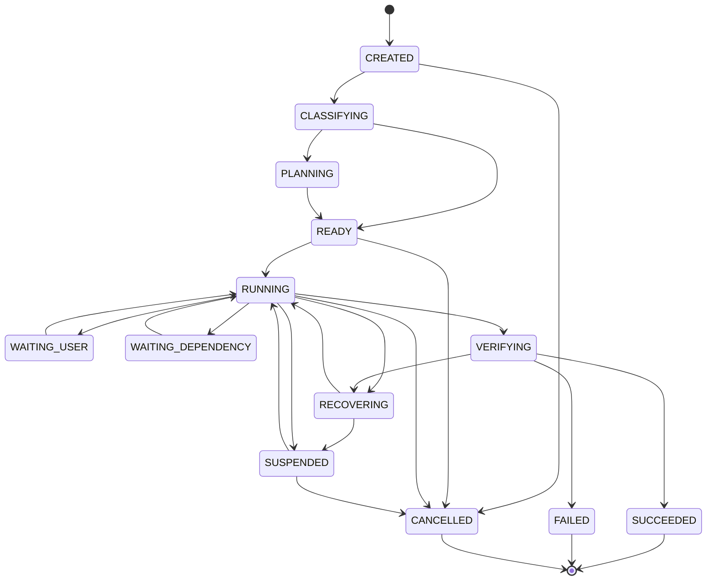

# EvoAgent 自进化智能体系统总体架构设计文档

英文名称： EvoAgent — Self-Evolving Agent Architecture

文档版本： Architecture 1.0

文档性质： 全量系统架构设计基线

架构目标： 建立可长期运行、可观测、可恢复、可验证、可独立进化的个人智能体平台。

目标产品形态： Android 个人智能体、云端模型服务、进化与验证平台、领域专家及可复用工作流资产。

适用范围： 客户端、服务端、AI 运行时、工具系统、记忆与上下文、模型适配、进化控制、评测发布、数据存储、安全与运维。

---

## 第一章 架构设计目标与基本原则

### 1.1 架构目标

EvoAgent 的架构需要同时满足六个目标。

目标 A：稳定完成任务

系统能够接收自然语言目标，理解任务、规划执行、调用工具、检查实际状态、恢复失败并验证最终结果。

任务执行不能依赖模型每次都正确理解提示词，也不能把模型输出直接视为事实。

目标 B：系统化诊断自身问题

系统能够发现任务执行中的异常，区分模型、提示词、规划、上下文、记忆、工具、环境和工作流等不同来源，并保存支持诊断的证据。

目标 C：持续改善能力

系统能够根据实际运行证据生成改进候选，在隔离环境中测试，评估质量、稳定性、成本和副作用，再将合格的改进应用于适当范围。

目标 D：支持能力独立演进

通用能力、领域专家、工具、工作流、模型适配和记忆策略可以独立版本化。

某个领域的失败不应自动引发整个系统的修改。

目标 E：支持复杂任务和长期运行

系统可以执行多步骤、长时运行、具有依赖关系和外部副作用的任务，并通过检查点、持久化状态和恢复机制维持执行连续性。

目标 F：支持环境与模型变化

系统能够适配不同的大语言模型、工具版本、Android 环境和服务端部署条件，并在兼容性验证后继承可复用的能力资产。

### 1.2 架构原则

1. 控制与推理分离： 模型负责提出判断和行动建议，运行时控制器负责最终执行授权、状态迁移和预算约束。
2. 稳定与实验分离： 正式任务执行与候选进化采用独立的运行环境和权限。
3. 数据与策略分离： 运行日志、记忆事实、候选假设和已验证策略分别管理。
4. 能力与模型解耦： 领域能力不直接绑定某个模型的内部行为。
5. 执行与验收分离： 执行组件不能仅凭自身报告宣布成功，重要结果必须有独立验收依据。
6. 共享内核受保护： 通用运行时、安全控制器和公共契约不能被领域专家随意修改。
7. 改动范围最小化： 只在证据支持的范围内修改，只有必要时才扩大回归和发布范围。
8. 预算硬约束： 模型调用次数、费用、时延、并发和实验资源由程序化控制器限制。
9. 离线优先保障安全： 网络中断时继续执行允许的任务，不因无法连接进化服务而破坏本地稳定状态。
10. 版本可追溯： 每次正式执行、候选实验和发布都能关联到明确的版本组合。
11. 可回滚设计： 重要策略、代码、工作流和模型适配必须保留可恢复的稳定版本。
12. 进化本身也要被评测： 不仅评测任务能力，也评测根因诊断、候选选择和发布决策的质量。

---

## 第二章 总体架构

### 2.1 架构分层

EvoAgent 采用六层逻辑架构，并将系统划分为稳定运行轨道和独立进化轨道。

第一层：交互与设备接入层

包括 Android App、语音交互、任务入口、无障碍服务、视觉识别、原生 Android 接口和本地文件处理。

第二层：智能体执行控制层

包括统一任务模型、意图识别、能力路由、Planning、ReAct、工作流引擎、运行时控制器和结果验收。

第三层：能力与上下文层

包括领域专家、工具注册、模型适配、记忆治理、上下文组装、能力依赖图和工作流资产。

第四层：运行数据与诊断层

包括任务事件、检查点、审计日志、环境健康、错误分类、根因假设和运行质量分析。

第五层：进化与验证层

包括进化控制器、候选生成、隔离实验、自动评测、质量与成本比较、发布门禁和进化策略管理。

第六层：版本与基础设施层

包括代码仓库、制品仓库、数据库、任务队列、模型服务、配置服务、签名发布、监控、备份和恢复。

### 2.2 总体架构图

该图表示逻辑职责和主要依赖关系，不要求所有组件都以独立微服务部署。

### 2.3 稳定运行轨道

稳定运行轨道负责当前任务的真实执行。

它可以使用本地能力、已安装工作流、可用的云端模型和外部工具，但必须在运行时控制器的权限、预算和状态约束内运行。

稳定运行轨道不得直接执行尚未通过相应验证的候选代码或策略。

### 2.4 独立进化轨道

进化轨道负责研究如何改善未来任务。

它可以分析日志、生成代码和提示词候选、建立 Git 分支、运行测试、比较指标和准备发布包。

进化轨道不能直接篡改正在运行的任务状态，也不能绕过稳定运行轨道的权限和预算控制。

### 2.5 双轨之间的接口

两条轨道通过以下受控接口协作：

- 运行事件接口。
- 诊断案例接口。
- 候选版本接口。
- 评测证据接口。
- 发布清单接口。
- 制品下载与签名验证接口。
- 版本启用和回滚接口。

所有跨轨操作都应具有明确的版本、权限、状态和审计记录。

---

## 第三章 核心运行时架构

### 3.1 统一任务模型

所有任务使用统一任务实体，避免不同专家各自维护互不兼容的任务状态。

任务至少包含：

- "task_id"
- "parent_task_id"
- "user_goal"
- "intent"
- "domain"
- "constraints"
- "risk_level"
- "acceptance_criteria"
- "budget_policy"
- "execution_plan_ref"
- "workflow_ref"
- "runtime_manifest"
- "task_status"
- "checkpoint_ref"
- "created_at"
- "updated_at"

具体字段可以根据存储技术实现为结构化列或受控扩展字段。

### 3.2 运行时控制器

运行时控制器是整个执行架构中拥有最终控制权的组件。

其职责包括：

1. 创建与恢复任务。
2. 校验任务状态转换。
3. 验证模型行动建议。
4. 检查工具权限。
5. 检查预算与调用次数。
6. 控制执行超时。
7. 管理并发和取消。
8. 记录关键状态。
9. 处理异常终止。
10. 管理高风险操作的授权。
11. 控制工作流恢复。
12. 在必要时停止任务。

模型、Planning、ReAct 和领域专家都不能绕过运行时控制器直接获得不受约束的执行能力。

### 3.3 任务状态机

建议采用统一状态机：

实际状态机还应为不可恢复错误、权限拒绝、资源耗尽和过期任务设置明确的处理规则。

终态不能被普通动作随意改写。重新执行应创建新执行实例或通过受控的重试机制产生新的运行记录。

### 3.4 状态所有权

这是必须在工程实现中严格执行的规则。

- 任务状态由运行时控制器管理。
- 计划内容由 Planning 管理，但计划是否生效由运行时控制器确认。
- 工作流节点状态由工作流引擎管理。
- 工具执行状态由工具执行器记录，最终业务结果由验收器判定。
- 记忆状态由记忆治理服务管理。
- 候选版本状态由进化控制器管理。
- 发布状态由发布控制器管理。
- Android 权限状态以系统实际授权为准，不能以模型记忆为准。

多个组件可以提出修改建议，但不能在没有明确协调规则的情况下同时修改同一份权威状态。

### 3.5 ReAct 执行循环

ReAct 是运行时内部的决策机制，不是整个系统的总控制器。

其循环为：

1. 读取当前任务状态。
2. 获取经过权限过滤和预算裁剪的上下文。
3. 观察当前状态与最近执行结果。
4. 判断下一步任务目标。
5. 提出行动建议。
6. 由运行时控制器校验行动。
7. 调用工具或执行受控动作。
8. 验证工具返回及实际状态。
9. 更新任务状态与检查点。
10. 判断继续、恢复、等待、验收或终止。

ReAct 可以处理局部不确定性，但不能自行改变系统权限、无限延长预算或任意修改正式版本。

### 3.6 Planning 与工作流引擎的边界

Planning 负责决定任务应当如何分解和组织。

工作流引擎负责可靠地执行已经明确的节点、依赖、条件分支和恢复逻辑。

ReAct 负责局部行动选择和异常应对。

运行时控制器负责权限、状态和预算。

这四个组件相互协作，但不应互相取代。

---

## 第四章 能力路由与领域专家架构

### 4.1 统一能力注册表

系统维护统一能力注册表，记录所有领域专家、工具、工作流和公共能力。

每个能力注册项至少包括：

- 能力 ID。
- 版本。
- 领域。
- 能力描述。
- 输入输出契约。
- 适用任务范围。
- 不适用范围。
- 依赖组件。
- 兼容模型。
- 工具清单。
- 评测集。
- 权限要求。
- 预算策略。
- 当前状态。
- 发布记录。

### 4.2 多层路由

路由分为以下层次：

第一层：任务意图识别

判断用户要完成什么，而不是直接决定使用哪个模型。

第二层：领域能力路由

选择通用专家、编程专家、旅游专家、AI 漫剧专家、手机操作专家或其他已注册专家。

第三层：执行模式路由

决定直接回答、ReAct、Planning、固定工作流或混合执行。

第四层：模型路由

根据能力需求、模型兼容性、质量要求、成本、延迟和可用性选择模型。

第五层：工具路由

选择适用的工具、执行环境和适配器。

第六层：故障与恢复路由

当执行失败时，选择重试、备用工具、备用模型、工作流分支、检查点恢复或安全停止。

### 4.3 共享内核

共享内核包括：

- 统一任务模型。
- 运行时控制器。
- 权限与预算系统。
- 工具调用契约。
- 任务状态机。
- 检查点与恢复接口。
- 事件记录接口。
- 结果验收接口。

领域专家可以通过插件、配置、策略和工作流扩展能力，但不得绕过共享内核。

### 4.4 领域隔离

每个领域拥有独立的：

- 提示词与策略。
- 记忆命名空间。
- 工具集合。
- 工作流库。
- 评测集。
- 质量指标。
- 模型适配配置。
- 发布与回滚记录。

跨领域共享经验必须经过适用性验证，不能将一个领域的成功经验自动认定为通用规律。

---

## 第五章 Harness 工程架构

### 5.1 Harness 的定义

Harness 是让模型能够在受控环境中稳定完成任务的工程系统。

它不等同于系统提示词，也不等同于 ReAct 循环。

Harness 负责连接模型推理、工具执行、任务状态、上下文、记忆、预算、安全、恢复和结果验证。

### 5.2 Harness 子系统

执行协调器

协调任务状态、Planning、ReAct、工作流和工具执行。

模型调用适配层

统一不同模型提供方的 API、消息格式、工具调用、超时和错误处理。

工具执行器

执行经过授权的工具调用，管理参数校验、幂等性、超时、返回值和副作用。

上下文装配器

按任务需要检索记忆、组织状态、加载必要提示词和证据，并控制上下文预算。

预算控制器

执行模型调用次数、费用、时间、重试和实验预算的硬限制。

检查点管理器

保存任务关键状态，支持暂停、恢复和故障后的状态重建。

验收执行器

根据任务类型执行规则校验、工具结果校验、测试或其他独立验收。

运行事件采集器

记录关键执行阶段、工具调用、错误、成本和状态变化。

### 5.3 Harness 的可进化边界

Harness 的某些策略可以由进化系统优化，例如重试规则、上下文装配策略和非关键调度参数。

但运行时控制器、安全权限和硬预算机制不能因模型提出了更好的策略就被绕过。

对 Harness 的改动必须具有明确接口、回归测试和版本兼容性检查。

---

## 第六章 工具系统与外部依赖架构

### 6.1 工具统一契约

工具应采用统一注册与调用协议。

核心字段包括：

- "tool_id"
- "tool_version"
- "input_schema"
- "output_schema"
- "permission_requirements"
- "side_effect_level"
- "timeout_policy"
- "retry_policy"
- "idempotency_policy"
- "error_mapping"
- "environment_constraints"
- "health_check"
- "evaluation_suite"

### 6.2 工具执行生命周期

注册 → 兼容性检查 → 权限校验 → 参数验证 → 预算检查 → 执行 → 返回验证 → 业务结果验证 → 事件记录。

工具返回 HTTP 200、进程退出码为零或模型报告“操作成功”，都不必然代表业务目标已经达到。

### 6.3 工具故障诊断

工具故障至少区分：

- 输入参数不合法。
- 工具实现缺陷。
- 外部接口变化。
- 认证或权限失败。
- 网络或服务不可用。
- 超时。
- 返回格式不符合契约。
- 执行成功但业务目标未达到。
- 执行结果不确定。
- 外部副作用已发生但本地未收到确认。

不同错误类型应采用不同恢复策略。

### 6.4 工具替代

备用工具必须在接口能力、权限、数据处理和副作用方面满足要求。

不能因为主工具失败，就自动调用一个权限更大或风险更高的工具。

### 6.5 副作用与幂等性

对于发送消息、提交表单、删除文件等操作，工具接口应支持幂等键、执行状态查询或其他适当的重复执行保护。

若系统无法判断某个操作是否已生效，应先验证状态，必要时暂停请求用户处理。

---

## 第七章 模型适配与版本隔离

### 7.1 模型适配层

所有大语言模型通过统一适配接口接入。

适配器负责：

- 请求和响应格式转换。
- 工具调用格式处理。
- 结构化输出处理。
- 超时和重试。
- 限流。
- 费用计量。
- 模型能力声明。
- 错误分类。
- 兼容性检测。
- 模型版本记录。

### 7.2 模型档案

每个模型档案应关联：

- 提供方和模型标识。
- 可用快照或版本信息。
- API 能力。
- 上下文限制。
- 工具调用能力。
- 多模态能力。
- 参数配置。
- 价格。
- 速率限制。
- 已知行为限制。
- 适配提示词。
- 评测结果。
- 环境依赖。
- 最近验证时间。

### 7.3 适配组合

模型本身不能单独代表完整的智能体版本。

系统需要使用发布组合清单关联：

模型版本 + 适配器版本 + 提示词版本 + 策略版本 + 工具版本 + 工作流版本 + 运行环境版本 + 评测证据。

这样才能在问题发生时还原当时的真实执行组合。

### 7.4 模型迁移

迁移新模型时：

1. 创建独立模型档案。
2. 识别可继承的能力资产。
3. 识别受影响组件。
4. 运行 API 与工具兼容性测试。
5. 运行必要的领域回归。
6. 比较质量、成本和时延。
7. 生成新发布组合。
8. 通过门禁后受控启用。
9. 保留旧模型档案与稳定发布组合。

旧模型上的经验可以作为候选知识，但不能无条件认定为新模型上的有效策略。

---

## 第八章 记忆与上下文架构

### 8.1 记忆架构

记忆系统分为逻辑存储和检索治理两部分。

逻辑存储负责保存信息、来源、版本、权限和关系。

检索治理负责判断哪些信息在当前任务中有效、相关且允许使用。

### 8.2 记忆分类

- 用户偏好记忆。
- 项目和任务状态记忆。
- 领域知识记忆。
- 技能与工作流记忆。
- 运行经验记忆。
- 模型与环境适配记忆。
- 原始运行证据。
- 审计记录。

记忆类型与记忆归属是独立维度。记忆可以属于某个任务、项目、专家、模型或共享范围。

### 8.3 记忆可信状态

至少区分：

- 候选信息。
- 已验证信息。
- 受限使用信息。
- 待复核信息。
- 已撤销信息。

一次失败后的模型推断不应直接写成已验证的长期经验。

### 8.4 记忆写入流程

来源识别 → 权限校验 → 重复检测 → 冲突检测 → 必要验证 → 适用范围确定 → 版本记录 → 写入 → 后续使用反馈。

### 8.5 上下文装配

上下文装配器根据当前任务、专家、模型、工作流和预算选择信息。

优先保留：

1. 系统安全约束。
2. 当前任务目标。
3. 不可变硬约束。
4. 当前任务状态。
5. 必要工具说明。
6. 相关且有效的记忆。
7. 最近执行结果。
8. 验收条件。
9. 必要证据引用。

### 8.6 上下文压缩

上下文压缩必须同时维护自然语言摘要和必要的结构化状态。

不能仅用一段摘要替代检查点、任务约束、工具结果和外部副作用状态。

### 8.7 上下文质量控制

系统应检查：

- 关键约束是否保留。
- 记忆是否过期。
- 是否存在跨项目污染。
- 是否包含不可信指令。
- 上下文是否超限。
- 是否遗漏当前状态。
- 是否引入不必要的历史内容。

---

## 第九章 运行事件、诊断与故障定位架构

### 9.1 事件模型

事件是运行观测的基本单元。

每个事件至少包括：

- "event_id"
- "event_type"
- "task_id"
- "run_id"
- "component_id"
- "component_version"
- "timestamp"
- "severity"
- "correlation_id"
- "causation_id"
- "payload_ref"
- "privacy_classification"
- "sync_status"

重要事件应具有唯一 ID 和可追溯的关联关系。

### 9.2 日志分层

运行事件

用于统计任务状态、工具调用、成本和异常。

执行轨迹

用于还原关键执行步骤。

诊断证据

包括经过授权的工具返回、必要的文件引用和界面证据。

审计记录

用于记录权限、发布、回滚和重要系统操作。

原始日志不能自动等同于记忆或进化结论。

### 9.3 故障分类

系统需要区分：

- 模型服务异常。
- 模型行为漂移。
- 意图识别错误。
- Planning 缺陷。
- ReAct 循环问题。
- 上下文遗漏。
- 记忆误用。
- 工具实现缺陷。
- 工具契约不兼容。
- 工作流定义错误。
- 环境变化。
- 权限失效。
- 检查点或状态恢复错误。
- 预算策略不合理。
- 多组件复合故障。

### 9.4 根因诊断器

根因诊断器根据事件、版本信息、错误模式和测试证据生成多个候选假设。

每个假设包含：

- 问题描述。
- 支持证据。
- 反对证据。
- 适用范围。
- 可能影响的组件。
- 诊断置信度。
- 建议验证实验。
- 修复候选。
- 剩余不确定性。

根因诊断器不能把语言模型生成的解释直接视为真实根因。

### 9.5 诊断实验

系统可以使用：

- 固定探针任务。
- 契约测试。
- 故障注入。
- 版本对照。
- 参数对照。
- 工作流重放。
- 模型对照。
- 环境健康检查。
- 必要的人工复核。

诊断实验必须与真实生产任务隔离，并遵守资源预算和数据访问策略。

### 9.6 诊断与恢复分离

当前任务的恢复由运行时控制器执行。

长期问题修复由进化控制器处理。

诊断结论可以同时服务于两者，但不能因为当前任务成功恢复，就自动认为根因已经永久解决。

---

## 第十章 自进化控制架构

### 10.1 进化控制器

进化控制器负责管理改进过程的完整生命周期。

它不直接替代模型推理，也不直接拥有无限制的代码修改和生产部署权限。

其职责包括：

- 问题优先级排序。
- 影响范围分析。
- 根因假设管理。
- 优化方法选择。
- 候选任务生成。
- 实验资源分配。
- 评测调度。
- 收益分析。
- 风险分级。
- 发布资格判定。
- 候选晋级或拒绝。
- 发布后监测。
- 回滚触发。

### 10.2 进化对象

支持优化：

- 提示词。
- Planning 策略。
- ReAct 策略。
- Harness 非关键执行策略。
- 上下文治理。
- 记忆写入与检索。
- 工具实现与适配器。
- 工作流定义。
- 模型路由。
- 模型适配参数。
- 诊断规则。
- 评测方法。
- 预算分配策略。

### 10.3 进化方法

系统不采用单一优化算法，而是根据问题类型选择不同方法。

配置与提示词优化

生成候选配置，进行消融实验和基线对照。

执行策略优化

通过轨迹分析、故障注入、状态机测试和回归验证改进。

工具实现优化

通过契约测试、单元测试、集成测试和副作用验证。

工作流优化

通过 DAG 调整、节点级测试、异常分支测试和端到端成本对比。

记忆与上下文优化

通过检索质量、关键约束保留率、任务表现和成本对照评测。

模型路由优化

通过任务类别分组，对比质量、费用、时延和稳定性。

诊断系统优化

通过已知根因案例和盲测数据，评估诊断准确性与错误建议率。

### 10.4 候选生命周期

stateDiagram-v2
    [*] --> DETECTED
    DETECTED --> TRIAGED
    TRIAGED --> HYPOTHESIZED
    HYPOTHESIZED --> CANDIDATE_CREATED
    CANDIDATE_CREATED --> TESTING
    TESTING --> EVALUATING
    EVALUATING --> REJECTED
    EVALUATING --> APPROVAL_PENDING
    APPROVAL_PENDING --> RELEASE_READY
    RELEASE_READY --> DEPLOYING
    DEPLOYING --> MONITORING
    MONITORING --> PROMOTED
    MONITORING --> ROLLED_BACK
    REJECTED --> [*]
    PROMOTED --> [*]
    ROLLED_BACK --> [*]

状态转换必须由进化控制器执行，并记录每次状态变更的依据。

### 10.5 候选版本隔离

每个候选拥有独立的变更范围、代码分支或配置版本、测试结果、成本记录和发布资格。

候选不得直接覆盖稳定版本。

### 10.6 进化影响范围

优先顺序为：

1. 当前任务的局部恢复。
2. 单一工作流改进。
3. 单一工具或适配器改进。
4. 单一领域专家改进。
5. 共享组件改进。
6. 核心安全与控制机制改进。

影响范围越大，所需的回归测试和发布门槛越严格。

---

## 第十一章 自动评测与质量体系

### 11.1 评测架构

评测体系由五个层级组成：

1. 单元与契约测试。
2. 组件集成测试。
3. 能力级评测。
4. 端到端任务评测。
5. 发布后真实运行监测。

### 11.2 评测集管理

每个评测集应具有：

- 唯一标识。
- 版本。
- 任务类别。
- 难度分层。
- 输入数据。
- 验收标准。
- 数据来源。
- 隐私分类。
- 适用模型。
- 适用能力。
- 是否属于独立保留测试集。

### 11.3 评测方法

根据任务类型采用确定性断言、单元测试、工具结果检查、领域规则、独立语义评测、人工抽检或受控实验。

对主观性较强的任务，需要明确自动评测的能力边界。

### 11.4 基线对比

候选版本必须与明确的基线版本对比。

如果模型、数据、环境或测试集发生变化，评测报告必须记录变化，不能将不等价测试的结果直接作为性能提升证据。

### 11.5 门禁指标

门禁应考虑：

- 任务质量。
- 关键约束遵循。
- 任务成功率。
- 工具正确性。
- 故障恢复能力。
- 跨领域回归。
- 安全风险。
- 成本增幅。
- 时延变化。
- 测试覆盖与证据质量。

关键安全测试失败时，不允许用总体平均分抵消。

---

## 第十二章 成本控制与资源调度架构

### 12.1 预算控制器

预算控制器为任务执行和进化实验提供统一资源限制。

支持：

- 单次模型调用预算。
- 单任务总预算。
- 单工作流预算。
- 单工具预算。
- 单候选实验预算。
- 每日进化预算。
- 每月进化预算。
- 并发限制。
- 最大执行时长。

### 12.2 预算分配

Planning 可以提出预算分配建议，但硬预算由控制器执行。

复杂任务可以按子任务分配预算；某个子任务超支时，系统应判断能否降级、暂停或请求用户批准。

### 12.3 成本收益模型

每个候选需要比较：

- 质量收益。
- 成功率变化。
- 失败成本变化。
- 调用费用变化。
- 时延变化。
- 运维复杂度变化。
- 风险变化。

系统应优先探索按任务难度进行策略分流、减少无效调用和复用已验证工作流等低成本方案。

### 12.4 进化预算

进化实验与正式任务使用独立预算池。

正式任务的费用不能被未受控的候选实验消耗。

---

## 第十三章 Git 与发布管理架构

### 13.1 版本管理范围

Git 负责版本化管理适合文本版本控制的内容：

- 源代码。
- 提示词。
- 策略配置。
- 工作流定义。
- 测试代码。
- 兼容性声明。
- 发布配置。

大体积素材、敏感用户数据、密钥和大量原始日志应存放在适当的数据存储中，并通过引用与版本关联。

### 13.2 分支体系

建议使用：

- "main"：共享基础代码。
- "stable/*"：稳定发布相关分支。
- "adapt/*"：模型或环境适配。
- "capability/*"：领域能力改进。
- "shared/*"：共享组件改进。
- "exp/*"：隔离实验。

实际分支命名可以调整，但必须保留稳定基线和候选隔离原则。

### 13.3 发布清单

发布清单应关联：

- Git 提交。
- 模型档案。
- 提示词版本。
- 策略版本。
- 工具版本。
- 工作流版本。
- 记忆策略版本。
- 环境版本。
- 评测集版本。
- 评测结果。
- 制品摘要。
- 签名。
- 兼容性要求。
- 回滚目标。

### 13.4 自动发布门禁

低风险改动可以在预先授权的范围内自动发布。

领域能力改动需要领域回归和影响分析。

共享内核改动需要更严格的验证。

安全控制器、硬预算机制和更新验证机制等核心安全边界，不允许普通进化流程自行修改并发布。

### 13.5 回滚

发布失败时，应能够恢复对应的稳定组合。

回滚对象包括代码、配置、提示词、模型路由和工作流引用。

对于不可逆的外部副作用或数据库迁移，应采用补偿操作或专门的恢复流程，不能假设简单回滚可以消除全部影响。

---

## 第十四章 Android 设备能力架构

### 14.1 Android 适配层

手机操作能力通过独立的设备适配层接入，不直接散落在通用 ReAct 代码中。

该层包括：

- 应用发现与启动。
- Android Intent。
- 原生系统接口。
- 无障碍节点读取与操作。
- 视觉识别。
- 受控输入与点击。
- 屏幕状态观察。
- 权限状态查询。
- 操作后验证。
- 失败恢复。

### 14.2 操作策略

优先采用稳定的原生接口。

其次采用无障碍节点操作。

当上述方式无法完成任务时，再考虑视觉识别与受控坐标操作。

实际使用方式应由能力可用性、权限和风险决定，而不是固定地使用单一技术。

### 14.3 操作闭环

观察当前界面 → 识别目标 → 检查权限 → 选择操作方式 → 执行动作 → 重新观察 → 验证结果 → 继续或恢复。

### 14.4 权限与安全

Android 系统实际授权是权限判断的权威来源。

智能体不能凭借提示词或记忆假设某项权限已被授予。

高风险操作需要遵循独立的授权策略，并且在结果不确定时优先停止或请求用户介入。

---

## 第十五章 离线与故障恢复架构

### 15.1 离线运行目标

服务端不可用不应导致手机端已安装能力整体失效。

系统需要明确区分：

- 本地可完成的任务。
- 需要云端模型的任务。
- 需要在线工具的任务。
- 需要服务端进化能力的操作。

### 15.2 本地持久化

本地存储至少支持：

- 任务状态。
- 任务检查点。
- 运行事件。
- 待同步队列。
- 已安装版本清单。
- 已批准配置。
- 必要的本地记忆。
- 未完成操作状态。

### 15.3 本地故障处理器

负责：

- 网络和服务健康检查。
- 有限重试。
- 备用路径选择。
- 本地规则化恢复。
- 失败状态记录。
- 安全终止。
- 检查点保存。

本地故障处理器不能在无法验证的情况下直接发布代码或改变安全策略。

### 15.4 事件同步

事件同步需要支持唯一 ID、去重、批次确认、断点续传、隐私过滤和容量管理。

重复上传同一事件不应重复触发有副作用的发布动作。

### 15.5 App 崩溃恢复

关键任务状态在执行过程中持久化。

App 重启后，系统先检查任务状态、外部操作状态和可用检查点，再决定恢复或终止。

对于已提交但结果未知的外部操作，应先检查实际状态，不能盲目重试。

### 15.6 更新离线处理

手机离线期间不影响当前稳定版本运行。

更新包可以在条件允许时下载和验证，但必须满足签名、兼容性、完整性和发布资格要求后才允许启用。

---

## 第十六章 工作流资产与复杂领域能力

### 16.1 工作流资产库

工作流资产库统一管理可复用流程，包括：

- 版本。
- 输入输出。
- DAG。
- 工具依赖。
- 模型需求。
- 环境要求。
- 验收规则。
- 预算策略。
- 错误处理。
- 恢复策略。
- 发布状态。

### 16.2 从执行任务到稳定工作流

系统可以从成功任务中提出工作流候选，但必须经过：

- 步骤抽取。
- 动态与固定逻辑分离。
- 输入输出定义。
- 依赖识别。
- 异常路径设计。
- 验收标准定义。
- 回归测试。
- 成本对比。
- 受控发布。

单次成功不构成工作流已经可靠的充分证据。

### 16.3 AI 漫剧能力包

漫剧能力包是领域架构的代表性应用，但不是通用内核的一部分。

其流程可以包含：

需求分析 → 剧本 → 角色设定 → 分镜 → 素材生成 → 视频生成 → 配音 → 合成 → 质量验收 → 交付。

该流程应通过 DAG 表达依赖关系，允许适当的并行执行，并为各节点提供独立状态、成本、重试和恢复机制。

### 16.4 外部生成服务适配

图像、视频和音频生成服务通过统一接口接入。

不同服务的能力、价格、质量、任务状态和失败模式独立管理。

切换生成服务时，只重新验证受影响的节点和端到端质量，不要求重写整个漫剧工作流。

---

## 第十七章 数据架构与存储设计

### 17.1 存储分类

事务数据库

用于任务状态、版本元数据、记忆索引、候选状态、发布记录、权限和审计索引。

对象存储

用于大型产物、必要诊断附件、生成素材、评测报告和发布制品。

Git 仓库

用于代码、提示词、策略、工作流定义和测试配置。

向量检索存储

用于支持语义检索的记忆索引，但不作为事实可信度和权限判断的唯一来源。

本地持久化存储

用于离线任务、检查点、事件队列和本地能力配置。

### 17.2 核心逻辑实体

系统至少需要以下实体类别：

- 任务与运行。
- 检查点与产物。
- 专家与能力版本。
- 能力依赖。
- 工具与契约。
- 工作流与节点。
- 模型与适配档案。
- 运行环境。
- 记忆与来源。
- 上下文构建记录。
- 运行事件。
- 诊断案例。
- 候选实验。
- 评测集与评测结果。
- Git 分支与提交。
- 发布清单与制品。
- 预算策略与用量。
- 权限与授权。
- 离线事件与同步回执。

### 17.3 数据一致性

需要明确不同数据的权威来源。

任务状态以运行时控制器管理的持久化状态为准。

发布资格以发布控制器的审核记录为准。

设备权限以 Android 系统实际状态为准。

记忆有效性以记忆治理状态和对应证据为准。

评测结论以实际执行的评测记录为准。

日志可以帮助重建事实，但不能自动取代权威状态。

### 17.4 数据生命周期

每类数据需要定义：

- 创建条件。
- 更新方式。
- 访问权限。
- 保留期限。
- 删除条件。
- 归档方式。
- 关联版本。
- 是否允许进入进化分析。
- 是否允许跨设备同步。

---

## 第十八章 安全与信任架构

### 18.1 安全控制平面

安全控制平面独立于模型推理和进化逻辑，负责：

- 身份与授权。
- 工具权限。
- 高风险操作策略。
- 数据访问。
- 硬预算。
- 发布权限。
- 制品验证。
- 审计。
- 安全终止。

### 18.2 外部内容信任边界

网页、文件、工具返回、OCR 内容和第三方应用界面均可能包含错误信息或恶意指令。

这些内容只能作为待处理的数据，不能自动覆盖系统规则、用户授权和安全策略。

### 18.3 候选执行隔离

候选代码和配置应在隔离环境中测试，限制网络访问、文件访问、凭证使用和外部副作用。

候选不能默认继承生产权限。

### 18.4 发布制品验证

发布包需要验证签名、完整性、版本、兼容性、来源和授权范围。

签名只能证明制品来源与完整性，不能单独证明制品本身安全，因此仍需配合测试和发布门禁。

### 18.5 数据最小化

默认使用结构化事件和必要诊断证据。

完整对话、屏幕内容、用户文件等数据应根据必要性、授权和保留策略处理。

---

## 第十九章 部署拓扑与运行模式

### 19.1 Android 设备端

运行交互层、任务控制、设备适配、本地记忆、检查点、事件队列和更新管理。

### 19.2 云端模型接入层

负责模型 API 代理、路由、适配、调用计量和服务健康。

该层与进化中心逻辑分离，避免进化服务维护期间影响模型调用路径。

### 19.3 云端稳定任务服务

承载需要云端运行的任务协调、工具执行和其他服务端能力。

是否执行具体任务取决于任务需求、权限、模型和环境能力。

### 19.4 进化与评测环境

使用隔离的执行环境运行候选、测试和诊断实验。

候选运行环境与生产任务环境应具有明确的权限与数据隔离。

### 19.5 数据与版本基础设施

包括事务数据库、对象存储、Git 仓库、能力注册表、模型档案、制品仓库和监控系统。

### 19.6 部署形态扩展

架构允许从本地开发环境逐步扩展到独立服务器、容器化服务和分布式评测环境。

模块边界应保持一致，但不要求所有逻辑组件在任何部署规模下都必须拆分为独立微服务。

---

## 第二十章 可观测性、运维与灾难恢复

### 20.1 监控指标

监控任务成功率、工具错误、模型调用失败、恢复成功率、上下文质量、记忆误用、任务费用、进化成本、候选通过率、发布后回滚率和离线事件积压量。

### 20.2 告警规则

针对连续失败、关键依赖不可用、成本超限、发布异常、数据同步失败和安全事件建立分级告警。

### 20.3 运行回放

系统应在隐私和权限允许的范围内，根据事件、检查点、版本清单和必要证据还原任务过程。

回放环境不得默认重新执行真实外部副作用。

### 20.4 备份与恢复

对事务数据、版本元数据、必要的对象存储和发布清单建立备份策略。

恢复后必须检查版本引用、任务状态和制品完整性。

### 20.5 进化服务故障

进化中心不可用时，稳定执行轨道继续使用已批准版本运行。

待处理诊断案例可以积累，待发布候选不影响现有稳定版本。

---

## 第二十一章 全量质量属性与验收

### 21.1 功能完整性

系统必须能够完成统一任务执行、领域路由、工具调用、结果验证、记忆管理、工作流执行、日志诊断、进化评测、版本管理、离线恢复和受控发布。

### 21.2 稳定性

通过故障注入、断网、超时、进程终止、工具失效和模型服务异常测试，验证任务状态与恢复机制。

### 21.3 可扩展性

新增专家、工具、模型适配器和工作流时，应优先通过注册与契约接入，而不是修改整个系统的核心执行逻辑。

### 21.4 可追溯性

能够根据任务 ID 还原其关键执行版本组合、工具结果、成本、验收结果和相关诊断记录。

### 21.5 进化有效性

每项重要改进都需要明确基线、变更范围、评测结果、成本影响、风险和发布结论。

### 21.6 安全性

不能通过提示词、领域插件或候选实验绕过权限、硬预算和发布控制。

### 21.7 成本效率

任务执行和进化实验都必须有明确预算，并能够识别无效重试、无效实验和质量收益不足的策略。

### 21.8 模型迁移能力

切换模型后，系统能够识别需要重新验证的资产，并保留旧模型适配与稳定发布组合。

### 21.9 离线韧性

服务端离线时，手机端继续执行已安装的允许能力；网络恢复后能够同步事件并受控接收更新。

---

## 第二十二章 架构演进治理

### 22.1 架构决策记录

重要的架构决策必须记录：

- 决策内容。
- 设计背景。
- 备选方案。
- 选择理由。
- 影响模块。
- 风险。
- 兼容性要求。
- 验证方式。
- 后续复审条件。

### 22.2 架构变更原则

普通能力变更通过版本化资产迭代。

共享内核变更通过架构评审和回归验证。

安全边界变更必须经过专门的审查流程。

### 22.3 兼容性治理

公共接口、任务模型、事件模型、发布清单和工作流格式应有明确版本。

接口升级需要定义兼容期、迁移路径和失败处理方式。

### 22.4 进化治理

进化系统本身也应纳入版本管理和评测。

包括诊断策略、候选生成器、评测调度器、门禁规则和发布控制器。

进化控制器不能因为自身版本升级，就跳过对自身的验证。

---

## 第二十三章 全量架构结论

EvoAgent 的完整架构由以下相互协作、职责独立的系统组成：

1. 统一任务入口与意图识别。
2. 多层能力路由与领域专家。
3. Planning、ReAct、工作流和运行时控制器。
4. Harness 与工具契约系统。
5. 模型适配和版本管理。
6. 记忆与上下文治理。
7. 检查点和任务恢复。
8. 运行事件与可观测性。
9. 环境健康与根因诊断。
10. 独立进化控制器。
11. 候选实验与自动评测。
12. 成本与资源控制。
13. Git、制品与受控发布。
14. Android 设备操作适配层。
15. 离线运行与双端同步。
16. 可复用工作流和领域能力包。
17. 安全与权限控制平面。
18. 数据、部署和运维基础设施。
19. 架构决策与长期演进治理。

这些模块不是彼此独立的孤岛，而是通过统一任务模型、能力契约、事件模型、版本清单和发布协议连接起来。

EvoAgent 最终要实现的不是让一个模型随意修改自己的全部代码，而是建立一个系统，使其能够：

- 稳定地执行真实任务。
- 可靠地记录任务过程。
- 区分不同类型的故障。
- 根据证据选择正确的改进对象。
- 在隔离环境中验证候选。
- 评估质量与成本的综合收益。
- 只在授权范围内发布改进。
- 在失败后恢复或回滚。
- 在模型和环境变化后继承并重新验证能力。
- 在服务端离线时继续提供允许的本地能力。
- 通过持续积累的运行证据，不断提高未来任务的完成质量。

最终架构原则：执行权由运行时控制器掌握，改进权由进化控制器在授权范围内行使，正确性由独立验收体系验证，发布权由受保护的发布控制器管理，所有关键行为都必须可追溯、可约束、可恢复。

这五项职责构成 EvoAgent 全量系统的核心控制边界。任何未来新增的模型、领域专家、工具或工作流，都必须在这套边界内扩展能力，而不能绕过它们。
