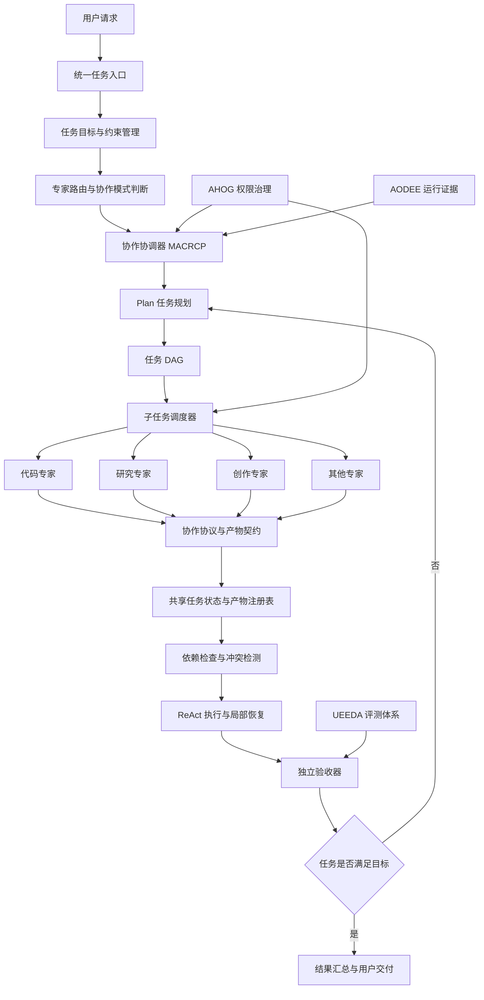
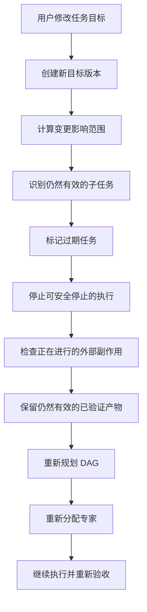

# 问答 116

> 来源: 新 窗口 | 会话: 分支 · 分支 · 分支 · 设计自进化智能体
> 消息: bbb2139d-9305-42e0-a6e4-e4df443baf98 | 时间(UTC): 2026-10-24 07:43

## 用户

继续

## ChatGPT

<WritingBlock id="58316" variant="document"># EvoAgent 第五十三专项：多专家协同执行、冲突解决与协作协议体系

**专项编号：MACRCP**

**英文名称：Multi-Agent Collaboration, Conflict Resolution & Coordination Protocol**

**文档版本：V1.0（架构设计基线）**

**文档性质：全量架构专项设计**

**适用范围：EvoAgent 通用内核、领域专家、Plan 规划器、ReAct 执行循环、任务 DAG、记忆与上下文系统、工具系统、工作流引擎、进化控制器。**

**前置专项：多专家分层架构、RARTSE、AODEE、RCAE、UEEDA、CDCIPC、SMSEE、AHOG、EODRA、SELCIA、CPLCG。**

**核心目标：让多个专家能够在统一任务目标下分工执行、共享必要信息、处理冲突、协调依赖、恢复失败，并在成本可控和权限受限的条件下完成复杂任务。**

> 本文定义目标架构、协作协议、状态模型、冲突处理策略与验收标准，不代表当前 EvoAgent 已经实现这些功能。设计遵循既定方向：个人使用、本地优先、Android 优先、专家独立演进、通用内核受保护、后台进化与稳定运行分离。

---

# 一、为什么需要独立的多专家协作体系？

前面已经确定，EvoAgent 不是一个只有单一提示词的通用智能体，而是由统一任务入口、共享通用内核、独立领域专家、能力依赖图和独立进化控制器构成的分层系统。

不同专家拥有不同的工具、记忆空间、工作流、模型适配和评测标准。

但有一个问题：

**拥有多个专家，不等于具备多专家协同能力。**

如果只是把一个复杂任务拆成几句话，分别发送给几个专家，再把回答拼起来，系统很容易产生新的问题。

## 1.1 场景一：多个专家对同一个目标产生不同理解

用户提出：

> 制作一部 60 秒的 AI 动态漫剧，要求主角外观一致、故事完整、画面和配音协调，成本控制在预算内。

可能涉及：

- 编剧专家；
- 分镜专家；
- 角色设计专家；
- 图像生成能力；
- 视频生成能力；
- 配音能力；
- 视频合成工作流；
- 质量评测器。

编剧专家可能认为故事完整性最重要。

分镜专家可能认为需要增加镜头数量。

视频生成能力可能发现部分镜头无法按预期生成。

预算控制器可能发现继续生成会超过预算。

如果没有统一的目标约束和冲突解决机制，这些模块可能分别完成自己的工作，却无法交付符合用户要求的最终视频。

## 1.2 场景二：两个专家同时修改同一个资源

假设代码专家和测试专家共同处理一个软件项目。

代码专家正在修改某个模块。

测试专家发现问题后，也尝试修复同一个文件。

如果两个专家直接写入同一个工作目录，可能发生：

- 文件覆盖；
- 修改丢失；
- 测试结果对应错误的代码版本；
- 一个专家覆盖另一个专家刚完成的修复；
- 最终补丁无法合并。

这不是模型推理能力不足，而是缺少资源协调和事务边界。

## 1.3 场景三：一个专家失败，导致整个任务失控

假设 AI 漫剧工作流已经完成：

- 剧本；
- 角色设计；
- 部分分镜；
- 部分图片生成。

随后，视频生成服务连续失败。

如果系统没有定义任务状态和恢复边界，可能继续重复生成、反复调用付费服务，甚至把不完整产物交给后续步骤。

正确的做法应该是：

- 保留已经验证的产物；
- 标记失败节点；
- 分析哪些下游节点受到影响；
- 判断是否可以替换视频生成方式；
- 检查替代方案是否仍符合用户约束；
- 在预算和权限范围内恢复执行。

## 1.4 场景四：用户中途改变需求

用户最初要求制作 60 秒的视频。

执行过程中又说：

> 改成 30 秒，保留主角和结局，减少中间镜头。

如果各专家仍然使用旧任务目标，就可能出现：

- 编剧专家已经改短剧本；
- 分镜专家仍按 60 秒规划；
- 视频生成任务继续生成旧镜头；
- 合成工作流仍然等待已经取消的素材。

因此，多专家协同必须支持目标版本、任务失效、取消传播和局部重规划。

这些问题需要统一的协作机制，而不是依靠每个专家自行猜测其他专家的状态。

---

# 二、第一性原理：协作必须围绕统一目标和明确契约

多专家协作的核心不是让多个智能体进行更多对话，而是让它们在明确的约束下完成可验证的工作。

建议确立六项基本原则。

## 2.1 单一任务目标，允许多个专业视角

每个复杂任务必须具有唯一的权威任务目标版本。

专家可以提出不同方案，但不能各自维护互相矛盾的最终目标。

例如，用户提出的预算、时长、角色一致性和安全限制，应当统一保存在任务约束中。

## 2.2 专家独立执行，但不能任意改变共享状态

专家可以独立规划自己的子任务，但必须通过规定的接口提交结果。

不能绕过协调器直接修改全局任务状态。

## 2.3 协作必须有明确输入输出契约

一个专家完成任务后，必须交付规定格式的产物、状态和验收证据。

下游专家不能仅凭一句“已经完成”就默认结果可用。

## 2.4 共享信息不等于共享全部记忆

专家之间可以共享任务目标、必要约束和明确授权的产物引用。

但不应自动共享所有会话历史、私人记忆、内部工作记录和无关领域知识。

## 2.5 并行执行必须建立在依赖关系和资源安全之上

两个子任务能够同时开始，不代表它们一定可以安全并行。

系统必须检查输入依赖、资源竞争、外部副作用和产物冲突。

## 2.6 协作收益必须能够被测量

如果增加一个专家没有提高任务质量，反而增加成本和延迟，就不应当为了使用多智能体而强行使用多智能体。

**最终目标是用最合适的协作结构完成任务，而不是让参与协作的专家数量最大化。**

---

# 三、总体架构：协作协调器位于什么位置？

建议在现有通用内核中增加独立的协作协调层。

它不替代专家路由器、Plan、ReAct 或任务 DAG，而是协调它们之间的关系。



这里需要明确四个组件的职责。

| 组件 | 负责什么 |
|---|---|
| Plan | 决定任务需要完成哪些工作，以及整体计划如何调整 |
| DAG | 表达子任务之间的依赖、顺序和可并行关系 |
| ReAct | 在每个执行单元内部，根据观察结果调用工具、验证结果和调整行动 |
| MACRCP | 管理专家之间的协作契约、共享状态、资源冲突、交接、取消和协调 |

这四者不是互相替代的关系。

Plan 可以决定某个任务需要代码专家和测试专家共同完成。

DAG 可以规定先读取项目，再修改代码，最后运行测试。

ReAct 可以让代码专家在修改过程中，根据测试失败信息调整补丁。

MACRCP 则负责确保测试专家使用的是正确的代码版本，避免两个专家同时修改同一个文件，并在目标发生变化时协调整个任务。

---

# 四、协作模式判断：什么时候需要多个专家？

不是每个任务都应该启动多专家协作。

如果用户只是询问一个简单问题，让多个专家分别回答，通常只会增加成本和冲突机会。

因此，统一任务入口应当先判断任务复杂度、专业需求和协作收益。

## 4.1 建议支持五种执行模式

| 模式 | 说明 | 典型场景 |
|---|---|---|
| 单专家模式 | 一个专家独立完成任务 | 普通代码修改、旅游信息查询 |
| 串行协作模式 | 专家按依赖顺序交接产物 | 编剧 → 分镜 → 合成 |
| 并行协作模式 | 多个独立子任务同时执行 | 多个独立来源的资料研究 |
| 评审协作模式 | 一个专家执行，另一个独立检查 | 代码修改后由测试专家评审 |
| 混合协作模式 | 同时包含串行、并行和评审 | 完整软件开发、AI 漫剧制作 |

## 4.2 判断条件

建议由任务解析器与 Plan 规划器综合判断：

1. 任务是否涉及多个不同领域的专业能力？
2. 子任务是否可以清晰拆分？
3. 不同专家是否确实具有互补能力？
4. 子任务之间是否存在可并行的工作？
5. 是否需要独立验证或交叉检查？
6. 多专家是否会竞争同一资源？
7. 协作带来的预期收益是否高于额外成本？
8. 当前预算是否允许协作？
9. 是否存在更简单的单专家或固定工作流方案？

## 4.3 建议的决策规则

- 任务简单、目标明确：优先单专家。
- 流程固定、重复性高：优先使用已验证的工作流模板。
- 任务开放、步骤不确定：使用 Plan 动态规划。
- 存在多个独立专业子任务：考虑并行协作。
- 结果风险较高：增加独立验证，但不能让验证专家代替权限控制器。
- 协作收益不明确：先使用单专家，只有发现能力缺口时才升级为多专家。

这里需要避免一个误区：

**专家和 DAG 不是二选一。**

专家代表谁负责某种专业工作，DAG 代表多个工作之间如何组织。

同一个专家可以执行多个 DAG 节点，多个专家也可以共同完成一个 DAG 节点的不同阶段。

---

# 五、统一任务目标：所有专家必须遵循同一个任务版本

多专家协作中最重要的共享对象不是专家之间的聊天记录，而是统一的任务目标和约束。

建议建立 `TaskContract`。

核心字段如下：

| 字段 | 含义 |
|---|---|
| `task_id` | 全局任务标识 |
| `goal_version` | 当前任务目标版本 |
| `objective` | 用户希望完成的目标 |
| `hard_constraints` | 不可违反的约束 |
| `soft_preferences` | 可权衡的偏好 |
| `acceptance_criteria` | 最终验收条件 |
| `resource_budget` | 时间、成本和资源预算 |
| `permission_scope` | 允许的操作范围 |
| `deadline` | 任务截止时间 |
| `delivery_spec` | 交付产物及格式 |
| `cancellation_policy` | 取消和副作用处理规则 |

## 5.1 硬约束与软偏好必须分开

例如，AI 漫剧任务：

硬约束：

- 视频时长不能超过用户指定上限；
- 必须使用指定主角；
- 不得未经授权调用付费服务；
- 必须满足规定的输出格式。

软偏好：

- 画面尽可能精美；
- 镜头衔接自然；
- 尽量降低生成成本；
- 优先选择更快的方案。

如果专家发现画质提升需要增加预算，它可以提出建议，但不能自行修改预算硬约束。

如果软偏好之间发生冲突，则交由统一决策机制进行权衡。

## 5.2 目标变更必须创建新版本

当用户改变任务目标时，不应直接覆盖旧目标。

建议：

- `goal_version = 1`：原始目标；
- `goal_version = 2`：修改后的目标；
- 记录变更来源、时间和影响范围；
- 识别哪些子任务仍然有效；
- 标记哪些子任务需要取消、重做或重新验收。

所有子任务都必须声明自己基于哪个目标版本。

如果某个专家基于 V1 生成的产物仍然符合 V2，可以经过重新验证后继续使用，而不必全部重做。

这可以显著降低复杂任务中途改变需求造成的浪费。

---

# 六、专家协作协议：每次交接必须说明什么？

建议建立统一的 `ExpertCollaborationProtocol`。

专家之间不能只传递自然语言结论，而应当传递结构化的任务请求、产物引用、状态和验收信息。

## 6.1 子任务请求 `SubtaskRequest`

至少包含：

- `subtask_id`；
- `task_id`；
- `goal_version`；
- `assigned_expert_id`；
- `objective`；
- `input_artifacts`；
- `required_capabilities`；
- `constraints`；
- `acceptance_criteria`；
- `allowed_tools`；
- `permission_scope`；
- `budget_limit`；
- `deadline`；
- `dependency_ids`；
- `expected_output_contract`。

## 6.2 专家交付 `SubtaskResult`

至少包含：

- `subtask_id`；
- `execution_id`；
- `goal_version`；
- `status`；
- `artifact_refs`；
- `acceptance_evidence`；
- `warnings`；
- `unresolved_questions`；
- `resource_usage`；
- `failure_details`；
- `provenance`。

其中，`artifact_refs` 指向实际产物，而不是把所有大文件复制进专家之间的消息。

例如，漫剧专家交付的是视频素材的路径或对象存储引用、对应版本、文件校验信息及验收结果。

## 6.3 交接确认

交付结果之后，下游专家或协调器必须验证：

1. 产物是否存在；
2. 产物版本是否正确；
3. 输入输出契约是否匹配；
4. 必要的验收证据是否齐全；
5. 是否基于当前任务目标；
6. 是否满足权限和数据来源要求；
7. 是否仍然符合当前资源预算。

只有验证通过，产物才能进入已接受状态。

**专家报告完成，只代表它提交了结果；协调器确认验收通过，才代表结果可以被下游正式消费。**

---

# 七、协作消息协议与状态机

建议定义统一的协作消息类型。

| 消息类型 | 用途 |
|---|---|
| `TASK_ASSIGNED` | 子任务已分配 |
| `TASK_ACCEPTED` | 专家接受任务 |
| `TASK_REJECTED` | 专家无法承担任务 |
| `ARTIFACT_SUBMITTED` | 提交产物 |
| `ARTIFACT_ACCEPTED` | 产物通过验收 |
| `ARTIFACT_REJECTED` | 产物不符合契约 |
| `BLOCKED` | 子任务被依赖或资源阻塞 |
| `HELP_REQUESTED` | 请求其他专家或协调器协助 |
| `CONFLICT_DETECTED` | 发现冲突 |
| `REPLAN_REQUESTED` | 请求重新规划 |
| `CANCEL_REQUESTED` | 请求取消任务 |
| `CANCEL_CONFIRMED` | 确认取消 |
| `BUDGET_WARNING` | 预算即将达到限制 |
| `TASK_FAILED` | 子任务失败 |
| `TASK_COMPLETED` | 子任务完成 |

每条消息至少应包含：

- 消息 ID；
- 任务 ID；
- 子任务 ID；
- 来源组件；
- 目标组件；
- 目标版本；
- 消息类型；
- 时间戳；
- 关联事件 ID；
- 幂等键；
- 必要的消息载荷。

对于本地部署，第一版可以采用进程内事件总线和 SQLite 持久化队列。

不需要一开始就引入 Kafka、分布式消息队列或复杂的微服务架构。

但即使是单机系统，也应该具备明确的消息状态、重复消息处理和中断恢复能力。

---

# 八、共享状态与共享记忆：哪些可以共享，哪些不能？

多专家协作必须有共享状态，但不意味着把所有专家的记忆合并成一个大上下文。

建议将数据分为四层。

## 8.1 全局任务状态

记录：

- 当前目标版本；
- 当前任务状态；
- 已完成子任务；
- 阻塞子任务；
- 全局预算；
- 当前验收情况；
- 用户确认事项；
- 取消或暂停状态。

由协调器统一维护。

## 8.2 子任务状态

每个专家维护自己的执行状态：

- 计划；
- 当前步骤；
- 工具调用结果；
- 局部重试次数；
- 产物版本；
- 尚未解决的问题。

专家可以更新自己的局部状态，但不能随意覆盖其他专家的状态。

## 8.3 共享任务记忆

用于保存对当前任务有必要的事实：

- 用户确认的目标；
- 已接受的产物；
- 关键约束；
- 专家之间的决策；
- 已验证的结论；
- 尚待解决的冲突；
- 重要的依赖关系。

共享任务记忆必须具有任务范围和有效期。

任务结束后，可以根据价值选择性归档。

## 8.4 专家私有记忆

例如：

- 代码专家的语言和项目分析经验；
- 旅游专家的路线规划策略；
- 漫剧专家的角色设计技巧；
- 手机操作专家的界面识别经验。

默认不直接共享。

如果某项经验具有跨领域价值，应当先抽象为独立能力，再经过验证决定是否共享。

## 8.5 上下文构建策略

不同专家接收的上下文不必相同。

协调器提供统一的任务事实与必要约束，专家各自选择相关的局部历史、专业知识和工具结果。

例如，代码专家只需要获得漫剧任务中与代码修改有关的产物信息，而不需要读取整个剧本创作过程。

这样可以降低 Token 消耗、减少无关信息干扰，并保护领域隔离。

---

# 九、共享资源与并发控制

这是多专家协作从概念设计进入真正工程实现时必须解决的问题。

## 9.1 资源冲突类型

建议至少识别以下类型：

- 文件写入冲突；
- 数据库记录更新冲突；
- 同一外部资源的重复操作；
- 同一个任务节点被重复执行；
- 预算竞争；
- GPU、CPU、内存竞争；
- 同一个用户界面的并发操作；
- 同一产物的多版本覆盖；
- 共享配置的并发修改。

## 9.2 资源所有权

每个可变资源应当声明：

- 当前所有者；
- 允许访问的子任务；
- 允许的操作类型；
- 版本或修订号；
- 锁定策略；
- 是否允许并行读取；
- 是否允许并行写入；
- 冲突处理方式。

## 9.3 建议采用四类协调策略

**只读共享**

多个专家可以同时读取已发布的产物。

**独立工作区**

每个专家在独立工作区或分支中修改，最后由协调器或专用合并步骤处理。

**单写者模式**

同一时刻只有一个专家能够修改某个共享资源。

**乐观并发控制**

允许并行处理，但提交时检查基础版本是否仍然有效。

如果资源已经发生变化，则拒绝旧版本直接覆盖，并要求重新基于最新状态进行合并。

## 9.4 不能仅依靠文件锁

文件锁只能解决一部分并发问题。

对于代码修改，还需要检查：

- 补丁是否仍然适用；
- 是否覆盖了其他专家的改动；
- 是否破坏接口；
- 是否引入回归。

对于手机操作，同一界面通常应当由一个执行者控制，避免多个动作同时修改 UI 状态。

对于外部付费 API，则需要幂等键、调用记录和重复请求保护。

---

# 十、冲突分类与统一解决机制

多专家冲突不能一律交给某个大模型进行讨论。

不同类型的冲突，应使用不同的解决方式。

建议分为六类。

## 10.1 目标冲突

不同专家对用户目标产生不同解释。

处理方式：

1. 检查统一任务目标；
2. 检查硬性约束；
3. 检查用户最近一次确认；
4. 如果仍存在歧义，向用户澄清；
5. 不允许专家自行选择会改变关键目标的解释。

## 10.2 方案冲突

不同专家提出不同解决方案，但都可能满足目标。

例如，代码专家建议重构，测试专家建议最小化修复。

处理方式：

- 比较目标满足程度；
- 比较实施成本；
- 比较风险；
- 比较可逆性；
- 比较维护成本；
- 在必要时执行小规模实验。

如果多个方案均符合要求，应优先采用满足目标且复杂度较低的方案。

## 10.3 事实冲突

不同专家提供互相矛盾的信息。

例如，研究专家认为某个 API 支持某项功能，另一个专家认为它不支持。

处理方式：

- 比较来源可信度；
- 检查信息时效性；
- 检查是否使用了相同的版本和环境；
- 必要时执行独立验证；
- 保留尚未解决的不确定性。

不能通过简单多数投票认定事实正确。

## 10.4 产物冲突

两个专家产生互不兼容的文件、配置、脚本或其他产物。

处理方式：

- 检查产物版本；
- 检查依赖关系；
- 检查文件修改差异；
- 尝试自动合并；
- 无法安全合并时，使用专门的合并或重规划步骤。

## 10.5 资源冲突

多个专家争用同一资源。

处理方式：

- 按任务优先级调度；
- 检查预算；
- 使用锁或并发控制；
- 对高风险资源采用单写者；
- 必要时暂停低优先级子任务。

## 10.6 验收冲突

某个专家认为任务完成，另一个评审专家认为不符合要求。

处理方式：

- 以统一的验收标准为依据；
- 优先使用可客观验证的测试；
- 对存在争议的项目进行独立复核；
- 必要时要求用户决定偏好；
- 不允许执行专家通过自己的声明覆盖失败的验收结果。

---

# 十一、冲突解决优先级

建议采用明确的优先级顺序。

1. **安全与授权边界。** 任何专家都不能绕过。
2. **用户明确确认的目标和硬性约束。** 不得由专家自行修改。
3. **数据完整性与任务状态一致性。** 防止不可逆损坏。
4. **客观验收标准。** 测试失败不能仅凭主观判断忽略。
5. **资源预算与截止时间。** 不得无限制消耗资源。
6. **任务质量与成功率。**
7. **效率、成本和维护复杂度。**
8. **专家个人偏好或局部优化建议。**

这不是说安全问题永远可以由一套静态优先级自动解决，而是明确：有些约束根本不能进入普通的方案评分。

例如，两个方案的成本和画质不同，可以进行权衡。

但一个方案需要越权访问文件时，不应该因为它画质更好或成功率更高而被选中。

---

# 十二、Plan、DAG、ReAct 与协作协调器如何配合？

这部分需要正式纳入 EvoAgent 的统一运行模型。

## 12.1 Plan：负责全局策略

Plan 决定：

- 任务如何拆分；
- 需要哪些专家；
- 哪些工作先做；
- 哪些工作可以并行；
- 失败后是否需要重新规划；
- 什么时候应当停止执行。

Plan 不是每一步工具调用的详细记录。

它是任务层面的规划和调整机制。

## 12.2 DAG：负责可执行的依赖结构

DAG 将计划转化为具体的执行节点与依赖关系。

例如：

```text
需求分析
   ↓
剧本生成
   ↓
角色设定
   ↓
分镜生成
   ↓
素材生成
   ↓
视频合成
   ↓
质量验收
```

其中，角色设计和部分场景设计可能在剧本确定后并行进行。

DAG 必须明确：

- 节点输入；
- 节点输出；
- 前置依赖；
- 执行状态；
- 失败策略；
- 重试策略；
- 取消策略；
- 资源需求；
- 验收条件。

## 12.3 ReAct：负责局部执行与反馈

在一个 DAG 节点内部，专家可能需要：

1. 观察当前状态；
2. 判断下一步行动；
3. 调用工具；
4. 检查工具结果；
5. 调整局部计划；
6. 再次执行；
7. 提交最终产物。

这就是局部 ReAct 循环。

ReAct 不应当绕过 DAG 的依赖约束，也不能擅自扩大任务权限。

## 12.4 MACRCP：负责跨专家协调

协调器负责：

- 将节点分配给适合的专家；
- 管理交接协议；
- 维护共享任务状态；
- 处理资源冲突；
- 检查产物契约；
- 协调失败与取消；
- 判断是否需要重新规划；
- 维护全局预算。

因此，四者的关系可以概括为：

**Plan 决定做什么，DAG 决定工作之间的依赖，ReAct 决定局部如何执行，MACRCP 决定多个执行者如何安全协同。**

---

# 十三、失败恢复：局部失败不应自动摧毁整个任务

复杂任务经常只有一部分失败。

如果每次局部失败都从头执行，成本会快速膨胀。

因此，协调器需要建立依赖感知的恢复机制。

## 13.1 失败分类

建议将失败分为：

- 可重试的暂时性失败；
- 输入不完整；
- 工具或服务不可用；
- 产物不符合验收要求；
- 依赖结果失效；
- 专家能力不足；
- 预算不足；
- 权限不足；
- 任务目标已经过期；
- 无法安全恢复的状态错误。

## 13.2 局部重试

适用于：

- 临时网络错误；
- 模型服务超时；
- 可恢复的工具调用失败；
- 未改变输入和环境的短暂异常。

重试次数和预算必须受控。

## 13.3 局部重规划

适用于：

- 某个专家无法完成子任务；
- 当前工具不再可用；
- 产物格式不兼容；
- 某个方案成本超出预算；
- 部分依赖需要替换。

局部重规划应尽可能保留已验证的上游产物。

## 13.4 全局重规划

适用于：

- 用户改变主要目标；
- 核心假设被推翻；
- 关键共享资源失效；
- 多个子任务之间存在无法局部解决的冲突；
- 原有 DAG 已经不再满足最终验收要求。

## 13.5 不确定的执行结果

例如，某个付费视频生成请求超时，但服务端可能已经完成生成。

此时不能直接重复调用。

系统应当先检查：

- 是否存在原请求 ID；
- 服务端是否提供查询接口；
- 是否已生成产物；
- 原请求是否支持幂等；
- 是否需要用户确认。

否则，重试可能产生重复费用和重复产物。

---

# 十四、用户中途修改目标：取消与重规划协议

用户可以在任务执行中随时改变要求。

协调器需要支持版本化目标和取消传播。

建议采用以下流程：



关键要求：

- 取消请求不等于所有外部操作都立即停止；
- 已经提交给外部服务的请求可能无法撤销；
- 不应删除仍然有效的产物；
- 已经产生费用的操作必须记录；
- 新任务必须基于最新目标版本；
- 旧任务迟到的结果不能自动覆盖新目标下的状态。

例如，用户把视频从 60 秒改为 30 秒后，已经生成且仍然适用的主角素材可以继续使用。

但依赖旧分镜的后续节点可能需要重新生成。

这样可以避免简单地取消整个任务，再从头消耗所有预算。

---

# 十五、协作成本控制：增加专家必须有明确收益

多专家协作会产生额外成本：

- 多次模型调用；
- 专家间的交接；
- 上下文传递；
- 产物验证；
- 冲突解决；
- 重复执行；
- 评审与复核。

因此，协作协调器必须具备成本预算模型。

## 15.1 全局预算

每个任务应具有统一的预算。

例如：

- 最大模型调用费用；
- 最大 Token 消耗；
- 最大工具调用次数；
- 最大执行时间；
- 最大重试次数；
- 最大并发数；
- 最大专家委派次数。

专家只能使用分配给自己的预算，不能擅自突破全局上限。

## 15.2 子任务预算

协调器可以根据任务的重要性和预期收益，为不同子任务分配预算。

例如：

- 核心代码修改：较高预算；
- 独立资料查询：较低预算；
- 关键结果复核：保留专用预算；
- 非必要的重复评审：默认不启动。

## 15.3 协作收益评估

建议记录：

\[
\Delta Q = Q_{\text{collaboration}}-Q_{\text{baseline}}
\]

其中，\(Q\) 表示在相同验收标准下得到的任务质量指标。

同时记录：

\[
\Delta C = C_{\text{collaboration}}-C_{\text{baseline}}
\]

其中，\(C\) 表示任务完整生命周期的实际成本。

如果协作质量没有显著改善，且成本、延迟或失败率明显增加，应当考虑简化协作结构。

这里的收益评估应当由 UEEDA 提供实验支持，而不是由协调器根据一次任务的主观感受直接判断。

---

# 十六、权限与安全：专家之间不能互相传递无限权限

多专家协作会扩大系统的操作范围。

例如，一个研究专家可能需要读取资料，但不需要修改本地文件；一个代码专家需要修改工作区，但不需要删除用户的其他目录。

因此，子任务必须继承明确的权限边界。

## 16.1 最小权限原则

每个子任务应只获得完成任务所需的权限。

包括：

- 文件读取范围；
- 文件写入范围；
- 网络访问范围；
- 可调用工具；
- 可使用的外部服务；
- 可访问的记忆空间；
- 允许的外部副作用；
- 预算和时限。

## 16.2 权限不能通过专家转交而扩大

一个专家没有权限执行某项操作，不能通过委派给另一个专家绕过限制。

被委派专家的权限必须由统一权限治理机制验证。

## 16.3 关键动作必须具有独立授权

例如：

- 删除用户文件；
- 发送邮件或消息；
- 提交代码到远程仓库；
- 支付费用；
- 发布公开内容；
- 修改安全配置。

这些动作是否需要用户确认，应由 AHOG 的风险和授权规则决定，而不是由专家之间协商决定。

## 16.4 协作审计

必须记录：

- 谁提出了子任务；
- 谁接受了任务；
- 谁调用了工具；
- 谁创建或修改了产物；
- 谁接受了产物；
- 谁批准了关键操作；
- 哪个版本的目标和权限生效；
- 是否发生冲突、重试或回滚。

这样才能在复杂任务失败时，重建完整的责任链。

---

# 十七、与能力依赖图 CDCIPC 的关系

CDCIPC 描述的是系统长期存在的能力依赖关系。

MACRCP 描述的是一次任务中多个专家如何实际协同。

两者必须关联，但不能混淆。

例如：

能力依赖图描述：

- 代码专家依赖 AST 分析器；
- 测试专家依赖测试执行器；
- 两者共享文件操作工具。

当前任务 DAG 描述：

- 代码专家先生成补丁；
- 测试专家随后执行测试；
- 如果失败，代码专家重新修改；
- 最终由验收器确认结果。

运行追踪图记录：

- 实际执行了哪个版本的 AST 分析器；
- 哪个文件发生变化；
- 测试执行了几次；
- 哪个补丁通过验收；
- 是否发生过资源冲突。

这三种信息结合后，系统才能回答：

- 某个任务为什么失败？
- 哪个专家的输出导致下游问题？
- 哪种协作结构更有效？
- 哪些能力依赖导致回归？
- 哪些协作经验适合固化为工作流？

---

# 十八、协作经验如何沉淀为稳定工作流？

这是 MACRCP 与 EvoAgent 自进化目标之间的重要连接点。

复杂任务经常会经历：

1. 开放式 Plan 规划；
2. 多专家分工；
3. DAG 执行；
4. 多次工具调用；
5. 冲突解决；
6. 失败恢复；
7. 最终验收。

如果某类任务反复以相似方式成功完成，系统可以考虑将其整理为可复用的工作流模板。

但不能直接把一次成功的运行轨迹当成稳定工作流。

## 18.1 固化候选工作流的条件

建议至少满足：

- 任务类型明确；
- 输入输出契约稳定；
- 关键依赖关系明确；
- 验收标准明确；
- 失败恢复方式经过验证；
- 成本和资源预算可预测；
- 相关回归测试通过；
- 不存在依赖特定偶然环境的隐式步骤。

## 18.2 工作流模板应保留灵活点

稳定工作流不应当变成无法调整的死流程。

例如，漫剧制作可以固定：

剧本 → 角色设定 → 分镜 → 素材生成 → 配音与合成 → 验收。

但具体镜头数量、是否使用视频生成、是否替换失败镜头，可以由任务条件决定。

因此，建议将工作流分成：

- 固定阶段；
- 可选节点；
- 条件分支；
- 可并行节点；
- 可替代能力；
- 恢复路径；
- 最终验收。

## 18.3 工作流升级必须独立评测

如果新的协作协议减少了执行时间，但提高了冲突率，就不能仅因为它运行得更快而升级。

候选工作流需要在相同任务集、预算和验收标准下与基线比较。

UEEDA 负责评测，CDCIPC 负责分析影响范围，SMSEE 负责版本管理，CPLCG 负责受控发布与回滚。

---

# 十九、贯穿案例：代码专家与测试专家共同修复缺陷

假设用户要求：

> 修复项目中的一个功能缺陷，保持现有公开接口不变，所有相关测试通过。

协调器首先创建统一任务目标。

随后 Plan 生成以下 DAG：

1. 分析项目；
2. 定位缺陷；
3. 生成修复方案；
4. 修改代码；
5. 执行测试；
6. 如果测试失败，重新分析；
7. 验收补丁；
8. 交付结果。

## 第一步：分配专家

代码专家负责分析和修改。

测试专家负责识别测试范围和验证补丁。

独立验收器负责检查最终产物。

## 第二步：建立工作区与契约

代码专家只能修改指定工作区。

测试专家可以读取同一工作区，但不能在代码专家执行期间直接修改相同文件。

如果测试专家需要补充测试代码，则应在独立工作区提交变更，再由协调器安排合并。

## 第三步：代码专家提交补丁

补丁提交后，协调器记录其基础版本和修改版本。

系统检查：

- 文件是否完整；
- 补丁是否基于当前代码；
- 公开接口是否发生变化；
- 修改范围是否超出授权；
- 必要的静态检查是否通过。

## 第四步：测试专家验证

测试专家针对指定版本运行测试，并提交：

- 测试结果；
- 失败案例；
- 测试环境；
- 对应代码版本；
- 相关证据。

如果测试失败，不能直接认定是代码专家的修改有问题，也不能让代码专家盲目重试。

应当先分析失败是否来自：

- 修复代码；
- 测试环境；
- 测试本身；
- 外部依赖；
- 原有缺陷。

## 第五步：冲突处理

假设测试专家发现，代码专家的修改破坏了一个公开接口。

这属于硬性约束违反。

协调器应拒绝当前补丁，并要求重新修复。

不能通过降低验收标准或删除相关测试来让任务通过。

## 第六步：最终验收

当代码补丁、接口兼容性和相关测试全部通过后，验收器才接受产物。

整个过程都能追踪到：

- 当前任务目标版本；
- 各专家负责的子任务；
- 使用的工具版本；
- 修改的文件；
- 失败原因；
- 冲突处理过程；
- 最终验收证据。

这就是可审计的多专家协作，而不是多个智能体各自回答问题后简单拼接。

---

# 二十、工程目录与核心接口

建议新增以下逻辑模块：

```text
evoagent/
├── collaboration/
│   ├── coordinator/
│   ├── collaboration_mode_selector/
│   ├── task_contract/
│   ├── expert_registry/
│   ├── collaboration_protocol/
│   ├── message_bus/
│   └── handoff_manager/
├── task_coordination/
│   ├── global_task_state/
│   ├── subtask_registry/
│   ├── goal_versioning/
│   ├── dependency_scheduler/
│   ├── replan_controller/
│   └── cancellation_manager/
├── shared_state/
│   ├── task_state_store/
│   ├── artifact_registry/
│   ├── shared_task_memory/
│   ├── expert_private_state/
│   └── state_consistency/
├── resource_coordination/
│   ├── resource_registry/
│   ├── file_workspace_manager/
│   ├── concurrency_control/
│   ├── budget_allocator/
│   ├── idempotency_manager/
│   └── side_effect_registry/
├── conflict_resolution/
│   ├── goal_conflict/
│   ├── factual_conflict/
│   ├── artifact_conflict/
│   ├── resource_conflict/
│   ├── acceptance_conflict/
│   └── resolution_policy/
├── recovery/
│   ├── local_retry/
│   ├── local_replan/
│   ├── global_replan/
│   ├── cancellation_recovery/
│   └── partial_result_reuse/
├── collaboration_evaluation/
│   ├── single_vs_multi_agent/
│   ├── coordination_cost/
│   ├── conflict_metrics/
│   ├── collaboration_success/
│   └── workflow_promotion/
└── audit/
    ├── collaboration_trace/
    ├── artifact_provenance/
    ├── authorization_trace/
    └── decision_record/
```

建议提供以下核心接口：

- `select_collaboration_mode`：选择单专家、串行、并行或混合协作；
- `create_task_contract`：创建统一任务目标与约束；
- `create_subtask`：创建结构化子任务；
- `assign_expert`：分配专家；
- `validate_expert_capability`：检查专家能力是否满足要求；
- `validate_permission_scope`：检查子任务权限；
- `submit_subtask_result`：提交子任务结果；
- `validate_artifact_contract`：验证产物契约；
- `accept_artifact`：接受已验证的产物；
- `detect_collaboration_conflict`：发现协作冲突；
- `resolve_collaboration_conflict`：执行相应冲突处理；
- `acquire_resource`：申请受控资源；
- `commit_artifact_version`：提交产物新版本；
- `request_task_cancellation`：请求取消任务；
- `propagate_cancellation`：传播取消请求；
- `replan_task_graph`：重新规划任务 DAG；
- `allocate_subtask_budget`：分配子任务预算；
- `validate_goal_version`：验证执行是否仍基于当前目标；
- `resume_interrupted_collaboration`：恢复中断的协作；
- `evaluate_collaboration_gain`：评估多专家协作收益；
- `promote_workflow_template`：申请将稳定协作流程固化为工作流；
- `record_collaboration_trace`：记录协作追踪与审计信息。

这些接口应与现有任务状态模型、AODEE 证据管道、UEEDA 评测体系和 CDCIPC 能力依赖图保持兼容。

---

# 二十一、专项验收标准

MACRCP 至少需要满足以下要求：

1. 能够根据任务复杂度和预期收益选择适当的协作模式。
2. 所有专家必须遵循统一任务目标和当前目标版本。
3. 子任务具有明确的输入、输出、权限、预算和验收契约。
4. 专家交付结果必须经过契约验证后才能被下游正式消费。
5. 支持单专家、串行、并行、评审和混合协作。
6. 能够识别目标、方案、事实、产物、资源和验收冲突。
7. 冲突解决机制能够区分硬性约束与可权衡的偏好。
8. 关键事实冲突不能仅通过多数投票解决。
9. 共享任务状态由协调器统一管理。
10. 专家私有记忆与共享任务记忆具有明确的隔离边界。
11. 支持文件、数据库、工具和外部资源的并发控制。
12. 能够避免多个专家同时覆盖同一份共享产物。
13. 支持目标版本变化、取消传播和局部重规划。
14. 能够保留仍然有效的已验证产物，减少无谓重做。
15. 能够处理超时后外部操作状态不确定的情况。
16. 所有重试、委派和模型调用都受预算约束。
17. 专家之间不能通过委派扩大自身权限。
18. 任务执行、产物提交、验收和冲突解决均可追踪。
19. 能够从中断状态恢复协作，并处理重复消息。
20. 能够比较单专家与多专家方案的质量、成本和延迟。
21. 能够识别无收益的重复评审、无限委派和循环协作。
22. 能够将成功的协作经验转化为候选工作流。
23. 候选工作流必须经过独立评测和受控发布。
24. 能够关联 CDCIPC 的依赖影响分析和 UEEDA 的评测结果。
25. 对高风险操作保留 AHOG 的独立权限控制和必要的用户确认。

以上为工程验收要求，不代表当前 EvoAgent 已经实现或通过测试。

---

# 二十二、建议冻结的架构决策

以下建议承接 ADR-797。

| 编号 | 决策 |
|---|---|
| ADR-798 | 建立统一的多专家协同执行、冲突解决与协调协议体系 |
| ADR-799 | 专家表示专业能力，Plan 表示全局规划，DAG 表示执行依赖，ReAct 表示局部执行，MACRCP 负责跨专家协调 |
| ADR-800 | 多专家协作不是默认模式，必须根据任务复杂度、专业互补性、风险和成本决定是否启用 |
| ADR-801 | 每个复杂任务必须具有统一、版本化的任务目标与约束 |
| ADR-802 | 子任务必须定义输入输出契约、权限范围、预算、依赖和验收条件 |
| ADR-803 | 专家声明完成不等于产物验收通过 |
| ADR-804 | 协作消息采用结构化协议，并支持持久化、幂等和中断恢复 |
| ADR-805 | 全局任务状态由协调器统一维护，专家只更新授权范围内的局部状态 |
| ADR-806 | 全局任务状态、子任务状态、共享任务记忆和专家私有记忆必须分层管理 |
| ADR-807 | 共享产物必须具有明确版本、来源和验收状态 |
| ADR-808 | 共享资源必须使用与风险相匹配的并发控制机制 |
| ADR-809 | 文件、外部副作用、预算和任务状态冲突必须分别处理 |
| ADR-810 | 冲突解决必须优先遵守安全、授权和用户硬性约束 |
| ADR-811 | 关键事实冲突必须通过来源核验或独立验证处理，不得仅依赖多数投票 |
| ADR-812 | 用户修改目标时必须创建新目标版本，并分析现有子任务与产物的有效性 |
| ADR-813 | 支持局部重试、局部重规划、全局重规划和可恢复取消 |
| ADR-814 | 对状态不确定的外部操作，必须优先检查原请求状态和幂等条件，避免盲目重复执行 |
| ADR-815 | 多专家协作必须受统一预算控制，不能通过增加专家无限扩张资源消耗 |
| ADR-816 | 专家委派不能扩大原任务的权限范围 |
| ADR-817 | 协作过程必须关联任务 ID、目标版本、子任务 ID、产物版本和运行证据 |
| ADR-818 | 协作协调器应根据能力依赖图识别潜在冲突与影响范围 |
| ADR-819 | 协作结果应由独立验收机制检查，并通过 UEEDA 评估长期收益 |
| ADR-820 | 成功协作可以形成工作流候选，但不能仅凭单次成功直接固化为正式工作流 |
| ADR-821 | 工作流模板应支持固定阶段、条件分支、并行节点、可替代能力和失败恢复 |
| ADR-822 | 多专家协作收益必须与单专家基线进行比较 |
| ADR-823 | 无法证明协作收益的任务应优先采用更简单、成本更低的执行结构 |
| ADR-824 | MACRCP 负责协作协调，不替代 Plan、ReAct、DAG、AHOG、UEEDA 或 CDCIPC |

以上为建议纳入 EvoAgent 全量架构的 MACRCP 基线。正式实施时，还需要定义任务契约 Schema、协作消息协议、资源所有权模型、冲突处理策略和恢复状态机。

---

# 二十三、下一专项：用户意图理解、目标澄清与任务契约生成体系

至此，EvoAgent 已经建立了多专家协作的核心执行机制。

但协作系统仍然依赖一个更基础的能力：

**用户到底想完成什么？系统如何把自然语言转换成足够准确、又不会过度僵化的任务目标？**

用户的真实意图经常并不完整。

例如：

- “帮我把这个项目优化一下。”
- “把刚才的视频做得更好。”
- “帮我安排一次旅行。”
- “继续之前的工作。”
- “这个程序还是有问题，再想办法。”
- “尽量便宜，但质量别太差。”

这些请求往往没有明确给出全部约束。

如果系统直接开始执行，可能选错专家、生成错误 DAG、使用不合适的工具，甚至把用户的偏好误当成必须遵守的硬性要求。

反过来，如果每次都向用户询问大量问题，又会让智能体变得繁琐，无法像真正的助手一样自然地工作。

因此，EvoAgent 需要独立的意图理解与任务契约生成体系。

下一专项建议定义为：

**Intent Understanding, Goal Clarification & Task Contract Generation，简称 IUGCTCG。**

重点研究：

1. 如何区分用户当前是在聊天、咨询、规划、创作还是要求实际执行；
2. 如何区分当前请求与此前任务的关系；
3. 如何判断用户是在补充约束、修改目标，还是开启新任务；
4. 如何从自然语言中提取目标、硬性约束、软偏好和验收条件；
5. 如何处理模糊、冲突、不完整或隐含的要求；
6. 如何判断哪些信息可以从已有上下文和记忆中可靠获得；
7. 如何决定什么时候直接执行，什么时候提出澄清问题；
8. 如何避免把模型猜测出来的偏好当成用户明确授权；
9. 如何在目标变化时生成新的任务版本；
10. 如何将自然语言请求转化为标准化的 TaskContract；
11. 如何在任务执行过程中检测目标偏移；
12. 如何将用户纠正转化为可追踪的运行证据；
13. 如何评估意图识别和目标解析的准确率；
14. 如何避免路由器、规划器和专家对用户目标产生不同解释；
15. 如何让系统在聊天模式和工作模式之间自然切换，同时保持适当的记忆与上下文边界。

这个专项将连接统一任务入口、用户记忆、上下文管理、专家路由、Plan、DAG 和多专家协作协议。

最终需要确立的原则是：

**先准确理解用户要实现的目标，再决定由谁执行、如何执行；对于可以安全推断的细节尽量自主处理，对于会改变目标、成本、权限或重要结果的歧义，必须采取明确的处理策略。**</WritingBlock>
