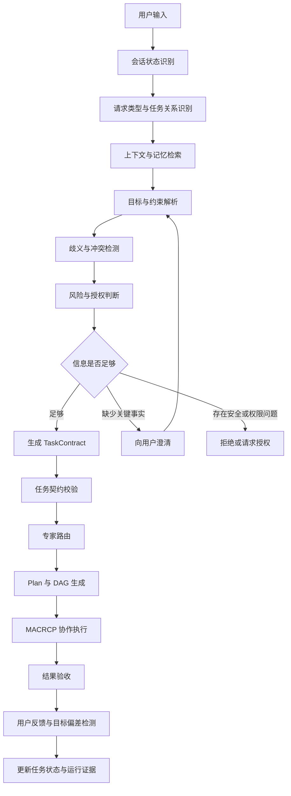

# 问答 117

> 来源: 新 窗口 | 会话: 分支 · 分支 · 分支 · 设计自进化智能体
> 消息: bbb21a49-7d70-4ef3-a0a8-aef284bb600f | 时间(UTC): 2026-10-24 08:08

## 用户

继续

## ChatGPT

<WritingBlock id="62481" variant="document"># EvoAgent 第五十四专项：用户意图理解、目标澄清与任务契约生成体系

**专项编号：IUGCTCG**

**英文名称：Intent Understanding, Goal Clarification & Task Contract Generation**

**文档版本：V1.0（架构设计基线）**

**文档性质：全量架构专项设计**

**适用范围：EvoAgent 统一任务入口、通用智能体、领域专家、用户记忆系统、上下文治理系统、专家路由器、Plan 规划器、任务 DAG、多专家协作协调器及安全权限系统。**

**前置专项：多专家分层架构、用户习惯与记忆治理、上下文压缩与管理、RARTSE、AODEE、RCAE、UEEDA、CDCIPC、MACRCP。**

**核心目标：让 EvoAgent 能够理解用户真正想做什么，将自然语言转换为结构化、可验证、可追踪的任务契约，并在信息不足、目标变化或上下文不一致时，合理选择直接执行、补充推断、向用户澄清或安全拒绝。**

> 本文定义目标架构、数据模型、决策规则和验收标准，不代表当前 EvoAgent 已经实现这些功能。继续遵循既定方向：个人使用、Android 优先、本地可运行、云端模型可选、专家独立演进、通用内核受保护。

---

# 一、为什么需要独立的意图理解系统？

前面的专项已经设计了专家路由、多专家协作、Plan、DAG、ReAct 和任务状态管理。

但是，这些机制都依赖一个前提：

**系统必须先正确理解用户希望实现什么。**

如果任务目标理解错误，后面的执行能力越强，反而可能越快地把事情做错。

例如：

用户说：“帮我优化一下这个项目。”

至少存在以下不同解释：

- 优化代码质量；
- 修复已知缺陷；
- 提高运行速度；
- 降低模型调用成本；
- 改进项目架构；
- 整理工程目录；
- 分析项目问题并提出建议；
- 直接修改代码并运行测试。

这些请求可能需要不同的专家、工具、权限、预算和验收方式。

如果系统直接把“优化”解释为“自动重构所有代码”，就可能在没有充分授权的情况下进行大规模修改。

如果系统每次都追问十几个问题，又会失去智能助手应有的流畅性。

因此，意图理解系统需要同时解决三个问题：

1. **理解目标：** 用户希望得到什么结果？
2. **确定行动：** 系统现在应该做什么、做到什么程度？
3. **管理不确定性：** 哪些内容可以合理推断，哪些必须询问用户？

这不是单纯的文本分类任务，而是贯穿整个任务生命周期的目标管理能力。

---

# 二、第一性原理：不要把用户说的话直接当作执行指令

自然语言是用户意图的表达，不一定是完整、准确的任务规格。

建议把用户请求的处理过程划分为六个阶段：

1. 原始输入理解；
2. 对话与任务关系识别；
3. 目标和约束提取；
4. 不确定性分析；
5. 任务契约生成；
6. 执行授权与后续规划。

这六个阶段需要相互关联，但不能完全合并为一个模型调用。

例如，用户说：

“继续之前的工作。”

系统首先需要判断：

- 当前对话是否已经存在正在进行的任务；
- 最近一次任务处于什么状态；
- 用户说的“继续”是否指向当前任务；
- 是否有多个可能的待办事项；
- 是否需要恢复之前的任务状态。

如果只有一个明确的未完成任务，系统通常可以直接继续。

如果有三个不同项目都处于未完成状态，则需要询问用户指的是哪一个。

**原则：尽量利用已有上下文减少用户负担，但不能用猜测替代必要的确认。**

---

# 三、总体架构：从自然语言到可执行任务契约

建议在 EvoAgent 统一任务入口之后，建立独立的意图与目标管理层。



这里需要区分三个概念：

- **意图理解：** 判断用户想要实现的目标。
- **任务契约生成：** 将目标转化为结构化的执行要求。
- **执行规划：** 决定由哪些专家、使用哪些工具、按照什么顺序完成任务。

意图理解不应该直接决定全部执行细节。

任务契约也不应该直接调用工具。

只有经过相应的权限检查和规划，任务才进入实际执行阶段。

---

# 四、建立统一的请求分类体系

EvoAgent 不能只把用户输入分为“问题”和“指令”。

个人使用的智能体需要覆盖聊天、咨询、规划、创作、执行、调试、延续工作等不同交互类型。

建议建立以下请求分类。

| 一级类型 | 二级类型示例 | 默认处理方式 |
|---|---|---|
| `CHAT` | 闲聊、讨论、情绪表达 | 自然对话 |
| `QUESTION` | 事实询问、概念解释 | 直接回答或检索 |
| `ANALYSIS` | 分析问题、比较方案、诊断原因 | 分析并给出证据 |
| `PLANNING` | 制订计划、设计架构、规划旅行 | 生成计划 |
| `CREATION` | 写文档、生成代码、创作剧本 | 生成目标产物 |
| `EXECUTION` | 修改文件、操作手机、运行工作流 | 进入执行与授权检查 |
| `DEBUGGING` | 定位故障、修复错误、排查异常 | 诊断后修复或提出方案 |
| `CONTINUATION` | 继续、恢复、接着做 | 恢复已有任务状态 |
| `MODIFICATION` | 修改目标、调整要求、替换方案 | 更新目标版本或局部约束 |
| `EVALUATION` | 检查质量、审查产物、运行测试 | 执行独立验收 |
| `RECALL` | 查找此前决定、恢复历史工作 | 检索已有上下文或记忆 |
| `CANCEL` | 停止、撤销、放弃当前任务 | 执行取消策略 |
| `AUTHORIZATION` | 确认、批准、拒绝某项操作 | 验证待确认操作的具体范围 |

这些分类不是互斥的。

例如：

“帮我检查这段代码，找到问题并直接修复。”

可以同时包含：

- `ANALYSIS`；
- `DEBUGGING`；
- `EXECUTION`；
- `EVALUATION`。

因此，系统需要支持多标签意图，而不是强制每个请求只能选择一个类别。

另外，意图分类只能帮助系统理解请求，不能代替权限检查。

用户说“直接删除”，即使意图十分明确，也不意味着系统可以忽略删除操作所需的授权规则。

---

# 五、用户当前是在聊天，还是在工作？

这是通用智能体必须解决的关键问题。

个人使用时，用户可能在同一个对话中：

- 随意讨论一个想法；
- 询问一个技术问题；
- 突然要求执行某项任务；
- 接着修改刚才的任务；
- 再回到普通聊天。

如果系统把所有内容都视为待执行任务，会产生过度行动。

如果系统把所有内容都视为聊天，又会错过用户希望直接推进工作的机会。

建议采用**交互意图与执行状态分离**的设计。

## 5.1 交互意图

描述用户当前希望系统如何参与：

- `CONVERSATIONAL`：聊天与讨论；
- `ADVISORY`：分析、建议、解释；
- `WORKING`：推进某个明确任务；
- `SUPERVISION`：审查、验收、确认执行结果；
- `CONTROL`：暂停、继续、取消或修改任务。

## 5.2 执行状态

描述任务当前实际处于什么阶段：

- `NO_ACTIVE_TASK`；
- `DRAFTING`；
- `READY`；
- `RUNNING`；
- `BLOCKED`；
- `WAITING_FOR_USER`；
- `PAUSED`；
- `COMPLETED`；
- `FAILED`；
- `CANCELLED`。

两者不能混为一谈。

用户可以在工作任务执行过程中进行普通聊天，而任务仍处于 `RUNNING`。

用户也可以在聊天中讨论一个工作方案，但任务尚未获得执行授权。

## 5.3 模式切换规则

建议采用以下规则：

1. 明确提出执行请求时，进入工作任务处理。
2. 只是在讨论某个方案时，不应自动执行高影响操作。
3. 用户说“继续”时，优先检查是否存在明确的待继续任务。
4. 用户说“先讨论，不要执行”时，应将任务限制为分析或规划。
5. 用户说“按刚才的方案开始做”时，关联已有方案，并检查其目标版本和授权状态。
6. 用户修改任务时，只更新被明确改变的部分，保留其他有效约束。
7. 用户要求停止时，检查正在执行的操作及其可取消性。

**聊天和工作不必依靠两个完全独立的智能体实现，而可以共享通用内核，同时采用不同的任务状态、上下文策略和执行权限。**

---

# 六、请求与历史任务的关系识别

意图理解不只是理解当前一句话，还要判断它和之前工作的关系。

建议支持以下关系类型：

| 关系 | 含义 | 示例 |
|---|---|---|
| `NEW_TASK` | 新任务 | “帮我规划一次旅行。” |
| `CONTINUE_TASK` | 继续已有任务 | “继续。” |
| `REFINE_TASK` | 补充或细化要求 | “预算再降低一点。” |
| `CHANGE_GOAL` | 修改主要目标 | “改成桌面版，不做手机版。” |
| `REPLACE_PLAN` | 替换执行方案 | “不要用这个工具，换一种方式。” |
| `PAUSE_TASK` | 暂停任务 | “先停一下。” |
| `RESUME_TASK` | 恢复已暂停任务 | “接着刚才的进度做。” |
| `CANCEL_TASK` | 取消任务 | “这个项目不做了。” |
| `REVIEW_RESULT` | 检查已有产物 | “你检查一下刚才的设计。” |
| `UNRELATED_CHAT` | 与当前任务无关 | “对了，今天有什么好玩的？” |

系统不能仅依赖关键词。

例如，“换一种方式”可能只是修改某个子任务的实现方法，也可能意味着重新设计整个项目。

需要结合当前任务状态、上下文和影响范围判断。

如果目标关联明确，就直接更新对应任务。

如果存在多个合理解释，而且不同解释会显著影响结果，则向用户提出一个简短、具体的问题。

---

# 七、TaskContract：统一任务契约的数据模型

这是本专项的核心产物。

建议所有需要进入任务执行流程的请求，都通过统一的任务契约表达。

不是每个普通聊天都必须生成完整的任务契约。

简单问答可以使用轻量契约，复杂执行任务则需要完整契约。

## 7.1 核心字段

| 字段 | 含义 |
|---|---|
| `task_id` | 稳定的任务标识 |
| `parent_task_id` | 上级任务标识，可选 |
| `goal_version` | 目标版本 |
| `request_type` | 请求类型 |
| `interaction_mode` | 聊天、咨询、工作或控制 |
| `objective` | 用户希望实现的目标 |
| `expected_outcome` | 期望得到的结果 |
| `hard_constraints` | 不可违反的要求 |
| `soft_preferences` | 可以权衡的偏好 |
| `acceptance_criteria` | 验收条件 |
| `assumptions` | 当前采用的假设 |
| `uncertainties` | 尚未解决的不确定性 |
| `required_capabilities` | 需要的能力 |
| `permission_scope` | 允许的操作范围 |
| `budget` | 成本、时间和资源预算 |
| `deadline` | 截止时间，可选 |
| `delivery_spec` | 交付格式与位置 |
| `source_references` | 目标和约束的来源 |
| `status` | 当前任务状态 |
| `created_at` | 创建时间 |
| `updated_at` | 更新时间 |

## 7.2 一个完整的任务契约示例

用户提出：

“帮我检查这个 Python 项目，找出明显的问题并直接修复，不能破坏现有接口，最后运行测试。”

系统可以生成如下契约：

```yaml
task:
  request_type:
    - ANALYSIS
    - DEBUGGING
    - EXECUTION
    - EVALUATION

  interaction_mode: WORKING

  objective: >
    检查当前 Python 项目，修复有证据支持的问题，
    并验证修改结果。

  hard_constraints:
    - 不破坏现有公开接口
    - 不修改授权范围之外的文件
    - 不绕过必要的安全检查

  soft_preferences:
    - 优先采用最小必要修改
    - 尽量复用现有架构
    - 控制额外依赖和执行成本

  acceptance_criteria:
    - 修改范围可追踪
    - 相关测试执行完成
    - 已知失败得到明确说明
    - 公开接口兼容性得到检查

  permission_scope:
    workspace_only: true
    external_publish: false

  status: READY
```

这里的 `READY` 只表示任务契约已准备好，不代表系统已经执行了代码修改。

具体文件权限、测试命令、预算和交付位置，应在检查实际环境后进一步确定。

## 7.3 契约必须支持部分信息

用户不可能在每次请求中都提供完整规格。

因此，契约字段应允许：

- 已确认；
- 合理推断；
- 尚未确定；
- 不适用。

不能因为某个字段暂时为空，就强迫用户补齐所有细节。

系统应当只对影响正确性、安全、预算或最终交付的关键缺失信息进行处理。

---

# 八、硬约束、软偏好、假设与未知信息必须分开

这是避免智能体擅自改变用户意图的核心机制。

建议为每条目标信息记录以下属性：

- 内容；
- 类型；
- 来源；
- 置信程度；
- 是否经过用户确认；
- 是否可以被调整；
- 适用范围；
- 有效版本。

## 8.1 硬约束

用户明确提出，或由安全、权限规则强制要求的条件。

例如：

- 必须保留公开 API；
- 不得超出预算上限；
- 不得访问指定范围之外的文件；
- 输出必须是某种格式。

硬约束不能通过普通的目标评分被忽略。

## 8.2 软偏好

用户希望尽可能满足，但可以在冲突时进行权衡。

例如：

- 尽量降低成本；
- 优先选择速度更快的模型；
- 文档尽量简洁；
- 画面尽可能精美。

## 8.3 假设

系统为了推进任务而采用的暂定判断。

例如：

- 假设当前目录就是目标项目；
- 假设用户希望继续使用已有技术栈；
- 假设不需要新增第三方服务。

假设必须可以被追踪和重新验证。

高影响假设不能被悄悄当作事实。

## 8.4 未知信息

系统目前没有足够证据确定的内容。

例如：

- 用户没有指定目标文件；
- 不清楚预算是否包含外部服务费用；
- 不清楚某个文件是否可以覆盖。

未知信息不等于错误。

系统需要根据风险决定是否可以暂时保留未知，还是必须询问用户。

## 8.5 信息来源优先级

建议按照以下方式处理不同来源：

1. 当前请求中明确表达的要求；
2. 当前任务中仍然有效的用户确认；
3. 与当前任务直接相关的历史上下文；
4. 经授权检索到的用户长期偏好；
5. 可验证的环境事实；
6. 系统推断；
7. 默认假设。

这里的顺序不是无条件覆盖规则。

例如，当前请求明确说“这次不要使用我平时偏好的方案”，那么当前要求应当覆盖历史偏好。

但任何用户指令都不能覆盖系统安全和权限边界。

---

# 九、什么时候直接执行，什么时候询问用户？

如果这一部分设计不好，EvoAgent 就会走向两个极端：

- 过度询问，效率低；
- 过度猜测，容易做错。

建议建立基于不确定性和风险的澄清决策机制。

## 9.1 四种处理方式

**方式 A：直接执行。**

适用于目标明确、关键条件齐全、风险较低的任务。

**方式 B：采用可撤销的默认假设。**

适用于缺失信息不会显著改变结果的情况。

例如，用户要求整理一段文档，但没有指定标题格式，可以使用一致的默认格式。

**方式 C：先给出方案或执行预览。**

适用于任务目标基本明确，但执行成本、范围或影响较大的情况。

例如，重构整个项目之前，先展示计划、预计修改范围和验收方式。

**方式 D：向用户澄清。**

适用于存在关键歧义，或者不同解释会造成明显不同结果的情况。

例如，用户要求“删除旧文件”，但系统无法确定哪些文件属于旧文件。

## 9.2 澄清决策表

| 情况 | 建议动作 |
|---|---|
| 目标明确、低风险、信息充分 | 直接执行 |
| 缺少非关键偏好 | 使用合理默认值 |
| 存在多个方案，但结果差异很小 | 自主选择并说明 |
| 目标有歧义，且会改变主要产物 | 询问用户 |
| 可能超出预算或授权范围 | 先确认或拒绝越权操作 |
| 可能造成不可逆副作用 | 根据权限策略要求确认 |
| 关键事实无法验证 | 检索、检查或明确说明不确定性 |
| 用户已经明确选择过方案 | 优先沿用，不重复询问 |
| 当前请求与历史约束冲突 | 判断是否为有意变更，必要时澄清 |

## 9.3 澄清问题应该尽可能少

建议一次只问最重要的问题。

例如：

不好的方式：

“请提供项目名称、项目路径、目标语言、代码规模、测试框架、目标质量、预算、截止时间、依赖约束和部署环境。”

更好的方式：

“你希望我先分析并给出修复建议，还是直接修改项目并运行测试？”

在用户已经明确要求直接修改时，不必再问这个问题。

如果具体项目路径尚未确定，再只询问路径。

**澄清的目的不是补齐所有字段，而是消除阻碍安全、正确执行的关键不确定性。**

---

# 十、目标解析与置信度：不能只看一个分数

意图理解通常会产生置信度，但不能把单一的模型置信度当作是否执行的唯一依据。

建议分别评估：

- 请求类型置信度；
- 任务关联置信度；
- 目标提取完整度；
- 硬约束识别可靠性；
- 关键事实可靠性；
- 专家路由置信度；
- 权限与风险判断结果。

例如：

系统可能非常确定用户想修改代码，但不确定用户允许修改哪些文件。

此时，请求类型置信度很高，执行授权仍然可能不足。

因此，应采用多维门禁。

对于关键条件，可以使用确定性规则验证。

例如：

- 目标文件是否明确；
- 是否存在有效权限；
- 预算是否已设置；
- 是否存在互相冲突的硬约束；
- 是否存在必须由用户确认的副作用。

模型置信度只用于辅助判断，不能替代这些检查。

---

# 十一、与记忆系统的关系：记忆提供线索，不自动生成授权

用户记忆可以显著提高意图理解效率。

例如，系统知道用户长期使用 Windows 开发环境，或者偏好本地部署。

当用户提出新的项目设计请求时，这些偏好可以作为合理的默认选项。

但记忆不能自动覆盖当前要求。

建议将记忆分为四类：

| 记忆类别 | 用途 | 使用规则 |
|---|---|---|
| 用户偏好记忆 | 语言、风格、常用方案 | 可用于默认选择 |
| 项目记忆 | 当前项目的目标、架构和决定 | 需要检查项目与版本是否匹配 |
| 任务记忆 | 当前任务进度、子任务和未解决问题 | 用于恢复和继续执行 |
| 历史经验记忆 | 过去任务的成功方案和失败教训 | 作为建议，不直接视为事实 |

## 11.1 记忆必须携带来源和时效

例如：

“项目使用 SQLite”可能是三个月前的设计决定。

如果项目后来迁移到 PostgreSQL，旧记忆就不能继续作为当前事实。

建议记录：

- 记忆来源；
- 关联项目；
- 关联任务；
- 创建时间；
- 最后验证时间；
- 可信程度；
- 适用条件；
- 是否已被更新。

## 11.2 用户纠正具有重要价值

如果用户说：

“这次不是让我直接修改，只需要分析。”

系统应当立即调整当前任务模式。

但不应因此推断用户从此永远只希望获得分析。

只有在用户明确表达长期偏好时，才考虑将其作为长期记忆。

这可以避免把一次性的任务要求误写为永久用户习惯。

---

# 十二、与上下文压缩系统的关系

意图理解严重依赖上下文。

如果压缩器丢失了关键约束，即使当前请求识别准确，也可能生成错误的任务契约。

例如，较早的对话已经明确：

- 只允许修改工作区；
- 不允许新增付费服务；
- 必须兼容现有 API。

后来用户说：

“按这个方案继续做。”

如果上下文压缩只保留了“继续做”，就可能丢失重要的约束。

因此，建议建立专门的任务约束保留机制。

## 12.1 约束必须结构化保存

关键任务约束不能只依赖对话摘要。

它们应该作为独立字段保存在 TaskContract 中。

## 12.2 压缩时区分信息类型

- 当前目标；
- 硬约束；
- 用户已确认的决定；
- 当前任务状态；
- 未解决问题；
- 历史讨论细节。

这些信息的重要性不同。

历史讨论可以压缩。

关键约束、权限和任务状态必须能够可靠恢复。

## 12.3 约束发生冲突时不能静默覆盖

如果新请求与历史约束不一致，系统需要判断：

- 用户是否明确改变了原约束；
- 是否只是补充信息；
- 是否存在误解；
- 是否涉及安全规则。

只有在确认是有效变更时，才更新目标版本。

---

# 十三、任务契约的版本管理

复杂任务经常会发生变化。

因此，TaskContract 必须支持版本化。

建议采用：

- `task_id`：整个任务生命周期内保持不变；
- `goal_version`：目标和关键约束的版本；
- `contract_revision`：契约细节修订版本；
- `subtask_id`：子任务标识；
- `execution_id`：某次具体执行标识。

## 13.1 什么时候创建新目标版本？

建议在以下情况创建新的 `goal_version`：

- 用户改变主要目标；
- 用户修改关键硬约束；
- 交付物发生实质性变化；
- 任务验收标准发生重要变化；
- 之前的目标被证明存在根本性误解。

## 13.2 什么时候只修改契约修订版本？

例如：

- 补充一个非关键说明；
- 调整任务描述；
- 增加可追踪的环境信息；
- 更正一个不影响目标语义的字段。

不应因为任何小变化都创建全新的目标版本，否则版本数量会迅速膨胀。

## 13.3 旧版本的子任务如何处理？

当目标版本从 V1 更新到 V2 时：

- 仍然有效的子任务可以继续；
- 输入条件已失效的子任务应当暂停或重新规划；
- 产物可以重新验收后复用；
- 已产生的外部副作用需要保留记录；
- 迟到的旧版本结果不能直接覆盖新版本状态。

这部分应与 MACRCP 的取消传播、局部恢复和任务协调协议保持一致。

---

# 十四、执行过程中如何发现目标偏移？

即使最初理解正确，执行过程中也可能逐渐偏离用户目标。

例如，用户希望修复一个小缺陷，智能体却开始大规模重构。

又或者，用户希望在预算内完成漫剧，系统不断增加镜头和生成调用，最终超出预算。

建议建立目标偏移检测机制。

## 14.1 三类目标偏移

**范围偏移**

执行内容超出用户原本要求。

**约束偏移**

执行过程中遗漏或违反了关键约束。

**结果偏移**

最终产物虽然完成了，但并不符合用户想要的结果。

## 14.2 检测方法

每个关键执行阶段都应检查：

- 当前子任务是否仍服务于目标；
- 是否新增了未授权的工作；
- 是否违反硬约束；
- 预算是否接近上限；
- 验收条件是否仍然有效；
- 是否发生了影响目标的重大假设变化。

## 14.3 偏移后的处理

轻微偏移可以由协调器纠正。

中等偏移可以触发局部重规划。

涉及主要目标、预算或权限的偏移，则应暂停相关操作并按规则澄清或请求授权。

这使得意图理解不再只是任务开始前的一次性步骤，而是贯穿整个执行生命周期。

---

# 十五、如何避免意图理解和专家路由相互干扰？

这是多专家架构中的重要问题。

意图理解与专家路由相关，但不能合并成一个无法解释的决策过程。

建议将两者分离。

## 15.1 意图理解负责回答

- 用户希望完成什么？
- 目标是什么？
- 有哪些约束？
- 当前请求与历史任务是什么关系？
- 是否需要澄清？
- 是否已经具备执行条件？

## 15.2 专家路由负责回答

- 哪些专家具备所需能力？
- 哪些能力可以直接复用？
- 哪个专家最适合承担任务？
- 是否需要多个专家协作？
- 是否需要回退到通用内核？

## 15.3 两者通过 TaskContract 连接

意图理解模块输出结构化任务契约。

路由器根据契约中的能力需求、任务类型和约束选择执行者。

这样，即使路由器判断错误，也可以独立诊断。

例如：

- 任务目标解析正确，但选错了专家：路由问题。
- 专家选择正确，但目标提取错误：意图理解问题。
- 目标和路由都正确，但工具执行失败：执行或工具问题。
- 结果正确，但验收器误判：评测问题。

这些分类可以进入 AODEE 和 RCAE 的问题诊断体系。

---

# 十六、与多专家协作 MACRCP 的接口

MACRCP 需要统一任务目标才能协调多个专家。

IUGCTCG 负责生成这个目标。

建议定义以下接口关系：

1. IUGCTCG 创建并校验 TaskContract。
2. 专家路由器识别候选执行者。
3. Plan 根据目标和约束生成执行计划。
4. DAG 将计划转化为子任务依赖。
5. MACRCP 分配子任务并管理协作。
6. 专家在授权范围内执行。
7. 验收器根据 TaskContract 检查结果。
8. 如果用户改变目标，IUGCTCG 更新目标版本。
9. MACRCP 根据新版本调整现有子任务。
10. AODEE 记录目标误解、用户纠正和执行偏移。

这样可以确保多个专家使用的是同一份权威目标，而不是分别根据各自的上下文重新解释用户需求。

---

# 十七、与 AHOG 安全权限治理的关系

任务目标明确，不等于执行权限自动成立。

建议把“用户想做什么”和“系统是否有权做”分成两个独立判断。

例如：

用户说：

“帮我把这些旧文件全部删除。”

意图可能非常明确。

但系统仍然需要判断：

- 哪些文件属于删除范围；
- 是否存在无法恢复的文件；
- 是否有明确授权；
- 是否需要用户确认；
- 是否存在安全备份。

因此，TaskContract 中应当包含预期操作范围，但实际执行权限仍然由 AHOG 验证。

建议采用以下原则：

- 意图理解不能扩大权限；
- 历史偏好不能替代当前必要授权；
- 专家不能自行修改权限；
- 目标契约中的权限范围必须经过独立检查；
- 用户修改任务目标时，应重新检查是否涉及新的权限要求。

这可以防止系统因为“理解了用户的意思”而误认为“已经获得所有操作许可”。

---

# 十八、与 AODEE、RCAE 和 UEEDA 的闭环

意图理解系统也需要持续进化。

但它不能仅凭用户一次不满意，就直接修改全局意图解析规则。

建议建立独立评估闭环。

## 18.1 运行时采集

AODEE 记录：

- 原始请求的受控引用；
- 意图分类结果；
- 目标契约版本；
- 关键假设；
- 路由结果；
- 用户澄清记录；
- 用户纠正；
- 最终验收结果；
- 任务失败阶段。

日志中应避免不必要地复制敏感内容，按照数据保留和权限策略管理。

## 18.2 问题诊断

RCAE 分析：

- 是否识别错了请求类型；
- 是否遗漏了硬约束；
- 是否错误关联历史任务；
- 是否将软偏好当成硬约束；
- 是否使用了过期记忆；
- 是否没有在关键歧义处询问；
- 是否进行了不必要的澄清；
- 是否将权限判断与意图判断混淆。

## 18.3 独立评测

UEEDA 使用固定任务集比较：

- 意图分类准确率；
- 目标提取准确率；
- 硬约束保留率；
- 目标版本识别准确率；
- 澄清决策质量；
- 错误执行率；
- 不必要澄清率；
- 任务最终成功率；
- Token 成本与时延。

## 18.4 受控改进

只有在候选版本通过相应回归和安全门禁后，才允许升级意图理解策略。

例如，某次优化减少了澄清次数，但如果同时提高了错误执行率，就不能仅凭对话更流畅而认定优化成功。

---

# 十九、工程目录与核心接口

建议新增以下逻辑模块：

```text
evoagent/
├── intent_understanding/
│   ├── request_classifier/
│   ├── interaction_mode/
│   ├── task_relation/
│   ├── goal_extractor/
│   ├── constraint_extractor/
│   ├── ambiguity_detector/
│   ├── uncertainty_model/
│   └── goal_drift_detector/
├── task_contract/
│   ├── contract_schema/
│   ├── contract_builder/
│   ├── contract_validator/
│   ├── hard_constraint_registry/
│   ├── soft_preference_registry/
│   ├── assumption_registry/
│   ├── source_provenance/
│   └── contract_versioning/
├── clarification/
│   ├── clarification_policy/
│   ├── question_generator/
│   ├── question_priority/
│   ├── user_response_resolver/
│   └── clarification_state/
├── task_context_resolution/
│   ├── active_task_resolver/
│   ├── historical_task_linker/
│   ├── memory_evidence_resolver/
│   ├── context_consistency/
│   └── stale_context_detector/
├── execution_readiness/
│   ├── readiness_check/
│   ├── permission_precheck/
│   ├── budget_precheck/
│   ├── dependency_precheck/
│   └── execution_gate/
└── intent_evaluation/
    ├── intent_regression/
    ├── constraint_retention/
    ├── clarification_quality/
    ├── goal_version_accuracy/
    └── execution_alignment/
```

建议提供以下核心接口：

- `classify_request`：识别请求类型；
- `resolve_interaction_mode`：判断当前交互模式；
- `resolve_task_relation`：识别当前请求与历史任务的关系；
- `extract_goal`：提取目标；
- `extract_constraints`：提取硬约束与软偏好；
- `resolve_task_context`：解析相关上下文和记忆；
- `detect_ambiguity`：检测关键歧义；
- `assess_uncertainty`：评估目标和事实的不确定性；
- `decide_clarification`：决定是否需要询问；
- `generate_clarification_question`：生成最少且关键的澄清问题；
- `build_task_contract`：生成任务契约；
- `validate_task_contract`：验证契约完整性与一致性；
- `create_goal_version`：创建新的目标版本；
- `resolve_active_task`：确定当前待继续或待修改的任务；
- `check_execution_readiness`：检查任务是否具备执行条件；
- `check_permission_preconditions`：检查权限前置条件；
- `detect_goal_drift`：检测执行中的目标偏移；
- `reconcile_user_correction`：处理用户纠正；
- `record_intent_evidence`：记录意图理解证据；
- `evaluate_intent_quality`：评估意图理解质量。

第一版建议采用明确的 Schema、规则和模型辅助解析相结合的方式。

不需要将整个流程都交给一个大模型完成，也不需要一开始就训练专用意图模型。

---

# 二十、专项验收标准

IUGCTCG 至少需要满足以下要求：

1. 能够区分聊天、咨询、规划、创作、执行、调试、验收和任务控制等请求类型。
2. 支持一个请求包含多个意图。
3. 能够识别当前请求与已有任务之间的关系。
4. 能够区分新任务、继续任务、补充约束、修改目标、暂停和取消。
5. 能够生成结构化 TaskContract。
6. 能够区分硬约束、软偏好、假设和未知信息。
7. 每个关键约束能够追溯到明确来源。
8. 能够利用相关记忆和历史上下文，但不能将过期信息自动当作当前事实。
9. 能够识别目标、上下文和历史记忆之间的冲突。
10. 能够根据歧义、风险和执行成本决定是否澄清。
11. 不会因为非关键字段缺失而强制询问用户。
12. 不会因为请求类型判断明确，就跳过权限检查。
13. 支持任务目标版本和契约修订版本。
14. 用户修改目标时，能够识别需要更新的约束和受影响的子任务。
15. 能够区分意图理解错误、路由错误、执行错误和验收错误。
16. 能够与 Plan、DAG 和 MACRCP 使用统一任务契约。
17. 能够在任务执行过程中检测目标偏移。
18. 能够保留用户明确拒绝或禁止的操作约束。
19. 能够通过独立评测比较不同意图理解策略。
20. 能够衡量不必要澄清、错误推断和错误执行的发生率。
21. 能够记录用户纠正并用于后续评估。
22. 能够在上下文压缩和任务恢复后恢复关键约束。
23. 能够在权限不足、关键事实缺失或目标存在重大歧义时阻止不适当的执行。
24. 能够根据风险选择直接执行、采用默认假设、预览方案或向用户澄清。
25. 所有改进都必须保留可追溯的评测证据与版本记录。

以上为工程验收要求，不代表当前 EvoAgent 已经实现或通过测试。

---

# 二十一、建议冻结的架构决策

以下建议承接 ADR-824。

| 编号 | 决策 |
|---|---|
| ADR-825 | 建立独立的用户意图理解、目标澄清与任务契约生成体系 |
| ADR-826 | 意图理解、任务契约生成、专家路由与执行规划必须职责分离 |
| ADR-827 | 支持聊天、咨询、工作、监督和任务控制等交互模式 |
| ADR-828 | 交互模式与实际任务执行状态必须分开建模 |
| ADR-829 | 请求分类支持多标签，不强制每个请求只有一个意图 |
| ADR-830 | 必须识别新任务、继续任务、修改目标、暂停、恢复和取消等任务关系 |
| ADR-831 | 需要进入执行流程的任务应具有结构化 TaskContract |
| ADR-832 | TaskContract 必须区分硬约束、软偏好、假设和未知信息 |
| ADR-833 | 关键约束应记录来源、适用范围、确认状态和有效版本 |
| ADR-834 | 历史记忆只能作为有来源的上下文证据，不自动构成当前授权 |
| ADR-835 | 关键任务约束必须结构化保存，不得仅依赖压缩后的自然语言摘要 |
| ADR-836 | 澄清决策应同时考虑不确定性、潜在影响、风险与用户交互成本 |
| ADR-837 | 非关键字段缺失不应强制触发澄清 |
| ADR-838 | 对影响主要目标、权限、预算或不可逆结果的关键歧义，必须采用相应的澄清或授权策略 |
| ADR-839 | 用户修改主要目标时必须创建新的目标版本 |
| ADR-840 | 契约修订与目标版本应当区分，避免无意义的版本膨胀 |
| ADR-841 | 专家路由必须基于经过校验的任务契约，而不是重新独立猜测用户目标 |
| ADR-842 | 意图理解不能替代 AHOG 的独立权限治理 |
| ADR-843 | 执行过程中必须持续检测目标偏移和约束失效 |
| ADR-844 | 用户纠正应关联具体任务、目标版本和问题类型 |
| ADR-845 | 意图理解的优化必须通过 UEEDA 的独立回归与效果评估 |
| ADR-846 | 意图理解错误、路由错误、执行错误和验收错误必须能够分别追踪 |
| ADR-847 | 任务恢复时必须重新验证当前目标、关键约束与相关历史状态 |
| ADR-848 | 复杂任务应当支持基于风险的执行预览与分阶段授权 |
| ADR-849 | TaskContract 必须与 Plan、DAG、MACRCP、CDCIPC 和运行追踪体系保持兼容 |

以上为建议纳入 EvoAgent 全量架构的 IUGCTCG 基线。

---

# 二十二、下一专项：任务执行可靠性、工具契约与结果真实性验证体系

现在，EvoAgent 已经具备以下设计基础：

- 能理解用户想做什么；
- 能将目标转换成任务契约；
- 能选择合适的专家；
- 能组织 Plan 和任务 DAG；
- 能协调多个专家；
- 能通过能力依赖图分析变更影响；
- 能记录运行证据并开展独立评测。

但仍然存在一个非常关键的问题：

**智能体说自己完成了任务，究竟怎样证明它真的完成了？**

这是执行型智能体与普通问答模型之间的重要区别。

例如：

- 模型声称文件已经保存，但文件实际上不存在；
- 工具返回成功，但产物内容不正确；
- 代码修改完成，但测试根本没有执行；
- 手机操作专家声称按钮已点击，但界面状态没有变化；
- 视频合成命令返回成功，但生成的视频无法播放；
- 外部 API 返回了响应，但实际结果不符合请求；
- 一个专家交付的结果格式正确，却包含错误事实；
- 系统在网络超时后误认为操作失败，实际上外部操作已经完成。

如果只依赖模型的自然语言总结，系统就可能把“尝试执行”“工具返回成功”和“任务真正成功”混为一谈。

因此，下一专项建议定义为：

**Execution Reliability, Tool Contracts & Outcome Verification，简称 ERTOV。**

重点研究：

1. 如何为每个工具定义明确的输入输出契约；
2. 如何区分工具调用成功、操作执行成功和用户目标完成；
3. 如何验证文件、代码、视频和其他实际产物；
4. 如何检查工具返回值是否真实反映最终状态；
5. 如何在工具失败、超时、部分成功和状态不确定时恢复；
6. 如何通过独立验证器检查专家提交的结果；
7. 如何避免执行者自行证明自己的任务成功；
8. 如何验证手机界面操作是否真正产生预期变化；
9. 如何处理外部服务的异步任务和重复请求；
10. 如何验证任务的前置条件、执行过程和后置条件；
11. 如何根据任务风险决定验证强度；
12. 如何让每个最终结论都具有相应的证据来源；
13. 如何将验证失败反馈给 ReAct、Plan 和任务 DAG；
14. 如何建立工具可靠性评分与故障诊断机制；
15. 如何通过历史失败案例持续改进执行和验证策略。

这一专项将进一步连接工具系统、ReAct、任务状态机、MACRCP、AODEE、RCAE、UEEDA 和最终交付验收。

最终需要确立的原则是：

**执行意图不等于执行事实，工具成功不等于任务成功，模型声称完成也不等于结果已经通过验证。EvoAgent 必须根据可观察的状态和独立证据判断任务是否真正完成。**</WritingBlock>
