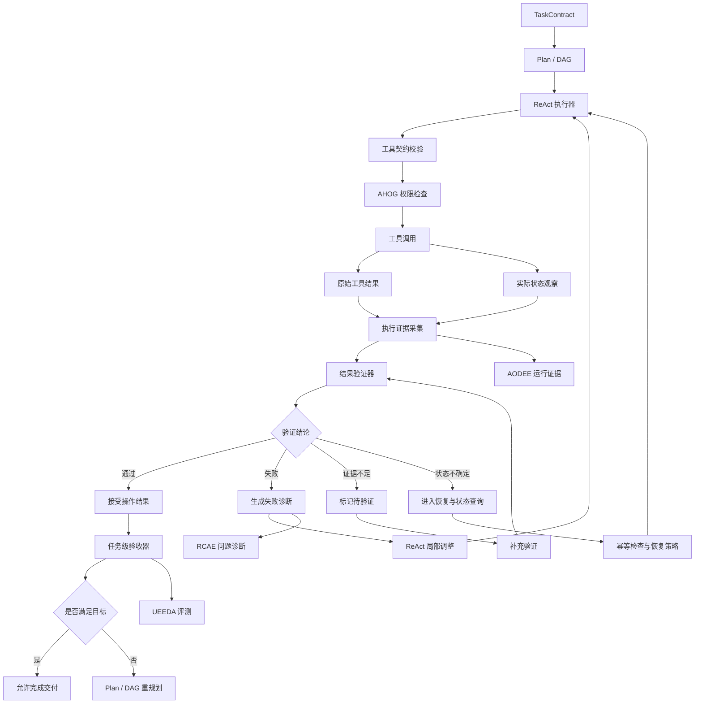
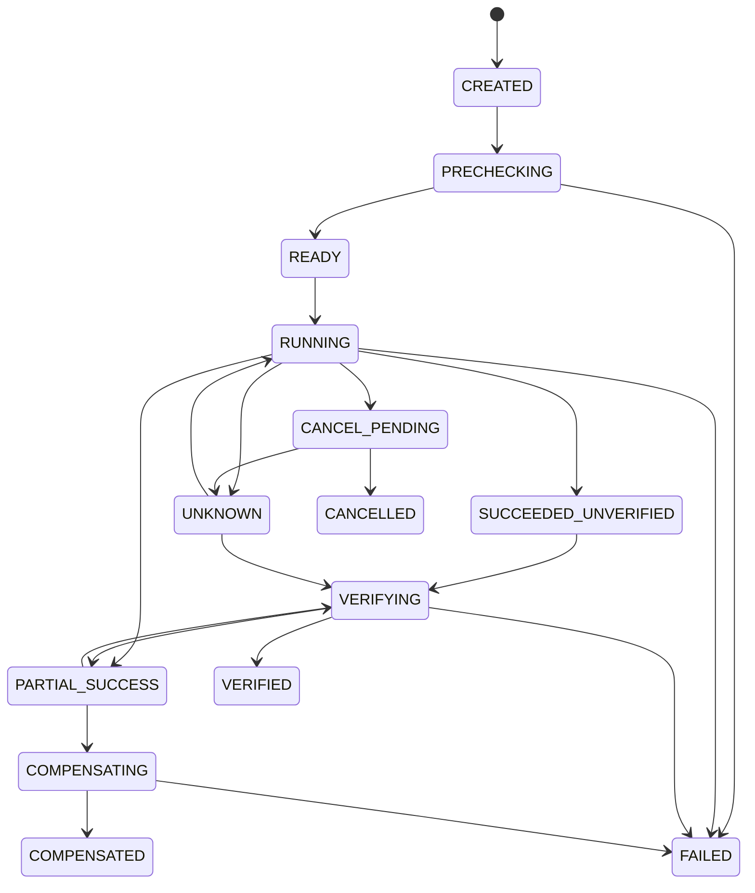
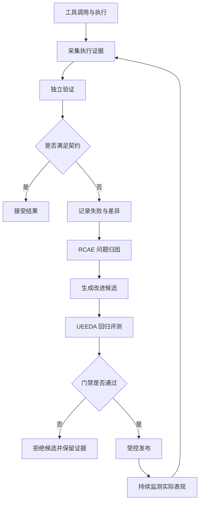

# 问答 118

> 来源: 新 窗口 | 会话: 分支 · 分支 · 分支 · 设计自进化智能体
> 消息: bbb21e3f-d55c-4c56-b217-c987e5db7b5a | 时间(UTC): 2026-10-24 09:03

## 用户

继续

## ChatGPT

梳理工具治理

<WritingBlock id="73164" variant="document"># EvoAgent 第五十五专项：任务执行可靠性、工具契约与结果真实性验证体系

**专项编号：ERTOV**

**英文名称：Execution Reliability, Tool Contracts & Outcome Verification**

**文档版本：V1.0（架构设计基线）**

**文档性质：全量架构专项设计**

**适用范围：EvoAgent 通用内核、领域专家、工具系统、ReAct 执行循环、Plan 规划器、任务 DAG、多专家协作协调器 MACRCP、任务契约 IUGCTCG、运行证据系统 AODEE、问题诊断系统 RCAE、自动评测系统 UEEDA、安全权限治理 AHOG。**

**核心目标：让 EvoAgent 不仅能够执行任务，还能够根据独立、可追溯的证据判断任务是否真正成功，并在工具异常、部分成功、状态不确定或结果不符合要求时，采取正确的恢复策略。**

本文定义目标架构、核心协议、验证模型、失败恢复机制、工程接口和验收标准。以下设计是 EvoAgent 的目标架构基线，不代表功能已经实现。

---

# 一、第一性原理：智能体必须证明自己完成了任务

此前的专项已经解决了多个问题：

- IUGCTCG：理解用户意图，生成结构化任务契约；
- 专家路由体系：选择合适的领域专家；
- Plan：规划整体任务；
- DAG：组织任务依赖；
- ReAct：执行工具调用并根据观察结果调整行动；
- MACRCP：协调多个专家；
- AHOG：控制操作权限；
- AODEE、RCAE、UEEDA：记录运行证据、诊断问题和开展独立评测。

但这些模块全部正常工作，也不代表最终结果一定正确。

原因在于：**系统内部的执行状态，不等于外部世界的真实状态。**

例如：

用户要求：

> 帮我修改代码，修复问题，并运行测试，确认没有破坏原来的功能。

智能体可能经历以下过程：

1. 代码专家生成了修改方案；
2. 文件工具返回写入成功；
3. 测试工具返回了一个结果；
4. 模型总结“问题已修复”。

但仍然可能存在以下情况：

- 写入的是错误的文件；
- 修改后的代码无法运行；
- 测试实际上没有执行；
- 测试执行的是旧版本代码；
- 测试通过，但原有功能已经被破坏；
- 测试工具返回成功，只表示命令启动成功；
- 最终产物不满足用户真正的要求。

因此，必须区分五件事：

| 层级 | 代表什么 | 能否直接认定任务成功 |
|---|---|---|
| 意图已解析 | 系统理解了用户要求 | 不能 |
| 执行已尝试 | 系统发起了工具调用 | 不能 |
| 工具调用成功 | 工具按协议返回了成功结果 | 不能 |
| 操作结果已验证 | 实际状态符合该操作的后置条件 | 仍不一定 |
| 任务目标已满足 | 最终产物通过任务级验收 | 可以在证据范围内认定 |

例如，文件写入成功只能证明文件操作可能完成，不能证明代码缺陷已经修复。

测试通过可以支持代码正确性的判断，但测试覆盖不足时，不能声称所有缺陷都已经排除。

**ERTOV 的核心职责，就是将“执行声明”转化为“有证据支持的完成结论”。**

---

# 二、设计目标与非目标

## 2.1 设计目标

ERTOV 必须实现以下能力：

1. 为每个工具建立明确的输入输出契约；
2. 明确工具调用前的前置条件和调用后的后置条件；
3. 区分工具成功、操作成功、产物正确和任务成功；
4. 对关键结果执行独立验证；
5. 验证工具返回值与实际状态是否一致；
6. 识别部分成功、重复执行、超时和状态不确定；
7. 对不同风险等级采用不同验证强度；
8. 为文件、代码、手机操作、视频生成和外部 API 建立领域化验证器；
9. 将验证失败反馈给 ReAct、Plan 和 DAG；
10. 让每个重要结论都能追溯到执行记录与验证证据；
11. 防止执行者自行宣布成功而绕过验收；
12. 将工具故障和验证失败转化为可诊断、可评测的运行数据。

## 2.2 非目标

ERTOV 不负责替代以下组件：

- AHOG：负责权限与授权；
- IUGCTCG：负责理解目标和生成任务契约；
- MACRCP：负责多专家协作；
- Plan：负责全局任务规划；
- DAG：负责任务依赖；
- ReAct：负责局部执行；
- UEEDA：负责独立评测与回归测试。

ERTOV 负责的是：

**对执行过程中的关键状态、操作结果和最终产物进行验证，并向上述组件提供可信的结果证据。**

它不应该演变成一个重新执行所有任务的第二套智能体，也不应该仅依赖另一个大模型来判断第一个大模型是否正确。

---

# 三、总体架构：执行器与验证器分离

建议在 EvoAgent 中建立独立的执行可靠性与结果验证层。



这套架构有一个重要要求：

**执行器可以提供执行证据，但不能单方面决定自己的结果是否通过验收。**

例如，代码专家可以提交补丁和测试报告，但最终验收还需要检查补丁版本、测试实际执行情况、接口兼容性以及用户要求。

对于不同风险等级的任务，独立验证可以采用不同实现：

- 简单文件操作：通过文件存在性、大小、哈希和内容检查；
- 代码修改：通过静态检查、测试、接口检查和补丁审查；
- 手机操作：通过操作后的界面状态和目标元素变化；
- 视频生成：通过文件可解码性、时长、分辨率和内容检查；
- 高影响操作：使用独立的状态查询、审计记录或外部系统回执。

并不是所有任务都需要第二个大模型。很多验证可以通过确定性程序完成，成本更低，也更容易复现。

---

# 四、建立统一的工具契约 ToolContract

工具不能只是一个函数名称加上几行描述。

对于需要可靠执行的工具，必须定义其行为边界。

建议建立统一的 `ToolContract`。

## 4.1 核心字段

| 字段 | 含义 |
|---|---|
| `tool_id` | 稳定的工具标识 |
| `tool_version` | 工具实现版本 |
| `input_schema` | 输入参数结构和约束 |
| `output_schema` | 返回结果结构 |
| `preconditions` | 执行前必须满足的条件 |
| `postconditions` | 执行后应当满足的条件 |
| `side_effects` | 可能产生的外部副作用 |
| `permission_requirements` | 所需权限 |
| `idempotency_policy` | 幂等性与重复调用策略 |
| `timeout_policy` | 超时策略 |
| `retry_policy` | 重试条件与上限 |
| `verification_policy` | 结果验证方式 |
| `failure_codes` | 标准化失败类型 |
| `resource_cost` | 资源和成本特征 |
| `recovery_policy` | 失败后的恢复策略 |

## 4.2 前置条件与后置条件

以文件写入工具为例。

前置条件：

- 目标路径位于允许访问的工作区；
- 调用方具有写入权限；
- 输入内容符合格式要求；
- 文件覆盖策略已经明确；
- 必要时已创建备份或临时文件。

后置条件：

- 文件存在；
- 文件内容符合预期；
- 文件写入完整；
- 产物版本可以识别；
- 原有文件在需要保留时没有被意外破坏。

工具返回 `success=true`，只能作为证据之一。

最终是否接受写入结果，必须根据后置条件验证。

## 4.3 工具契约示例

```yaml
tool:
  tool_id: file.write
  tool_version: "1.0"

  input_schema:
    path: string
    content: string
    expected_base_version: optional_string

  preconditions:
    - path_within_authorized_workspace
    - caller_has_write_permission
    - overwrite_policy_validated

  postconditions:
    - target_file_exists
    - content_matches_expected
    - resulting_version_recorded

  idempotency_policy:
    retry_requires_state_check: true

  verification_policy:
    checks:
      - file_exists
      - content_hash_matches
      - version_matches

  failure_policy:
    preserve_previous_version: true
    record_partial_write: true
```

这里的 `expected_base_version` 用于避免旧任务覆盖其他执行者已经更新的文件。

真实实现还应定义编码、原子写入方式、文件权限、异常类型和大文件处理策略。

---

# 五、建立统一的执行结果状态机

不同工具返回的数据可能完全不同。

有的返回布尔值，有的返回 HTTP 状态码，有的返回文件路径，有的返回异步任务 ID。

因此，不能直接用工具自身的返回值决定整个任务状态。

建议建立统一的执行状态机。

## 5.1 执行状态

| 状态 | 含义 |
|---|---|
| `CREATED` | 执行记录已创建 |
| `PRECHECKING` | 正在检查前置条件 |
| `READY` | 可以执行 |
| `RUNNING` | 正在执行 |
| `SUBMITTED` | 请求已提交给外部服务 |
| `SUCCEEDED_UNVERIFIED` | 工具声明成功，但结果尚未验证 |
| `VERIFYING` | 正在检查实际结果 |
| `VERIFIED` | 操作结果通过验证 |
| `PARTIAL_SUCCESS` | 部分结果有效，部分未完成 |
| `FAILED` | 已确认执行失败 |
| `UNKNOWN` | 真实执行状态尚不确定 |
| `CANCEL_PENDING` | 正在尝试取消 |
| `CANCELLED` | 已确认取消 |
| `COMPENSATING` | 正在执行补偿操作 |
| `COMPENSATED` | 补偿结果已验证 |

这些状态不能简单地合并为一个 `success` 或 `failed` 字段。

例如，`UNKNOWN` 不是 `FAILED`。

一次网络超时可能意味着：

- 请求没有发送成功；
- 请求已经发送，但服务端没有执行；
- 服务端执行成功，但响应丢失；
- 服务端正在执行；
- 服务端已经执行，但结果尚未生成。

如果直接将 `UNKNOWN` 视为失败并重新调用，可能造成重复扣费、重复发送消息或重复创建资源。

## 5.2 状态迁移规则



状态迁移必须由受控状态管理器完成。

工具回调、模型输出和外部事件只能提出状态更新，不能绕过状态机直接修改任务的最终状态。

---

# 六、执行成功、结果正确、任务完成必须分别判断

这是 ERTOV 最重要的设计决策之一。

建议使用三个不同层级的判定。

## 6.1 操作级验证

判断一次具体操作是否成功。

例如：

- 文件是否成功写入；
- 按钮是否被实际点击；
- API 请求是否被服务端接受；
- 视频生成任务是否返回了可查询的任务 ID。

## 6.2 产物级验证

判断产生的产物是否符合要求。

例如：

- 代码能否通过编译；
- JSON 是否符合 Schema；
- 视频能否正常解码；
- 生成文档是否包含规定章节；
- 数据文件是否完整。

## 6.3 任务级验收

判断整个任务是否满足用户目标。

例如：

- 代码缺陷是否修复；
- 相关测试是否通过；
- 原有接口是否保持兼容；
- 最终视频是否符合时长、角色一致性和画质要求；
- 用户要求的所有交付物是否齐全。

这三个层级的关系是：

\[
\text{操作成功}
\not\Rightarrow
\text{产物正确}
\not\Rightarrow
\text{任务完成}
\]

反过来，如果某项操作失败，但通过合法替代方案仍然实现了用户目标，整个任务也可能成功。

例如，首选视频生成服务不可用，但系统使用已获准的替代工作流完成了符合要求的视频。

因此，任务验收不应该简单地要求所有原始操作都成功，而应检查最终目标是否满足，并确保替代方案符合权限、预算和质量约束。

---

# 七、证据体系：每个重要结论都必须有来源

ERTOV 不仅需要执行状态，还需要证据。

建议建立统一的 `ExecutionEvidence` 数据模型。

## 7.1 核心字段

- `evidence_id`：证据标识；
- `task_id`：关联任务；
- `execution_id`：关联执行；
- `tool_id`：关联工具；
- `tool_version`：工具版本；
- `goal_version`：任务目标版本；
- `evidence_type`：证据类型；
- `source`：证据来源；
- `observed_at`：观察时间；
- `subject_ref`：被验证的资源或产物；
- `observed_value`：实际观察值；
- `expected_value`：预期值；
- `verification_method`：验证方式；
- `result`：验证结果；
- `integrity_metadata`：完整性相关信息；
- `limitations`：证据局限。

证据内容可以是：

- 工具调用记录；
- 实际文件信息；
- 测试报告；
- 外部服务回执；
- 界面截图或结构化界面状态；
- 视频元数据；
- 数据库查询结果；
- 独立评测报告。

## 7.2 证据等级

建议将证据区分为四类。

| 等级 | 类型 | 示例 |
|---|---|---|
| E0 | 声明性证据 | 模型声称“已经完成” |
| E1 | 工具返回证据 | 工具返回成功状态 |
| E2 | 独立观察证据 | 实际读取文件并检查内容 |
| E3 | 目标验收证据 | 独立测试通过，且满足任务验收标准 |

这些等级不是所有任务都必须从 E0 逐级经过 E3，也不是每个 E3 都绝对正确。

它们只是帮助系统区分不同来源的证据。

例如，外部服务的可信签名回执可能比普通工具返回值更可靠。

某些简单任务只需要 E2。

复杂软件修改通常需要 E3 级别的任务验收证据。

## 7.3 证据不能证明超出自身范围的结论

例如：

- 文件存在，不能证明内容正确；
- 哈希匹配，不能证明内容满足用户要求；
- 测试通过，不能证明所有未覆盖路径都没有缺陷；
- 手机界面显示成功提示，不能保证后端数据已经持久化；
- 视频文件可以播放，不能证明人物形象一致。

验证器必须明确证据覆盖了什么，以及没有覆盖什么。

---

# 八、验证器设计：独立不等于一定要使用另一个模型

建议建立统一的 `OutcomeVerifier` 接口，并支持不同验证方式。

## 8.1 确定性验证器

适用于能够通过明确规则判断的结果。

例如：

- Schema 校验；
- 文件存在性检查；
- 哈希比对；
- 编译检查；
- 单元测试；
- 数据库约束检查；
- 视频时长和分辨率检查。

这是优先级最高、成本通常较低的验证方式。

## 8.2 环境观察验证器

通过实际观察外部状态来确认结果。

例如：

- 重新读取文件；
- 查询服务端任务状态；
- 检查数据库记录；
- 重新获取手机当前界面；
- 检查视频文件是否可以解码。

## 8.3 语义验证器

用于无法完全通过确定性规则验证的任务。

例如：

- 文档是否回答了用户问题；
- 剧情是否连贯；
- 生成图片是否符合角色设定；
- 研究报告是否遗漏关键结论。

语义验证可以使用规则、专门的评测模型或独立专家。

但不能把模型给出的主观评分当作绝对事实。

## 8.4 多层组合验证

高价值任务可以组合使用多种验证方式。

例如，代码修改可以依次检查：

1. 补丁是否应用成功；
2. 语法和静态检查；
3. 单元测试；
4. 集成测试；
5. 公开接口兼容性；
6. 任务目标验收。

如果某项检查失败，应明确标记对应失败，而不是把所有失败混合成一个模糊的“质量不够好”。

## 8.5 验证器也可能出错

验证器不是绝对可靠的。

因此需要：

- 为验证器编写测试；
- 使用已知正确和错误的样本进行校准；
- 监控误报和漏报；
- 对高风险结果使用独立的第二种验证方式；
- 定期通过 UEEDA 评估验证策略。

不能因为把“执行者”与“验证者”分开，就假设验证者一定正确。

---

# 九、风险分级与验证强度

不是每个操作都需要昂贵的多层验证。

建议根据任务影响、可逆性、外部副作用、失败代价和用户要求，决定验证强度。

| 风险级别 | 典型任务 | 建议验证 |
|---|---|---|
| R0：只读低风险 | 查询信息、读取文件 | 检查返回结构与来源 |
| R1：可逆低影响 | 创建临时文件、生成草稿 | 检查产物存在性与内容 |
| R2：中等影响 | 修改项目代码、更新配置 | 独立验证产物、运行测试、保留恢复点 |
| R3：高影响 | 批量修改、外部发布、重要数据变更 | 多层验证、操作审计、必要的用户确认 |
| R4：不可接受或超出授权 | 越权操作、违反硬性安全限制 | 阻止执行 |

风险等级应由 AHOG 的权限与风险治理机制确定或参与确定。

ERTOV 根据风险级别选择验证策略，但不能自行降低权限要求。

还需要注意：

**风险级别不是对任务价值的评价，而是对潜在损害和失败后果的评价。**

一个很小的文件操作，如果目标路径涉及重要数据，也可能需要较高强度的检查。

---

# 十、工具失败、部分成功和不确定状态的恢复机制

执行可靠性不能只依赖重试。

不同故障需要不同处理方式。

## 10.1 可重试失败

例如：

- 短暂网络中断；
- 模型服务暂时不可用；
- 明确未执行的瞬时错误。

处理方式：

- 判断失败是否可重试；
- 检查预算；
- 使用有上限的退避重试；
- 记录每次尝试；
- 防止重试循环。

## 10.2 不可直接重试的失败

例如：

- 参数错误；
- 权限不足；
- 输入文件不存在；
- 已确认产生不可逆副作用；
- 当前工具版本不兼容。

处理方式：

- 修正前置条件；
- 请求授权；
- 更换经过验证的实现；
- 或终止任务并报告原因。

## 10.3 部分成功

例如，批量处理 100 个文件，其中 80 个成功，20 个失败。

系统应记录每个项目的状态，而不是将整个批次简单标记为成功。

建议：

- 保存已完成项目；
- 标记失败项目；
- 检查已完成结果是否仍然有效；
- 对失败项目局部重试；
- 对不可恢复项目明确说明。

## 10.4 状态不确定

例如，外部 API 请求超时。

处理顺序应当是：

1. 保存原始请求标识；
2. 查询原请求状态；
3. 检查是否已经产生结果；
4. 检查接口是否支持幂等；
5. 根据实际状态决定继续等待、查询、重试或停止。

**不能把网络超时直接当作业务操作失败。**

## 10.5 补偿操作

对于无法直接撤销的操作，可以使用补偿操作恢复业务状态。

例如：

- 创建了错误的临时资源，可以删除该资源；
- 生成了不合格的视频，可以保留记录并重新生成；
- 修改了配置，可以恢复经过验证的上一版本。

但补偿并不总是等价于回滚。

例如，已经发送的邮件无法通过删除本地记录真正撤回。

因此，每种工具都应明确其副作用和补偿能力。

---

# 十一、不同领域的专用验证策略

通用验证接口必须允许领域专家配置专业化验证逻辑。

这也是为什么 EvoAgent 需要领域专家，而不能把所有任务都交给一个通用执行器。

## 11.1 代码专家

建议支持：

- AST 语法分析；
- 静态分析；
- 类型检查；
- 依赖检查；
- 单元测试；
- 集成测试；
- 接口兼容性检查；
- 差异审查；
- 必要的性能测试；
- 构建与运行验证。

例如，修改 Python 代码后，应检查实际修改版本，而不是仅依据模型生成的代码片段判断成功。

如果代码通过了单元测试，但公开接口已经改变，则仍然不满足用户目标。

## 11.2 Android 手机操作专家

建议支持：

- 操作前界面状态快照；
- 目标元素定位；
- 操作执行记录；
- 操作后界面观察；
- 目标元素状态变化；
- 页面跳转或状态转移验证；
- 超时和界面失效检测。

例如，点击“保存”按钮后，不能仅凭点击动作已执行就认定保存成功。

系统还需要检查：

- 保存按钮是否被正确定位；
- 是否出现成功提示；
- 页面是否显示新内容；
- 如果任务要求后端持久化，是否存在可验证的持久化证据。

对于无障碍、悬浮窗和文件访问等权限，仍然由 AHOG 控制。

## 11.3 AI 漫剧制作专家

建议验证：

- 剧本结构；
- 镜头数量与时长；
- 角色参考一致性；
- 图片分辨率；
- 视频文件可解码性；
- 音频完整性；
- 最终时长；
- 字幕和配音；
- 音视频同步；
- 文件格式和输出位置。

但画面质量、剧情连贯性和人物一致性往往无法仅通过文件属性验证。

因此，应该组合使用自动指标、视觉检查、语义评测和必要的人工验收。

## 11.4 研究与信息检索专家

建议验证：

- 关键事实是否有来源；
- 来源是否支持具体结论；
- 来源是否过期；
- 是否存在相互矛盾的证据；
- 结论是否超出证据范围；
- 是否遗漏重要限制条件。

检索到了网页，不等于事实已经得到证实。

## 11.5 文件与数据处理专家

建议验证：

- 文件是否存在；
- 文件是否完整；
- Schema 是否匹配；
- 记录数是否符合预期；
- 数据是否丢失；
- 是否存在重复记录；
- 输出是否可以重新读取；
- 原始数据是否按要求保留。

这些领域策略由专家维护，但验证接口与执行状态模型应当保持统一。

---

# 十二、结果真实性与不可信工具输出

工具输出不一定总是正确、完整或安全的。

例如：

- 外部服务可能返回错误信息；
- 工具可能只返回部分数据；
- 文件内容可能包含恶意指令；
- 网页内容可能试图改变智能体行为；
- 工具适配器可能错误解析响应；
- 旧版本工具可能存在缺陷。

因此，工具返回的数据必须被视为待处理的外部输入，而不是自动可信的系统指令。

建议建立三条规则。

## 12.1 数据与指令分离

工具返回的文本可以作为事实候选、产物或证据。

但不能因为某个网页或文件要求系统忽略权限规则，就把它提升为新的执行指令。

## 12.2 来源与完整性记录

对于关键数据，应记录：

- 来源；
- 获取时间；
- 关联请求；
- 数据版本；
- 必要的完整性信息；
- 是否经过验证。

## 12.3 对矛盾结果保留不确定性

如果两个可信来源互相矛盾，系统不能为了让任务顺利完成而随意选择一个结果。

应当进一步核验，或者在最终交付中明确说明冲突。

对于外部服务，系统应当区分：

- 服务端确认；
- 客户端观察；
- 本地推断；
- 尚未验证的结果。

---

# 十三、结果验收与任务完成判定

任务完成不能由工具、执行专家或单一状态字段直接决定。

建议建立统一的 `TaskOutcomeAcceptance`。

## 13.1 输入

任务级验收器需要读取：

- 当前 TaskContract；
- 当前目标版本；
- 验收条件；
- 已接受的产物；
- 操作级验证结果；
- 产物级验证结果；
- 未解决问题；
- 预算和权限记录；
- 失败与恢复记录。

## 13.2 输出

建议使用以下判定：

| 判定 | 含义 |
|---|---|
| `ACCEPTED` | 任务满足规定的验收条件 |
| `ACCEPTED_WITH_LIMITATIONS` | 主要目标满足，但存在已披露的限制 |
| `REJECTED` | 结果不满足验收条件 |
| `NEEDS_MORE_EVIDENCE` | 现有证据不足 |
| `BLOCKED` | 由于权限、依赖或资源等原因无法继续 |
| `CANCELLED` | 任务已按规则取消 |

`ACCEPTED_WITH_LIMITATIONS` 必须谨慎使用。

如果某项限制违反了用户的硬性要求，就不能通过附加说明将其转为可接受结果。

## 13.3 最终报告必须对应实际证据

例如：

- 已修改哪些文件；
- 实际运行了哪些测试；
- 哪些测试通过；
- 哪些测试没有执行；
- 哪些结果通过独立验证；
- 是否存在未解决的问题；
- 是否仍有状态不确定的外部操作。

如果测试没有执行，就不能报告“所有测试通过”。

如果只检查了代码语法，也不能报告“功能已经完全正确”。

最终报告的表述强度必须与证据强度匹配。

---

# 十四、工具可靠性评分与故障诊断

工具本身也可能成为系统失败的根源。

例如：

- 工具描述不准确；
- 参数 Schema 过时；
- 返回值解析错误；
- 某个 API 版本发生变化；
- 工具超时率升高；
- 工具成功返回，但后置条件经常不满足。

因此，需要建立工具可靠性评估。

## 14.1 建议监测的指标

- 调用成功率；
- 后置条件满足率；
- 结果验证通过率；
- 超时率；
- 状态不确定率；
- 重试率；
- 重复副作用率；
- 平均执行时长；
- 平均资源成本；
- 故障恢复成功率；
- 工具返回值与实际状态不一致的比例。

这些指标应按工具版本、环境、参数类型和任务类别进行分析。

## 14.2 不能只看调用成功率

假设工具 A 的调用成功率为 99%，但只有 80% 的调用真正产生了符合要求的结果。

工具 B 的调用成功率为 96%，但 99% 的调用都能通过后置条件验证。

对于可靠执行任务，工具 B 可能更合适。

因此，工具评估应当关注实际结果，而不是只关注接口是否返回成功。

## 14.3 故障归因

建议将问题分类为：

- 意图理解问题；
- 工具选择问题；
- 参数构造问题；
- 权限问题；
- 工具实现问题；
- 外部服务问题；
- 结果验证问题；
- 验收标准问题；
- 环境问题；
- 任务规划问题。

RCAE 应根据运行证据进行归因，而不是直接把所有失败归咎于模型。

## 14.4 工具健康状态

可以为每个工具维护：

- `HEALTHY`；
- `DEGRADED`；
- `UNAVAILABLE`；
- `QUARANTINED`。

当某个工具连续发生契约违例或产生危险副作用时，可以暂时限制其调用，并进入诊断流程。

但工具状态变化不能导致系统静默切换到权限更宽或风险更高的替代工具。

---

# 十五、与 ReAct、Plan、DAG 和 MACRCP 的协同

ERTOV 必须与现有架构保持职责分离。

## 15.1 ReAct

ReAct 根据工具结果和验证结果决定下一步行动。

例如：

- 工具执行成功且验证通过：继续后续步骤；
- 工具失败：分析原因并尝试恢复；
- 结果不符合要求：调整局部计划；
- 状态不确定：先查询状态，避免盲目重试。

ReAct 不能直接把模型自己生成的“成功”文本当作外部状态。

## 15.2 Plan

Plan 根据任务级结果决定是否需要调整整体方案。

例如：

- 一个工具不可用，但存在替代能力；
- 某个关键假设被验证为错误；
- 局部失败影响多个下游节点；
- 预算不足以完成原计划。

## 15.3 DAG

每个 DAG 节点都应定义：

- 输入契约；
- 输出契约；
- 成功条件；
- 失败条件；
- 验证器；
- 重试策略；
- 恢复策略；
- 下游依赖。

下游节点只能消费符合规定状态的产物。

## 15.4 MACRCP

在多专家协作中：

- 专家提交产物；
- ERTOV 验证产物和证据；
- MACRCP 根据验证结果决定是否接受交接；
- 如果产物不合格，则触发局部恢复或重新规划。

这可以避免一个专家将错误产物传给多个下游专家，最终造成大范围返工。

---

# 十六、与 AODEE、RCAE、UEEDA 的进化闭环

ERTOV 不仅需要验证任务，也需要持续改进验证能力。

建议形成以下闭环：



## 16.1 AODEE 记录什么？

- 工具调用参数的必要审计信息；
- 工具版本；
- 执行前状态；
- 工具原始结果；
- 实际观察结果；
- 验证器结论；
- 失败原因；
- 恢复过程；
- 最终任务验收结果。

敏感参数、令牌和无关个人数据不应被无条件写入日志。

## 16.2 RCAE 分析什么？

例如：

- 工具契约是否不完整；
- 验证器是否漏检；
- 工具结果是否被错误解析；
- 重试策略是否造成重复副作用；
- 是否因为缺少后置条件而错误认定成功；
- 是否在旧目标版本下验证了新任务产物。

## 16.3 UEEDA 如何评测？

建议建立专门的工具可靠性回归集，覆盖：

- 正常执行；
- 参数错误；
- 超时；
- 部分成功；
- 重复请求；
- 错误返回值；
- 旧版本产物；
- 不完整产物；
- 权限拒绝；
- 外部服务不可用；
- 状态不确定；
- 恢复失败。

候选改进必须在可重复的测试环境中进行比较。

**不能因为一次生产任务成功，就直接认定工具实现或验证策略已经变得更可靠。**

---

# 十七、个人设备优先的部署方案

EvoAgent 面向个人使用，不需要一开始就建立庞大的分布式验证平台。

建议采用本地优先的模块化架构。

## 17.1 第一阶段的核心组件

- 本地工具注册表；
- ToolContract Schema；
- 统一执行状态机；
- 轻量事件与证据记录；
- SQLite 状态存储；
- 文件和代码验证器；
- 统一结果验收器；
- 受控重试与恢复管理器。

这些组件可以运行在个人电脑或 mini Linux 主机上。

Android 端负责界面交互、语音输入、必要的设备操作和本地证据采集。

如果 Android 端需要执行设备级操作，仍需使用用户授权的系统能力。

## 17.2 服务端不是必须条件

在本地部署模式下：

- 工具调用可以直接由本地执行器完成；
- 验证器可以本地运行；
- 执行证据可以保存在本地数据库；
- 网络恢复后再同步允许上传的日志；
- 模型 API 可以作为外部推理服务，但不应成为本地状态管理的唯一依赖。

后台进化控制器可以独立运行，也可以在资源允许时启动。

不需要为了实现 ERTOV 而将所有执行和验证功能拆分成多个服务端。

## 17.3 断联时的处理

网络断开后：

- 已经完成的本地操作仍可进行本地验证；
- 无法确认的远程操作标记为 `UNKNOWN`；
- 不可用的外部工具不应被伪装成成功；
- 证据保存在本地；
- 重连后优先核实原请求状态，再决定是否恢复执行。

这样可以避免服务端离线或网络中断导致任务状态失真。

---

# 十八、工程目录与核心接口

建议新增以下逻辑模块：

```text
evoagent/
├── execution_reliability/
│   ├── execution_state_machine/
│   ├── execution_orchestrator/
│   ├── precondition_checker/
│   ├── postcondition_checker/
│   ├── execution_receipt/
│   └── execution_recovery/
├── tool_contracts/
│   ├── contract_schema/
│   ├── contract_registry/
│   ├── input_validator/
│   ├── output_validator/
│   ├── side_effect_model/
│   ├── idempotency_policy/
│   └── compatibility_checker/
├── outcome_verification/
│   ├── verifier_registry/
│   ├── deterministic_verifiers/
│   ├── semantic_verifiers/
│   ├── evidence_collector/
│   ├── evidence_integrity/
│   ├── verification_policy/
│   └── verification_report/
├── task_acceptance/
│   ├── acceptance_engine/
│   ├── acceptance_criteria/
│   ├── outcome_classifier/
│   ├── limitation_registry/
│   └── delivery_gate/
├── recovery/
│   ├── retry_controller/
│   ├── partial_success_handler/
│   ├── unknown_state_resolver/
│   ├── compensation_manager/
│   ├── idempotency_manager/
│   └── checkpoint_manager/
├── tool_reliability/
│   ├── tool_health_monitor/
│   ├── failure_classifier/
│   ├── reliability_metrics/
│   ├── quarantine_policy/
│   └── fallback_selector/
└── evaluation/
    ├── tool_contract_tests/
    ├── verifier_regression/
    ├── failure_injection/
    ├── recovery_tests/
    └── outcome_acceptance_tests/
```

建议提供以下核心接口：

- `register_tool_contract`：注册工具契约；
- `validate_tool_input`：校验工具输入；
- `check_preconditions`：检查执行前置条件；
- `check_permission_requirements`：校验权限要求；
- `create_execution_record`：创建执行记录；
- `execute_tool`：执行工具；
- `normalize_tool_result`：规范化工具返回结果；
- `record_execution_evidence`：记录执行证据；
- `check_postconditions`：检查操作后置条件；
- `verify_artifact`：验证产物；
- `verify_external_state`：验证外部系统状态；
- `resolve_unknown_execution_state`：处理状态不确定；
- `check_idempotency`：检查重复调用风险；
- `handle_partial_success`：处理部分成功；
- `apply_compensation`：执行补偿操作；
- `evaluate_task_outcome`：进行任务级验收；
- `accept_task_outcome`：接受经过验证的结果；
- `classify_tool_failure`：识别工具故障；
- `update_tool_health`：更新工具健康状态；
- `record_verification_failure`：记录验证失败；
- `resume_execution`：恢复可恢复的执行；
- `evaluate_tool_reliability`：评估工具可靠性。

所有接口都应使用统一的任务 ID、执行 ID、工具版本和目标版本，确保能够重建完整的执行链路。

---

# 十九、专项验收标准

ERTOV 至少需要满足以下要求：

1. 所有关键工具均具有明确的输入输出契约。
2. 契约能够描述前置条件、后置条件、权限、副作用和失败策略。
3. 工具输入必须在执行前经过 Schema 和必要的语义校验。
4. 工具执行必须经过权限治理机制。
5. 工具返回成功不能直接使任务进入最终成功状态。
6. 能够区分执行尝试、工具成功、操作验证和任务验收。
7. 关键操作必须能够关联实际执行证据。
8. 验证器必须说明验证范围与证据局限。
9. 支持确定性验证、环境观察和语义验证。
10. 支持按任务风险选择验证强度。
11. 能够识别工具返回值与实际状态不一致。
12. 能够区分失败、部分成功和状态不确定。
13. 对状态不确定的外部操作，不能默认盲目重试。
14. 支持幂等检查和必要的重复调用保护。
15. 支持有上限的重试、局部恢复和补偿操作。
16. 能够防止旧版本产物覆盖新版本任务状态。
17. 能够验证产物是否符合当前任务契约。
18. 能够识别验证证据不足的情况。
19. 不能因为模型声明完成就绕过验收。
20. 能够将验证失败反馈给 ReAct、Plan 和 DAG。
21. 能够支持代码、Android 操作、视频生成、研究检索和文件处理等领域验证器。
22. 工具故障能够关联到工具版本和具体执行环境。
23. 能够记录工具可靠性指标和验证器误报、漏报。
24. 工具进入降级或隔离状态后，不会静默绕过权限切换到危险的替代工具。
25. 能够与 AODEE、RCAE 和 UEEDA 建立可追踪的诊断与评测闭环。
26. 本地运行和网络断联时，能够正确维护执行状态与本地证据。
27. 最终交付报告必须与实际验证结果一致。
28. 对未执行的测试、未验证的外部状态和未解决的问题必须如实披露。
29. 能够通过故障注入和回归测试验证恢复机制。
30. 能够比较不同工具版本和验证策略的可靠性、成本与时延。

以上是目标架构的验收要求，不代表当前系统已经实现或通过测试。

---

# 二十、建议冻结的架构决策

以下建议承接 ADR-849。

| 编号 | 决策 |
|---|---|
| ADR-850 | 建立独立的任务执行可靠性、工具契约与结果真实性验证体系 ERTOV |
| ADR-851 | 每个关键工具必须定义输入输出契约、前置条件、后置条件和失败策略 |
| ADR-852 | 工具返回成功、操作结果验证通过和任务目标满足必须分别判定 |
| ADR-853 | 建立统一的执行状态机，区分未执行、执行中、待验证、已验证、失败、部分成功和状态不确定 |
| ADR-854 | 对状态不确定的外部操作，必须优先查询原请求状态并检查幂等性 |
| ADR-855 | 关键执行结果必须具备可追溯的证据记录 |
| ADR-856 | 证据必须说明来源、时间、关联版本、验证方法和适用范围 |
| ADR-857 | 执行器不能单方面决定任务验收通过 |
| ADR-858 | 验证器应优先采用确定性检查，必要时组合环境观察和语义验证 |
| ADR-859 | 验证器本身也必须经过测试、校准和独立评测 |
| ADR-860 | 根据任务风险、可逆性和失败代价决定验证强度 |
| ADR-861 | 工具副作用、幂等性、重试和补偿策略必须在契约中明确 |
| ADR-862 | 局部失败不应自动导致整个任务从头执行 |
| ADR-863 | 部分成功必须能够保留已验证产物并进行局部恢复 |
| ADR-864 | 不可逆操作不能被假定为可回滚，补偿操作必须独立验证 |
| ADR-865 | 任务级验收必须依据当前 TaskContract 和有效目标版本 |
| ADR-866 | 最终交付报告的表述必须与实际证据强度一致 |
| ADR-867 | 工具返回内容应作为待验证数据处理，不能自动提升为系统指令 |
| ADR-868 | 工具可靠性评估必须关注后置条件满足率和实际结果，而非仅关注调用成功率 |
| ADR-869 | 工具异常、契约违例和验证器故障必须进入 AODEE 与 RCAE 诊断体系 |
| ADR-870 | 验证策略、工具实现和恢复机制的升级必须通过 UEEDA 独立评测 |
| ADR-871 | 工具健康状态变化不能绕过 AHOG 的权限和安全规则 |
| ADR-872 | ERTOV 与 ReAct、Plan、DAG、MACRCP、IUGCTCG 必须使用统一的任务与执行标识 |
| ADR-873 | 本地优先部署必须支持离线证据保存、状态恢复和重连后的安全核验 |
| ADR-874 | 任务成功必须依据最终目标验收，而不是要求所有原始执行步骤都必须成功 |

以上建议作为 EvoAgent 第五十五专项的架构基线。

---

# 二十一、下一专项：工具能力注册、发现、版本兼容与替代治理体系

ERTOV 解决了工具如何执行、如何验证结果以及失败后如何恢复的问题。

但还有一个与之紧密相关的问题：

**系统如何知道当前有哪些工具、每个工具能做什么、是否可靠、是否兼容当前环境，以及在工具不可用时能否安全替代？**

这需要独立的工具能力治理体系。

例如，代码专家可能拥有多个工具：

- AST 分析器；
- 静态检查器；
- 测试执行器；
- 代码搜索工具；
- 文件修改工具；
- Git 操作工具。

但这些工具可能存在不同的问题：

- 工具已经安装，但版本不兼容；
- 工具支持某种语言，却不支持当前项目的语法版本；
- 工具描述声称支持某个功能，实际实现却不完整；
- 某个工具在 Windows 可用，在 Android 或 Linux 上不可用；
- 首选工具发生故障，但替代工具的输出格式不同；
- 两个工具功能相似，但权限范围和副作用完全不同；
- 某个专家需要一项能力，却不知道能力依赖图中已经存在可复用实现。

如果没有统一的能力注册、发现和兼容性管理机制，专家可能重复开发已有能力，也可能调用不合适的工具，或者在工具升级后出现隐蔽的回归。

因此，下一专项建议定义为：

**Tool Capability Registry, Discovery, Compatibility & Fallback Governance，简称 TCRDCF。**

重点研究：

1. 如何建立统一的工具与能力注册表；
2. 如何区分工具、能力、服务、模型和工作流；
3. 如何描述工具的输入输出契约、运行环境和权限要求；
4. 如何让专家根据能力需求发现合适工具；
5. 如何识别工具之间的功能重叠与依赖关系；
6. 如何检查工具版本、系统环境和依赖兼容性；
7. 如何在工具不可用时寻找安全的替代实现；
8. 如何比较不同工具的可靠性、成本、时延和质量；
9. 如何避免替代工具扩大权限或产生新的副作用；
10. 如何检测工具描述与真实能力不一致；
11. 如何管理工具安装、升级、停用、隔离和回滚；
12. 如何让 Android、Windows 和 Linux 使用不同实现，但保持统一能力接口；
13. 如何将工具可靠性数据反馈给专家路由和能力依赖图；
14. 如何防止工具注册表被错误配置或不可信数据污染；
15. 如何通过回归评测持续改进工具选择与替代策略。

这一专项将连接 ERTOV、CDCIPC、MACRCP、AHOG、专家路由器、工具系统和独立进化控制器。

最终需要确立的原则是：

**专家需要的是可验证的能力，而不是固定依赖某个工具名称。EvoAgent 应当根据任务需求、环境兼容性、真实可靠性、成本和权限边界选择工具，并在工具发生变化时进行受控切换，而不是盲目重试或静默替换。**</WritingBlock>

<MemoryCite />
