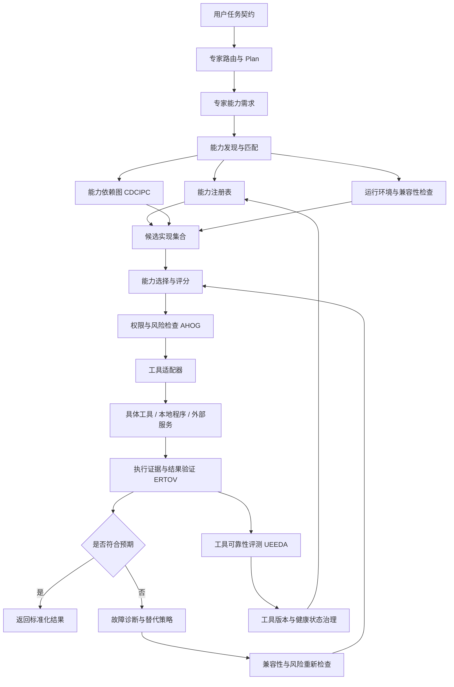
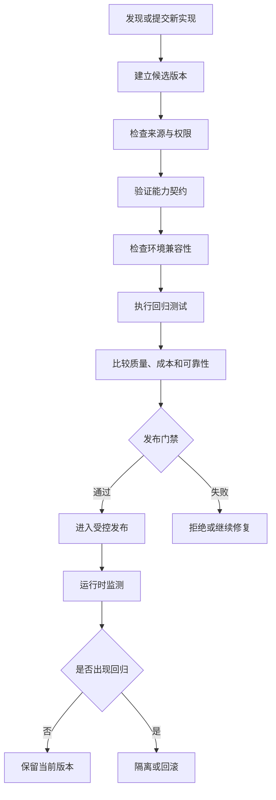

# 问答 120

> 来源: 新 窗口 | 会话: 分支 · 分支 · 分支 · 设计自进化智能体
> 消息: bbb21683-50ca-4c2e-a2b5-b48be74b1ad8 | 时间(UTC): 2026-10-24 10:25

## 用户

继续

## ChatGPT

<WritingBlock id="58372" variant="document"># EvoAgent 第五十六专项：工具能力注册、发现、版本兼容与替代治理体系

**专项编号：TCRDCF**

**英文名称：Tool Capability Registry, Discovery, Compatibility & Fallback Governance**

**文档版本：V1.0（架构设计基线）**

**文档性质：全量架构专项设计**

**适用范围：EvoAgent 统一任务入口、专家路由器、领域专家、工具系统、能力依赖图 CDCIPC、执行可靠性体系 ERTOV、多专家协作体系 MACRCP、安全权限治理 AHOG、自动评测系统 UEEDA、独立进化控制器。**

**核心目标：让 EvoAgent 能够准确知道自己拥有哪些能力、每项能力由什么实现、适用于什么环境、是否可靠、如何选择最合适的实现，以及在工具不可用或升级失败时，如何安全地切换、降级和恢复。**

> 本专项承接前述 EvoAgent 架构决策。目标是建立统一的工具能力治理机制，而不是简单增加一个工具列表。本文属于目标架构设计，不代表相关功能已经实现。

---

# 一、为什么工具系统必须独立治理？

前面的专项已经解决了任务理解、专家协作、工具执行、结果验证等问题。

但这些机制都依赖一个基础条件：

**系统必须知道有哪些能力可用，并且能够判断这些能力是否适合当前任务。**

假设代码专家需要修改一个 Python 项目。

它可能需要：

- 文件读取与修改；
- 代码搜索；
- AST 语法树分析；
- 静态分析；
- 类型检查；
- 单元测试；
- Git 差异分析；
- 代码构建与运行；
- 补丁验证。

这些能力可能由不同的工具提供。

有些工具已经安装，有些需要调用外部服务，有些只在 Windows 上可用，有些只能在 Linux 环境运行，还有些需要额外的权限。

如果没有统一治理机制，就容易出现以下问题。

## 1.1 工具存在，但专家不知道

代码专家需要 AST 分析能力，却不知道系统已经安装了适用于当前 Python 版本的解析器。

于是它可能：

- 让模型直接阅读大量代码；
- 重复实现已有功能；
- 选择更昂贵的云端分析服务；
- 产生质量更差的分析结果。

本质上，这是能力发现失败。

## 1.2 工具名称相同，实际能力却不同

两个工具都叫“代码分析器”，但实际可能存在明显差异：

- 一个支持 Python 3.10；
- 一个支持 Python 3.13；
- 一个只能解析语法；
- 一个还能生成类型信息；
- 一个只支持单文件；
- 一个支持跨文件依赖分析。

如果系统只根据工具名称选择，就可能产生错误调用。

## 1.3 工具升级后，原有工作流突然失效

例如，工具升级后修改了返回值格式。

原来返回：

`{"passed": true}`

升级后返回：

`{"status": "passed"}`

如果适配器、验证器和工作流没有同步更新，就可能出现：

- 结果解析错误；
- 测试状态判断错误；
- 原本通过的任务被判定失败；
- 原本失败的任务被错误判定成功。

因此，工具升级必须纳入统一的版本兼容和回归评测机制。

## 1.4 首选工具失效，替代工具却不安全

假设手机操作专家无法使用原来的界面识别工具。

系统找到另一个工具，虽然也能识别界面，却要求上传完整屏幕内容到第三方服务。

如果系统只关注功能能否实现，就可能在未经授权的情况下改变数据流向。

**能力相似，不代表权限、隐私、成本和副作用相同。**

## 1.5 多个专家重复建设相同能力

代码专家、手机操作专家和漫剧专家都可能需要：

- 文件管理；
- 图像识别；
- 任务状态查询；
- 日志记录；
- 产物校验。

如果每个专家都独立实现这些基础能力，系统会逐渐出现重复代码、行为不一致和维护成本上升。

因此，EvoAgent 需要把“能力是什么”和“由哪个工具实现”分开管理。

---

# 二、第一性原理：能力、工具、模型和工作流不是同一个东西

这是本专项首先需要冻结的架构原则。

建议将相关对象分为五层。

<box gap={1}>
  <box border radius="lg" padding={3} gap={1}>
    **第一层：能力 Capability**

    <text color="secondary" size="sm">描述系统能够完成什么工作。</text>

    示例：Python AST 分析、文件搜索、界面元素识别、视频解码验证。
  </box>
  <box align="center">
    <icon name="arrow-down" color="secondary" size="lg"/>
  </box>
  <box border radius="lg" padding={3} gap={1}>
    **第二层：实现 Implementation**

    <text color="secondary" size="sm">提供某项能力的具体实现。</text>

    示例：本地 Python 解析器、静态分析工具、OCR 引擎、视频检测程序。
  </box>
  <box align="center">
    <icon name="arrow-down" color="secondary" size="lg"/>
  </box>
  <box border radius="lg" padding={3} gap={1}>
    **第三层：执行适配器 Adapter**

    <text color="secondary" size="sm">统一不同工具的调用方式、输入输出和错误语义。</text>

    示例：将不同解析器的结果转换成 EvoAgent 统一的 AST 分析结果。
  </box>
  <box align="center">
    <icon name="arrow-down" color="secondary" size="lg"/>
  </box>
  <box border radius="lg" padding={3} gap={1}>
    **第四层：执行策略 Execution Policy**

    <text color="secondary" size="sm">决定使用哪个实现、如何验证、失败后如何处理。</text>

    示例：优先本地解析器，失败后检查兼容的替代实现。
  </box>
  <box align="center">
    <icon name="arrow-down" color="secondary" size="lg"/>
  </box>
  <box border radius="lg" padding={3} gap={1}>
    **第五层：任务工作流 Workflow**

    <text color="secondary" size="sm">将多项能力组合成完整任务。</text>

    示例：代码读取 → AST 分析 → 修改代码 → 测试 → 验收。
  </box>
</box>

此外，模型属于可被工作流或能力实现调用的推理资源；外部服务属于能力实现可能依赖的运行资源；领域专家则负责理解专业目标、组织专业工作。

这些对象之间有关联，但不能互相替代。

例如：

- “代码分析”是一项能力；
- “Python AST 解析器”是一种实现；
- `python_ast_adapter` 是调用适配器；
- “优先本地、失败后有限回退”是一种执行策略；
- “修复代码并运行测试”是一条工作流；
- “代码专家”负责利用这些能力完成专业任务。

这种分层可以避免工具更换导致整个专家系统都需要重写。

---

# 三、总体架构：建立统一能力治理层

建议新增独立的工具能力治理层，作为专家路由、工作流调度和工具执行之间的统一能力入口。



建议由以下核心组件共同构成：

| 组件 | 核心职责 |
|---|---|
| 能力注册表 | 保存能力、实现、版本、契约与状态 |
| 能力发现器 | 根据专家需求找到候选能力 |
| 能力匹配器 | 检查功能、输入输出和任务要求是否匹配 |
| 兼容性检查器 | 检查系统环境、依赖、版本和资源要求 |
| 能力选择器 | 综合质量、成本、时延和风险选择实现 |
| 工具适配器层 | 统一不同工具的调用和结果格式 |
| 替代治理器 | 在故障时寻找经过验证的替代实现 |
| 工具健康管理器 | 监控故障、降级、隔离和恢复状态 |
| 能力依赖图 | 分析能力之间的依赖及变更影响 |
| 评测与发布门禁 | 检查候选工具及新版本能否安全使用 |

**核心原则：专家提出能力需求，治理层决定采用哪个实现，执行可靠性体系验证实际结果。**

---

# 四、统一能力注册表：系统必须知道自己拥有什么

建议建立 `CapabilityRegistry`，作为能力发现与工具选择的权威数据源。

它不应该只是保存工具名称的数组，而是需要记录能力定义、实现、环境约束、接口契约、验证状态和运行表现。

## 4.1 注册表中的核心对象

建议至少支持以下对象：

| 对象 | 说明 |
|---|---|
| `CapabilityDefinition` | 能力的统一定义 |
| `ImplementationRecord` | 能力的具体实现 |
| `ToolContract` | 工具输入输出及执行契约 |
| `AdapterDefinition` | 调用适配器及标准化规则 |
| `EnvironmentProfile` | 运行环境和依赖要求 |
| `CompatibilityRecord` | 实现与环境之间的兼容性结论 |
| `ReliabilityProfile` | 工具可靠性与健康状态 |
| `FallbackPolicy` | 允许的替代规则 |
| `CapabilityDependency` | 能力之间的依赖关系 |
| `VerificationProfile` | 能力结果的验证要求 |

这些对象应当具有稳定标识和独立版本。

不能只使用显示名称作为唯一标识，因为工具可能改名、换版本或被不同专家使用。

## 4.2 能力定义需要包含什么？

建议至少包括：

- `capability_id`；
- `name`；
- `description`；
- `capability_version`；
- `input_contract`；
- `output_contract`；
- `supported_domains`；
- `required_dependencies`；
- `environment_constraints`；
- `permission_requirements`；
- `side_effects`；
- `verification_requirements`；
- `quality_dimensions`；
- `resource_requirements`；
- `deprecation_policy`。

例如，`code.python.ast_analysis` 可以定义为：

- 能力类型：代码分析；
- 适用语言：Python；
- 输入：源文件或项目文件集合；
- 输出：标准化语法树分析结果；
- 前置条件：文件可读取、语法版本已确定；
- 验收：结果可以解析，并能追溯到原始文件与位置；
- 副作用：只读；
- 验证方式：Schema 检查、解析结果检查和已知样例测试。

这里定义的是能力的语义契约，而不是某个特定 Python 库的安装方式。

---

# 五、能力实现注册：同一能力允许有多个实现

EvoAgent 不应把某项能力永久绑定到某个工具。

例如，Python AST 分析可以存在多个实现：

- 本地标准库解析器；
- 第三方静态分析工具；
- IDE 或语言服务器提供的分析能力；
- 经授权的远程代码分析服务。

它们可能在功能、速度、准确性、资源消耗和适用环境方面存在差异。

## 5.1 实现记录

每个 `ImplementationRecord` 至少应记录：

- `implementation_id`；
- `capability_id`；
- `implementation_version`；
- `adapter_id`；
- `tool_id`；
- `provider_type`；
- `supported_platforms`；
- `supported_versions`；
- `dependency_requirements`；
- `resource_requirements`；
- `permission_scope`；
- `network_requirements`；
- `data_handling_policy`；
- `verification_profile_id`；
- `health_status`；
- `lifecycle_status`。

其中，`provider_type` 可以区分：

- 本地库；
- 本地命令行程序；
- 独立进程；
- 外部 API；
- 设备系统接口；
- 模型驱动能力；
- 其他经注册的执行后端。

## 5.2 实现状态

建议区分：

- `DISCOVERED`：已发现，但尚未验证；
- `VALIDATING`：正在验证；
- `ACTIVE`：通过要求，可以参与选择；
- `DEGRADED`：存在限制，但允许特定场景使用；
- `QUARANTINED`：因异常或风险暂时隔离；
- `DEPRECATED`：不再推荐新任务使用；
- `DISABLED`：已停用；
- `REMOVED`：已从可用实现集合移除。

新发现的工具不能自动成为 `ACTIVE`。

必须先完成必要的契约验证、权限审查和环境兼容性检查。

---

# 六、能力发现：专家如何找到需要的工具？

专家不应直接搜索所有工具名称，也不应在提示词中硬编码大量具体工具。

建议采用两阶段发现机制。

## 6.1 第一阶段：能力需求声明

专家根据任务契约，声明自己需要哪些能力。

例如，代码专家需要：

```yaml
capability_requirements:
  - capability_id: code.python.ast_analysis
    required: true
    minimum_features:
      - syntax_tree
      - source_location

  - capability_id: code.static_analysis
    required: false
    preferred_features:
      - type_checks
      - rule_based_diagnostics

  - capability_id: code.test_execution
    required: true
    constraints:
      - authorized_workspace_only
```

这只是能力需求，不是对具体工具的指定。

专家可以表达：

- 必需能力；
- 可选能力；
- 首选能力；
- 可接受的降级能力；
- 不允许的实现方式。

## 6.2 第二阶段：能力发现与匹配

治理层根据需求查询注册表，筛选候选实现。

筛选顺序建议为：

1. 是否具有所需能力；
2. 是否满足必需功能；
3. 是否符合输入输出契约；
4. 是否兼容当前环境；
5. 是否满足权限和数据处理要求；
6. 是否能够完成必要的结果验证；
7. 是否满足预算和资源限制；
8. 是否具有足够的可靠性证据。

只有通过这些基础检查的实现，才进入后续评分。

**不能让一个不满足硬性约束的工具，仅仅因为速度快、成本低，就获得更高的最终评分。**

## 6.3 运行时发现与安装必须分开

发现工具不等于允许安装工具。

例如，系统发现某个第三方工具可以提升代码分析质量时，应分别判断：

- 工具是否值得采用；
- 工具是否可信；
- 是否需要安装；
- 是否需要新增依赖；
- 安装是否需要用户确认；
- 是否影响已有环境；
- 是否存在可用的本地替代实现。

工具安装和能力调用应具有不同的权限策略。

---

# 七、工具选择：不只看功能，还要看成本、质量和风险

当存在多个合格实现时，治理层需要选择合适的候选项。

建议先进行硬性过滤，再进行软性评分。

## 7.1 硬性过滤

以下条件不能通过评分抵消：

- 不满足必要能力；
- 不兼容当前运行环境；
- 缺少必需权限；
- 数据处理方式违反约束；
- 无法满足硬性预算；
- 存在未解决的关键安全问题；
- 不支持必需的结果验证；
- 工具处于隔离或停用状态。

## 7.2 软性评分

通过硬性过滤后，可以综合考虑：

- 任务质量；
- 实际可靠性；
- 执行时延；
- 资源成本；
- 额外 Token 消耗；
- 环境稳定性；
- 验证成本；
- 历史故障率；
- 替代和恢复难度。

可以采用如下抽象评分：

\[
S(i,t)=w_qQ(i,t)+w_rR(i,t)-w_cC(i,t)-w_lL(i,t)-w_vV(i,t)
\]

其中：

- \(i\)：候选实现；
- \(t\)：当前任务；
- \(Q\)：与当前任务相关的质量表现；
- \(R\)：实际可靠性；
- \(C\)：预计成本；
- \(L\)：预计时延；
- \(V\)：验证和恢复成本；
- \(w\)：根据任务类型配置的权重。

这个评分只用于比较已经满足硬性要求的候选项。

不同专家不应该共用一套完全相同的评分权重。例如，手机操作专家对权限和界面状态稳定性的要求，可能明显高于普通文本处理任务。

## 7.3 必须保留基线与选择理由

每次重要的工具选择，应记录：

- 候选实现集合；
- 被过滤的候选项及原因；
- 最终选中的实现；
- 选择时的版本；
- 相关评分与限制；
- 是否使用了降级策略；
- 最终验证结果。

这样才能在任务失败时判断：究竟是工具本身不可靠，还是选择器选择了不适合当前任务的工具。

---

# 八、版本兼容：工具能安装，不等于能正常工作

EvoAgent 需要支持 Android、Windows 和 Linux 等不同环境。

同一个能力的不同实现，可能具有不同的运行要求。

因此，兼容性必须独立建模。

## 8.1 兼容性检查维度

建议至少检查：

- 操作系统；
- CPU 架构；
- 运行时版本；
- 编程语言版本；
- 依赖库版本；
- 工具自身版本；
- 输入数据格式；
- 输出数据格式；
- 系统权限；
- 可用内存和存储；
- GPU 或硬件要求；
- 网络连接要求；
- 设备接口可用性。

例如，某个代码分析工具虽然安装成功，但要求的 Python 版本高于项目实际使用版本，就不能直接认定它适合当前任务。

## 8.2 兼容性矩阵

建议建立统一的兼容性记录。

| 能力实现 | Windows | Linux | Android | 状态 |
|---|---|---|---|---|
| Python AST 分析 | 通过验证后启用 | 通过验证后启用 | 视运行环境而定 | 需环境检测 |
| 本地文件操作 | 需要路径与权限适配 | 需要路径与权限适配 | 需要 Android 授权机制 | 平台适配 |
| Android 无障碍操作 | 不适用 | 不适用 | 需要系统授权 | 设备专用 |
| FFmpeg 视频合成 | 取决于构建版本 | 取决于构建版本 | 取决于部署与资源条件 | 需实测 |
| 云端生成 API | 需网络和凭据 | 需网络和凭据 | 需网络和凭据 | 外部依赖 |

这张表是兼容性治理的示例，不是对具体工具已经完成测试的声明。

真实兼容性必须来自实际环境探测、版本检查和测试证据。

## 8.3 兼容性不是永久结论

一个工具可能昨天正常，今天因为：

- 操作系统升级；
- 依赖更新；
- API 变更；
- 权限撤销；
- 配置变化；
- 磁盘空间不足；

而不再适用。

因此，兼容性记录必须包含适用环境、检查时间和有效条件。

遇到关键环境变化时，应触发重新检查。

---

# 九、统一适配器：隔离工具差异，保护专家与工作流

建议在具体工具和专家之间建立标准化适配器层。

例如，多个 AST 工具可以有不同的调用参数和输出结构，但经过适配后，向代码专家提供统一的数据模型。

## 9.1 适配器负责什么？

- 输入参数转换；
- 输出格式标准化；
- 错误码映射；
- 超时和取消接口；
- 执行记录关联；
- 工具版本信息；
- 结果证据采集；
- 能力特性声明；
- 兼容性检查；
- 统一的异常语义。

## 9.2 适配器不能做什么？

适配器不能：

- 擅自扩大工具权限；
- 隐藏重要错误；
- 把不确定状态伪装成失败；
- 把工具调用成功伪装成任务完成；
- 静默删除不符合预期的结果；
- 在未经批准的情况下改变数据传输方式。

适配器是接口和行为规范的边界，不是绕过安全策略的通道。

## 9.3 标准化结果

建议所有工具结果采用统一外层结构：

```yaml
tool_result:
  execution_id: "exec-..."
  tool_id: "..."
  tool_version: "..."
  status: "SUCCEEDED_UNVERIFIED"

  output:
    # 由具体能力定义

  evidence_refs:
    - "evidence-..."

  warnings: []
  error: null

  resource_usage:
    duration_ms: 0
    cost_estimate: null
```

这里的标识和值仅为示意。

`SUCCEEDED_UNVERIFIED` 表示工具执行层认为调用成功，但实际结果还需要经过 ERTOV 验证。

适配器不得自行将状态升级为最终任务成功。

---

# 十、工具替代治理：能力相似不代表可以直接替换

这是本专项最重要的部分之一。

当首选工具不可用时，EvoAgent 应当尝试寻找替代方案，但不能只根据名称相似度或功能描述相似度选择。

建议将替代分为四种情况。

## 10.1 等价替代

替代工具满足相同的关键能力、契约、权限和验收要求。

例如，两个工具都能以相同的标准格式输出 Python AST 结构，并通过相同的回归集验证。

这种情况可以考虑自动切换，但仍然需要完成必要的运行时检查。

## 10.2 受限替代

替代工具可以完成核心任务，但缺少部分非关键能力。

例如，替代的静态分析工具不能进行跨文件分析，但仍然能完成当前单文件任务。

此时，系统必须检查缺失能力是否影响当前验收标准。

如果不影响，可以使用；如果影响，就不能将它当作完全等价的替代品。

## 10.3 降级替代

替代方案能够完成任务的部分内容，但可能降低质量、增加人工处理或减少覆盖范围。

例如：

- 高级图像分析不可用，改用基础 OCR；
- 完整测试环境不可用，只能进行静态检查；
- 视频生成服务不可用，只能生成静态分镜图。

降级结果必须明确披露能力缺口。

如果降级违反用户硬性要求，则必须停止或请求用户决定，而不能自动接受。

## 10.4 禁止替代

以下情况应禁止自动切换：

- 替代工具要求更高权限；
- 替代工具会把敏感数据发送给未授权的外部服务；
- 替代工具具有未经批准的外部副作用；
- 替代工具无法满足关键验收条件；
- 替代工具来源不可信；
- 替代工具与当前环境不兼容；
- 替代工具可能造成不可逆的数据损失。

**替代治理的第一原则不是“总要找到办法继续”，而是“只能使用符合约束的替代方案”。**

---

# 十一、替代工具的自动切换条件

建议为每个能力建立 `FallbackPolicy`。

至少包含：

- 首选实现；
- 候选替代实现；
- 可接受的能力差异；
- 允许的环境差异；
- 权限约束；
- 数据处理约束；
- 成本上限；
- 质量下限；
- 是否允许自动切换；
- 是否需要用户确认；
- 切换后的验证要求；
- 失败后的回退路径。

## 11.1 自动切换

只有同时满足以下条件，才建议允许自动切换：

1. 原工具已经确认不可用，或明确满足触发降级的条件；
2. 替代工具处于可用状态；
3. 能力匹配通过；
4. 版本与环境兼容；
5. 权限范围不扩大；
6. 数据处理方式符合要求；
7. 预算未超限；
8. 不会产生未经授权的新副作用；
9. 关键输出契约仍然成立；
10. 切换后可以完成规定的结果验证。

## 11.2 需要用户确认

以下情况建议先确认：

- 替代方案会显著降低质量；
- 替代方案会改变最终交付形式；
- 替代方案会增加费用；
- 替代方案需要新的权限；
- 替代方案需要安装新的软件；
- 替代方案会将数据发送到新的服务；
- 替代方案需要改变关键任务约束。

如果系统无法确定替代方案是否满足用户目标，应当先询问，而不是静默选择。

## 11.3 切换后的重新验收

即使替代工具通过了自己的契约检查，任务级验收标准也不能自动降低。

例如，原计划运行完整测试，但替代环境只能执行静态检查。

系统可以报告静态检查通过，但不能声称完整测试已经通过。

---

# 十二、工具健康状态与隔离机制

工具治理不仅要知道工具是否安装，还要持续知道它是否可靠。

建议建立独立的 `ToolHealthManager`。

## 12.1 健康状态

- `HEALTHY`：正常运行；
- `DEGRADED`：存在可控的性能或功能退化；
- `UNAVAILABLE`：暂时不可用；
- `QUARANTINED`：存在需要调查的异常；
- `DISABLED`：由治理规则或用户停用。

## 12.2 触发降级或隔离的条件

例如：

- 连续超时；
- 契约违例；
- 输出格式错误；
- 验证器发现结果与工具声明不一致；
- 产生未经预期的副作用；
- 依赖版本冲突；
- 权限状态发生变化；
- 安全检查失败。

不能仅凭一次普通网络波动就永久隔离工具。

应根据故障类型、严重程度和历史证据决定。

## 12.3 恢复流程

工具从隔离状态恢复时，应当：

1. 确认故障原因已经处理；
2. 检查工具和依赖版本；
3. 运行基础健康检查；
4. 执行必要的契约测试；
5. 执行与故障相关的回归测试；
6. 通过发布门禁后重新启用。

对于产生过严重安全问题的工具，恢复策略必须更加严格。

---

# 十三、与能力依赖图 CDCIPC 的关系

TCRDCF 与 CDCIPC 需要紧密协作，但职责不同。

CDCIPC 描述能力之间的依赖关系。

TCRDCF 管理这些能力由哪些具体实现提供，以及这些实现是否可用、兼容和可靠。

例如：

```text
代码修复工作流
    ├── 代码读取能力
    ├── AST 分析能力
    │      ├── 本地解析器 A
    │      └── 本地解析器 B
    ├── 文件修改能力
    ├── 测试执行能力
    └── 结果验收能力
```

这里：

- CDCIPC 记录工作流对 AST 分析能力的依赖；
- TCRDCF 记录 AST 分析能力由哪些实现提供；
- 兼容性检查器判断当前环境适用哪个实现；
- 选择器根据任务要求选择实现；
- ERTOV 验证实际执行结果；
- UEEDA 评估实现版本是否达到预期质量。

如果解析器 A 升级，系统不应直接假设所有代码专家都需要重新设计。

而是应该通过依赖图找到受到影响的能力、适配器和工作流，再针对相关部分执行回归测试。

---

# 十四、与专家路由器和 MACRCP 的关系

## 14.1 专家路由器

专家路由器选择负责某类工作的专家。

它不需要直接知道每个工具的全部参数和安装细节。

例如，路由器决定由代码专家处理任务。

代码专家随后声明所需能力，由 TCRDCF 选择实际实现。

这样可以避免路由器与工具实现产生紧耦合。

## 14.2 MACRCP 多专家协作

在多专家任务中，不同专家可能使用不同实现完成相同的基础能力。

例如，代码专家与研究专家都需要文件读取，但它们可能具有不同的目录范围和访问策略。

因此，能力复用不等于权限共享。

每个调用都必须根据具体任务和调用方重新检查权限。

## 14.3 专家可以声明偏好，但不能绕过治理

专家可以声明：

- 优先本地实现；
- 优先低成本实现；
- 优先经过验证的工具；
- 不允许外部数据传输；
- 需要某项高级能力。

但不能直接调用未注册、未验证或未授权的工具来绕过能力治理层。

对于临时研究或开发中的新工具，可以进入受控实验区，经过验证后再进入正式能力注册表。

---

# 十五、与 ERTOV 的关系：注册可用不等于执行可靠

TCRDCF 与 ERTOV 之间必须明确职责边界。

TCRDCF 负责：

- 能力是否存在；
- 实现是否匹配；
- 版本是否兼容；
- 权限和资源要求是否满足；
- 候选工具是否可以参与选择；
- 是否存在合适的替代方案。

ERTOV 负责：

- 工具调用是否按契约执行；
- 操作后置条件是否满足；
- 实际产物是否正确；
- 是否需要恢复；
- 最终任务是否满足验收要求。

因此：

**工具注册表中的 `ACTIVE` 不能直接解释为“任何任务调用它都会成功”。**

`ACTIVE` 只表示该实现当前通过了注册、兼容性和治理门禁，可以参与适用任务的选择。

每一次实际执行，仍然必须接受 ERTOV 的运行时检查和结果验证。

---

# 十六、工具供应链与注册安全

工具能力注册表是整个智能体执行系统的重要信任边界。

如果注册表被错误配置或恶意污染，系统可能调用未经授权的程序、错误的服务地址或危险的替代工具。

因此，必须建立注册安全机制。

## 16.1 注册来源分类

建议区分：

- 系统内置工具；
- 用户主动安装的工具；
- 项目级工具；
- 经授权的第三方插件；
- 远程服务；
- 实验性工具；
- 尚未验证的自动发现结果。

不同来源应采用不同的信任和审批策略。

## 16.2 新工具注册检查

至少检查：

- 工具来源；
- 版本与身份；
- 输入输出契约；
- 运行环境；
- 权限需求；
- 数据传输方式；
- 外部副作用；
- 依赖与安装脚本；
- 基础功能测试；
- 必要的安全测试。

对于高风险工具，不能只依据工具自己的描述决定是否可信。

## 16.3 工具描述不等于可信证据

工具可以声明自己：

- 安全；
- 高性能；
- 支持所有平台；
- 不上传数据；
- 完全兼容现有工作流。

这些声明都应当作为待验证信息。

系统应尽可能通过配置检查、运行观察、网络策略和测试证据进行核验。

## 16.4 注册表修改必须可追溯

每次重要变更应记录：

- 修改前后版本；
- 变更来源；
- 变更理由；
- 审批状态；
- 兼容性检查结果；
- 回归测试结果；
- 发布与回滚记录。

注册表不能被普通专家在运行过程中随意修改。

---

# 十七、能力注册表的版本管理与发布机制

工具能力治理也需要版本化。

建议将版本分为三个层级：

1. **能力契约版本**：定义能力的语义和输入输出要求。
2. **实现版本**：具体工具、库、服务或程序的版本。
3. **适配器版本**：将具体实现转换为统一接口的代码版本。

这三个版本不应混为一谈。

例如，某个解析器升级后，可能只需要更新实现版本，而不需要改变能力契约。

但如果新版本不再输出某些必需字段，就可能导致能力契约不兼容，需要修改适配器或拒绝升级。

## 17.1 候选版本发布流程

建议采用以下流程：



## 17.2 发布与自动进化

EvoAgent 可以自动发现潜在工具、生成适配器或提出版本升级建议。

但自动生成的实现不能直接进入稳定运行环境。

至少需要：

- 契约验证；
- 兼容性测试；
- 权限审查；
- 回归评测；
- 版本记录；
- 可执行的回滚方案。

低风险工具更新可以在满足明确门禁的情况下自动发布。

涉及权限扩大、敏感数据流变化或不可逆副作用的更新，应采用更严格的授权流程。

---

# 十八、个人使用环境下的工程落地

EvoAgent 的目标是个人使用，不需要一开始就部署复杂的分布式工具管理平台。

建议采用本地优先的模块化架构。

## 18.1 核心组件

第一阶段只需要：

- 本地能力注册表；
- 工具契约存储；
- 能力发现与匹配器；
- 环境兼容性检查器；
- 工具适配器注册表；
- 基础健康检查；
- 受控替代策略；
- SQLite 状态存储；
- 版本与变更记录；
- 兼容性和回归测试入口。

这些组件可以运行在个人电脑或 mini Linux 主机上。

Android 端使用适配后的设备能力，并通过授权接口调用无障碍、文件访问和其他系统能力。

## 18.2 本地与云端实现并存

同一能力可以具有本地和云端实现。

例如：

- 本地 OCR 与云端视觉识别；
- 本地代码分析与云端代码审查；
- 本地视频合成与云端视频生成；
- 本地模型与云端模型。

但选择云端实现时，必须额外检查：

- 数据是否允许上传；
- 网络是否可用；
- 服务费用是否在预算内；
- 外部服务的可靠性；
- 返回结果是否满足统一契约。

不能因为云端实现能力更强，就自动将所有任务切换到云端。

## 18.3 离线与断联策略

网络中断后：

- 本地工具可以继续工作；
- 需要外部服务的能力应标记为不可用或受限；
- 系统可以寻找满足要求的本地替代实现；
- 没有合适替代方案时，应暂停受影响的任务节点；
- 已完成的本地产物继续保留；
- 外部操作状态不确定时，由 ERTOV 负责查询和恢复。

不应为了维持表面上的任务连续性，伪造外部工具的执行结果。

---

# 十九、工程目录与核心接口

建议新增以下逻辑模块：

```text
evoagent/
├── capability_registry/
│   ├── capability_definition/
│   ├── implementation_registry/
│   ├── tool_contract_registry/
│   ├── adapter_registry/
│   ├── environment_profiles/
│   ├── compatibility_records/
│   ├── reliability_profiles/
│   └── registry_versioning/
├── capability_discovery/
│   ├── requirement_parser/
│   ├── capability_matcher/
│   ├── candidate_filter/
│   ├── feature_compatibility/
│   └── dependency_resolver/
├── implementation_selection/
│   ├── hard_constraint_filter/
│   ├── quality_cost_scoring/
│   ├── risk_aware_selector/
│   ├── selection_explanation/
│   └── decision_trace/
├── compatibility_governance/
│   ├── platform_detector/
│   ├── runtime_detector/
│   ├── dependency_checker/
│   ├── version_compatibility/
│   ├── hardware_requirements/
│   └── compatibility_test_runner/
├── adapter_runtime/
│   ├── adapter_loader/
│   ├── input_normalizer/
│   ├── output_normalizer/
│   ├── error_mapper/
│   └── execution_context/
├── fallback_governance/
│   ├── fallback_policy/
│   ├── equivalence_checker/
│   ├── fallback_selector/
│   ├── downgrade_policy/
│   ├── user_approval_gate/
│   └── fallback_audit/
├── tool_health/
│   ├── health_monitor/
│   ├── circuit_breaker/
│   ├── quarantine_manager/
│   ├── recovery_check/
│   └── tool_status_store/
├── supply_chain_security/
│   ├── source_verification/
│   ├── dependency_audit/
│   ├── permission_review/
│   ├── installation_policy/
│   └── registry_integrity/
└── capability_evaluation/
    ├── contract_tests/
    ├── compatibility_regression/
    ├── fallback_tests/
    ├── reliability_benchmark/
    └── release_gate/
```

建议提供以下核心接口：

- `register_capability`：注册能力定义；
- `register_implementation`：注册能力实现；
- `register_tool_contract`：关联工具契约；
- `discover_capabilities`：发现满足需求的能力；
- `match_implementations`：匹配候选实现；
- `check_compatibility`：检查环境与版本兼容性；
- `validate_implementation`：验证实现是否符合能力契约；
- `select_implementation`：选择适用实现；
- `explain_selection`：解释选择理由；
- `resolve_dependencies`：解析能力依赖；
- `load_adapter`：加载已批准的适配器；
- `normalize_tool_output`：标准化工具结果；
- `check_fallback_eligibility`：检查替代资格；
- `select_fallback`：选择替代实现；
- `validate_fallback_equivalence`：检查替代能力差异；
- `request_fallback_approval`：申请必要的用户授权；
- `update_tool_health`：更新工具健康状态；
- `quarantine_implementation`：隔离异常实现；
- `restore_implementation`：恢复已验证的实现；
- `publish_implementation_version`：发布候选版本；
- `rollback_implementation`：回滚实现版本；
- `record_registry_change`：记录注册表变更；
- `evaluate_capability_quality`：评估能力质量；
- `evaluate_fallback_success`：评估替代策略效果。

这些接口应当使用统一的能力 ID、实现 ID、工具版本、适配器版本、任务 ID 和执行 ID，保证整个调用链可追踪。

---

# 二十、专项验收标准

TCRDCF 至少需要满足以下要求：

1. 能够区分能力、实现、工具、适配器、模型、服务和工作流。
2. 能够建立统一的能力注册表。
3. 每项能力具有明确的输入输出契约和适用范围。
4. 同一能力允许存在多个独立实现。
5. 能够根据专家声明的能力需求发现候选实现。
6. 能够区分必需能力、可选能力、首选能力和允许的降级能力。
7. 能够在候选实现选择之前执行硬性约束过滤。
8. 能够检查操作系统、运行时、依赖和硬件兼容性。
9. 能够记录兼容性结论的环境条件和有效时间。
10. 新发现的工具不能未经验证直接进入正式可用状态。
11. 工具适配器能够统一输入输出、错误语义和执行记录。
12. 适配器不能扩大权限或隐藏重要错误。
13. 能够根据质量、可靠性、成本、时延和验证成本选择实现。
14. 能够记录重要的工具选择理由。
15. 能够识别等价替代、受限替代、降级替代和禁止替代。
16. 能够检查替代工具的权限、数据处理方式和外部副作用。
17. 替代工具不能通过自动切换扩大原任务的权限范围。
18. 关键能力降级时，不能自动降低用户的硬性验收要求。
19. 能够根据健康状态对异常工具降级、隔离和恢复。
20. 工具恢复前必须执行相应的健康检查和回归测试。
21. 能够关联 CDCIPC 分析工具变更影响范围。
22. 能够与 ERTOV 共享工具契约、执行状态和结果验证信息。
23. 能够与 MACRCP、专家路由器和工作流引擎保持职责分离。
24. 工具注册表的变更具有版本记录和审计信息。
25. 能够区分工具发现、安装、启用和执行授权。
26. 能够识别未经验证的工具声明和不可信注册信息。
27. 工具升级必须经过适用的兼容性和回归门禁。
28. 重要工具更新具有明确的发布与回滚路径。
29. 支持本地工具、云端服务和 Android 设备能力的统一治理。
30. 网络断联时，系统能够正确识别本地可用能力和不可用的外部能力。
31. 能够通过实际任务评测比较不同实现的质量、成本和可靠性。
32. 能够识别因能力匹配错误、版本不兼容或替代策略不当导致的失败。
33. 能够将运行证据反馈给 RCAE 和 UEEDA。
34. 任何能力替代都不能绕过 AHOG 的权限和安全规则。
35. 能够防止工具选择、重试和替代流程无限循环。

以上是目标架构的验收要求，不代表当前 EvoAgent 已经实现或通过测试。

---

# 二十一、建议冻结的架构决策

以下建议承接 ADR-874。

| 编号 | 决策 |
|---|---|
| ADR-875 | 建立独立的工具能力注册、发现、版本兼容与替代治理体系 TCRDCF |
| ADR-876 | 能力、具体实现、工具适配器、执行策略和工作流必须分层建模 |
| ADR-877 | 同一能力允许存在多个实现，不将专家与特定工具永久绑定 |
| ADR-878 | 建立统一的 CapabilityRegistry，作为能力发现和实现选择的权威数据源 |
| ADR-879 | 每项能力必须具有稳定标识、输入输出契约、适用范围和验证要求 |
| ADR-880 | 能力实现必须记录版本、环境要求、权限范围、副作用和生命周期状态 |
| ADR-881 | 新发现的工具不得未经验证直接进入正式可用状态 |
| ADR-882 | 专家通过能力需求声明请求能力，不直接绕过治理层调用未经批准的工具 |
| ADR-883 | 能力匹配必须先执行硬性约束过滤，再进行质量、成本、时延和可靠性评分 |
| ADR-884 | 兼容性必须结合实际运行环境、依赖版本和验证证据判断 |
| ADR-885 | 能力发现、工具安装、工具启用和实际执行授权必须分开治理 |
| ADR-886 | 工具适配器负责接口标准化，不得扩大权限、隐藏错误或伪造执行状态 |
| ADR-887 | 工具替代必须区分等价替代、受限替代、降级替代和禁止替代 |
| ADR-888 | 自动替代必须满足能力契约、兼容性、权限、数据处理、预算和验证要求 |
| ADR-889 | 替代工具不能扩大原任务权限，也不能静默改变数据传输方式 |
| ADR-890 | 替代方案不得擅自降低用户明确规定的硬性验收要求 |
| ADR-891 | 工具健康状态必须支持降级、隔离、恢复和审计 |
| ADR-892 | 工具恢复前必须通过与故障风险相匹配的健康检查和回归测试 |
| ADR-893 | 能力注册表必须与 CDCIPC 的能力依赖图保持关联 |
| ADR-894 | 能力注册状态不等于实际执行成功，所有关键执行仍需经过 ERTOV 验证 |
| ADR-895 | 能力与实现版本、适配器版本应分别管理，避免无意义的整体升级 |
| ADR-896 | 工具注册与更新必须具有来源验证、权限审查、版本记录和回滚机制 |
| ADR-897 | 工具能力评估必须关注真实结果、后置条件满足率和任务相关的质量指标 |
| ADR-898 | 工具选择与替代策略必须通过 UEEDA 独立评测 |
| ADR-899 | 工具治理不得绕过 AHOG 的权限和安全边界 |
| ADR-900 | 本地、Windows、Linux、Android 和云端能力应通过统一契约治理，并保留平台特定适配 |
| ADR-901 | 工具替代和能力发现必须具有循环检测、调用上限与预算控制 |
| ADR-902 | 工具选择、兼容性检查、替代过程和最终结果必须能够通过统一执行标识追踪 |

以上建议作为 EvoAgent 第五十六专项的架构基线。

---

# 二十二、下一专项：自主进化变更治理、风险分级与安全发布体系

到这里，EvoAgent 已经建立了相当完整的运行时能力治理基础：

- 理解用户目标；
- 生成任务契约；
- 选择领域专家；
- 规划任务；
- 协调多专家；
- 调用工具；
- 验证执行结果；
- 管理工具版本与替代；
- 采集运行证据；
- 通过独立评测发现问题。

但这会引出一个更深层的问题。

**当 EvoAgent 发现自己的某个部分存在问题时，它究竟应该如何修改自己？**

例如：

- 意图理解经常遗漏某类约束；
- 路由器经常把任务分配给错误的专家；
- 某个工具适配器存在错误；
- 某个专家的提示词需要改进；
- 上下文压缩导致重要信息丢失；
- 某条工作流的恢复策略经常失败；
- 某个新版本的工具虽然更快，却降低了任务成功率；
- 系统发现可以通过增加一个验证步骤降低失败率。

这些问题都可能产生改进候选。

但它们的风险完全不同。

修改一个只影响格式的提示词，与修改文件执行器、权限治理器、任务状态机和进化控制器，不应该使用相同的自动发布策略。

如果所有改进都需要人工批准，系统的自主进化能力会受到限制。

如果所有改进都允许自动发布，系统又可能因为错误诊断、评测漏洞或优化目标偏差而破坏稳定版本。

因此，EvoAgent 需要建立独立的自主进化变更治理机制。

建议下一专项定义为：

**Autonomous Evolution Change Governance, Risk Classification & Safe Release，简称 AECGSR。**

重点研究：

1. 如何将运行问题转化为结构化改进候选；
2. 如何判断问题属于意图理解、路由、工具、执行、验证还是评测；
3. 如何确定改进范围和影响依赖；
4. 如何对提示词、配置、工具、工作流、代码和权限策略进行风险分级；
5. 如何区分可自动发布的低风险改进与必须人工批准的高风险改进；
6. 如何建立改进候选的独立工作区和版本分支；
7. 如何防止候选版本修改自己的评测标准来制造虚假提升；
8. 如何建立固定回归集、对照组和反向测试；
9. 如何验证新版本确实提升质量、效率或稳定性；
10. 如何进行灰度发布、运行时监控和自动回滚；
11. 如何管理稳定版与后台进化轨道；
12. 如何在模型切换、工具升级和环境变化时维护独立的进化分支；
13. 如何限制进化控制器自身的修改权限；
14. 如何防止无限优化、循环修改、评测过拟合和成本失控；
15. 如何让每一次改进都记录“为什么改、改了什么、效果如何、为什么通过或失败”；
16. 如何在个人电脑、mini Linux 主机和 Android 设备上实现低开销的进化治理；
17. 如何将长期运行证据转化为经过验证、可以积累的系统能力；
18. 如何建立稳定版本、候选版本、实验版本和隔离版本之间的生命周期；
19. 如何在改进失败后恢复旧版本，而不破坏正在执行的任务；
20. 如何验证整个进化系统自身的安全性与可恢复性。

下一专项将把前面分散的日志、诊断、评测、版本、发布和回滚机制连接成真正的进化治理闭环。

最终需要确立的原则是：

**EvoAgent 可以自主发现问题、提出改进、生成候选版本并执行验证，但改进的自主程度必须与其风险、可验证性和可恢复性相匹配。系统越接近核心执行机制、权限边界和自身进化控制器，就越需要严格的独立验证、发布门禁和恢复保障。**</WritingBlock>

<MemoryCite />
