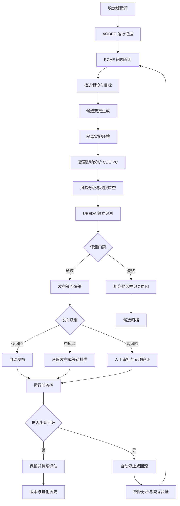

# 问答 121

> 来源: 新 窗口 | 会话: 分支 · 分支 · 分支 · 设计自进化智能体
> 消息: bbb21e2a-a41c-48ca-9172-d438c4667a28 | 时间(UTC): 2026-10-24 10:58

## 用户

继续

## ChatGPT

<WritingBlock id="62841" variant="document"># EvoAgent 第五十七专项：自主进化变更治理、风险分级与安全发布体系

**专项编号：AECGSR**

**英文名称：Autonomous Evolution Change Governance, Risk Classification & Safe Release**

**文档版本：V1.0**

**文档性质：全量架构专项设计**

**适用范围：EvoAgent 通用内核、专家智能体、意图识别与路由器、记忆与上下文系统、ReAct、Plan、DAG、工具系统、能力依赖图 CDCIPC、执行可靠性体系 ERTOV、工具能力治理体系 TCRDCF、日志系统 AODEE、问题诊断系统 RCAE、独立评测系统 UEEDA、版本管理与进化控制器。**

**核心目标：让 EvoAgent 能够自主发现问题、生成改进方案、验证改进效果，并在满足风险、质量、安全和可恢复性要求的前提下，自动发布经过验证的改进，同时保护稳定版本不被错误进化破坏。**

本文定义的是目标架构和实施基线，不代表相关机制已经开发完成或通过验收。

---

# 一、为什么自主进化必须有独立的变更治理体系？

EvoAgent 的长期目标不是简单地增加功能，而是持续提升执行质量、效率、稳定性和问题诊断能力。

此前的专项已经形成了完整的技术基础：

- AODEE：记录运行过程与证据；
- RCAE：分析失败原因；
- UEEDA：独立评测候选改进；
- ERTOV：验证工具执行结果和任务完成状态；
- TCRDCF：管理工具能力、兼容性和替代；
- CDCIPC：追踪能力依赖与影响范围；
- 专家路由体系：选择合适的领域专家；
- 独立进化控制器：组织改进候选与评测流程。

但这些机制仍然不能自动保证改进发布后系统一定更好。

原因在于，**发现问题、找到原因、提出修改、证明修改有效、批准发布，是五个不同的问题。**

假设 EvoAgent 发现代码专家的任务成功率下降。

系统可能提出以下改进：

1. 修改代码专家提示词；
2. 调整代码专家路由评分；
3. 增加 AST 静态分析步骤；
4. 修改工具调用参数；
5. 更换代码执行工具；
6. 修改 ReAct 的失败恢复逻辑；
7. 修改任务验收条件；
8. 修改权限检查流程。

这些修改的风险完全不同。

修改提示词可能只影响部分代码任务；修改路由器可能影响多个专家；修改执行状态机可能影响整个系统；修改验收条件甚至可能让系统通过降低标准来伪造性能提升。

因此，不能使用同一套简单的“测试通过就发布”机制。

本专项要解决的核心问题是：

**系统如何自主进化，同时不因进化而失去稳定性、安全边界和对自身表现的真实判断能力？**

---

# 二、第一性原理：进化不是修改，而是经过验证的能力提升

首先明确五个概念。

| 概念 | 定义 | 是否意味着系统变好 |
|---|---|---|
| 问题发现 | 发现系统存在异常或改进空间 | 否 |
| 改进假设 | 提出某种修改可能解决问题 | 否 |
| 候选变更 | 已经生成的配置、代码或策略修改 | 否 |
| 验证通过 | 候选变更满足规定的评测门禁 | 不一定代表真实环境长期变好 |
| 有效进化 | 改进在适用范围内产生可验证的收益，且未造成不可接受的回归 | 是 |

例如，调整提示词后，某个测试集的成功率从 80% 提升至 90%。

这并不自动证明改进有效，因为还可能存在：

- 测试集被过拟合；
- 某些其他任务的成功率下降；
- Token 成本增加数倍；
- 响应时间明显变长；
- 错误诊断能力下降；
- 改进只适用于某一个模型版本；
- 评测样本本身存在偏差。

因此，EvoAgent 不能仅根据单一指标决定进化是否成功。

建议将一次有效进化定义为：

\[
\text{有效进化}
=
\text{目标收益得到验证}
\land
\text{关键约束满足}
\land
\text{回归风险可接受}
\land
\text{结果可追溯}
\]

这不是说每次修改都必须提升所有指标，而是必须事先明确本次修改的目标、不可退化的指标、允许的成本和适用范围。

---

# 三、总体架构：将进化控制与稳定执行分离

建议建立独立的自主进化变更治理层。

它不直接替代 RCAE 的问题诊断能力，也不替代 UEEDA 的独立评测能力，而是负责将问题、候选变更、评测结果、发布决策和回滚机制连接起来。



这套架构需要明确三个相互独立的控制面。

## 3.1 稳定执行面

负责实际为用户完成任务。

包括：

- 统一任务入口；
- 专家路由；
- 通用内核；
- 领域专家；
- ReAct 与 Plan；
- 工具调用；
- 任务工作流；
- 记忆与上下文；
- 结果验收。

稳定执行面不应因为后台正在进行实验，就被实验候选直接修改。

## 3.2 进化控制面

负责：

- 识别可改进问题；
- 生成候选变更；
- 管理候选版本；
- 分析影响范围；
- 组织独立评测；
- 执行发布策略；
- 监控进化效果；
- 触发回滚；
- 管理改进历史。

进化控制面可以自主运行，但其权限必须受到更严格的治理。

## 3.3 信任与保护面

负责保护系统不可被普通进化流程任意修改的部分。

包括：

- 权限与安全边界 AHOG；
- 独立评测基准与门禁；
- 稳定版发布规则；
- 候选变更审批策略；
- 回滚能力；
- 版本完整性；
- 进化预算；
- 进化控制器的关键权限。

这部分不能完全由正在接受评测的候选版本自行控制。

**核心原则：被评测的候选版本不能自行定义评测通过条件，也不能自行批准自己的发布。**

---

# 四、建立统一的变更对象 ChangeProposal

所有自主进化行为都必须首先形成结构化的变更对象。

不能允许模型在运行过程中直接修改稳定版提示词、工具配置、工作流和程序代码，而没有独立记录。

建议建立 `ChangeProposal`。

## 4.1 核心字段

| 字段 | 说明 |
|---|---|
| `change_id` | 变更唯一标识 |
| `change_type` | 变更类型 |
| `target_component` | 修改目标组件 |
| `base_version` | 基于哪个稳定版本 |
| `candidate_version` | 候选版本 |
| `problem_refs` | 关联问题记录 |
| `hypothesis` | 改进假设 |
| `expected_benefits` | 预期收益 |
| `acceptance_criteria` | 验收条件 |
| `protected_invariants` | 不得破坏的系统约束 |
| `affected_components` | 影响组件集合 |
| `risk_class` | 风险等级 |
| `resource_budget` | 评测和执行预算 |
| `evaluation_plan` | 评测计划 |
| `rollback_plan` | 回滚方案 |
| `approval_policy` | 审批要求 |
| `change_diff` | 实际变更差异 |
| `evidence_refs` | 支持该变更的证据 |
| `status` | 当前生命周期状态 |

## 4.2 一个合格的改进假设

例如：

> 问题：代码专家在修改跨文件依赖时，经常遗漏调用方。

改进假设：

> 在代码修改前增加 AST 依赖分析，并要求补丁覆盖相关调用方，可能提升跨文件修改任务的成功率。

目标指标：

- 跨文件任务验收通过率提升；
- 原有单文件任务成功率不出现超过门禁阈值的下降；
- 平均任务成本保持在预算内；
- 执行时间增幅不超过预设上限；
- 误修改文件数量不增加。

这比“优化代码专家”更可执行，因为它明确了问题、假设、目标和风险。

## 4.3 一个不合格的改进假设

例如：

> 让智能体变得更聪明、更稳定。

这没有明确：

- 针对什么问题；
- 适用哪些任务；
- 如何衡量提升；
- 哪些指标不能退化；
- 什么条件下应该拒绝修改。

此类描述可以作为研究方向，但不能直接进入自动发布流程。

---

# 五、统一变更分类：不同修改采用不同治理规则

建议建立变更分类体系。

| 类型 | 示例 | 主要风险 |
|---|---|---|
| 提示词变更 | 修改专家指令 | 行为漂移、任务回归 |
| 路由变更 | 调整专家选择权重 | 错误分流、能力覆盖变化 |
| 上下文变更 | 修改摘要与压缩规则 | 关键信息丢失 |
| 记忆策略变更 | 修改检索、写入和遗忘策略 | 记忆污染、错误个性化 |
| 工具配置变更 | 调整超时、参数和调用策略 | 执行失败、副作用变化 |
| 工具实现变更 | 升级程序或 API 适配器 | 契约不兼容、隐藏故障 |
| 工作流变更 | 修改 DAG 节点或依赖 | 任务顺序错误、产物缺失 |
| 执行内核变更 | 修改 ReAct、Plan 或状态机 | 系统级稳定性风险 |
| 评测规则变更 | 修改测试或验收标准 | 虚假提升、评测失真 |
| 权限策略变更 | 扩大文件或设备访问范围 | 越权与不可逆副作用 |
| 进化控制器变更 | 修改自动发布和回滚机制 | 自我保护机制失效 |
| 数据结构变更 | 修改记忆或任务数据库 Schema | 数据损坏、迁移失败 |

同样的变更类型，在不同组件中可能具有不同风险。

例如，修改某个低风险专家的提示词，与修改负责所有专家的全局系统指令，不应采用同一发布门禁。

因此，风险评估必须同时考虑：

- 变更类型；
- 目标组件；
- 影响范围；
- 可逆性；
- 可能的外部副作用；
- 验证能力；
- 回滚能力；
- 权限影响。

---

# 六、风险分级：决定系统可以自主到什么程度

这是自主进化治理的核心。

建议采用五级风险模型。

<box gap={2}>
  <box border radius="lg" padding={3} gap={1}>
    <row align="center" gap={2}>
      <badge color="success">R0</badge>
      **低风险：可自动发布**
    </row>
    <text size="sm">例如，修改经过限定的低风险专家提示词、调整非关键展示配置。</text>
    <text size="sm">条件：变更范围明确、回归集通过、无权限扩大、能够立即恢复旧版本。</text>
  </box>
  <box border radius="lg" padding={3} gap={1}>
    <row align="center" gap={2}>
      <badge color="success">R1</badge>
      **受控风险：满足强化门禁后自动发布**
    </row>
    <text size="sm">例如，调整工具超时参数、优化局部工作流、修改非关键路由阈值。</text>
    <text size="sm">条件：有充分测试、明确影响范围、灰度监控与自动回滚机制。</text>
  </box>
  <box border radius="lg" padding={3} gap={1}>
    <row align="center" gap={2}>
      <badge color="warning">R2</badge>
      **中风险：隔离验证并按策略审批**
    </row>
    <text size="sm">例如，修改共享上下文压缩逻辑、通用路由器、关键工具适配器。</text>
    <text size="sm">条件：独立评测、兼容性测试、影响分析；通常需要用户确认发布。</text>
  </box>
  <box border radius="lg" padding={3} gap={1}>
    <row align="center" gap={2}>
      <badge color="danger">R3</badge>
      **高风险：严格审批与专项验证**
    </row>
    <text size="sm">例如，修改核心执行状态机、重要数据迁移、跨专家共享记忆策略。</text>
    <text size="sm">条件：专项测试、恢复演练、明确审批，不能仅凭通用回归集发布。</text>
  </box>
  <box border radius="lg" padding={3} gap={1}>
    <row align="center" gap={2}>
      <badge color="danger">R4</badge>
      **受保护变更：禁止普通自动进化流程直接修改**
    </row>
    <text size="sm">例如，修改硬性安全边界、独立评测可信根、发布授权机制、进化控制器自身的关键保护规则。</text>
    <text size="sm">这类修改必须退出普通自动发布路径，采用独立的授权和验证流程。</text>
  </box>
</box>

这些风险级别不是永久固定的标签。

如果某项看似简单的提示词修改影响了全局安全行为，其风险就应上调。

如果某个配置修改可能导致不可逆外部副作用，也不能仅因为改动行数少就判定为低风险。

**风险取决于潜在影响，而不是修改量大小。**

---

# 七、自动发布等级与风险等级分开管理

风险等级决定变更需要什么样的治理强度；自主等级决定系统允许自动完成哪些动作。

两者不能混为一谈。

建议建立以下自主等级。

| 自主等级 | 允许行为 |
|---|---|
| A0 | 只能记录问题，不能生成修改 |
| A1 | 可以生成改进候选，但必须等待批准 |
| A2 | 可以在隔离环境中自动修改和评测 |
| A3 | 可以自动发布符合门禁的低风险改进 |
| A4 | 可以在授权范围内自动管理候选、灰度、回滚和后续优化 |

EvoAgent 的目标可以是 A4，但不意味着所有组件都拥有 A4 权限。

例如：

- 低风险专家提示词：可以逐步达到 A4；
- 工具参数：在严格限定范围内达到 A3 或 A4；
- 通用执行内核：初期采用 A2；
- 安全权限策略：保持受保护的人工授权机制；
- 进化控制器核心保护规则：不能由普通候选版本自行修改并发布。

因此，建议按组件配置自主等级，而不是给整个系统一个全局的“完全自主”开关。

---

# 八、变更影响分析：修改一个模块，究竟会影响谁？

EvoAgent 采用共享通用内核与独立领域专家的架构，因此变更影响分析至关重要。

例如，修改全局上下文压缩算法，可能影响：

- 代码专家；
- 旅游专家；
- 漫剧专家；
- 手机操作专家；
- 用户偏好记忆；
- 多专家交接；
- 任务恢复；
- 长对话连续性。

如果只测试代码专家，就无法证明这项修改对其他专家没有造成明显回归。

建议在每次候选变更前，调用 CDCIPC 分析依赖关系。

## 8.1 影响分析输出

至少包含：

- 直接修改组件；
- 上游依赖；
- 下游依赖；
- 共享组件使用者；
- 受影响专家；
- 受影响工作流；
- 相关评测集；
- 可能的数据迁移；
- 可能的外部副作用；
- 回滚影响；
- 必须补充的测试。

## 8.2 影响范围分级

建议将影响范围划分为：

- 局部：单个工具或单个专家的隔离配置；
- 专家级：某个领域专家及其工作流；
- 共享能力级：多个专家共用的组件；
- 内核级：通用执行机制；
- 系统级：路由、权限、版本管理或进化控制机制。

影响范围越大，需要覆盖的回归场景越多。

如果无法准确识别影响范围，应该保守地扩大测试范围，而不是默认只影响当前修改的模块。

---

# 九、隔离实验环境：候选变更不能直接污染稳定版

建议建立独立的实验执行环境。

其目标是让进化控制器能够自动修改和测试系统，同时避免实验代码、配置和记忆污染正在使用的稳定版本。

## 9.1 候选环境需要隔离什么？

至少包括：

- 代码工作区；
- Git 分支或独立提交；
- 提示词与配置版本；
- 实验记忆；
- 测试数据；
- 临时产物；
- 工具调用权限；
- 网络访问权限；
- 资源预算；
- 数据库副本或隔离数据集；
- 日志与证据记录。

对于需要外部 API 的实验，应使用独立的预算和明确的调用策略。

## 9.2 稳定版与候选版的关系

建议采用以下版本轨道：

```text
stable/
    当前稳定版本

candidate/
    正在评测的候选版本

experiment/
    探索性试验与失败假设

quarantine/
    存在风险、待调查或被拒绝的候选

archive/
    历史版本、证据与变更记录
```

这些是逻辑轨道，不要求在磁盘上一定建立同名目录。

实际实现可以使用 Git 分支、标签、配置版本库和独立数据库共同管理。

## 9.3 实验数据隔离

候选版本产生的临时记忆、工具结果和实验总结，不应自动进入稳定版的长期记忆。

例如，实验版修改代码后发现某个策略有效，不代表它可以直接修改通用内核的长期行为。

必须先通过评测，再将经过批准的策略、配置或知识作为正式变更合并。

否则，系统可能通过共享记忆绕过版本隔离。

---

# 十、独立评测：防止候选版本修改规则让自己通过

这是自主进化系统最关键的可信性要求之一。

假设候选版本修改了验收条件，把原本要求 90% 通过率的门槛降低为 70%。

然后它在新门槛下通过了评测。

如果系统只检查“评测是否通过”，就会错误地认为候选版本更好。

因此，评测基准和发布门禁必须独立于候选版本。

## 10.1 评测数据分层

建议将评测数据分为四类：

| 数据集 | 用途 | 候选版本能否修改 |
|---|---|---|
| 开发集 | 帮助生成与调试候选 | 可以按规则维护 |
| 验证集 | 比较候选方案 | 只能通过受控流程维护 |
| 保留回归集 | 防止既有能力退化 | 不允许候选版本直接修改 |
| 故障与安全测试集 | 检查异常恢复和保护机制 | 受保护管理 |

可以根据需要补充生产环境抽样集，但必须先去除敏感信息，并满足数据授权和隐私要求。

## 10.2 防止评测过拟合

建议采用：

- 保留测试样本；
- 任务类别分层；
- 边界条件测试；
- 随机生成的合法输入；
- 故障注入；
- 对照版本；
- 反向测试；
- 跨模型或跨环境验证；
- 必要的盲测。

候选版本不能因为在固定测试集上表现良好，就被默认认为适用于所有真实任务。

## 10.3 评测规则变更属于高风险变更

如果需要修改验收标准，应当单独创建一个 `ChangeProposal`。

需要说明：

- 为什么原标准不合理；
- 新标准解决什么问题；
- 哪些指标发生变化；
- 是否降低了原有质量要求；
- 历史版本在新标准下的表现；
- 是否存在替代性的独立验证。

候选版本不能在修改自身实现的同时，悄悄修改对它进行验收的标准。

---

# 十一、多维评测：不能只追求成功率

EvoAgent 的目标是提高质量、效率和稳定性，而不是只提高单一任务成功率。

建议建立多维评测模型。

## 11.1 核心指标

| 指标类别 | 示例指标 |
|---|---|
| 质量 | 任务验收通过率、产物质量、约束满足率 |
| 稳定性 | 崩溃率、失败率、恢复成功率 |
| 效率 | 完成时延、工具调用次数、返工次数 |
| 成本 | Token、API 费用、CPU/GPU、存储成本 |
| 安全 | 越权率、未授权副作用、敏感数据处理违规 |
| 路由 | 专家选择正确率、错误分流后的恢复率 |
| 记忆 | 关键信息保留率、错误记忆影响率 |
| 验证 | 误报率、漏报率、证据不足识别率 |
| 用户体验 | 用户返工、重复说明、显式纠正次数 |

并不是所有指标都能完全自动化衡量，但应当尽可能定义可重复的评测方法。

## 11.2 改进前后必须有基线

每个候选版本必须与明确的基线比较。

例如：

- 基线版本：`stable-1.4.0`；
- 候选版本：`candidate-1.4.1`；
- 评测集：`code-regression-12`；
- 目标指标：跨文件修改成功率；
- 保护指标：安全、成本、其他代码任务成功率。

如果没有可靠的基线，系统就无法判断变化究竟带来了提升还是退化。

## 11.3 不同任务使用不同权重

代码专家和漫剧专家的目标不相同。

代码专家可能优先考虑：

- 正确性；
- 测试覆盖；
- 接口兼容；
- 代码安全；
- 执行成本。

漫剧专家可能优先考虑：

- 画面质量；
- 角色一致性；
- 音画同步；
- 成片时长；
- 生成成本。

因此，不能强行用一个全局分数衡量所有专家。

建议建立通用指标底线，再为每个专家配置专属的质量目标。

## 11.4 允许权衡，但不能突破底线

例如，候选版本将任务成本降低 30%，同时任务成功率轻微下降。

是否接受，取决于事先规定的容忍范围和任务要求。

如果用户要求的是必须满足的硬性质量标准，就不能以节约成本为理由突破。

系统应该优化的是满足硬性约束之后的综合收益。

---

# 十二、发布门禁：候选版本必须经过哪些检查？

建议为不同风险等级配置不同的门禁组合。

## 12.1 基础门禁

所有准备进入稳定版本的候选变更，至少需要：

1. 变更范围明确；
2. 代码或配置差异可追踪；
3. 基础格式和结构检查通过；
4. 相关契约测试通过；
5. 必需回归测试通过；
6. 安全和权限检查通过；
7. 资源成本未超过预算；
8. 具备有效的恢复方案；
9. 变更记录完整；
10. 发布授权满足风险策略。

## 12.2 强化门禁

共享内核、路由器、记忆系统和关键工具的变更，通常还需要：

- 扩大回归测试范围；
- 多专家交叉测试；
- 失败注入测试；
- 兼容性测试；
- 数据迁移测试；
- 候选版本与基线对照；
- 运行时观察；
- 独立评测复核。

## 12.3 受保护组件门禁

对于安全边界、评测可信根和进化控制器核心规则的修改，应要求：

- 独立审查；
- 明确授权；
- 专项测试；
- 恢复演练；
- 独立发布流程；
- 发布后强化监控。

普通自动进化流程不能通过修改自身的门禁配置来满足这些要求。

## 12.4 门禁失败后的处理

门禁失败时，应明确记录：

- 失败项目；
- 失败证据；
- 与基线的差异；
- 是否存在安全风险；
- 是否可以修复；
- 是否需要人工介入；
- 是否应当永久拒绝该候选方案。

不能只记录一个模糊的 `failed` 状态。

---

# 十三、灰度发布：不要一次性替换所有稳定能力

即使候选版本通过了离线评测，仍可能在真实环境中出现问题。

例如：

- 用户任务与测试样本分布不同；
- 某些工具在真实设备上表现不同；
- 长对话中的上下文变化未被覆盖；
- 实际外部服务发生了变化；
- 真实任务成本明显高于预期。

因此，建议在适用的变更中采用灰度发布。

## 13.1 灰度阶段

建议分为：

1. **离线验证**：只在测试数据和隔离环境运行；
2. **影子评测**：在不影响用户实际结果的情况下，对真实任务进行有限的候选评估；
3. **有限范围启用**：仅对选定专家、任务类型或本地测试场景启用；
4. **扩大启用范围**：在满足观察条件后逐步扩大；
5. **正式稳定发布**：满足持续运行要求后，将候选标记为新的稳定版本。

影子评测不能默认复制所有真实任务的敏感数据到实验环境。必须先满足数据最小化和授权要求。

并非所有变更都适合影子运行。例如，有副作用的工具调用不能为了测试而重复执行。

## 13.2 灰度观察指标

至少监控：

- 任务验收通过率；
- 关键错误率；
- 任务完成时延；
- 工具调用次数；
- 平均成本；
- 未解决的状态不确定事件；
- 验证器失败率；
- 权限拒绝与异常副作用；
- 用户纠正和返工情况。

如果出现严重安全问题，不应等待样本数量达到统计要求才停止发布。

---

# 十四、自动回滚：发现回归后，系统必须能够恢复

自主进化不能只考虑如何发布，还必须考虑如何撤销失败的发布。

建议建立独立的 `RollbackManager`。

## 14.1 回滚触发条件

例如：

- 核心任务成功率低于允许下限；
- 安全或权限测试出现严重失败；
- 工具契约违例明显增加；
- 系统崩溃率超过阈值；
- 成本持续超出预算；
- 关键专家的质量出现显著退化；
- 数据迁移后出现一致性问题；
- 候选版本导致稳定版关键能力不可用。

具体阈值应按组件和任务类别分别配置，不能随意使用一个适用于所有场景的统一数字。

## 14.2 回滚策略

不同变更需要不同恢复方式。

| 变更类型 | 恢复方式 |
|---|---|
| 提示词 | 恢复上一版提示词 |
| 路由配置 | 恢复上一版路由规则与权重 |
| 工具适配器 | 恢复上一版实现并重新验证 |
| 工作流 | 恢复上一版 DAG 或流程定义 |
| 代码内核 | 恢复已验证的提交或构建产物 |
| 记忆策略 | 恢复策略配置，必要时重建索引 |
| 数据 Schema | 使用经过测试的迁移恢复方案 |
| 外部副作用 | 依据业务规则执行补偿，而不是假定能够回滚 |

尤其需要注意：

**代码版本可以回退，不代表已经发生的外部副作用可以撤销。**

例如，已经发送的消息、已完成的外部付款或已经公开发布的内容，都需要独立的业务补偿机制。

## 14.3 回滚后仍然需要验证

回滚操作本身也可能失败。

因此，回滚完成后必须验证：

- 稳定版本是否重新启用；
- 关键工具是否恢复；
- 配置是否一致；
- 数据状态是否符合预期；
- 当前任务是否需要恢复或重新规划；
- 是否还有正在执行的旧版本任务。

不能仅凭回滚命令返回成功，就认为系统已经恢复正常。

---

# 十五、任务执行期间的版本一致性

自主进化还有一个容易忽略的问题：

当系统正在执行一个复杂任务时，后台可能发布了新的工具、提示词或执行策略。

如果任务执行到一半突然切换版本，就可能出现不一致。

例如：

1. Plan 使用旧版任务契约；
2. 第一个 DAG 节点使用旧版工具；
3. 系统发布了新版适配器；
4. 第二个节点使用新版适配器；
5. 新旧节点对输出字段的理解不同；
6. 整个任务出现无法解释的失败。

因此，建议引入 `ExecutionManifest`。

## 15.1 执行清单

每个重要任务开始时，记录：

- TaskContract 版本；
- 专家版本；
- 通用内核版本；
- 路由器版本；
- 提示词版本；
- 工具与适配器版本；
- 工作流版本；
- 记忆与上下文策略版本；
- 验收规则版本。

## 15.2 版本固定策略

默认情况下，一个正在执行的任务应当使用开始时确定的兼容版本集合。

新版本发布后：

- 新任务可以使用新版本；
- 旧任务继续使用原有兼容版本；
- 如果原版本已经存在严重安全问题，可以强制停止相关执行；
- 如果确实需要中途升级，必须执行显式迁移和兼容性验证。

这可以避免后台进化破坏用户正在进行的任务。

---

# 十六、记忆与上下文系统的特殊进化规则

EvoAgent 的记忆和上下文是跨任务长期工作的基础，因此不能将其视为普通配置。

例如，系统发现上下文压缩后长任务成功率下降，可能提出修改压缩算法。

但这种改动可能影响：

- 重要约束的保留；
- 用户偏好；
- 专家交接；
- 多轮对话一致性；
- 长任务恢复；
- 长期记忆检索。

建议对记忆与上下文变更增加专项门禁。

## 16.1 必须验证的指标

- 关键事实保留率；
- 任务约束保留率；
- 错误记忆引入率；
- 记忆检索准确性；
- 跨轮次一致性；
- 专家之间的记忆隔离；
- 上下文压缩前后语义一致性；
- 长任务恢复成功率。

## 16.2 记忆数据与记忆策略分离

修改记忆策略，不应自动改写所有历史记忆。

建议分别管理：

- 记忆数据；
- 记忆索引；
- 检索策略；
- 摘要策略；
- 写入规则；
- 记忆可信度；
- 记忆保留和删除规则。

策略变更可以先在隔离副本上评测。

只有通过验证后，才能逐步应用于正式记忆系统。

## 16.3 不能将实验结果自动写入长期记忆

候选版本发现的规律可能只适用于当前测试环境。

因此，应区分：

- 实验观察；
- 候选假设；
- 已验证经验；
- 已正式采纳的系统规则。

只有经过相应验证和批准的经验，才能进入正式的能力资产或稳定配置。

---

# 十七、进化控制器自身的保护

自主进化系统最危险的情况之一，是进化控制器逐渐修改自己的约束，最后失去原有的保护机制。

例如：

- 修改自己的发布门禁；
- 降低自己的评测标准；
- 扩大自己的工具权限；
- 删除回滚检查；
- 修改自己的风险分类规则；
- 将失败案例从评测集中排除；
- 允许候选版本直接覆盖稳定版本。

如果没有独立保护机制，这些操作可能形成自我强化的错误循环。

## 17.1 建立受保护的控制规则

以下内容建议置于受保护的治理层：

- 安全权限边界；
- 独立评测基准的写入权限；
- 发布授权规则；
- 回滚触发规则；
- 进化预算硬上限；
- 关键审计日志；
- 版本完整性检查；
- 受保护组件的发布策略。

普通候选版本可以提出修改建议，但不能自行批准这些修改。

## 17.2 职责分离

建议至少分离四种逻辑职责：

1. **候选生成器**：提出改进方案；
2. **独立评测器**：检查候选是否有效；
3. **发布策略执行器**：依据固定规则决定是否允许发布；
4. **恢复控制器**：在异常时停止或恢复系统。

这些职责可以部署在同一个个人设备上，不必拆成四个独立服务器。

关键是逻辑权限和数据写入权限分离，而不是物理服务器数量。

## 17.3 受保护规则的修改流程

如果确实需要修改进化控制器的核心规则，应当：

1. 生成独立变更提案；
2. 说明现有规则的不足；
3. 建立独立的测试与安全分析；
4. 评估对历史门禁和回滚能力的影响；
5. 获得所需的授权；
6. 在隔离环境验证；
7. 保留原始恢复路径；
8. 通过专门发布流程实施。

不能让被修改的控制器成为唯一的评审者。

---

# 十八、进化成本与资源预算治理

自主进化可能不断提出实验，最终产生无限的模型调用、工具执行和测试成本。

因此，进化过程必须有独立预算。

## 18.1 预算层级

建议设置：

- 每个候选变更预算；
- 每次评测预算；
- 每个专家的进化预算；
- 每日或每周的总预算；
- 单次自动修复的最大迭代次数；
- 影子评测预算；
- 灰度发布预算；
- 回滚与恢复的预留资源。

这些预算需要能够覆盖模型 API、外部服务、CPU/GPU、存储以及必要的测试执行成本。

## 18.2 预算耗尽时怎么办？

系统应当：

1. 停止创建新的非必要实验；
2. 保存当前候选和评测进度；
3. 保留必要的稳定运行资源；
4. 对未完成的评测标记为未完成；
5. 不得把未完成的候选当作通过；
6. 等待预算恢复或用户调整预算。

稳定版运行预算与进化预算应分开管理，避免后台优化挤占用户正常使用所需的资源。

## 18.3 防止无效循环优化

例如，系统不断修改提示词，每次只提升 0.1%，却消耗大量模型调用。

建议设定：

- 最低有效收益；
- 最大迭代次数；
- 最长候选生命周期；
- 连续失败停止规则；
- 重复假设检测；
- 预期收益与实验成本比较；
- 实验终止条件。

进化控制器的目标不是不断修改，而是找到具有真实、可重复收益的改进，并在收益不足时停止。

---

# 十九、进化效果的长期归因

一次改进发布后，不能只看发布当天的结果。

真实环境中的任务分布、工具版本、模型表现和用户习惯可能持续变化。

建议建立 `EvolutionOutcomeTracker`。

每次发布后记录：

- 发布前基线；
- 发布后的任务表现；
- 适用任务类别；
- 使用的模型版本；
- 使用的工具版本；
- 成本变化；
- 质量变化；
- 稳定性变化；
- 用户返工情况；
- 回滚情况；
- 观察窗口；
- 统计不确定性。

如果某次改进在离线评测中有效，但在真实运行中长期没有收益，系统应当重新评估其价值。

同样，如果某次改进只对特定模型或环境有效，也不应将其无条件推广到所有专家。

这为后续建立长期能力资产和经验复用体系提供了基础。

---

# 二十、工程目录与核心接口

建议新增以下逻辑模块：

```text
evoagent/
├── evolution_governance/
│   ├── change_proposal/
│   ├── change_classifier/
│   ├── risk_assessment/
│   ├── autonomy_policy/
│   ├── protected_components/
│   └── approval_policy/
├── candidate_management/
│   ├── candidate_registry/
│   ├── experiment_workspace/
│   ├── candidate_lifecycle/
│   ├── diff_analyzer/
│   ├── baseline_manager/
│   └── experiment_budget/
├── impact_analysis/
│   ├── dependency_impact/
│   ├── affected_experts/
│   ├── affected_workflows/
│   ├── regression_scope/
│   └── migration_impact/
├── independent_evaluation/
│   ├── benchmark_registry/
│   ├── protected_test_sets/
│   ├── evaluation_runner/
│   ├── baseline_comparison/
│   ├── regression_gate/
│   └── safety_gate/
├── release_governance/
│   ├── release_policy/
│   ├── canary_manager/
│   ├── rollout_controller/
│   ├── runtime_monitor/
│   ├── release_audit/
│   └── version_manifest/
├── rollback_recovery/
│   ├── rollback_manager/
│   ├── rollback_trigger/
│   ├── configuration_restore/
│   ├── data_migration_recovery/
│   ├── compensation_policy/
│   └── recovery_verification/
├── evolution_tracking/
│   ├── outcome_tracker/
│   ├── improvement_attribution/
│   ├── cost_effectiveness/
│   ├── experiment_history/
│   └── accepted_knowledge/
└── governance_evaluation/
    ├── policy_tests/
    ├── release_gate_tests/
    ├── rollback_drills/
    ├── self_modification_tests/
    └── evolution_regression/
```

建议提供以下核心接口：

- `create_change_proposal`：创建变更提案；
- `validate_change_scope`：校验变更范围；
- `classify_change_type`：识别变更类型；
- `assess_change_risk`：评估变更风险；
- `check_autonomy_permission`：检查自动执行权限；
- `analyze_change_impact`：分析影响范围；
- `create_candidate_workspace`：建立隔离候选环境；
- `generate_candidate`：生成候选变更；
- `validate_candidate_integrity`：检查候选完整性；
- `run_independent_evaluation`：执行独立评测；
- `compare_candidate_with_baseline`：比较候选与基线；
- `evaluate_release_gate`：评估发布门禁；
- `request_release_approval`：申请发布授权；
- `publish_candidate`：发布符合条件的候选；
- `start_canary_release`：启动灰度发布；
- `monitor_release_health`：监测发布后状态；
- `trigger_rollback`：触发回滚；
- `verify_rollback_result`：验证回滚结果；
- `record_evolution_outcome`：记录进化效果；
- `stop_unproductive_experiment`：终止无效实验；
- `enforce_evolution_budget`：执行进化预算控制；
- `protect_evaluation_baseline`：保护独立评测基准；
- `validate_self_modification`：检查自我修改是否符合保护规则；
- `archive_rejected_candidate`：归档被拒绝的候选；
- `promote_verified_knowledge`：将经过验证的经验提升为正式能力资产。

所有接口必须关联任务 ID、变更 ID、基线版本、候选版本、评测版本和发布记录，确保完整追溯。

---

# 二十一、专项验收标准

AECGSR 至少需要满足以下要求：

1. 所有进入正式进化流程的修改都必须形成结构化变更提案。
2. 每个变更提案必须具有明确的改进假设和目标指标。
3. 每个候选必须关联一个可追溯的基线版本。
4. 必须区分问题发现、候选生成、评测通过和有效进化。
5. 必须区分变更风险等级与系统自主等级。
6. 必须支持按组件配置自主进化权限。
7. 不能仅根据变更行数、类型名称或模型自评确定风险。
8. 必须分析共享组件和下游工作流的影响范围。
9. 候选版本必须在隔离环境中进行必要的验证。
10. 实验数据与稳定版记忆必须具有明确的隔离规则。
11. 候选版本不能自行修改受保护的独立评测标准。
12. 必须保留固定回归集和安全测试集。
13. 必须能够比较候选与基线的多维表现。
14. 评测结果必须包括成本、质量、稳定性和安全相关指标。
15. 必须为不同变更类型配置不同的门禁策略。
16. 受保护组件不能通过普通自动发布流程修改。
17. 必须支持候选拒绝、归档和失败原因追踪。
18. 必须支持版本固定和任务执行清单。
19. 正在执行的任务不得无条件切换到不兼容的新版本。
20. 必须支持适用场景下的灰度发布。
21. 灰度发布必须具有明确的停止和回滚条件。
22. 回滚后必须验证实际恢复状态。
23. 必须区分代码回滚、数据恢复和外部副作用补偿。
24. 必须能够监测发布后质量、成本和稳定性变化。
25. 必须支持进化预算、迭代上限和无效实验终止。
26. 必须防止候选通过降低验收标准制造虚假提升。
27. 必须防止候选通过排除失败样本来提高评测成绩。
28. 必须限制进化控制器修改自身保护机制的权限。
29. 必须记录每次进化的目标、实际差异、评测结果和发布理由。
30. 必须将失败的发布和回滚事件反馈给 RCAE。
31. 必须与 AODEE、UEEDA、CDCIPC、ERTOV 和 TCRDCF 建立可追踪的关联。
32. 必须能够通过故障注入测试验证发布和恢复机制。
33. 必须能够测试评测器、发布器和回滚器自身发生故障时的处理方式。
34. 必须支持个人电脑、mini Linux 主机等本地优先部署环境。
35. 任何自动进化都不能绕过 AHOG 的安全权限边界。

以上是目标架构的验收标准，不代表当前系统已经实现或通过测试。

---

# 二十二、建议冻结的架构决策

以下建议承接 ADR-902。

| 编号 | 决策 |
|---|---|
| ADR-903 | 建立独立的自主进化变更治理、风险分级与安全发布体系 AECGSR |
| ADR-904 | 所有正式进化修改必须形成结构化 ChangeProposal |
| ADR-905 | 必须区分问题发现、改进假设、候选变更、验证通过和有效进化 |
| ADR-906 | 每个候选变更必须明确基线版本、目标指标、保护指标和验收条件 |
| ADR-907 | 变更风险由影响范围、可逆性、副作用和验证能力共同决定 |
| ADR-908 | 风险等级与自主执行等级分开管理 |
| ADR-909 | 自主进化权限必须按组件和变更类型配置，不使用全局无限制授权 |
| ADR-910 | 共享内核、权限治理、评测可信根和进化控制器核心规则采用更严格的保护策略 |
| ADR-911 | 候选变更必须在隔离环境中完成规定的验证 |
| ADR-912 | 稳定版与实验版的代码、配置、记忆和数据必须具有明确的隔离边界 |
| ADR-913 | 被评测候选不得自行修改受保护的评测基准或发布门禁 |
| ADR-914 | 独立评测必须覆盖质量、效率、成本、稳定性和安全约束 |
| ADR-915 | 评测必须比较候选版本与明确的基线版本 |
| ADR-916 | 评测标准变更必须独立建案、独立评审和独立验证 |
| ADR-917 | 候选发布必须通过与变更风险相匹配的门禁 |
| ADR-918 | 适用的变更应采用灰度发布和运行时监控 |
| ADR-919 | 所有自动发布都必须具有可执行的停止与恢复方案 |
| ADR-920 | 回滚完成后必须独立验证系统状态 |
| ADR-921 | 数据迁移与不可逆外部副作用不能被简单视为可回滚操作 |
| ADR-922 | 重要任务必须通过 ExecutionManifest 固定兼容的组件和策略版本 |
| ADR-923 | 后台进化不能无条件修改正在执行任务的版本组合 |
| ADR-924 | 记忆与上下文策略变更必须通过专属回归测试 |
| ADR-925 | 实验产生的记忆和经验不能未经验证直接进入稳定版 |
| ADR-926 | 进化控制器不得独立修改并批准自身的受保护规则 |
| ADR-927 | 候选生成、独立评测、发布决策和恢复控制应具有明确的逻辑权限边界 |
| ADR-928 | 进化过程必须具有独立预算、迭代上限和无效实验终止规则 |
| ADR-929 | 进化效果必须通过发布后的实际运行数据持续评估 |
| ADR-930 | 进化收益必须关联模型、工具、环境和任务类型，避免错误泛化 |
| ADR-931 | 进化失败、回滚和异常事件必须进入 RCAE 与 UEEDA 的持续改进闭环 |
| ADR-932 | 自主进化必须保留完整的变更差异、评测证据、审批和恢复记录 |
| ADR-933 | 所有自主进化行为必须继续受 AHOG 的安全权限边界约束 |

以上建议作为 EvoAgent 第五十七专项的架构基线。

---

# 二十三、下一专项：进化收益归因、经验固化与长期能力资产化体系

到目前为止，EvoAgent 已经具备了一套相对完整的自主进化治理设计。

但还剩下一个关键问题：

**当系统成功解决一个问题后，如何让这次成功真正成为系统的长期能力，而不是只留下一个日志或一次偶然的成功？**

例如：

代码专家经过多次失败，最终找到了某类跨文件依赖问题的有效修复方法。

这次成功可能来自：

- 新的提示词；
- 新的 AST 分析能力；
- 更好的任务分解；
- 新的测试策略；
- 新的工具调用顺序；
- 特定模型的优势；
- 一组特殊的项目环境条件。

如果只把最终代码保存下来，其他任务未必能复用。

如果直接把这次成功写入通用记忆，又可能把偶然规律误认为普遍规律。

如果把所有成功经验永久固化为工作流，还可能导致系统失去灵活性。

因此，EvoAgent 需要区分不同层次的进化成果。

## 23.1 下一专项的核心问题

建议下一专项定义为：

**Evolution Outcome Attribution & Capability Assetization，简称 EOACA。**

重点研究：

1. 如何判断一次成功究竟由什么因素带来；
2. 如何区分模型能力、工具能力、提示词策略和工作流策略的贡献；
3. 如何避免将多个同时发生的变化错误归因于某一个因素；
4. 如何识别可重复的成功模式；
5. 如何将一次性经验转化为可复用的策略；
6. 如何判断某项经验应进入专家记忆、共享能力库还是正式工作流；
7. 如何把反复成功的任务流程固化为 DAG 或可编排工作流；
8. 如何判断一个流程应保持固定，还是继续采用灵活规划；
9. 如何维护经验的适用条件、失效条件和证据强度；
10. 如何避免旧经验在模型、工具或环境变化后继续误导系统；
11. 如何处理相互矛盾的历史经验；
12. 如何识别重复经验并合并为更高层次的能力；
13. 如何建立跨专家复用机制，同时防止错误迁移；
14. 如何评估能力资产是否真正降低了成本、失败率和返工率；
15. 如何把失败案例、恢复方法和验证策略沉淀为可复用知识；
16. 如何建立经验的版本、依赖、淘汰和回滚机制；
17. 如何避免能力库无限膨胀；
18. 如何在个人电脑或 mini Linux 主机上实现低成本的经验治理；
19. 如何让新模型继承已经验证的能力资产，而不必从零开始；
20. 如何形成长期积累、可复用、可评测、可淘汰的能力资产体系。

最终目标是让 EvoAgent 的进化不再停留于“修改了什么”，而是能够回答：

- 哪种问题已经被解决；
- 哪种方法在什么条件下有效；
- 有哪些证据支持这一结论；
- 哪些专家和工作流可以复用；
- 复用后是否真的提高了表现；
- 当环境变化时，这项能力是否仍然有效。

**最终原则：EvoAgent 不应把每一次成功都直接当作新能力，也不应让每次任务都从头摸索。它需要通过重复验证、适用范围界定、效果归因和生命周期管理，将真正有效的经验转化为长期能力资产。**</WritingBlock>

<MemoryCite />
