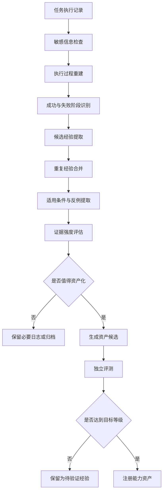

# 问答 122

> 来源: 新 窗口 | 会话: 分支 · 分支 · 分支 · 设计自进化智能体
> 消息: 3fb6c39f-3e22-48ae-a58f-a8e7bb071430 | 时间(UTC): 2026-10-24 11:12

## 用户

继续

## ChatGPT

构建归因资产体系

构建了归因资产体系

<WritingBlock id="71384" variant="document"># EvoAgent 第五十八专项：进化收益归因、经验固化与长期能力资产化体系

**专项编号：EOACA**

**英文名称：Evolution Outcome Attribution & Capability Assetization**

**文档版本：V1.0**

**文档性质：全量架构专项设计**

**适用范围：EvoAgent 通用内核、领域专家、ReAct、Plan、DAG、记忆系统、上下文治理、工具能力治理 TCRDCF、能力依赖图 CDCIPC、执行可靠性体系 ERTOV、运行日志系统 AODEE、问题诊断系统 RCAE、独立评测系统 UEEDA、自主进化治理系统 AECGSR。**

**核心目标：将真实任务中经过验证的成功经验、失败恢复方法、工具组合、提示词策略和工作流，转化为具有明确适用范围、证据、版本、评测标准和生命周期的长期能力资产，使 EvoAgent 能够持续积累真正有效的能力，而不是反复解决相同问题。**

本文定义目标架构与实施基线，不代表相关模块已经实现。

---

# 一、为什么完成任务不等于获得能力？

此前的专项已经建立了自主进化闭环：

运行任务 → 记录问题 → 分析原因 → 生成候选改进 → 独立评测 → 风险分级 → 安全发布 → 运行监控与回滚。

但这条闭环主要解决的是：**如何发现问题，以及如何安全地改进系统。**

还有一个更深层的问题没有解决：

当 EvoAgent 成功完成一次复杂任务后，这次成功究竟应该留下什么？

假设你让 EvoAgent 修复一个 Python 项目中的跨文件依赖问题。

第一次执行时，系统经历了：

1. 直接搜索代码，未发现全部调用关系；
2. 修改代码后，测试出现失败；
3. 启用 AST 分析，找到遗漏的调用方；
4. 调整修改范围；
5. 重新执行测试；
6. 最终通过验收。

这个过程至少产生了五种不同的潜在成果：

- 一份成功修复的代码；
- 一条经过验证的修复流程；
- 一种识别跨文件依赖问题的方法；
- 一条失败恢复经验；
- 一组能够验证修复是否成功的测试。

如果系统只保存最终代码，下一次遇到相似任务时，仍然可能重复之前的失败。

如果把完整执行日志全部塞进长期记忆，不仅会造成记忆膨胀，还会让模型难以判断哪些信息值得复用。

如果直接把这次成功的步骤固化成工作流，又可能在不同项目、不同语言或不同约束下产生错误。

因此，EvoAgent 需要建立一个独立的长期能力资产化体系。

其核心任务不是保存更多内容，而是把经历转化为可验证、可复用、可维护的能力。

## 1.1 必须区分六种对象

| 对象 | 含义 | 示例 |
|---|---|---|
| 执行记录 | 实际发生了什么 | 某次代码修复的完整日志 |
| 经验假设 | 可能存在什么规律 | 跨文件修改前应检查调用关系 |
| 已验证经验 | 在明确条件下经过验证的规律 | 某类 Python 修改任务中，先分析调用关系可以降低遗漏率 |
| 能力资产 | 可以被系统直接检索和使用的正式成果 | 跨文件依赖检查策略 |
| 工作流资产 | 可重复执行的步骤、依赖与验收规则 | 分析依赖 → 修改 → 测试 → 验收 |
| 长期能力 | 资产被正确复用后形成的稳定执行表现 | 类似任务的成功率持续提升 |

它们之间存在联系，但不能直接画等号。

一次任务成功，不代表已经形成可靠经验；一条经验被保存，不代表它已经成为可复用能力；一个工作流被固化，也不代表它适用于所有类似任务。

**EOACA 的核心职责，就是建立从执行证据到长期能力的严格转换机制。**

---

# 二、第一性原理：能力资产必须满足什么条件？

建议把正式能力资产定义为：

> 一项具有明确用途、适用条件、执行方式、验证要求、来源证据和维护策略，能够在后续任务中被安全复用的结构化系统资源。

一个合格的能力资产至少满足以下条件。

1. **可描述**：能够明确说明解决什么问题。
2. **可定位**：系统能够在适当任务中找到它。
3. **有边界**：明确适用条件与不适用条件。
4. **有证据**：记录它为什么值得被信任。
5. **可执行或可应用**：能够指导实际操作，而不只是泛泛的经验描述。
6. **可验证**：能够检查使用后是否达到预期。
7. **可追溯**：能够追踪其来源、版本和依赖。
8. **可撤销**：发现失效后，可以停止使用或恢复旧版本。
9. **有成本意识**：复用带来的收益应与维护、检索和执行成本相匹配。
10. **有生命周期**：能够更新、降级、淘汰和归档。

这里有一个重要区别：

**长期能力资产不是单纯的自然语言知识库，而是包含知识、策略、工具、工作流和验证机制的结构化能力库。**

它可以包含自然语言经验，但不能只依赖自然语言描述来保证执行正确。

---

# 三、总体架构：从任务经历到长期能力资产

建议新增独立的 `Capability Assetization Layer`，作为记忆系统、工具治理系统、工作流编排器和自主进化控制器之间的桥梁。

<box border radius="xl" padding={3} gap={2}>
  <box background="surface-secondary" radius="lg" padding={3} align="center" gap={1}>
    **第一层：任务执行与证据采集**

    <text color="secondary" size="sm">AODEE · ERTOV</text>

    <text size="sm">记录任务目标、执行步骤、失败、恢复、成本、产物与验收结果。</text>
  </box>
  <box align="center">
    <icon name="arrow-down" size="lg" color="secondary"/>
  </box>
  <box background="surface" border radius="lg" padding={3} align="center" gap={1}>
    **第二层：结果归因与经验提取**

    <text color="secondary" size="sm">RCAE · UEEDA · EOACA</text>

    <text size="sm">识别有效因素，区分相关性与因果证据，提取成功策略和失败模式。</text>
  </box>
  <box align="center">
    <icon name="arrow-down" size="lg" color="secondary"/>
  </box>
  <box background="surface" border radius="lg" padding={3} align="center" gap={1}>
    **第三层：资产候选生成与验证**

    <text color="secondary" size="sm">资产分类 · 适用范围 · 独立评测</text>

    <text size="sm">把候选经验转换为策略、工具组合、工作流、恢复方案或测试资产。</text>
  </box>
  <box align="center">
    <icon name="arrow-down" size="lg" color="secondary"/>
  </box>
  <box background="surface-secondary" radius="lg" padding={3} align="center" gap={1}>
    **第四层：资产注册与生命周期治理**

    <text color="secondary" size="sm">Capability Asset Registry</text>

    <text size="sm">管理版本、证据、依赖、信任等级、使用记录、失效条件与淘汰规则。</text>
  </box>
  <box align="center">
    <icon name="arrow-down" size="lg" color="secondary"/>
  </box>
  <box background="surface" border radius="lg" padding={3} align="center" gap={1}>
    **第五层：能力发现与实际复用**

    <text color="secondary" size="sm">专家路由 · 记忆检索 · Plan · DAG · TCRDCF</text>

    <text size="sm">在满足适用条件时选择资产，并在执行后验证真实收益。</text>
  </box>
  <box align="center">
    <icon name="arrow-down" size="lg" color="secondary"/>
  </box>
  <box background="surface-secondary" radius="lg" padding={3} align="center" gap={1}>
    **第六层：长期收益评估与反馈**

    <text size="sm">比较复用前后的质量、成本、效率、失败率与维护负担，决定保留、更新或淘汰。</text>
  </box>
</box>

六层结构不要求部署为六个独立服务。

考虑到 EvoAgent 是个人使用、本地优先的系统，可以在一个进程中实现多个逻辑模块，使用统一数据库与任务标识协同。

关键是职责分离，而不是增加服务器数量。

---

# 四、结果归因：成功究竟是怎么产生的？

这是整个专项最容易被低估的部分。

假设某次任务在增加 AST 分析步骤后成功了。

系统观察到：

- 修改前：任务失败；
- 修改后：任务成功。

能否直接得出“AST 分析提升了任务成功率”的结论？

不能。

因为同一次修改过程中，还可能同时发生了：

- 更换模型；
- 修改提示词；
- 增加测试；
- 调整工具参数；
- 改变了任务拆分方式。

真正起作用的可能是其中一个因素，也可能是多个因素共同作用。

如果系统把所有收益归因于 AST 分析，就可能在未来过度使用该能力，甚至在不适合的任务中增加不必要的成本。

因此，EOACA 必须建立独立的结果归因机制。

## 4.1 归因的五个层次

| 层级 | 问题 | 所需证据 |
|---|---|---|
| L0：结果记录 | 任务是否成功？ | 任务验收与执行日志 |
| L1：过程关联 | 成功前发生了哪些变化？ | 步骤、工具调用、版本与时间线 |
| L2：机制解释 | 哪些因素可能解释结果？ | 诊断报告、错误变化、过程证据 |
| L3：对照验证 | 去掉或改变某因素后，结果是否不同？ | 对照实验、消融测试、基线比较 |
| L4：重复验证 | 该效果是否能在适用任务中重复出现？ | 多任务回归、分层评测、实际运行证据 |

这些等级表示证据强度，而不是所有经验都必须达到同一等级才能保存。

例如，一次成功可以立即保存为执行记录；但如果要把某项经验升级为通用自动执行策略，就需要更强的证据。

## 4.2 建立候选因素清单

每次归因至少记录：

- 任务目标；
- 任务难度与类别；
- 执行环境；
- 模型版本；
- 专家版本；
- 工具版本；
- 提示词版本；
- 工作流版本；
- 实际执行步骤；
- 失败及恢复情况；
- 最终验收结果；
- 可能影响结果的因素。

这样才能避免把环境变化误认为策略进步。

## 4.3 使用对照实验

对于可重复的任务，建议比较：

- 原始方案；
- 新方案；
- 原始方案加单项修改；
- 新方案去掉某项关键步骤后的表现。

例如：

| 实验组 | AST 分析 | 修改前测试 | 结果 |
|---|---|---|---|
| A：基线 | 否 | 有 | 基线表现 |
| B：候选 | 是 | 有 | 候选表现 |
| C：消融 | 否 | 有，但采用其他候选步骤 | 检查 AST 的独立贡献 |

具体实验应尽可能固定其他条件，并覆盖足够多的代表性任务。

对于涉及随机生成、不同模型输出或复杂环境的任务，单次成功往往不足以支持强因果结论。

## 4.4 不能强行追求单一原因

有些能力本来就来自组合。

例如，代码修复成功可能需要：

- AST 分析；
- 文件搜索；
- 修改前测试；
- 补丁检查；
- 修改后测试。

单独删除其中任一环节都可能导致失败。

这种情况下，应当把它视为一个经过验证的**能力组合**，而不是强行认定某个工具或提示词是唯一原因。

归因系统需要允许：

- 单因素贡献；
- 多因素协同；
- 条件性贡献；
- 证据不足；
- 结果无法归因。

最后一种状态非常重要。

当证据不足时，系统应该记录不确定性，而不是让模型编造一个听起来合理的解释。

---

# 五、经验提取：从完整日志中提炼真正有用的信息

运行日志通常非常庞大，包含大量低价值细节。

例如，一次代码修复可能产生数百条工具调用记录。

如果全部保存为长期经验，系统的检索效率会逐渐下降。

因此，EOACA 应当建立经验提取流水线。

## 5.1 提取流程



## 5.2 提取的不是摘要，而是可应用规则

低价值摘要：

> 这次代码修改经历了一些错误，最终通过增加分析步骤成功。

更有价值的经验候选：

> 对涉及多个 Python 文件的修改任务，在执行写入前检查目标符号的定义、引用位置和相关调用方；如果修改影响公共接口，应补充对应的兼容性测试。对于不涉及跨文件依赖的简单修改，不强制执行完整依赖分析。

第二种表达具有：

- 明确的触发条件；
- 具体的执行动作；
- 适用边界；
- 需要检查的结果；
- 避免过度使用的限制。

这才适合转化为结构化能力资产。

## 5.3 必须提取反例

如果只收集成功经验，系统会逐渐形成过度乐观的策略。

因此，每项重要经验都应尽可能收集：

- 成功案例；
- 失败案例；
- 适用边界；
- 不适用条件；
- 与其他策略冲突的情况；
- 已知副作用；
- 资源成本；
- 尚未验证的假设。

例如，“优先使用 AST 分析”并不是一个普遍适用的规则。

如果项目语言不受支持、文件不是有效源代码，或者任务只涉及简单字符串替换，这项能力可能没有必要。

反例能够防止系统把局部经验泛化为全局规则。

---

# 六、能力资产分类：成功后应该保存什么？

建议建立八种主要资产类型。

<box gap={2}>
  <row align="start" gap={3}>
    <box background="surface-secondary" radius="lg" size="44px" align="center" justify="center">
      <icon name="lightbulb" size="xl"/>
    </box>
    <box flex="1" gap={1}>
      **1. 经验规则资产**

      <text color="secondary" size="sm">记录某类问题的有效判断方法、适用条件和限制。</text>

      示例：当任务涉及公共接口变更时，应检查调用方和兼容性。
    </box>
  </row>
  <divider color="subtle"/>
  <row align="start" gap={3}>
    <box background="surface-secondary" radius="lg" size="44px" align="center" justify="center">
      <icon name="workflow" size="xl"/>
    </box>
    <box flex="1" gap={1}>
      **2. 工作流资产**

      <text color="secondary" size="sm">将重复验证有效的任务流程固化为 DAG 或可编排工作流。</text>

      示例：读取项目 → 依赖分析 → 修改 → 测试 → 产物验收。
    </box>
  </row>
  <divider color="subtle"/>
  <row align="start" gap={3}>
    <box background="surface-secondary" radius="lg" size="44px" align="center" justify="center">
      <icon name="wrench" size="xl"/>
    </box>
    <box flex="1" gap={1}>
      **3. 工具组合资产**

      <text color="secondary" size="sm">记录哪些工具组合、调用顺序与参数适合某类任务。</text>

      示例：代码搜索 + AST 分析 + 类型检查。
    </box>
  </row>
  <divider color="subtle"/>
  <row align="start" gap={3}>
    <box background="surface-secondary" radius="lg" size="44px" align="center" justify="center">
      <icon name="shield-check" size="xl"/>
    </box>
    <box flex="1" gap={1}>
      **4. 失败恢复资产**

      <text color="secondary" size="sm">记录故障特征、恢复动作、重试条件和恢复后的验收方法。</text>

      示例：测试环境超时后，先区分环境故障和代码故障，再决定重试或更换执行方式。
    </box>
  </row>
  <divider color="subtle"/>
  <row align="start" gap={3}>
    <box background="surface-secondary" radius="lg" size="44px" align="center" justify="center">
      <icon name="clipboard-check" size="xl"/>
    </box>
    <box flex="1" gap={1}>
      **5. 验收与测试资产**

      <text color="secondary" size="sm">沉淀有效的测试用例、验收规则、边界条件和回归测试。</text>

      示例：某次修复发现的历史缺陷，转化为长期回归用例。
    </box>
  </row>
  <divider color="subtle"/>
  <row align="start" gap={3}>
    <box background="surface-secondary" radius="lg" size="44px" align="center" justify="center">
      <icon name="git-branch" size="xl"/>
    </box>
    <box flex="1" gap={1}>
      **6. 专家策略资产**

      <text color="secondary" size="sm">记录特定专家经过验证的规划、判断、验证和恢复策略。</text>

      示例：漫剧专家在角色一致性检查失败时的镜头替换策略。
    </box>
  </row>
  <divider color="subtle"/>
  <row align="start" gap={3}>
    <box background="surface-secondary" radius="lg" size="44px" align="center" justify="center">
      <icon name="brain" size="xl"/>
    </box>
    <box flex="1" gap={1}>
      **7. 用户与项目上下文资产**

      <text color="secondary" size="sm">保存后续任务确实需要的长期偏好、项目约束和环境信息。</text>

      示例：某项目固定使用的测试框架或用户明确指定的工作习惯。
    </box>
  </row>
  <divider color="subtle"/>
  <row align="start" gap={3}>
    <box background="surface-secondary" radius="lg" size="44px" align="center" justify="center">
      <icon name="package-check" size="xl"/>
    </box>
    <box flex="1" gap={1}>
      **8. 可执行能力包**

      <text color="secondary" size="sm">将工作流、工具要求、策略、测试和版本约束组合成可复用单元。</text>

      示例：可安装、可验证、可升级的 Python 项目代码修复能力包。
    </box>
  </row>
</box>

这八类资产不是八个完全隔离的数据库。

它们可以由统一注册表管理，通过类型字段、依赖关系和访问策略区分。

同一任务可以产生多种资产，但每种资产都必须独立满足自己的准入条件。

---

# 七、能力资产的去向：哪些进入记忆，哪些进入工作流？

这是 EvoAgent 需要明确冻结的一项架构决策。

**不是所有经验都应该写入记忆，也不是所有成功流程都应该固化为 DAG。**

建议建立以下分流规则。

| 内容特征 | 首选去向 | 原因 |
|---|---|---|
| 用户明确的长期偏好 | 用户长期记忆 | 后续多个任务可能需要 |
| 当前任务中的临时信息 | 会话或任务记忆 | 生命周期较短 |
| 特定项目的约束 | 项目命名空间 | 避免污染其他项目 |
| 某个专家的判断策略 | 专家策略库 | 与专业语境紧密相关 |
| 跨专家通用的稳定方法 | 共享能力库 | 可以被多个专家复用 |
| 重复且步骤明确的任务流程 | 工作流库 | 便于执行、验证和维护 |
| 具体工具的参数与兼容性 | 工具能力注册表 TCRDCF | 属于工具实现与环境治理 |
| 经验证的测试和验收条件 | 评测资产库 UEEDA | 用于回归与独立评测 |
| 一次失败的完整过程 | 运行日志与案例库 | 用于诊断和事后分析 |
| 尚未验证的规律 | 候选经验库 | 避免误导稳定系统 |

## 7.1 记忆与能力资产的关系

记忆系统主要回答：

> 什么信息值得在未来继续保留和检索？

能力资产系统主要回答：

> 哪些经过验证的方法可以被系统在未来任务中可靠地应用？

两者可以互相引用，但不应互相替代。

例如，用户明确要求某项目使用特定测试框架，这属于项目上下文记忆。

而“修改该项目代码时，先运行哪些测试、如何解释失败、何时可以发布”，则可能形成工作流或专家策略资产。

## 7.2 工作流固化的判断标准

一条成功流程是否值得固化为 DAG，应综合考虑：

- 是否重复出现；
- 步骤顺序是否稳定；
- 节点输入输出是否明确；
- 依赖关系是否可以声明；
- 关键后置条件是否可验证；
- 失败恢复是否明确；
- 适用环境是否清晰；
- 固化后是否真的降低成本或失败率。

如果这些条件大部分满足，适合考虑固化。

如果任务目标、工具选择和步骤顺序经常变化，就不应强行固化为完全固定的流程。

---

# 八、固定工作流与灵活 Plan：采用双层执行模式

这是前面多个专项讨论过的问题，现在可以进一步明确。

固定 DAG 和灵活 Plan 不应该是二选一。

建议采用：

**稳定工作流负责可重复的确定性步骤，灵活 Plan 负责处理任务变化、未知情况和动态分支。**

## 8.1 固定工作流适用场景

例如，经过多次验证的代码发布流程：

1. 检查工作区；
2. 运行基础测试；
3. 生成代码差异；
4. 执行静态分析；
5. 运行指定测试集；
6. 检查验收条件；
7. 生成发布报告。

这类流程具有明确的顺序、输入输出和验收条件，适合固化。

## 8.2 灵活 Plan 适用场景

例如：

- 用户只描述了一个模糊的业务问题；
- 项目结构未知；
- 不确定应该使用哪种分析工具；
- 可能需要多个专家协作；
- 任务执行中出现了未预期的错误；
- 原始计划无法满足约束。

此时，应由 Plan 根据当前情况动态决定下一步。

## 8.3 混合模式

建议把工作流分为三种执行形式：

- `FIXED`：按经过验证的固定流程执行；
- `PARAMETERIZED`：流程稳定，但部分节点、参数和工具可以选择；
- `ADAPTIVE`：由 Plan 动态规划，并根据执行反馈调整。

例如，代码修复能力包可以采用：

```text
代码修复任务
    │
    ├── 识别任务类型
    │
    ├── 是否匹配已验证的工作流？
    │       │
    │       ├── 是 → 加载参数化工作流
    │       │         ├── 按契约执行确定性节点
    │       │         └── 异常时交给 Plan 恢复
    │       │
    │       └── 否 → 使用灵活 Plan
    │                 ├── 选择所需能力
    │                 ├── 动态分解任务
    │                 └── 验收后判断是否形成新资产
    │
    └── 统一执行结果验证
```

这意味着工作流固化不是让智能体失去灵活性，而是让已经验证有效的部分不必每次从头探索。

## 8.4 工作流资产不能绕过实时验证

即使一个工作流已经多次成功，也必须检查：

- 当前环境是否兼容；
- 相关工具是否可用；
- 输入是否满足前置条件；
- 版本是否仍然受支持；
- 是否存在新的权限限制；
- 当前任务是否处于该工作流的适用范围内。

工作流是经过验证的执行方案，不是永久正确的保证。

---

# 九、统一能力资产数据模型

建议建立独立的 `CapabilityAssetRegistry`。

每个正式资产都必须有唯一标识、版本、适用条件、证据和生命周期状态。

## 9.1 核心数据结构

建议至少包含以下字段：

| 字段 | 说明 |
|---|---|
| `asset_id` | 资产唯一标识 |
| `asset_type` | 资产类型 |
| `name` | 资产名称 |
| `description` | 资产用途 |
| `version` | 资产版本 |
| `owner_namespace` | 所属命名空间 |
| `applicability` | 适用条件 |
| `preconditions` | 前置条件 |
| `procedure` | 策略或执行步骤 |
| `postconditions` | 执行后置条件 |
| `verification_profile` | 验证规则 |
| `evidence_refs` | 支撑资产的证据 |
| `confidence_level` | 证据强度 |
| `dependencies` | 所依赖的能力和资产 |
| `known_limitations` | 已知限制 |
| `failure_modes` | 已知失败模式 |
| `cost_profile` | 成本与资源特征 |
| `model_constraints` | 模型适用要求 |
| `environment_constraints` | 环境要求 |
| `security_constraints` | 权限和数据处理要求 |
| `usage_stats` | 实际使用情况 |
| `outcome_stats` | 使用后的结果统计 |
| `lifecycle_status` | 生命周期状态 |
| `supersedes` | 替代的旧资产 |
| `created_at` | 创建时间 |
| `last_verified_at` | 最近验证时间 |
| `next_review_condition` | 下次复核条件 |

`confidence_level` 不应仅由模型主观给出一个数字。

它应由证据等级、验证次数、样本覆盖、反例情况以及适用环境等信息共同支持。

## 9.2 一个资产示例

下面是一个概念示例，而不是已运行的资产：

```yaml
asset_id: code.python.cross_file_change
asset_type: workflow_strategy
version: 1.0.0

applicability:
  language: python
  task_types:
    - cross_file_refactoring
    - public_interface_change

preconditions:
  - project_files_accessible
  - target_language_supported

procedure:
  - identify_modified_symbols
  - locate_definitions_and_references
  - analyze_affected_callers
  - construct_change_plan
  - apply_patch
  - run_relevant_tests

postconditions:
  - affected_callers_reviewed
  - patch_is_parseable
  - required_tests_passed

verification:
  required:
    - syntax_validation
    - relevant_regression_tests

known_limitations:
  - unsupported_language_features_require_alternative_analysis

lifecycle_status: candidate
```

正式资产还应关联实际的评测证据、工具版本、适用环境、失败案例和维护责任。

---

# 十、资产准入：什么时候才能从经验升级为正式能力？

建议建立五级资产成熟度。

| 等级 | 状态 | 含义 |
|---|---|---|
| L0 | `OBSERVED` | 只有执行记录 |
| L1 | `HYPOTHESIS` | 已提取候选经验，但未充分验证 |
| L2 | `VALIDATED` | 在明确条件下通过规定的验证 |
| L3 | `PROMOTED` | 已进入正式能力库，可在适用任务中复用 |
| L4 | `ESTABLISHED` | 经持续运行验证，具有较充分的长期表现证据 |

这不是要求每种资产都必须从 L0 开始。

例如，人工直接创建并通过测试的工作流，可以从候选状态开始。

但系统不能仅凭一次成功，就把经验升级为长期稳定的通用能力。

## 10.1 不同资产采用不同准入标准

一条低风险经验规则，可能只需要少量代表性任务验证。

一个会修改文件的自动化工作流，则需要更严格的前置条件、后置条件、异常恢复和副作用检查。

一个跨多个专家复用的共享能力资产，还需要测试其对不同专家的影响。

因此，资产准入标准应由以下因素共同决定：

- 资产类型；
- 风险等级；
- 影响范围；
- 自动执行程度；
- 失败后果；
- 可验证性；
- 可恢复性。

## 10.2 准入不能只看成功次数

例如，一条经验连续成功 20 次，但这 20 次任务都来自同一个项目、同一个环境和同一类输入。

它可能只对该项目有效。

因此，验证时应考虑任务覆盖的多样性，而不是简单地累计成功次数。

## 10.3 允许有价值但尚未成熟的资产存在

尚未达到正式准入条件的经验，不必全部删除。

可以保留在候选经验库中，并明确标记：

- 证据不足；
- 仅在单一环境验证；
- 已知存在失败案例；
- 需要补充反例；
- 仅供人工参考；
- 不允许自动执行。

这样既能积累探索成果，也不会让未经验证的经验污染稳定版。

---

# 十一、经验冲突与重复资产治理

随着 EvoAgent 长期运行，能力资产会逐渐增加。

不同任务、不同模型和不同工具可能产生相互矛盾的经验。

例如：

- 经验 A：代码修改前应始终运行完整测试；
- 经验 B：对于简单格式变更，只运行局部测试更高效。

这两条经验并不一定互相矛盾。

它们可能分别适用于不同任务类别。

因此，资产治理不能简单地采用“新经验覆盖旧经验”的方式。

## 11.1 冲突分类

建议识别以下情况：

1. **完全重复**：同一内容被重复提取。
2. **部分重复**：两个资产解决同类问题，但覆盖范围不同。
3. **条件冲突**：同一规则在不同环境中结论不同。
4. **真实冲突**：相同条件下，两个资产提出不兼容的动作。
5. **版本冲突**：旧资产依赖已失效的工具或接口。
6. **证据冲突**：新评测结果与原有经验不一致。

## 11.2 解决顺序

建议依次进行：

- 规范化资产描述；
- 比较适用条件；
- 检查依赖和版本；
- 检查证据等级；
- 比较最近的实际评测；
- 判断能否合并；
- 判断能否细化适用范围；
- 无法解决时，限制自动使用并进入复核。

不能简单地认为最新经验一定正确。

也不能因为某条旧经验历史成功次数更多，就拒绝接受新证据。

## 11.3 资产合并

两个资产只有在以下条件得到检查后，才能考虑合并：

- 目标问题相同；
- 前置条件兼容；
- 执行语义一致；
- 验收规则可以统一；
- 依赖关系可兼容；
- 合并后没有丢失关键限制。

合并后必须保留来源引用，使历史使用记录仍然可以追溯。

---

# 十二、能力资产检索与复用：不能只靠语义相似度

即使资产库很完整，如果系统不能在正确的任务中找到合适资产，长期积累也不会带来实际收益。

建议采用多阶段检索。

## 12.1 第一阶段：任务语义检索

根据用户任务和 TaskContract，识别：

- 任务类别；
- 领域专家；
- 输入类型；
- 目标产物；
- 必要能力；
- 约束；
- 验收要求。

利用这些信息检索可能相关的能力资产。

## 12.2 第二阶段：适用性过滤

对候选资产检查：

- 任务是否属于适用范围；
- 当前环境是否满足前置条件；
- 依赖工具是否兼容；
- 资产是否仍处于有效状态；
- 权限要求是否符合任务约束；
- 是否满足用户指定的硬性要求。

这一步必须先于最终排序。

## 12.3 第三阶段：资产排序

对通过过滤的资产，再考虑：

- 任务相关性；
- 证据强度；
- 历史成功表现；
- 环境匹配程度；
- 预期成本；
- 预计节省的执行步骤；
- 失败恢复能力；
- 维护状态。

可以采用如下抽象评分：

\[
S(a,t)=w_mM+w_eE+w_hH+w_cC+w_fF
\]

其中：

- \(a\)：能力资产；
- \(t\)：当前任务；
- \(M\)：任务匹配度；
- \(E\)：证据强度；
- \(H\)：相关历史表现；
- \(C\)：预期成本收益；
- \(F\)：失败恢复能力。

这个评分只用于排序，不能代替适用性检查与安全约束。

## 12.4 第四阶段：选择复用方式

找到资产后，还需要决定如何使用。

例如：

- 直接应用一条经验规则；
- 加载完整工作流；
- 只复用其中一个节点；
- 采用工具组合；
- 将资产作为 Plan 的参考；
- 先执行一个低风险验证步骤；
- 因条件不匹配而拒绝复用。

**检索到资产，不等于必须使用资产。**

如果当前任务与资产的适用条件不一致，正确做法是放弃复用，而不是为了利用历史经验强行套用。

---

# 十三、能力资产的使用反馈与长期收益归因

资产正式进入能力库后，工作还没有结束。

系统需要持续验证资产在真实任务中是否仍然有效。

建议每次复用都记录一份 `AssetUsageRecord`。

至少包含：

- `usage_id`；
- `asset_id`；
- `asset_version`；
- `task_id`；
- `expert_id`；
- `model_version`；
- `tool_versions`；
- `environment_profile`；
- `applicability_check`；
- `execution_outcome`；
- `verification_result`；
- `cost_actual`；
- `duration_actual`；
- `failure_reason`；
- `user_correction_signal`。

## 13.1 比较复用与不复用的表现

如果系统只记录“使用资产后成功”，会产生明显的选择偏差。

因为它可能只在容易的任务中使用某项资产，而把困难任务交给灵活 Plan。

此时，即使资产没有真实收益，统计数据也可能显得很好。

因此，长期评估应尽可能比较相似任务在不同策略下的表现。

可以采用：

- 基线版本对照；
- 同类任务分层比较；
- 离线重放；
- 受控消融；
- 适用条件内的自然对照；
- 在安全且允许的情况下进行受控试验。

对于有副作用的任务，不应为了对照实验而重复执行真实外部操作。可以使用隔离环境、历史记录或模拟环境。

## 13.2 核心收益指标

建议记录以下指标：

| 指标 | 说明 |
|---|---|
| 资产复用率 | 适用任务中实际采用资产的比例 |
| 复用成功率 | 使用资产后满足验收要求的比例 |
| 增量成功收益 | 相对于合理基线的成功率变化 |
| 平均成本变化 | 复用前后平均任务成本变化 |
| 平均时延变化 | 复用前后完成时间变化 |
| 失败恢复改善 | 资产是否减少失败或提高恢复成功率 |
| 返工变化 | 是否减少重复执行与用户纠正 |
| 误用率 | 资产被用于不适合场景的比例 |
| 过时率 | 因环境或工具变化而失效的资产比例 |
| 维护负担 | 更新、测试、存储和治理成本 |

## 13.3 不能把所有收益都归因于资产

如果复用资产的同时，系统也升级了模型或工具，就不能直接把全部提升归因于资产。

因此，长期收益报告需要记录环境和版本变化，并在证据允许的范围内做归因。

对于无法可靠归因的收益，应标记为相关性证据，而不是强因果结论。

---

# 十四、资产失效、更新与淘汰

能力资产会随着时间变化。

某条工作流可能因为工具升级而失效；某条经验可能因为模型能力增强而不再必要；某个恢复策略可能因为新版本修复了底层问题而变得多余。

因此，资产库必须具备生命周期治理。

## 14.1 资产生命周期

建议采用以下状态：

- `CANDIDATE`：候选资产；
- `VALIDATING`：正在验证；
- `ACTIVE`：正式可用；
- `DEGRADED`：存在已知限制；
- `SUSPENDED`：暂时停止自动使用；
- `DEPRECATED`：不再推荐新任务使用；
- `RETIRED`：已退出正式使用；
- `ARCHIVED`：保留历史记录，不再参与常规检索。

状态转换必须有明确条件。

例如，某项资产在新模型版本下未经验证，未必需要立即删除，但可以暂时限制其自动使用范围。

## 14.2 触发重新验证的条件

建议至少包括：

- 模型版本变化；
- 工具或适配器版本变化；
- 操作系统或运行时变化；
- 工作流依赖变化；
- 关键评测集更新；
- 相关任务的失败率上升；
- 用户明确纠正资产行为；
- 资产依赖被淘汰；
- 安全策略变化；
- 资产长期没有有效使用。

## 14.3 失效不等于删除

某项资产失效后，应区分：

- 仅当前环境不适用；
- 依赖工具暂时不可用；
- 资产存在局部缺陷；
- 资产已经过时；
- 资产本身具有危险行为；
- 资产从未获得充分验证。

如果只是当前环境不适用，可以保留资产并限制使用范围。

如果资产存在安全问题，则应立即停止相关自动调用，并保留必要的审计证据。

## 14.4 更新必须创建新版本

不建议直接覆盖正式资产的历史内容。

更新应生成新的候选版本，经过相应验证后，再替换正式版本。

这样可以比较：

- 旧资产解决了什么问题；
- 新资产修改了什么；
- 适用范围是否变化；
- 哪些测试证明了改进；
- 哪些历史任务需要重新评估；
- 是否需要回滚。

---

# 十五、能力资产依赖与跨专家复用

EvoAgent 采用通用内核、独立领域专家和能力依赖图相结合的架构。

因此，能力资产必须支持不同范围的复用。

建议建立四个资产命名空间。

| 命名空间 | 适用范围 | 示例 |
|---|---|---|
| `global` | 通用内核及多个专家共享 | 任务验收与执行证据记录 |
| `expert/{id}` | 单个领域专家 | 代码专家的跨文件修改策略 |
| `project/{id}` | 特定项目 | 某代码仓库的构建与测试流程 |
| `task/{id}` | 单次任务 | 当前任务的临时恢复方案 |

## 15.1 跨专家共享必须有门槛

假设代码专家总结出一条有效经验：

> 复杂任务在执行前，应先建立依赖关系，再安排修改顺序。

这条经验可能适用于：

- 代码重构；
- 漫剧生产；
- 多工具自动化；
- 复杂信息处理。

但不同领域的依赖语义并不完全相同。

因此，系统可以将其提取为通用候选规则，但必须在目标专家中重新验证。

不能因为一项策略在代码专家中有效，就直接认定它适用于所有专家。

## 15.2 共享基础能力与专家专业知识分离

建议遵循以下原则：

- 通用内核沉淀跨领域稳定的机制；
- 专家资产库沉淀领域特定的知识与策略；
- 项目命名空间保存项目特定约束；
- 单次任务记忆保存临时状态；
- 工作流库保存经过验证的流程；
- 工具注册表保存工具的实现和兼容性信息。

这样可以避免一次领域任务失败，导致通用内核或其他专家受到不必要的影响。

## 15.3 依赖关系必须显式化

一个工作流资产可能依赖：

- 多个工具能力；
- 某个专家策略；
- 特定版本的验收规则；
- 一组回归测试；
- 一个模型能力；
- 特定的运行环境。

这些依赖应通过 CDCIPC 和 TCRDCF 追踪。

如果某个依赖升级，系统应识别受影响的资产，并判断是否需要重新验证。

---

# 十六、记忆系统与能力资产库如何协同？

这一问题需要与前面关于上下文治理、记忆压缩和专家隔离的设计统一。

建议将长期知识组织为三个相互关联、但职责不同的层次。

<box border radius="lg" padding={3} gap={2}>
  <box gap={1}>
    **第一层：上下文与任务记忆**

    <text size="sm">保存当前任务状态、近期对话、临时观察和执行进度。生命周期较短，主要服务于当前任务连续性。</text>
  </box>
  <divider color="subtle"/>
  <box gap={1}>
    **第二层：长期语义记忆**

    <text size="sm">保存用户偏好、项目事实、长期约束、已确认的背景信息。主要服务于未来任务的理解和个性化。</text>
  </box>
  <divider color="subtle"/>
  <box gap={1}>
    **第三层：能力资产库**

    <text size="sm">保存经过验证的规则、工作流、工具组合、测试、恢复策略和可执行能力包。主要服务于可靠执行和持续改进。</text>
  </box>
</box>

三者之间可以相互引用，但不应把所有内容都压缩进同一个记忆空间。

例如：

- 用户偏好“修改代码前先解释计划”，进入用户长期记忆；
- 当前任务的待办步骤，进入任务记忆；
- 经过验证的代码修改工作流，进入工作流资产库；
- 工作流所依赖的 AST 工具版本，进入工具能力注册表；
- 工作流验收所需的测试集，进入评测资产库。

这样，记忆系统主要解决“记住什么”，能力资产库主要解决“如何可靠地做”，工具注册表主要解决“由什么实现”，评测系统主要解决“如何证明有效”。

---

# 十七、资产数量增长与知识库治理

如果 EvoAgent 长期运行，能力资产数量可能不断增加。

即使单个资产很小，过多重复、过时和低价值的资产也会降低检索质量。

因此，必须控制资产库的增长。

## 17.1 资产价值评估

建议综合考虑：

- 复用频率；
- 经验证的实际收益；
- 证据强度；
- 适用范围；
- 维护成本；
- 依赖稳定性；
- 误用风险；
- 是否存在更优替代资产。

可以定义概念性的资产价值函数：

\[
V(a)=B(a)-C(a)-R(a)
\]

其中：

- \(B(a)\)：经过验证的复用收益；
- \(C(a)\)：检索、执行、维护与验证成本；
- \(R(a)\)：误用、过时和失败带来的风险。

这个函数用于帮助决定是否继续维护资产，不应直接作为唯一的淘汰标准。

尤其是安全恢复方案、低频但重要的故障处理策略，不能因为使用频率低就被简单删除。

## 17.2 治理动作

建议支持：

- 去重；
- 合并；
- 拆分；
- 缩小适用范围；
- 更新版本；
- 标记失效；
- 降低信任等级；
- 转为人工参考；
- 停止自动调用；
- 归档。

## 17.3 防止资产无限膨胀

建议采用：

1. 候选经验有生命周期；
2. 正式资产必须有维护策略；
3. 重复资产定期合并；
4. 长期未验证资产降低自动使用权限；
5. 过时依赖触发复核；
6. 低收益资产可以淘汰；
7. 高价值历史证据独立保留；
8. 归档不等于彻底删除。

不应将所有历史日志都转换为正式能力资产。

日志系统负责保留执行证据，资产系统负责保留经过筛选的可复用成果。

---

# 十八、隐私、权限与资产安全

能力资产可能包含项目结构、用户偏好、代码片段、外部服务配置或失败案例。

因此，资产化不能成为数据泄漏的入口。

## 18.1 资产提取前的数据检查

应检查：

- 是否包含凭据；
- 是否包含访问令牌；
- 是否包含敏感个人信息；
- 是否包含不应跨项目共享的代码；
- 是否包含第三方保密内容；
- 是否包含外部服务返回的受限数据；
- 是否包含未经授权保存的原始文件内容。

敏感信息不应因为“有利于未来复用”就自动进入长期资产库。

## 18.2 资产权限

每个资产应具有明确的访问范围：

- 全局可读；
- 专家内可读；
- 项目内可读；
- 任务内可读；
- 仅诊断系统可读；
- 需要特定授权才能执行。

执行权限与读取权限应当分开。

一个资产可以被检索和解释，但不一定允许自动执行。

## 18.3 可执行资产的特殊保护

工作流和能力包可能调用工具、修改文件或触发外部操作。

因此，必须继续受 AHOG 和 TCRDCF 的约束。

正式资产不能因为曾经成功，就获得永久且不受限制的执行权限。

每次调用仍然需要根据当前任务、环境和权限重新检查。

---

# 十九、个人设备上的实现方案

考虑到 EvoAgent 的部署目标是个人电脑、mini Linux 主机以及 Android 优先的设备体系，不建议一开始建设复杂的分布式知识平台。

建议采用本地优先的模块化实现。

## 19.1 核心组件

第一阶段可以使用：

- SQLite：存储资产元数据、版本、状态与使用统计；
- 文件系统：保存工作流、测试用例和结构化资产内容；
- Git：管理代码型资产与工作流定义的版本；
- 内容哈希：识别重复资产与检查文件完整性；
- 向量索引或全文搜索：辅助候选资产检索；
- 统一评测接口：复用 UEEDA；
- 依赖关系索引：关联 CDCIPC 与 TCRDCF。

向量检索不是必需的核心依赖。

在早期资产数量较少时，结构化过滤与全文检索可能已经足够。只有在实际检索质量需要时，再增加向量索引。

## 19.2 Android 端与本地控制端

Android 端可以采集经授权的任务执行证据，并缓存必要的任务状态。

在条件允许时，将脱敏后的经验候选同步到本地控制端或个人服务器，由统一资产治理流程进行验证和注册。

如果没有独立服务器，也可以在桌面端或 mini Linux 主机上完成整个流程。

当设备断联时：

- 保留当前任务必要的资产副本；
- 使用已经验证且适用于本地环境的资产；
- 不依赖远程资产服务也能完成基本能力检索；
- 缓存新增的使用记录；
- 网络恢复后再进行增量同步。

资产同步不能直接覆盖本地更高版本或已被隔离的资产。

同步时必须检查版本、依赖、完整性和状态冲突。

---

# 二十、工程目录与核心接口

建议新增以下逻辑模块：

```text
evoagent/
├── capability_assets/
│   ├── asset_registry/
│   ├── asset_schema/
│   ├── asset_versioning/
│   ├── asset_namespace/
│   ├── asset_lifecycle/
│   ├── asset_dependencies/
│   └── asset_integrity/
├── outcome_attribution/
│   ├── execution_reconstruction/
│   ├── factor_extraction/
│   ├── baseline_comparison/
│   ├── ablation_testing/
│   ├── evidence_strength/
│   └── attribution_report/
├── experience_extraction/
│   ├── success_pattern_extractor/
│   ├── failure_pattern_extractor/
│   ├── boundary_condition_extractor/
│   ├── duplicate_detection/
│   └── candidate_experience/
├── asset_promotion/
│   ├── asset_classifier/
│   ├── admission_policy/
│   ├── evidence_validator/
│   ├── independent_benchmark/
│   └── promotion_gate/
├── asset_retrieval/
│   ├── task_context_parser/
│   ├── semantic_retrieval/
│   ├── applicability_filter/
│   ├── asset_ranker/
│   └── reuse_decision/
├── workflow_assetization/
│   ├── workflow_candidate_builder/
│   ├── dag_normalizer/
│   ├── precondition_validator/
│   ├── postcondition_validator/
│   └── workflow_regression/
├── asset_outcome_tracking/
│   ├── usage_record/
│   ├── reuse_effectiveness/
│   ├── cost_attribution/
│   ├── drift_detection/
│   └── asset_health/
├── asset_governance/
│   ├── conflict_resolution/
│   ├── deduplication/
│   ├── merge_split/
│   ├── deprecation/
│   ├── archival/
│   └── privacy_review/
└── asset_evaluation/
    ├── retrieval_benchmark/
    ├── applicability_tests/
    ├── reuse_benchmark/
    ├── cross_expert_transfer/
    └── lifecycle_regression/
```

建议提供以下核心接口：

- `reconstruct_execution`：重建任务执行过程；
- `attribute_task_outcome`：分析任务结果的可能影响因素；
- `compare_execution_baseline`：比较任务基线与候选方案；
- `run_ablation_experiment`：执行适用的消融实验；
- `extract_success_patterns`：提取候选成功经验；
- `extract_failure_patterns`：提取失败和恢复经验；
- `extract_applicability_conditions`：提取适用条件；
- `create_asset_candidate`：生成资产候选；
- `classify_asset_type`：识别资产类型；
- `validate_asset_evidence`：验证资产证据；
- `evaluate_asset_admission`：评估资产准入；
- `promote_asset`：将通过门禁的候选提升为正式资产；
- `retrieve_relevant_assets`：检索相关资产；
- `check_asset_applicability`：检查资产是否适用于当前任务；
- `select_asset_reuse_mode`：选择复用方式；
- `record_asset_usage`：记录资产使用情况；
- `evaluate_reuse_effectiveness`：评估复用收益；
- `detect_asset_conflicts`：检测资产冲突；
- `merge_duplicate_assets`：合并重复资产；
- `create_asset_version`：创建资产新版本；
- `suspend_asset`：暂停资产自动使用；
- `deprecate_asset`：标记资产过时；
- `archive_asset`：归档历史资产；
- `invalidate_asset_dependencies`：标记依赖变化引起的潜在失效；
- `evaluate_cross_expert_transfer`：评估跨专家复用效果；
- `audit_asset_permissions`：检查资产访问与执行权限。

这些接口必须与任务 ID、执行证据、资产版本和评测记录建立关联，避免形成无法追溯的独立知识库。

---

# 二十一、端到端验收场景

建议至少设计以下验收场景。

## 场景 A：从重复失败中提取恢复策略

初始情况：某工具经常因超时失败。

验收流程：

1. 系统从日志中识别重复失败；
2. RCAE 分析可能原因；
3. 提取候选恢复策略；
4. 在隔离环境执行故障注入测试；
5. 比较新旧恢复策略；
6. 检查是否增加不必要的重试；
7. 检查是否违反预算；
8. 通过门禁后注册为恢复资产；
9. 在后续适用任务中复用；
10. 记录复用后的成功率、成本和恢复表现。

验收重点：系统不能把“重试一次后成功”直接当作普遍有效的恢复规则。

## 场景 B：把成功任务固化为工作流

初始情况：某类漫剧任务已经多次完成，步骤相对稳定。

验收流程：

1. 收集成功执行记录；
2. 比较不同任务的步骤差异；
3. 提取共同节点和可变节点；
4. 建立参数化 DAG；
5. 为每个节点定义输入输出契约；
6. 定义失败恢复策略；
7. 建立质量验收规则；
8. 在新样本上执行回归测试；
9. 比较工作流与灵活 Plan 的表现；
10. 根据收益决定是否正式发布。

验收重点：系统不能为了固化流程而丢失必要的动态决策能力。

## 场景 C：防止错误经验跨专家传播

初始情况：代码专家发现一条有效策略。

验收流程：

1. 将策略登记为代码专家资产；
2. 其他专家检索到该资产；
3. 检查跨领域适用条件；
4. 在未验证的专家中限制自动执行；
5. 生成领域适配候选；
6. 在目标专家的独立评测集中验证；
7. 只有通过验证后，才允许在该专家范围内使用。

验收重点：不能仅凭语义相似度就将代码策略提升为全局通用规则。

## 场景 D：工具升级导致资产失效

初始情况：某工作流依赖的工具升级后，输出格式发生变化。

验收流程：

1. TCRDCF 记录工具版本变化；
2. CDCIPC 找到受影响的工作流资产；
3. EOACA 将相关资产标记为需要重新验证；
4. 在验证完成前限制受影响资产的自动调用；
5. 检查适配器与工作流是否兼容；
6. 运行相关回归集；
7. 通过后更新依赖关系；
8. 失败时恢复旧版本或寻找合规替代方案。

验收重点：资产不能因为历史上成功，就永久绕过当前环境检查。

## 场景 E：候选资产没有真实收益

初始情况：某经验在开发集上表现良好，但在独立测试集上没有提升。

验收流程：

1. 记录开发集结果；
2. 在独立评测集上验证；
3. 比较基线；
4. 检查任务分布和成本变化；
5. 拒绝正式晋升；
6. 将经验保留为待验证候选，或在无后续价值时归档。

验收重点：不能因为已经投入生成成本，就强行把候选升级为正式能力。

## 场景 F：资产库过度膨胀

初始情况：多个专家反复产生类似经验。

验收流程：

1. 检测重复资产；
2. 比较适用条件；
3. 合并兼容资产；
4. 保留原始来源；
5. 对冲突规则进行拆分或复核；
6. 验证合并后检索质量；
7. 检查合并前后的实际复用效果。

验收重点：资产数量减少不能以丢失关键限制和证据为代价。

---

# 二十二、专项验收标准

EOACA 至少需要满足以下要求：

1. 能够区分执行记录、经验假设、已验证经验、能力资产和正式工作流。
2. 能够记录任务成功、失败、恢复、成本和最终验收结果。
3. 能够分析影响任务结果的候选因素。
4. 能够区分过程关联、机制解释和较强因果证据。
5. 在证据不足时，允许归因结果保持不确定。
6. 支持基线比较、消融测试和重复验证。
7. 能够提取成功经验、失败模式、恢复策略与反例。
8. 每项正式资产具有明确用途和适用条件。
9. 每项正式资产具有可追溯的证据引用。
10. 能够区分经验规则、工作流、工具组合、测试资产和项目记忆。
11. 能够根据资产类型执行不同的准入门禁。
12. 不允许单次任务成功直接将经验提升为全局正式规则。
13. 能够将长期偏好与可执行能力资产分开存储。
14. 能够在适当场景下将稳定流程固化为固定或参数化 DAG。
15. 能够保留需要动态规划的任务的灵活 Plan 能力。
16. 能够通过前置条件、后置条件和依赖关系约束工作流执行。
17. 能够在任务开始时检查资产的适用范围。
18. 能够根据实际结果决定是否复用某项资产。
19. 能够记录每次资产使用的版本、环境、成本和结果。
20. 能够比较资产复用与合理基线之间的收益。
21. 能够识别资产在不同模型、工具和环境下的表现差异。
22. 能够检测重复资产、部分重复资产和真实冲突。
23. 能够通过合并、拆分、更新、降级和归档治理资产增长。
24. 能够识别工具升级、模型切换和环境变化导致的资产失效风险。
25. 能够在必要时暂停资产的自动使用。
26. 能够追踪资产与 CDCIPC、TCRDCF 和 UEEDA 之间的依赖关系。
27. 能够限制未经验证的跨专家经验迁移。
28. 能够对资产执行读取权限和执行权限分离治理。
29. 能够在资产提取前检查敏感信息和数据授权。
30. 能够通过实际任务验证能力资产是否降低失败率、成本或返工。
31. 能够识别没有真实收益或维护成本过高的资产。
32. 能够将长期有效的经验转化为可版本化的能力资产。
33. 能够保留资产的历史版本、来源证据和淘汰原因。
34. 能够在个人电脑、mini Linux 主机等本地优先环境运行。
35. 能够在设备断联时使用已经验证的本地资产，并在重连后安全同步。
36. 能够防止实验经验、未验证规则和临时任务数据污染稳定版资产库。

以上是目标架构的验收要求，不代表相关模块已经实现或通过测试。

---

# 二十三、建议冻结的架构决策

以下建议承接 ADR-933。

| 编号 | 决策 |
|---|---|
| ADR-934 | 建立独立的进化收益归因、经验固化与长期能力资产化体系 EOACA |
| ADR-935 | 区分执行记录、经验假设、已验证经验、能力资产和正式工作流 |
| ADR-936 | 能力资产必须具有明确用途、适用条件、证据、版本和生命周期 |
| ADR-937 | 结果归因必须区分过程关联、机制解释和因果验证 |
| ADR-938 | 证据不足时允许保留不确定性，不得将模型生成的解释视为已证实原因 |
| ADR-939 | 重要能力资产应通过基线比较、消融测试或重复验证获得足够证据 |
| ADR-940 | 能力资产分为经验规则、工作流、工具组合、恢复策略、测试、专家策略、上下文资产和能力包 |
| ADR-941 | 记忆系统负责保留重要信息，能力资产库负责管理可复用的执行方法 |
| ADR-942 | 用户偏好、任务状态、项目约束和可执行策略采用不同命名空间与生命周期 |
| ADR-943 | 正式资产必须具有适用范围、前置条件、后置条件和验证要求 |
| ADR-944 | 能力资产必须支持候选、验证、正式使用、降级、暂停、淘汰和归档等生命周期状态 |
| ADR-945 | 固定 DAG、参数化工作流和灵活 Plan 应共同存在，并根据任务特征选择 |
| ADR-946 | 工作流固化必须经过重复性、可验证性、适用边界和实际收益评估 |
| ADR-947 | 资产检索必须先执行适用性和安全约束检查，再进行候选排序 |
| ADR-948 | 检索到资产不代表必须使用资产 |
| ADR-949 | 每次重要资产复用必须记录版本、环境、结果和实际成本 |
| ADR-950 | 资产收益必须尽可能与合理基线比较，避免将相关性误认为因果关系 |
| ADR-951 | 资产之间发生冲突时，必须比较适用条件、证据、依赖和版本，不得简单以新旧顺序覆盖 |
| ADR-952 | 跨专家复用必须经过目标专家适用性验证，不能直接推广领域特定经验 |
| ADR-953 | 能力资产的依赖必须关联 CDCIPC 与 TCRDCF，便于识别变更影响 |
| ADR-954 | 工具、模型和环境发生关键变化时，应触发相关资产的重新验证或使用限制 |
| ADR-955 | 正式资产更新应产生可追溯的新版本，不得破坏历史证据 |
| ADR-956 | 资产治理必须支持去重、合并、拆分、降级、淘汰和归档 |
| ADR-957 | 资产价值评估必须考虑真实收益、维护成本、误用风险和长期有效性 |
| ADR-958 | 资产读取权限与执行权限分离，所有执行继续受到 AHOG 约束 |
| ADR-959 | 资产提取与跨项目共享必须遵守数据最小化、授权和敏感信息保护要求 |
| ADR-960 | 长期能力资产必须通过实际复用效果持续评估，而不是仅凭历史成功次数认定有效 |
| ADR-961 | 实验经验不得未经验证直接进入稳定版的全局策略或长期能力库 |
| ADR-962 | 正式资产必须支持本地优先运行、断联使用和安全增量同步 |

以上建议作为 EvoAgent 第五十八专项的架构基线。

---

# 二十四、下一专项：能力缺口发现、需求预测与主动能力规划体系

至此，EvoAgent 已经具备四项相互衔接的长期能力建设基础：

- 运行中发现问题；
- 自主提出并验证改进；
- 通过变更治理安全发布；
- 将经过验证的经验沉淀为可复用能力资产。

但这套体系仍然主要是被动的。

系统往往需要先遇到问题，才能知道自己缺少什么。

如果一个任务失败是因为缺少特定能力，系统可能要经历多次失败，才会开始考虑增加该能力。

如果用户准备开展一个新的复杂项目，系统也可能等到执行中途才发现缺少必要工具、专家或工作流。

这引出了下一层问题：

**EvoAgent 能否在任务开始前，主动识别自身的能力缺口，并判断应该补充什么能力、何时补充、补充到什么程度？**

建议下一专项定义为：

**Capability Gap Discovery, Demand Forecasting & Proactive Capability Planning，简称 CGDPCP。**

重点研究：

1. 如何根据用户任务和长期目标预测所需能力；
2. 如何判断当前能力库是否足以支持任务；
3. 如何区分真正缺失的能力与尚未发现的已有能力；
4. 如何识别工具缺失、专家缺失、工作流缺失和模型能力不足；
5. 如何判断问题来自能力缺口，还是已有能力的使用方式不正确；
6. 如何建立能力缺口的统一描述与严重程度分级；
7. 如何根据任务频率、失败代价、预期收益和资源成本决定是否补齐能力；
8. 如何避免为了少数特殊任务引入过多工具和复杂度；
9. 如何预测未来可能反复出现的能力需求；
10. 如何根据能力依赖图识别关键基础能力的缺失；
11. 如何在新增能力前优先检查现有资产能否组合解决问题；
12. 如何评估新增专家、工具、模型、工作流或验证器的必要性；
13. 如何在不同方案之间进行成本收益比较；
14. 如何将能力缺口转化为结构化开发任务；
15. 如何为新增能力生成独立评测集和验收标准；
16. 如何判断新增能力应归属于通用内核、某个专家还是独立能力包；
17. 如何管理能力覆盖率和能力冗余；
18. 如何识别已有能力因环境变化而形成的隐性缺口；
19. 如何建立能力需求优先级，避免自主进化系统不断扩张；
20. 如何把能力规划与预算、风险、版本管理和安全发布体系结合；
21. 如何在个人电脑、mini Linux 主机和 Android 设备上进行低成本能力规划；
22. 如何根据实际使用反馈持续修正未来的能力需求预测。

最终目标是让 EvoAgent 不仅能从过去的失败中成长，还能在面对新任务之前，合理规划自身需要具备的能力。

**核心原则：不是发现任何能力缺口就立即增加功能，而是先确认缺口真实存在，再评估现有能力能否组合解决，最后根据预期收益、风险和成本决定是否投资建设。**

这样，EvoAgent 才能持续增强能力，同时避免陷入工具越来越多、专家越来越多、工作流越来越复杂，却没有带来相应实际收益的系统膨胀。 </WritingBlock>

<MemoryCite />
