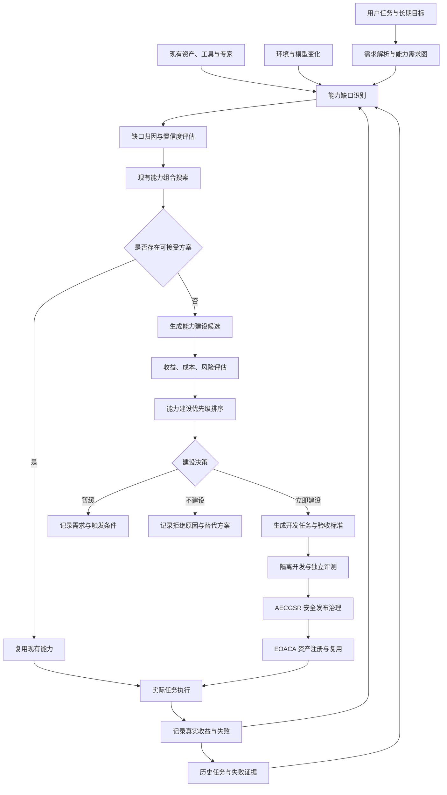

# 问答 123

> 来源: 新 窗口 | 会话: 分支 · 分支 · 分支 · 设计自进化智能体
> 消息: 128dcb63-cee1-4d6a-a365-0589ea659f30 | 时间(UTC): 2026-10-24 11:26

## 用户

继续

## ChatGPT

<WritingBlock id="58317" variant="document"># EvoAgent 第五十九专项：能力缺口发现、需求预测与主动能力规划体系

**专项编号：CGDPCP**

**英文名称：Capability Gap Discovery, Demand Forecasting & Proactive Capability Planning**

**文档版本：V1.0**

**文档性质：全量架构专项设计**

**适用范围：EvoAgent 统一任务入口、多层路由、通用内核、领域专家、ReAct、Plan、DAG、工具能力治理 TCRDCF、能力依赖图 CDCIPC、执行可靠性体系 ERTOV、问题诊断系统 RCAE、独立评测系统 UEEDA、自主进化治理体系 AECGSR、能力资产化体系 EOACA、成本预算与安全权限体系。**

**核心目标：让 EvoAgent 能够根据当前任务、历史执行证据、已有能力资产、环境变化和未来需求，主动识别真实能力缺口，评估缺口的重要性，比较补齐方案，并在成本、风险和收益满足要求时，规划和验证能力建设。**

本文定义目标架构和实施基线，不代表相关模块已经实现。

---

# 一、为什么 EvoAgent 不能只依靠失败来进化？

此前的专项已经建立了从运行问题到长期能力积累的闭环。

- AODEE：采集任务执行证据。
- RCAE：分析问题原因。
- UEEDA：独立验证候选改进。
- AECGSR：控制变更风险、发布和回滚。
- EOACA：将经过验证的经验固化为长期能力资产。

但这套机制仍然存在一个局限：

**系统通常要先遇到问题，才能意识到自己可能缺少某项能力。**

假设用户要求 EvoAgent 完成一个较复杂的代码项目。

系统可能执行到中途才发现：

- 缺少项目依赖分析能力；
- 无法运行当前项目的测试；
- 没有识别跨文件调用关系的工具；
- 缺少数据库迁移验证流程；
- 无法判断外部 API 是否发生变化；
- 没有可靠的任务恢复工作流。

如果每次都等到执行失败后才补齐能力，系统就会反复浪费时间、Token、API 费用和工具调用次数。

反过来，如果系统每发现一个潜在需求就增加一个工具、专家或工作流，又会造成另一种问题：

- 工具越来越多；
- 专家越来越多；
- 依赖关系越来越复杂；
- 维护成本不断增长；
- 路由器越来越难以判断；
- 能力库中出现大量重复功能；
- 很多新增能力几乎从未使用。

因此，EvoAgent 需要一种介于被动修复和无限扩张之间的机制。

它应当能够提前判断：

1. 当前任务需要什么能力？
2. 现有能力是否足够？
3. 如果不足，真正缺少的是什么？
4. 是缺少能力，还是没有正确使用已有能力？
5. 能否通过组合已有工具和工作流解决？
6. 如果必须新增能力，应该建设到什么程度？
7. 新能力应该属于通用内核、某个专家，还是独立能力包？
8. 是否值得现在建设，还是等到需求更明确时再建设？

本专项的目标，就是建立一套可验证、可控成本的主动能力规划体系。

---

# 二、第一性原理：能力缺口不等于功能缺失

首先必须冻结一个重要概念。

**能力缺口是当前系统在特定任务和约束条件下，无法以可接受的质量、成本、时延或风险完成任务时，表现出的能力不足。**

它不等于系统没有某个工具，也不等于某个任务曾经失败。

例如，代码专家修复代码失败，至少可能存在以下不同原因。

| 情况 | 真正的问题 | 是否应该立即新增能力 |
|---|---|---|
| 没有 AST 工具，而任务确实需要语法树分析 | 工具能力缺口 | 评估后可能需要 |
| 已有 AST 工具，但路由器没有选择它 | 路由缺陷 | 通常先修路由 |
| 已选择 AST 工具，但调用参数错误 | 工具使用缺陷 | 优先修正调用策略 |
| AST 工具本身存在 Bug | 工具可靠性问题 | 优先修复或替换工具 |
| 计划遗漏必要的测试步骤 | 规划或工作流缺陷 | 优先改进 Plan 或工作流 |
| 测试结果错误地显示成功 | 验收或验证缺陷 | 修复独立验证机制 |
| 当前模型无法稳定完成复杂推理 | 模型适配问题 | 先评估模型与策略组合 |
| 缺少外部服务权限 | 环境或授权约束 | 不能通过无限新增能力解决 |
| 任务需求本身不明确 | 需求解析缺陷 | 先澄清任务 |
| 系统已具备能力，但未检索到相应资产 | 能力发现缺陷 | 改进检索与路由 |

如果系统把所有失败都归类为“缺少能力”，它就会不断扩张，而不是解决真正的问题。

因此，CGDPCP 必须先进行**缺口归因，再进行能力建设决策**。

---

# 三、能力缺口的统一分类

建议建立九类能力缺口。

<box gap={2}>
  <box border radius="lg" padding={3} gap={1}>
    **G1：工具能力缺口**

    <text color="secondary" size="sm">缺少执行特定操作所需的工具、接口或工具适配器。</text>

    示例：缺少适用于当前项目的静态分析工具。
  </box>
  <box border radius="lg" padding={3} gap={1}>
    **G2：专业知识缺口**

    <text color="secondary" size="sm">缺少某领域的必要知识、规则、判断方法或专家策略。</text>

    示例：漫剧专家缺少角色一致性评价规则。
  </box>
  <box border radius="lg" padding={3} gap={1}>
    **G3：规划与执行缺口**

    <text color="secondary" size="sm">已有工具，但缺少有效的任务分解、依赖管理、调度或恢复方法。</text>

    示例：复杂任务没有正确安排数据库迁移与代码发布顺序。
  </box>
  <box border radius="lg" padding={3} gap={1}>
    **G4：验证与评测缺口**

    <text color="secondary" size="sm">能够生成结果，但无法可靠判断结果是否正确、完整或安全。</text>

    示例：能够生成代码，却缺少有效的集成测试。
  </box>
  <box border radius="lg" padding={3} gap={1}>
    **G5：路由与能力发现缺口**

    <text color="secondary" size="sm">系统已经具备相应能力，但无法正确检索、识别或调用。</text>

    示例：存在合适的工作流，但意图识别将任务分配给错误的专家。
  </box>
  <box border radius="lg" padding={3} gap={1}>
    **G6：可靠性与恢复缺口**

    <text color="secondary" size="sm">系统可以执行任务，但缺少超时处理、幂等控制、失败恢复或状态核验能力。</text>

    示例：手机操作失败后，系统无法确认当前界面状态。
  </box>
  <box border radius="lg" padding={3} gap={1}>
    **G7：环境与兼容性缺口**

    <text color="secondary" size="sm">现有能力无法适配当前设备、操作系统、模型或外部服务。</text>

    示例：某工具仅支持桌面环境，无法在 Android 上使用。
  </box>
  <box border radius="lg" padding={3} gap={1}>
    **G8：记忆与上下文缺口**

    <text color="secondary" size="sm">系统无法正确保留、检索或传递完成任务所需的信息。</text>

    示例：多专家协作时丢失关键任务约束。
  </box>
  <box border radius="lg" padding={3} gap={1}>
    **G9：治理与安全缺口**

    <text color="secondary" size="sm">缺少权限检查、数据保护、审计、成本限制或变更治理机制。</text>

    示例：某自动化工作流没有可靠的执行权限检查。
  </box>
</box>

这九类缺口用于统一记录和分析，并不是九种必须分别建设的专家。

一个问题可以涉及多个类别，但必须区分主要原因和次要原因，避免重复建设。

---

# 四、总体架构：建立主动能力规划闭环

CGDPCP 应位于能力资产库、任务规划器和独立进化控制器之间。

它不直接替代工具治理、问题诊断或自主进化机制，而是决定：

**当前能力是否足够、缺什么、先补什么，以及什么时候值得补。**



这套闭环分为六个阶段：

1. 需求识别；
2. 现有能力盘点；
3. 缺口归因；
4. 建设方案比较；
5. 能力建设与验收；
6. 使用效果追踪与下一轮规划。

---

# 五、第一阶段：任务开始前，建立能力需求图

当用户提出任务时，系统不能只生成一段自然语言计划，还应该识别完成任务所需的能力。

建议新增 `CapabilityRequirementGraph`，简称 CRG。

它描述任务需要什么能力、这些能力之间有什么依赖，以及哪些能力是必须的、哪些是可选的。

## 5.1 能力需求的五种属性

每个需求节点至少具有：

- `required_capability`：需要什么能力；
- `requirement_level`：硬性要求还是可选增强；
- `preconditions`：满足什么条件才能使用；
- `verification_method`：如何证明能力有效；
- `fallback_strategy`：能力不可用时怎么办。

例如，一个代码修改任务可能生成：

| 能力需求 | 级别 | 验证方式 |
|---|---|---|
| 读取项目文件 | 必须 | 能读取授权范围内的文件 |
| 分析相关代码 | 必须 | 能识别目标符号与相关引用 |
| 修改代码 | 必须 | 生成符合约束的补丁 |
| 运行相关测试 | 取决于任务要求 | 测试执行与结果记录 |
| 静态分析 | 按任务风险决定 | 分析报告与规则检查 |
| 自动提交代码 | 可选且受授权限制 | 检查提交范围与用户授权 |

注意，需求图中的“必须”不是模型主观判断后就可以强制执行。

它需要结合用户要求、任务契约、风险等级和系统策略来确定。

例如，用户只要求解释代码，不代表系统必须访问文件系统；用户要求修改代码，也不代表系统自动获得提交或推送权限。

## 5.2 区分任务能力与系统能力

任务能力描述“这次任务需要什么”。

系统能力描述“EvoAgent 目前有什么”。

二者不能混为一谈。

例如：

- 任务需要执行 Python 测试；
- 系统拥有测试执行工具；
- 但当前环境没有 Python 运行时。

此时，不是工具完全不存在，而是能力依赖链无法满足。

CGDPCP 应当追踪完整依赖链，而不是仅检查工具名称是否存在。

## 5.3 能力需求图与 DAG 的关系

能力需求图和任务 DAG 是不同对象。

- **能力需求图**：描述完成任务需要哪些能力，以及能力之间的依赖。
- **任务 DAG**：描述这次任务实际执行哪些步骤、以什么顺序执行。
- **能力依赖图 CDCIPC**：描述系统能力资产、工具、专家和模块之间的依赖。

例如：

能力需求图要求“代码修改后必须验证”。

任务 DAG 可以根据项目环境选择运行单元测试、集成测试或静态分析。

CDCIPC 则负责追踪这些验证步骤依赖哪些工具、资产和版本。

三者应该关联，但不能合并成同一张图。

---

# 六、第二阶段：建立真实能力盘点机制

在提出新增能力之前，系统必须先回答：

**这个能力是否已经存在，只是我没有找到或没有正确使用？**

建议建立统一的 `CapabilityInventory`。

它不是简单的工具列表，而是记录系统当前能够完成什么、依赖什么、在什么条件下有效。

## 6.1 能力盘点的对象

至少包括：

- 通用内核能力；
- 专家能力；
- 工具及其适配器；
- 正式能力资产；
- 已验证工作流；
- 模型适配能力；
- 测试与验收能力；
- 失败恢复策略；
- 当前环境与权限；
- 受支持的输入输出格式；
- 已知限制；
- 尚未验证的能力。

## 6.2 能力状态

建议采用以下状态：

| 状态 | 含义 |
|---|---|
| `AVAILABLE` | 能力存在，依赖满足，可以使用 |
| `AVAILABLE_UNVERIFIED` | 能力存在，但当前条件下尚未充分验证 |
| `DEGRADED` | 能力可用，但质量或可靠性低于预期 |
| `BLOCKED` | 存在能力，但因权限、依赖或环境限制无法使用 |
| `MISSING` | 经过检查，确实不存在所需能力 |
| `UNKNOWN` | 证据不足，无法确定 |
| `DEPRECATED` | 能力已经过时，不应优先使用 |

`UNKNOWN` 必须是合法状态。

系统不能因为暂时没有发现某个能力，就直接认定它不存在。

## 6.3 盘点需要什么证据？

建议综合检查：

1. 资产注册表；
2. 工具注册表；
3. 专家能力声明；
4. 工作流目录；
5. 模型与运行时配置；
6. 环境检测结果；
7. 最近的相关执行记录；
8. 近期评测结果；
9. 当前权限；
10. 相关依赖的健康状态。

这一步可以复用 EOACA、TCRDCF 和 CDCIPC 的现有设计。

不要再建立一个独立且重复维护的能力目录。

## 6.4 区分能力存在与能力有效

某项能力在注册表中存在，不代表它在当前任务中可用。

例如：

- 工具存在，但缺少授权；
- 工作流存在，但依赖版本不兼容；
- 专家存在，但当前模型不支持必要的输入形式；
- 测试工具存在，但无法访问当前项目；
- 资产历史上有效，但当前版本已经失效。

因此，能力盘点至少需要区分：

- 是否存在；
- 是否可用；
- 是否适用；
- 是否经过验证；
- 是否值得使用。

---

# 七、第三阶段：能力缺口归因与证据等级

这是 CGDPCP 最重要的判断环节。

如果没有可靠的归因机制，系统就可能不断建设错误的能力。

## 7.1 缺口诊断流程

建议按照以下顺序执行：

1. 确认任务要求是否完整；
2. 确认任务验收标准是否明确；
3. 检查所需能力是否已经存在；
4. 检查路由是否选择了正确能力；
5. 检查能力是否满足当前环境要求；
6. 检查工具调用和参数是否正确；
7. 检查任务规划与执行顺序；
8. 检查验收机制是否可靠；
9. 检查失败是否由外部环境引起；
10. 只有在排除其他主要原因后，才将问题归因为真实能力缺口。

## 7.2 建立归因置信等级

建议使用五级证据等级：

| 等级 | 定义 | 允许的决策 |
|---|---|---|
| E0 | 仅有表面现象 | 只能记录和观察 |
| E1 | 存在合理缺口假设 | 可以进一步诊断 |
| E2 | 有明确证据支持缺口判断 | 可以比较解决方案 |
| E3 | 已通过对照或专项测试验证 | 可以提出正式建设计划 |
| E4 | 在多个适用任务中持续验证 | 可以作为长期规划依据 |

例如，系统第一次无法完成某项任务，通常只能产生 E0 或 E1 的候选判断。

如果系统反复发现缺少同一个工具，并且隔离实验表明该工具可以稳定解决问题，证据等级才可以提高。

这些等级不是机械的固定次数门槛，而是依据任务风险、证据质量、样本覆盖和可重复性综合判断。

## 7.3 允许多个原因并存

例如，一次手机操作失败可能同时涉及：

- UI 识别能力不足；
- 元素定位错误；
- 工具执行超时；
- 执行后状态验证不足。

此时应当分别记录各因素及其证据，而不是强行选择一个唯一原因。

系统也应允许结论为“当前无法可靠归因”。

---

# 八、第四阶段：先组合已有能力，再考虑新增能力

这是防止 EvoAgent 无限扩张的关键设计。

当系统发现能力缺口后，不能立刻生成新的专家或开发新的工具。

必须先尝试寻找已有能力的组合方案。

建议建立 `CapabilityCompositionPlanner`。

## 8.1 能力组合的优先顺序

建议按照以下优先级进行搜索：

1. 直接复用已验证的能力资产；
2. 组合现有工具和工作流；
3. 调整已有能力的调用参数；
4. 修复路由、规划或能力发现问题；
5. 复用其他专家的能力，但先验证适用范围；
6. 更换或调整模型适配策略；
7. 新增工具适配器；
8. 新增领域策略或工作流；
9. 扩展现有专家；
10. 只有在确实必要时，才考虑新建独立专家或大规模能力包。

这不是绝对的执行顺序。

如果现有工具存在严重安全缺陷，系统应直接停止使用，而不是为了遵守优先级继续尝试。

## 8.2 比较不同方案

例如，系统发现代码任务缺少跨文件依赖分析。

可能的方案包括：

- 方案 A：修改提示词，让模型更仔细地搜索文件；
- 方案 B：复用已有搜索工具与测试工具，组合成工作流；
- 方案 C：增加 AST 分析工具；
- 方案 D：增加完整代码分析能力包。

系统应比较：

| 维度 | 方案 A | 方案 B | 方案 C | 方案 D |
|---|---|---|---|---|
| 建设成本 | 低 | 低至中 | 中 | 高 |
| 预期能力提升 | 不确定 | 取决于现有工具 | 可能较高 | 可能较高 |
| 维护负担 | 低 | 中 | 中 | 高 |
| 环境适配 | 依赖模型 | 依赖现有工具 | 依赖语言支持 | 依赖多项组件 |
| 验证难度 | 中 | 中 | 中 | 高 |
| 适用范围 | 可能有限 | 取决于组合 | 取决于工具覆盖 | 可能更广 |

表中的判断只是方案比较示例，不能在没有实际测试的情况下预先认定某个方案效果最好。

## 8.3 组合能力也需要验证

即使所有工具单独都可靠，组合后的行为也可能出现问题。

例如：

- 上一个工具输出的字段与下一个工具不兼容；
- 工具执行顺序不正确；
- 中间结果丢失；
- 失败恢复时重复执行有副作用的操作；
- 多个工具产生相互矛盾的结论。

因此，组合方案必须拥有独立的端到端验收标准。

---

# 九、第五阶段：评估是否值得建设新能力

即使确认存在真实能力缺口，也不意味着必须补齐。

某项能力可能只被极少数任务使用，开发成本很高，维护负担很重，或者涉及无法接受的权限风险。

因此，CGDPCP 必须建立能力投资决策机制。

## 9.1 能力建设的收益

建议评估以下收益：

- 任务成功率提升；
- 失败恢复能力提升；
- 执行时延降低；
- 模型调用和工具成本降低；
- 用户返工减少；
- 新任务覆盖范围扩大；
- 稳定性改善；
- 其他能力复用率提升；
- 长期维护成本降低。

## 9.2 能力建设的成本

需要考虑：

- 初始开发成本；
- 外部 API 或服务成本；
- 模型调用成本；
- 本地 CPU、GPU 和内存占用；
- 存储成本；
- 测试和维护成本；
- 安全审查成本；
- 依赖复杂度；
- 新增失败模式；
- 对现有专家的影响。

## 9.3 能力投资评分

建议使用以下概念性公式：

\[
P(c)=
\frac{
D(c)\cdot B(c)\cdot Q(c)\cdot F(c)
}{
C(c)+M(c)+R(c)+K(c)
}
\]

其中：

- \(D(c)\)：需求强度；
- \(B(c)\)：预期收益；
- \(Q(c)\)：证据可信程度；
- \(F(c)\)：复用与覆盖潜力；
- \(C(c)\)：建设成本；
- \(M(c)\)：维护成本；
- \(R(c)\)：风险成本；
- \(K(c)\)：引入的系统复杂度成本。

这是候选排序模型，不是最终自动批准规则。

特别是：

- 高风险能力不能仅凭高分自动发布；
- 安全和权限要求属于硬性约束；
- 低频但涉及严重故障恢复的能力不能只因使用频率低而忽略；
- 数据不足时，应降低决策置信度，而不是用模型猜测补齐数字。

## 9.4 将建设决策分为四类

<box gap={2}>
  <box border radius="lg" padding={3} gap={1}>
    **P0：立即补齐**

    <text size="sm">存在明确的高优先级缺口，直接影响关键任务、安全或稳定性，且有合理的解决方案。</text>
  </box>
  <box border radius="lg" padding={3} gap={1}>
    **P1：近期建设**

    <text size="sm">需求明确、预期收益较高，但可以先通过其他方案临时满足任务，适合排入近期能力建设计划。</text>
  </box>
  <box border radius="lg" padding={3} gap={1}>
    **P2：观察与积累证据**

    <text size="sm">需求可能存在，但频率、收益或适用范围尚不明确，继续收集证据比立即建设更合理。</text>
  </box>
  <box border radius="lg" padding={3} gap={1}>
    **P3：暂不建设**

    <text size="sm">现有能力足以解决问题，或者新增能力的收益不足以覆盖成本、复杂度和风险。</text>
  </box>
</box>

这些优先级描述的是建设计划，而不是任务执行时的故障严重程度。

严重故障应当通过现有安全与故障处理机制立即响应，不能因为某项能力建设被排期，就忽略当前任务的安全处置。

---

# 十、能力建设不是一个动作，而是一组不同的投资选择

发现缺口之后，系统应该选择最小且足够的解决方案。

建议建立九种建设动作。

| 动作 | 适用情况 |
|---|---|
| `REUSE` | 现有能力已经足够，只需正确使用 |
| `RECONFIGURE` | 能力存在，但配置不合适 |
| `REPAIR` | 已有工具、工作流或策略存在缺陷 |
| `COMPOSE` | 多个已有能力组合即可满足需求 |
| `ADAPT` | 为现有能力增加适配器或环境支持 |
| `EXTEND` | 扩展现有专家、工作流或工具能力 |
| `CREATE` | 创建真正缺失的独立能力 |
| `DEFER` | 证据不足或当前收益不够 |
| `REJECT` | 风险不可接受或需求不成立 |

每次建设决策都应说明：

- 为什么选择该动作；
- 为什么不选择更简单的替代方案；
- 预期解决什么缺口；
- 如何证明解决成功；
- 新增哪些依赖；
- 失败时如何恢复；
- 需要多少预算；
- 是否影响其他专家。

这可以防止系统将所有问题都转化为开发新模块的任务。

---

# 十一、能力需求预测：从被动补缺到主动规划

主动规划的第二个重要部分，是预测未来可能需要什么能力。

但预测不应该演变为无限制的功能想象。

建议将需求预测分为三个来源。

## 11.1 来源 A：当前任务的显式需求

例如，用户要求制作动态视频漫剧。

在任务开始前，系统就可以检查是否具备：

- 脚本生成；
- 分镜规划；
- 角色设计；
- 图像或视频生成接口；
- 配音；
- 音视频合成；
- 质量验收；
- 预算控制；
- 失败恢复。

如果发现关键依赖缺失，就可以在正式执行前给出可行方案、限制和预计成本。

这种预测证据最直接。

## 11.2 来源 B：历史任务的重复需求

如果过去一段时间中，多个任务反复出现同一能力缺口，系统可以提高其建设优先级。

例如：

- 多次需要检查跨文件调用关系；
- 多次因测试环境不一致失败；
- 多次在手机界面变化后无法恢复；
- 多次需要把相同的处理流程重新规划一遍。

但必须先排除已有能力未被正确调用的问题。

否则，系统会把一个路由 Bug 误判为需要增加工具。

## 11.3 来源 C：已知环境和依赖变化

例如：

- 模型版本升级；
- 工具接口变化；
- 操作系统变化；
- 运行环境变化；
- 关键依赖被弃用；
- 某项能力的资源需求发生变化。

这些变化可能导致已有能力退化或产生新的适配需求。

CGDPCP 应结合 TCRDCF、CDCIPC 和资产生命周期机制，识别可能受到影响的能力，而不是等到任务失败后再处理。

## 11.4 预测必须具有不确定性

每项预测至少需要记录：

- 预测对象；
- 预测时间范围；
- 依据；
- 预期任务类别；
- 预计需求频率；
- 置信等级；
- 可能的误判成本；
- 复核条件。

预测结果不能直接等同于真实需求。

例如，系统可以提出“某项能力未来可能被频繁使用”的假设，但不能因为该预测就自动采购服务、扩大权限或创建大量组件。

---

# 十二、能力覆盖率：如何知道系统还缺什么？

建议建立 `CapabilityCoverageModel`。

它用于衡量 EvoAgent 对某类任务的能力覆盖情况。

需要特别强调：**能力覆盖率不是系统智能程度的绝对分数，而是针对明确任务集合和验收标准的覆盖情况。**

## 12.1 覆盖率的四个维度

建议分别衡量：

1. **功能覆盖**：是否存在满足需求的能力；
2. **可用性覆盖**：当前环境和权限是否允许使用；
3. **验证覆盖**：是否有可靠的验收与测试；
4. **可靠性覆盖**：是否具备必要的失败处理和恢复能力。

例如，系统可以生成代码，但没有运行测试的能力。

它可能具有代码生成功能覆盖，却没有达到特定代码修改任务的验证覆盖要求。

## 12.2 基础计算

在一个明确的任务集合中，可以采用加权覆盖率：

\[
Coverage=
\frac{\sum_i w_i s_i}{\sum_i w_i}
\]

其中：

- \(w_i\)：第 \(i\) 项需求的重要性权重；
- \(s_i\)：该需求的满足程度。

满足程度可以按统一规则取值，例如：

- 0：缺失；
- 0.5：部分满足；
- 1：满足。

但这只是总体分析指标。

对于硬性安全要求、用户明确指定的必要条件和关键验收条件，不能用其他能力的高分来抵消缺失。

因此，必须同时记录：

- 总体覆盖率；
- 硬性需求满足情况；
- 未覆盖的高优先级需求；
- 未经验证的能力；
- 环境受限能力；
- 主要失败风险。

## 12.3 不要追求 100% 覆盖所有可能任务

通用智能体的潜在任务范围几乎没有明确上限。

如果以覆盖所有可能任务为目标，系统就会无限扩张。

合理目标应该是：

> 在明确的个人使用场景、资源预算和安全边界内，优先覆盖高频、高价值、可验证且有合理实现成本的任务。

对于极低频、成本过高或风险不可接受的任务，系统可以明确说明暂不支持，而不是强行建设能力。

---

# 十三、通用内核、专家和能力包之间的建设归属

当系统决定新增能力时，还必须确定它应该放在哪里。

这是防止专家之间互相污染的关键。

建议建立以下归属判断规则。

| 建设对象 | 归属原则 | 示例 |
|---|---|---|
| 通用内核 | 多领域稳定共用的基础机制 | 统一任务状态、证据记录 |
| 领域专家 | 具有明确专业语义的能力 | 代码 AST 分析策略 |
| 独立工具 | 可独立调用、可声明契约的操作能力 | 文件解析器、图像处理工具 |
| 工作流资产 | 重复且可验证的任务流程 | 代码修复 DAG |
| 独立能力包 | 具有完整依赖、评测和生命周期的复合能力 | AI 漫剧制作能力包 |
| 评测资产库 | 用于独立验收的测试与规则 | 跨文件代码修改回归集 |
| 工具能力注册表 | 工具描述、版本、状态和兼容性 | 某个测试运行器的能力声明 |
| 共享策略库 | 已验证且适用于多个领域的规则 | 通用任务恢复策略 |

## 13.1 归属决策的优先顺序

建议按以下顺序判断：

1. 能否直接复用现有资产？
2. 能否在现有专家内部解决？
3. 是否属于可以独立治理的工具？
4. 是否属于可复用工作流？
5. 是否确实需要独立能力包？
6. 是否有充分证据证明它应该进入共享通用内核？

特别是第六点，应采用较高门槛。

因为共享内核中的任何变更，都可能影响多个专家。

**默认优先扩展局部能力；只有证明其具有跨领域的稳定价值后，才考虑提升为共享能力。**

---

# 十四、能力建设任务的自动生成

当系统决定建设能力后，应将抽象缺口转化为可以执行和验收的工程任务。

建议建立 `CapabilityBuildPlan`。

每份建设计划至少包括：

- `gap_id`：能力缺口 ID；
- `problem_statement`：问题描述；
- `evidence_refs`：证据；
- `target_capability`：目标能力；
- `selected_action`：建设动作；
- `owner_namespace`：归属专家或模块；
- `implementation_scope`：实现范围；
- `alternatives_rejected`：被拒绝的替代方案及理由；
- `dependencies`：依赖；
- `acceptance_criteria`：验收标准；
- `benchmark_plan`：评测计划；
- `security_requirements`：安全要求；
- `budget`：资源预算；
- `risk_class`：风险等级；
- `rollback_plan`：恢复方案；
- `expected_benefit`：预期收益；
- `review_condition`：复核条件。

例如：

**缺口：** 代码专家无法可靠识别 Python 项目中的跨文件调用关系。

**建设候选：** 为代码专家接入 AST 分析工具，并增加调用关系检查工作流。

**验收条件：**

- 能够解析目标范围内的有效 Python 文件；
- 能够识别指定测试集中的目标符号及相关引用；
- 对不支持的语法或输入能够明确报告限制；
- 不会未经授权修改源文件；
- 与现有代码修复流程兼容；
- 在独立评测集中证明它对目标任务具有实际收益；
- 成本和执行时间符合预设预算；
- 出现错误时能够退出或回退到受控替代方案。

这样，能力建设就从一句“增加代码分析能力”，变成了可执行、可验证的工程任务。

---

# 十五、能力规划与自主进化控制器的关系

CGDPCP 不应直接拥有任意修改稳定版的权限。

建议明确以下分工。

- **CGDPCP**：发现缺口、预测需求、比较方案、安排建设优先级。
- **RCAE**：分析运行失败及其原因。
- **EOACA**：判断已有经验和资产是否能够解决问题，并追踪实际复用收益。
- **CDCIPC**：分析依赖和影响范围。
- **TCRDCF**：管理工具能力、契约和兼容性。
- **UEEDA**：独立验证新增能力是否有效。
- **AECGSR**：控制变更风险、审批、发布、监控和回滚。
- **AHOG**：持续约束权限和安全边界。

CGDPCP 可以自动生成开发计划，甚至在授权范围内启动隔离开发，但不能自行跳过独立评测和发布门禁。

建议建立以下生命周期：

`GAP_DETECTED → ATTRIBUTION_PENDING → GAP_CONFIRMED → OPTIONS_EVALUATED → BUILD_APPROVED → BUILDING → VALIDATING → PROMOTION_PENDING → ACTIVE`

还应支持：

- `DEFERRED`：暂缓建设；
- `REJECTED`：拒绝建设；
- `BLOCKED`：因权限、依赖或环境问题阻塞；
- `CANCELLED`：建设任务被取消；
- `SUPERSEDED`：被更优方案替代。

每次状态转换都应记录证据与决策理由。

---

# 十六、能力规划预算与系统复杂度治理

能力建设会消耗资源，也会增加系统复杂度。

因此，不能只计算开发成本。

建议分别管理三类预算。

## 16.1 运行预算

用于日常任务执行：

- 模型调用；
- 工具调用；
- 外部 API；
- 本地计算；
- 任务恢复。

## 16.2 进化预算

用于探索和验证：

- 失败分析；
- 候选生成；
- 实验执行；
- 独立评测；
- 候选比较；
- 资产验证。

## 16.3 能力建设预算

用于真正扩展系统：

- 新工具开发；
- 新工作流建设；
- 专家能力扩展；
- 依赖维护；
- 新增评测集；
- 长期运行与维护。

这三类预算应相互关联，但不能无条件互相挪用。

## 16.4 为复杂度设置上限

建议跟踪：

- 新增工具数量；
- 新增专家数量；
- 新增外部依赖数量；
- 能力依赖图复杂度；
- 重复能力比例；
- 需要维护的工作流数量；
- 失效资产比例；
- 每项新增能力的实际复用频率；
- 新增能力引起的故障数量。

这些指标不应被简单地转化为硬性的数量限制。

例如，增加一个关键恢复工具，可能显著降低系统级故障风险；而新增十个功能重叠的工具，可能没有实际收益。

真正需要控制的是**能力扩张带来的净价值与净复杂度**。

## 16.5 暂缓也是一种正确的进化决策

当系统发现某项能力可能有用，但证据不足时，应该：

1. 记录缺口；
2. 继续收集相关任务证据；
3. 尝试已有能力组合；
4. 设置复核条件；
5. 在达到条件后重新评估。

不能因为系统已经生成建设计划，就默认必须完成建设。

---

# 十七、能力缺口发现的长期反馈机制

CGDPCP 不是一次性分析器，而是持续运行的规划机制。

建议建立 `CapabilityGapRecord`，用于记录每次发现的缺口。

核心字段包括：

| 字段 | 说明 |
|---|---|
| `gap_id` | 缺口唯一标识 |
| `gap_type` | 缺口类别 |
| `task_refs` | 关联任务 |
| `evidence_refs` | 证据来源 |
| `attribution_status` | 归因状态 |
| `confidence_level` | 证据等级 |
| `affected_components` | 受影响组件 |
| `affected_experts` | 受影响专家 |
| `existing_solutions` | 已有解决方案 |
| `candidate_solutions` | 候选补齐方案 |
| `expected_frequency` | 预计需求频率 |
| `expected_benefit` | 预期收益 |
| `estimated_cost` | 预计成本 |
| `risk_class` | 风险等级 |
| `priority` | 建设优先级 |
| `decision` | 建设、暂缓、拒绝或复用 |
| `review_trigger` | 复核条件 |
| `actual_outcome` | 最终实际结果 |

## 17.1 必须记录没有建设的原因

如果系统决定暂不建设，也应记录：

- 现有能力足够；
- 需求频率过低；
- 预期收益不足；
- 成本过高；
- 风险不可接受；
- 证据不足；
- 有更简单的替代方案；
- 当前环境不支持。

否则，系统可能在几个月后再次遇到同一个问题，又重新执行一遍相同分析。

## 17.2 必须允许重新打开旧缺口

“暂不建设”不等于永久拒绝。

当以下条件变化时，可以重新评估：

- 用户再次提出相关需求；
- 同类任务频率明显增加；
- 失败成本上升；
- 新工具降低了实现成本；
- 新模型改变了能力边界；
- 相关能力的依赖已经具备；
- 旧有替代方案不再有效。

重新打开时，应复用已有证据，而不是从零开始。

---

# 十八、个人设备部署设计

考虑到 EvoAgent 的目标是个人使用，主要运行环境为 Windows 电脑、mini Linux 主机和 Android 设备，CGDPCP 应采用本地优先、模块化的部署方式。

不需要为能力规划单独建立一套服务器集群。

## 18.1 建议的实现组件

- SQLite：保存能力缺口、需求预测、建设计划与决策记录；
- JSON 或 YAML：描述能力需求图、能力声明和建设计划；
- Git：管理代码、工作流和能力配置版本；
- 文件系统：保存评测产物、构建结果与历史证据；
- 结构化检索：查找已有工具、资产和工作流；
- 可选向量索引：在资产数量增长后辅助语义检索；
- 统一任务队列：调度缺口诊断与能力建设任务；
- 统一预算管理：限制探索、评测和开发成本。

## 18.2 Android 与本地控制端协同

Android 端可以负责：

- 提供用户任务入口；
- 执行当前设备允许的操作；
- 记录任务结果与能力失败；
- 缓存必要的缺口证据；
- 使用本地可用的已验证能力。

桌面端或 mini Linux 主机可以负责：

- 聚合授权后的运行证据；
- 进行长期能力盘点；
- 评估建设优先级；
- 运行独立评测；
- 管理能力资产和版本；
- 组织候选建设任务。

如果没有独立控制端，也可以在个人电脑上完成上述工作。

断联时，设备继续使用已验证且满足本地条件的能力；新增缺口可以缓存，待重连后再同步。

不能因为网络中断，就将未经验证的候选能力自动提升为正式能力。

---

# 十九、工程目录与核心接口

建议新增以下逻辑模块：

```text
evoagent/
├── capability_planning/
│   ├── requirement_graph/
│   ├── capability_inventory/
│   ├── gap_detection/
│   ├── gap_attribution/
│   ├── demand_forecasting/
│   ├── coverage_model/
│   ├── investment_scoring/
│   ├── build_planning/
│   └── planning_lifecycle/
├── capability_composition/
│   ├── asset_search/
│   ├── tool_composition/
│   ├── workflow_composition/
│   ├── model_strategy/
│   ├── applicability_check/
│   └── composition_evaluation/
├── capability_portfolio/
│   ├── expert_ownership/
│   ├── shared_capability_policy/
│   ├── dependency_analysis/
│   ├── redundancy_detection/
│   └── complexity_budget/
├── demand_intelligence/
│   ├── task_frequency_analysis/
│   ├── failure_pattern_analysis/
│   ├── environment_change_detection/
│   ├── demand_confidence/
│   └── forecast_validation/
├── capability_build/
│   ├── build_plan_generator/
│   ├── acceptance_criteria/
│   ├── dependency_resolution/
│   ├── isolated_implementation/
│   └── build_status/
└── capability_planning_evaluation/
    ├── gap_detection_benchmark/
    ├── attribution_benchmark/
    ├── composition_benchmark/
    ├── forecast_accuracy/
    ├── investment_decision_quality/
    └── overbuilding_regression/
```

建议提供以下核心接口：

- `build_capability_requirement_graph`：构建任务能力需求图；
- `inventory_available_capabilities`：盘点现有能力；
- `check_capability_availability`：检查能力可用性；
- `detect_capability_gaps`：发现候选缺口；
- `attribute_capability_gap`：分析缺口原因；
- `evaluate_gap_evidence`：评估缺口证据；
- `search_existing_capability_assets`：检索已有能力资产；
- `plan_capability_composition`：规划现有能力组合；
- `evaluate_composition_feasibility`：评估组合方案是否可行；
- `forecast_capability_demand`：预测未来需求；
- `calculate_capability_coverage`：计算指定任务集合的覆盖情况；
- `rank_capability_investments`：对建设方案排序；
- `select_capability_build_action`：选择建设动作；
- `create_capability_build_plan`：生成能力建设计划；
- `validate_build_acceptance_criteria`：检查验收标准是否完整；
- `assign_capability_owner`：确定能力归属；
- `check_complexity_budget`：检查系统复杂度预算；
- `approve_capability_planning_decision`：执行建设决策策略；
- `defer_capability_gap`：暂缓能力建设；
- `reopen_capability_gap`：重新评估历史缺口；
- `record_capability_build_outcome`：记录建设实际结果；
- `evaluate_capability_investment`：评估能力投资的真实收益；
- `detect_capability_redundancy`：识别重复能力；
- `audit_capability_coverage`：审计目标任务范围内的能力覆盖。

所有接口应关联任务、缺口、能力资产、建设计划和评测记录，避免形成新的孤立子系统。

---

# 二十、专项验收标准

CGDPCP 至少需要满足以下要求：

1. 能够根据任务目标构建结构化能力需求图。
2. 能够区分能力需求图、任务 DAG 和 CDCIPC 能力依赖图。
3. 能够盘点工具、专家、工作流、能力资产、模型适配和运行环境。
4. 能够区分能力不存在、不可用、不适用、未经验证和未知状态。
5. 能够在新增能力前检查已有能力资产。
6. 能够识别路由、规划、工具调用和验收缺陷，避免一律归因为能力缺失。
7. 能够允许多个原因并存，并记录各自的证据。
8. 能够在证据不足时保留不确定性。
9. 能够依据证据等级限制自动建设决策。
10. 能够比较复用、重配置、修复、组合、适配、扩展和新建等方案。
11. 能够识别组合能力产生的契约、顺序和恢复问题。
12. 能够评估能力建设的预期收益、初始成本和长期维护成本。
13. 能够根据风险、证据、预算和复杂度决定建设优先级。
14. 能够将建设决策划分为立即建设、近期建设、观察和暂不建设。
15. 能够根据明确任务范围评估功能、可用性、验证和可靠性覆盖情况。
16. 能够识别硬性需求未满足的情况，不能用总体覆盖率掩盖关键缺口。
17. 能够根据能力用途确定通用内核、专家、工具、工作流或能力包的归属。
18. 能够生成结构化的能力建设计划。
19. 每项建设计划都必须具有验收标准、预算和恢复方案。
20. 能够通过独立评测验证新增能力是否真正解决缺口。
21. 能够防止建设计划绕过 AECGSR 发布治理。
22. 能够记录被拒绝和暂缓的方案及原因。
23. 能够在条件变化时重新评估历史缺口。
24. 能够追踪能力需求预测的准确性。
25. 能够识别模型、工具和环境变化导致的能力退化。
26. 能够管理运行、进化和能力建设三类预算。
27. 能够识别重复工具、重复工作流和不必要的专家扩张。
28. 能够评估新增能力对其他专家与共享内核的影响。
29. 能够在本地优先环境运行，并支持断联后的增量同步。
30. 能够通过历史任务回放或受控实验验证缺口诊断质量。
31. 能够通过对照评测验证能力组合是否优于新增能力。
32. 能够检测能力规划系统自身的误判、过度建设和低收益投资。
33. 能够持续将实际建设结果反馈给 EOACA、RCAE 和 UEEDA。
34. 能够保持 AHOG 的权限边界不受能力建设流程绕过。
35. 能够在不需要新增独立服务器的情况下运行核心能力规划流程。

以上为目标架构验收要求，不代表相关模块已经实现或通过测试。

---

# 二十一、建议冻结的架构决策

以下建议承接 ADR-962。

| 编号 | 决策 |
|---|---|
| ADR-963 | 建立独立的能力缺口发现、需求预测与主动能力规划体系 CGDPCP |
| ADR-964 | 能力缺口定义为特定任务约束下，系统无法以可接受的质量、成本、时延或风险完成任务的能力不足 |
| ADR-965 | 必须区分工具、知识、规划、验证、路由、可靠性、环境、记忆和治理等能力缺口 |
| ADR-966 | 能力需求图、任务 DAG 与 CDCIPC 能力依赖图分别建模，并通过标识关联 |
| ADR-967 | 新增能力前必须盘点已有工具、专家、工作流、资产、模型和环境 |
| ADR-968 | 能力状态必须区分可用、未经验证、退化、受阻、缺失、未知和过时 |
| ADR-969 | 发现失败不能直接等同于能力缺口，必须先执行缺口归因 |
| ADR-970 | 缺口归因必须允许多因素并存，并记录证据等级 |
| ADR-971 | 当证据不足时，系统可以继续观察，不得强行生成确定性结论 |
| ADR-972 | 能力建设前必须优先评估现有能力的直接复用、组合和修复方案 |
| ADR-973 | 能力组合必须通过适用性、契约、依赖和端到端验证 |
| ADR-974 | 能力建设决策必须同时考虑预期收益、建设成本、维护成本、风险和复杂度 |
| ADR-975 | 建设优先级与运行故障严重程度分别管理 |
| ADR-976 | 能力覆盖率必须基于明确任务集合和验收要求计算 |
| ADR-977 | 硬性需求、安全要求和关键验收条件不得被总体覆盖率抵消 |
| ADR-978 | 不以覆盖所有可能任务为目标，而以明确使用场景内的有效能力覆盖为目标 |
| ADR-979 | 新增能力默认优先归属局部专家或独立能力资产，跨领域价值经过验证后再考虑共享 |
| ADR-980 | 能力建设计划必须包含目标、证据、依赖、验收、预算和恢复方案 |
| ADR-981 | CGDPCP 负责能力规划，不得替代 UEEDA 的独立评测或 AECGSR 的发布治理 |
| ADR-982 | 能力需求预测必须记录依据、不确定性和复核条件 |
| ADR-983 | 历史失败、重复任务需求和环境变化均可触发缺口重新评估 |
| ADR-984 | 能力规划必须区分运行预算、进化预算和能力建设预算 |
| ADR-985 | 能力建设必须考虑引入的依赖、复杂度、维护负担与潜在故障 |
| ADR-986 | 暂缓和拒绝建设必须保留原因、证据与重新评估条件 |
| ADR-987 | 过去暂缓的能力缺口可以在需求、环境、成本或证据变化后重新打开 |
| ADR-988 | 每项正式新增能力必须通过相应的独立验收门禁 |
| ADR-989 | 新能力的真实收益必须在实际使用后进行持续评估 |
| ADR-990 | 能力需求预测和投资决策必须根据实际结果持续校准 |
| ADR-991 | 必须检测能力重复、过度建设和低收益投资 |
| ADR-992 | 能力规划与 CDCIPC、TCRDCF、EOACA、RCAE、UEEDA 和 AECGSR 保持明确接口 |
| ADR-993 | 能力建设不得绕过 AHOG 的权限、安全和数据保护要求 |
| ADR-994 | 核心规划能力采用本地优先实现，不要求建立独立服务器集群 |
| ADR-995 | 能力规划系统必须能够通过回放、对照实验和建设结果追踪验证自身决策质量 |

以上建议作为 EvoAgent 第五十九专项的架构基线。

---

# 二十二、下一专项：能力组合编排、跨专家协作与动态团队治理体系

到目前为止，EvoAgent 的长期进化体系已经覆盖：

- 问题发现与诊断；
- 工具能力治理；
- 独立评测；
- 安全发布与回滚；
- 经验固化与能力资产化；
- 主动能力缺口发现与建设规划。

但随着能力库和专家数量增加，会出现一个新的问题。

**系统已经拥有足够多的能力，却不一定能够把它们组合成最有效的执行方案。**

例如，完成一个复杂的 AI 漫剧项目，可能同时需要：

- 通用任务规划；
- 编剧能力；
- 分镜能力；
- 角色一致性管理；
- 图像与视频生成；
- 配音；
- FFmpeg 合成；
- 质量评测；
- 预算控制。

问题不再只是“有没有这些能力”，而是：

1. 应该由哪个专家负责整个任务？
2. 哪些任务应该交给其他专家？
3. 专家之间如何交换上下文和产物？
4. 哪些步骤可以并行，哪些必须串行？
5. 是否应该建立临时的专家协作组合？
6. 哪些专家只需要提供一次结果，哪些需要持续参与？
7. 某个专家失败时，是重试、替换专家，还是重新规划？
8. 如何避免多个专家重复调用相同工具？
9. 如何防止专家之间互相覆盖记忆、产生冲突或重复工作？
10. 如何判断多专家协作是否真的优于单个专家完成任务？
11. 哪些协作模式应该沉淀为可复用的工作流？
12. 哪些协作关系应该成为长期的能力依赖？
13. 如何控制协作带来的 Token、API、存储和维护成本？
14. 如何在 Android、Windows 和 mini Linux 环境中调度不同的能力？
15. 如何在部分工具或专家不可用时，动态调整整个任务？

因此，建议下一专项定义为：

**Capability Composition Orchestration, Cross-Expert Collaboration & Dynamic Team Governance，简称 CCOCDTG。**

下一专项将重点研究：如何将已有工具、能力资产、工作流和领域专家组织成一个能够动态规划、并行执行、协调上下文、处理冲突、恢复失败且成本受控的协作系统。

最终目标不是让 EvoAgent 拥有越来越多的专家，而是让它能够根据任务需要，动态选择最合适的能力组合，并证明这种组合比简单调用单一专家更有效。

**核心原则：能力数量不等于系统能力。真正的系统能力，来自正确的能力选择、清晰的职责划分、可靠的协作协议、统一的结果验收，以及能够在失败时恢复整个任务的协调机制。**</WritingBlock>

<MemoryCite />
