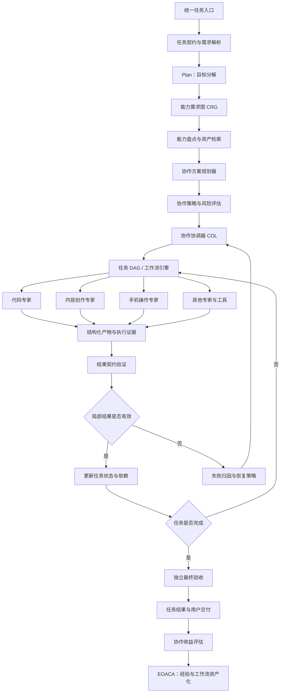

# 问答 124

> 来源: 新 窗口 | 会话: 分支 · 分支 · 分支 · 设计自进化智能体
> 消息: c99550b6-5af5-4f01-a5e2-fc0050d7e7ca | 时间(UTC): 2026-10-24 11:31

## 用户

继续

## ChatGPT

<WritingBlock id="62481" variant="document"># EvoAgent 第六十专项：能力组合编排、跨专家协作与动态团队治理体系

**专项编号：CCOCDTG**

**英文名称：Capability Composition Orchestration, Cross-Expert Collaboration & Dynamic Team Governance**

**文档版本：V1.0**

**文档性质：全量架构专项设计**

**适用范围：EvoAgent 统一任务入口、多层路由、共享通用内核、领域专家、ReAct、Plan、DAG、能力依赖图 CDCIPC、工具能力治理 TCRDCF、能力资产化 EOACA、主动能力规划 CGDPCP、执行可靠性体系 ERTOV、独立评测 UEEDA、自主进化治理 AECGSR、上下文与记忆系统、成本预算及安全权限体系。**

**核心目标：让 EvoAgent 能够根据任务目标，动态组合最合适的专家、工具、工作流与能力资产，建立清晰的协作职责、统一的数据契约、可靠的执行依赖、可恢复的失败处理和可验证的最终结果，并将经过验证的有效协作模式沉淀为长期能力资产。**

本文定义目标架构、关键机制与验收基线，不代表相关模块已经实现。

---

# 一、为什么拥有多个专家，仍然不等于拥有强大的智能体？

此前的专项已经解决了几个基础问题：

- 统一任务入口负责理解用户意图。
- 多层路由负责选择合适的专家。
- 共享通用内核负责通用推理、Plan、ReAct、上下文治理与执行控制。
- 独立领域专家负责专业知识、专用工具和领域工作流。
- CDCIPC 负责能力之间的依赖关系。
- EOACA 负责将经过验证的经验沉淀为长期能力资产。
- CGDPCP 负责识别真实能力缺口，并决定是否需要建设新能力。

但这些机制还没有完整解决一个更深层的问题：

**当一个任务需要多个专家共同完成时，谁来决定它们如何协作，以及如何保证整个任务最终成功？**

例如，你要求 EvoAgent 制作一部 30～60 秒的动态视频漫剧。

这个任务可能涉及：

1. 剧本创作；
2. 分镜设计；
3. 角色设计与一致性控制；
4. 图像或视频生成；
5. 配音；
6. 音视频合成；
7. 质量验收；
8. 失败恢复；
9. 预算控制；
10. 最终产物交付。

即使 EvoAgent 已经拥有这些专家，也不意味着它能够顺利完成任务。

因为它还可能遇到以下问题：

- 编剧专家生成的场景无法被视频生成工具实现；
- 分镜专家没有遵循角色设计专家定义的视觉约束；
- 视频生成失败后，配音专家仍然基于旧时长生成音频；
- 多个专家分别生成了不同版本的角色设定；
- 合成专家不知道哪些镜头已经通过质量验收；
- 两个专家重复执行同一个高成本工具调用；
- 某个专家失败后，其他专家继续使用失效产物；
- 每个专家分别认为自己完成了任务，但最终成片不符合用户要求；
- 专家之间反复传递完整上下文，导致成本膨胀；
- 为了解决一个局部问题，系统重新执行了整个工作流。

这些都不是单个专家能力不足，而是**系统级协作能力不足**。

因此，我们需要将 EvoAgent 的能力架构从“多个专家并列存在”，进一步提升为“多个能力单元能够被动态组织、协调和验收”。

---

# 二、第一性原理：协作系统真正需要解决什么？

一个有效的协作系统必须解决六个基本问题。

| 问题 | 核心要求 |
|---|---|
| 谁来做？ | 根据任务要求选择合适的专家、工具和能力资产 |
| 做什么？ | 为每个参与者分配明确的职责、输入和预期产物 |
| 如何衔接？ | 通过明确的数据契约和依赖关系传递结果 |
| 如何协同？ | 控制并行、串行、共享状态、资源和冲突 |
| 如何验收？ | 检查局部产物与最终任务是否达到要求 |
| 如何恢复？ | 在局部失败时尽可能恢复，而不是盲目重做整个任务 |

这六个问题共同决定协作质量。

这里有一个关键结论：

**协作不是让多个专家同时思考同一个问题，而是让多个能力单元围绕统一目标，在明确约束下产生可组合、可验证的结果。**

如果两个专家的职责完全相同，系统可能只是在增加成本。

如果专家职责不同，但没有统一的数据契约，系统就可能产生大量无法衔接的结果。

如果所有专家都可以随意修改共享记忆、改变任务计划或调用外部工具，系统就可能陷入不可控的相互干扰。

因此，CCOCDTG 必须建立一套统一的协作协议与治理机制。

---

# 三、先明确：专家、ReAct、Plan、DAG 和协调器是什么关系？

这是整个架构的基础，需要与此前确定的分层专家架构保持一致。

## 3.1 五种不同对象

| 对象 | 核心职责 | 回答的问题 |
|---|---|---|
| 专家 Agent | 提供特定领域的判断与执行能力 | 谁具备这项专业能力？ |
| ReAct | 根据观察、行动与反馈推进执行 | 下一步应该如何行动？ |
| Plan | 分解目标、安排步骤、根据反馈调整计划 | 为了完成目标，需要做什么？ |
| DAG / 工作流 | 明确任务节点、依赖关系、输入输出和验收条件 | 哪些步骤必须先后执行？ |
| 协作协调器 | 组织多个专家与能力单元，管理共享状态、资源、冲突和整体进度 | 多个执行单元如何共同完成任务？ |

它们不是互相替代的模块。

例如，在 AI 漫剧任务中：

- Plan 决定需要哪些阶段；
- 协调器决定哪些专家参与，以及如何分配任务；
- DAG 定义分镜、生成、配音、合成之间的依赖；
- 各专家使用自己的 ReAct 循环完成局部任务；
- 协调器汇总结果，处理异常，并判断是否需要重新规划；
- 最终验收器判断整个任务是否满足用户要求。

## 3.2 协作协调器不应该变成另一个万能专家

协调器的主要职责是调度和治理，不是亲自完成所有专业工作。

它可以请求专家提供意见，但不能默认把所有专业判断都集中到自己身上。

否则，系统虽然在形式上拥有多个专家，实际上所有复杂工作仍然依赖一个中央模型完成，既增加成本，也形成新的单点瓶颈。

建议采用：

**集中治理、分布执行、契约协作、统一验收。**

集中治理，是指任务目标、权限、预算和最终验收有统一约束。

分布执行，是指专业工作由对应的专家或工具完成。

契约协作，是指专家之间通过明确的输入输出协议衔接。

统一验收，是指整个任务最终由独立于局部执行的验证机制判断是否成功。

---

# 四、总体架构：动态能力组合与协作控制平面

建议新增逻辑模块 `Collaboration Orchestration Layer`，简称 COL。

它不需要成为独立服务器，而是作为 EvoAgent 运行时的一部分，负责协调多专家、多工具、多工作流任务。



建议将该架构分为七个逻辑模块。

1. **协作需求解析器**：识别任务是否需要多专家或多能力组合。
2. **协作方案规划器**：比较单专家、串行协作、并行协作和混合协作。
3. **协作协调器 COL**：管理执行状态、调度、资源、冲突与恢复。
4. **契约与产物管理器**：规范输入、输出、版本和依赖。
5. **上下文与信息交换管理器**：控制专家之间传递什么信息。
6. **协作验证器**：检查局部结果、跨专家一致性与最终结果。
7. **协作收益评估器**：判断协作是否真正改善了任务表现。

这七个模块可以共用现有的任务执行基础设施，不需要分别部署为服务。

---

# 五、第一阶段：判断任务究竟需要单专家还是多专家

不是每个任务都应该启动多个专家。

例如：

- “帮我解释这段 Python 代码”通常不需要复杂协作。
- “帮我设计一个多专家自进化系统”可能需要架构分析、评测设计和安全治理等不同能力。
- “制作一部完整的动态视频漫剧”则可能需要多个专业阶段共同完成。

如果系统对所有任务都采用多专家协作，成本和时延都会上升。

因此，首先要判断任务的协作需求。

## 5.1 协作需求的五个判断维度

| 维度 | 判断内容 |
|---|---|
| 专业差异 | 是否需要明显不同的领域能力？ |
| 任务依赖 | 不同步骤之间是否存在明确的前后依赖？ |
| 并行潜力 | 是否存在可以同时执行的独立任务？ |
| 结果耦合 | 不同子任务的结果是否需要相互协调？ |
| 风险与验证 | 是否需要独立复核或多阶段质量检查？ |

这些维度用于判断是否需要协作，以及采用何种协作形式。

## 5.2 建立四种基本执行模式

<box gap={2}>
  <box border radius="lg" padding={3} gap={1}>
    **模式 A：单专家执行**

    <text color="secondary" size="sm">任务边界清楚，专业要求集中，单个专家即可满足要求。</text>

    例如：解释一段代码、生成一封普通邮件。
  </box>
  <box border radius="lg" padding={3} gap={1}>
    **模式 B：串行协作**

    <text color="secondary" size="sm">后续任务依赖前一个专家的结果，必须按依赖顺序执行。</text>

    例如：编剧 → 分镜 → 视频生成 → 合成。
  </box>
  <box border radius="lg" padding={3} gap={1}>
    **模式 C：并行协作**

    <text color="secondary" size="sm">多个任务共享相同的上游输入，但彼此之间没有直接依赖。</text>

    例如：在需求确定后，同时准备配音风格建议和背景音乐方案。
  </box>
  <box border radius="lg" padding={3} gap={1}>
    **模式 D：混合协作**

    <text color="secondary" size="sm">任务中同时存在串行依赖、并行分支和动态调整。</text>

    例如：漫剧制作过程中，分镜生成后可并行准备角色参考图和配音脚本，之后再进入视频生成与合成。
  </box>
</box>

## 5.3 选择原则

建议优先采用能够满足任务要求的最简单执行模式。

如果单专家已经能够稳定完成任务，就不应该为了体现“多智能体能力”而增加协作层。

如果任务存在清晰的固定依赖，就优先复用已验证的工作流。

如果任务中存在未知条件或动态分支，则允许 Plan 调整任务 DAG。

如果需要独立复核，则应明确设置验证角色，而不是简单地让多个专家重复给出相同答案。

---

# 六、第二阶段：动态组建专家协作组合

当系统确认需要多能力协作后，就需要决定由谁参与。

建议建立 `CollaborationTeamPlanner`。

这里的“团队”是一个逻辑概念，并不要求创建长期存在的多个智能体进程。

一个协作团队可以由：

- 一个主协调器；
- 一个或多个领域专家；
- 若干工具执行器；
- 一个或多个验证器；
- 必要的恢复与诊断能力；

共同组成。

## 6.1 专家选择不能只依赖名称或语义相似度

假设系统有三个候选能力：

- 代码专家；
- 通用规划专家；
- 测试与验证能力。

对于一个代码修改任务，系统不能仅仅因为“代码专家最相关”，就把全部工作交给代码专家。

它还应检查：

- 代码专家是否具备当前语言支持；
- 是否存在合适的工具；
- 是否能够验证修改结果；
- 是否满足当前环境约束；
- 是否需要独立验收；
- 是否有经过验证的工作流可以直接使用。

建议使用多阶段选择机制。

### 第一步：硬性条件过滤

排除不满足以下条件的候选：

- 必要能力缺失；
- 工具依赖不满足；
- 当前环境不兼容；
- 权限不足；
- 资产已停用；
- 预算无法满足；
- 无法满足必要的验收要求。

硬性条件不应被低成本或高相关度评分抵消。

### 第二步：候选能力排序

对于剩余候选，考虑：

- 任务匹配度；
- 历史表现；
- 证据强度；
- 环境适配度；
- 预计执行成本；
- 执行时延；
- 失败恢复能力；
- 与其他候选的互补性。

### 第三步：形成协作方案

系统不仅需要决定“选择哪些专家”，还要决定：

- 谁负责哪个子任务；
- 谁负责最终协调；
- 哪些任务并行执行；
- 哪些产物需要交接；
- 哪些节点必须独立验收；
- 发生失败时由谁决定恢复。

## 6.2 主协调器的职责

每个复杂任务应有一个明确的协调责任主体。

建议由通用内核的 COL 实例承担，而不是让所有专家平等地修改同一个全局任务状态。

主协调器负责：

- 维护任务契约；
- 管理执行计划；
- 分配子任务；
- 管理任务状态；
- 检查依赖；
- 协调共享资源；
- 管理预算；
- 处理冲突；
- 触发恢复；
- 汇总结果；
- 发起最终验收。

主协调器可以委托专业判断，但必须对整体任务状态保持统一管理。

## 6.3 专家不应该自动获得其他专家的全部权限

专家被加入协作团队，并不意味着它可以：

- 访问所有项目文件；
- 读取所有长期记忆；
- 修改其他专家的配置；
- 任意调用外部工具；
- 修改共享内核；
- 扩大任务预算；
- 绕过最终验收。

协作成员的权限必须根据任务契约和 AHOG 规则单独授予。

---

# 七、第三阶段：建立标准化子任务契约

这是多专家协作能否稳定运行的关键。

如果专家只接收一段自然语言指令，然后随意输出内容，协调器就很难判断它是否完成任务。

建议所有协作子任务都使用标准化的 `SubtaskContract`。

## 7.1 子任务契约的核心字段

| 字段 | 说明 |
|---|---|
| `task_id` | 总任务 ID |
| `subtask_id` | 子任务唯一 ID |
| `parent_subtask_id` | 父任务 ID |
| `assigned_capability` | 被分配的专家或工具能力 |
| `objective` | 子任务目标 |
| `input_refs` | 输入数据引用 |
| `required_output` | 预期输出类型 |
| `acceptance_criteria` | 验收条件 |
| `preconditions` | 前置条件 |
| `dependencies` | 依赖的其他子任务 |
| `constraints` | 任务限制 |
| `permissions` | 允许的操作范围 |
| `budget` | 子任务资源预算 |
| `deadline_policy` | 时限和超时策略 |
| `retry_policy` | 重试条件 |
| `fallback_strategy` | 失败替代方案 |
| `artifact_destination` | 产物存储位置 |
| `context_refs` | 需要的上下文引用 |
| `status` | 子任务状态 |

契约应由协调器生成或审核。

专家可以提出修改建议，但不能自行扩大权限、删除验收要求或改变总任务目标。

## 7.2 为什么必须有验收条件？

假设分镜专家返回了十个镜头。

这并不意味着分镜任务完成。

协调器还需要检查：

- 镜头数量是否符合要求；
- 每个镜头是否具有明确描述；
- 角色信息是否与角色库一致；
- 镜头时长之和是否符合总时长；
- 是否存在生成阶段无法执行的内容；
- 是否满足用户指定的风格约束。

只有通过相应的契约验证，产物才能进入下游阶段。

## 7.3 输出必须具有明确类型

建议支持以下产物类型：

- `TEXT`：文本；
- `STRUCTURED_DATA`：结构化数据；
- `CODE_PATCH`：代码修改；
- `FILE_ARTIFACT`：文件产物；
- `IMAGE_ASSET`：图像资产；
- `VIDEO_ASSET`：视频资产；
- `AUDIO_ASSET`：音频资产；
- `TEST_REPORT`：测试报告；
- `QUALITY_REPORT`：质量报告；
- `WORKFLOW_ARTIFACT`：工作流；
- `ERROR_REPORT`：错误报告。

实际实现中，可以进一步细化媒体格式、数据模式和版本约束。

产物类型不匹配时，应拒绝将其直接传入下游任务。

---

# 八、第四阶段：统一协作状态机

如果多个专家同时执行任务，系统必须能够回答：

- 哪些任务已经开始？
- 哪些任务正在执行？
- 哪些任务等待依赖？
- 哪些任务已经通过验收？
- 哪些任务失败了？
- 哪些任务需要重试？
- 哪些任务的输入已经失效？

因此，建议建立统一的 `CollaborationStateMachine`。

## 8.1 子任务状态

建议至少包括：

- `CREATED`：已创建；
- `READY`：满足启动条件；
- `RUNNING`：正在执行；
- `WAITING_DEPENDENCY`：等待上游产物；
- `WAITING_APPROVAL`：等待必要的授权或审批；
- `VERIFYING`：正在验收；
- `SUCCEEDED`：成功并通过验收；
- `FAILED`：执行失败；
- `RETRY_PENDING`：等待受控重试；
- `BLOCKED`：受到权限、环境或依赖限制；
- `CANCELLED`：已取消；
- `SUPERSEDED`：被新版本任务替代。

需要特别注意：

**执行成功和验收成功不是同一个状态。**

一个工具返回正常，不代表产物正确。

一个专家声称完成，也不代表任务满足验收标准。

只有在必要的验证完成后，任务才能进入 `SUCCEEDED`。

## 8.2 状态转换规则

例如：

```text
CREATED
   ↓
READY
   ↓
RUNNING
   ↓
VERIFYING
   ├── 验收通过 → SUCCEEDED
   ├── 可恢复问题 → RETRY_PENDING
   ├── 依赖缺失 → BLOCKED
   ├── 不可恢复错误 → FAILED
   └── 任务不再需要 → CANCELLED
```

任何状态转换都应写入事件日志。

协调器重启后，应能够根据持久化状态恢复任务，而不是假定所有专家仍然处于原有状态。

## 8.3 任务事件记录

建议采用事件驱动的状态更新机制。

例如：

- `SubtaskCreated`；
- `SubtaskAssigned`；
- `SubtaskStarted`；
- `ArtifactProduced`；
- `ContractValidated`；
- `SubtaskFailed`；
- `RetryScheduled`；
- `SubtaskAccepted`；
- `DependencyInvalidated`；
- `SubtaskCancelled`；
- `TaskPlanRevised`；
- `FinalAcceptanceCompleted`。

这可以让日志系统、故障诊断和协作评测共享统一事实来源。

事件驱动不意味着必须使用复杂消息队列。个人设备上可以通过 SQLite 事务和本地任务队列实现。

---

# 九、第五阶段：跨专家上下文与记忆治理

这是多专家协作中非常容易出现问题的地方。

假设用户要求代码专家修改某个项目。

代码专家可能已经掌握：

- 用户的修改偏好；
- 当前项目的技术栈；
- 之前发生的失败；
- 已经确认的架构约束；
- 当前任务的验收要求。

如果把这些内容全部复制给测试专家、文档专家和其他参与者，就会导致：

- Token 消耗增加；
- 无关信息干扰；
- 不同专家获得不同版本的上下文；
- 私有项目数据不必要地扩散；
- 上下文之间出现矛盾。

因此，跨专家协作需要一个明确的信息交换机制。

## 9.1 上下文分为四层

| 上下文类型 | 主要内容 | 共享策略 |
|---|---|---|
| 任务契约上下文 | 目标、约束、验收标准 | 按任务需要共享 |
| 子任务上下文 | 当前步骤需要的具体信息 | 最小化传递 |
| 专家私有上下文 | 专家内部推理状态、领域细节 | 默认不共享 |
| 长期记忆与能力资产 | 项目事实、经验规则、工作流 | 按命名空间和权限检索 |

共享的是完成子任务所必需的信息，而不是整个专家的全部内部上下文。

## 9.2 使用上下文引用，而不是反复复制

建议采用 `ContextRef`。

例如，分镜专家输出的角色定义可以保存在一个结构化产物中。

后续的视频生成专家只需获得：

- 角色资产 ID；
- 角色资产版本；
- 访问权限；
- 需要使用的字段；
- 验证状态。

而不必接收分镜专家的全部对话历史。

这有利于减少 Token 消耗，也能确保不同专家使用同一版本的正式产物。

## 9.3 区分事实、假设与建议

跨专家传递的信息应标记其性质：

- `FACT`：已验证事实；
- `ASSUMPTION`：尚未验证的假设；
- `PROPOSAL`：建议方案；
- `DECISION`：已经批准的决策；
- `WARNING`：风险或限制；
- `OBSERVATION`：执行中观察到的现象。

例如：

“角色服装是红色”如果来自已经批准的角色资产，可以作为事实。

“这个镜头最好使用暖色调”则可能只是建议。

如果系统不区分这些信息，某个专家的临时建议可能被另一个专家当成强制约束。

## 9.4 统一版本引用

所有关键共享产物都应具有：

- 唯一 ID；
- 版本；
- 创建者；
- 创建时间；
- 来源任务；
- 验收状态；
- 依赖；
- 内容完整性标识。

当上游产物发生变化时，协调器必须检查下游任务是否仍然有效。

---

# 十、第六阶段：并行执行与资源调度

多专家协作可以提高效率，但并行执行并不是越多越好。

如果任务之间存在依赖关系，盲目并行会造成重复工作和大量返工。

如果多个任务争用有限 GPU、API 额度或文件锁，并行还可能导致整体时延上升。

因此，需要建立统一的调度机制。

## 10.1 并行任务的必要条件

两个任务只有在以下条件满足时，才适合并行：

- 输入已经可用；
- 任务之间不存在未解决的依赖；
- 不会同时写入相同的可变资源；
- 不会违反模型或 API 的并发限制；
- 总预算足够；
- 并行带来的效率收益大于协调成本。

## 10.2 建立资源调度器

建议将资源分为：

- 模型调用额度；
- 外部 API 额度；
- CPU 和内存；
- GPU 资源；
- 本地文件锁；
- 网络连接；
- 共享产物写入权限；
- 用户交互与审批通道。

调度器应维护全局预算，而不是让每个专家分别认为自己拥有完整预算。

例如，总任务预算为 100 个成本单位。

如果五个专家各自获得 100 个单位，系统就可能产生五倍的实际成本。

因此，建议采用：

**全局预算 → 阶段预算 → 子任务预算 → 实际消耗记账。**

未使用的子任务预算可以按规则回收，但不能自动突破全局预算。

## 10.3 并行不应牺牲验收

如果三个专家并行生成三个方案，系统不能仅仅因为三个任务都返回成功，就直接将结果合并。

需要检查：

- 结果是否相互兼容；
- 是否存在重复；
- 是否违反共同约束；
- 是否需要统一决策；
- 是否需要重新分配任务。

对于必须保持唯一事实来源的对象，例如正式角色定义、项目配置和发布版本，应使用明确的版本管理与写入策略。

---

# 十一、第七阶段：共享状态、冲突检测与决策权

多个专家在同一任务中工作，必然可能出现意见冲突。

例如：

- 编剧专家认为剧情需要增加一个场景；
- 分镜专家认为当前时长已经不足；
- 视频生成专家认为该场景难以稳定生成；
- 预算控制器认为新增镜头会超过预算。

这些意见都可能合理。

系统需要区分不同类型的冲突，并确定谁有权决定。

## 11.1 冲突分类

建议识别六类冲突：

1. **事实冲突**：不同专家提供互相矛盾的信息。
2. **约束冲突**：方案违反用户要求或任务契约。
3. **专业冲突**：不同领域专家对方案的可行性判断不同。
4. **资源冲突**：多个任务争用相同资源。
5. **版本冲突**：不同专家使用了不同版本的产物。
6. **目标冲突**：局部目标与全局任务目标不一致。

## 11.2 决策权分层

建议采用以下规则：

| 决策类型 | 主要责任方 |
|---|---|
| 用户目标与明确限制 | 用户任务契约 |
| 安全与权限边界 | AHOG 及授权规则 |
| 全局任务计划 | Plan 与 COL |
| 专业领域判断 | 对应领域专家 |
| 资源预算与并发限制 | 预算管理与调度器 |
| 产物是否符合契约 | 契约验证器 |
| 整体任务是否完成 | 独立最终验收器 |
| 是否建设或升级能力 | CGDPCP 与 AECGSR 治理流程 |

专业专家可以提出建议，但不能擅自修改全局任务约束。

协调器可以调整执行计划，但不能越过用户的明确限制。

预算管理器可以阻止超预算执行，但不能自行放宽预算上限。

## 11.3 冲突处理顺序

建议采用：

1. 检查是否违反硬性约束；
2. 检查是否由版本不一致导致；
3. 检查是否存在事实证据；
4. 检查能否通过补充验证消除冲突；
5. 由相关领域专家提供针对性意见；
6. 由协调器比较可行方案；
7. 无法自动解决时，暂停受影响的步骤并请求用户决策。

不要简单采用多数表决。

多个专家可能共享同一个错误假设，三票对一票并不代表事实正确。

---

# 十二、第八阶段：局部失败、动态恢复与重新规划

多专家协作最重要的价值之一，是避免局部失败导致整个任务失败。

但这要求系统能够识别失败影响范围，并选择合适的恢复动作。

## 12.1 失败分级

建议将协作失败分为四级。

| 等级 | 说明 | 推荐动作 |
|---|---|---|
| F1：局部可恢复 | 单个子任务失败，不影响其他已验证产物 | 局部重试或替换执行方式 |
| F2：依赖失效 | 上游产物改变，导致部分下游任务失效 | 仅重跑受影响的依赖节点 |
| F3：计划失效 | 原计划无法继续满足全局目标 | 由 Plan 重新规划 |
| F4：任务级阻塞 | 权限、环境、预算或关键能力导致任务无法继续 | 暂停、降级、请求授权或终止 |

## 12.2 失败恢复动作

建议支持：

- `RETRY`：在满足条件时重试；
- `RECONFIGURE`：调整参数；
- `REASSIGN`：分配给其他专家；
- `FALLBACK`：采用替代能力；
- `REPLAN`：重新规划任务；
- `REBUILD_DEPENDENCIES`：重建受影响的依赖；
- `ROLLBACK_ARTIFACT`：恢复到已验证的产物版本；
- `PAUSE_FOR_APPROVAL`：等待必要授权；
- `CANCEL_SUBTREE`：取消失效的任务分支；
- `ABORT_TASK`：终止无法安全继续的任务。

恢复策略应根据失败原因选择，而不是无条件重试。

## 12.3 防止重复执行副作用

这是自动化任务中尤其重要的要求。

假设一个手机操作专家已经点击了“提交订单”，但在返回结果之前超时。

系统不能直接重试点击，因为订单可能已经成功提交。

同样，支付、发送邮件、删除文件和发布代码等操作，都可能产生不可逆或重复副作用。

因此，恢复机制必须区分：

- 纯计算任务；
- 可安全重试任务；
- 具有幂等键的外部操作；
- 需要先核实状态的操作；
- 必须获得用户再次确认的操作。

对于无法确定执行状态的副作用操作，必须优先检查实际状态，而不是直接重新执行。

## 12.4 失效传播

如果分镜发生变化，依赖该分镜生成的视频和配音可能需要重做。

但角色资产、剧本背景和已经完成的其他独立工作可能仍然有效。

因此，应通过依赖图识别需要重新执行的节点，而不是简单地重新运行整个项目。

---

# 十三、第九阶段：协作产物、版本与依赖管理

协作任务的结果不只是最终回答。

它可能包括代码、文档、图片、视频、测试报告、配置和工作流。

这些产物需要统一管理。

建议新增 `CollaborationArtifactRegistry`，用于记录协作过程中产生的正式产物。

## 13.1 产物必须具备的属性

每个产物至少包含：

- `artifact_id`；
- `artifact_type`；
- `version`；
- `producer_subtask_id`；
- `producer_capability`；
- `content_hash`；
- `schema_version`；
- `dependency_refs`；
- `verification_status`；
- `created_at`；
- `storage_ref`；
- `access_policy`。

## 13.2 采用不可变版本与显式更新

建议将已经发布或验收的关键产物视为不可变版本。

修改时生成新版本，而不是直接覆盖。

例如：

- `storyboard.v1`；
- `storyboard.v2`；
- `video_scene_03.v1`；
- `video_scene_03.v2`。

当分镜从 v1 更新到 v2，协调器应根据依赖关系检查哪些视频镜头需要重新生成。

这样可以避免下游任务误用旧版产物。

## 13.3 产物与任务状态分离

一个产物可以存在，但未通过验收。

一个子任务可以完成计算，但其产物尚未满足契约。

因此：

- 产物注册不代表验收通过；
- 子任务完成不代表最终任务成功；
- 最终交付必须关联通过验收的产物版本。

---

# 十四、第十阶段：跨专家协作质量评估

如果不评估协作效果，系统很可能会形成一种错觉：

参与的专家越多，系统就越强。

实际上，额外专家可能增加重复工作、沟通成本和错误传播。

因此，CCOCDTG 必须独立评估协作本身。

## 14.1 核心指标

| 指标 | 说明 |
|---|---|
| 任务成功率 | 整个协作任务通过验收的比例 |
| 子任务成功率 | 子任务通过自身验收的比例 |
| 协作增益 | 相对于合理单专家或基线方案的表现变化 |
| 协作开销 | 协调、上下文传递与额外模型调用的成本 |
| 返工率 | 因上游错误、契约不一致或版本变化导致的重复工作比例 |
| 依赖失效率 | 因依赖缺失、版本错误或产物不兼容导致的失败比例 |
| 冲突解决时间 | 从发现冲突到得到有效决策的时间 |
| 失败恢复率 | 发生可恢复错误后，任务最终恢复成功的比例 |
| 预算偏差 | 实际资源消耗与预算的差异 |
| 产物一致性 | 关键产物是否满足共同约束和版本要求 |
| 路由与分工准确率 | 专家和子任务分配是否合理 |
| 最终验收通过率 | 最终交付是否满足独立验收要求 |

## 14.2 协作增益

建议将协作增益定义为一个可配置的综合指标。

例如：

\[
G =
\alpha \Delta Q
+\beta \Delta S
+\gamma \Delta T
-\lambda \Delta C
-\mu \Delta R
\]

其中：

- \(\Delta Q\)：结果质量变化；
- \(\Delta S\)：成功率变化；
- \(\Delta T\)：时间效率改善；
- \(\Delta C\)：成本增加；
- \(\Delta R\)：新增风险或返工负担；
- \(\alpha,\beta,\gamma,\lambda,\mu\)：根据任务类型和用户约束确定的权重。

这里的指标仅用于候选方案比较。

如果用户将质量设为硬性要求，就不能允许低成本但不达标的结果通过综合评分。

## 14.3 必须设置合理基线

例如，比较：

- 单专家执行；
- 多专家串行协作；
- 多专家并行协作；
- 固定工作流；
- 灵活 Plan；
- 混合工作流与 Plan。

比较时应尽可能固定输入条件、验收标准和可用资源。

对于高风险或具有外部副作用的任务，应优先使用历史回放、隔离环境或模拟测试，不应为了对照实验重复执行真实危险操作。

## 14.4 评估失败的协作

不仅要分析成功任务，还要分析：

- 为什么选择了不必要的专家；
- 为什么遗漏了关键专家；
- 为什么上游产物不能被下游使用；
- 为什么发生重复执行；
- 为什么并行没有带来效率提升；
- 为什么协调器没有及时发现失效；
- 为什么最终验收遗漏了关键要求。

这些记录可以反馈给路由器、EOACA、CGDPCP 和自主进化治理体系。

---

# 十五、第十一阶段：把有效协作模式固化为长期资产

这一步与第五十八专项 EOACA 直接关联。

如果一种协作模式经过反复验证，系统不应该每次都从头选择专家、重新定义接口和规划执行顺序。

但也不能把每一次成功的协作直接固化成工作流。

建议将协作模式分为三个成熟阶段。

## 15.1 协作模式候选

当系统观察到某种重复模式时，可以生成候选，例如：

- 代码专家先生成补丁；
- 测试专家运行测试；
- 独立验证器检查关键约束；
- 只有全部通过后才交付。

此时只记录候选，不直接改变默认路由。

## 15.2 经验证的协作模板

当该模式通过代表性任务的评测后，可以形成协作模板，包含：

- 适用任务类型；
- 所需专家；
- 子任务契约；
- 依赖关系；
- 并行规则；
- 失败恢复策略；
- 验收条件；
- 成本预算；
- 已知限制。

## 15.3 正式协作资产

只有当该模板在目标范围内表现稳定，并且确实带来收益，才应注册为正式协作资产。

正式资产可以包含：

- 参数化 DAG；
- 专家分工规则；
- 输入输出契约；
- 共享上下文策略；
- 资源调度规则；
- 恢复方案；
- 回归测试集；
- 版本与依赖信息。

当环境或模型发生变化时，仍然需要重新验证。

**协作模式固化的目的，是复用经过验证的协作结构，而不是把所有未来任务强行限制在同一个流程中。**

---

# 十六、协作中的安全与权限边界

多个专家共同工作，会扩大系统的操作范围。

因此，协作治理必须延续 AHOG 的硬性权限边界。

## 16.1 权限按子任务分配

每个子任务都应明确：

- 可读取哪些资源；
- 可修改哪些文件；
- 可调用哪些工具；
- 是否允许联网；
- 是否允许访问外部服务；
- 是否允许执行有副作用的操作；
- 是否需要用户确认；
- 是否允许将结果写入长期记忆或能力资产库。

## 16.2 最小权限原则

专家只获得完成当前子任务所需的权限。

例如，分镜专家通常不需要修改系统配置；配音专家不需要访问整个代码仓库；验证器通常只需要读取产物与测试结果。

## 16.3 安全决策不能由普通专家覆盖

如果某个专家提出“为了完成任务，需要关闭权限检查”，协调器不能将其当作普通建议执行。

安全策略、授权条件和不可突破的限制必须由独立治理机制强制执行。

## 16.4 外部输入不自动成为可信指令

专家可能处理来自网页、文档、代码注释、图像 OCR 或第三方工具的内容。

这些内容可能包含错误信息或试图影响执行的指令。

协作系统必须将外部数据视为待处理内容，而不是自动提升为系统级指令。

不同专家之间传递的外部内容也应保留来源和信任标签，避免不可信内容在协作过程中逐级传播并获得不恰当的权限。

## 16.5 最终交付与外部执行分离

即使多个专家已经完成任务，也不代表系统可以自动发布、发送、删除或提交结果。

最终执行仍需满足相应的授权、风险与验收条件。

---

# 十七、与已有专项的职责边界

为了避免重复建设，建议明确以下关系。

| 专项 | 主要职责 | CCOCDTG 如何协作 |
|---|---|---|
| AODEE | 运行日志与执行证据 | 记录协作事件与产物交接 |
| RCAE | 问题诊断与原因分析 | 分析协作失败的根因 |
| ERTOV | 执行可靠性与恢复 | 提供重试、恢复和可靠性策略 |
| TCRDCF | 工具能力治理 | 提供工具契约、兼容性和状态 |
| CDCIPC | 能力依赖管理 | 提供能力与组件依赖图 |
| UEEDA | 独立评测 | 验证协作方案与最终结果 |
| EOACA | 能力资产化 | 沉淀经过验证的协作模式 |
| CGDPCP | 能力缺口与建设规划 | 识别协作能力缺口并安排建设 |
| AECGSR | 自主进化与安全发布 | 管理协作机制的变更与发布 |
| AHOG | 安全权限治理 | 限制专家和协调器的操作范围 |
| 记忆与上下文治理 | 管理上下文和长期记忆 | 控制信息共享范围与生命周期 |
| 成本预算体系 | 控制模型、工具和资源成本 | 统一分配协作预算 |

CCOCDTG 不需要重新实现这些能力，而应通过明确接口调用它们。

---

# 十八、个人设备环境下的工程实现

考虑到 EvoAgent 面向个人使用，优先运行在 Windows、mini Linux 主机和 Android 设备上，第一版不需要部署复杂的分布式协作平台。

建议采用本地优先的模块化架构。

## 18.1 核心技术组件

- SQLite：保存任务、子任务、状态事件和协作记录；
- JSON 或 YAML：定义子任务契约、协作模板和工作流；
- Git：管理协作资产、工作流及其版本；
- 本地文件系统：保存代码、媒体和其他产物；
- 统一任务队列：管理待执行、运行中和待恢复任务；
- 文件锁或轻量资源锁：避免多个任务同时修改同一资源；
- 结构化日志：记录调度、依赖、交接与验收；
- 可选向量索引：检索相关能力资产和协作模板。

对于单机环境，不需要一开始引入 Kafka、Kubernetes 或复杂的分布式任务编排系统。

当实际工作负载证明单机架构不足时，再考虑升级调度基础设施。

## 18.2 Android 与桌面端的分工

Android 端可以负责：

- 接收用户任务；
- 执行手机本地允许的操作；
- 提供任务进度；
- 缓存必要的产物引用与状态；
- 在断联时继续执行已验证的本地能力。

Windows 或 mini Linux 主机可以负责：

- 运行长期协作任务；
- 调度外部模型 API；
- 管理大体量文件和媒体产物；
- 运行评测与工作流；
- 保存长期资产和协作记录。

如果没有独立主机，也可以在单台设备中运行核心逻辑。

协作机制应该与部署形态解耦，而不是要求每个专家都拥有独立服务器。

---

# 十九、工程目录与核心接口

建议新增以下逻辑模块：

```text
evoagent/
├── collaboration/
│   ├── collaboration_planner/
│   ├── team_composition/
│   ├── orchestration_controller/
│   ├── subtask_contracts/
│   ├── collaboration_state/
│   ├── event_journal/
│   ├── dependency_scheduler/
│   ├── resource_scheduler/
│   ├── artifact_registry/
│   ├── context_exchange/
│   ├── conflict_resolution/
│   ├── failure_recovery/
│   ├── collaboration_verification/
│   ├── collaboration_evaluation/
│   └── collaboration_templates/
├── task_runtime/
│   ├── plan_adapter/
│   ├── react_executor/
│   ├── dag_executor/
│   ├── task_checkpoint/
│   └── resume_manager/
├── collaboration_governance/
│   ├── permission_policy/
│   ├── budget_enforcement/
│   ├── concurrency_policy/
│   ├── artifact_access_policy/
│   └── final_acceptance_policy/
└── collaboration_tests/
    ├── contract_tests/
    ├── dependency_tests/
    ├── concurrency_tests/
    ├── failure_injection/
    ├── recovery_tests/
    ├── cost_benchmarks/
    └── cross_expert_regression/
```

建议提供以下核心接口：

- `assess_collaboration_need`：判断任务是否需要多能力协作；
- `select_execution_mode`：选择单专家、串行、并行或混合模式；
- `build_collaboration_plan`：生成协作方案；
- `select_collaboration_members`：选择参与的专家与能力；
- `assign_subtask`：分配子任务；
- `validate_subtask_contract`：验证子任务契约；
- `check_subtask_dependencies`：检查启动条件；
- `schedule_ready_subtasks`：调度满足条件的子任务；
- `reserve_shared_resources`：分配共享资源；
- `record_collaboration_event`：记录协作事件；
- `register_artifact`：登记协作产物；
- `validate_artifact_contract`：检查产物契约；
- `resolve_artifact_version`：解析正式产物版本；
- `invalidate_dependent_subtasks`：标记受产物变化影响的任务；
- `exchange_context_refs`：按权限传递上下文引用；
- `detect_collaboration_conflicts`：识别协作冲突；
- `resolve_collaboration_conflict`：处理冲突；
- `recover_failed_subtask`：恢复失败的子任务；
- `replan_collaboration`：重新规划协作任务；
- `cancel_obsolete_subtasks`：取消失效的任务；
- `enforce_global_budget`：检查全局预算；
- `verify_subtask_result`：验证子任务结果；
- `verify_final_task_result`：执行最终任务验收；
- `evaluate_collaboration_gain`：评估协作增益；
- `promote_collaboration_template`：将通过门禁的协作模式提升为正式资产；
- `restore_collaboration_state`：恢复中断任务；
- `audit_collaboration_permissions`：审计协作权限。

所有接口都应关联统一任务 ID、子任务 ID、产物版本和执行证据，保证协作过程可以恢复、审计和复现。

---

# 二十、端到端验收场景

建议至少建立以下八个验收场景。

## 场景 A：单专家任务不会被过度拆分

**初始条件：** 用户要求解释一段代码。

**验收过程：**

1. 系统解析任务要求；
2. 检查已有代码专家或通用能力；
3. 判断任务可以由单个专家完成；
4. 不创建不必要的协作成员；
5. 完成结果验证；
6. 记录任务成本和实际执行路径。

**验收重点：** 协作机制不能让简单任务变得更复杂、更昂贵。

## 场景 B：多个专家按依赖正确协作

**初始条件：** 用户要求生成一部完整的短视频漫剧。

**验收过程：**

1. 构建能力需求图；
2. 生成协作方案；
3. 建立脚本、分镜、角色资产、视频生成、配音和合成任务；
4. 明确子任务输入输出契约；
5. 只在依赖满足时启动下游任务；
6. 验证角色一致性与总时长；
7. 完成合成；
8. 执行独立最终验收。

**验收重点：** 最终产物必须满足整体任务要求，而不是只检查各专家是否返回成功。

## 场景 C：并行任务不会产生共享资源冲突

**初始条件：** 两个专家需要读取同一份输入，并生成不同产物。

**验收过程：**

1. 检查输入依赖；
2. 确认两个任务可以并行；
3. 为各自的产物分配独立写入位置；
4. 执行并行调度；
5. 检查预算和资源竞争；
6. 汇总并验证结果。

**验收重点：** 并行执行不能导致产物互相覆盖或预算超限。

## 场景 D：上游产物改变后只重跑必要节点

**初始条件：** 分镜 v1 已完成，部分视频镜头已生成；随后分镜更新为 v2。

**验收过程：**

1. 注册分镜 v2；
2. 检查依赖关系；
3. 标记受影响的视频镜头；
4. 保留与变更无关的有效产物；
5. 重跑必要节点；
6. 验证最终视频引用的是正确版本。

**验收重点：** 不得继续静默使用失效的上游产物，也不得无必要地重做全部任务。

## 场景 E：副作用操作失败后不会盲目重试

**初始条件：** 手机操作专家执行一项外部提交操作后超时。

**验收过程：**

1. 记录执行状态未知；
2. 阻止无条件重复提交；
3. 查询可用的外部状态；
4. 根据状态选择恢复动作；
5. 无法确认时暂停并请求必要的用户介入。

**验收重点：** 防止重复订单、重复发送或其他重复副作用。

## 场景 F：专家意见冲突时能够正确决策

**初始条件：** 两个专家提出相互矛盾的方案。

**验收过程：**

1. 分类冲突类型；
2. 检查硬性约束；
3. 核实关键事实；
4. 比较方案的可行性、成本和风险；
5. 由正确的决策责任方确定处理方式；
6. 记录决策依据。

**验收重点：** 不以多数表决或模型自信程度代替证据与约束检查。

## 场景 G：局部专家失败后能够恢复任务

**初始条件：** 视频生成专家在一个镜头上失败。

**验收过程：**

1. 识别失败原因；
2. 判断失败影响范围；
3. 保留已验收的独立产物；
4. 尝试适用的恢复策略；
5. 必要时更换工具或专家；
6. 重新验证受影响节点；
7. 检查预算与最终质量。

**验收重点：** 局部失败不能自动导致整个任务被无条件重跑。

## 场景 H：协作模板必须证明具有实际收益

**初始条件：** 某种多专家协作模式多次成功。

**验收过程：**

1. 生成协作模板候选；
2. 构建代表性评测集；
3. 与合理基线比较；
4. 测量质量、成本、时延和失败恢复；
5. 检查适用范围和已知限制；
6. 通过门禁后注册为正式协作资产；
7. 在后续任务中持续监测。

**验收重点：** 历史成功不能代替协作增益验证。

---

# 二十一、专项验收标准

CCOCDTG 至少需要满足以下要求：

1. 能够区分专家、工具、ReAct、Plan、DAG 和协作协调器的职责。
2. 能够根据任务特征选择单专家、串行、并行或混合执行模式。
3. 能够根据能力、依赖、环境、风险和成本选择协作成员。
4. 能够为每个子任务建立结构化契约。
5. 能够检查子任务的前置条件、输入输出类型和验收要求。
6. 能够维护统一的任务和子任务状态机。
7. 能够区分执行完成、产物生成和验收通过。
8. 能够记录所有关键状态变化和协作事件。
9. 能够在进程中断后恢复必要的任务状态。
10. 能够通过上下文引用减少不必要的信息复制。
11. 能够区分事实、假设、建议、决策和警告。
12. 能够控制专家之间的信息访问范围。
13. 能够在并行执行前检查依赖和共享资源。
14. 能够维护统一预算，并将预算分配到阶段和子任务。
15. 能够识别事实、约束、专业、资源、版本和目标冲突。
16. 能够按照明确的决策权规则处理冲突。
17. 能够识别上游产物变化引起的下游失效。
18. 能够只重跑必要的受影响节点。
19. 能够根据失败类型选择重试、重新分配、回退、重新规划或终止。
20. 能够识别具有副作用的操作，并防止不安全的盲目重试。
21. 能够对产物进行版本化管理。
22. 能够防止下游任务静默使用未经验证或已经失效的产物。
23. 能够对局部结果执行契约验证。
24. 能够对最终任务执行独立验收。
25. 能够评估协作增益、返工率、恢复率、成本和最终成功率。
26. 能够比较多专家协作与合理的单专家或工作流基线。
27. 能够识别无效协作、重复工作和不必要的专家参与。
28. 能够将经过验证的协作模式沉淀为可版本化的能力资产。
29. 能够在模型、工具和环境变化后识别需要重新验证的协作模板。
30. 能够与 AODEE、RCAE、ERTOV、TCRDCF、CDCIPC、EOACA、CGDPCP 和 UEEDA 共享统一证据。
31. 能够在 AHOG 的权限约束下执行全部协作任务。
32. 能够限制未经授权的跨专家文件、记忆和工具访问。
33. 能够在本地优先环境中运行核心协作逻辑。
34. 能够在网络断联时恢复已验证的本地任务和工作流。
35. 能够通过端到端测试证明协作质量，而不是仅以专家调用成功率作为验收标准。

以上是目标架构的验收要求，不代表相关模块已经实现或通过测试。

---

# 二十二、建议冻结的架构决策

以下建议承接 ADR-995。

| 编号 | 决策 |
|---|---|
| ADR-996 | 建立独立的能力组合编排、跨专家协作与动态团队治理体系 CCOCDTG |
| ADR-997 | 明确专家、ReAct、Plan、DAG 和 COL 的职责边界 |
| ADR-998 | 协作系统采用集中治理、分布执行、契约协作和统一验收原则 |
| ADR-999 | 默认采用满足任务要求的最简单执行模式，不为简单任务强制引入多专家 |
| ADR-1000 | 协作成员选择必须检查能力、依赖、环境、权限、风险和成本 |
| ADR-1001 | 每个复杂任务应有明确的主协调责任主体 |
| ADR-1002 | 所有协作子任务必须具有明确目标、输入输出、依赖、预算和验收契约 |
| ADR-1003 | 执行完成、产物生成与验收通过必须分别建模 |
| ADR-1004 | 协作运行时必须具备统一的任务状态机和可恢复的事件记录 |
| ADR-1005 | 专家之间默认通过结构化产物和上下文引用交换信息 |
| ADR-1006 | 专家私有上下文与长期记忆不得因加入协作团队而自动共享 |
| ADR-1007 | 跨专家信息必须保留来源、信任标签和版本信息 |
| ADR-1008 | 并行执行前必须检查依赖、共享资源、预算与潜在副作用 |
| ADR-1009 | 全局预算必须统一管理，并向阶段与子任务分配受控额度 |
| ADR-1010 | 冲突处理不得仅依赖多数表决或模型自信程度 |
| ADR-1011 | 用户目标、权限、安全边界和硬性约束不得由普通专家擅自修改 |
| ADR-1012 | 上游产物更新后必须检查下游依赖，并仅重跑必要节点 |
| ADR-1013 | 具有副作用的任务必须采用适当的幂等、状态核验或用户确认策略 |
| ADR-1014 | 关键协作产物必须具有唯一标识、版本、依赖和验收状态 |
| ADR-1015 | 产物注册不代表验收通过，最终交付必须关联经过验收的产物版本 |
| ADR-1016 | 协作质量必须通过合理基线比较评估，不以专家数量衡量能力 |
| ADR-1017 | 协作模式只有在适用范围内证明具有实际收益后，才能固化为正式资产 |
| ADR-1018 | 协作模板必须具有适用条件、契约、依赖、预算、恢复方案和回归测试 |
| ADR-1019 | 协作协调器不得绕过 AHOG 的权限和安全治理 |
| ADR-1020 | CCOCDTG 负责协调，不重复实现工具治理、问题诊断、评测和能力资产化机制 |
| ADR-1021 | 协作状态、产物、依赖和执行证据必须使用统一标识关联 |
| ADR-1022 | 核心协作机制采用本地优先、模块化实现，不要求为每个专家建立独立服务器 |
| ADR-1023 | 协作系统必须支持局部恢复、任务恢复和受控重新规划 |
| ADR-1024 | 必须持续监测协作带来的成本、返工、冲突和新增故障 |

以上建议作为 EvoAgent 第六十专项的架构基线。

---

# 二十三、下一专项：任务结果验收、事实核验与可信交付体系

到目前为止，EvoAgent 已经建立了越来越完整的执行与进化架构。

它可以：

- 识别任务；
- 选择专家；
- 分解计划；
- 调用工具；
- 组织多专家协作；
- 记录执行证据；
- 诊断失败；
- 建设新能力；
- 固化成功经验；
- 持续优化系统。

但仍然存在一个不能忽略的问题：

**系统完成了任务，不等于用户真正获得了正确、完整、可信且可用的结果。**

例如：

- 代码能够运行，但实现的功能并不符合需求；
- 报告格式完整，但引用的数据是错误的；
- 视频成功合成，但角色一致性和音画同步不达标；
- 手机操作返回成功，但实际页面状态没有改变；
- 多个专家都认为任务完成，但没有一个机制检查全部用户要求；
- 模型生成了看似合理的结论，却没有足够证据支持。

这说明，执行控制与结果可信度仍然需要进一步明确分工。

下一专项建议定义为：

**Task Outcome Verification, Factual Validation & Trustworthy Delivery，简称 TOVFTD。**

核心研究方向包括：

1. 如何将用户目标转化为可验证的验收条件；
2. 如何区分事实正确性、任务完整性、过程正确性和结果可用性；
3. 如何为不同领域建立不同的验证器；
4. 如何验证代码、文档、视频、文件和手机操作等不同产物；
5. 如何检查模型生成的事实是否有可靠证据；
6. 如何处理来源冲突、信息过时和不确定结论；
7. 如何验证多专家协作的最终结果；
8. 如何防止执行器自行判断自己成功；
9. 如何将自动验证与必要的人工确认结合；
10. 如何建立独立于生成过程的验收机制；
11. 如何识别部分成功、虚假成功和不可验证结果；
12. 如何处理验证器本身的错误；
13. 如何根据风险决定验证深度；
14. 如何在预算有限时选择最有价值的验证步骤；
15. 如何将验收结果反馈给 RCAE、UEEDA、EOACA 和 AECGSR；
16. 如何保证最终交付具有明确的版本、来源、限制和验证证据；
17. 如何在 Android 离线操作与桌面本地任务中保持结果可追溯；
18. 如何判断任务是否真正达到用户要求，而不是仅仅满足内部工作流。

**核心原则：执行系统负责产生结果，验证系统负责判断结果是否可信，交付系统负责向用户明确说明结果、证据和限制。三者可以协同，但不能完全混为一体。**

这将进一步补齐 EvoAgent 从任务规划、能力执行、协作治理到可信结果交付的关键链路。</WritingBlock>

<MemoryCite />
