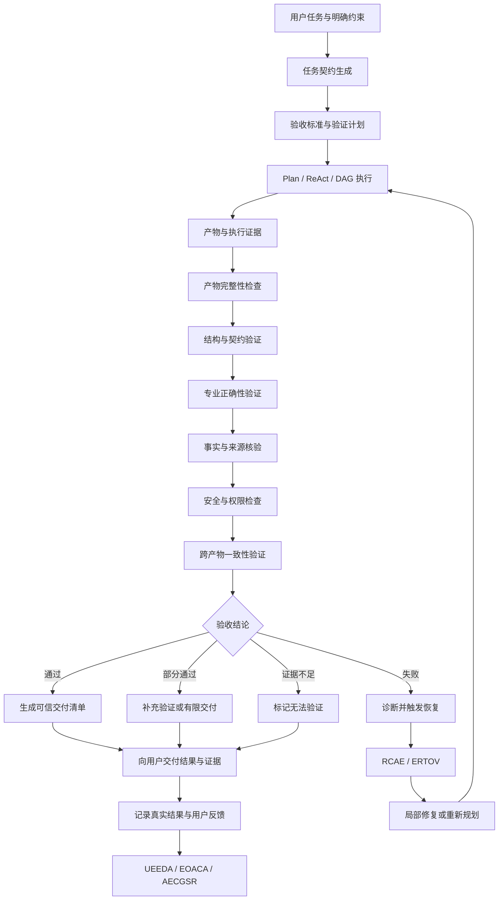

# 问答 125

> 来源: 新 窗口 | 会话: 分支 · 分支 · 分支 · 设计自进化智能体
> 消息: f8de6280-2438-4419-9455-7bfb67637a25 | 时间(UTC): 2026-10-24 11:46

## 用户

继续

## ChatGPT

<WritingBlock id="76142" variant="document"># EvoAgent 第六十一专项：任务结果验收、事实核验与可信交付体系

**专项编号：TOVFTD**

**英文名称：Task Outcome Verification, Factual Validation & Trustworthy Delivery**

**文档版本：V1.0**

**文档性质：全量架构专项设计**

**适用范围：EvoAgent 统一任务入口、Plan、ReAct、DAG、领域专家、能力组合编排 CCOCDTG、能力资产化 EOACA、问题诊断 RCAE、独立评测 UEEDA、自主进化治理 AECGSR、能力规划 CGDPCP、工具能力治理 TCRDCF、上下文与记忆系统、权限治理 AHOG、成本预算和多设备执行体系。**

**核心目标：建立独立于任务生成与执行过程的结果验证体系，将用户目标转化为明确的验收条件，核验事实与证据，检查产物完整性、专业正确性、执行真实性、安全性和可用性，并根据任务风险决定验证深度，最终向用户交付具有明确状态、验证证据和限制说明的结果。**

本文定义目标架构、数据模型、执行机制、治理策略和验收标准，不代表相关模块已经实现。

---

# 一、为什么执行成功不等于任务成功？

此前的专项已经逐步建立了完整的执行链路。

EvoAgent 可以理解任务、选择专家、制定计划、调用工具、组织多专家协作、处理失败，并将经过验证的能力沉淀为长期资产。

但是，这条执行链路存在一个根本问题：

**执行系统能够报告自己做了什么，却不一定能够证明最终结果满足用户的真实要求。**

例如：

- 代码专家修改了代码，工具返回成功，但修改没有实现用户要求的功能。
- 文档专家生成了一份结构完整的报告，但关键数据来源错误。
- 漫剧工作流完成了视频合成，但角色形象前后不一致。
- 手机操作工具返回了成功状态，但目标页面实际上没有发生预期变化。
- 多个专家分别完成了各自的子任务，但组合后的最终产物不符合整体约束。
- 模型给出一个非常确定的答案，却没有足够证据支持结论。
- 系统完成了任务的大部分步骤，却遗漏了用户要求中的一个关键条件。

如果系统只根据工具返回值、专家自我评价或任务节点状态来判断成功，就会产生一种危险的假象：

**系统看起来越来越能干，实际交付的可靠性却没有同步提高。**

因此，EvoAgent 需要将以下三个职责明确分开。

| 责任体系 | 核心职责 |
|---|---|
| 执行体系 | 产生结果，记录执行过程 |
| 验证体系 | 检查结果是否符合要求，证据是否充分 |
| 交付体系 | 告知用户实际完成了什么、验证了什么、还有什么限制 |

三者需要协同，但不能完全混为一体。

本专项的核心，就是让 EvoAgent 从“能够执行任务”进一步发展为“能够证明自己在什么程度上完成了任务”。

---

# 二、第一性原理：什么才算真正完成一项任务？

一项任务真正完成，至少需要满足五个条件。

1. **目标符合性**：结果符合用户的真实目标和明确约束。
2. **内容正确性**：关键事实、计算、逻辑或专业结论正确。
3. **结果完整性**：所有必须完成的部分均已覆盖。
4. **证据充分性**：对于需要验证的结论，存在足够的检查证据。
5. **交付可用性**：结果可以被用户实际使用，并且其限制和风险已经明确。

对于具有外部副作用的任务，还需要额外检查：

- 操作是否获得授权；
- 外部状态是否真正发生变化；
- 是否产生了重复执行或其他非预期后果；
- 是否需要保留可审计的执行记录。

这五个条件并不是简单的加权平均。

例如，代码生成任务的格式非常规范、解释非常清晰，但代码本身存在严重错误，仍然不能算作成功。

同样，某项外部操作即使执行结果正确，如果没有得到必要授权，也不能被视为合规完成。

因此，TOVFTD 必须同时支持：

- 可量化的质量指标；
- 明确的硬性验收条件；
- 证据充分性判断；
- 风险约束；
- 不确定性表达。

## 2.1 结果正确性与执行正确性必须分开

考虑一个手机自动化任务：

用户要求打开某个应用，并进入指定页面。

可能发生两种情况：

- 工具调用成功，但打开了错误页面；
- 工具调用过程中出现超时，但页面实际上已经成功打开。

如果系统仅检查工具返回值，就可能分别产生错误的失败判断和错误的成功判断。

正确的做法是：

1. 记录执行证据；
2. 检查当前实际界面；
3. 比较实际状态与目标状态；
4. 根据证据判定结果。

这意味着：

**执行日志是验证的重要证据，但不能代替对最终状态的核验。**

## 2.2 结果正确也不意味着所有结论都可信

例如，一份研究报告中的结论可能碰巧正确，但引用的来源无法支持该结论。

如果系统只检查结论是否看起来合理，就无法识别这种问题。

因此，事实核验必须同时检查：

- 结论本身；
- 支持结论的证据；
- 证据与结论之间的逻辑关系；
- 来源的可信度；
- 信息的时效性；
- 是否存在相反证据。

---

# 三、总体架构：独立结果验证与可信交付层

建议新增 `Task Outcome Verification Layer`，简称 TOVL。

TOVL 不是一个新的通用专家，也不负责重新执行所有任务，而是建立一套独立的结果验证和交付控制机制。



建议将 TOVL 划分为九个逻辑模块。

| 模块 | 主要职责 |
|---|---|
| 1. 验收契约管理器 | 将用户目标转化为可验证的验收条件 |
| 2. 验证计划生成器 | 决定需要哪些检查、证据和验证资源 |
| 3. 产物完整性验证器 | 检查文件、媒体、代码和数据是否完整有效 |
| 4. 事实与来源核验器 | 检查事实、引用、数据来源和时效性 |
| 5. 专业验证器 | 根据领域检查代码、文档、媒体或操作结果 |
| 6. 跨产物一致性验证器 | 检查不同产物之间的约束、版本与逻辑关系 |
| 7. 验证证据管理器 | 记录验证方法、输入、结果和证据来源 |
| 8. 验收决策引擎 | 综合硬性条件、证据和风险，确定最终状态 |
| 9. 可信交付管理器 | 生成交付清单，说明完成情况、证据和限制 |

这些模块可以作为本地运行时的逻辑组件实现，不需要分别部署成独立服务。

---

# 四、第一阶段：把用户要求变成可验证的验收契约

验证系统最容易犯的错误，是任务完成后才临时决定应该检查什么。

这会导致验收标准随着结果变化，甚至出现“结果已经生成，所以降低验收要求”的情况。

因此，TOVFTD 必须在执行前尽可能建立验收契约。

建议新增 `AcceptanceContract`。

## 4.1 验收契约包含什么？

每项任务至少需要记录：

- `task_id`：任务 ID；
- `user_goal`：用户目标；
- `required_outcomes`：必须实现的结果；
- `hard_constraints`：不可违反的约束；
- `quality_targets`：质量目标；
- `verification_methods`：验证方法；
- `evidence_requirements`：证据要求；
- `risk_class`：风险等级；
- `partial_completion_policy`：部分完成时的处理方式；
- `approval_requirements`：需要用户确认的事项；
- `delivery_requirements`：交付格式与内容；
- `contract_version`：验收契约版本。

例如，用户要求修改代码时，契约可以规定：

- 指定功能必须实现；
- 不能修改指定范围之外的文件；
- 必须通过相关测试；
- 不能引入已知严重安全问题；
- 如果无法运行测试，必须明确说明；
- 未经授权不得提交或推送代码。

这些条件应当在执行开始前确定。

## 4.2 区分硬性条件与软性目标

硬性条件不能被其他高分抵消。

例如：

| 条件 | 类型 | 处理规则 |
|---|---|---|
| 必须保留指定文件 | 硬性 | 不满足则不能完全通过 |
| 必须使用指定输出格式 | 硬性 | 不符合时需要修复或明确阻塞 |
| 报告尽量简洁 | 软性 | 可以通过质量评分衡量 |
| 视频画面风格一致 | 按任务契约定义 | 可设置明确的最低门槛 |
| 尽可能降低 API 成本 | 优化目标 | 在硬性要求满足后进行权衡 |
| 外部操作必须获得授权 | 硬性安全约束 | 不允许通过质量评分抵消 |

对于自然语言要求中存在歧义的部分，系统应尽量解析，并对影响任务可行性的重要歧义进行澄清。

不能擅自将不明确的要求转换为严格约束，也不能在没有依据的情况下忽略明确要求。

## 4.3 验收标准应随任务类型变化

不应该让所有任务都使用同一套评分规则。

例如：

- 代码任务重视功能正确性、测试和安全；
- 研究任务重视来源、事实和论证；
- 文档任务重视内容完整性、格式和一致性；
- 视频任务重视时长、画面、音频与连续性；
- 手机操作任务重视真实状态变化和授权；
- 数据分析任务重视数据来源、计算正确性和结果可复现性。

因此，建议采用：

**通用验收框架 + 领域专用验收模板 + 任务级定制条件。**

通用框架负责统一流程和证据管理，领域专家提供专业检查规则，任务契约决定本次任务的具体验收要求。

---

# 五、第二阶段：建立风险分级的验证策略

验证需要消耗模型调用、计算资源、时间和外部 API 费用。

如果对每项任务都执行最复杂的验证流程，系统会变得昂贵而缓慢。

如果所有任务都只做简单检查，又无法保证可靠性。

因此，TOVFTD 必须采用风险分级策略。

## 5.1 五级验证强度

<box gap={2}>
  <box border radius="lg" padding={3} gap={1}>
    **V0：基础检查**

    <text color="secondary" size="sm">适用于低风险、简单且容易直接判断的任务。</text>

    检查必要字段、输出格式、明显遗漏和基本约束。
  </box>
  <box border radius="lg" padding={3} gap={1}>
    **V1：结构化验证**

    <text color="secondary" size="sm">适用于需要明确格式、依赖和结果完整性的任务。</text>

    增加结构校验、契约检查、产物完整性和基本一致性验证。
  </box>
  <box border radius="lg" padding={3} gap={1}>
    **V2：独立专业验证**

    <text color="secondary" size="sm">适用于代码修改、复杂内容生成、重要文件处理和多步骤任务。</text>

    使用独立测试、专业规则、结果对照或专用验证工具。
  </box>
  <box border radius="lg" padding={3} gap={1}>
    **V3：多源与多方法验证**

    <text color="secondary" size="sm">适用于高影响任务、关键事实核验和复杂协作产物。</text>

    结合独立证据来源、不同验证方法、交叉检查和严格的失败处理。
  </box>
  <box border radius="lg" padding={3} gap={1}>
    **V4：高保障验证与人工确认**

    <text color="secondary" size="sm">适用于严重后果、不可逆操作或无法仅靠自动检查可靠确认的任务。</text>

    采用强制权限门禁、独立验证、必要的人工审批和明确的执行边界。
  </box>
</box>

这些级别表示验证强度，不是对任务正确性的绝对保证。

高风险任务不一定需要更多语言模型，而可能更需要确定性检查、真实状态查询、独立证据和人工授权。

## 5.2 风险等级由什么决定？

建议综合考虑：

- 错误造成的潜在损失；
- 操作是否可逆；
- 是否存在外部副作用；
- 结果是否会被用户直接用于重要决策；
- 验证是否容易；
- 结果错误是否容易被发现；
- 是否涉及隐私、权限或敏感数据；
- 用户是否明确要求严格验证。

对于安全、授权和不可逆操作，应使用硬性门禁，而不是只计算一个平均风险分数。

## 5.3 验证深度可以动态调整

例如：

- 普通代码解释采用 V0 或 V1；
- 修改现有代码采用 V2；
- 涉及关键系统变更时采用更严格的验证；
- 真实外部提交操作可能需要 V4 级别的授权与状态确认。

但验证级别必须根据实际风险和任务契约确定，不能仅根据任务名称机械决定。

---

# 六、第三阶段：建立独立验证机制，防止系统自我欺骗

这是整个专项最关键的设计之一。

如果生成结果的执行器同时负责判断自己的结果是否正确，就可能出现系统性偏差。

例如，模型先生成一段代码，再用同一套推理过程判断“代码看起来正确”，但它可能没有发现自己最初就犯下的错误。

因此，需要建立验证独立性机制。

## 6.1 验证独立性分层

建议将验证方式划分为五类。

| 类型 | 方法 | 主要作用 |
|---|---|---|
| I1：结构独立 | JSON Schema、文件格式检查、约束检查 | 发现格式与结构错误 |
| I2：执行独立 | 测试运行、实际状态检查、独立计算 | 验证结果能否实际工作 |
| I3：证据独立 | 查阅原始数据、外部来源、执行记录 | 核实事实与执行状态 |
| I4：判断独立 | 使用不同验证器、不同方法或独立模型复核 | 降低共同推理错误的风险 |
| I5：人工独立 | 用户或授权人员确认 | 处理高风险、歧义和无法自动判断的情况 |

并不是每项任务都需要全部五类验证。

但关键结论不能仅依赖生成器自己的口头确认。

## 6.2 不同验证方法具有不同价值

例如：

- 代码语法是否正确，可以使用解析器检查；
- 单元测试是否通过，可以通过实际运行验证；
- 事实是否真实，可以检查可信来源；
- 手机操作是否成功，可以查询实际界面状态；
- 视频时长是否符合要求，可以检查媒体元数据；
- 视频叙事是否合理，则可能需要专业模型或人工评估。

不能用一种通用语言模型检查替代所有验证手段。

## 6.3 独立模型也可能犯相同错误

使用两个不同模型进行复核，并不自动意味着验证可靠。

两个模型可能：

- 使用相同的错误假设；
- 依赖同一份错误数据；
- 对同一类问题存在相同盲点；
- 受到相同的提示注入内容影响；
- 以不同措辞给出同一个错误结论。

因此，验证独立性应优先考虑验证方法和证据来源的差异，而不是单纯增加模型数量。

**最重要的不是让更多模型说“正确”，而是让结果通过能够发现真实错误的检查。**

---

# 七、第四阶段：事实核验与证据管理

对于研究、问答、报告、数据分析和需要外部信息的任务，事实核验尤其重要。

建议新增 `ClaimEvidenceRegistry`，用于管理结果中的重要主张与支持证据。

## 7.1 什么是可核验主张？

例如，一份报告包含以下陈述：

- 某个产品支持特定功能；
- 某个政策在指定日期生效；
- 某项研究得出了特定结论；
- 某个数字来自某个统计机构；
- 某个操作已经完成；
- 某个文件已经成功生成。

这些陈述可以被拆分为独立主张，并根据其重要性决定是否需要核验。

不需要对所有日常表达都执行复杂的事实核验。

系统应优先验证：

- 影响用户决策的关键事实；
- 数值和计算结果；
- 时效性强的信息；
- 可能造成重大误解的陈述；
- 用户明确要求提供来源的结论；
- 最终交付中明确宣称已经完成的操作。

## 7.2 主张记录的数据结构

每个主张建议包含：

- `claim_id`：主张 ID；
- `claim_text`：主张内容；
- `claim_type`：事实、数字、推论、预测、状态或建议；
- `importance`：重要性；
- `source_refs`：支持证据引用；
- `contradiction_refs`：相反证据；
- `verification_method`：验证方法；
- `verification_status`：核验状态；
- `freshness_requirement`：时效要求；
- `scope`：适用范围；
- `limitations`：已知限制；
- `last_verified_at`：最近核验时间。

对于事实类结论，建议保留来源引用和可追溯的原始内容位置。

对于预测、推论或建议，应明确标记其性质，不能将其包装成已经证实的事实。

## 7.3 证据来源的可信度

来源可信度需要根据主张类型判断。

例如：

- 法规内容优先查阅适用司法辖区的正式文本；
- 软件接口行为优先查阅对应版本的官方文档或实际测试结果；
- 科学结论优先检查原始研究、系统综述及适用的专业证据；
- 外部操作状态优先查询实际系统状态，而不是仅依赖模型生成的执行描述；
- 用户提供的文件可以证明文件中写了什么，但不必然证明其中的事实都正确。

因此，系统不能给所有来源设置一个永久不变的绝对排名。

应当同时检查来源权威性、时间、适用范围、原始性和证据与主张之间的关联。

## 7.4 来源之间存在冲突怎么办？

如果两个来源给出不同信息，系统应：

1. 确认它们讨论的是不是同一对象；
2. 检查日期、版本和适用范围；
3. 优先寻找原始来源；
4. 检查是否存在更新版本；
5. 保留无法消除的分歧；
6. 根据任务风险决定是否需要进一步核验。

不能为了生成一个简洁答案，就自动选择看起来更符合预期的来源。

## 7.5 证据不足时如何处理？

建议为事实主张设置以下状态：

- `SUPPORTED`：证据充分支持；
- `PARTIALLY_SUPPORTED`：证据只支持部分内容；
- `CONTRADICTED`：存在有力反证；
- `UNVERIFIED`：尚未核验；
- `INSUFFICIENT_EVIDENCE`：证据不足；
- `CONFLICTING_EVIDENCE`：存在尚未解决的证据冲突；
- `STALE`：证据可能已经过时；
- `NOT_APPLICABLE`：不需要或不适用该类核验。

这些状态不能简单映射成一个“事实置信度百分比”。

系统可以估计置信程度，但不能把模型自信、来源数量或搜索结果数量直接等同于事实正确率。

---

# 八、第五阶段：不同产物采用不同的验证器

EvoAgent 是多领域智能体，不能让所有专家共享同一个通用验收器来处理所有产物。

建议建立统一的验证器注册机制 `VerifierRegistry`。

每个验证器需要声明：

- 支持的产物类型；
- 输入要求；
- 适用范围；
- 检查规则；
- 输出格式；
- 验证证据；
- 已知盲点；
- 资源成本；
- 失败处理方式；
- 版本；
- 独立评测状态。

## 8.1 代码验证

代码任务可以采用多层验证。

| 检查层 | 示例 |
|---|---|
| 结构检查 | 语法解析、文件格式、补丁格式 |
| 静态检查 | 类型、代码规则、依赖与潜在缺陷 |
| 功能检查 | 单元测试、集成测试、行为测试 |
| 回归检查 | 原有功能是否受到影响 |
| 安全检查 | 权限、敏感数据、危险调用 |
| 结果检查 | 修改是否满足用户要求 |
| 变更范围检查 | 是否修改了授权范围之外的文件 |

某项测试通过只能证明它覆盖范围内的行为满足相应断言，不能自动证明整个程序没有错误。

如果测试没有执行，系统不能将“测试通过”作为结论。

如果只运行了部分测试，也必须明确说明覆盖范围。

## 8.2 文档与研究报告验证

文档任务至少可以检查：

- 是否覆盖全部必需章节；
- 事实主张是否具有相应来源；
- 引用是否真实存在；
- 引用内容是否支持对应结论；
- 数据和单位是否一致；
- 是否存在前后矛盾；
- 是否混淆事实、推论与建议；
- 是否符合用户要求的格式；
- 是否明确说明重要限制。

格式正确不等于内容正确。

引用存在也不等于引用有效。

## 8.3 数据分析验证

数据分析任务可以检查：

- 输入数据是否完整；
- 数据清洗规则是否正确应用；
- 缺失值和异常值是否被妥善处理；
- 计算公式是否正确；
- 单位和统计口径是否一致；
- 样本范围是否明确；
- 结果是否能够通过独立计算复现；
- 图表是否与底层数据一致；
- 是否存在不合理的因果推断。

对于统计分析，还需要根据任务判断是否涉及抽样偏差、混杂因素、不确定性区间和多重比较等问题。

## 8.4 AI 漫剧与视频验证

视频产物需要同时进行机器可测量的检查和语义质量评估。

机器可测量检查可以包括：

- 文件是否可解码；
- 时长是否符合要求；
- 分辨率和帧率是否满足要求；
- 音频轨道是否存在；
- 镜头之间是否存在异常黑帧；
- 音画同步是否达到预设标准；
- 输出文件是否完整。

语义质量检查可以包括：

- 角色外观是否一致；
- 场景是否符合分镜；
- 画面是否出现严重生成错误；
- 镜头之间是否存在明显的叙事断裂；
- 配音是否对应正确角色；
- 整体是否满足用户指定的风格与内容要求。

技术指标达标不能自动证明叙事质量达标。

语义质量评估也不能代替对视频文件完整性和实际时长的检查。

## 8.5 Android 手机操作验证

手机操作任务必须尽可能验证实际状态，而不是只验证点击是否执行。

例如：

用户要求打开某个应用并进入指定页面。

可以检查：

- 目标应用是否处于前台；
- 当前界面是否包含目标元素；
- 是否满足任务定义的页面状态；
- 是否出现权限弹窗或错误提示；
- 是否存在未完成的中间步骤。

对于发送、删除、购买等有副作用的操作，还需要根据风险检查真实操作结果，并遵守用户授权要求。

## 8.6 文件与媒体交付验证

对于需要交付文件的任务，至少需要检查：

- 文件确实存在；
- 路径可访问；
- 文件大小合理；
- 文件能够被目标程序读取；
- 文件格式与扩展名一致；
- 必需内容已经写入；
- 文件版本与验收记录一致。

仅生成文件名或创建一个空文件，不能视为交付成功。

---

# 九、第六阶段：跨产物与跨专家一致性验证

多专家任务经常产生多个独立产物。

即使每个产物单独通过检查，它们组合起来仍可能存在矛盾。

例如：

- 剧本中角色叫 A，分镜中却变成角色 B；
- 文档引用的是旧数据，图表使用的是新数据；
- 代码实现了一个接口，但调用方使用了另一种参数格式；
- 工作流已经更新，说明文档仍然描述旧流程；
- 视频时长发生变化，但配音和字幕没有同步更新。

因此，需要新增 `CrossArtifactConsistencyVerifier`。

## 9.1 一致性检查的四个层次

1. **标识一致性**：同一个实体是否使用统一标识。
2. **版本一致性**：各产物是否引用兼容的版本。
3. **约束一致性**：各产物是否满足共同的任务约束。
4. **语义一致性**：产物之间的含义是否矛盾。

## 9.2 关键产物必须有共同事实来源

例如，AI 漫剧中的正式角色设定应由一个明确的角色资产提供。

编剧、分镜和视频生成专家可以分别提出建议，但正式角色资产必须有明确版本和状态。

如果角色设定发生变更，系统应识别哪些下游产物受到影响。

同理，代码项目的正式接口定义、数据库模式、配置和工作流，也应尽可能具有明确的事实来源。

这可以减少不同专家各自维护一套事实的风险。

## 9.3 一致性检查必须结合依赖图

TOVFTD 应复用 CDCIPC 和 CCOCDTG 的依赖关系。

当一个上游产物变化时：

1. 找出直接依赖；
2. 找出间接依赖；
3. 判断哪些产物仍然有效；
4. 标记需要重新验证的产物；
5. 仅对必要的节点重新执行检查。

这样既可以避免旧结果继续流入最终交付，也可以减少不必要的重复计算。

---

# 十、第七阶段：验证证据、状态与验收决策

结果验证必须有统一的证据记录，不能只返回一个“通过”或“失败”。

建议新增 `VerificationEvidence`。

## 10.1 验证证据的数据结构

每条证据至少记录：

- `evidence_id`：证据 ID；
- `task_id`：任务 ID；
- `artifact_id`：产物 ID；
- `criterion_id`：对应验收条件；
- `verifier_id`：执行验证的验证器；
- `verifier_version`：验证器版本；
- `method`：验证方法；
- `input_refs`：验证输入；
- `result`：验证结果；
- `observed_at`：验证时间；
- `source_refs`：相关来源；
- `limitations`：验证限制；
- `reproducibility_info`：复现所需信息；
- `integrity_metadata`：证据完整性信息。

对于代码测试，可以保存测试命令、退出状态、测试报告和相关环境信息。

对于事实核验，可以保存来源引用、关键段落、来源时间和核验结论。

对于手机操作，可以保存必要的操作状态、页面检查结果和操作证据。

证据记录应遵循最小化原则，避免为了审计而无限制收集个人数据。

## 10.2 统一验收状态

建议建立以下任务级状态：

| 状态 | 含义 |
|---|---|
| `PASS` | 所有适用的硬性验收条件均满足，所需验证已完成 |
| `PASS_WITH_LIMITATIONS` | 核心要求满足，但存在已披露的限制或未覆盖范围 |
| `PARTIAL` | 只完成了部分目标 |
| `UNVERIFIABLE` | 现有条件下无法获得足够证据判断 |
| `FAIL` | 存在明确未满足的必要条件 |
| `BLOCKED` | 因权限、依赖、环境或必要输入缺失而无法继续 |
| `CANCELLED` | 任务已取消，未完成正常验收 |

这些状态是最终验收状态，不应与子任务的执行状态混为一谈。

例如，子任务可以成功运行，但最终任务仍然为 `FAIL`。

## 10.3 验收决策规则

建议按照以下顺序判断：

1. 是否违反硬性安全或权限条件？
2. 必须完成的结果是否全部存在？
3. 关键产物是否完整、可访问且版本正确？
4. 关键功能或事实是否通过必要验证？
5. 是否存在尚未解决的关键矛盾？
6. 是否有足够证据支持最终结论？
7. 是否存在必须披露的限制？
8. 是否需要用户确认后才能交付或继续执行？

如果任何硬性条件未满足，就不能通过普通加权评分将任务判定为完全成功。

如果证据不足，应该使用 `UNVERIFIABLE` 或 `PASS_WITH_LIMITATIONS` 等适当状态，而不是将不确定性隐藏起来。

---

# 十一、第八阶段：验证器本身也需要被验证

这是很多自动验收系统容易忽略的问题。

如果验证器本身有错误，系统可能会出现更严重的问题：

- 错误产物被标记为通过；
- 正确产物被误判为失败；
- 引用不存在的证据；
- 测试覆盖不足却报告完整通过；
- 验收标准被错误解释；
- 验证器在某种输入下持续漏检。

因此，验证器不能被视为绝对可靠的最终裁判。

## 11.1 建立验证器质量评估体系

建议针对每个验证器记录：

- `false_accept_rate`：错误产物被接受的比例；
- `false_reject_rate`：正确产物被拒绝的比例；
- `coverage`：已验证的规则或行为范围；
- `evidence_quality`：证据充分程度；
- `latency`：验证时延；
- `cost`：验证成本；
- `known_blind_spots`：已知盲点；
- `applicability_scope`：适用范围；
- `calibration_status`：校准状态。

这些指标应通过已知答案的测试集、对照样本和受控实验评估。

不能只依靠验证器自己的自我评分。

## 11.2 使用正反样本和边界样本

每个关键验证器都应具备：

- 正常通过样本；
- 明确失败样本；
- 边界条件样本；
- 易混淆样本；
- 历史失败样本；
- 可能触发误判的样本。

例如，代码验收器不仅需要检查正确代码，还需要检查：

- 测试实际失败的代码；
- 仅通过表面测试但违反任务要求的代码；
- 存在副作用的代码；
- 缺少依赖或无法运行的代码。

## 11.3 防止验证器与生成器相互迎合

如果生成器和验证器都以同一份有缺陷的验收描述为依据，二者可能共同忽略重要要求。

因此，关键任务应将验收标准与生成过程分开管理。

对于重要的任务，可以由独立检查器从原始用户要求中提取必要条件，并与生成器的执行计划进行对照。

如果两者存在差异，应先解决差异，而不是默认采用生成器的解释。

## 11.4 验证器升级也需要独立门禁

验证器自身的提示词、规则、模型或代码发生变化时，应运行回归测试。

如果升级后漏检率上升，即使平均评分提高，也不能直接发布。

对于关键验证器，应优先采用保守升级策略，并保留旧版本及回滚能力。

---

# 十二、第九阶段：验证失败后的恢复与重新执行

验证失败并不总是意味着整个任务都需要重做。

TOVFTD 应根据失败范围和原因，与 RCAE、ERTOV 和 CCOCDTG 协同处理。

## 12.1 验证失败的分类

建议分为六类：

1. `CONTENT_ERROR`：内容或逻辑错误；
2. `CONTRACT_VIOLATION`：未满足验收契约；
3. `EVIDENCE_FAILURE`：证据缺失或来源不支持结论；
4. `ARTIFACT_FAILURE`：产物损坏、不完整或无法访问；
5. `CONSISTENCY_FAILURE`：产物之间存在冲突；
6. `VERIFICATION_FAILURE`：验证器运行失败或无法给出可靠判断。

第六类尤其重要。

验证器自身无法运行，并不代表被验证的产物一定错误，也不代表产物已经通过。

应当区分“结果失败”和“无法完成验证”。

## 12.2 根据失败类型选择恢复动作

| 失败类型 | 推荐处理 |
|---|---|
| 内容错误 | 修复对应内容并重新验证 |
| 契约违反 | 调整产物或重新规划任务 |
| 证据不足 | 补充来源或降低结论强度 |
| 产物损坏 | 重新生成或恢复已验证版本 |
| 一致性错误 | 修复冲突产物并检查依赖 |
| 验证器失败 | 修复验证环境、切换验证方法或标记无法验证 |

## 12.3 不允许无限循环

验证系统不能因为某项结果不通过，就无限要求生成器重新生成。

建议对每个任务设置：

- 最大修复轮次；
- 最大验证预算；
- 最大任务时延；
- 最大重复失败次数；
- 可接受的降级策略；
- 需要用户介入的触发条件。

如果连续修复仍然无法满足验收要求，系统应暂停并说明原因。

它可以交付部分有效结果，但必须明确标记未完成部分，不得将失败结果包装成完整成功。

---

# 十三、第十阶段：可信交付与结果说明

最终交付不是把文件、文本或操作结果简单地返回给用户。

它还需要说明：

- 完成了什么；
- 哪些条件已经验证；
- 哪些条件没有验证；
- 使用了哪些重要证据；
- 是否存在已知限制；
- 是否还有待用户确认的事项。

建议建立 `DeliveryManifest`，作为正式交付清单。

## 13.1 交付清单的字段

- `delivery_id`：交付 ID；
- `task_id`：关联任务；
- `final_status`：最终验收状态；
- `artifact_refs`：交付产物引用；
- `verified_criteria`：已验证的验收条件；
- `unverified_criteria`：未验证的条件；
- `known_limitations`：已知限制；
- `important_evidence_refs`：关键证据；
- `external_actions`：已执行的外部操作；
- `pending_actions`：尚未执行的操作；
- `approval_status`：授权或审批状态；
- `artifact_versions`：正式交付版本；
- `generated_at`：生成时间；
- `verification_summary`：验证摘要。

## 13.2 不同验收状态采用不同交付策略

**完全通过：**

说明结果已满足规定的验收条件，并列出关键验证范围。

**部分通过：**

说明哪些部分完成、哪些部分未完成，以及未完成的原因。

**无法验证：**

说明缺少什么证据、哪些条件无法判断，以及需要什么条件才能进一步核验。

**失败或阻塞：**

说明关键失败点、当前状态和可行的恢复路径。

不能将“没有发现错误”直接表述为“证明不存在错误”。

同样，不能把“工具执行返回成功”表述为“整个任务已经完全成功”，除非最终结果也通过了相应的验证。

## 13.3 交付声明必须有证据支撑

如果系统告诉用户：

“已成功修改代码并通过测试。”

就必须能够找到对应的代码版本和实际测试记录。

如果系统告诉用户：

“已经生成视频。”

就必须确认目标文件真实存在且可读取。

如果系统告诉用户：

“已经完成手机操作。”

就应当有相应的状态核验依据，特别是涉及外部副作用时。

可信交付不是让说明文字显得更加专业，而是让每个重要完成声明都可以追溯到实际结果。

---

# 十四、第十一阶段：验证预算与成本优化

验证也需要受预算约束，但不能因为成本有限就无条件降低关键验收标准。

建议建立 `VerificationBudgetManager`。

## 14.1 预算分层

将验证资源分为：

- 基础结构验证预算；
- 专业功能验证预算；
- 事实与来源核验预算；
- 高风险独立验证预算；
- 失败修复与复验预算。

每类任务可以采用不同预算策略。

例如，简单文本任务不需要执行复杂的多模型验证，而关键代码变更可能值得增加测试和静态分析成本。

## 14.2 先做高价值检查

建议按照以下原则安排验证顺序：

1. 先检查硬性条件和权限；
2. 检查产物是否存在、完整且可访问；
3. 检查成本低且能发现大量错误的确定性条件；
4. 检查关键功能和事实；
5. 根据风险增加独立复核；
6. 仅在必要时进行更昂贵的深度验证。

这样可以在早期发现明显失败，避免对已经不符合基本要求的结果继续投入大量验证资源。

## 14.3 不允许通过削减验证预算掩盖风险

当预算不足以完成必要的验证时，系统应：

- 使用已有的低成本验证方法；
- 减少非必要的附加检查；
- 缩小任务范围；
- 请求用户批准额外预算；
- 或将结果标记为无法验证。

不能为了维持高完成率，直接跳过硬性验收条件。

---

# 十五、第十二阶段：验证结果如何反馈给整个进化系统？

TOVFTD 不应成为一个只负责最后打分的孤立模块。

它的结果应反馈给 EvoAgent 的其他治理体系。

## 15.1 与 RCAE 的关系

当验证失败时，将验收差异和证据提供给 RCAE。

RCAE 再分析原因属于：

- 需求理解错误；
- 计划遗漏；
- 工具使用错误；
- 专家能力不足；
- 上下文丢失；
- 事实来源错误；
- 验收规则缺陷；
- 验证器本身的错误。

这样可以避免将所有验收失败都归因于生成模型。

## 15.2 与 UEEDA 的关系

UEEDA 负责独立评估候选改进。

TOVFTD 负责当前任务的结果验证。

二者可以共享验证器、验收契约和证据资产，但职责不同。

例如：

- TOVFTD 检查这次代码修改是否通过测试；
- UEEDA 检查新的代码专家策略是否在代表性测试集上优于旧策略。

一次任务通过验收，不能代替对新策略的系统性评测。

## 15.3 与 EOACA 的关系

当某项能力或工作流经过反复验证，可以将以下内容沉淀为资产：

- 验收模板；
- 领域验证器；
- 已验证测试集；
- 失败案例；
- 可靠的证据提取规则；
- 跨产物一致性检查；
- 已验证的交付清单模板。

但不能因为某个任务成功，就自动把它的全部执行过程固化为正式资产。

## 15.4 与 AECGSR 的关系

如果验证器本身发生变化，或者验收策略需要升级，应进入相应的变更治理流程。

重要验证规则不能在没有回归测试的情况下直接覆盖稳定版。

验证器更新后，必须检查其对其他专家和工作流的影响，并保留回滚方案。

## 15.5 与 CGDPCP 的关系

如果系统发现某类任务始终无法通过验证，可能意味着：

- 缺少必要的工具；
- 缺少领域验证器；
- 现有工作流不可靠；
- 关键能力尚未建立。

此时，CGDPCP 可以将它识别为能力缺口，并评估是否值得建设。

---

# 十六、第十三阶段：个人设备与离线环境中的验证设计

EvoAgent 采用个人使用、本地优先的部署策略，因此结果验证不能依赖所有任务都在线完成。

## 16.1 本地可完成的验证

例如：

- 文件完整性；
- JSON、YAML 和代码语法；
- 本地测试；
- 文件格式检查；
- 本地媒体元数据；
- 本地数据库状态；
- 已安装工具的确定性检查；
- 已缓存资料的结构与版本检查。

这些检查可以在断网时继续执行。

## 16.2 需要外部信息的验证

例如：

- 最新政策；
- 当前软件接口；
- 外部服务的真实状态；
- 最新产品规格；
- 在线数据的时效性；
- 需要访问远程环境的任务。

如果断网导致这些条件无法验证，系统应将相关结论标记为未验证或受限，而不是假定缓存内容仍然有效。

## 16.3 Android 端与桌面端的验证分工

Android 端可以执行：

- 本地界面状态检查；
- 已授权的操作结果核验；
- 本地文件检查；
- 离线任务的基础验收；
- 结果与证据缓存。

Windows 或 mini Linux 主机可以执行：

- 较复杂的测试；
- 媒体质量分析；
- 大型文件处理；
- 长时间任务验收；
- 需要额外计算资源的验证。

验证机制应与设备类型解耦。

如果设备不支持某项验证，系统应明确记录限制，而不是把验证缺失当作通过。

## 16.4 断联期间的证据同步

建议使用增量同步。

每条验证记录应具有：

- 唯一 ID；
- 关联任务；
- 产物版本；
- 验证器版本；
- 本地执行时间；
- 同步状态；
- 内容完整性标识。

重新连接后，系统可以同步新的验证事件，并在必要时重新检查依赖或环境是否已经变化。

---

# 十七、工程目录与核心接口

建议新增以下逻辑模块：

```text
evoagent/
├── verification/
│   ├── acceptance_contracts/
│   ├── verification_planner/
│   ├── risk_based_verification/
│   ├── verifier_registry/
│   ├── structural_verifiers/
│   ├── factual_verification/
│   ├── code_verification/
│   ├── document_verification/
│   ├── data_verification/
│   ├── media_verification/
│   ├── device_state_verification/
│   ├── artifact_integrity/
│   ├── cross_artifact_consistency/
│   ├── evidence_registry/
│   ├── acceptance_engine/
│   └── verification_budget/
├── trustworthy_delivery/
│   ├── delivery_manifest/
│   ├── artifact_versioning/
│   ├── result_summary/
│   ├── limitation_reporting/
│   ├── delivery_audit/
│   └── delivery_status/
├── verifier_quality/
│   ├── verifier_benchmarks/
│   ├── false_accept_tests/
│   ├── false_reject_tests/
│   ├── adversarial_cases/
│   ├── calibration/
│   └── regression/
└── verification_tests/
    ├── contract_tests/
    ├── evidence_tests/
    ├── domain_verifier_tests/
    ├── cross_artifact_tests/
    ├── acceptance_state_tests/
    ├── failure_recovery_tests/
    └── offline_verification_tests/
```

建议提供以下核心接口：

- `build_acceptance_contract`：构建验收契约；
- `validate_acceptance_contract`：检查验收条件是否完整；
- `plan_verification_strategy`：制定验证计划；
- `select_verification_level`：选择验证强度；
- `select_verifiers`：选择适用的验证器；
- `verify_artifact_integrity`：检查产物完整性；
- `verify_artifact_contract`：检查产物是否满足契约；
- `verify_factual_claims`：核验事实主张；
- `validate_evidence_source`：检查证据来源；
- `detect_conflicting_evidence`：识别证据冲突；
- `verify_domain_artifact`：执行领域专用验证；
- `verify_cross_artifact_consistency`：检查跨产物一致性；
- `register_verification_evidence`：记录验证证据；
- `evaluate_evidence_sufficiency`：评估证据是否充分；
- `evaluate_verifier_quality`：评估验证器自身的质量；
- `classify_verification_failure`：分类验证失败；
- `decide_acceptance_status`：生成任务级验收状态；
- `request_reverification`：触发重新验证；
- `trigger_failure_recovery`：将失败交给恢复体系；
- `enforce_verification_budget`：执行验证预算控制；
- `generate_delivery_manifest`：生成正式交付清单；
- `validate_delivery_claims`：检查交付声明是否有证据支持；
- `report_verification_limitations`：输出验证限制；
- `record_final_acceptance`：保存最终验收结果；
- `revalidate_after_dependency_change`：依赖变化后重新验证；
- `evaluate_verification_regression`：检查验证规则升级后的回归风险；
- `sync_verification_evidence`：同步离线产生的验证记录。

所有接口必须关联统一任务 ID、验收契约版本、产物版本和验证证据，避免结果与验证记录发生错配。

---

# 十八、端到端验收场景

建议至少建立以下九个场景。

## 场景 A：代码修改不能仅凭生成成功就通过

**初始条件：** 用户要求修改一个功能。

**验收过程：**

1. 生成验收契约；
2. 修改代码；
3. 检查补丁和文件范围；
4. 运行适用的测试；
5. 检查测试报告；
6. 对照原始需求验证功能；
7. 生成交付清单。

**验收重点：** 工具返回成功不等于代码正确。

## 场景 B：事实报告必须有相应证据

**初始条件：** 用户要求生成一份包含最新信息的报告。

**验收过程：**

1. 识别关键事实主张；
2. 检查信息时效要求；
3. 获取适用的证据来源；
4. 检查来源是否支持对应主张；
5. 识别冲突或过时信息；
6. 对证据不足的结论作出限制说明；
7. 生成带有来源引用的交付结果。

**验收重点：** 不能仅因为内容看起来合理就判定事实正确。

## 场景 C：视频合成成功但质量不达标

**初始条件：** 漫剧工作流生成了最终视频文件。

**验收过程：**

1. 检查文件是否可读取；
2. 检查时长、分辨率和音轨；
3. 检查镜头与音频同步；
4. 检查角色一致性；
5. 检查用户要求的内容与风格；
6. 对不达标镜头触发局部修复；
7. 重新检查受影响的产物。

**验收重点：** 文件生成成功不代表视频质量达标。

## 场景 D：手机操作必须验证真实状态

**初始条件：** 用户要求打开某应用并进入目标页面。

**验收过程：**

1. 检查操作授权；
2. 执行打开应用和导航操作；
3. 获取实际界面状态；
4. 检查目标页面是否满足条件；
5. 如果状态未知，进行安全的状态核验；
6. 根据证据确定最终状态。

**验收重点：** 点击成功不能替代结果状态检查。

## 场景 E：多个专家完成局部任务，但整体结果存在冲突

**初始条件：** 多个专家分别生成文档、图表和数据文件。

**验收过程：**

1. 检查每个产物的独立验收结果；
2. 检查共同数据来源；
3. 检查版本一致性；
4. 检查数值和文本是否矛盾；
5. 修复冲突；
6. 对受影响产物重新验收。

**验收重点：** 局部成功不能自动推导出整体成功。

## 场景 F：验证器本身运行失败

**初始条件：** 测试环境不可用，无法完成代码测试。

**验收过程：**

1. 记录验证器运行失败；
2. 区分验证器失败与代码失败；
3. 尝试可用的替代验证方法；
4. 如果关键验证仍无法完成，将结果标记为无法验证或部分通过；
5. 明确说明缺失的验证范围。

**验收重点：** 验证器失效不能被当作验收通过。

## 场景 G：硬性要求未满足时不能靠平均分通过

**初始条件：** 结果质量较高，但违反一项明确的硬性约束。

**验收过程：**

1. 检查硬性约束；
2. 确认违规事实；
3. 阻止完全通过；
4. 触发修复或说明阻塞原因；
5. 保留相应证据。

**验收重点：** 综合评分不能抵消硬性条件失败。

## 场景 H：预算不足时不能伪造验证结论

**初始条件：** 剩余预算不足以执行完整的深度验证。

**验收过程：**

1. 先执行必要的硬性检查；
2. 评估是否存在成本更低的可靠替代方法；
3. 保留未执行的验证项；
4. 按实际证据决定交付状态；
5. 必要时请求额外预算或用户确认。

**验收重点：** 不能为了维持高完成率而隐瞒验证缺口。

## 场景 I：验证规则升级不能破坏旧有可靠性

**初始条件：** 验证器规则或模型发生变化。

**验收过程：**

1. 执行既有回归集；
2. 执行正反样本和边界测试；
3. 比较误接受率与误拒绝率；
4. 检查成本、时延和覆盖范围；
5. 根据门禁决定发布、暂缓或回滚。

**验收重点：** 新版本不能只因为平均评分上升就自动替换稳定版。

---

# 十九、专项验收标准

TOVFTD 至少需要满足以下要求：

1. 能够将用户目标转化为结构化验收契约。
2. 能够区分硬性条件、软性目标和优化目标。
3. 能够在任务执行前建立主要验收标准。
4. 能够根据风险选择不同验证强度。
5. 能够区分执行成功、产物生成成功和最终任务成功。
6. 能够使用结构、执行、证据、独立判断和人工确认等不同验证方法。
7. 能够避免单纯依赖生成器自我评价。
8. 能够管理事实主张、来源引用、证据状态和时效要求。
9. 能够识别证据不足、相互冲突和可能过时的结论。
10. 能够针对代码、文档、数据、媒体和手机操作选择不同的验证器。
11. 能够检查产物完整性和可访问性。
12. 能够检查多专家产物之间的标识、版本、约束和语义一致性。
13. 能够通过依赖关系确定哪些产物需要重新验证。
14. 能够区分验证失败和验证器自身失败。
15. 能够识别并处理部分成功、无法验证和任务阻塞等状态。
16. 能够防止硬性条件被综合评分抵消。
17. 能够根据验证失败原因触发适当的恢复流程。
18. 能够限制重复修复、重复验证和无限循环。
19. 能够根据任务风险控制验证预算。
20. 能够生成具有明确产物版本、验收状态、证据引用和限制说明的交付清单。
21. 能够确保重要交付声明具有对应证据。
22. 能够对验证器本身进行独立评测。
23. 能够检测验证器的误接受、误拒绝和适用范围问题。
24. 能够通过回归集、边界样本和失败样本验证验证器升级。
25. 能够与 RCAE、ERTOV、UEEDA、EOACA、CGDPCP 和 AECGSR 共享验证证据。
26. 能够在 AHOG 的权限边界内执行验证和交付。
27. 能够在本地环境完成适用的离线验证。
28. 能够在断联后保留验证证据并进行受控同步。
29. 能够明确区分自动验证的范围与人工确认的必要性。
30. 能够通过端到端任务证明验收质量，而不是仅依据生成质量评分。
31. 能够检测任务执行过程中验收契约发生的非授权变化。
32. 能够防止旧版本产物沿用新版本的验收结果。
33. 能够在关键依赖、环境或验证器版本变化后重新评估验证有效性。
34. 能够在证据不足时诚实表达不确定性。
35. 能够将实际验收结果反馈给整个 EvoAgent 进化闭环。

以上为目标架构验收要求，不代表相关模块已经实现或通过测试。

---

# 二十、建议冻结的架构决策

以下建议承接 ADR-1024。

| 编号 | 决策 |
|---|---|
| ADR-1025 | 建立独立的任务结果验收、事实核验与可信交付体系 TOVFTD |
| ADR-1026 | 明确区分任务执行、结果验证和最终交付三个职责 |
| ADR-1027 | 任务执行前应尽可能建立版本化验收契约 |
| ADR-1028 | 验收契约必须区分硬性约束、软性质量目标和优化目标 |
| ADR-1029 | 不得仅凭工具返回成功或专家自我评价认定任务完成 |
| ADR-1030 | 根据任务风险、可逆性、错误后果和验证难度选择验证强度 |
| ADR-1031 | 采用通用验收框架、领域验证器和任务级验收条件相结合的机制 |
| ADR-1032 | 验证方法应根据产物类型选择，不以单一通用模型替代所有验证方式 |
| ADR-1033 | 关键任务应采用与生成过程具有足够独立性的验证方法 |
| ADR-1034 | 不得将不同模型的意见一致直接视为事实正确的充分证明 |
| ADR-1035 | 关键事实主张应关联相应证据来源和核验状态 |
| ADR-1036 | 来源可信度必须结合权威性、时效性、适用范围和证据关联性判断 |
| ADR-1037 | 证据不足、冲突或过时必须作为显式状态处理 |
| ADR-1038 | 代码、文档、数据、媒体、文件和设备操作必须具有适用的专用验证机制 |
| ADR-1039 | 多专家产物必须进行必要的版本、依赖和跨产物一致性检查 |
| ADR-1040 | 验证结果必须具有可追溯的证据记录 |
| ADR-1041 | 任务验收状态必须区分通过、有限通过、部分完成、无法验证、失败、阻塞和取消 |
| ADR-1042 | 硬性验收条件不得被其他质量指标的高分抵消 |
| ADR-1043 | 验证器自身的失败不得被视为被验证产物通过 |
| ADR-1044 | 验证器必须通过独立评测、正反样本和回归测试验证其质量 |
| ADR-1045 | 验证失败应按原因触发局部修复、重新规划或受控终止 |
| ADR-1046 | 验证与修复必须具有预算、时延和重复次数限制 |
| ADR-1047 | 最终交付必须包含适当的产物版本、验收状态、关键证据和限制说明 |
| ADR-1048 | 交付声明不得超出实际执行证据和验证范围 |
| ADR-1049 | 验证预算不足时，应降低交付状态或缩小任务范围，不得伪造通过结论 |
| ADR-1050 | 验收结果必须反馈给 RCAE、UEEDA、EOACA、CGDPCP 和 AECGSR |
| ADR-1051 | 验证器升级必须经过回归测试、变更治理和必要的回滚门禁 |
| ADR-1052 | 断联环境下只能对实际可验证的条件作出确定结论 |
| ADR-1053 | 关键外部副作用操作必须结合权限、实际状态与适当的人工确认 |
| ADR-1054 | TOVFTD 采用本地优先、模块化实现，不要求单独部署验证服务器 |
| ADR-1055 | 验收契约、产物版本和验证证据必须使用统一标识关联 |
| ADR-1056 | 系统必须明确说明自动验证的范围、局限及尚未核验的部分 |
| ADR-1057 | 结果可信度不能仅由单一评分、模型自信或执行成功率决定 |

以上建议作为 EvoAgent 第六十一专项的架构基线。

---

# 二十一、当前架构还缺少什么？

完成 TOVFTD 后，EvoAgent 已经拥有比较完整的任务执行与结果验收框架：

- 任务进入系统后可以识别目标；
- 路由器可以选择领域专家；
- Plan 和 DAG 可以组织执行过程；
- 协调器可以安排多专家协作；
- 工具治理负责约束工具能力；
- 问题诊断机制负责分析失败；
- 能力规划机制负责发现缺口；
- 进化治理机制负责控制变更；
- 独立评测负责验证能力改进；
- 结果验收机制负责判断最终产物；
- 可信交付机制负责说明完成状态和证据。

但是，还有一个关键问题尚未彻底解决：

**如果系统自己的任务记录、评测数据、验证器、记忆和历史经验也可能存在错误，那么系统如何知道自己长期积累的证据和能力资产值得信任？**

例如：

- 某次任务被错误标记为成功；
- 错误的评测标签被写入长期数据集；
- 验证器误判后，系统将失败经验固化为规则；
- 过时的记忆被多个专家反复引用；
- 某项能力因为错误统计而被判定为高可靠；
- 一个不正确的诊断结论不断影响后续改进；
- 多个模块共享同一个错误来源，最终形成相互印证的假象。

这说明，系统不但要验证用户任务的结果，还需要验证自身长期积累的证据、评测数据和知识资产。

下一专项建议定义为：

**Evidence Integrity, Memory Trust & Evaluation Data Governance，简称 EIMTEDG。**

重点研究：

1. 如何判断运行日志是否完整、真实和可追溯；
2. 如何管理不同来源的证据及其可信等级；
3. 如何防止错误的任务标签进入长期评测集；
4. 如何识别过时、重复、矛盾或失效的记忆；
5. 如何区分真实执行事实、模型推断和人工判断；
6. 如何避免多个专家引用同一个错误来源，却被误认为相互独立的证据；
7. 如何对能力资产建立可信度、适用范围和失效条件；
8. 如何识别数据污染、评测泄漏和错误反馈循环；
9. 如何维护回归测试集的代表性；
10. 如何检测评测指标被优化后出现的投机行为；
11. 如何审计长期进化过程中关键决策的证据链；
12. 如何在模型、工具和环境变化后重新评估历史证据的有效性；
13. 如何防止错误记忆在跨专家协作中传播；
14. 如何对不可信数据设置隔离、降权或撤销机制；
15. 如何保证系统能够纠正历史错误，而不是将错误永久固化。

**核心原则：可信的自进化系统不能只会积累经验，还必须能够判断经验是否可靠、证据是否独立、记忆是否仍然适用，以及过去的结论是否需要被撤销。**

这将进一步补齐 EvoAgent 从执行、验证、进化到长期知识可信治理的闭环。</WritingBlock>

<MemoryCite />
