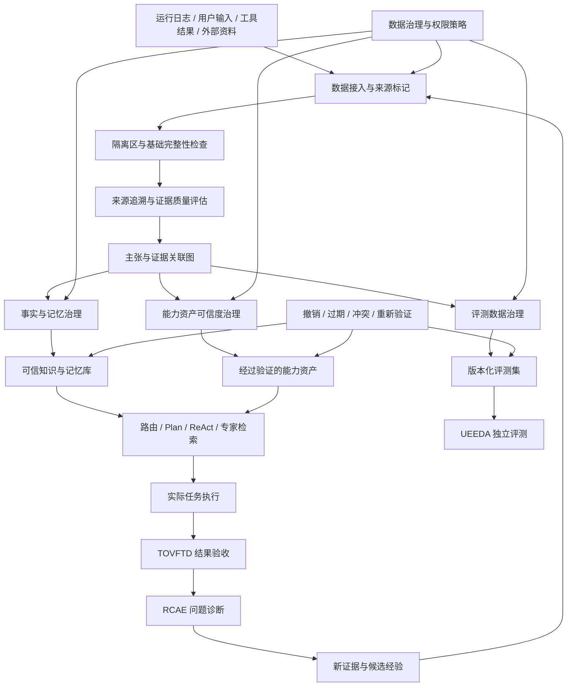

# 问答 126

> 来源: 新 窗口 | 会话: 分支 · 分支 · 分支 · 设计自进化智能体
> 消息: ca54d16a-06b6-42dc-a2b2-23604b3dc63a | 时间(UTC): 2026-10-24 11:52

## 用户

继续

## ChatGPT

设计证据治理体系

设计了证据治理体系

<WritingBlock id="58317" variant="document"># EvoAgent 第六十二专项：证据完整性、记忆可信度与评测数据治理体系

**专项编号：EIMTEDG**

**英文名称：Evidence Integrity, Memory Trust & Evaluation Data Governance**

**文档版本：V1.0**

**文档性质：全量架构专项设计**

**适用范围：EvoAgent 统一任务入口、多层路由、共享通用内核、领域专家、ReAct、Plan、DAG、跨专家协作 CCOCDTG、结果验收 TOVFTD、运行日志、问题诊断 RCAE、能力资产化 EOACA、能力规划 CGDPCP、独立评测 UEEDA、自主进化治理 AECGSR、上下文与记忆系统、工具治理 TCRDCF、安全权限治理 AHOG，以及 Android、Windows 和 mini Linux 本地运行环境。**

**核心目标：建立覆盖证据采集、来源追溯、真实性检查、记忆生命周期、评测数据质量、能力资产可信度和错误纠正的统一治理体系，防止 EvoAgent 将错误结论、失效记忆、污染数据和错误评测结果不断积累并传播，最终形成能够自我纠错、持续积累可靠经验的长期进化系统。**

本文定义目标架构、数据模型、治理流程、工程接口和验收标准，不代表相关模块已经实现。

---

# 一、为什么能够自我进化的智能体，仍然可能越进化越差？

上一专项 TOVFTD 已经解决了一个重要问题：

如何判断一项任务是否真正完成，以及最终结果是否有足够证据支持。

但它还没有彻底解决一个更深层的问题：

**如果用于判断任务成功与否的证据本身存在错误，系统应该怎么办？**

考虑 EvoAgent 的一个长期运行场景。

第一天，代码专家修改了一段代码。测试结果实际上不完整，但任务被错误标记为成功。

第二天，系统将这次执行记录保存为成功案例。

第三天，能力资产化模块从成功案例中提取了一条经验规则。

第四天，另一个专家检索到了这条规则，将其用于新的代码任务。

第五天，新的任务再次因为相同的问题失败，但诊断模块错误地认为失败是由其他因素造成的。

第六天，系统又将错误诊断写入长期记忆。

随着运行次数增加，系统可能积累越来越多相互引用的错误经验。

最终会发生一种危险现象：

- 历史记录支持当前判断；
- 当前判断又被记录为新的经验；
- 新经验反过来支持未来判断；
- 系统内部出现大量相互印证的信息；
- 但这些信息实际上可能源自同一个最初的错误。

这是一种**错误自强化循环**。

它不一定来自模型能力不足，也可能来自数据治理、记忆治理、评测治理和证据管理的设计缺陷。

对于希望长期运行并持续优化的 EvoAgent，这个问题尤其重要。

因为普通智能体犯错，可能只影响一次任务；而自进化智能体如果把错误固化为规则，就可能影响未来成百上千次任务。

因此，本专项需要建立的不是简单的“记忆清理功能”，而是一套贯穿整个系统的可信数据治理机制。

---

# 二、第一性原理：系统长期积累的东西，究竟有哪些？

首先必须区分六类容易混淆的对象。

| 对象 | 含义 | 示例 |
|---|---|---|
| 原始事件 | 系统实际观察到或执行过程中记录的事件 | 某次工具调用返回超时 |
| 证据 | 用于支持或反驳某个判断的信息 | 测试报告、文件哈希、页面状态记录 |
| 主张 | 系统提出的事实、推论或判断 | “这次代码修改已经通过测试” |
| 记忆 | 为未来任务保存的事实、偏好、经验或程序性知识 | “该项目使用 Python 3.12” |
| 评测数据 | 用于衡量模型、路由器、工具或工作流表现的数据 | 代码专家回归测试集 |
| 能力资产 | 已经沉淀、能够被未来任务复用的能力或工作流 | 经过验证的代码修改与测试工作流 |

这六类对象之间存在联系，但不能互相替代。

例如：

一次工具调用的原始日志，只能说明系统记录到了什么事件，不能直接证明用户目标已经实现。

一个测试报告可以支持某项功能在特定条件下通过了测试，但不能自动证明整个程序不存在错误。

一条记忆可以帮助未来任务快速了解项目情况，但它仍然可能过时。

一项能力资产可能在历史评测中表现良好，但换用新的模型、工具或环境后，仍然需要重新验证。

因此，EIMTEDG 的第一条基本原则是：

**任何历史记录、记忆、评测数据或能力资产，都不能仅仅因为已经被系统保存或多次引用，就自动获得永久可信的地位。**

---

# 三、总体架构：可信证据与长期知识治理层

建议新增 `Evidence & Knowledge Trust Governance Layer`，简称 EKTG，作为 EIMTEDG 的运行时治理层。

它不是另一个领域专家，也不是独立的模型服务器，而是管理系统内部长期积累的信息如何进入、验证、传播、使用、更新和撤销。



建议划分为九个逻辑模块。

| 模块 | 核心职责 |
|---|---|
| 1. 数据接入与来源登记 | 记录数据来自哪里、由谁产生、何时产生 |
| 2. 证据完整性管理 | 检查记录完整性、关联关系和可追溯性 |
| 3. 主张与证据图谱 | 建立主张、证据、来源、任务和结论之间的关系 |
| 4. 记忆可信度治理 | 管理记忆的有效性、适用范围、冲突和失效 |
| 5. 评测数据治理 | 管理数据集来源、标签、版本、泄漏和污染风险 |
| 6. 能力资产可信度治理 | 管理能力资产的适用条件、验证范围和失效状态 |
| 7. 传播与撤销控制 | 防止不可信信息继续扩散，并支持纠错 |
| 8. 数据质量监测与审计 | 发现异常、重复、矛盾和系统性偏差 |
| 9. 治理策略引擎 | 决定哪些数据可使用、可训练、可评测或可固化 |

这些模块应与现有任务执行、验证、评测和进化体系集成，不重复实现其他专项已经承担的职责。

---

# 四、第一阶段：建立统一的来源追溯机制

系统需要首先回答一个基础问题：

**一条信息究竟来自哪里？**

如果来源不明确，后续就很难判断其可信度，也无法在发现错误后追踪哪些记忆、评测数据和能力资产受到了影响。

建议为所有需要长期保存或影响重要决策的数据建立 `ProvenanceRecord`。

## 4.1 来源记录的核心字段

| 字段 | 说明 |
|---|---|
| `record_id` | 唯一记录 ID |
| `record_type` | 日志、证据、主张、记忆、评测数据或能力资产 |
| `source_type` | 用户、工具、模型、文件、外部服务或人工审核 |
| `source_ref` | 原始来源引用 |
| `task_id` | 关联任务 ID |
| `producer_id` | 产生该记录的模块或能力 |
| `created_at` | 产生时间 |
| `observed_at` | 实际观察时间 |
| `content_version` | 内容版本 |
| `integrity_hash` | 内容完整性校验值 |
| `parent_refs` | 上游来源或依赖引用 |
| `verification_status` | 验证状态 |
| `trust_scope` | 允许使用的范围 |
| `sensitivity` | 数据敏感级别 |
| `retention_policy` | 保存和过期规则 |

这里必须区分两个时间：

- **产生时间**：信息最初被创建的时间；
- **观察时间**：系统实际取得该信息的时间。

例如，一份三年前发布的文档今天才被导入系统，它的产生时间和观察时间就不同。

对于实时状态、产品规格、政策和软件版本等信息，这种区分十分重要。

## 4.2 不同来源不能默认具有相同可信度

建议将来源分为以下类别：

- `USER_PROVIDED`：用户明确提供的信息；
- `TOOL_OBSERVED`：工具实际观察到的状态；
- `SYSTEM_MEASURED`：系统通过确定性计算或测试获得的结果；
- `OFFICIAL_SOURCE`：适用的官方来源；
- `EXTERNAL_SOURCE`：其他外部来源；
- `MODEL_INFERENCE`：模型推断；
- `HUMAN_REVIEWED`：经过人工审核的信息；
- `DERIVED_DATA`：从其他记录计算或转换得到的数据。

这些标签表示来源性质，不是固定的可信度排名。

例如，用户提供的信息对于用户自身的偏好可能具有最高相关性，但用户提供的技术判断仍然可能有误。

官方文档通常适合确认产品规格，但不一定能证明某次实际操作已经成功。

工具返回的状态可以证明工具报告了什么，却不一定证明工具报告与外部真实状态完全一致。

因此，来源类型必须与具体主张和适用范围结合判断。

## 4.3 推断结果必须保留推断链

例如，系统观察到：

- 工具调用失败；
- 相同操作此前成功；
- 当前网络状态未知。

它可能推断：

“本次失败可能与网络异常有关。”

这是一项合理假设，但不是已经证实的事实。

系统必须记录：

- 原始观察；
- 推断过程所依赖的证据；
- 其他可能解释；
- 当前结论状态；
- 后续验证结果。

不能只保存最后一句“网络异常导致失败”，否则未来的系统可能将假设误当成确定事实。

---

# 五、第二阶段：建立主张—证据—结论关系图

来源追溯解决的是“信息从哪里来”。

但还需要解决：

**这条信息究竟支持什么结论？**

建议建立 `ClaimEvidenceGraph`，将主张、证据、任务、记忆、评测结果和能力资产关联起来。

## 5.1 核心关系类型

建议支持以下关系：

- `SUPPORTS`：证据支持主张；
- `CONTRADICTS`：证据反驳主张；
- `DERIVED_FROM`：记录由其他数据推导而来；
- `OBSERVED_DURING`：证据产生于某次任务；
- `VALIDATED_BY`：记录经过某种验证；
- `SUPERSEDES`：新版本替代旧版本；
- `DEPENDS_ON`：记录依赖某个上游对象；
- `USED_BY`：对象被某个任务或能力使用；
- `INVALIDATED_BY`：对象因新证据而失效；
- `REVIEWED_BY`：记录经过某个审核过程。

例如：

```text
原始代码
   ↓
代码修改任务
   ↓
测试运行记录
   ↓
测试报告
   ↓
主张：指定测试通过
   ↓
记忆：该修改在特定测试集上通过
   ↓
能力资产：代码修改与验证工作流
```

如果后来发现测试报告不完整，系统就可以沿着依赖关系找到受影响的记忆和能力资产。

## 5.2 为什么不能只依赖向量检索？

向量检索适合查找语义相近的信息，但不适合独立承担来源追溯和可信度治理。

例如，两条内容在语义上非常相似：

- “该工具已经通过完整测试。”
- “该工具尚未完成全部测试。”

如果只依赖相似度检索，系统可能找到相关内容，却没有正确处理其中的矛盾。

因此，建议采用双层结构：

**语义检索负责找到候选信息，结构化证据图负责判断来源、关系、版本与有效状态。**

在资源有限的个人设备上，不必一开始部署独立图数据库。可以先使用 SQLite 中的关系表、外键和索引实现关系追踪，之后再根据规模升级。

## 5.3 证据数量不能直接等同于证据强度

假设有十条记忆都声称某项功能已经通过测试。

但这十条记忆实际上都来自同一份错误报告。

它们不是十份独立证据，而是一个来源被重复引用了十次。

因此，系统需要识别共同来源。

如果多个结论依赖同一个上游证据，应当在可信度判断中明确体现这种依赖，不能把它们当成相互独立的验证结果。

---

# 六、第三阶段：建立可信度模型，但不制造虚假的精确性

可信度治理不能简单地为每条记忆打一个分数，然后按照分数排序。

原因在于，不同类型的可信度具有不同含义。

一条记录可能来源真实，但内容已经过时。

另一条记录可能内容正确，但适用范围很窄。

还有一条记录可能被多次验证，却只在特定模型版本下有效。

因此，建议使用多维可信度描述。

## 6.1 六个核心维度

| 维度 | 需要回答的问题 |
|---|---|
| 来源可信度 | 信息来自哪里，来源是否适合当前主张？ |
| 完整性 | 内容是否完整，是否存在截断或缺失？ |
| 验证强度 | 使用了什么方法检查，检查覆盖范围是什么？ |
| 独立性 | 多条证据是否真正来自独立来源？ |
| 时效性 | 信息是否仍然适用于当前时间和环境？ |
| 适用范围 | 该结论在哪些任务、模型、工具或环境中成立？ |

建议为每个维度分别记录状态和证据。

例如：

```text
记忆：该工作流可以生成目标格式的视频。

来源可信度：中等
完整性：通过
验证强度：已完成文件格式与时长检查
独立性：仅有一次有效验证
时效性：需要重新检查当前工具版本
适用范围：指定模型与视频参数
总体状态：有限可信，允许候选使用，不允许直接固化为通用规则
```

这些标签只是示意，实际状态应由证据和治理规则确定。

## 6.2 可信度不能只由模型自评

不建议让模型单独输出：

“我认为这条记忆的可信度是 95%。”

然后直接使用这个数字作为系统级决策依据。

模型自评可以作为辅助信号，但不能代替：

- 来源核验；
- 确定性检查；
- 独立测试；
- 历史表现统计；
- 适用范围判断；
- 人工审核。

对于能够通过确定性方法检查的事项，应优先采用可复现的检查结果。

## 6.3 可信状态与使用权限分开

建议将记录状态划分为：

- `QUARANTINED`：待检查；
- `CANDIDATE`：候选，可在受控条件下评估；
- `VERIFIED`：在明确范围内通过验证；
- `LIMITED`：仅在特定条件下允许使用；
- `STALE`：可能过时，需要重新核验；
- `CONFLICTED`：存在尚未解决的冲突；
- `REVOKED`：已撤销，不允许继续作为有效依据；
- `ARCHIVED`：归档，不再作为默认检索结果。

状态不应简单表示为从低到高的线性分数。

例如，`LIMITED` 并不一定比 `CANDIDATE` 更差，它表示该信息只能在指定范围内使用。

同样，`VERIFIED` 不意味着永久正确，而是表示在指定验证条件和适用范围内获得了相应证据。

---

# 七、第四阶段：记忆系统可信度治理

EvoAgent 的记忆系统需要支持长期积累，但记忆并不是越多越好。

如果系统不断保存未经核验的内容，长期记忆就会逐渐成为一个充满过时事实、错误经验和相互矛盾规则的数据库。

因此，需要将记忆生成与记忆晋升分开。

## 7.1 记忆分为四类

| 类型 | 内容 | 主要治理要求 |
|---|---|---|
| 短期上下文 | 当前对话和任务的临时信息 | 随任务结束或窗口策略管理 |
| 情景记忆 | 某次任务实际发生了什么 | 保留任务 ID、时间和原始证据 |
| 语义记忆 | 项目事实、稳定知识和概念 | 检查来源、时效和矛盾 |
| 程序性记忆 | 如何完成某类任务的经验和流程 | 必须通过代表性任务验证 |

这四类记忆不能使用完全相同的治理策略。

例如，记录“上次工具调用超时”属于情景记忆。

记录“该工具的当前版本不支持某参数”属于语义记忆。

记录“先检查版本，再执行调用，失败时采用替代接口”则属于程序性记忆。

程序性记忆通常会直接影响未来的执行路径，因此它需要更严格的验证。

## 7.2 记忆晋升机制

建议采用以下流程：

```text
任务产生信息
    ↓
保存原始事件与来源
    ↓
提取候选记忆
    ↓
识别事实 / 假设 / 经验 / 建议
    ↓
检查重复、冲突、适用范围
    ↓
评估是否值得长期保存
    ↓
必要时进行独立验证
    ↓
进入对应记忆命名空间
    ↓
按使用记录和环境变化持续复核
```

不是每次对话都需要写入长期记忆。

只有具有长期价值、能够帮助未来任务，且保存它符合隐私和权限要求的信息，才应进入相应的长期存储。

## 7.3 记忆写入必须保留来源

例如，系统从某次失败中提取了经验：

“先检查输出目录是否存在，再执行文件写入。”

这条经验应关联：

- 哪次任务产生了它；
- 原始失败是什么；
- 采取了什么修复措施；
- 修复后是否通过验证；
- 适用于哪些文件写入场景；
- 是否存在不适用条件。

如果只是保存一句经验，未来就无法判断它究竟来自一次偶然成功，还是来自反复验证的稳定规律。

## 7.4 记忆过期机制

不同记忆需要不同的有效期策略。

例如：

- 用户明确表达的长期工作偏好，在没有变化时可以长期保留；
- 当前软件版本的接口信息，需要在版本变化后重新检查；
- 某个外部服务的可用状态，可能很快失效；
- 一次任务失败的历史记录可以保留，但不能将其直接当成当前状态；
- 某个工作流的成功经验，在模型或工具变化后可能需要重新验证。

建议为记忆定义：

- `valid_from`；
- `valid_until`；
- `revalidation_trigger`；
- `scope`；
- `last_verified_at`；
- `next_review_policy`。

对于有效期不确定的记录，不应随意设置一个看似精确的过期时间，而应根据类型定义复核触发条件。

## 7.5 记忆冲突如何处理？

假设记忆中同时存在：

- “项目使用 Python 3.11。”
- “项目已经升级到 Python 3.12。”

不能简单地保留最近写入的一条并删除另一条。

更合理的做法是：

1. 检查两条记忆的来源；
2. 检查对应项目和环境；
3. 检查信息时间；
4. 判断它们是否描述不同分支或不同环境；
5. 通过配置文件或实际环境进行验证；
6. 更新正式事实状态；
7. 将旧记忆标记为历史状态或被替代状态。

冲突可能意味着一条记忆错误，也可能意味着系统正在描述两个不同环境。

因此，冲突处理必须结合适用范围。

---

# 八、第五阶段：跨专家记忆隔离与可信信息传播

EvoAgent 采用独立领域专家和共享通用内核架构。

这意味着记忆治理不能简单采用一个所有专家共同读写的全局记忆库。

否则，某个专家的错误经验就可能迅速影响其他专家。

## 8.1 建议的记忆命名空间

至少区分：

- `global`：跨专家通用事实和已验证规则；
- `project`：具体项目事实；
- `expert`：领域专家专属知识；
- `task`：当前任务的临时信息；
- `workflow`：已验证的工作流与程序性经验；
- `evaluation`：评测规则、基线和结果；
- `quarantine`：尚未验证或存在冲突的信息。

命名空间之间的共享必须通过明确的晋升或授权规则。

例如，代码专家发现的一个问题可以先保存在代码专家的命名空间中。

如果该经验经过验证，且确实适用于多个领域，再考虑提升为通用规则。

不能因为它来自某个成功任务，就自动将其写入全局记忆。

## 8.2 共享记忆必须携带适用条件

共享的规则至少应明确：

- 适用领域；
- 适用环境；
- 前置条件；
- 已验证范围；
- 已知限制；
- 证据来源；
- 版本；
- 失效条件。

例如：

“调用工具之前检查参数类型。”

这条经验可能具有广泛适用性。

但如果它进一步具体化为某个工具的参数规则，就必须限定对应工具版本和接口。

## 8.3 防止错误在专家之间传播

建议建立记忆传播控制：

1. 未验证记忆默认不能晋升为全局规则；
2. 冲突记忆不能作为无条件事实传播；
3. 被撤销的记忆不能继续出现在默认检索结果中；
4. 下游记忆必须保留上游来源引用；
5. 关键记忆更新后，应检查依赖它的能力资产；
6. 不同专家引用同一来源时，应识别共同来源，避免重复计算证据。

这样可以让专业知识独立演进，同时保护共享通用内核不被未经验证的领域经验污染。

---

# 九、第六阶段：评测数据治理

EvoAgent 的持续进化依赖自动评测。

但评测结果是否可靠，首先取决于评测数据本身是否可靠。

如果测试集包含错误标签、过时答案、重复样本或与训练过程泄漏的内容，系统就可能在错误的指标上不断优化。

例如：

- 一个代码测试用例本身存在错误；
- 某个路由评测样本把正确专家标注为错误专家；
- 测试集中的答案来自旧版本接口；
- 同一类样本被大量重复计算，导致指标虚高；
- 模型在优化过程中反复接触保留测试集的答案；
- 合成数据存在系统性偏差，却被当作真实任务分布。

因此，UEEDA 需要与 EIMTEDG 共同建立评测数据治理机制。

## 9.1 评测样本的标准结构

建议使用 `EvaluationCase`。

核心字段包括：

- `case_id`：样本 ID；
- `case_type`：评测类型；
- `input_ref`：输入数据；
- `expected_outcome`：预期结果；
- `acceptance_criteria`：验收标准；
- `label_source`：标签来源；
- `label_verification_status`：标签验证状态；
- `difficulty`：难度；
- `risk_class`：风险等级；
- `domain`：所属领域；
- `environment_constraints`：环境约束；
- `source_refs`：原始来源；
- `dataset_version`：所属数据集版本；
- `split`：训练、开发或保留评测分组；
- `known_limitations`：已知限制。

对于没有唯一标准答案的开放任务，应保存评分规则、参考证据或可接受结果范围，而不是强行生成唯一的标准答案。

## 9.2 标签必须有来源

例如，路由评测数据中写着：

“该任务应该交给代码专家。”

系统应当知道这个标签是：

- 人工审核得出的；
- 根据任务契约推导的；
- 从历史成功案例中提取的；
- 由模型自动生成的；
- 通过实际对照实验验证的。

这些标签的证据强度并不相同。

模型自动生成的标签可以作为候选，但不应默认具有与人工审核或确定性规则相同的可信度。

## 9.3 评测数据必须版本化

数据集发生以下变化时，应创建新版本：

- 新增样本；
- 删除错误样本；
- 修改标签；
- 修改验收规则；
- 修改样本适用范围；
- 更新环境依赖；
- 修正来源信息。

每次评测都必须记录：

- 数据集版本；
- 评测器版本；
- 被评测的模型或能力版本；
- 运行环境；
- 关键参数；
- 实际结果。

否则，即使两次评测得分不同，也无法判断变化究竟来自模型改进，还是来自数据集或评测器变化。

---

# 十、第七阶段：防止评测泄漏、污染与指标投机

这是自进化系统必须认真处理的问题。

如果一个系统能够反复修改自身的提示词、工具参数、路由策略和工作流，同时又可以直接接触全部评测答案，它就可能逐渐适应测试集，而不是提高真实任务能力。

## 10.1 建立不同用途的数据分区

建议至少区分：

| 数据分区 | 用途 | 使用限制 |
|---|---|---|
| 开发集 | 快速调试和问题定位 | 可以反复使用 |
| 回归集 | 检查已知能力是否退化 | 访问受控，变更需记录 |
| 保留评测集 | 判断候选改进是否具有泛化收益 | 不应暴露全部答案供优化器直接拟合 |
| 线上观察集 | 观察真实使用中的表现 | 需要处理隐私、授权和分布偏差 |
| 故障案例集 | 复现历史失败 | 需要保留根因和复现条件 |
| 对抗与边界集 | 检查异常输入和已知弱点 | 不应只覆盖模型已经熟悉的场景 |

对于个人设备，可以先通过文件权限、独立目录、版本控制和访问日志实现基本隔离，不需要一开始建立复杂的数据平台。

## 10.2 防止评测答案泄漏

建议采用以下机制：

- 将保留评测数据与普通开发数据分开存储；
- 对保留评测集的读取进行记录；
- 优化阶段尽可能只接收评测结果与失败摘要；
- 对直接修改评测标签的操作进行审核；
- 记录每次候选改进实际使用过哪些数据；
- 检查评测输入是否与训练、优化样本高度重复；
- 对重要评测集保留独立版本和校验信息。

需要明确，简单隐藏答案并不能彻底消除泄漏。

如果优化器反复看到同一批样本的详细反馈，也可能逐渐对这批样本过拟合。

因此，应结合保留测试集、不同任务来源和真实使用中的观察结果判断泛化能力。

## 10.3 防止 Goodhart 式指标投机

当某个指标成为系统优化目标时，系统可能找到提高指标、却没有真正提高能力的捷径。

例如：

- 为了提高任务成功率，系统减少接收困难任务；
- 为了降低平均成本，系统跳过必要验证；
- 为了提高路由准确率，系统总是选择最常见的专家；
- 为了降低失败率，系统提前放弃复杂任务；
- 为了提高测试通过率，系统只优化固定测试样本；
- 为了缩短时延，系统输出未经验证的结果。

因此，任何关键指标都需要配套的反作弊检查。

例如：

| 优化目标 | 需要同步监测的指标 |
|---|---|
| 提高成功率 | 任务难度分布、拒绝率、部分完成率 |
| 降低成本 | 质量、验证覆盖率、返工率 |
| 缩短时延 | 最终验收通过率、错误率 |
| 提高路由准确率 | 任务成功率、未知任务处理能力 |
| 提高自动发布率 | 回滚率、回归缺陷、风险事件 |
| 提高记忆复用率 | 记忆过期率、错误引用率、收益对照 |

不能让系统只对一个容易被投机的单一指标负责。

---

# 十一、第八阶段：能力资产的可信度与失效治理

能力资产化 EOACA 负责将有价值的能力、工具使用经验和工作流沉淀为长期资产。

但资产化本身也需要可信度治理。

一项能力可能在某个模型版本下有效，在另一个版本下失效；可能在小规模输入下可靠，在大规模任务中出现问题；也可能依赖已经被替换的工具接口。

因此，能力资产必须记录自己的适用条件和验证状态。

## 11.1 能力资产的核心可信字段

建议新增以下字段：

- `asset_id`；
- `asset_version`；
- `source_tasks`；
- `source_evidence_refs`；
- `validation_suite_version`；
- `validation_status`；
- `validated_environments`；
- `supported_models`；
- `supported_tool_versions`；
- `known_limitations`；
- `failure_history`；
- `last_verified_at`；
- `revalidation_triggers`；
- `rollback_target`。

## 11.2 资产晋升不能只看成功次数

例如，某个工作流已经成功运行十次。

这十次任务可能都使用相同的输入、相同的工具和相同的环境。

它们只能说明该工作流在这些相近条件下多次成功，不能证明它适用于所有任务。

因此，资产晋升还应检查：

- 是否覆盖目标适用范围；
- 是否存在足够多样的样本；
- 是否测试过已知失败边界；
- 是否比较过合理基线；
- 是否评估过成本与恢复能力；
- 是否存在明显的共同来源偏差；
- 是否具备必要的回归测试。

## 11.3 环境变化触发重新验证

建议在以下情况触发复核：

- 模型版本变化；
- 工具接口变化；
- 关键依赖升级；
- 操作系统或运行环境变化；
- 工作流关键节点变化；
- 发现新的失败模式；
- 验收标准变化；
- 相关上游记忆被撤销。

重新验证并不意味着必须立即废弃资产。

可以先将其状态调整为 `LIMITED` 或 `STALE`，在适用范围内保留受控使用能力，并安排复核。

如果关键证据被确认无效，则应进一步撤销相关资产的有效状态。

---

# 十二、第九阶段：错误传播、撤销与纠错机制

这是 EIMTEDG 最重要的运行时能力之一。

发现一条记忆错误，只删除这条记忆是不够的。

因为它可能已经被：

- 多个专家引用；
- 多个工作流使用；
- 多个评测样本采用；
- 多项能力资产吸收；
- 多次诊断结论继承；
- 多份文档和配置复制。

因此，必须建立基于依赖关系的纠错机制。

## 12.1 纠错传播流程

```text
发现可疑信息
    ↓
建立异常事件
    ↓
冻结相关信息的晋升与扩散
    ↓
核实原始来源和关联证据
    ↓
确认错误 / 过时 / 适用范围变化
    ↓
查询下游依赖
    ↓
标记受影响的记忆、评测集和能力资产
    ↓
重新评估相关任务与结论
    ↓
修复、替换、降级或撤销
    ↓
执行回归验证
    ↓
记录纠错结果
```

## 12.2 不同错误采用不同处理方式

| 情况 | 处理方式 |
|---|---|
| 来源被证明错误 | 撤销相关结论，并检查下游依赖 |
| 信息已经过时 | 更新版本或标记为历史状态 |
| 适用范围被错误扩大 | 收缩适用范围，重新评估资产 |
| 评测标签错误 | 修正数据集并重新计算受影响的评测结果 |
| 验证器存在漏检 | 修复验证器，重新检查相关历史结果 |
| 记忆内容存在歧义 | 拆分为更明确的记录，保留来源 |
| 证据不足以作出判断 | 降级为未验证，不应直接断言错误或正确 |

特别需要注意：

**证据不足不等于已经证伪，来源过时也不一定意味着历史结论在当时是错误的。**

系统必须保留历史时间与适用范围，避免将现在不再成立的信息错误地解释成过去也不成立。

## 12.3 纠错不能破坏审计历史

当一条记忆被撤销时，建议保留：

- 原记录 ID；
- 原始内容或受控引用；
- 撤销原因；
- 撤销依据；
- 撤销时间；
- 受影响的下游对象；
- 后续修复结果。

但“保留审计记录”不等于无限期保存所有原始内容。

如果原始数据涉及隐私或需要删除，应根据数据治理和保留策略处理内容本身，同时在允许范围内保留最小化的审计信息。

---

# 十三、第十阶段：运行日志与证据完整性

EvoAgent 需要长期记录任务执行过程，以支持诊断、评测和进化。

但是，日志系统本身也可能出现问题：

- 日志丢失；
- 事件顺序错误；
- 同一事件重复记录；
- 任务 ID 关联错误；
- 日志与产物版本不一致；
- 离线同步导致重复写入；
- 文件被意外修改；
- 不同模块对同一事件使用不同定义。

因此，需要建立日志完整性治理。

## 13.1 事件日志的必要字段

建议每个关键事件都包含：

- `event_id`；
- `event_type`；
- `task_id`；
- `subtask_id`；
- `event_sequence`；
- `occurred_at`；
- `recorded_at`；
- `producer_id`；
- `schema_version`；
- `payload_ref`；
- `previous_event_ref`；
- `integrity_hash`；
- `sync_status`。

事件 ID 应当具备全局唯一性，或采用足以避免冲突的命名策略。

在离线设备和主机之间同步时，需要依赖事件 ID 和幂等写入机制，避免同一事件被重复计数。

## 13.2 使用追加式日志

对于关键执行事件，建议优先采用追加式记录，而不是直接覆盖旧状态。

例如：

```text
TaskCreated
TaskStarted
ToolCallStarted
ToolCallTimedOut
ExternalStateChecked
RecoveryCompleted
FinalAcceptancePassed
```

这种记录方式有利于重建事件顺序和分析真实执行过程。

当前状态可以由事件投影得到，也可以作为便于查询的缓存保存，但不应成为唯一事实来源。

## 13.3 完整性哈希与哈希链

对于需要防止意外修改的关键日志，可以使用内容哈希和前序事件哈希构建哈希链。

例如：

```text
event_001 → hash_001
event_002 → hash(hash_001 + event_002)
event_003 → hash(hash_002 + event_003)
```

这样可以检测部分事件内容被修改或事件顺序被破坏的情况。

但必须明确：

**哈希链能够帮助检测某些完整性问题，并不自动保证日志绝对真实或防篡改。**

如果攻击者能够同时修改全部日志和哈希链，或者系统最初记录的就是错误事实，哈希链本身无法解决这些问题。

对于个人设备，初期可以使用哈希链、只追加写入策略、文件权限和定期备份。只有在确实存在更高审计需求时，再考虑签名、独立密钥存储或远程备份等更强机制。

## 13.4 区分执行事实与模型解释

建议将以下两类数据分开保存：

**执行事实：**

- 工具调用参数；
- 工具返回值；
- 测试退出状态；
- 文件实际存在状态；
- 页面观察结果；
- 任务开始与结束时间。

**模型解释：**

- 失败原因推测；
- 可能的修复方案；
- 质量评价；
- 后续改进建议。

执行事实可以支持问题诊断，但模型解释仍然需要验证。

不能将模型对一次失败的解释直接写入原始事件日志，替代真正发生的事情。

---

# 十四、第十一阶段：隐私、数据最小化与删除治理

证据治理并不意味着系统应该保存所有数据。

对个人智能体来说，过度记录可能带来更大的隐私风险，也会增加存储、检索和治理成本。

因此，EIMTEDG 必须遵循数据最小化原则。

## 14.1 不同数据采用不同保留策略

| 数据类型 | 建议策略 |
|---|---|
| 普通执行状态 | 保留必要的任务与状态记录 |
| 调试日志 | 按问题诊断需要设置保留期限 |
| 用户私有文件内容 | 默认不复制到无关的长期存储 |
| 敏感操作证据 | 仅保留必要字段，限制访问范围 |
| 评测样本 | 保留授权范围内的数据与来源 |
| 长期记忆 | 仅保存有明确未来价值的信息 |
| 失败案例 | 尽量保留可复现条件，避免无必要复制完整敏感内容 |
| 已撤销记录 | 按审计和删除策略保留最小必要信息 |

## 14.2 脱敏后的数据仍可能具有敏感性

删除姓名、账号或文件路径，并不意味着数据必然匿名。

任务描述、行为模式、时间序列和特定错误信息，仍可能暴露用户的个人信息。

因此，系统应限制数据在专家之间的传播范围，并在需要构建评测集时优先采用最小化、脱敏或合成的数据。

## 14.3 删除与纠错是两个不同操作

删除是数据生命周期管理。

纠错是对错误结论、依赖关系和下游资产进行修复。

当某条来源被删除时，系统仍需要检查依赖它的结论是否失去了必要证据。

如果一条记忆被撤销，但它已经影响了某项能力资产，单纯删除记忆并不能自动修复该能力资产。

因此，删除和撤销操作都应触发适当的依赖检查。

---

# 十五、第十二阶段：个人设备与断联同步设计

EvoAgent 面向个人使用，优先采用本地运行和轻量主机架构。

因此，可信数据治理不应依赖复杂的云端数据平台。

## 15.1 推荐的基础存储结构

- SQLite：存储结构化元数据、状态和关联关系；
- 本地文件系统：保存大体量原始产物；
- Git：管理版本化的评测配置、规则与能力资产；
- 内容哈希：识别内容变化与重复；
- 可选向量索引：辅助记忆和证据检索；
- 增量同步机制：同步必要的事件、元数据和资产引用。

不是所有文件都需要进入 Git，也不是所有记忆都需要建立向量索引。

应根据数据类型选择合适的存储方式。

## 15.2 断联期间的治理策略

当 Android 设备与主机断联时：

- 本地仍可执行适用的确定性验证；
- 新事件应使用唯一 ID 保存；
- 未同步的证据应明确标记；
- 无法获得外部证据时，不得假定验证已经完成；
- 未经验证的候选经验不能自动晋升为全局资产；
- 本地已撤销的信息不能继续被默认当作有效信息使用。

重新连接后：

1. 同步新增事件；
2. 检查重复记录；
3. 合并兼容的元数据；
4. 检查同一对象是否存在版本冲突；
5. 检查关键来源是否已失效；
6. 更新相关记忆与资产状态；
7. 重新评估受影响的评测结果。

## 15.3 不同设备的事实冲突

假设 Android 端记录某项任务成功，但桌面端后来发现对应产物损坏。

系统不能仅依据时间较晚的一条记录直接决定结果。

应该检查：

- 两条记录是否指向同一个产物版本；
- 是否在不同时间观察到不同状态；
- 产物是否在第一次检查后被修改；
- 是否存在同步延迟；
- 哪个观察更适合证明当前状态。

例如，“任务在 10:00 时成功生成文件”和“文件在 10:30 时已经损坏”可以同时成立。

冲突解决应保留时间和对象版本，而不是强行覆盖历史事实。

---

# 十六、工程目录与核心接口

建议新增以下逻辑模块：

```text
evoagent/
├── trust_governance/
│   ├── provenance_registry/
│   ├── evidence_integrity/
│   ├── claim_evidence_graph/
│   ├── trust_policy_engine/
│   ├── trust_state_machine/
│   ├── conflict_detection/
│   ├── invalidation_engine/
│   ├── propagation_control/
│   └── governance_audit/
├── memory_governance/
│   ├── memory_ingestion/
│   ├── memory_promotion/
│   ├── memory_namespaces/
│   ├── memory_freshness/
│   ├── memory_conflicts/
│   ├── memory_revalidation/
│   └── memory_retention/
├── evaluation_data_governance/
│   ├── dataset_registry/
│   ├── label_provenance/
│   ├── dataset_versioning/
│   ├── dataset_deduplication/
│   ├── leakage_detection/
│   ├── contamination_detection/
│   ├── holdout_access_control/
│   └── dataset_quality_checks/
├── capability_asset_governance/
│   ├── asset_provenance/
│   ├── asset_validation_state/
│   ├── environment_compatibility/
│   ├── asset_revalidation/
│   └── asset_revocation/
├── event_integrity/
│   ├── append_only_journal/
│   ├── event_idempotency/
│   ├── event_hashing/
│   ├── event_reconciliation/
│   └── offline_sync/
└── trust_governance_tests/
    ├── provenance_tests/
    ├── evidence_lineage_tests/
    ├── memory_conflict_tests/
    ├── dataset_quality_tests/
    ├── leakage_tests/
    ├── asset_revocation_tests/
    ├── event_integrity_tests/
    ├── offline_sync_tests/
    └── privacy_retention_tests/
```

建议提供以下核心接口：

- `register_provenance`：登记数据来源；
- `validate_record_integrity`：检查记录完整性；
- `build_claim_evidence_links`：建立主张与证据的关系；
- `trace_evidence_lineage`：追踪证据来源链；
- `detect_shared_evidence_sources`：识别共同证据来源；
- `evaluate_trust_dimensions`：评估多维可信度；
- `set_trust_status`：更新可信状态；
- `quarantine_unverified_record`：隔离未验证记录；
- `promote_candidate_memory`：按规则晋升候选记忆；
- `validate_memory_scope`：检查记忆适用范围；
- `detect_memory_conflicts`：识别记忆冲突；
- `revalidate_stale_memory`：复核过时记忆；
- `revoke_invalid_memory`：撤销错误记忆；
- `register_evaluation_dataset`：登记评测数据集；
- `validate_dataset_labels`：检查标签来源与正确性；
- `version_evaluation_dataset`：创建数据集版本；
- `detect_dataset_duplicates`：检测重复样本；
- `detect_evaluation_leakage`：检测评测泄漏；
- `audit_holdout_access`：审计保留评测集访问；
- `validate_capability_asset_scope`：检查能力资产的适用范围；
- `trigger_asset_revalidation`：触发能力资产复核；
- `invalidate_dependent_records`：标记依赖某项错误数据的对象；
- `propagate_revocation`：传播撤销状态；
- `recompute_affected_evaluations`：重新计算受影响的评测结果；
- `append_integrity_event`：追加记录关键事件；
- `verify_event_hash_chain`：检查事件哈希链；
- `reconcile_offline_events`：合并离线事件；
- `enforce_retention_policy`：执行数据保留策略；
- `audit_data_access`：审计数据访问；
- `record_correction_history`：记录纠错历史。

这些接口必须与任务 ID、来源 ID、数据集版本、记忆版本和能力资产版本关联，避免出现无法追踪的孤立记录。

---

# 十七、端到端验收场景

建议至少建立以下九个场景。

## 场景 A：未经验证的成功记录不能直接固化为通用经验

**初始条件：** 某项任务被标记为成功，但缺少必要的测试证据。

**验收过程：**

1. 检查任务状态与证据记录；
2. 发现缺少必要验证；
3. 将对应经验保留为候选；
4. 阻止其自动晋升为通用规则；
5. 补充验证后再决定是否晋升。

**验收重点：** 任务被标记为成功，不代表所有相关经验都已经可靠。

## 场景 B：共同来源不能被当成独立证据

**初始条件：** 五条记忆都支持同一个结论，但它们均来自同一份报告。

**验收过程：**

1. 追踪各条记忆的来源；
2. 识别共同来源；
3. 合并重复证据关系；
4. 按实际独立证据数量评估；
5. 说明剩余证据的局限。

**验收重点：** 不允许通过重复引用制造虚假的证据强度。

## 场景 C：过时记忆不会继续指导新任务

**初始条件：** 某项工具接口发生变化，旧记忆仍然保留。

**验收过程：**

1. 检测到工具版本变化；
2. 查询依赖该接口的记忆；
3. 将相关记忆标记为待复核；
4. 检查当前官方文档或实际接口；
5. 更新或撤销旧记忆；
6. 检查依赖它的工作流。

**验收重点：** 旧记忆不能仅因为过去有效，就继续作为当前事实使用。

## 场景 D：错误评测标签不会持续污染回归集

**初始条件：** 发现一个路由评测样本的标准标签错误。

**验收过程：**

1. 记录标签错误；
2. 追踪标签来源；
3. 核验正确标签；
4. 创建新的数据集版本；
5. 重新运行受影响的评测；
6. 检查此前依赖错误结果作出的升级决策。

**验收重点：** 修正数据后，必须重新评估受影响的结论，而不仅仅是修改标签。

## 场景 E：错误记忆被多个专家引用后能够纠正

**初始条件：** 一条错误的全局记忆已经被代码专家、文档专家和工作流资产引用。

**验收过程：**

1. 确认原始记忆错误；
2. 撤销其有效状态；
3. 查询所有下游引用；
4. 标记受影响的资产与规则；
5. 对相关能力执行必要复核；
6. 记录修复历史；
7. 验证错误信息不再进入默认检索结果。

**验收重点：** 撤销必须能够传播到依赖对象，而不是只删除原始记录。

## 场景 F：评测指标提高但真实能力没有改善

**初始条件：** 某次优化显著提高固定测试集的通过率，但线上任务表现没有改善。

**验收过程：**

1. 检查测试集是否过拟合；
2. 检查训练与评测样本是否重复；
3. 使用独立保留集重新评测；
4. 比较任务难度和分布；
5. 检查成本、拒绝率和失败恢复情况；
6. 根据证据决定是否接受该优化。

**验收重点：** 固定测试集得分上升，不足以证明系统能力真正提高。

## 场景 G：离线同步不会重复计数或覆盖有效事实

**初始条件：** Android 与桌面端离线期间分别产生任务记录，重新连接后需要同步。

**验收过程：**

1. 检查事件唯一 ID；
2. 识别重复事件；
3. 合并兼容的记录；
4. 保留不同时间的真实状态；
5. 检查同一产物的版本变化；
6. 更新可信状态和依赖关系。

**验收重点：** 同步后既不能重复计算，也不能因简单覆盖而丢失真实历史。

## 场景 H：能力资产的适用范围不会被错误扩大

**初始条件：** 某工作流在一种模型和环境下通过验证。

**验收过程：**

1. 记录原始验证环境；
2. 将资产标记为特定范围内有效；
3. 在另一模型或工具版本中使用前检查兼容性；
4. 触发必要复验；
5. 根据结果更新适用范围。

**验收重点：** 特定条件下的成功不能自动推导为普遍适用。

## 场景 I：日志完整性异常能够触发审计

**初始条件：** 发现关键事件序列存在缺口或哈希校验不一致。

**验收过程：**

1. 识别异常事件；
2. 检查关联任务和产物；
3. 判断是同步问题、存储损坏还是记录被修改；
4. 尝试从可用备份恢复；
5. 对受影响任务降低证据可信状态；
6. 记录审计结果。

**验收重点：** 不能因为日志本身存在异常，就继续无条件信任依赖该日志的历史结论。

---

# 十八、专项验收标准

EIMTEDG 至少需要满足以下要求：

1. 能够区分原始事件、证据、主张、记忆、评测数据和能力资产。
2. 能够为重要记录保存明确的来源与版本信息。
3. 能够区分产生时间、观察时间和最后验证时间。
4. 能够记录主张与支持、反驳证据之间的关系。
5. 能够识别多条记录来自同一证据源的情况。
6. 能够采用多维可信度模型，而不是仅依赖单一分数。
7. 能够区分候选、已验证、有限适用、过时、冲突和撤销等状态。
8. 能够防止未经验证的记忆直接晋升为全局规则。
9. 能够为不同类型的记忆制定不同的保留、复核和过期策略。
10. 能够识别不同专家记忆之间的冲突。
11. 能够限制记忆在不同命名空间之间的传播。
12. 能够在关键来源变化后检查相关记忆与能力资产。
13. 能够追踪评测标签的来源。
14. 能够对评测数据集进行版本化管理。
15. 能够检测重复样本和明显的数据质量问题。
16. 能够识别训练、优化与保留评测数据之间的泄漏风险。
17. 能够防止通过重复引用共同来源制造虚假的证据强度。
18. 能够检查固定测试集过拟合和单一指标投机的风险。
19. 能够记录能力资产的适用模型、工具、环境和验证范围。
20. 能够在环境变化后触发适当的资产复核。
21. 能够根据来源错误传播撤销状态。
22. 能够查询受错误记忆影响的下游对象。
23. 能够在纠错后重新评估受影响的任务结论和评测结果。
24. 能够保留必要的纠错历史，同时遵守数据删除和保留策略。
25. 能够区分执行事实与模型推断。
26. 能够通过唯一事件 ID 和幂等机制处理重复同步。
27. 能够使用适当的完整性检查识别日志缺失或修改。
28. 能够明确说明完整性哈希无法证明原始记录必然真实。
29. 能够控制敏感数据在专家之间的传播范围。
30. 能够在本地和断联环境中继续执行适用的数据治理机制。
31. 能够与 TOVFTD、RCAE、UEEDA、EOACA、CGDPCP 和 AECGSR 共享统一证据与版本关系。
32. 能够将可信度治理纳入自主进化的正式门禁。
33. 能够通过历史故障、冲突记忆、错误标签和资产撤销等测试证明系统具备纠错能力。
34. 能够避免删除原始记忆后，仍将其错误结论作为有效规则继续使用。
35. 能够在证据不足时保留不确定性，而不是强行生成确定结论。

以上为目标架构验收要求，不代表相关模块已经实现或通过测试。

---

# 十九、建议冻结的架构决策

以下建议承接 ADR-1057。

| 编号 | 决策 |
|---|---|
| ADR-1058 | 建立证据完整性、记忆可信度与评测数据治理体系 EIMTEDG |
| ADR-1059 | 重要历史记录必须具有明确来源、版本、时间和适用范围 |
| ADR-1060 | 区分原始事件、证据、主张、记忆、评测数据和能力资产 |
| ADR-1061 | 重要主张必须能够追溯到相应证据或明确标记为推断 |
| ADR-1062 | 多条记录共享同一来源时，不得默认将其视为独立证据 |
| ADR-1063 | 可信度采用多维评估，不允许单一模型自评分数决定重要数据的可信状态 |
| ADR-1064 | 候选记忆与正式长期记忆必须具有不同的使用和晋升规则 |
| ADR-1065 | 全局记忆只能接收满足相应治理条件的信息 |
| ADR-1066 | 情景、语义和程序性记忆应采用不同的验证与过期策略 |
| ADR-1067 | 记忆冲突必须结合来源、时间、版本和适用范围解决 |
| ADR-1068 | 不同领域专家的私有记忆不得因协作需要而自动变为全局知识 |
| ADR-1069 | 评测样本与标签必须记录来源和验证状态 |
| ADR-1070 | 评测数据集、标签、验收规则和评测器必须进行版本管理 |
| ADR-1071 | 开发集、回归集、保留评测集和线上观察数据应具有明确的访问与使用策略 |
| ADR-1072 | 必须检查评测数据重复、泄漏、标签错误和分布偏差 |
| ADR-1073 | 单一评测指标上升不得直接作为系统能力全面提升的充分证据 |
| ADR-1074 | 能力资产必须记录适用环境、依赖版本、验证范围和已知限制 |
| ADR-1075 | 模型、工具、环境或关键依赖变化时，应触发相关资产的适用性复核 |
| ADR-1076 | 来源错误、过时或适用范围变化必须触发依赖追踪与状态更新 |
| ADR-1077 | 撤销操作必须检查下游记忆、评测结果和能力资产 |
| ADR-1078 | 纠错过程必须保留必要的历史与审计信息，但受数据最小化和删除策略约束 |
| ADR-1079 | 关键运行事件采用可追溯的追加式记录，并使用唯一 ID 和幂等同步 |
| ADR-1080 | 完整性哈希只能作为检测手段之一，不得被解释为原始事实绝对真实的证明 |
| ADR-1081 | 模型解释与执行事实必须分别保存 |
| ADR-1082 | 可信数据治理必须遵循最小必要访问与数据保留原则 |
| ADR-1083 | 断联同步必须处理重复事件、版本冲突和状态时间差 |
| ADR-1084 | 可信度状态必须影响记忆检索、能力复用、评测与自主发布 |
| ADR-1085 | 被撤销的记录不得继续作为默认有效证据参与重要决策 |
| ADR-1086 | 关键评测集和能力资产的晋升必须通过相应的质量门禁 |
| ADR-1087 | EIMTEDG 与 TOVFTD、RCAE、UEEDA、EOACA、CGDPCP 和 AECGSR 通过统一标识与证据关系协作 |
| ADR-1088 | 核心数据治理采用本地优先的模块化实现，不要求独立数据治理服务器 |
| ADR-1089 | 必须通过端到端纠错测试验证系统能够发现、传播和修复历史数据错误 |

以上建议作为 EvoAgent 第六十二专项的架构基线。

---

# 二十、完成本专项后，EvoAgent 的进化闭环发生了什么变化？

之前的闭环可以概括为：

```text
任务执行
  → 运行日志
  → 问题诊断
  → 能力改进
  → 独立评测
  → 发布
```

现在，需要进一步完善为：

```text
任务执行
  ↓
记录原始事件与执行证据
  ↓
验收实际结果
  ↓
分析失败原因
  ↓
形成候选改进
  ↓
验证证据与评测数据质量
  ↓
执行独立评测
  ↓
通过变更门禁
  ↓
受控发布
  ↓
监测真实运行表现
  ↓
更新记忆与能力资产
  ↓
持续复核历史结论
```

这条链路具有三个重要变化。

**第一，系统不再把所有成功案例都视为可靠经验。**

只有经过适当验证、适用范围明确且符合治理条件的经验，才可以晋升为正式能力资产。

**第二，系统不仅能够发现当前错误，还能够纠正历史错误的影响。**

当某条记忆、某项评测标签或某个验证器被证明存在问题时，系统可以追踪相关依赖，重新评估受影响的结论。

**第三，系统开始管理自己的知识质量，而不只是管理知识数量。**

长期积累的价值不再取决于保存了多少记录，而取决于这些记录是否真实、有效、可追溯，并且能够在正确的条件下帮助未来任务。

需要特别说明：这套机制并不能保证系统永远不犯错。它的目标是让错误更容易被发现、影响范围更容易被识别、修复过程更可控，并尽量减少错误被反复固化和传播的概率。

---

# 二十一、下一专项：自进化变更影响分析、因果归因与安全发布治理

完成第六十二专项后，EvoAgent 已经建立了以下关键能力：

- 任务执行与跨专家协作；
- 结果验收与可信交付；
- 证据来源追溯；
- 长期记忆治理；
- 评测数据治理；
- 能力资产可信度管理；
- 历史错误的传播与撤销机制。

但还有一个重要问题需要继续解决：

**当系统同时修改多个模块时，如何知道究竟是哪一项修改带来了提升或退化，以及如何避免局部优化破坏整个系统？**

例如，某次升级同时修改了：

- 路由器提示词；
- 代码专家的工具选择策略；
- 上下文压缩规则；
- 验收器的判定标准；
- 失败重试次数。

升级后，整体任务成功率提高了。

但与此同时，成本增加了 30%，部分复杂任务的时延也明显上升。

此时，如果没有变更影响分析与因果归因机制，系统很难判断：

- 哪项修改真正带来了成功率提升；
- 哪项修改只是增加了成本；
- 哪项修改导致了时延退化；
- 是否有两个修改互相抵消；
- 是否只是评测样本发生变化；
- 是否应该只保留其中一部分修改。

这正是自进化系统区别于普通自动优化脚本的关键问题。

下一专项建议定义为：

**Self-Evolution Change Impact Analysis, Causal Attribution & Safe Release Governance，简称 SECIASRG。**

核心研究方向包括：

1. 如何建立统一的变更清单与变更依赖图；
2. 如何识别一次升级影响了哪些专家、工具、记忆和工作流；
3. 如何区分相关性、时间先后与真正的因果关系；
4. 如何建立可复现的升级前后对照实验；
5. 如何处理多个改动同时发生时的归因问题；
6. 如何识别质量、成本、时延、稳定性之间的权衡；
7. 如何对高风险变更进行隔离测试；
8. 如何设计渐进式发布、灰度验证和自动回滚；
9. 如何检测升级后出现的隐性退化；
10. 如何保证独立评测集不被优化过程污染；
11. 如何验证多个局部改进组合后是否仍然有效；
12. 如何判断某项改进只适用于特定模型或环境；
13. 如何为每次升级建立明确的收益与风险记录；
14. 如何决定自动发布、暂缓发布或请求人工审核；
15. 如何在个人设备资源有限的情况下执行受控实验；
16. 如何将真实线上表现反馈到后续进化决策。

**核心原则：一次升级通过测试，不代表它一定带来了真实收益；整体指标提高，也不代表其中每一项修改都值得保留。系统必须能够追踪变更、评估影响、验证收益，并在出现退化时有能力恢复到可信状态。**

这将进一步补齐 EvoAgent 从长期知识积累到系统级自主优化的治理链路。</WritingBlock>

<MemoryCite />
