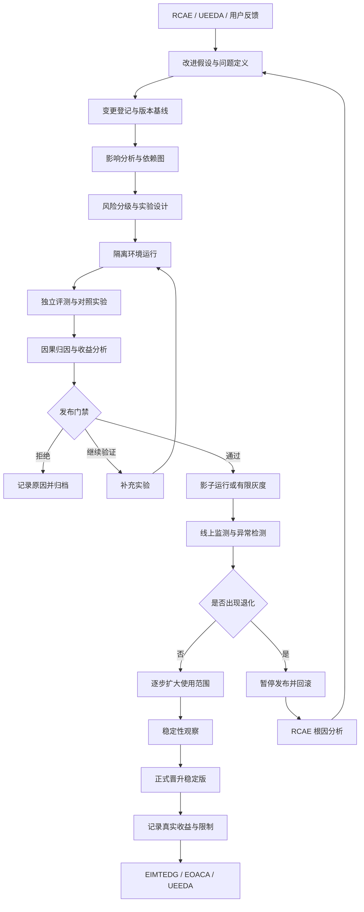
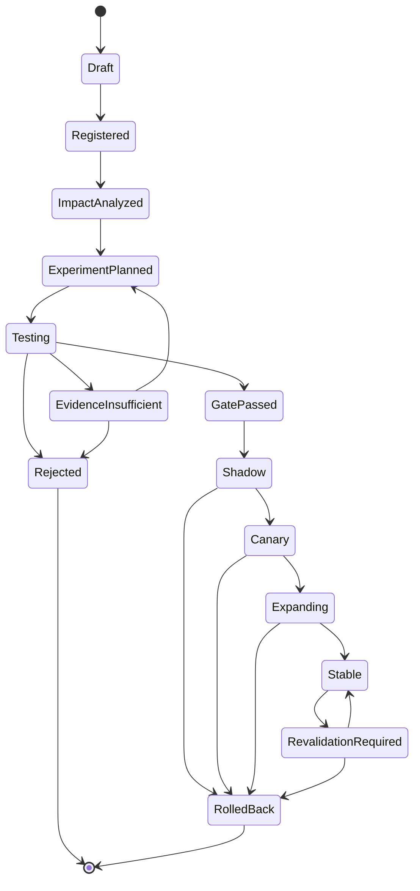

# 问答 127

> 来源: 新 窗口 | 会话: 分支 · 分支 · 分支 · 设计自进化智能体
> 消息: a9aa0bf5-bb1c-425d-97b0-99a57a2122ea | 时间(UTC): 2026-10-24 11:59

## 用户

继续

## ChatGPT

<WritingBlock id="62483" variant="document"># EvoAgent 第六十三专项：自进化变更影响分析、因果归因与安全发布治理

**专项编号：SECIASRG**

**英文名称：Self-Evolution Change Impact Analysis, Causal Attribution & Safe Release Governance**

**文档版本：V1.0**

**文档性质：全量架构专项设计**

**适用范围：EvoAgent 统一任务入口、多层路由、共享通用内核、领域专家、Plan、ReAct、DAG、工具能力治理 TCRDCF、结果验收 TOVFTD、证据与记忆治理 EIMTEDG、问题诊断 RCAE、独立评测 UEEDA、能力资产化 EOACA、能力规划 CGDPCP、自主进化治理 AECGSR，以及 Android、Windows 和 mini Linux 本地运行环境。**

**核心目标：建立完整的变更登记、影响分析、实验设计、因果归因、风险分级、渐进发布、运行监测和自动回滚机制，使 EvoAgent 不仅能够提出改进方案，还能够判断改进是否真正有效、效果来自哪里、适用于什么范围，以及是否值得发布。**

本文定义目标架构、数据模型、运行机制、工程接口和验收标准，不代表相关模块已经实现。

---

# 一、为什么自进化系统不能只依赖自动评测？

前面的专项已经建立了 EvoAgent 的主要进化闭环：

- RCAE 负责分析问题；
- CGDPCP 负责识别能力缺口并规划建设；
- EOACA 负责沉淀可复用能力；
- UEEDA 负责独立评测；
- AECGSR 负责进化治理；
- TOVFTD 负责验收真实任务结果；
- EIMTEDG 负责管理证据、记忆与评测数据的可信度。

但这些能力组合起来，仍然存在一个重要缺口。

**系统能够发现某个新版本表现更好，却不一定能够证明为什么更好，以及这种提升是否值得承担相应代价。**

假设 EvoAgent 同时修改了五项内容：

1. 路由器提示词；
2. 代码专家的工具选择策略；
3. 上下文压缩算法；
4. 失败重试次数；
5. 结果验收规则。

修改后，测试集的任务通过率从 80% 上升到 86%。

这看起来是一次成功的进化。

但继续分析可能发现：

- 路由器提示词确实提高了任务分配准确率；
- 代码专家的新策略只在少数任务上有效；
- 上下文压缩导致长任务的部分约束丢失；
- 增加重试次数提高了部分任务的成功率，却显著增加了成本；
- 验收规则变宽松，使部分本应失败的任务被判定为通过。

此时，整体通过率上升，并不意味着整个升级值得发布。

甚至可能出现：系统表面上越来越优秀，实际交付质量却在下降。

因此，SECIASRG 要解决的不是简单的“版本比较”，而是六个问题：

1. **变更可追溯**：究竟修改了什么？
2. **影响可预测**：哪些模块和任务可能受到影响？
3. **收益可归因**：哪项修改真正产生了效果？
4. **风险可控制**：是否存在局部提升、整体退化？
5. **发布可撤回**：发现问题后能否快速恢复？
6. **结论可复现**：未来能否重新验证当初的判断？

这六项能力共同决定了 EvoAgent 能否安全地进行长期自主进化。

---

# 二、第一性原理：改进必须满足什么条件？

建议将一次有效改进定义为同时满足以下条件的变更：

- 有明确的问题或改进假设；
- 有可测量的目标；
- 有可信的对照基线；
- 有足够适用的验证数据；
- 有明确的安全和质量门槛；
- 能够区分实际收益与偶然波动；
- 已知成本和时延变化；
- 不会突破既定权限边界；
- 具备失败后的回滚路径；
- 发布后能够持续观察实际表现。

这意味着：

**一次测试通过，不等于改进成功；一个指标提高，不等于系统整体改善；一个版本发布成功，也不等于长期稳定。**

## 2.1 必须区分四种不同结论

| 结论 | 实际含义 |
|---|---|
| 变更可运行 | 新版本可以正常执行 |
| 变更通过验收 | 新版本满足规定的验收条件 |
| 变更具有收益 | 在适当对照下，目标指标得到可信改善 |
| 变更值得发布 | 收益、风险、成本、兼容性和回滚能力均满足发布要求 |

这四种结论不能互相替代。

例如，一个新的代码专家可能通过全部单元测试，但没有证据证明它比旧版本更好。

这时它可以被认为“通过验收”，但不能仅凭这一点被认定为“进化成功”。

## 2.2 进化不是永远追求更高的单一分数

EvoAgent 的核心目标是提升执行质量、效率与稳定性，同时控制成本。

因此，改进目标应当是多维的。

至少包括：

- 任务成功率；
- 最终验收通过率；
- 关键错误率；
- 路由准确性；
- 稳定性；
- 平均及高分位时延；
- 单任务成本；
- 返工率；
- 重试次数；
- 权限与安全违规；
- 用户实际满意度；
- 能力覆盖范围。

其中，安全和必要验收条件属于硬性门槛，不能通过降低成本或提高成功率来抵消。

---

# 三、总体架构：从候选改进到安全发布的治理层

建议新增 `Self-Evolution Change Governance Layer`，简称 SECGL。

它是 EvoAgent 的进化控制体系，不负责直接完成所有任务，而是负责管理系统自身的变化。



建议划分为十个逻辑模块。

| 模块 | 核心职责 |
|---|---|
| 1. 变更登记中心 | 记录改动内容、动机、版本和责任模块 |
| 2. 变更影响分析器 | 识别依赖、潜在影响范围和需要复验的对象 |
| 3. 风险分级引擎 | 决定验证强度、发布权限和回滚要求 |
| 4. 实验规划器 | 设计对照实验、消融实验和测试样本 |
| 5. 实验执行器 | 在隔离环境中运行候选版本 |
| 6. 因果归因分析器 | 分析收益、退化及其可能来源 |
| 7. 发布门禁引擎 | 根据质量、风险和证据决定是否允许发布 |
| 8. 渐进发布控制器 | 执行影子运行、灰度和逐步晋升 |
| 9. 运行监测与回滚器 | 检查真实表现，发现退化并恢复稳定版本 |
| 10. 变更审计与收益账本 | 保存实验结果、发布决策、实际收益和失败记录 |

这些是逻辑职责，不要求每个模块成为独立服务。

对于个人使用的 EvoAgent，建议将其实现为一个本地进化控制模块，通过统一任务 ID、版本 ID 和事件记录连接各个专家。

---

# 四、第一阶段：建立统一变更登记与版本基线

所有会影响系统行为的修改，都应进入变更登记流程。

这不仅包括代码变更，还包括提示词、工具参数、路由规则、上下文策略、记忆检索、验收标准和工作流编排。

## 4.1 统一变更对象 ChangeSet

建议新增 `ChangeSet` 数据模型。

核心字段如下：

| 字段 | 含义 |
|---|---|
| `change_id` | 唯一变更 ID |
| `change_type` | 代码、提示词、工具、路由、记忆、评测规则或工作流变更 |
| `target_component` | 目标组件 |
| `baseline_version` | 修改前的基线版本 |
| `candidate_version` | 候选版本 |
| `parent_changes` | 依赖或组合变更 |
| `change_reason` | 改进原因 |
| `hypothesis` | 预期效果 |
| `target_metrics` | 目标指标 |
| `guardrail_metrics` | 必须保持的指标 |
| `risk_level` | 风险等级 |
| `affected_assets` | 预计受影响的资产 |
| `experiment_plan_ref` | 实验计划引用 |
| `rollback_target` | 回滚目标 |
| `status` | 当前状态 |
| `created_at` | 创建时间 |

变更对象必须能够追溯到具体版本，而不能只记录一句“优化了代码专家”。

例如：

```text
变更 ID：CHG-00421
目标组件：代码专家工具选择器
基线版本：code-expert-1.8.2
候选版本：code-expert-1.8.3-candidate
变更类型：工具选择策略
改进假设：减少因工具选择错误造成的重试
目标指标：工具选择错误率下降
保护指标：任务验收通过率不下降
风险等级：中
回滚目标：code-expert-1.8.2
```

以上只是字段示例，不代表实际版本已经存在。

## 4.2 版本基线必须可复现

每次评测都必须记录：

- 系统版本；
- 专家版本；
- 模型名称及可识别版本；
- 提示词版本；
- 工具版本；
- 验收规则版本；
- 数据集版本；
- 运行环境；
- 关键配置；
- 实验随机种子或其他可复现参数；
- 资源预算；
- 结果产物引用。

如果模型 API 是不可固定的远程服务，系统可能无法完全复现当时的模型行为。

此时应记录实际可获得的模型标识、调用时间、请求参数和返回结果，并将无法固定的因素标记为复现限制。

**不能把“保存了代码版本”误认为“整个实验已经可以完全复现”。**

## 4.3 修改前必须保存稳定基线

在评估候选变更之前，必须确认旧版本具有明确身份。

至少需要：

- 稳定版本 ID；
- 对应配置；
- 可用的执行入口；
- 已知兼容条件；
- 关键回归测试；
- 必要的恢复方法。

否则，即使发现新版本有问题，也可能无法准确恢复原来的行为。

---

# 五、第二阶段：建立变更影响分析与依赖图

EvoAgent 的模块之间存在复杂依赖关系。

例如，修改上下文压缩规则可能影响：

- 通用任务入口；
- 代码专家；
- 旅游专家；
- 任务计划生成；
- 长任务执行；
- 记忆检索；
- 失败恢复；
- 最终验收。

因此，不能仅测试被直接修改的模块。

建议建立 `ChangeImpactGraph`。

## 5.1 变更影响分析需要识别什么？

每次变更应当识别：

1. 直接修改的组件；
2. 直接依赖该组件的模块；
3. 间接依赖的下游模块；
4. 共享通用内核的其他专家；
5. 受影响的能力资产；
6. 受影响的验收契约和验证器；
7. 受影响的评测集；
8. 需要重新运行的回归测试；
9. 需要重新确认的权限与安全约束。

例如，修改路由器可能不直接修改代码专家，但会改变分配给代码专家的任务分布。

即使代码专家本身没有变化，它的整体表现也可能因为输入分布变化而发生变化。

这类影响必须纳入分析。

## 5.2 影响范围分为三类

| 范围 | 含义 | 验证策略 |
|---|---|---|
| 局部影响 | 只影响某个独立专家或工具 | 执行局部测试和必要回归 |
| 关联影响 | 影响多个相关组件或工作流 | 执行依赖范围内的组合测试 |
| 系统级影响 | 影响共享内核、路由、权限或统一验收机制 | 执行跨专家回归和严格门禁 |

影响范围不能仅根据文件数量判断。

一行共享路由规则的修改，可能比数百行独立领域代码更具系统性影响。

## 5.3 变更影响图的数据结构

建议至少包含：

- `source_component`；
- `target_component`；
- `dependency_type`；
- `dependency_strength`；
- `version_constraint`；
- `impact_scope`；
- `verification_requirement`；
- `last_validated_at`。

依赖关系应当来自显式声明、工程配置和实际运行记录。

不能只靠模型阅读代码后猜测全部依赖关系。

模型可以补充候选依赖，但关键影响关系应经过静态分析、配置检查或实际验证。

## 5.4 影响分析不完整时如何处理？

如果系统无法确定一项修改会影响哪些组件，应将影响范围标记为不确定。

对于低风险变更，可以增加抽样回归。

对于共享内核、权限、安全和统一验收规则的变更，应扩大验证范围，必要时阻止自动发布。

**未知影响不是没有影响。**

---

# 六、第三阶段：风险分级与实验权限

不是所有改进都需要同样严格的发布流程。

如果修改一个低风险的文档格式模板，也执行完整的多阶段发布，会增加不必要的成本。

但如果修改权限判断、工具执行策略或验收规则，仅通过几个单元测试就直接发布，则风险过高。

建议采用五级变更风险模型。

<box gap={2}>
  <box border radius="lg" padding={3} gap={1}>
    **R0：纯展示或低影响变更**

    <text color="secondary" size="sm">示例：不影响任务语义的展示格式调整。</text>

    要求：基本测试、变更记录、必要的快速回归。
  </box>
  <box border radius="lg" padding={3} gap={1}>
    **R1：局部行为优化**

    <text color="secondary" size="sm">示例：独立专家中的局部提示词调整。</text>

    要求：局部回归、基线对照、基本成本与质量检查。
  </box>
  <box border radius="lg" padding={3} gap={1}>
    **R2：跨模块行为变更**

    <text color="secondary" size="sm">示例：工具选择策略、上下文压缩或任务计划逻辑修改。</text>

    要求：依赖影响分析、组合测试、独立评测和明确回滚路径。
  </box>
  <box border radius="lg" padding={3} gap={1}>
    **R3：共享内核或系统级变更**

    <text color="secondary" size="sm">示例：统一路由、任务状态机、评测体系或记忆治理规则调整。</text>

    要求：跨专家回归、独立实验、分阶段发布、严格保护指标。
  </box>
  <box border radius="lg" padding={3} gap={1}>
    **R4：权限、安全或不可逆行为相关变更**

    <text color="secondary" size="sm">示例：修改自动操作权限、外部副作用控制或安全门禁。</text>

    要求：隔离验证、强制安全测试、必要的人工审批；不得仅凭普通质量评分自动发布。
  </box>
</box>

风险等级不是按变更规模机械决定的。

一个很小的修改，只要可能绕过权限检查，就可能属于 R4。

## 6.1 自动发布权限必须有明确边界

建议允许系统在满足全部门禁时自动发布部分 R0、R1 以及经过严格限定的 R2 变更。

R3 需要根据影响范围、成熟度和已有验证能力决定是否允许自动晋升。

R4 不应因整体指标提高而自动突破既定权限边界。

即使用户允许 EvoAgent 高度自主，也不意味着系统可以自行取消原本的安全约束。

## 6.2 风险等级可以动态升级，不能任意降级

如果影响分析发现一项原本被认为是局部的变更，实际上影响多个专家，系统应自动提高风险等级。

如果后续发现风险较低，可以通过正式重新评估调整等级，但不能为了让候选版本更容易通过门禁而临时降低要求。

---

# 七、第四阶段：把改进假设写清楚

很多自动优化失败，并不是因为执行不够好，而是因为最初没有明确说明要解决什么问题。

建议每次变更都建立 `ImprovementHypothesis`。

## 7.1 假设必须包含什么？

- 当前问题；
- 问题证据；
- 推测根因；
- 目标行为；
- 预期变化；
- 衡量指标；
- 保护指标；
- 适用任务范围；
- 可能副作用；
- 失败判定条件；
- 回滚条件。

例如：

> 当前代码专家在选择测试工具时，经常调用不适用于当前项目的工具，导致额外重试。假设通过在调用前检查项目配置和工具适用范围，可以降低错误工具调用率，同时不降低最终验收通过率。

这比“优化代码专家工具调用能力”更适合验证。

## 7.2 区分根因假设与解决方案假设

需要分别回答：

- 当前问题为什么发生？
- 新方案为什么可能解决这个问题？

例如，工具调用失败可能来自：

- 参数格式错误；
- 工具接口版本不匹配；
- 网络异常；
- 权限不足；
- 工具本身缺陷。

如果根因判断错误，即使改进方案实现得很完整，也可能无法真正解决问题。

因此，SECIASRG 应将 RCAE 提供的根因结论作为证据输入，而不是无条件接受它。

## 7.3 一个变更尽量对应一个主要假设

如果一次改动同时解决五个问题，虽然工程上可能更方便，但实验归因会变得困难。

建议优先采用小步变更：

- 每个变更有一个主要假设；
- 主要目标可测量；
- 保护指标明确；
- 失败时能够独立回滚。

如果多个修改必须同时实施，则应把它们登记为一个组合变更，并明确无法单独归因的部分。

---

# 八、第五阶段：建立实验设计与因果归因机制

这是整个专项最重要的部分。

系统需要区分三件事：

1. 新版本与旧版本表现不同；
2. 这种差异可能由某项修改造成；
3. 有足够证据认为该修改在指定范围内产生了实际效果。

三者的证据要求不同。

## 8.1 最基本的基线对照

建议为每次重要变更保留同一批任务上的基线结果。

设旧版本在某个指标上的表现为 \(M_b\)，候选版本的表现为 \(M_c\)，则观察到的差异为：

\[
\Delta M=M_c-M_b
\]

例如：

- 旧版本成功率：80%；
- 新版本成功率：86%；
- 观察到的差异：+6 个百分点。

但这个差异只有在样本可比、评测规则一致、数据来源可信的条件下才具有解释价值。

如果旧版本使用了 100 个简单任务，而新版本使用了 100 个复杂任务，直接比较两个比例就可能误导决策。

## 8.2 同任务配对比较

对于可以重复执行的任务，优先采用配对比较。

具体步骤：

1. 固定一组具有代表性的任务；
2. 让旧版本和新版本分别执行；
3. 尽量保持输入、工具、预算和环境一致；
4. 使用同一套独立验收规则；
5. 比较两者在每项任务上的结果；
6. 分析改进与退化分别发生在哪里。

配对比较可以减少任务难度差异造成的干扰。

但如果任务执行具有随机性，仍然可能需要多次运行，并采用适合数据分布的统计方法。

## 8.3 什么时候需要消融实验？

假设一个候选版本同时包含：

- 新路由策略；
- 新上下文压缩；
- 新工具选择规则。

即使整体表现提升，也无法知道是哪项修改带来的收益。

可以采用消融实验：

| 实验组 | 路由 | 上下文压缩 | 工具选择 |
|---|---|---|---|
| A | 旧版 | 旧版 | 旧版 |
| B | 新版 | 旧版 | 旧版 |
| C | 旧版 | 新版 | 旧版 |
| D | 旧版 | 旧版 | 新版 |
| E | 新版 | 新版 | 新版 |

通过比较各组，可以初步分析单项变更及其组合效果。

不过，消融实验也有成本。

对于低风险、影响范围小的修改，不必机械地对所有变更执行完整实验矩阵。

应根据潜在收益、风险和资源决定实验深度。

## 8.4 什么时候需要更严格的因果分析？

如果任务分布、工具版本、模型版本和外部环境都在变化，仅靠前后对比很难区分原因。

此时可以采用：

- 随机分配的对照实验；
- 分层实验；
- 多因素实验；
- 交错运行；
- 受控环境下的重复测试；
- 对重要变化进行分阶段验证。

对于不能随机分配的线上任务，应明确其局限，不能把观察到的相关性直接表述为已经证明的因果关系。

## 8.5 因果归因必须考虑交互效应

两项修改分别有效，并不意味着组合起来仍然有效。

例如：

- 新路由器提高了专家匹配率；
- 新上下文压缩减少了输入成本；
- 两者组合后，路由器所需的关键信息被压缩掉了。

此时，单独测试可能都通过，但组合效果反而变差。

因此，SECIASRG 必须支持：

- 单项收益分析；
- 组合收益分析；
- 交互效应分析；
- 关键依赖的兼容性检查。

对于共享内核和系统级变更，组合验证尤为重要。

## 8.6 证据不足时，不强行进行精确归因

有些变化无法可靠归因。

例如，远程模型服务在评测期间发生了不可观测的变化，系统又无法固定模型版本。

此时可以报告：

- 观察到的性能差异；
- 已控制的因素；
- 未控制的因素；
- 可能的解释；
- 当前证据的限制。

不能为了让进化报告显得完整，就强行断言某项修改带来了全部收益。

---

# 九、第六阶段：多目标收益分析与成本治理

EvoAgent 的优化不能只关注成功率。

对于个人使用场景，成本、时延、资源占用和稳定性同样重要。

建议建立 `EvolutionUtilityEvaluator`，负责评估候选变更的综合收益。

## 9.1 关键指标分层

建议将指标分为三组。

**A. 质量指标**

- 最终验收通过率；
- 关键错误率；
- 事实核验失败率；
- 路由正确率；
- 回归缺陷率；
- 失败恢复成功率。

**B. 资源指标**

- 每个成功任务的平均成本；
- 模型调用次数；
- 工具调用次数；
- 平均与高分位时延；
- CPU、内存及存储占用；
- 本地计算时间。

**C. 稳定与安全指标**

- 崩溃率；
- 超时率；
- 任务中断率；
- 未验证交付比例；
- 权限违规次数；
- 回滚率；
- 长任务失败率。

具体指标应根据专家和任务类型配置，不要求所有领域使用完全相同的指标集。

## 9.2 使用硬性门槛与软性目标相结合的决策方式

例如：

- 验收通过率不得出现超过允许范围的退化；
- 关键安全违规必须为零容忍事件；
- 成本应尽量降低；
- 时延应尽量改善；
- 在不降低必要质量的前提下，提升任务覆盖率。

不建议把所有指标简单加权成一个总分。

因为一个候选版本可能通过极低成本获得很高的综合分数，却没有满足必要的质量要求。

建议采用两层决策：

第一层是硬性门槛，判断是否具备发布资格。

第二层是在通过硬性门槛的候选版本中，比较质量、成本、时延和稳定性的综合收益。

## 9.3 关注每个成功任务的成本

仅比较平均 API 成本可能产生误导。

例如，旧版本执行 100 个任务，成功 80 个；新版本执行 100 个任务，成功 90 个。

即使新版本总成本略高，它的单位成功任务成本仍然可能更低。

因此，可以定义：

\[
C_{\text{success}}=
\frac{\text{任务总成本}}{\text{通过验收的任务数}}
\]

但这个指标只能作为补充。

系统不能为了降低单位成功任务成本，主动拒绝困难任务或降低验收标准。

需要同时观察任务接受率、任务难度分布、部分完成率和拒绝率。

## 9.4 为每次改进建立收益账本

建议每次变更记录：

- 预期收益；
- 实验观察结果；
- 可信度与统计不确定性；
- 实际成本变化；
- 主要退化；
- 适用范围；
- 发布决定；
- 上线后的真实表现；
- 后续回滚或修复记录。

长期来看，EvoAgent 不仅要知道哪些变更成功，还要知道哪些改进经常失败、哪些收益无法复现、哪些优化在特定环境下才有效。

---

# 十、第七阶段：独立评测与发布门禁

SECIASRG 应当复用 UEEDA 和 TOVFTD，而不是重新建立一套重复的评测系统。

二者职责如下：

- TOVFTD：判断具体任务的结果是否符合验收要求；
- UEEDA：判断候选能力或策略在独立评测集上的表现；
- SECIASRG：判断变更是否产生可信收益，以及是否允许发布。

## 10.1 发布门禁必须检查什么？

建议至少检查：

1. 变更记录是否完整；
2. 基线版本是否有效；
3. 影响分析是否覆盖必要依赖；
4. 候选版本是否通过必要的功能测试；
5. 硬性安全与权限条件是否满足；
6. 目标指标是否达到要求；
7. 保护指标是否出现退化；
8. 实验数据是否足够可信；
9. 是否存在明显的评测泄漏；
10. 是否有可执行的回滚方案；
11. 是否需要灰度发布；
12. 是否需要人工批准。

## 10.2 评测规则变化必须单独管理

一个特别危险的情况是：

候选版本修改了系统，同时修改了判定系统是否成功的规则。

例如，新版本不仅修改了代码生成策略，还放宽了代码验收标准。

如果直接使用新标准评估新版本，再将结果与旧版本比较，评测结果就不再具有可比性。

因此：

**被评测系统的改动，与用于判断其是否合格的验收规则改动，必须明确区分。**

如果确实需要修改验收标准，应当：

1. 单独登记规则变更；
2. 说明变更理由；
3. 使用可信样本检查新旧规则；
4. 评估新规则对历史结果的影响；
5. 尽可能使用统一、独立的标准重新比较候选版本；
6. 无法直接比较时，明确标记结果不可直接横向比较。

## 10.3 统计不确定性不能被忽略

如果某项指标只提升了很小的幅度，而样本数量很少，系统不应直接宣称已经证明改进有效。

建议根据指标类型选择适当的统计方法：

- 二元成功率可以采用比例区间或配对二元结果分析；
- 时延可以检查分布、分位数和异常值；
- 成本可以分析均值、分布和极端任务；
- 多次重复运行可以估计随机波动；
- 多组实验需要考虑多重比较造成的误判风险。

不需要每次都进行复杂统计建模。

但对于重要的自动发布决策，必须明确样本量和结论的不确定性。

---

# 十一、第八阶段：渐进式发布与灰度验证

通过离线评测，不代表新版本在真实环境中一定稳定。

实际任务可能包含评测集没有覆盖的输入、工具故障、模型变化和设备差异。

因此，建议采用渐进式发布机制。

## 11.1 推荐的发布阶段

<box gap={2}>
  <box border radius="lg" padding={3} gap={1}>
    **阶段 A：离线验证**

    在隔离环境中执行测试和独立评测。

    未通过硬性门槛，不得进入下一阶段。
  </box>
  <box border radius="lg" padding={3} gap={1}>
    **阶段 B：影子运行**

    候选版本接收相同任务输入，但不直接控制正式执行结果。

    比较新旧版本的输出、成本和潜在差异。
  </box>
  <box border radius="lg" padding={3} gap={1}>
    **阶段 C：有限灰度**

    在明确限定的低风险任务范围内启用候选版本。

    持续检查质量、时延、成本和异常情况。
  </box>
  <box border radius="lg" padding={3} gap={1}>
    **阶段 D：逐步扩大范围**

    在达到预设门槛后扩大使用范围，并继续保留旧版本作为回退目标。
  </box>
  <box border radius="lg" padding={3} gap={1}>
    **阶段 E：正式晋升稳定版**

    完成必要的观察周期、回归检查和发布记录后，将候选版本晋升为正式稳定版本。
  </box>
</box>

影子运行并不适用于所有任务。

对于有外部副作用的工具调用，影子版本不应直接重复执行真实操作。

应优先使用模拟环境、只读观察、离线重放或不产生副作用的对照方式。

## 11.2 灰度比例应由风险决定

不应为所有变更设置固定的灰度比例。

对于个人使用的单设备环境，也不一定具备足够的真实任务量进行传统意义上的线上 A/B 实验。

此时可以采用：

- 代表性历史任务重放；
- 隔离测试环境；
- 只读影子运行；
- 明确限定的低风险任务；
- 少量真实任务的人工观察；
- 对照运行和结果审计。

如果样本量不足，系统应保留“不确定”的结论，而不是因为设备用户少，就降低发布门槛。

## 11.3 灰度期间必须保持可比较性

候选版本与稳定版的对照，应尽可能使用：

- 相同验收标准；
- 相同任务定义；
- 可比较的模型和工具环境；
- 一致的成本口径；
- 一致的结果统计规则。

如果无法保持这些条件，系统需要记录差异，并避免过度解读结果。

---

# 十二、第九阶段：自动监测、异常检测与回滚

发布后的真实表现是最终判断的重要依据。

因此，SECIASRG 需要持续检查候选版本是否出现退化。

## 12.1 回滚触发条件

建议包括：

- 硬性安全约束被违反；
- 关键验收指标低于允许门槛；
- 错误率显著上升；
- 任务中断率异常；
- 成本超出预设上限；
- 高分位时延明显退化；
- 新版本产生大量无法验证的结果；
- 发现影响范围超出预期；
- 发现重要评测或验证机制存在缺陷。

这些条件应根据变更风险和任务类型分别设置。

对于关键安全问题，不需要等待统计显著性成立才暂停相关功能。

对于普通性能波动，则应结合样本量、观测周期和异常程度判断。

## 12.2 自动回滚不是简单切换版本号

可靠回滚至少需要：

1. 停止扩大候选版本的使用范围；
2. 禁止新的任务继续进入受影响的版本；
3. 将默认执行入口切换到已知稳定版本；
4. 检查正在运行的任务；
5. 根据任务状态决定继续、暂停或恢复；
6. 记录已产生的外部副作用；
7. 检查候选版本是否写入了不兼容的状态；
8. 执行回滚后的健康检查；
9. 记录触发原因；
10. 启动 RCAE 进行根因分析。

如果候选版本已经改变数据库结构、长期记忆格式或外部资源，仅切回旧代码可能不足以恢复系统。

因此，涉及持久化状态变化的变更必须事先设计向后兼容策略或恢复方案。

## 12.3 回滚后必须检查残留影响

例如，新版本错误地将一条记忆晋升为全局规则。

即使系统代码已经回滚，这条记忆仍然可能继续影响其他专家。

因此，回滚应与 EIMTEDG 联动：

- 标记由候选版本产生的可疑记录；
- 检查相关记忆和能力资产；
- 撤销或重新验证受影响对象；
- 重新计算必要的评测结果；
- 防止错误状态继续传播。

**版本回滚只能恢复软件状态，不能自动撤销已经产生的全部知识、数据和外部副作用。**

## 12.4 允许安全停止优先于自动恢复

如果系统无法确定回滚是否安全，或者恢复操作本身可能造成更大损失，应暂停相关操作并请求人工确认。

自动回滚的目标是恢复可信状态，而不是不惜代价维持自动运行。

---

# 十三、第十阶段：多专家、多模型与多设备的变更治理

EvoAgent 采用独立领域专家和共享通用内核的架构。

因此，变更治理必须区分局部升级与共享能力升级。

## 13.1 专家级变更

例如，AI 漫剧专家优化镜头生成策略。

主要影响可能集中在：

- 镜头生成；
- 角色一致性；
- 视频合成；
- 相关成本和质量指标。

此时应优先执行漫剧专家的专项评测，并检查其对通用内核的依赖是否发生变化。

## 13.2 共享内核变更

例如，修改统一上下文压缩机制。

可能同时影响：

- 代码专家；
- 旅游专家；
- 文档专家；
- 手机操作专家；
- 多轮任务；
- 长期工作流；
- 记忆检索和验收。

因此，需要执行跨专家回归。

不能因为代码专家的测试通过，就认定共享上下文机制的升级已经安全。

## 13.3 模型切换必须视为环境变更

当某个专家切换模型后，即使提示词和工具代码没有变化，其行为仍然可能发生变化。

因此，模型切换应触发：

- 模型兼容性检查；
- 关键提示词回归；
- 工具调用能力检查；
- 输出格式检查；
- 结果验收回归；
- 成本和时延重新评估；
- 关键能力资产的适用性复核。

模型名称相同也不一定代表行为完全相同，尤其是在远程模型服务无法固定全部内部配置的情况下。

## 13.4 Android 与桌面环境差异

同一个工作流在不同设备上可能存在差异：

- Android 权限不同；
- Windows 文件路径和进程管理方式不同；
- mini Linux 缺少部分依赖；
- 不同设备具有不同的计算资源；
- 工具可用性和版本可能不同。

因此，变更影响分析必须考虑运行环境。

某项改进在 Windows 上通过测试，不应自动推导出 Android 或 Linux 环境也通过了验证。

---

# 十四、第十一阶段：工程实现与状态机

建议建立统一的变更状态机。



其中：

- `Draft`：尚未完成登记；
- `Registered`：变更信息完整；
- `ImpactAnalyzed`：完成影响范围分析；
- `ExperimentPlanned`：实验方案已经确定；
- `Testing`：正在隔离测试；
- `EvidenceInsufficient`：证据不足，需要补充实验；
- `GatePassed`：通过发布前门禁；
- `Shadow`：影子运行；
- `Canary`：有限灰度；
- `Expanding`：逐步扩大使用范围；
- `Stable`：正式稳定版；
- `Rejected`：拒绝发布；
- `RolledBack`：已经回滚；
- `RevalidationRequired`：由于环境、依赖或证据变化，需要重新验证。

状态迁移必须具有明确的前置条件，不能由模型直接把一个候选版本的状态文本修改为 `Stable`。

---

# 十五、工程目录与核心接口

建议新增以下逻辑模块：

```text
evoagent/
├── evolution_governance/
│   ├── change_registry/
│   ├── change_sets/
│   ├── baseline_manager/
│   ├── dependency_graph/
│   ├── impact_analyzer/
│   ├── risk_classifier/
│   ├── hypothesis_registry/
│   ├── experiment_planner/
│   ├── experiment_runner/
│   ├── causal_attribution/
│   ├── utility_evaluator/
│   ├── release_gate/
│   ├── rollout_controller/
│   ├── runtime_monitor/
│   ├── rollback_controller/
│   └── evolution_audit/
├── experiment_storage/
│   ├── experiment_registry/
│   ├── baseline_snapshots/
│   ├── candidate_artifacts/
│   ├── result_records/
│   ├── metric_definitions/
│   ├── experiment_replay/
│   └── reproducibility_manifest/
├── release_management/
│   ├── release_state_machine/
│   ├── shadow_execution/
│   ├── canary_policy/
│   ├── compatibility_checks/
│   ├── rollback_plans/
│   ├── health_checks/
│   └── release_history/
└── evolution_governance_tests/
    ├── change_registry_tests/
    ├── impact_analysis_tests/
    ├── risk_gate_tests/
    ├── experiment_comparison_tests/
    ├── causal_attribution_tests/
    ├── regression_tests/
    ├── rollout_tests/
    ├── rollback_tests/
    └── persistence_recovery_tests/
```

建议提供以下核心接口：

- `register_change_set`：登记变更；
- `capture_baseline`：保存基线；
- `validate_change_manifest`：检查变更清单；
- `analyze_change_impact`：分析影响范围；
- `resolve_affected_dependencies`：查找受影响依赖；
- `classify_change_risk`：确定风险等级；
- `build_improvement_hypothesis`：登记改进假设；
- `plan_controlled_experiment`：生成实验方案；
- `validate_experiment_design`：检查实验是否具有可比性；
- `run_baseline_experiment`：运行基线实验；
- `run_candidate_experiment`：运行候选实验；
- `compare_paired_results`：执行配对比较；
- `run_ablation_analysis`：分析组合变更；
- `estimate_effect_uncertainty`：评估效果不确定性；
- `attribute_observed_changes`：分析收益和退化的可能来源；
- `evaluate_multi_objective_utility`：分析质量、成本和时延权衡；
- `validate_evaluation_integrity`：检查评测数据可信度；
- `evaluate_release_gate`：执行发布门禁；
- `start_shadow_rollout`：启动影子运行；
- `start_limited_canary`：启动有限灰度；
- `expand_rollout_scope`：扩大使用范围；
- `monitor_release_health`：监测发布后表现；
- `detect_release_regression`：检测性能退化；
- `trigger_safe_rollback`：触发安全回滚；
- `validate_rollback_state`：检查回滚后的系统状态；
- `revalidate_after_environment_change`：环境变化后重新验证；
- `record_release_decision`：保存发布决策；
- `record_actual_improvement`：记录真实收益；
- `audit_change_lineage`：审计变更历史；
- `invalidate_dependent_assets`：处理变更导致的失效资产；
- `generate_evolution_report`：生成可追溯的进化报告。

所有接口都应使用统一的 `change_id`、版本 ID、任务 ID、实验 ID 和证据引用，确保从变更原因到最终发布结果形成完整链路。

---

# 十六、端到端验收场景

建议至少建立以下九个场景。

## 场景 A：整体成功率提高，但成本明显增加

**初始条件：** 候选版本提高任务通过率，但增加了模型调用和重试次数。

**验收过程：**

1. 对比新旧版本；
2. 检查成功任务数和任务难度；
3. 计算单位成功任务成本；
4. 检查时延与重试率；
5. 确认是否满足成本预算；
6. 根据质量收益和资源代价决定是否发布。

**验收重点：** 不能只根据成功率决定发布。

## 场景 B：多个修改组合后出现退化

**初始条件：** 路由器、上下文压缩和工具选择策略同时更新。

**验收过程：**

1. 建立组合变更清单；
2. 执行完整组合测试；
3. 检查交互效应；
4. 必要时执行消融实验；
5. 定位导致退化的修改；
6. 仅保留有足够证据支持的改进。

**验收重点：** 单项改进有效，不代表组合后仍然有效。

## 场景 C：评测结果提高，但验收规则同时变宽松

**初始条件：** 候选版本修改了执行策略和最终验收器。

**验收过程：**

1. 分离执行策略变更与验收规则变更；
2. 使用独立标准重新比较；
3. 检查新旧验收器对历史样本的判定差异；
4. 重新评估候选版本；
5. 在证据不足时拒绝自动晋升。

**验收重点：** 不能通过改变裁判标准来制造改进。

## 场景 D：模型服务在评测期间发生变化

**初始条件：** 远程模型的实际行为发生变化，但系统无法固定其内部版本。

**验收过程：**

1. 检查模型标识和调用时间；
2. 分析实验期间的环境差异；
3. 检查是否存在时间相关的性能漂移；
4. 采用重复或交错实验降低混淆；
5. 记录无法控制的因素；
6. 根据证据决定是否可以归因。

**验收重点：** 不能将所有前后差异都归因于代码或提示词修改。

## 场景 E：灰度发布出现关键错误

**初始条件：** 候选版本在少量真实任务中触发严重错误。

**验收过程：**

1. 识别关键异常；
2. 停止扩大发布范围；
3. 执行安全回滚；
4. 检查正在运行的任务和外部副作用；
5. 检查候选版本产生的记忆和状态变化；
6. 启动 RCAE 进行根因分析。

**验收重点：** 严重风险事件不需要等待统计显著性成立才处理。

## 场景 F：回滚后仍然受到错误记忆影响

**初始条件：** 新版本写入了错误的全局记忆，随后代码回滚。

**验收过程：**

1. 检查候选版本产生的记忆；
2. 追踪引用它的工作流；
3. 撤销或重新验证相关记录；
4. 清理无效缓存和默认检索入口；
5. 检查受影响能力资产；
6. 验证旧稳定版恢复后不会继续使用错误信息。

**验收重点：** 软件回滚不等于完整的系统状态恢复。

## 场景 G：单一专家改进影响其他专家

**初始条件：** 通用内核中某个共享模块发生变化。

**验收过程：**

1. 识别共享依赖；
2. 运行目标专家的专项测试；
3. 运行其他受影响专家的回归测试；
4. 检查长任务、记忆和工具调用行为；
5. 根据系统级结果决定发布。

**验收重点：** 必须检查真实依赖范围，而不是只检查修改所在模块。

## 场景 H：评测样本不足，结果不确定

**初始条件：** 候选版本在少量样本上显示明显改善。

**验收过程：**

1. 检查样本量和任务分布；
2. 检查结果的随机波动；
3. 评估是否需要补充样本；
4. 运行更多对照实验；
5. 如果仍然无法得出可靠结论，则限制发布范围或继续观察。

**验收重点：** 样本不足时应承认不确定性，不能自动把观察结果当作确定收益。

## 场景 I：发布后长期表现逐渐退化

**初始条件：** 新版本刚发布时表现良好，但随着模型、工具或用户任务变化，质量逐渐下降。

**验收过程：**

1. 监测真实任务指标；
2. 检查输入分布和环境变化；
3. 识别退化发生的时间和范围；
4. 检查候选版本的适用条件；
5. 必要时限制使用范围或回滚；
6. 重新验证相关能力资产。

**验收重点：** 发布成功不代表永久稳定，系统必须能够检测环境变化引发的失效。

---

# 十七、专项验收标准

SECIASRG 至少需要满足以下要求：

1. 所有重要系统变更都具有唯一变更 ID。
2. 每项变更都能追溯到修改原因、目标组件和具体版本。
3. 变更前能够保存明确的稳定基线。
4. 能够识别直接依赖和间接依赖。
5. 能够根据共享范围和风险确定影响分析深度。
6. 能够为每项改进建立明确的假设、目标和保护指标。
7. 能够区分根因假设和解决方案假设。
8. 能够根据任务类型设计适当的对照实验。
9. 能够在适用情况下采用同任务配对比较。
10. 能够对多个组合修改进行必要的消融和交互分析。
11. 能够区分观察到的差异与已获得充分证据支持的因果结论。
12. 能够记录实验期间无法控制的环境因素。
13. 能够评估质量、成本、时延、稳定性和覆盖范围。
14. 能够防止单一指标提高掩盖其他重要指标退化。
15. 能够识别评测规则变更对结果可比性的影响。
16. 能够复用 UEEDA 的独立评测体系。
17. 能够根据风险级别执行不同的发布门禁。
18. 能够对高风险权限变更实施严格限制。
19. 能够通过影子运行和有限灰度验证部分候选版本。
20. 能够根据任务风险设置不同的观察条件。
21. 能够识别发布后的异常与退化。
22. 能够在关键异常发生时停止扩大候选版本的使用范围。
23. 能够在安全条件允许时自动回滚。
24. 能够检查回滚后的持久化状态和残留影响。
25. 能够识别软件回滚后仍然存在的错误记忆和能力资产。
26. 能够在共享内核变更时执行必要的跨专家回归。
27. 能够在模型、工具或运行环境变化后重新评估相关能力。
28. 能够为每次发布保存可追溯的实验和决策记录。
29. 能够将真实线上表现反馈给 RCAE、UEEDA、EIMTEDG 和 EOACA。
30. 能够区分通过验收、观察到收益和具备发布资格三个不同结论。
31. 能够在证据不足时暂缓发布，而不是强行得出确定结论。
32. 能够控制实验、灰度和重复验证的成本。
33. 能够在个人电脑或 mini Linux 主机上执行基本的变更治理。
34. 能够在断联环境下保留实验结果与发布记录。
35. 能够通过端到端测试证明变更治理机制本身可靠。

以上为目标架构验收要求，不代表相关模块已经实现或通过测试。

---

# 十八、建议冻结的架构决策

以下建议承接 ADR-1089。

| 编号 | 决策 |
|---|---|
| ADR-1090 | 建立自进化变更影响分析、因果归因与安全发布治理体系 SECIASRG |
| ADR-1091 | 所有重要变更必须具有可追溯的变更清单和版本标识 |
| ADR-1092 | 每次重要实验必须具有明确的稳定基线和复现信息 |
| ADR-1093 | 变更影响分析必须覆盖直接依赖、间接依赖和共享内核影响 |
| ADR-1094 | 影响范围不确定时，应根据潜在风险扩大验证或限制发布 |
| ADR-1095 | 变更风险等级必须影响验证深度、发布权限和回滚要求 |
| ADR-1096 | 权限与安全相关的关键门禁不得因普通质量指标提高而自动放宽 |
| ADR-1097 | 每项重要改进必须具备可验证的假设、目标指标和保护指标 |
| ADR-1098 | 应尽量分离独立变更，降低多个修改同时发生时的归因难度 |
| ADR-1099 | 变更效果必须通过适当的基线对照进行评估 |
| ADR-1100 | 对可以配对执行的任务，应优先考虑同任务配对比较 |
| ADR-1101 | 多项变更组合使用时，必须检查必要的交互效应 |
| ADR-1102 | 观察到的指标差异不得自动等同于已经证实的因果关系 |
| ADR-1103 | 无法控制的模型、工具和环境变化必须记录为实验限制 |
| ADR-1104 | 改进评估必须同时考虑质量、成本、时延、稳定性和任务覆盖范围 |
| ADR-1105 | 硬性验收与安全门槛不得被加权总分抵消 |
| ADR-1106 | 被评测系统与其验收规则的变更必须分开管理 |
| ADR-1107 | 独立评测必须复用 UEEDA，并受 EIMTEDG 的数据可信度治理 |
| ADR-1108 | 重要候选版本应采用与风险相适应的渐进发布机制 |
| ADR-1109 | 影子运行不得重复执行具有未授权外部副作用的操作 |
| ADR-1110 | 灰度范围必须根据风险、任务量和实际验证能力确定 |
| ADR-1111 | 发布后必须监测关键质量、成本、时延和安全指标 |
| ADR-1112 | 严重安全异常可以立即触发暂停，不必等待统计显著性 |
| ADR-1113 | 自动回滚必须考虑正在运行的任务、持久化状态和外部副作用 |
| ADR-1114 | 回滚后必须检查候选版本留下的记忆、评测数据和能力资产影响 |
| ADR-1115 | 共享内核变更必须执行适当的跨专家回归测试 |
| ADR-1116 | 模型或运行环境变化必须触发相关能力资产的适用性复核 |
| ADR-1117 | 每次重要发布必须保存收益、风险、限制与回滚记录 |
| ADR-1118 | 变更治理必须能够在本地优先环境中运行，不要求独立发布服务器 |
| ADR-1119 | 变更状态迁移必须满足明确的门禁条件，不能由模型直接修改为已发布状态 |
| ADR-1120 | 证据不足时允许暂缓发布、限制范围或拒绝晋升 |
| ADR-1121 | SECIASRG 必须与 RCAE、UEEDA、TOVFTD、EIMTEDG、EOACA 和 AECGSR 协同 |
| ADR-1122 | 系统必须区分变更可运行、通过验收、具有可信收益和具备发布资格 |
| ADR-1123 | 自动回滚和发布恢复机制必须通过故障注入与恢复测试 |
| ADR-1124 | 真实运行结果应反馈至后续改进规划，但不得自动视为新的可靠经验 |

以上建议作为 EvoAgent 第六十三专项的架构基线。

---

# 十九、完成本专项后，EvoAgent 具备了什么能力？

如果前述专项逐步实现并通过验收，EvoAgent 的自进化闭环将具备更完整的治理结构。

| 环节 | 主要责任 |
|---|---|
| 任务执行 | Plan、ReAct、DAG、领域专家与工具体系 |
| 结果验收 | TOVFTD |
| 问题诊断 | RCAE |
| 能力缺口识别 | CGDPCP |
| 经验与能力沉淀 | EOACA |
| 证据和记忆治理 | EIMTEDG |
| 独立能力评测 | UEEDA |
| 变更影响分析与因果归因 | SECIASRG |
| 发布权限、进化门禁与回滚治理 | AECGSR |
| 长期运行反馈 | 运行日志、质量指标和可信交付记录 |

这里需要强调：这些专项并不是十个必须分别部署的服务器。

对于个人使用的 EvoAgent，它们完全可以作为一个本地程序中的逻辑模块，按照统一接口协作。

在实际实现时，应优先共享任务 ID、版本管理、事件日志、评测基础设施和证据存储，避免因为专项划分而重复建设。

---

# 二十、下一专项：自进化自主权限、决策边界与可证明控制体系

完成第六十三专项后，仍然有一个必须进一步明确的问题：

**当 EvoAgent 已经能够诊断问题、提出改进、运行实验、评估收益、逐步发布和自动回滚时，它究竟可以自主决定什么，又有哪些事情永远不能仅凭自己的判断决定？**

这是自主进化系统走向高度自治时必须解决的治理问题。

例如：

- 系统能否自行修改自己的权限规则？
- 能否自行改变安全门槛？
- 能否因为连续成功而逐步扩大外部操作权限？
- 能否自动安装新的工具或依赖？
- 能否在发现成本超预算时自行修改预算？
- 能否将原本需要人工确认的任务改为自动执行？
- 能否修改自己的验收规则和发布条件？
- 当多个模块的权限要求发生冲突时，以什么规则为准？
- 如果进化控制器本身发生错误，谁负责阻止它继续发布？
- 如果系统发现原有规则不合理，它可以提出修改，但是否可以直接修改并生效？

这些问题不能仅通过普通的代码测试和质量评测解决。

它们涉及系统的授权边界、决策权、权限继承、不可绕过的控制条件，以及控制机制本身的可信度。

下一专项建议定义为：

**Autonomous Authority, Decision Boundaries & Verifiable Control，简称 AADBVEC。**

重点研究：

1. 如何划分建议权、执行权、发布权和授权权；
2. 如何定义不同专家和不同工具的权限边界；
3. 如何防止智能体自行扩大权限；
4. 如何区分可以自动修改的普通策略与必须受保护的控制规则；
5. 如何管理用户授权、任务授权和长期授权；
6. 如何处理多个专家之间的权限冲突；
7. 如何保证安全门禁不能被普通优化流程绕过；
8. 如何限制高风险操作的自主程度；
9. 如何在权限不足时安全降级；
10. 如何对授权决策保留可追溯记录；
11. 如何处理权限变更与系统升级之间的依赖关系；
12. 如何设计紧急停止、冻结和恢复机制；
13. 如何在 Android、Windows 和 mini Linux 环境中统一权限原则；
14. 如何防止诊断模块、执行模块和进化模块互相修改对方的控制规则；
15. 如何在尽可能高的自主程度与不可突破的安全边界之间取得平衡。

**核心原则：EvoAgent 应当尽可能自主地完成已经获得授权的工作，但不能把“能够修改系统”自动等同于“有权修改任何系统规则”。**

真正成熟的自主进化系统，不仅需要知道怎样变得更强，还必须知道哪些决定可以自行作出、哪些决定必须经过授权，以及在自身判断出现错误时如何被可靠地约束。

这将进一步补齐 EvoAgent 从自我改进到受控自主进化的治理闭环。</WritingBlock>
