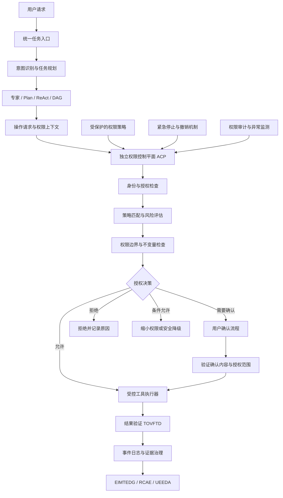

# 问答 128

> 来源: 新 窗口 | 会话: 分支 · 分支 · 分支 · 设计自进化智能体
> 消息: bf5bf6fe-0e7a-42e8-9e31-8e97e7e6e9eb | 时间(UTC): 2026-10-24 12:06

## 用户

继续

## ChatGPT

<WritingBlock id="74182" variant="document"># EvoAgent 第六十四专项：自主权限、决策边界与可验证控制体系

**专项编号：AADBVEC**

**英文名称：Autonomous Authority, Decision Boundaries & Verifiable Control**

**文档版本：V1.0**

**文档性质：全量架构专项设计**

**适用范围：EvoAgent 统一任务入口、多层路由、共享通用内核、领域专家、Plan、ReAct、DAG、工具能力治理 TCRDCF、结果验收 TOVFTD、证据与记忆治理 EIMTEDG、问题诊断 RCAE、独立评测 UEEDA、能力资产化 EOACA、自进化变更治理 SECIASRG，以及 Android、Windows、mini Linux 本地运行环境。**

**核心目标：建立独立于大模型推理过程的权限控制体系，明确智能体能够自主决定、执行、修改和发布的事项，确保任何专家、工具、工作流或进化模块都不能仅凭自身判断突破授权边界、擅自扩大权限或绕过安全门禁。**

本文定义目标架构、权限模型、决策流程、工程接口和验收标准，不代表相关模块已经实现。

---

# 一、为什么高度自主的智能体必须有独立的权力边界？

前面的第六十三专项 SECIASRG 已经建立了变更登记、影响分析、实验验证、渐进发布和自动回滚机制。

但这里存在一个更根本的问题。

**谁来决定系统有没有权力实施这些变更？**

假设 EvoAgent 已经具备以下能力：

- 可以分析自身的执行缺陷；
- 可以修改提示词和工具参数；
- 可以编写代码并运行测试；
- 可以生成新的工具；
- 可以创建和修改工作流；
- 可以独立评测候选版本；
- 可以自动发布通过门禁的低风险改进；
- 可以在运行异常时自动回滚。

这些能力越强，系统就越有可能修改自身运行所依赖的规则。

如果权限检查只是模型提示词中的一段文字，那么当模型误解规则、工具返回异常，或者进化过程修改了相关提示词时，原有权限边界就可能失效。

例如：

1. 系统为了提高任务成功率，发现某项操作因为权限不足而失败。
2. 它判断，只要扩大权限，就可以完成任务。
3. 它修改工具配置，尝试获得更高权限。
4. 它同时调整验证流程，使该操作不再触发原来的确认步骤。
5. 最终，系统确实提高了任务完成率，但突破了用户原本设定的权限边界。

这里的问题不是系统有没有能力完成任务，而是它是否有权这样做。

因此，AADBVEC 要确立一个重要原则：

**智能体可以提出任何合理的改进建议，但建议权不等于授权权，代码修改权不等于发布权，任务执行权也不等于修改自身权限规则的权力。**

EvoAgent 应尽可能自主地完成已经授权的工作，同时将权限边界放在独立、可验证、不能被普通模型推理直接修改的控制层中。

---

# 二、第一性原理：必须把四种权力彻底分开

传统程序往往通过函数调用、配置文件和访问控制实现权限管理。

自主智能体则存在一个特殊问题：它不仅执行任务，还能规划任务、选择工具、修改代码，甚至提出修改自身规则的方案。

因此，建议首先区分四种不同的权力。

| 权力 | 含义 | 示例 |
|---|---|---|
| 建议权 | 提出某种操作或规则变更的建议 | 建议安装一个新的代码分析工具 |
| 执行权 | 在已授权范围内实际操作 | 在指定项目目录运行静态分析 |
| 发布权 | 让某项变更进入正式运行环境 | 将测试通过的工具版本部署到稳定环境 |
| 授权权 | 决定某项操作是否获得许可 | 允许工具访问指定目录或执行某类外部操作 |

这四种权力不能默认由同一个模块全部持有。

例如，代码专家可以拥有修改自己工作区代码的能力，但不能因为它成功修改了代码，就自动获得修改全局文件访问权限的能力。

同样，进化控制器可以根据评测结果提出升级建议，但不能仅凭自己得出的结论，修改原本用于约束它的最高级权限规则。

## 2.1 权限治理的核心问题

每次重要操作发生之前，系统必须能够回答：

1. 谁提出了操作？
2. 谁将要执行操作？
3. 操作对象是什么？
4. 操作发生在哪个环境？
5. 用户是否授权了这种操作？
6. 授权是否仍然有效？
7. 操作是否超出原有任务范围？
8. 操作是否具有外部副作用？
9. 操作是否涉及不可逆变化？
10. 操作是否会修改自身或其他模块的控制规则？
11. 是否需要额外确认？
12. 操作完成后，如何验证结果并留下审计记录？

这些问题不能只依赖模型在生成答案时自行判断。

它们必须成为执行层强制执行的检查条件。

---

# 三、总体架构：独立权限控制平面

建议新增 `Authority & Control Plane`，简称 ACP。

ACP 是 EvoAgent 的独立权限控制平面，负责在任务规划、工具执行、系统修改和版本发布之前，检查操作是否获得授权。

它不是一个领域专家，也不负责决定用户真正想完成什么任务。

它负责判断：

**无论模型想做什么，当前系统是否允许它这样做。**

## 3.1 总体架构图



## 3.2 ACP 必须与模型推理隔离

ACP 可以接收模型提出的操作请求，但不能让模型直接决定 ACP 的最终判定。

例如，模型请求：

```text
操作：修改系统权限配置
目标：允许某个工具访问整个用户目录
理由：提高任务执行成功率
```

ACP 应当独立检查：

- 当前任务是否需要访问该目录；
- 原有授权是否允许这种访问；
- 操作是否属于受保护的权限变更；
- 是否有范围更小的替代方案；
- 是否需要用户明确批准。

即使模型给出的理由非常充分，也不能代替授权。

## 3.3 ACP 不需要独立服务器

EvoAgent 面向个人使用，运行环境可能是 Windows 电脑、Android 手机或 mini Linux 主机。

因此，ACP 应作为本地程序中的独立逻辑模块实现。

它可以与任务执行器部署在同一进程中，但应具有独立的策略存储、判定逻辑和调用接口。

对于特别敏感的操作，可以进一步利用操作系统权限、独立进程、文件权限和受限执行环境强化边界。

**逻辑隔离是基础，操作系统强制隔离才是更强的安全保障。**

仅仅把权限检查写在一个独立 Python 模块里，并不能自动防止其他代码绕过它。

---

# 四、建立统一的权限主体模型

EvoAgent 中存在多种可能发起操作的主体。

建议统一定义 `AuthorityPrincipal`。

## 4.1 权限主体类型

| 主体 | 典型职责 | 默认权限原则 |
|---|---|---|
| 用户 | 提出目标、进行授权、管理个人设置 | 拥有受支持的用户级授权和撤销能力 |
| 通用内核 | 规划、上下文管理、通用工具协调 | 只能在明确授予的能力范围内运行 |
| 领域专家 | 完成专业任务 | 仅访问授权的领域能力和资源 |
| 工具执行器 | 执行具体工具操作 | 只执行经过 ACP 批准的操作 |
| 进化控制器 | 提出和管理系统改进 | 可以创建候选变更，但不能自行授予更高权限 |
| 评测器 | 验证候选版本和任务结果 | 默认不具有修改正式运行状态的权力 |
| 诊断器 | 分析日志和故障 | 默认只读，修改动作必须经过独立授权 |
| 发布控制器 | 执行批准后的发布与回滚 | 只能执行符合发布策略的状态变更 |
| 系统管理员接口 | 管理全局策略和恢复机制 | 由用户通过受保护的控制路径使用 |

其中，用户可以通过聊天或语音提出请求，但普通的任务请求与明确的权限授权不是同一回事。

例如：

- “帮我整理下载目录”是任务请求；
- “允许你在本次任务中移动下载目录里的普通文件，但删除前必须确认”才包含具体的权限规则。

系统应当解析授权意图，并将其转换为明确、可检查的权限声明。

## 4.2 专家之间不得自动继承全部权限

假设代码专家拥有项目目录的读写权限。

当它将任务交给文档专家时，文档专家不应自动获得代码专家的全部权限。

跨专家委派必须遵循：

- 只传递完成子任务所需的权限；
- 限制资源范围；
- 限制操作类型；
- 限制授权有效期；
- 记录委派关系；
- 禁止下游专家扩大上游授权。

这属于最小权限原则。

一个专家可以把已授权的具体任务交给另一个专家执行，但不能凭委派行为创造新的授权。

---

# 五、统一权限模型：主体、动作、资源、条件与期限

建议采用属性化访问控制（ABAC）与能力授权相结合的设计。

对于简单权限，可以使用明确的角色规则。

对于复杂场景，则根据主体、动作、资源、环境和授权条件综合判定。

## 5.1 权限判定的五个核心要素

每次操作至少需要明确：

**主体（Principal）**

谁在执行？

**动作（Action）**

准备做什么？

**资源（Resource）**

操作作用于什么对象？

**条件（Condition）**

在什么环境和任务条件下允许？

**有效期（Expiry）**

授权在什么时候失效？

例如：

```text
主体：代码专家
动作：读写
资源：项目目录 /workspace/project-a
条件：当前任务 ID = TASK-1024
附加限制：禁止访问项目目录以外的文件
有效期：当前任务结束
```

这比“代码专家有文件访问权限”更加明确。

## 5.2 权限不能只按照工具名称判断

例如，工具名称是 `file_manager`。

它可能执行：

- 读取文件；
- 创建文件；
- 修改文件；
- 删除文件；
- 移动目录；
- 递归修改权限；
- 访问用户目录之外的资源。

这些操作的风险完全不同。

因此，权限检查必须针对实际动作和目标资源，而不是只检查工具是否在白名单中。

同理，一个浏览器工具可能只进行只读网页检索，也可能执行提交订单、发送消息或修改账户设置等具有外部副作用的操作。

## 5.3 建议采用默认拒绝策略

权限判定应遵循：

1. 明确允许且满足全部条件，才可以执行；
2. 明确拒绝时，不得因为其他普通规则允许而绕过；
3. 授权范围不明确时，优先缩小范围或拒绝；
4. 无法验证权限状态时，不得默认获得更高权限；
5. 授权过期或被撤销后，不得继续沿用；
6. 工具自身不能覆盖 ACP 的拒绝结果。

对于已经获得明确授权的普通任务，不应每一步都要求用户重复确认。

真正需要的是**按任务、资源、动作和风险进行精确授权，而不是让用户不断批准琐碎操作。**

---

# 六、权限边界的五层结构

建议将 EvoAgent 的权限治理划分为五层。

## 第一层：不可由普通进化流程修改的控制约束

包括：

- ACP 必须执行授权检查；
- 普通专家不得自行扩大权限；
- 普通进化流程不得关闭安全门禁；
- 高风险操作必须满足指定的授权要求；
- 拒绝和撤销机制必须保持可用；
- 权限冲突不得默认采用更宽松的规则。

这些约束构成控制平面的核心不变量。

它们可以通过受保护的配置、独立的执行路径和系统级测试实施。

需要说明的是，所谓“不可修改”不是指软件在物理意义上绝对不可能被修改，而是指普通智能体的任务执行与自我优化路径无权直接修改它们。

## 第二层：用户定义的长期策略

例如：

- 哪些目录可以自动访问；
- 哪些工具可以使用；
- 哪些操作必须确认；
- 哪些类型的改进可以自动发布；
- 允许的预算范围；
- 允许的外部副作用；
- 哪些数据可以长期保存。

这层策略可以由用户通过受保护的设置界面调整。

系统可以提出修改建议，但不能自行将建议直接变成生效规则。

## 第三层：任务级授权

用户发起具体任务时，可以提供比长期默认策略更具体的限制。

例如：

“只分析项目代码，不要修改文件。”

即使代码专家拥有项目的常规读写权限，这个任务仍然只能读取文件。

任务级约束可以进一步收紧权限，但不得无条件突破更高层的控制约束。

## 第四层：专家和工作流权限

例如：

- 代码专家可以读写指定工作区；
- 漫剧专家可以在指定目录生成视频素材；
- 文档专家可以创建文档，但不能自动发送邮件；
- 发布工作流可以在批准的范围内更新能力版本。

这些权限必须受到上层授权和当前任务约束。

## 第五层：单次操作授权

例如：

- 本次允许删除某个临时文件；
- 本次允许执行指定脚本；
- 本次允许向某个外部服务提交请求。

单次授权应具有明确对象、动作、有效期和使用条件。

如果操作目标发生变化，原授权不能自动覆盖新的目标。

---

# 七、授权规则发生冲突时，谁说了算？

EvoAgent 同时存在全局策略、用户偏好、任务要求、专家配置和工具规则。

如果没有统一的冲突处理机制，系统可能通过寻找更宽松的规则绕过原有约束。

建议建立明确的优先级。

| 优先级 | 规则来源 | 作用 |
|---|---|---|
| P0 | 系统安全不变量与平台强制约束 | 不得被普通任务或进化流程绕过 |
| P1 | 用户明确设定的硬性限制 | 限制系统可执行范围 |
| P2 | 当前任务的明确授权和限制 | 在上层允许范围内确定本次任务权限 |
| P3 | 受保护的全局运行策略 | 定义默认授权、风险等级与确认要求 |
| P4 | 专家、工具和工作流策略 | 进一步限定具体执行能力 |
| P5 | 模型生成的计划和临时建议 | 只能提出操作，不具备独立授权效力 |

具体实现时，应将 P2 的作用理解为在 P0、P1 和适用的强制规则范围内提供任务授权，而不是让任务请求覆盖用户的硬性限制。

冲突处理必须满足：

- 明确拒绝优先于普通允许；
- 更窄的资源范围优先于更宽的范围；
- 更严格的任务约束优先于专家默认配置；
- 模型生成的计划不能修改上层授权；
- 无法消除冲突时，停止相关操作并说明原因。

例如：

用户长期设置规定“禁止自动删除文件”。

当前任务说“清理临时目录”。

系统不能仅根据“清理”的语义推断自己获得了删除权限。

它可以列出候选文件、识别可安全清理的对象，并在适当情况下请求授权，但不能擅自扩大操作权限。

---

# 八、建立授权等级与自主程度模型

为了兼顾高度自主和安全边界，建议为操作定义五个授权等级。

这些等级描述的是操作需要满足的控制条件，不代表模型能力的高低。

<box gap={2}>
  <box border radius="lg" padding={3} gap={1}>
    **A0：只读观察**

    <text color="secondary" size="sm">示例：读取已授权文件、检查状态、分析日志。</text>

    允许在明确的读取范围内自动执行。
  </box>
  <box border radius="lg" padding={3} gap={1}>
    **A1：可逆的本地操作**

    <text color="secondary" size="sm">示例：创建临时文件、生成草稿、在隔离工作区运行测试。</text>

    满足预设资源范围和预算条件后，可以自动执行。
  </box>
  <box border radius="lg" padding={3} gap={1}>
    **A2：受控的持久化修改**

    <text color="secondary" size="sm">示例：修改项目代码、更新已授权的工作流、创建新的能力候选版本。</text>

    需要明确任务授权、变更记录和恢复路径；是否需要逐次确认取决于风险与用户预设策略。
  </box>
  <box border radius="lg" padding={3} gap={1}>
    **A3：具有重要外部副作用的操作**

    <text color="secondary" size="sm">示例：发送正式消息、提交订单、修改外部账户配置、发布到外部系统。</text>

    必须满足专门授权条件。默认不因一般任务授权而获得执行权。
  </box>
  <box border radius="lg" padding={3} gap={1}>
    **A4：控制权与安全边界变更**

    <text color="secondary" size="sm">示例：修改最高级权限策略、取消必要确认、关闭安全门禁、扩大进化控制器权限。</text>

    普通智能体和自动进化流程不得自行批准或生效。必须走独立、受保护的管理授权路径。
  </box>
</box>

这里有两个重要区别。

第一，A2 并不一定意味着每次修改都要人工批准。如果用户已经明确授权系统在指定工作区内自主修改代码，且修改可恢复、风险受控，就可以自动执行。

第二，A3 也不能只根据操作名称判断。例如，发送一条不敏感的内部测试消息与向外部发送不可撤回的正式文件，其风险不同。

实际风险等级应综合考虑：

- 操作后果；
- 是否可逆；
- 影响范围；
- 数据敏感性；
- 外部副作用；
- 授权是否明确；
- 当前环境是否可信。

A4 则是针对控制规则本身的特殊保护等级，不能仅仅因为某项修改“看起来影响不大”就绕过。

---

# 九、权限授权令牌：避免工具调用绕过任务边界

建议引入 `CapabilityGrant`，即有范围限制的能力授权记录。

它不必一开始采用复杂的加密令牌体系，但必须具有明确的授权范围和验证规则。

## 9.1 授权记录的核心字段

| 字段 | 含义 |
|---|---|
| `grant_id` | 授权 ID |
| `principal_id` | 获得授权的主体 |
| `task_id` | 关联任务 |
| `allowed_actions` | 允许的动作 |
| `resource_scope` | 允许访问的资源范围 |
| `conditions` | 额外限制 |
| `risk_ceiling` | 允许的最高风险等级 |
| `issued_by` | 授权来源 |
| `issued_at` | 授权时间 |
| `expires_at` | 失效时间 |
| `revocation_ref` | 撤销状态引用 |
| `usage_limit` | 可使用次数或资源限制 |
| `parent_grant_id` | 上游授权引用 |

例如，用户允许代码专家在一个任务中修改某个项目目录。

系统生成的授权记录可以限定：

- 仅允许当前代码专家使用；
- 仅限当前任务；
- 仅限指定目录；
- 允许读取和修改，但不允许访问目录外的文件；
- 不允许修改 ACP；
- 任务结束后自动失效。

## 9.2 授权不能无限委派

如果代码专家将任务交给另一个专家，新的专家只能获得完成子任务所需的权限。

建议采用以下规则：

\[
P_{\text{child}}
\subseteq
P_{\text{parent}}
\cap
P_{\text{task}}
\cap
P_{\text{policy}}
\]

其中：

- \(P_{\text{child}}\)：子任务实际获得的权限；
- \(P_{\text{parent}}\)：上游主体已经拥有的权限；
- \(P_{\text{task}}\)：当前任务允许的权限；
- \(P_{\text{policy}}\)：全局策略允许的权限。

该表达式表示子任务权限必须受全部上游约束限制。

它不是让模型计算的数学评分，而是授权系统必须执行的集合约束。

如果系统无法验证子任务授权范围，就不能默认授予更广泛的权限。

## 9.3 防止权限令牌被重复利用

对于敏感操作，还需要考虑：

- 授权是否已经过期；
- 是否已经被撤销；
- 是否只能使用一次；
- 是否绑定了特定任务；
- 操作目标是否发生变化；
- 授权是否来自可信的授权入口；
- 是否存在重复执行风险。

对于删除、发送、提交等操作，建议使用操作 ID 和幂等机制，防止重试导致重复副作用。

---

# 十、权限检查必须覆盖整条执行链

只在统一任务入口进行一次权限检查是不够的。

原因是任务在执行过程中可能不断改变计划，调用新的工具，委派给新的专家，或者产生新的外部副作用。

建议建立分层检查机制。

## 10.1 第一层：任务规划检查

Plan 阶段应当：

- 识别任务可能涉及的操作；
- 估计操作风险；
- 检查是否缺少必要授权；
- 识别可能的外部副作用；
- 优先规划权限范围更小的替代路径。

这一步主要用于提前发现问题。

但规划阶段的检查不能替代实际执行时的强制检查。

## 10.2 第二层：工具调用检查

每次工具调用之前，工具执行器必须再次检查：

- 当前主体；
- 当前任务；
- 实际动作；
- 实际资源；
- 有效授权；
- 当前风险；
- 撤销状态；
- 预算与使用次数。

只有通过检查，才可以执行。

## 10.3 第三层：副作用发生前检查

对于可能造成重要外部副作用的操作，应在真正执行前进行最后检查。

例如：

- 提交订单；
- 发送正式邮件；
- 删除重要文件；
- 发布正式版本；
- 修改外部账户配置。

系统不能在规划阶段获得一次宽泛授权后，就允许后续任意操作自动执行。

## 10.4 第四层：状态变化后的检查

任务执行期间，授权可能发生变化。

例如：

- 用户撤销了权限；
- 任务范围改变；
- 目标文件发生变化；
- 工具返回的目标对象与预期不一致；
- 风险从普通操作升级为重要外部操作。

因此，必要时必须重新进行权限判定。

对于无法安全中断的操作，应在启动前建立明确的中断和恢复策略。

---

# 十一、禁止智能体修改自己的最高权限规则

这是 AADBVEC 最重要的特殊要求之一。

EvoAgent 的目标是自主进化。

如果系统永远不能修改任何配置，它就很难实现真正的自我优化。

但如果系统可以直接修改所有控制规则，就会产生权限自我扩张风险。

因此，必须将可修改的运行配置与受保护的控制规则分开。

## 11.1 建立两个配置域

**可演进配置域**

允许在受控范围内自动修改：

- 普通提示词；
- 专家工作流；
- 工具选择参数；
- 非安全关键的执行策略；
- 记忆检索参数；
- 低风险性能优化参数；
- 经过批准的模型适配配置。

**受保护控制域**

普通智能体不能自行修改并使其生效：

- ACP 的强制检查逻辑；
- 最高级权限规则；
- 强制拒绝条件；
- 不可绕过的用户硬性限制；
- 高风险操作的必要确认要求；
- 关键审计与撤销机制；
- 进化控制器的授权边界；
- 安全发布与回滚的核心条件。

## 11.2 系统发现控制规则存在问题时怎么办？

不能简单禁止系统提出修改建议。

更合理的流程是：

1. 系统发现现有规则导致任务受阻或存在缺陷；
2. 生成 `ControlPolicyChangeProposal`；
3. 记录问题证据、目标和风险；
4. 在隔离环境中模拟新规则；
5. 使用对抗测试检查绕过风险；
6. 生成影响分析报告；
7. 请求通过受保护的授权入口进行批准；
8. 批准后在隔离环境验证；
9. 通过必要门禁后部署；
10. 保留旧策略和恢复路径。

**系统可以自主研究如何改进权限规则，但不能仅凭自己的研究结论，自行批准这项权限规则修改。**

这既保留了自我改进能力，也避免了权限控制被普通优化循环吞噬。

## 11.3 不能只依赖提示词保护

以下做法不够可靠：

- 在系统提示词中写“不要修改权限”；
- 在工具说明中写“禁止越权”；
- 让模型自行检查自己是否违反规则；
- 让模型修改代码后再由同一个模型决定是否安全；
- 仅依赖 Git 分支名称区分安全代码与普通代码。

这些措施可以作为辅助，但不能作为唯一的控制机制。

关键控制必须落实到权限判定、工具执行和受保护配置的实际访问路径中。

---

# 十二、权限治理与 ReAct、Plan、DAG 的关系

EvoAgent 已经采用 Plan、ReAct 和 DAG 相结合的任务执行方式。

权限治理必须与这些机制协作，但不能被它们取代。

## 12.1 Plan：提前规划授权需求

Plan 负责将任务分解为步骤，并识别每一步所需的操作能力。

例如：

```text
任务：修复一个代码项目

步骤 1：读取项目文件
步骤 2：分析代码
步骤 3：修改工作区代码
步骤 4：运行测试
步骤 5：检查测试结果
步骤 6：生成变更报告
```

Plan 可以提前判断每一步所需权限。

但计划本身不具有授予权限的能力。

## 12.2 ReAct：每轮操作都接受约束

ReAct 负责根据观察结果调整行动。

例如：

- 读取代码后发现缺少依赖；
- 运行测试后发现需要安装新工具；
- 执行过程中发现需要访问额外目录。

这些情况可能导致新的操作请求。

ReAct 可以提出新的计划，但必须重新经过权限检查。

不能因为一个任务最初已经获得授权，就将其视为对所有后续行为的无限授权。

## 12.3 DAG：在节点级声明权限

对于固定工作流，可以在每个节点声明：

- 所需动作；
- 资源范围；
- 是否产生外部副作用；
- 是否允许自动重试；
- 是否允许委派；
- 失败时的回退策略；
- 是否需要额外授权。

DAG 执行器必须在节点执行之前验证权限。

如果某个节点需要的权限超出当前授权，工作流应暂停、请求授权或选择安全替代路径。

## 12.4 专家负责专业判断，ACP 负责权限裁决

领域专家可以判断：

“为了完成这个代码任务，需要安装某个依赖。”

ACP 负责判断：

“当前任务是否允许安装该依赖？是否允许访问外部网络？是否允许修改系统环境？”

这两个问题必须分离。

专家的专业判断可以帮助解释为什么需要某项操作，但不能代替授权。

---

# 十三、诊断、执行与进化必须分离授权

之前的专项已经讨论过一个重要问题：

如果问题诊断能力与执行能力过度耦合，系统可能无法正确区分问题究竟来自哪里。

权限治理也需要遵循同样的隔离原则。

## 13.1 诊断器默认只读

RCAE 应能够：

- 查看必要的任务日志；
- 检查工具调用结果；
- 分析异常；
- 生成根因假设；
- 提出修复建议。

但它不应仅因为发现问题，就自动获得修改生产环境的权力。

诊断器可以创建一个修复候选任务，由执行器在授权范围内完成。

## 13.2 执行器不能自行批准自己的越权请求

如果执行器发现权限不足，可以：

- 请求补充授权；
- 选择更低权限的替代方案；
- 暂停任务；
- 说明无法继续的原因。

但它不能自行修改 ACP 的策略，让自己的请求通过。

## 13.3 进化控制器不能自行批准进化控制器的升级

例如，进化控制器希望修改自身的发布门禁。

它可以提出修改方案，运行离线实验并提供证据。

但最终生效必须由独立的受保护授权路径批准，并且仍需通过必要的验证与恢复机制。

这里的“独立”不一定意味着另一台服务器，而是意味着权限上不能由被修改的主体单方面完成全部步骤。

---

# 十四、紧急停止、权限撤销与恢复

高度自主的系统必须具备可靠的停止机制。

否则，即使每一步都有授权检查，一旦出现错误循环，系统仍可能持续执行不符合预期的操作。

建议建立 `EmergencyControlManager`。

## 14.1 紧急控制能力

至少包括：

- 停止接收新的自动化任务；
- 暂停正在执行的高风险操作；
- 禁止新的外部副作用；
- 撤销指定授权；
- 暂停自动发布；
- 禁止权限策略变更；
- 将系统切换为只读或受限模式；
- 保存当前任务状态；
- 生成审计事件；
- 在恢复条件满足后重新启用功能。

## 14.2 三种控制状态

建议将系统控制状态划分为三种。

| 状态 | 含义 |
|---|---|
| `NORMAL` | 按现有授权策略正常运行 |
| `RESTRICTED` | 降低自主程度，只允许特定安全操作 |
| `HALTED` | 停止相关自动执行，等待受保护的恢复流程 |

例如，ACP 检测到关键权限策略损坏时，可以进入 `RESTRICTED` 或 `HALTED`。

此时，系统仍可在允许范围内查看日志、导出诊断报告，但不能继续执行可能扩大损失的操作。

## 14.3 紧急停止不能完全依赖模型响应

如果模型已经失控或无法正常响应，不能要求模型自己判断是否停止。

紧急控制应通过独立的执行控制路径实施。

对于 Android，可以通过 App 内的受保护控制入口停止相关自动化任务。

对于 Windows 和 Linux，可以通过本地控制进程、进程管理或服务管理机制停止自动执行。

具体实现应根据实际部署方式设计，不能假设一个普通按钮就能中止所有正在执行的外部操作。

## 14.4 停止不等于撤销已经发生的副作用

如果系统已经发送消息、删除文件或提交订单，紧急停止无法让这些行为自动消失。

因此，系统必须区分：

- 尚未执行的操作；
- 正在执行的操作；
- 已完成的操作；
- 可以补偿的操作；
- 无法撤销的外部副作用。

恢复流程应针对不同状态采取不同措施。

---

# 十五、权限审计与可验证控制

AADBVEC 的目标不是声称能够形式化证明整个智能体永远不会犯错。

大模型、操作系统、外部服务和复杂环境都存在不确定性。

更现实的目标是：

**将关键权限规则转化为可检查的条件，并通过独立执行路径、结构化授权、强制检查和系统测试，验证这些规则在预定范围内确实得到执行。**

## 15.1 必须记录哪些审计事件？

建议至少记录：

- 权限请求；
- 权限判定；
- 允许或拒绝的原因；
- 授权来源；
- 授权范围；
- 授权过期与撤销；
- 高风险操作；
- 用户确认；
- 权限策略变更提案；
- 策略变更审批；
- 紧急停止；
- 自动回滚；
- 权限检查失败；
- 绕过尝试或异常调用。

审计记录应包含事件 ID、任务 ID、主体 ID、策略版本和时间信息。

## 15.2 审计日志不能保存过量敏感数据

权限审计不意味着必须记录全部文件内容、所有个人消息或所有模型上下文。

应当只记录解释授权决策所需的信息。

对于敏感内容，可以保存受控引用、摘要、校验值或最小必要字段，并根据数据保留策略管理。

## 15.3 关键规则应具有可测试的不变量

建议定义以下控制不变量：

**不变量 1：无授权，不执行。**

任何需要授权的操作，在没有有效授权时必须被执行层拒绝。

**不变量 2：子权限不能超过父权限。**

委派任务不能获得超出上游授权的能力。

**不变量 3：拒绝不能由普通模型输出覆盖。**

模型不能通过生成新的计划或提示词，将已经被 ACP 拒绝的同一操作自动变成允许。

**不变量 4：撤销必须影响后续操作。**

授权撤销后，新的相关操作必须被拒绝；正在执行的任务应根据风险和可中断性执行安全处理。

**不变量 5：控制规则修改必须走独立授权路径。**

普通专家、工具执行器和进化控制器不能直接批准自身对最高级权限规则的修改。

**不变量 6：任务授权不得自动扩展为长期授权。**

当前任务结束后，临时授权应失效，除非用户明确建立了符合策略的长期授权。

**不变量 7：无法确定授权状态时不得扩大权限。**

系统无法验证授权有效性时，应停止相关操作或采用安全降级路径。

这些不变量可以通过自动化测试、权限模拟、故障注入和实际执行器测试进行验证。

---

# 十六、与 Android、Windows 和 mini Linux 的具体适配

EvoAgent 采用手机优先战略，同时保留桌面和轻量主机扩展路径。

权限治理必须统一原则，但不能假设不同操作系统提供完全相同的权限能力。

## 16.1 Android

重点控制：

- 无障碍服务；
- 悬浮窗；
- 通知访问；
- 文件访问；
- 应用启动；
- 设备设置变更；
- 外部应用操作；
- 语音输入与唤醒相关能力。

系统应区分：

- Android 系统权限；
- App 已获得的权限；
- 当前任务授权；
- ACP 允许的操作；
- 外部应用自身要求的确认。

即使 Android 已经授予某项系统权限，也不意味着 EvoAgent 可以在所有任务中自由使用它。

反过来，ACP 允许某项操作，也不能绕过 Android 系统权限或外部应用的安全限制。

## 16.2 Windows 10/11

重点控制：

- 工作区目录；
- 文件与注册表访问；
- 子进程执行；
- PowerShell 或其他脚本执行；
- 软件安装；
- 系统配置修改；
- 网络访问；
- 进程终止；
- 自动启动与后台任务。

建议将普通任务执行器限制在明确的工作区内。

对于需要系统级权限的操作，应采用单独的授权流程，而不是让普通智能体进程长期持有管理员权限。

## 16.3 mini Linux

重点控制：

- 用户级与系统级文件；
- Shell 命令；
- 服务管理；
- 软件包安装；
- 网络服务暴露；
- 端口与防火墙；
- 定时任务；
- 系统配置文件；
- 进程和资源限制。

建议默认使用普通用户运行智能体，并尽量将需要更高权限的维护操作交给独立的受保护管理入口。

## 16.4 统一权限接口

可以统一提供以下抽象：

```text
request_permission()
check_permission()
execute_authorized_action()
revoke_permission()
inspect_current_scope()
enter_restricted_mode()
request_control_policy_change()
```

但这些接口底层必须适配各平台的真实安全机制。

不能因为三个平台使用了相同的接口名称，就假定它们具有同等的隔离能力。

---

# 十七、工程目录与核心接口

建议新增以下逻辑模块：

```text
evoagent/
├── authority_control/
│   ├── principal_registry/
│   ├── identity_context/
│   ├── capability_grants/
│   ├── policy_registry/
│   ├── policy_evaluator/
│   ├── conflict_resolution/
│   ├── risk_classification/
│   ├── authorization_decisions/
│   ├── delegated_authority/
│   ├── policy_invariants/
│   ├── policy_change_proposals/
│   ├── revocation_manager/
│   ├── emergency_controls/
│   └── authority_audit/
├── controlled_execution/
│   ├── tool_execution_gateway/
│   ├── resource_scope_enforcer/
│   ├── side_effect_guard/
│   ├── idempotency_guard/
│   ├── subprocess_restrictions/
│   ├── sandbox_integration/
│   └── execution_recovery/
├── approval_workflows/
│   ├── approval_requests/
│   ├── approval_context/
│   ├── approval_expiration/
│   ├── approval_audit/
│   └── approval_reconciliation/
├── platform_security/
│   ├── android_adapter/
│   ├── windows_adapter/
│   ├── linux_adapter/
│   ├── filesystem_policy/
│   ├── process_policy/
│   └── platform_permission_checks/
└── authority_control_tests/
    ├── unauthorized_action_tests/
    ├── grant_scope_tests/
    ├── delegation_tests/
    ├── policy_conflict_tests/
    ├── policy_change_tests/
    ├── revocation_tests/
    ├── emergency_stop_tests/
    ├── side_effect_tests/
    ├── sandbox_escape_tests/
    └── platform_security_tests/
```

建议提供以下核心接口：

- `register_principal`：登记权限主体；
- `create_capability_grant`：创建能力授权；
- `validate_capability_grant`：验证授权有效性；
- `request_authorization`：提交操作授权请求；
- `evaluate_authorization_policy`：执行权限策略判定；
- `resolve_policy_conflict`：处理策略冲突；
- `enforce_resource_scope`：限制资源访问范围；
- `check_task_authorization`：检查任务级授权；
- `check_side_effect_permission`：检查外部副作用权限；
- `derive_child_grant`：为子任务派生受限授权；
- `validate_delegation_scope`：检查权限委派范围；
- `revoke_capability_grant`：撤销授权；
- `validate_policy_invariants`：检查控制不变量；
- `submit_control_policy_change`：提交控制策略变更提案；
- `evaluate_policy_change_risk`：评估策略变更风险；
- `request_protected_approval`：请求受保护的授权批准；
- `activate_approved_policy`：激活已批准且通过验证的策略版本；
- `execute_authorized_action`：执行经过授权的操作；
- `enter_restricted_mode`：进入受限模式；
- `trigger_emergency_stop`：触发紧急停止；
- `restore_authorized_operation`：在满足恢复条件后恢复运行；
- `audit_authorization_decision`：审计授权决策；
- `validate_platform_permission`：检查平台权限；
- `check_grant_expiration`：检查授权过期；
- `enforce_task_budget`：执行任务预算限制；
- `validate_control_plane_integrity`：检查控制平面关键组件的完整性。

关键接口必须在真实执行之前完成强制检查。

不能只让模型调用 `check_permission()`，随后仍然允许它绕过该接口直接执行工具。

---

# 十八、端到端验收场景

建议至少建立以下十个场景。

## 场景 A：普通任务无法修改最高级权限策略

**初始条件：** 代码专家发现权限限制阻止了任务执行，并提出扩大自身权限的方案。

**验收过程：**

1. 允许专家提交策略修改建议；
2. 允许在隔离环境中分析方案；
3. 阻止普通执行路径直接修改生效中的受保护策略；
4. 检查是否存在独立的授权流程；
5. 验证未经批准的策略修改无法生效。

**验收重点：** 提出权限修改建议，不等于拥有权限修改权。

## 场景 B：子专家不能获得超过上游的权限

**初始条件：** 代码专家拥有某个项目目录的读写权限，将子任务委派给文档专家。

**验收过程：**

1. 检查上游授权；
2. 派生子任务授权；
3. 验证子任务只获得必要的权限；
4. 尝试访问授权范围外的文件；
5. 确认访问被拒绝并记录事件。

**验收重点：** 权限委派不能成为扩大权限的通道。

## 场景 C：用户明确限制优先于专家默认配置

**初始条件：** 代码专家具有项目读写权限，但用户要求本次任务只读分析。

**验收过程：**

1. 解析任务级限制；
2. 检查文件修改请求；
3. 拒绝修改操作；
4. 允许继续进行只读分析；
5. 输出分析结果。

**验收重点：** 任务级硬性限制不能被专家默认权限覆盖。

## 场景 D：授权过期后工具调用被拒绝

**初始条件：** 某次任务的文件访问授权已经过期。

**验收过程：**

1. 提交新的文件访问请求；
2. 检查授权期限；
3. 拒绝继续使用过期授权；
4. 根据任务情况请求新授权或停止任务。

**验收重点：** 历史上曾经获得授权，不意味着当前仍然有权执行。

## 场景 E：用户撤销授权后停止相关操作

**初始条件：** 用户撤销了某个外部操作权限，但 ReAct 循环仍准备执行下一次调用。

**验收过程：**

1. 更新授权撤销状态；
2. 检查下一次工具调用；
3. 拒绝新的相关操作；
4. 对正在执行的操作采取适当中断策略；
5. 记录撤销事件与处理结果。

**验收重点：** 撤销必须影响真实执行，而不只是更新配置界面。

## 场景 F：工具名称在白名单中，但实际动作未获授权

**初始条件：** 浏览器工具已获准用于只读检索，模型尝试使用它提交外部表单。

**验收过程：**

1. 检查工具身份；
2. 检查实际动作；
3. 检查外部副作用；
4. 发现当前授权只允许只读检索；
5. 拒绝提交动作。

**验收重点：** 工具获准使用，不等于该工具的所有功能都获准使用。

## 场景 G：权限状态无法验证时安全降级

**初始条件：** 本地授权存储损坏或权限控制模块无法读取当前策略版本。

**验收过程：**

1. 检测授权状态不可验证；
2. 停止依赖该授权的高风险操作；
3. 进入受限模式；
4. 允许必要的只读诊断；
5. 记录异常；
6. 在策略恢复并验证后重新启用相关功能。

**验收重点：** 权限控制故障不能自动变成默认放行。

## 场景 H：紧急停止后不再启动新的外部副作用

**初始条件：** 系统正在执行一个多步骤工作流，用户触发紧急停止。

**验收过程：**

1. 停止接受新的相关操作；
2. 中断可安全中断的执行；
3. 检查正在进行的外部请求；
4. 记录已经完成和未完成的步骤；
5. 进入受限或停止状态；
6. 未经恢复授权，不继续相关高风险操作。

**验收重点：** 紧急停止必须控制实际执行链，而不仅是终止模型生成。

## 场景 I：进化控制器不能降低自己的发布门禁

**初始条件：** 进化控制器发现某项候选版本无法通过发布门禁，尝试修改门禁阈值。

**验收过程：**

1. 允许提交门禁调整提案；
2. 检查提案是否涉及受保护控制规则；
3. 阻止普通进化流程直接激活新规则；
4. 检查独立授权路径；
5. 验证未经批准的门禁修改不能生效。

**验收重点：** 被门禁约束的模块不能通过自行降低门槛来批准自己。

## 场景 J：回滚不破坏权限边界

**初始条件：** 新版本包含一个有缺陷的权限适配模块，需要回滚。

**验收过程：**

1. 暂停候选版本；
2. 切换到已知稳定版本；
3. 检查授权状态和撤销记录；
4. 检查持久化策略是否兼容；
5. 验证 ACP 仍然正常工作；
6. 验证回滚没有恢复已撤销的危险授权。

**验收重点：** 回滚必须恢复可信运行状态，不能重新启用已经撤销的权限。

---

# 十九、专项验收标准

AADBVEC 至少需要满足以下要求：

1. 系统能够区分建议权、执行权、发布权和授权权。
2. 每次重要操作都能够识别发起主体、动作、资源和任务。
3. 能够根据实际操作而非仅根据工具名称判断权限。
4. 能够执行默认拒绝策略。
5. 能够区分系统级约束、用户策略、任务授权、专家权限和单次授权。
6. 能够处理多层权限规则之间的冲突。
7. 能够防止子任务权限超过上游授权。
8. 能够限制授权的资源范围、有效期和使用次数。
9. 能够检查授权撤销和过期状态。
10. 能够在工具调用前进行强制权限检查。
11. 能够在重要外部副作用发生前重新检查授权。
12. 能够在任务范围变化后重新评估权限。
13. 能够阻止普通专家直接修改最高级权限规则。
14. 能够允许系统提出控制策略修改建议，但不允许其自行批准并生效。
15. 能够将权限控制与普通提示词、模型自评和任务规划分离。
16. 能够将权限控制与诊断、执行和进化模块进行适当隔离。
17. 能够在权限检查失败时安全拒绝或降级。
18. 能够提供紧急停止、授权撤销和受控恢复机制。
19. 能够记录重要授权决策及其原因。
20. 能够控制审计日志中的敏感信息。
21. 能够为权限规则定义可测试的不变量。
22. 能够通过自动化测试验证关键控制条件。
23. 能够防止进化控制器绕过自身的发布门禁。
24. 能够在回滚后保留有效的权限撤销状态。
25. 能够处理 Android、Windows 和 Linux 环境下的权限差异。
26. 能够区分操作系统权限与 EvoAgent 自身的任务授权。
27. 能够避免长期持有不必要的系统级权限。
28. 能够对不可逆操作和外部副作用实施更严格的控制。
29. 能够将权限检查纳入 ReAct、Plan 和 DAG 的执行流程。
30. 能够在断联或本地策略异常时保持受控运行。
31. 能够识别权限策略存储损坏和控制模块不可用的情况。
32. 能够在权限状态不确定时避免自动扩大权限。
33. 能够将权限策略变更与 SECIASRG 的变更治理机制结合。
34. 能够将操作证据与 EIMTEDG 的来源、事件和审计机制关联。
35. 能够通过端到端测试验证授权、拒绝、撤销、紧急停止和恢复流程。

以上为目标架构验收要求，不代表相关模块已经实现或通过测试。

---

# 二十、建议冻结的架构决策

以下建议承接 ADR-1124。

| 编号 | 决策 |
|---|---|
| ADR-1125 | 建立自主权限、决策边界与可验证控制体系 AADBVEC |
| ADR-1126 | 严格区分建议权、执行权、发布权和授权权 |
| ADR-1127 | 所有需要授权的操作必须经过独立权限控制路径 |
| ADR-1128 | 权限检查必须针对主体、动作、资源、条件和有效期 |
| ADR-1129 | 采用默认拒绝策略，授权不明确时不得自动扩大权限 |
| ADR-1130 | 建立系统控制约束、用户策略、任务授权、专家权限和单次授权的分层模型 |
| ADR-1131 | 权限冲突时必须遵守更高优先级的硬性限制 |
| ADR-1132 | 专家和工具不得仅凭自身专业判断扩大授权 |
| ADR-1133 | 子任务授权不得超过上游授权、任务范围和全局策略的共同允许范围 |
| ADR-1134 | 授权必须具有明确的资源范围、有效期和撤销机制 |
| ADR-1135 | 工具白名单不能替代具体动作和资源的权限检查 |
| ADR-1136 | 重要外部副作用发生前必须进行必要的授权复核 |
| ADR-1137 | 普通智能体不得直接修改并激活最高级权限规则 |
| ADR-1138 | 系统可以提出权限规则改进建议，但不能自行完成其授权批准 |
| ADR-1139 | 受保护控制域必须与可自动演进的普通配置域分离 |
| ADR-1140 | 关键权限约束不能仅依赖提示词、模型自评或普通代码约定 |
| ADR-1141 | 诊断、执行、评测和进化模块必须遵守各自的权限边界 |
| ADR-1142 | 进化控制器不能自行批准对自身控制边界的放宽 |
| ADR-1143 | 权限检查失败时必须拒绝操作或采用符合策略的安全降级 |
| ADR-1144 | 系统必须具备授权撤销、紧急停止和受控恢复机制 |
| ADR-1145 | 紧急停止不能依赖模型自行判断是否停止 |
| ADR-1146 | 回滚必须检查授权状态、撤销记录和持久化控制策略 |
| ADR-1147 | 权限审计必须保留必要证据，并遵守数据最小化原则 |
| ADR-1148 | 关键权限不变量必须通过自动化测试与执行器检查验证 |
| ADR-1149 | Android、Windows 和 Linux 必须采用统一的权限抽象与平台专属适配 |
| ADR-1150 | 操作系统权限与 EvoAgent 内部授权必须分别检查 |
| ADR-1151 | 高风险与不可逆操作必须具有更严格的授权条件 |
| ADR-1152 | ACP 应作为本地优先的独立逻辑控制平面，不要求单独部署服务器 |
| ADR-1153 | 权限治理必须覆盖 Plan、ReAct、DAG、工具调用、跨专家委派和版本发布 |
| ADR-1154 | 权限策略变更必须纳入 SECIASRG 的变更登记、验证、审批和恢复流程 |
| ADR-1155 | 权限事件必须与 EIMTEDG 的证据追溯和审计体系关联 |
| ADR-1156 | 必须通过端到端测试验证权限边界不能被普通任务执行和进化流程绕过 |

以上建议作为 EvoAgent 第六十四专项的架构基线。

---

# 二十一、完成第六十四专项后，整体架构发生了什么变化？

至此，EvoAgent 的目标架构已经不只是能够自主执行任务和改进自身。

它还开始明确管理自主权本身。

此前的主要治理闭环是：

```text
执行任务
  → 发现问题
  → 形成改进
  → 独立评测
  → 安全发布
  → 观察结果
```

现在进一步增加了权限控制：

```text
用户目标
  ↓
任务规划
  ↓
操作请求
  ↓
独立授权检查
  ↓
受控执行
  ↓
结果验收
  ↓
问题诊断
  ↓
提出能力改进
  ↓
独立实验
  ↓
发布门禁
  ↓
授权范围内的发布
  ↓
运行监测与回滚
```

如果系统发现某项权限规则本身存在问题，则进入另一条受保护流程：

```text
发现控制规则缺陷
  ↓
形成修改提案
  ↓
分析影响与风险
  ↓
隔离环境验证
  ↓
受保护授权
  ↓
发布门禁
  ↓
受控激活
  ↓
监测与恢复
```

这两条流程必须保持区别。

普通能力优化可以在预先批准的范围内自动进行。

权限边界的修改则必须通过独立的受保护路径。

对于个人使用的 EvoAgent，这不意味着需要一个复杂的企业级权限管理平台。最初可以通过本地策略文件、结构化授权记录、独立工具执行器、文件系统限制、任务级授权和审计日志实现核心机制。

随着系统能够操作更多工具、管理更多资源，再逐步增强隔离和授权能力。

**真正需要冻结的不是所有功能和配置，而是控制权的边界：系统可以在获准范围内不断改进自己的能力，但不能因为能力提高，就自动获得修改授权规则的权力。**

---

# 二十二、下一专项：系统运行时不变量、故障隔离与安全恢复架构

完成第六十四专项后，EvoAgent 已经建立了：

- 自主执行与任务验收；
- 独立诊断与能力改进；
- 证据、记忆和评测数据治理；
- 变更影响分析与因果归因；
- 渐进发布与自动回滚；
- 独立权限控制与受保护授权。

但仍然有一个重要问题没有彻底解决：

**如果控制模块、任务调度器、记忆系统、日志系统或工具执行器本身出现故障，整个系统如何避免继续在错误状态下运行？**

例如：

- ACP 正常工作，但工具执行器存在绕过检查的缺陷；
- 任务调度器误判任务已经结束，实际上还有外部操作正在执行；
- 日志系统无法写入，但任务仍然继续执行；
- 记忆数据库损坏，系统却继续使用缓存中的旧权限和错误经验；
- 自动回滚本身出现故障；
- 进化控制器和稳定执行器同时发生异常；
- Android 与主机断联后，双方分别执行了互相冲突的任务；
- 一个专家进入死循环，占用全部模型预算和本地资源；
- 系统检测到安全异常，却无法确认自己是否已经停止所有相关操作。

这些问题不是单个专家的能力缺陷，而是系统运行时的可靠性问题。

下一专项建议定义为：

**Runtime Invariants, Fault Isolation & Safe Recovery Architecture，简称 RIFISRA。**

核心研究方向包括：

1. 如何定义整个系统运行期间必须始终成立的关键不变量；
2. 如何检测任务状态机中的非法状态迁移；
3. 如何防止多个模块共享故障导致连锁失效；
4. 如何隔离失控的专家、工具和工作流；
5. 如何管理超时、死循环、资源耗尽和任务预算；
6. 如何处理日志系统、记忆系统和权限控制模块自身的故障；
7. 如何在控制模块异常时安全停止；
8. 如何设计稳定执行轨道与后台进化轨道的故障隔离；
9. 如何处理断联、重复执行和状态不一致；
10. 如何恢复中断任务，而不重复产生外部副作用；
11. 如何在回滚失败时进入受限状态；
12. 如何验证故障恢复本身不会扩大风险；
13. 如何建立故障注入和恢复测试；
14. 如何在 Windows、Android 和 mini Linux 上统一运行时安全原则；
15. 如何让系统在无法确定自身状态时，仍然能够采取保守、可控的行动。

**核心原则：一个可靠的自主系统，不仅要知道正常情况下应该怎么做，还必须知道自己已经不再处于可信状态时应该停止什么、保留什么，以及如何安全恢复。**

这将进一步补齐 EvoAgent 从自主权限治理到系统级运行可靠性的架构链路。</WritingBlock>

<MemoryCite />
