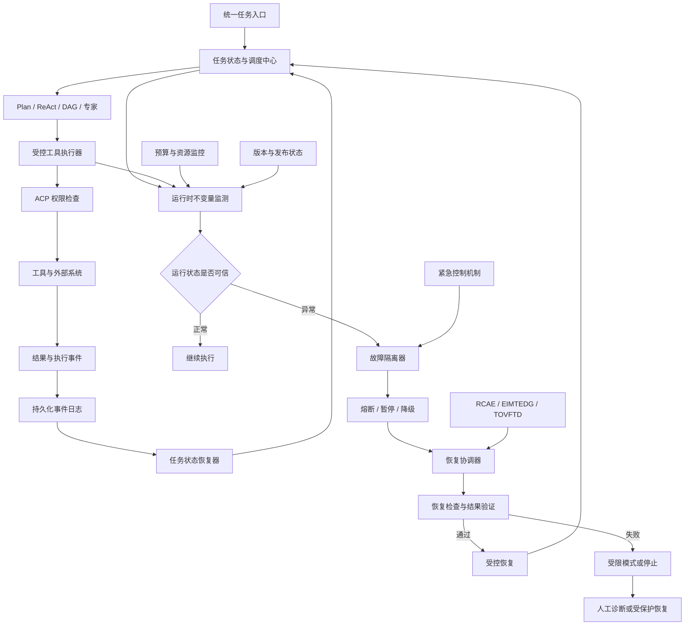
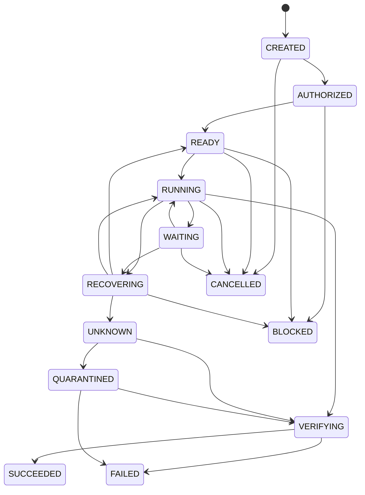
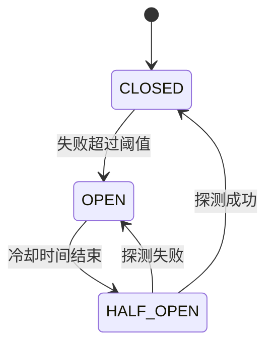
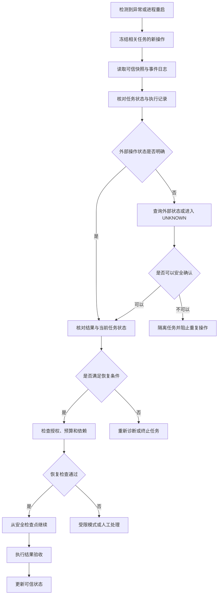

# 问答 129

> 来源: 新 窗口 | 会话: 分支 · 分支 · 分支 · 设计自进化智能体
> 消息: af1db3cf-b297-4a00-9fa7-0e597a81a841 | 时间(UTC): 2026-10-24 12:11

## 用户

继续

## ChatGPT

<WritingBlock id="58317" variant="document"># EvoAgent 第六十五专项：运行时不变量、故障隔离与安全恢复架构

**专项编号：RIFISRA**

**英文名称：Runtime Invariants, Fault Isolation & Safe Recovery Architecture**

**文档版本：V1.0**

**文档性质：全量架构专项设计**

**适用范围：EvoAgent 统一任务入口、多层路由、共享通用内核、领域专家、Plan、ReAct、DAG、TCRDCF、TOVFTD、EIMTEDG、RCAE、UEEDA、EOACA、SECIASRG、AADBVEC，以及 Android、Windows 10/11、mini Linux 本地运行环境。**

**核心目标：保证 EvoAgent 在任务调度异常、工具故障、模型不可用、记忆损坏、日志中断、权限控制异常、进化发布失败、设备断联及资源耗尽等情况下，能够识别自身运行状态、隔离故障、保护关键数据、停止不安全操作，并在满足验证条件后安全恢复。**

本文定义目标架构、状态模型、故障处理机制、工程接口和验收标准，不代表相关模块已经实现。

---

# 一、为什么权限控制完成后，还需要系统级故障治理？

第六十四专项 AADBVEC 解决的是：智能体能做什么，哪些操作需要授权，以及如何防止它突破权限边界。

但权限正确，并不代表系统运行可靠。

假设 EvoAgent 正在执行一个包含十个步骤的工作流：

1. 读取项目文件；
2. 分析代码；
3. 生成修改方案；
4. 修改代码；
5. 安装必要依赖；
6. 运行测试；
7. 检查测试结果；
8. 修复失败项；
9. 验收结果；
10. 保存最终交付物。

每一步都通过了权限检查，但执行过程中仍可能发生以下问题：

- 任务调度器重复提交第六步；
- 工具调用超时，但实际操作已经成功；
- 日志系统停止写入，任务仍然继续；
- 模型服务中断，ReAct 循环不断重试；
- 记忆系统返回旧版本的任务状态；
- 进化控制器误将候选版本切换为稳定版本；
- 设备断联后，手机与主机分别认为自己拥有任务执行权；
- 自动回滚成功恢复了代码，却没有恢复被修改的数据；
- 进程崩溃后，系统无法判断某项外部操作是否已经完成。

这些问题不是简单增加重试次数就能解决的。

事实上，**在状态不明确时盲目重试，可能把一次故障变成重复操作、数据损坏或连锁故障。**

因此，第六十五专项要建立的是系统运行时的可靠性基础设施。

它必须回答：

1. 系统如何判断自己是否处于可信状态？
2. 关键运行规则如何持续得到检查？
3. 一个专家发生故障，为什么不应该拖垮其他专家？
4. 一个工具失效，为什么不应该无限消耗预算？
5. 任务中断后，如何判断从哪里恢复？
6. 外部操作结果不明确时，如何避免重复执行？
7. 日志、记忆、权限和调度模块自身发生故障时，谁负责停止危险操作？
8. 手机与主机断联后，如何避免重复执行和状态冲突？
9. 如果自动恢复失败，系统应该如何降级？
10. 如何证明恢复机制本身没有引入新的风险？

本专项的核心不是让系统永远不发生故障，而是让故障具有明确边界、可观察状态和可控后果。

---

# 二、第一性原理：可靠性来自可验证的不变量，而不是更多重试

一个自主智能体会持续改变计划、调用工具、委派任务和更新自身状态。

如果每个模块都按照自己的理解处理异常，系统就很容易出现状态冲突。

例如：

- ReAct 认为任务正在执行；
- DAG 调度器认为任务已经失败；
- 日志系统记录任务已完成；
- 结果验收器尚未获得结果；
- 进化控制器已经开始总结经验。

这不是单个模块执行错误，而是多个模块对同一事实形成了不同判断。

因此，EvoAgent 必须建立一组跨模块共享的运行时不变量。

## 2.1 核心运行时不变量

| 编号 | 不变量 | 含义 |
|---|---|---|
| I-01 | 权限不变量 | 未获得有效授权的操作不得执行 |
| I-02 | 任务状态不变量 | 任务状态必须符合合法状态迁移规则 |
| I-03 | 执行所有权不变量 | 同一任务的互斥操作不能被多个执行者同时提交 |
| I-04 | 副作用不变量 | 不确定外部操作是否完成时，不得盲目重复执行 |
| I-05 | 验收不变量 | 任务完成必须满足相应的结果验收条件 |
| I-06 | 预算不变量 | 任务不能突破规定的时间、调用次数和成本预算 |
| I-07 | 版本不变量 | 正式执行只能使用符合发布策略的有效版本 |
| I-08 | 证据不变量 | 关键状态变化必须有足够的可追溯记录 |
| I-09 | 故障隔离不变量 | 单个组件故障不能无条件扩散到整个系统 |
| I-10 | 恢复不变量 | 恢复操作不能绕过权限检查、验收条件和预算限制 |
| I-11 | 数据一致性不变量 | 关键持久化状态必须具有明确的版本与恢复规则 |
| I-12 | 受控降级不变量 | 无法确认系统状态时，必须停止相关不安全操作或进入受限模式 |

这些不变量不是十二个独立的提示词要求。

它们需要落实到任务状态机、执行器、持久化机制、权限控制、预算管理和恢复流程中。

## 2.2 三种不同的可靠性目标

建议区分以下三个层次。

**第一层：不发生非法状态迁移。**

例如，未经验收的任务不能直接进入成功状态。

**第二层：故障不会无限扩散。**

例如，代码专家反复失败，不应该导致所有专家都无法使用。

**第三层：恢复不会制造新的损失。**

例如，恢复一个中断的任务，不应该重复提交已经成功的外部操作。

这三个层次共同决定系统是否具备可靠的运行时治理能力。

---

# 三、总体架构：运行时可靠性控制平面

建议新增 `Runtime Reliability Control Plane`，简称 RRCP。

RRCP 是系统运行时的可靠性控制体系，负责监测关键不变量、管理故障域、控制重试、协调恢复和验证恢复结果。

它与 AADBVEC 的 ACP 权限控制平面相互协作，但职责不同。

- ACP 判断操作是否被允许。
- RRCP 判断当前运行状态是否允许继续操作，以及发生故障后如何恢复。
- SECIASRG 判断系统变更是否具有发布资格。
- TOVFTD 判断具体任务的交付结果是否满足验收要求。

四者不能相互替代。

## 3.1 总体架构图



## 3.2 本地优先，不拆成大量服务

EvoAgent 是个人使用系统，运行环境可能是：

- Android 手机；
- Windows 10/11 电脑；
- mini Linux 主机。

因此，RRCP 应首先实现为本地程序中的逻辑模块，而不是新增一组必须持续联网的服务器。

建议共享以下基础设施：

- 统一任务 ID；
- 任务状态存储；
- 事件日志；
- 执行预算；
- 故障状态记录；
- 版本清单；
- 恢复检查器；
- 运行时指标。

对于重要的任务调度、外部副作用和受保护控制，可以逐步引入独立进程或操作系统级隔离。

**逻辑模块划分不等于物理部署划分。**

---

# 四、建立统一任务状态机

任务状态不应该由模型自由生成，也不能只存在于对话上下文中。

它必须是具有明确迁移规则的持久化状态。

## 4.1 推荐任务状态

| 状态 | 含义 |
|---|---|
| `CREATED` | 任务已创建 |
| `AUTHORIZED` | 任务及所需权限已经检查 |
| `READY` | 已具备执行条件 |
| `RUNNING` | 正在执行 |
| `WAITING` | 等待模型、工具、用户或外部系统 |
| `RECOVERING` | 正在执行恢复流程 |
| `VERIFYING` | 正在检查结果 |
| `SUCCEEDED` | 已通过任务验收 |
| `FAILED` | 任务无法完成 |
| `CANCELLED` | 任务被取消 |
| `BLOCKED` | 因权限、依赖或安全条件无法继续 |
| `UNKNOWN` | 关键执行状态无法确定 |
| `QUARANTINED` | 任务进入隔离状态，等待检查 |

其中，`UNKNOWN` 和 `QUARANTINED` 非常重要。

如果工具调用超时，而外部系统没有提供可靠的执行状态查询接口，系统就可能无法确定操作是否已经完成。

此时不能把任务直接标记为失败并重新执行。

应该进入 `UNKNOWN`，随后根据操作的可查询性、幂等性和副作用风险决定下一步。

如果发现任务状态、执行事件和持久化记录相互矛盾，则应将其置于 `QUARANTINED`，直到状态得到核实。

## 4.2 合法状态迁移



这只是建议的状态模型。

正式实现时，需要补充每条迁移的前置条件、并发规则和异常处理。

例如：

- `RUNNING → SUCCEEDED` 不应是任意模块可以直接执行的迁移；
- `UNKNOWN → RUNNING` 必须先确认之前的操作不会被重复提交；
- `CANCELLED` 不意味着已经完成的外部副作用自动消失；
- `BLOCKED` 不应在授权条件没有变化时自动恢复。

## 4.3 状态迁移必须经过统一接口

建议提供统一方法：

```python
transition_task(
    task_id=task_id,
    expected_state="RUNNING",
    new_state="VERIFYING",
    event_id=event_id,
    reason="execution_finished",
)
```

上面的代码只是接口示例。

核心要求是：状态更新必须验证原状态、迁移规则和事件关联关系。

不能让专家通过直接修改数据库字段，将任务从 `RUNNING` 改成 `SUCCEEDED`。

对于需要并发控制的存储，应使用事务、版本检查或等效机制，避免两个执行者同时修改同一状态。

---

# 五、建立统一事件日志与持久化恢复机制

任务状态机解决的是“当前状态是什么”。

事件日志解决的是“系统为什么进入当前状态，以及此前发生过什么”。

两者应相互配合。

## 5.1 关键事件必须可追溯

建议统一记录以下事件：

- 任务创建；
- 授权检查；
- 任务启动；
- 计划更新；
- 工具调用开始；
- 工具调用结束；
- 工具超时；
- 重试请求；
- 外部副作用确认；
- 状态迁移；
- 预算消耗；
- 故障检测；
- 熔断触发；
- 恢复开始；
- 恢复结果；
- 任务验收；
- 发布状态变化；
- 回滚；
- 紧急停止。

每个事件至少包含：

| 字段 | 含义 |
|---|---|
| `event_id` | 事件唯一标识 |
| `task_id` | 所属任务 |
| `execution_id` | 本次执行实例 |
| `event_type` | 事件类型 |
| `component_id` | 产生事件的组件 |
| `sequence` | 任务内或日志流内的顺序标识 |
| `timestamp` | 事件时间 |
| `state_version` | 关联状态版本 |
| `payload_ref` | 必要的事件内容引用 |
| `correlation_id` | 关联请求或调用 |
| `integrity_metadata` | 必要的完整性检查信息 |

不要把所有模型上下文和文件内容都复制进事件日志。

应优先保存必要的结构化数据、结果引用和校验信息，避免个人使用环境的存储持续膨胀。

## 5.2 采用事件记录与状态快照相结合的方式

只保存事件会导致恢复时需要重放大量历史记录。

只保存当前状态又无法可靠追溯中间发生的操作。

因此建议采用：

**事件日志 + 定期状态快照 + 可验证的外部操作记录。**

恢复时：

1. 读取最近一个可信快照；
2. 检查快照版本和完整性；
3. 找到其后的事件；
4. 按合法顺序重建任务状态；
5. 检查未完成的工具调用；
6. 检查外部副作用是否已发生；
7. 识别无法确定的状态；
8. 决定继续、恢复、隔离或终止。

事件日志不是绝对真相。

如果工具事件显示操作已经提交，但外部服务没有可靠的确认信息，系统仍然需要核实真实状态。

## 5.3 关键状态必须先持久化，再执行高风险动作

对于可能产生重要外部副作用的操作，建议采用以下流程：

1. 记录准备执行的操作；
2. 持久化操作意图；
3. 检查授权与预算；
4. 记录操作进入提交阶段；
5. 执行外部操作；
6. 获取执行结果或查询外部状态；
7. 持久化确认结果；
8. 进入下一步。

如果进程在第 5 步崩溃，恢复程序可以根据记录识别出“操作可能已经执行，但结果尚未确认”的状态。

这比只在操作结束后写日志可靠得多。

不过，本地数据库与远程外部系统通常不共享同一个事务，因此不能仅凭本地记录保证外部操作一定只执行一次。

必须继续结合幂等键、外部状态查询和补偿策略处理。

---

# 六、故障隔离：防止一个模块拖垮整个系统

EvoAgent 的专家架构具有一个重要优势：领域专家可以独立演进。

但如果运行时资源、任务队列和异常处理全部共享，那么一个专家仍可能影响整个系统。

例如：

- 代码专家进入无限重试；
- 漫剧专家占满本地存储；
- 某个工具不断创建子进程；
- 进化评测任务占用全部模型预算；
- 一个失效的记忆服务阻塞所有专家。

因此，建议建立明确的故障域。

## 6.1 故障域划分

| 故障域 | 主要对象 | 默认隔离策略 |
|---|---|---|
| 任务级 | 单个任务、计划或 DAG | 取消、重试、恢复或隔离单个任务 |
| 工具级 | 某个工具实例或外部接口 | 超时、熔断、限流、切换替代工具 |
| 专家级 | 代码、旅游、漫剧等领域专家 | 暂停该专家的新任务，保留其他专家 |
| 共享能力级 | 上下文、路由、记忆、通用内核 | 扩大影响分析，必要时限制多个专家 |
| 进化级 | 评测、候选版本、自动发布 | 暂停进化，不影响已验证的稳定执行能力 |
| 控制级 | ACP、RRCP、状态存储、关键策略 | 进入受限模式，停止依赖失效控制的危险操作 |
| 设备级 | Android、Windows、mini Linux | 根据设备状态暂停相关任务并保留恢复信息 |

## 6.2 故障不能自动跨越隔离边界

例如，代码专家发生异常。

合理的处理方式是：

1. 停止该专家的新任务分配；
2. 检查其当前运行任务；
3. 对可安全恢复的任务进行恢复；
4. 对状态不明确的任务进行隔离；
5. 继续允许旅游专家或文档专家执行不依赖该故障域的任务；
6. 在代码专家通过健康检查后重新开放。

但如果代码专家故障的原因是共享权限模块失效，就不能只暂停代码专家。

此时必须扩大隔离范围，因为其他专家也可能受到影响。

因此，故障隔离的范围应由依赖关系和实际故障位置决定，而不是固定按专家名称划分。

## 6.3 进化轨道必须与稳定执行轨道隔离

这是 EvoAgent 的核心架构要求之一。

建议明确区分：

**稳定执行轨道**

- 执行用户任务；
- 使用已验证的能力版本；
- 管理当前任务状态；
- 提供必要的故障恢复。

**后台进化轨道**

- 分析日志；
- 生成改进候选；
- 运行实验；
- 进行独立评测；
- 准备发布；
- 维护能力资产。

如果后台进化出现死循环、预算耗尽或候选版本错误，不应自动拖垮稳定执行轨道。

两条轨道可以共享存储与资源管理设施，但必须具有独立的任务队列、预算限制、状态和暂停机制。

---

# 七、熔断、超时、重试与降级

重试是一种恢复手段，但不是所有故障都适合重试。

建议将失败分为不同类型，再决定处理策略。

## 7.1 失败类型与默认处理

| 故障类型 | 推荐策略 |
|---|---|
| 暂时性网络错误 | 在预算内进行有限重试 |
| 模型服务暂时不可用 | 等待、切换经过批准的模型或安全暂停 |
| 工具参数错误 | 修正参数后再尝试，避免原样无限重试 |
| 权限拒绝 | 不得通过增加重试次数解决 |
| 工具接口不兼容 | 停止调用并进行兼容性检查 |
| 结果验收失败 | 进入诊断与修复流程，受任务预算约束 |
| 外部操作结果不明确 | 先核实状态，不得盲目重复提交 |
| 资源耗尽 | 降低并发、暂停非必要任务或停止任务 |
| 状态存储异常 | 停止依赖不可信状态的操作 |
| 控制平面异常 | 进入受限模式或停止相关自动执行 |

## 7.2 超时必须覆盖整个执行链

只设置模型调用超时是不够的。

建议至少定义：

- 单次模型调用超时；
- 单次工具调用超时；
- 单个计划节点超时；
- 单个任务总时限；
- 专家级并发上限；
- 任务队列等待上限；
- 后台进化任务总时限；
- 恢复操作时限。

这些限制应根据任务类型配置。

例如，漫剧生成可能需要较长时间等待外部视频服务，而普通文件查询通常不应该长时间占用执行资源。

## 7.3 建立有限重试与指数退避

对于适合重试的暂时性故障，可以使用逐步增加等待时间的策略。

例如：

```text
第 1 次失败：等待 1 秒
第 2 次失败：等待 2 秒
第 3 次失败：等待 4 秒
超过上限：停止并进入诊断
```

这只是示例，不是所有工具的固定配置。

实际策略应当考虑：

- 错误类型；
- 服务方的限流要求；
- `Retry-After` 等服务端提示；
- 剩余任务预算；
- 操作是否幂等；
- 外部操作是否可能已经完成。

## 7.4 熔断器的状态模型

建议为频繁失败的工具或服务建立熔断器。



- `CLOSED`：正常调用；
- `OPEN`：暂时阻止新调用；
- `HALF_OPEN`：允许少量探测请求。

熔断器必须按故障域配置。

某个视频生成服务熔断，不应导致所有本地文件工具都被禁止使用。

同样，权限拒绝不是普通的服务失败，不能通过熔断器自动重试来绕过。

## 7.5 降级必须保留任务目标与安全约束

如果高成本模型不可用，可以切换到经过验证的低成本模型。

如果在线检索不可用，可以使用本地已有资料，并明确标记信息可能过期。

如果某个专家不可用，可以回退到通用内核，但必须确认通用内核具备完成该任务所需的能力。

降级不能成为隐瞒失败的手段。

系统应明确告知用户：

- 哪项能力不可用；
- 使用了什么替代方案；
- 哪些结果仍然可靠；
- 哪些部分需要重新验证。

---

# 八、外部副作用与幂等执行：防止重复操作

这是任务恢复中最容易被忽略、但实际影响很大的问题。

假设 EvoAgent 正在提交一个外部请求：

1. 请求已经发送；
2. 外部服务已经处理；
3. 返回结果途中网络断开；
4. 本地执行器认为请求失败；
5. 恢复流程重新提交同一个请求。

如果外部操作不支持幂等，可能导致重复订单、重复消息或重复数据。

因此，必须区分：

**执行失败**与**执行结果未知**。

## 8.1 为重要操作建立操作记录

建议使用 `OperationRecord`。

核心字段包括：

- `operation_id`；
- `task_id`；
- `idempotency_key`；
- `action_type`；
- `target_resource`；
- `authorization_ref`；
- `execution_status`；
- `request_ref`；
- `external_reference`；
- `attempt_count`；
- `started_at`；
- `last_checked_at`；
- `result_ref`；
- `compensation_status`。

操作状态可以包括：

- `PREPARED`：已准备；
- `SUBMITTED`：已提交或已尝试提交；
- `CONFIRMED`：已经确认完成；
- `FAILED_CONFIRMED`：已确认失败；
- `UNKNOWN`：结果未知；
- `COMPENSATION_PENDING`：等待补偿；
- `COMPENSATED`：补偿已完成。

## 8.2 优先使用外部系统支持的幂等机制

如果外部 API 支持幂等键，应为同一逻辑操作生成稳定的幂等标识。

重试时使用同一个标识，而不是每次创建一个新的操作。

如果外部系统不支持幂等，则应优先查询外部状态，确认之前的操作是否已经发生。

如果既不能保证幂等，也无法查询执行状态，就必须将重复执行风险显式标记出来。

对于高风险操作，应暂停并请求进一步确认，而不是假设重试一定安全。

## 8.3 可补偿操作与不可补偿操作

建议为工作流中的重要动作声明：

- 是否具有外部副作用；
- 是否幂等；
- 是否可逆；
- 是否支持状态查询；
- 是否存在补偿操作；
- 是否允许自动重试。

例如：

| 操作 | 典型恢复方式 |
|---|---|
| 读取文件 | 通常可以直接重试 |
| 在隔离目录生成文件 | 检查文件状态后继续 |
| 修改项目文件 | 使用版本控制或备份恢复 |
| 创建数据库记录 | 使用幂等键或唯一约束 |
| 发送外部消息 | 查询发送状态；无法确认时避免盲目重发 |
| 提交外部订单 | 查询订单状态；必要时进入人工确认 |
| 发布能力版本 | 检查实际激活版本后再决定恢复 |

某些外部副作用无法真正撤销。

因此，系统必须允许任务进入“部分完成、需要补偿或人工处理”的状态，而不是强行将所有任务恢复为完整成功或完整失败。

---

# 九、恢复协调器：决定从哪里恢复，而不是简单重新开始

建议新增 `RecoveryCoordinator`。

它负责综合任务状态、事件日志、权限、预算、工具状态和结果验收信息，决定故障发生后应采取什么行动。

## 9.1 恢复决策流程



## 9.2 检查点必须对应真实可恢复状态

不能只保存模型的思考摘要，就认为任务可以恢复。

一个有效检查点至少需要：

- 当前任务 ID；
- 当前计划或 DAG 版本；
- 已完成的节点；
- 尚未完成的节点；
- 当前版本与配置；
- 已使用的预算；
- 已提交的外部操作；
- 关键结果引用；
- 当前授权状态引用；
- 恢复所需的输入与依赖。

如果检查点中的某些状态无法验证，恢复程序应将其标记为不可信，而不是直接继续。

## 9.3 恢复必须重新检查权限和预算

任务在崩溃前获得的授权可能已经被撤销或过期。

任务预算也可能已经消耗到上限。

因此，恢复不能无条件沿用旧授权。

恢复前必须重新检查：

- 当前用户策略；
- 当前任务权限；
- 授权是否有效；
- 工具版本是否兼容；
- 预算是否充足；
- 任务是否已被取消；
- 当前是否处于受限模式；
- 是否有其他执行者正在处理同一任务。

## 9.4 恢复失败后必须允许终止

不是所有任务都能自动恢复。

如果关键状态丢失、外部副作用无法确认，或恢复可能导致更大损失，系统应进入隔离或终止状态。

**安全失败优于不可靠地继续执行。**

---

# 十、稳定执行与后台进化的故障隔离

EvoAgent 的核心策略是稳定执行与后台进化分离。

本专项需要进一步把这种分离落实到运行时资源和状态管理中。

## 10.1 资源隔离

建议至少为以下资源设置独立配额：

- 稳定执行的模型调用预算；
- 后台评测预算；
- 候选版本运行预算；
- 专家级并发数；
- 工具调用并发数；
- 临时存储；
- 日志与事件存储；
- 本地 CPU 和内存；
- 后台进化任务时限。

后台进化不能因为不断运行实验，就耗尽稳定执行所需的全部资源。

对于个人设备，建议优先使用可配置的资源配额和并发限制，而不是一开始就引入复杂的容器集群。

## 10.2 版本隔离

稳定执行轨道应当使用已验证的稳定版本。

候选版本必须在独立工作区或独立运行上下文中测试。

候选版本不能直接覆盖正在使用的稳定版本文件。

正式切换时，应通过受控的版本激活机制完成。

如果激活失败，系统应能够识别当前实际运行版本，而不是仅根据配置文件中的期望版本判断。

## 10.3 故障时优先保护稳定执行

如果后台进化模块发生异常：

1. 暂停新的进化任务；
2. 停止消耗过量资源的实验；
3. 保留已有实验记录；
4. 检查是否有未完成的候选版本发布；
5. 确保稳定执行轨道继续使用可信版本；
6. 待进化模块通过健康检查后再恢复。

如果故障涉及共享内核或权限控制，则必须重新评估稳定执行是否也受到影响。

不能为了保持用户体验而继续运行已失去可信控制条件的任务。

---

# 十一、断联、双重执行与多设备状态一致性

EvoAgent 以 Android 为优先入口，同时保留 Windows 和 mini Linux 的扩展路径。

未来可能出现手机离线、主机离线、两者同时执行任务或重连后同步状态冲突的情况。

这不是简单的日志上传问题，而是任务执行权与状态一致性问题。

## 11.1 首先明确任务执行权

每个任务应明确：

- 任务创建位置；
- 当前执行者；
- 执行版本；
- 当前任务状态；
- 最后一个可信事件；
- 是否允许迁移到其他设备；
- 是否允许多个设备并行执行。

默认情况下，同一个具有外部副作用的任务不应在两个设备上同时执行。

## 11.2 采用执行租约与 fencing token

对于确实需要跨设备协调的任务，可以引入执行租约。

执行租约定义：

- 当前执行者；
- 租约有效期；
- 任务版本；
- 最近续租时间。

同时使用递增的 `fencing_token`，用于标识当前有效的执行所有权世代。

当任务重新分配给新的执行者时，旧执行者的令牌应失效。

对于支持该机制的受控执行接口，可以拒绝来自旧令牌的后续写操作。

但要注意：

**租约和 fencing token 只有在实际操作路径能够验证它们时才有效。**

如果某个旧设备可以绕过受控执行接口，直接向外部系统提交操作，单纯在本地记录租约并不能阻止重复副作用。

对于不支持 fencing 的外部系统，应通过幂等键、唯一操作 ID、外部状态查询和安全暂停等方式降低风险。

## 11.3 离线期间的处理规则

可以按操作类型区分：

- 本地只读任务：满足本地权限条件时可以继续；
- 不产生外部副作用的本地任务：在资源和预算允许时可以继续；
- 需要远程模型的任务：等待连接或切换到已批准的离线模式；
- 具有重要外部副作用的任务：根据现有授权、网络状态和执行所有权决定是否允许；
- 依赖远程状态确认的操作：无法确认时不得盲目重复提交；
- 权限状态无法验证的操作：进入受限模式。

离线不意味着必须停止所有任务，但也不意味着可以忽略授权、执行所有权和副作用风险。

## 11.4 重连后的状态合并

建议重连后执行：

1. 交换任务 ID 和最后确认的事件序号；
2. 检查双方的执行版本；
3. 检查任务执行权和租约；
4. 对比事件日志；
5. 识别重复事件和缺失事件；
6. 查询外部副作用状态；
7. 对冲突任务进行隔离；
8. 在状态确认后再恢复同步。

不能简单采用“时间戳更新的一方获胜”。

不同设备的时钟可能不一致，而且较新的记录也不一定代表操作真的成功。

对于重要操作，必须依据执行记录、操作 ID、外部确认信息和有效执行权综合判断。

---

# 十二、运行时健康检查与可信状态判断

RRCP 需要知道系统当前是否能够安全执行任务。

建议建立 `RuntimeHealthMonitor`。

## 12.1 健康检查对象

至少覆盖：

- 任务调度器；
- 任务状态存储；
- 事件日志；
- ACP 权限控制；
- 工具执行器；
- 模型调用适配器；
- 记忆存储；
- 版本管理；
- 预算管理；
- 恢复协调器；
- 稳定执行轨道；
- 后台进化轨道。

## 12.2 三种健康状态

| 状态 | 含义 | 允许的行为 |
|---|---|---|
| `HEALTHY` | 关键依赖正常，必要状态可验证 | 按授权策略正常执行 |
| `DEGRADED` | 部分能力不可用，但仍可安全运行有限任务 | 降级运行、限制任务范围 |
| `UNTRUSTED` | 关键状态或控制条件无法确认 | 停止依赖不可信条件的操作 |

例如，远程模型不可用，但本地文件读取、权限检查和状态存储正常，系统可能进入 `DEGRADED`，仍然能够执行部分本地任务。

如果 ACP 的授权状态无法验证，则系统不能因为模型仍然可用就继续执行所有操作。

健康状态应按故障域分别维护，同时提供系统级健康判断。

不能仅用一个简单的“服务在线”状态代表整个系统安全可用。

---

# 十三、故障恢复与 RCAE、EIMTEDG、TOVFTD 的协作

恢复机制不能只把任务重新启动。

它还需要知道故障原因、恢复后结果是否可信，以及此前留下的错误状态是否会继续影响未来任务。

## 13.1 与 RCAE 协作

RRCP 负责：

- 检测故障；
- 限制故障扩散；
- 暂停危险操作；
- 保存故障现场；
- 选择安全恢复方式。

RCAE 负责：

- 分析故障原因；
- 区分直接原因与根本原因；
- 生成修复建议；
- 识别是否需要修改工具、配置或工作流。

RCAE 的诊断结论不能直接覆盖 RRCP 的状态判断。

## 13.2 与 EIMTEDG 协作

需要检查：

- 故障期间产生的记忆是否可信；
- 候选版本是否写入错误经验；
- 是否存在重复或冲突的任务记录；
- 是否需要撤销某些自动沉淀的经验；
- 是否需要标记受影响的能力资产。

恢复任务不能自动把所有执行结果都当作有效经验。

## 13.3 与 TOVFTD 协作

恢复完成不代表任务成功。

恢复后必须重新检查：

- 目标是否实现；
- 输出是否完整；
- 外部副作用是否符合预期；
- 是否存在部分完成；
- 是否满足最终验收标准。

如果恢复后只完成了部分步骤，应准确记录部分完成状态，而不是为了闭环完整而强行标记成功。

## 13.4 与 SECIASRG 协作

如果故障与候选版本有关，应：

1. 停止扩大候选版本的使用范围；
2. 保存故障证据；
3. 根据风险决定回滚；
4. 检查候选版本的影响范围；
5. 重新评估相关变更；
6. 必要时撤销候选版本产生的能力资产；
7. 在问题解决前限制该版本重新发布。

---

# 十四、工程目录与核心接口

建议新增以下逻辑模块：

```text
evoagent/
├── runtime_reliability/
│   ├── invariant_registry/
│   ├── invariant_monitor/
│   ├── task_state_machine/
│   ├── execution_ownership/
│   ├── event_journal/
│   ├── checkpoint_manager/
│   ├── runtime_health_monitor/
│   ├── fault_domain_registry/
│   ├── fault_isolation/
│   ├── circuit_breaker/
│   ├── timeout_manager/
│   ├── retry_policy/
│   ├── degradation_controller/
│   ├── recovery_coordinator/
│   ├── recovery_verifier/
│   ├── resource_budget_guard/
│   └── emergency_recovery/
├── operation_safety/
│   ├── operation_registry/
│   ├── idempotency_manager/
│   ├── side_effect_tracker/
│   ├── external_status_reconciler/
│   ├── compensation_manager/
│   └── uncertain_operation_handler/
├── multi_device_consistency/
│   ├── execution_lease/
│   ├── fencing_token/
│   ├── offline_queue/
│   ├── event_reconciliation/
│   ├── task_ownership_transfer/
│   └── conflict_quarantine/
├── persistence_recovery/
│   ├── durable_event_store/
│   ├── snapshot_manager/
│   ├── integrity_checker/
│   ├── journal_replay/
│   ├── schema_compatibility/
│   └── recovery_manifest/
└── runtime_reliability_tests/
    ├── state_transition_tests/
    ├── crash_recovery_tests/
    ├── fault_isolation_tests/
    ├── timeout_and_retry_tests/
    ├── idempotency_tests/
    ├── event_replay_tests/
    ├── storage_corruption_tests/
    ├── resource_exhaustion_tests/
    ├── split_brain_tests/
    ├── recovery_failure_tests/
    └── fault_injection_tests/
```

建议提供以下核心接口：

- `check_runtime_invariants`：检查运行时不变量；
- `transition_task`：执行合法任务状态迁移；
- `append_durable_event`：持久化关键事件；
- `capture_task_checkpoint`：保存任务检查点；
- `reconstruct_task_state`：从可信记录重建任务状态；
- `verify_execution_ownership`：检查任务执行所有权；
- `acquire_execution_lease`：获取执行租约；
- `validate_fencing_token`：验证执行令牌；
- `register_operation`：登记外部操作；
- `check_idempotency`：检查操作是否可以安全重试；
- `reconcile_external_operation`：核对外部操作状态；
- `classify_runtime_failure`：识别故障类型；
- `open_circuit_breaker`：打开熔断器；
- `evaluate_retry_policy`：判断是否允许重试；
- `enforce_execution_timeout`：执行超时控制；
- `enforce_resource_budget`：检查资源预算；
- `isolate_fault_domain`：隔离故障域；
- `enter_degraded_mode`：进入降级模式；
- `enter_untrusted_mode`：进入不可信状态；
- `start_recovery`：启动恢复流程；
- `verify_recovery_preconditions`：检查恢复前置条件；
- `resume_from_checkpoint`：从检查点恢复；
- `quarantine_uncertain_operation`：隔离结果不明的操作；
- `run_recovery_health_check`：检查恢复后的系统状态；
- `reconcile_device_events`：核对多设备事件；
- `verify_stable_runtime_version`：检查实际运行版本；
- `record_compensation_result`：记录补偿操作结果；
- `generate_runtime_incident_report`：生成故障报告；
- `validate_recovery_completion`：验证恢复是否完成。

这些接口必须与 ACP、SECIASRG 和 TOVFTD 协作。

尤其要避免一种设计错误：恢复协调器为了尽快恢复任务，直接绕过原来的权限检查、版本检查或预算检查。

---

# 十五、端到端验收场景

建议至少建立以下十二个场景。

## 场景 A：任务执行过程中进程崩溃

**初始条件：** Windows 上的 EvoAgent 在任务执行中途异常退出。

**验收过程：**

1. 重启后读取可信快照；
2. 重放必要的持久化事件；
3. 检查未完成的操作；
4. 核对当前任务状态；
5. 检查授权与预算；
6. 从安全检查点继续，或进入隔离状态。

**验收重点：** 恢复不能简单地从任务第一步重新执行。

## 场景 B：工具超时，但外部操作可能已经成功

**初始条件：** 外部服务已经处理请求，但本地没有收到响应。

**验收过程：**

1. 将操作状态标记为 `UNKNOWN`；
2. 检查是否存在幂等键；
3. 尝试查询外部状态；
4. 确认操作结果；
5. 只有在能够安全重试时才重新提交。

**验收重点：** 不确定的操作结果不能被直接等同于执行失败。

## 场景 C：一个专家进入无限重试

**初始条件：** 代码专家反复调用失败的工具。

**验收过程：**

1. 识别连续失败；
2. 检查剩余预算；
3. 触发重试上限；
4. 打开对应工具或专家的熔断器；
5. 暂停相关任务；
6. 保持其他独立专家正常运行。

**验收重点：** 一个专家不能耗尽整个系统的资源。

## 场景 D：日志系统无法写入

**初始条件：** 本地存储空间不足，事件日志写入失败。

**验收过程：**

1. 检测关键事件持久化失败；
2. 阻止新的重要外部副作用；
3. 尝试安全释放可清理空间；
4. 保留必要的诊断信息；
5. 进入受限模式；
6. 恢复日志能力后进行一致性检查。

**验收重点：** 关键记录无法持久化时，系统不能无条件继续高风险执行。

## 场景 E：记忆数据库损坏

**初始条件：** 记忆存储无法通过完整性检查。

**验收过程：**

1. 隔离受影响的记忆存储；
2. 阻止使用不可信记录进行重要决策；
3. 从可信快照恢复；
4. 重新验证关键记忆；
5. 检查相关专家的能力资产；
6. 恢复正常检索。

**验收重点：** 记忆系统损坏不能导致错误经验继续传播。

## 场景 F：恢复时授权已经撤销

**初始条件：** 任务崩溃后，用户撤销了原有文件访问授权。

**验收过程：**

1. 读取任务检查点；
2. 重新检查当前授权；
3. 发现授权已经撤销；
4. 禁止相关操作继续执行；
5. 根据情况进入 `BLOCKED`；
6. 保留必要的恢复记录。

**验收重点：** 恢复流程不能无条件继承历史授权。

## 场景 G：后台进化耗尽资源

**初始条件：** 候选版本评测占用了大量模型调用预算和磁盘空间。

**验收过程：**

1. 检测进化轨道资源超限；
2. 暂停新的实验；
3. 停止非必要的候选运行；
4. 保留实验进度和日志；
5. 确认稳定执行轨道仍有可用资源；
6. 通过资源检查后再恢复进化任务。

**验收重点：** 后台进化不能挤占稳定执行的基本资源保障。

## 场景 H：Android 与主机同时执行同一任务

**初始条件：** 手机与 mini Linux 主机在断联期间都尝试恢复同一个具有外部副作用的任务。

**验收过程：**

1. 检查任务执行所有权；
2. 验证租约和执行令牌；
3. 阻止失效执行者提交新的操作；
4. 核对已发生的外部副作用；
5. 合并可信事件；
6. 隔离无法确定的状态。

**验收重点：** 不能仅根据较新的时间戳判断哪个设备拥有任务执行权。

## 场景 I：候选版本发布失败

**初始条件：** 新版本已经开始激活，但进程在切换过程中崩溃。

**验收过程：**

1. 检查实际运行版本；
2. 检查版本激活记录；
3. 判断当前状态是否可信；
4. 恢复到已验证版本，或进入受限模式；
5. 检查持久化状态兼容性；
6. 验证稳定执行轨道恢复正常。

**验收重点：** 不能只看配置文件中的期望版本就判断发布完成。

## 场景 J：恢复协调器本身出现异常

**初始条件：** 恢复过程中，恢复协调器无法读取关键状态。

**验收过程：**

1. 停止自动恢复流程；
2. 禁止继续执行依赖不可信状态的操作；
3. 保留当前检查点和事件日志；
4. 进入受限模式；
5. 使用独立健康检查机制判断是否可以恢复；
6. 无法验证时，等待受保护的人工处理。

**验收重点：** 恢复失败不能引发无穷恢复循环。

## 场景 K：取消任务时存在正在执行的外部操作

**初始条件：** 用户取消任务，但一个外部请求正在处理中。

**验收过程：**

1. 停止发起新的相关操作；
2. 检查当前操作是否可安全中断；
3. 查询外部执行状态；
4. 记录已经发生的副作用；
5. 对必要的补偿操作重新检查授权；
6. 进入明确的取消或部分完成状态。

**验收重点：** 任务取消不代表所有外部操作都自动停止。

## 场景 L：资源耗尽导致任务无法继续

**初始条件：** 本地磁盘或内存达到预设上限。

**验收过程：**

1. 检测资源异常；
2. 停止新的高资源消耗任务；
3. 保护必要的状态与审计数据；
4. 暂停或终止非必要任务；
5. 检查资源恢复情况；
6. 在满足条件后恢复有限执行。

**验收重点：** 资源耗尽时，系统应优先保留恢复所需的数据，而不是继续扩大故障。

---

# 十六、专项验收标准

RIFISRA 至少需要满足以下要求：

1. 能够定义并检查关键运行时不变量。
2. 所有重要任务状态迁移都具有明确的合法条件。
3. 任务状态不能由模型直接任意修改。
4. 关键状态变化具有持久化事件记录。
5. 能够通过可信快照和事件日志恢复任务状态。
6. 能够识别外部操作结果未知的情况。
7. 能够避免对结果不明的非幂等操作进行盲目重试。
8. 能够限制单任务、单专家和后台进化的资源消耗。
9. 能够为频繁失败的工具或服务建立熔断机制。
10. 能够将故障限制在合理的故障域内。
11. 能够在共享能力故障时扩大隔离范围。
12. 能够区分正常、降级和不可信运行状态。
13. 能够在关键控制模块异常时进入受限模式。
14. 能够在恢复前重新检查权限、预算和依赖。
15. 能够在恢复后重新执行必要的结果验收。
16. 能够处理部分完成和无法补偿的外部副作用。
17. 能够将稳定执行轨道与后台进化轨道进行资源和版本隔离。
18. 能够检查实际运行版本与预期版本是否一致。
19. 能够在设备断联后识别重复执行和状态冲突。
20. 能够对多设备任务执行权实施明确控制。
21. 能够在事件日志写入失败时限制高风险操作。
22. 能够在记忆存储损坏时隔离不可信记录。
23. 能够防止恢复协调器进入无限重试或恢复循环。
24. 能够在自动恢复失败时安全停止。
25. 能够记录故障发生、隔离、恢复与验证的完整过程。
26. 能够通过故障注入测试验证进程崩溃后的恢复行为。
27. 能够通过测试验证幂等机制和副作用核对。
28. 能够通过测试验证熔断、超时和预算限制。
29. 能够通过测试验证 Android 与主机断联后的状态协调。
30. 能够在 Windows、Android 和 mini Linux 上采用相应的平台适配策略。
31. 能够避免为了恢复任务而绕过 ACP 权限控制。
32. 能够避免将未经验证的恢复结果直接沉淀为可信经验。
33. 能够将运行时故障反馈至 RCAE、EIMTEDG、TOVFTD 和 SECIASRG。
34. 能够在恢复后明确区分成功、失败、部分完成和状态未知。
35. 能够通过端到端故障注入与恢复测试验证整个机制。

以上为目标架构验收要求，不代表相关模块已经实现或通过测试。

---

# 十七、建议冻结的架构决策

以下建议承接 ADR-1156。

| 编号 | 决策 |
|---|---|
| ADR-1157 | 建立运行时不变量、故障隔离与安全恢复体系 RIFISRA |
| ADR-1158 | 关键运行时不变量必须由可执行的控制逻辑和自动化测试保障 |
| ADR-1159 | 任务状态必须通过统一状态机进行受控迁移 |
| ADR-1160 | 任务状态必须与持久化事件记录保持可核对关系 |
| ADR-1161 | 关键事件应采用持久化日志、可信快照和恢复清单相结合的机制 |
| ADR-1162 | 重要外部副作用发生前应持久化必要的操作意图和执行记录 |
| ADR-1163 | 工具调用超时不能自动等同于外部操作失败 |
| ADR-1164 | 无法确认外部操作结果时，应优先核实状态而不是盲目重试 |
| ADR-1165 | 对重要外部操作，应根据实际能力采用幂等键、状态查询和补偿策略 |
| ADR-1166 | 故障应按照任务、工具、专家、共享能力、进化和控制等故障域隔离 |
| ADR-1167 | 单个专家故障不得无条件导致其他独立专家停止运行 |
| ADR-1168 | 共享内核或控制平面故障必须触发更广泛的影响评估 |
| ADR-1169 | 稳定执行轨道与后台进化轨道必须在任务、资源和版本方面进行隔离 |
| ADR-1170 | 模型调用、工具执行、计划节点和完整任务必须具有适当的超时与预算限制 |
| ADR-1171 | 暂时性故障的重试必须受到错误类型、预算和操作幂等性的共同约束 |
| ADR-1172 | 高频失败的工具和服务应采用按故障域配置的熔断机制 |
| ADR-1173 | 降级不得绕过权限、结果验收和资源限制 |
| ADR-1174 | 任务恢复必须基于可验证的检查点、事件和执行记录 |
| ADR-1175 | 恢复前必须重新检查当前授权、预算、版本和任务状态 |
| ADR-1176 | 恢复失败时允许隔离、终止或请求人工处理 |
| ADR-1177 | 任务取消不等于已发生的外部副作用自动撤销 |
| ADR-1178 | 设备断联期间必须明确任务执行所有权和状态同步规则 |
| ADR-1179 | 对多设备任务应采用适当的租约、执行令牌和状态协调机制 |
| ADR-1180 | 多设备状态冲突不能仅依赖时间戳进行解决 |
| ADR-1181 | 关键状态存储、日志和权限控制不可用时，系统必须采取受限运行策略 |
| ADR-1182 | 恢复协调器必须受到独立的超时、预算和失败处理机制约束 |
| ADR-1183 | 运行时健康状态应区分正常、降级和不可信状态 |
| ADR-1184 | 关键恢复结果必须经过独立验证，不能直接视为任务成功 |
| ADR-1185 | 故障期间产生的记忆、经验和能力资产必须经过可信度检查 |
| ADR-1186 | 运行时故障必须能够关联任务、版本、专家、工具和授权记录 |
| ADR-1187 | RIFISRA 必须与 ACP、SECIASRG、RCAE、EIMTEDG 和 TOVFTD 协同 |
| ADR-1188 | 关键故障恢复机制必须通过故障注入、崩溃恢复和状态一致性测试验证 |
| ADR-1189 | RRCP 应采用本地优先的逻辑架构，不要求单独部署服务器 |
| ADR-1190 | 在无法验证系统状态时，安全停止或受限运行优先于强行继续任务 |

以上建议作为 EvoAgent 第六十五专项的架构基线。

---

# 十八、完成第六十五专项后，EvoAgent 具备了什么能力？

如果此前各专项逐步实现并通过验收，EvoAgent 将形成更完整的执行、治理与恢复闭环。

| 层次 | 主要职责 |
|---|---|
| 任务执行层 | Plan、ReAct、DAG、专家和工具 |
| 结果验收层 | TOVFTD |
| 权限控制层 | AADBVEC / ACP |
| 问题诊断层 | RCAE |
| 能力与经验治理层 | EOACA、EIMTEDG |
| 独立评测层 | UEEDA |
| 变更治理层 | SECIASRG |
| 运行时可靠性层 | RIFISRA / RRCP |
| 进化控制层 | AECGSR |
| 设备与资源适配层 | Android、Windows、mini Linux 适配 |

这些层次之间需要共享统一的任务 ID、事件 ID、版本标识、权限记录和证据引用。

但不要求每一层都成为独立服务。

对于个人使用的第一套完整实现，最合理的方式是先构建一个本地优先的模块化单体：

- 一套统一任务状态机；
- 一套持久化事件日志；
- 一套权限控制平面；
- 一套资源和预算管理；
- 一套恢复协调器；
- 一套独立评测与发布机制；
- 多个可插拔的领域专家。

只有当实际负载、隔离需求或设备边界确实要求独立进程时，再将部分模块拆分出去。

这可以避免架构过早复杂化，也能减少个人设备上的运维成本。

---

# 十九、下一专项：端到端可观测性、事件关联与故障诊断数据质量

完成第六十五专项后，仍有一个关键问题值得继续深入。

系统已经能够记录事件、识别故障、隔离问题并尝试恢复。

但当 EvoAgent 运行几个月甚至更长时间后，可能积累大量日志、工具调用记录、任务状态、版本变更和恢复事件。

如果这些数据缺乏统一关联和可信度管理，系统仍然可能无法准确判断：

- 哪个模块最容易造成任务失败？
- 某次退化是模型变化、工具变化还是提示词变化导致的？
- 为什么某个专家的失败率突然上升？
- 某项修复是否真正减少了同类问题？
- 任务失败是因为模型推理、工具缺陷、权限拒绝还是环境异常？
- 哪些错误只是偶发波动，哪些已经形成系统性问题？
- 哪些日志缺失会影响根因分析？
- 如何防止错误日志、重复事件或错误关联误导进化控制器？
- 如何判断某个改进是否真正降低了长期返工率？

这不仅是日志采集问题，而是从原始运行事件到可信诊断结论的数据治理问题。

下一专项建议定义为：

**End-to-End Observability, Event Correlation & Diagnostic Data Quality，简称 EOECDDQ。**

核心研究方向包括：

1. 如何建立统一的任务、调用、事件和版本关联模型；
2. 如何在专家、工具、DAG 节点与跨设备执行之间建立追踪链；
3. 如何区分执行日志、诊断结论和评测结果；
4. 如何检查日志丢失、重复、乱序与不一致；
5. 如何在不保存过量敏感数据的前提下保留必要证据；
6. 如何统一错误分类、错误码和故障事件语义；
7. 如何建立从用户目标到最终验收的完整追踪；
8. 如何计算真正有意义的任务级质量指标；
9. 如何防止错误关联导致错误根因归因；
10. 如何评估 RCAE 的诊断准确率；
11. 如何衡量一次修复是否减少了同类故障；
12. 如何把运行数据转化为可信的进化候选，而不是直接把所有失败记录变成训练或记忆素材；
13. 如何建立数据保留、脱敏、删除和离线导出机制；
14. 如何在 Android、Windows 和 mini Linux 环境中统一事件模型；
15. 如何验证整条观测与诊断链路本身的可靠性。

**核心原则：系统不仅要记录发生了什么，还必须知道这些记录是否完整、来自哪里、能够证明什么，以及哪些结论仍然无法从现有证据中得出。**

这将进一步连接运行时可靠性、问题诊断、独立评测与自进化治理，形成从真实运行事件到可信改进决策的数据基础。</WritingBlock>
