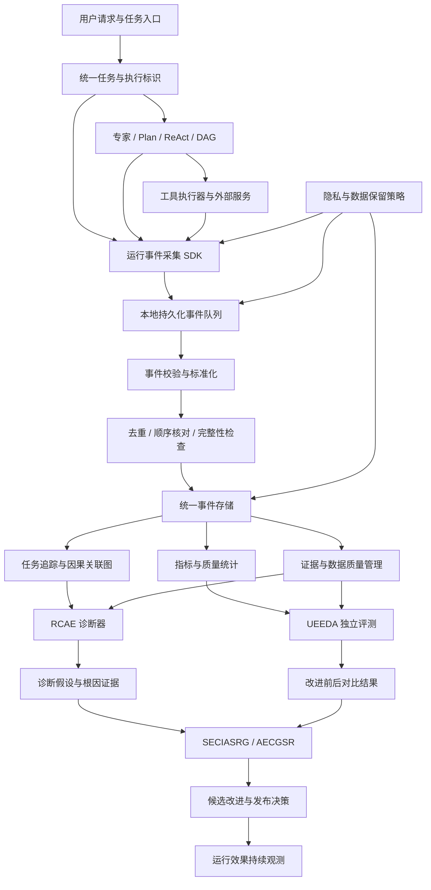

# 问答 131

> 来源: 新 窗口 | 会话: 分支 · 分支 · 分支 · 设计自进化智能体
> 消息: 27324361-64b7-41e2-ba9d-224023b4537f | 时间(UTC): 2026-10-24 12:17

## 用户

继续

## ChatGPT

<WritingBlock id="69241" variant="document"># EvoAgent 第六十六专项：端到端可观测性、事件关联与诊断数据质量体系

**专项编号：EOECDDQ**

**英文名称：End-to-End Observability, Event Correlation & Diagnostic Data Quality**

**文档版本：V1.0**

**文档性质：全量架构专项设计**

**承接专项：** 第六十五专项 RIFISRA——运行时不变量、故障隔离与安全恢复架构。

**核心目标：** 建立从用户目标、意图识别、专家路由、Plan、ReAct、DAG、工具调用、结果验收到故障诊断、进化实验和版本发布的统一观测与证据关联体系，确保 EvoAgent 不仅能够记录运行过程，还能够判断记录是否完整、证据是否可信、故障归因是否成立，以及某项改进是否真正改善了系统表现。

本文定义目标架构、数据模型、工程接口、指标体系和验收标准，不代表相关模块已经实现。

---

# 一、为什么运行日志完整了，系统仍然可能无法正确进化？

前面已经设计了 RIFISRA，解决系统在异常发生时如何隔离故障、保存状态和安全恢复的问题。

但是，可靠恢复依赖可靠的运行数据。

假设 EvoAgent 的代码专家在过去一周内出现了 100 次任务失败。

日志显示：

- 35 次工具调用超时；
- 25 次代码测试失败；
- 20 次任务预算耗尽；
- 12 次权限拒绝；
- 8 次结果验收不通过。

如果系统直接根据这些统计结果优化代码专家，可能会得出以下结论：

“工具调用超时最多，因此应该优化工具调用策略。”

但这不一定正确。

例如，35 次超时可能来自同一个外部服务故障，而且其中 20 次实际上是同一个任务的重复重试。

另外，25 次测试失败可能是这 35 次超时引发的连锁结果，而不是独立的代码质量问题。

如果系统没有正确关联任务、调用、故障和版本，就可能将同一个根因计算多次，并错误地分配优化资源。

更严重的是：

1. 工具调用实际上已经成功，但返回记录丢失。
2. 系统把成功操作误认为失败。
3. 自动恢复机制重复执行操作。
4. 日志系统将两次执行记录为两个独立失败。
5. 诊断器认为工具稳定性下降。
6. 进化控制器修改工具参数。
7. 新参数使真正的正常场景表现变差。

最终，系统因为错误的观测数据，主动降低了自己的能力。

这说明：

**记录了数据，不等于数据可信；找到了相关事件，不等于找到了根因；修复后指标发生变化，也不等于修复产生了预期效果。**

EOECDDQ 的核心任务，是在原始运行事件与自动进化决策之间建立可信的数据治理层。

---

# 二、第一性原理：把观测数据、事实、判断和决策分开

建议明确区分五种不同的数据对象。

| 对象 | 含义 | 示例 |
|---|---|---|
| 运行事件 | 系统实际记录的行为或状态变化 | 工具调用超时 |
| 观测事实 | 经过校验后可以确认的状态 | 工具调用超过规定时限，未收到响应 |
| 诊断假设 | 对故障原因的解释 | 外部服务延迟可能导致超时 |
| 验证结论 | 经过独立证据或实验支持的判断 | 在相同测试条件下，服务延迟与超时存在稳定关联 |
| 进化决策 | 根据证据采取的行动 | 调整超时策略并运行对照实验 |

这五种对象必须分开存储和管理。

不能把模型生成的诊断假设直接写成确定事实。

不能因为某个专家连续失败，就直接认定专家本身有缺陷。

也不能因为某次优化之后任务成功率上升，就立即断言优化方案是唯一原因。

EOECDDQ 需要保证：

- 原始事件可追溯；
- 事实与推断明确区分；
- 诊断结论具有证据引用；
- 评测结果能够复现；
- 进化决策能够解释；
- 错误结论能够撤销或修正。

## 2.1 核心原则

**所有重要的自动诊断与进化决策，都必须能够追溯到明确的运行事件、经过验证的事实和适当的评测证据。**

如果证据不足，系统应明确表示无法确定原因，而不是为了完成自动化闭环而强行给出根因。

---

# 三、总体架构：统一观测与诊断数据平面

建议新增 `Observability & Diagnostic Data Plane`，简称 ODDP。

ODDP 不替代日志系统、评测系统或记忆系统，而是负责统一这些模块的数据语义、事件关联、数据质量和证据追溯。

它应与以下现有专项协作：

- RIFISRA：运行时状态、故障事件与恢复记录；
- AADBVEC：权限判定与控制事件；
- TCRDCF：工具能力、接口和工具调用事件；
- TOVFTD：任务验收结果；
- RCAE：根因诊断；
- EIMTEDG：证据、记忆与数据治理；
- UEEDA：独立评测与回归测试；
- EOACA：能力资产及其来源；
- SECIASRG：变更影响分析、发布和回滚；
- AECGSR：进化控制与资源协调。

## 3.1 总体架构图



## 3.2 部署原则

EOECDDQ 采用本地优先的逻辑架构。

Android、Windows 和 mini Linux 可以使用统一的事件模型，但底层存储、文件访问、网络同步和系统监控应由平台适配层处理。

第一阶段不要求单独部署一组服务。

对于个人使用的 EvoAgent，可以先实现：

1. 统一事件数据结构；
2. 本地持久化事件队列；
3. 任务与工具调用关联；
4. 数据质量检查；
5. 基础指标计算；
6. 诊断证据引用；
7. 离线导出和重连同步。

只有当数据规模、并发量或设备协同需要时，再将部分模块拆分成独立服务。

---

# 四、建立统一的任务、执行与事件关联模型

这是本专项最重要的基础设计。

如果没有统一标识，即使每个模块都有日志，也很难把它们正确关联起来。

建议至少定义以下标识。

| 标识 | 作用 | 示例 |
|---|---|---|
| `task_id` | 一次用户目标或任务的稳定标识 | TASK-2048 |
| `execution_id` | 一次实际执行实例 | EXEC-001 |
| `trace_id` | 一条端到端执行追踪 | TRACE-001 |
| `span_id` | 一次具体执行片段 | SPAN-031 |
| `parent_span_id` | 上游执行片段 | SPAN-012 |
| `event_id` | 单个事件的唯一标识 | EVT-1002 |
| `operation_id` | 一个逻辑操作的稳定标识 | OP-044 |
| `attempt_id` | 一次具体尝试 | ATT-003 |
| `expert_id` | 执行任务的专家 | coding-expert |
| `tool_id` | 被调用的工具 | file-reader |
| `workflow_id` | 工作流标识 | code-repair |
| `workflow_version` | 工作流版本 | 1.4.0 |
| `model_config_id` | 模型及相关配置标识 | model-config-12 |
| `capability_version` | 能力版本标识 | coding-cap-2.1.0 |
| `policy_version` | 权限与运行策略版本 | policy-18 |
| `incident_id` | 一组相关故障事件 | INC-0021 |
| `experiment_id` | 进化实验标识 | EXP-009 |

这些标识不能相互替代。

例如，同一个任务可能经历多次执行；同一个逻辑操作可能有多次尝试；一次工具调用也可能产生多个事件。

如果将它们全部压缩为一个 `task_id`，系统就无法准确区分重试、重复执行和独立故障。

## 4.1 必须支持的关联关系

建议建立以下关联链：

```text
用户目标
  └── task_id
       ├── 意图识别
       ├── 路由决策
       ├── execution_id
       │    ├── Plan
       │    ├── DAG 节点
       │    ├── ReAct 轮次
       │    ├── 专家调用
       │    ├── 工具调用
       │    │    ├── operation_id
       │    │    ├── attempt_id
       │    │    └── 外部结果
       │    ├── 结果验收
       │    └── 恢复事件
       ├── 最终质量评分
       └── 进化关联
            ├── incident_id
            ├── experiment_id
            ├── capability_version
            └── 发布与回滚记录
```

这里的树形结构只是便于理解。

实际系统中，一个任务可能跨多个专家、多个工作流和多个设备，因此底层关系应当允许形成有向关联图，而不是强行限定为单一父子树。

## 4.2 任务与事件之间必须支持多对多关联

例如，一个外部服务故障可能影响 20 个任务。

这 20 个任务产生的异常不能简单被认定为 20 个互不相关的根因。

同样，一个任务失败也可能同时受到：

- 错误路由；
- 工具参数错误；
- 模型响应异常；
- 预算不足；
- 验收规则缺陷。

因此，需要允许一个故障事件关联多个任务，也允许一个任务关联多个诊断假设。

---

# 五、统一事件模型：每条记录都必须有明确语义

建议定义统一的 `RuntimeEvent`。

## 5.1 核心字段

| 字段 | 含义 |
|---|---|
| `event_id` | 事件唯一 ID |
| `event_type` | 标准事件类型 |
| `event_schema_version` | 事件结构版本 |
| `task_id` | 任务标识 |
| `execution_id` | 执行实例 |
| `trace_id` | 追踪标识 |
| `span_id` | 当前执行片段 |
| `parent_span_id` | 上游执行片段 |
| `source_component` | 事件来源组件 |
| `source_device_id` | 来源设备标识 |
| `sequence_number` | 事件流内的顺序号 |
| `event_time` | 事件发生时间 |
| `recorded_time` | 本地记录时间 |
| `received_time` | 汇聚端接收时间 |
| `severity` | 严重程度 |
| `outcome` | 结果状态 |
| `version_context` | 相关模型、工具和能力版本 |
| `authorization_ref` | 必要时关联的授权记录 |
| `operation_ref` | 相关操作记录 |
| `payload_ref` | 事件内容引用 |
| `integrity_status` | 完整性检查结果 |
| `privacy_class` | 数据敏感级别 |

事件数据可以使用 JSON、数据库记录或其他结构化格式存储。

关键是所有模块必须遵循相同的字段语义和版本兼容规则。

## 5.2 示例事件

```json
{
  "event_id": "EVT-1002",
  "event_type": "tool.call.timeout",
  "event_schema_version": 1,
  "task_id": "TASK-2048",
  "execution_id": "EXEC-001",
  "trace_id": "TRACE-001",
  "span_id": "SPAN-031",
  "parent_span_id": "SPAN-012",
  "source_component": "tool_executor",
  "sequence_number": 42,
  "severity": "warning",
  "outcome": "unknown",
  "version_context": {
    "expert_version": "2.1.0",
    "tool_version": "1.3.0"
  },
  "integrity_status": "pending_reconciliation"
}
```

以上仅为结构示例。

这里的 `outcome` 被标记为 `unknown`，因为超时只能证明系统没有在规定时间内获得结果，不能证明外部操作一定失败。

这种细节决定了后续诊断与进化是否可靠。

---

# 六、统一事件分类与错误语义

如果每个专家自行定义错误类型，系统就很难进行跨领域比较。

例如：

- 代码专家使用 `tool_failed`；
- 漫剧专家使用 `generation_error`；
- 手机操作专家使用 `action_timeout`。

这些事件可能描述相似的问题，却无法直接统一统计。

建议建立全局错误分类，同时允许领域专家定义细化子类型。

## 6.1 全局事件分类

| 类别 | 示例 |
|---|---|
| `task.lifecycle` | 任务创建、暂停、恢复、结束 |
| `routing.decision` | 路由选择、回退、路由置信度 |
| `planning.lifecycle` | 计划创建、更新、终止 |
| `workflow.node` | DAG 节点开始、成功、失败 |
| `model.call` | 模型请求、超时、响应校验 |
| `tool.call` | 工具调用、返回、超时 |
| `tool.contract` | 参数不匹配、接口不兼容 |
| `authorization.decision` | 允许、拒绝、授权撤销 |
| `result.validation` | 验收通过、失败、证据不足 |
| `runtime.failure` | 崩溃、资源耗尽、非法状态 |
| `recovery.lifecycle` | 恢复开始、完成、失败 |
| `memory.operation` | 检索、写入、压缩、校验 |
| `evolution.experiment` | 实验开始、结果、终止 |
| `release.lifecycle` | 候选发布、激活、回滚 |
| `data.quality` | 日志缺失、重复、乱序、格式异常 |

## 6.2 统一错误码与领域子类型

建议错误分类至少包含三层：

```text
一级：错误域
二级：错误类型
三级：具体实现或领域子类型
```

例如：

```text
TOOL.TIMEOUT.EXTERNAL_API
TOOL.CONTRACT.PARAMETER_MISMATCH
ROUTING.MISCLASSIFICATION
VALIDATION.MISSING_EVIDENCE
RUNTIME.STATE_CONFLICT
RECOVERY.EXTERNAL_STATUS_UNKNOWN
DATA.EVENT_DUPLICATE
```

具体错误码应通过注册表维护，而不是允许每个模块随意拼接字符串。

这样，系统可以进行跨专家统计，同时保留领域所需的细节。

---

# 七、事件采集必须与执行模块解耦

运行事件采集本身不能成为新的单点故障。

如果每次工具调用都必须同步等待远程日志服务写入，网络异常就可能阻塞正常任务。

如果日志写入失败后直接丢弃事件，系统又可能失去关键诊断证据。

因此，建议采用本地持久化事件队列。

## 7.1 推荐采集流程

1. 执行器产生事件；
2. 事件采集 SDK 进行基础校验；
3. 对关键事件执行必要的本地持久化；
4. 将事件加入待处理队列；
5. 异步执行标准化、去重和关联；
6. 生成追踪与指标；
7. 供诊断器和评测器使用；
8. 在满足策略时同步至其他设备或服务端。

对于普通性能指标，可以允许采样。

对于授权拒绝、重要外部副作用、任务状态迁移、发布和回滚等关键事件，不应采用可能造成审计缺失的随意采样策略。

## 7.2 事件采集失败时怎么办？

应区分事件的重要程度。

**普通性能事件丢失：**

可以记录数据质量异常，并在必要时降低相关指标的可信等级。

**关键执行事件无法持久化：**

如果系统无法满足关键状态记录要求，应停止依赖该记录的高风险操作，或进入受限模式。

**远程同步失败：**

本地事件队列可以继续保存事件，等待网络恢复后增量同步。

**本地存储空间不足：**

系统应保护关键状态与审计记录，限制非必要任务，并执行受控清理。

不能简单删除最旧日志来腾出空间，因为最旧日志可能恰好是恢复当前任务所需的关键事件。

## 7.3 事件写入与外部操作的关系

对于重要外部副作用，事件记录必须与 RIFISRA 的操作状态机协作。

不能仅仅因为事件采集 SDK 已经返回成功，就认定事件已经可靠持久化。

应明确区分：

- 已进入内存；
- 已写入本地持久化介质；
- 已完成必要的完整性检查；
- 已同步到远程系统。

不同状态提供不同级别的可靠性保证。

---

# 八、事件去重、乱序与缺失检测

EvoAgent 可能在 Android、Windows 和 mini Linux 上运行。

断联、重试、进程崩溃和日志补传都可能造成事件重复或乱序。

如果直接按照接收时间统计，可能产生错误结果。

## 8.1 事件去重

建议使用稳定的 `event_id` 作为主要去重依据。

同一事件重复上传时，系统应识别其为同一条逻辑记录，而不是新增一次工具调用或一次任务失败。

对于同一个逻辑操作的多次执行，则应使用 `operation_id` 和 `attempt_id` 区分。

**事件重复不等于操作重复；操作重复也不一定意味着事件重复。**

这两个概念必须分开处理。

## 8.2 事件顺序

建议组合使用：

- 事件流顺序号；
- 任务状态版本；
- 父子追踪关系；
- 事件发生时间；
- 本地记录时间；
- 接收时间。

时间戳用于辅助分析，不应作为唯一排序依据。

跨设备时钟可能存在偏差，异步事件也可能晚于后续事件抵达。

## 8.3 缺失检测

系统应能够识别：

- 预期存在的事件没有出现；
- 事件序号存在缺口；
- 只有工具结束事件，没有工具开始事件；
- 任务已经完成，却缺少最终验收记录；
- 发生恢复，但没有对应的故障事件；
- 候选版本已经激活，却没有发布记录；
- 外部操作已登记，但没有确认或明确的未知状态记录。

缺失事件不一定意味着执行失败。

例如，进程可能在事件持久化之前崩溃。

系统应将这种情况标记为数据质量问题，并根据任务状态决定是否需要恢复，而不是伪造一个确定的失败原因。

---

# 九、建立证据关联图，而不是只保存日志列表

单纯的日志列表很难表示复杂任务中的依赖关系。

建议建立 `EvidenceCorrelationGraph`，即证据关联图。

节点可以包括：

- 用户目标；
- 路由决策；
- 计划；
- DAG 节点；
- 工具调用；
- 外部操作；
- 任务结果；
- 验收结论；
- 故障事件；
- 诊断假设；
- 实验结果；
- 发布记录。

边可以表示：

- `caused_by`：直接原因或经过验证的因果关系；
- `preceded_by`：时间顺序；
- `depends_on`：执行依赖；
- `observed_in`：观测来源；
- `supports`：支持某个结论；
- `contradicts`：与某个结论冲突；
- `reproduced_by`：在实验中复现；
- `changed_by`：由某个变更引入；
- `validated_by`：经过某项验收；
- `recovered_by`：由某项恢复操作处理。

必须特别注意：

**`preceded_by` 不等于 `caused_by`。**

某项工具调用发生在任务失败之前，只能证明它在时间上先发生。

除非存在额外证据，否则不能直接认定它就是失败原因。

同样，诊断器提出的 `caused_by` 关系在验证之前应当标记为假设，而不是已确认的因果事实。

---

# 十、建立统一指标体系

EOECDDQ 不应仅仅统计工具调用次数或模型请求次数。

真正重要的是任务质量、执行成本、稳定性和诊断可靠性。

建议建立四类指标。

## 10.1 任务质量指标

| 指标 | 定义 |
|---|---|
| 任务成功率 | 通过最终验收的任务数 / 具备明确结果的已结束任务数 |
| 验收通过率 | 通过验收的结果数 / 已执行验收的结果数 |
| 部分完成率 | 存在未完成目标的任务数 / 已结束任务数 |
| 返工率 | 因原结果不满足要求而重新执行的任务数 / 适用任务数 |
| 结果缺陷率 | 经验证存在实质缺陷的交付结果数 / 已验收结果数 |
| 路由成功率 | 被正确路由且满足任务要求的任务数 / 可评估路由任务数 |

指标必须明确分母。

例如，任务成功率不能把尚未结束的任务直接计为失败，也不能把结果未知的任务默认为成功。

如果存在未完成任务，应单独报告其数量与比例。

## 10.2 执行效率指标

- 任务端到端耗时；
- 模型调用次数；
- 工具调用次数；
- 平均重试次数；
- 单任务模型成本；
- 单位成功任务成本；
- 等待外部服务的时间；
- 计划调整次数；
- 恢复耗时；
- 人工介入频率。

其中，单位成功任务成本可以定义为：

\[
C_{\text{success}}
=
\frac{\text{统计期内任务总成本}}
{\text{统计期内通过验收的任务数}}
\]

如果统计期内没有成功任务，该指标应标记为不可计算，而不是填入零。

## 10.3 稳定性指标

- 工具超时率；
- 任务异常终止率；
- 任务状态冲突率；
- 重复副作用发生率；
- 恢复成功率；
- 恢复后再次失败率；
- 日志关键事件缺失率；
- 权限控制异常率；
- 版本发布失败率；
- 受限模式触发次数。

这些指标必须能够按照专家、工具版本、模型配置、设备和任务类型进行分组。

## 10.4 诊断与数据质量指标

- 事件完整率；
- 事件重复率；
- 事件关联成功率；
- 关键字段缺失率；
- 数据标准化成功率；
- 根因诊断准确率；
- 根因诊断覆盖率；
- 根因诊断证据充分率；
- 诊断结论被推翻的比例；
- 修复方案复现率；
- 修复后的同类故障复发率。

诊断准确率不能只由诊断器自己打分。

应当尽可能使用独立复核、可复现实验和已确认根因的历史案例进行评估。

---

# 十一、避免指标被错误优化

这是自进化系统必须重视的问题。

如果进化控制器只优化一个指标，系统可能通过改变统计口径而不是改善实际能力来取得表面进步。

例如：

- 将难任务提前标记为取消，降低失败率；
- 缩小验收范围，使更多任务通过；
- 不再记录失败的工具调用；
- 将同一个任务拆成多个简单任务；
- 把未知结果统一标记为成功；
- 减少测试覆盖范围；
- 通过增加成本换取很小的成功率提升，却不检查收益是否值得。

因此，建议建立统一的指标治理机制。

## 11.1 每项指标必须包含

- 明确的定义；
- 统计分母；
- 纳入和排除规则；
- 数据来源；
- 计算版本；
- 适用任务范围；
- 缺失数据处理方式；
- 不确定性说明；
- 防操纵检查。

## 11.2 核心指标与约束指标分离

建议将优化目标分为两类。

**优化目标：**

- 任务成功率；
- 任务完成时间；
- 单位成功任务成本；
- 用户返工率。

**硬性约束：**

- 权限违规次数必须满足既定安全要求；
- 重复外部副作用必须受到严格控制；
- 关键审计事件不能出现未处理的缺失；
- 不得通过降低验收标准制造虚假的成功率提升；
- 资源预算不能无限扩大；
- 高风险操作不能因为任务成功率下降而绕过授权。

这意味着进化控制器不能为了提高一个指标，就自动牺牲其他硬性约束。

---

# 十二、诊断器必须能够处理证据不足和相互矛盾

RCAE 的任务是分析故障原因。

EOECDDQ 的任务则是为 RCAE 提供可信的证据基础，并检查诊断结论是否与实际数据相符。

## 12.1 诊断结果的数据结构

建议建立 `DiagnosticFinding`：

| 字段 | 含义 |
|---|---|
| `finding_id` | 诊断结论 ID |
| `incident_id` | 关联故障 |
| `hypothesis` | 根因假设 |
| `supporting_evidence` | 支持证据引用 |
| `contradicting_evidence` | 反向证据引用 |
| `missing_evidence` | 尚缺少的证据 |
| `alternative_hypotheses` | 其他可能原因 |
| `confidence` | 经过定义的置信度或证据等级 |
| `validation_method` | 验证方式 |
| `validation_status` | 验证状态 |
| `diagnostic_version` | 诊断器版本 |
| `review_status` | 复核状态 |

建议的验证状态包括：

- `PROPOSED`：初步假设；
- `SUPPORTED`：有证据支持，但仍存在不确定性；
- `REPRODUCED`：在规定条件下复现；
- `CONFIRMED`：满足预定义的确认标准；
- `CONTRADICTED`：存在与假设冲突的重要证据；
- `INCONCLUSIVE`：现有证据不足以判断。

这里的 `CONFIRMED` 也不意味着在所有可能环境下都已证明因果关系。

它只表示结论满足了预先定义的验证标准。

## 12.2 置信度不能只靠模型自报

如果模型输出“根因判断置信度 95%”，但没有经过校准或历史验证，这个数字并不具有可靠的统计含义。

建议综合使用：

- 证据完整程度；
- 复现成功率；
- 独立复核结果；
- 替代解释排除情况；
- 历史诊断器校准表现；
- 相关任务与当前任务的可比性。

对于证据不足的故障，系统可以保留多个候选解释，并选择信息增益较高、成本较低的验证实验。

这比强行给出单一根因更有价值。

---

# 十三、如何判断某项改进是否真的有效？

EOECDDQ 必须与 UEEDA、SECIASRG 协作。

当系统根据诊断结果修改工具参数、提示词、路由规则或工作流时，需要保留完整的变更与评测关联。

例如：

```text
故障事件
  ↓
诊断假设
  ↓
修复候选
  ↓
候选版本
  ↓
测试集与评测配置
  ↓
对照结果
  ↓
发布决策
  ↓
实际运行结果
```

每一步都应当有明确的 ID 和证据引用。

## 13.1 区分三种证据

**第一种：历史关联证据。**

例如，使用某个工具版本时失败率较高。

它可以帮助提出假设，但不能单独证明工具版本导致失败。

**第二种：可复现实验证据。**

例如，在固定输入和环境下，旧版本重复出现某个错误，而新版本修复了错误。

它可以更有力地支持修复有效性的判断，但仍需考虑测试范围和环境差异。

**第三种：实际运行效果证据。**

例如，新版本发布后，在相似任务分布下，失败率下降且成本没有显著恶化。

它可以验证修复在真实运行环境中的表现，但必须考虑任务难度变化、模型版本变化和外部服务变化等混杂因素。

## 13.2 发布后持续观测

发布成功不代表改进永久有效。

系统应持续比较：

- 发布前基线；
- 实验阶段结果；
- 发布后的实际结果；
- 旧版本与新版本的任务分布；
- 成本变化；
- 稳定性变化；
- 同类故障复发情况。

如果实际效果与实验结论明显不符，应暂停继续扩大使用范围，并将差异反馈至诊断和评测模块。

---

# 十四、隐私、数据最小化与本地数据治理

EvoAgent 会接触用户任务、文件、语音输入、工具调用和运行日志。

可观测性不能成为无限制保存个人数据的理由。

建议对事件数据实行分级管理。

## 14.1 四类数据

| 数据类别 | 示例 | 默认处理 |
|---|---|---|
| 运行元数据 | 任务 ID、耗时、工具版本 | 按必要期限保存 |
| 诊断证据 | 错误码、调用结果、验收摘要 | 按诊断与审计需求保存 |
| 任务内容 | 用户输入、文件内容、模型上下文 | 尽可能保存受控引用或最小必要摘要 |
| 敏感数据 | 密钥、令牌、个人身份信息等 | 避免进入普通日志，必要时脱敏或严格限制访问 |

## 14.2 不应默认记录完整模型思考内容

诊断系统通常不需要长期保存所有模型内部推理文本。

更合理的方式是记录：

- 输入任务的必要摘要；
- 计划版本；
- 工具请求与结果的必要字段；
- 关键状态迁移；
- 验收证据；
- 诊断结论及其来源。

这样既能够追踪执行过程，也能减少敏感数据暴露和存储开销。

## 14.3 数据删除必须处理关联记录

如果用户要求删除某项任务的数据，不能只删除原始任务记录，而保留所有可识别的副本和关联内容。

需要根据数据治理策略检查：

- 原始事件；
- 任务摘要；
- 诊断样本；
- 记忆引用；
- 本地缓存；
- 远程同步副本；
- 导出文件；
- 可识别的关联索引。

对于必须保留的安全审计数据，应有明确的保留依据、范围和期限。

系统应尽量通过引用关系和数据分类实现精确删除，而不是简单清空整个事件库。

## 14.4 离线与重连同步

Android 断联时，事件应保存在本地队列。

重连后，应通过事件 ID、顺序号和完整性检查进行增量同步。

对于同一事件的重复上传，应执行幂等去重。

如果本地记录与远程记录冲突，应保留冲突状态和证据，不能直接用最后写入的记录覆盖另一份数据。

---

# 十五、工程目录与核心接口

建议新增以下模块：

```text
evoagent/
├── observability/
│   ├── event_schema/
│   ├── event_registry/
│   ├── event_sdk/
│   ├── trace_context/
│   ├── span_manager/
│   ├── correlation_engine/
│   ├── event_normalizer/
│   ├── deduplication/
│   ├── ordering_validator/
│   ├── completeness_checker/
│   ├── durable_event_queue/
│   ├── metric_registry/
│   ├── metric_calculator/
│   └── privacy_filter/
├── diagnostic_data_quality/
│   ├── schema_validation/
│   ├── event_integrity/
│   ├── missing_event_detection/
│   ├── duplicate_detection/
│   ├── clock_skew_detection/
│   ├── causal_link_validation/
│   ├── evidence_completeness/
│   └── quality_scoring/
├── evidence_graph/
│   ├── node_registry/
│   ├── relation_registry/
│   ├── evidence_reference/
│   ├── hypothesis_store/
│   ├── contradiction_detection/
│   └── lineage_query/
├── diagnostic_governance/
│   ├── finding_schema/
│   ├── confidence_calibration/
│   ├── diagnostic_review/
│   ├── reproduction_tracking/
│   └── conclusion_retraction/
├── metric_governance/
│   ├── metric_definitions/
│   ├── denominator_rules/
│   ├── evaluation_windows/
│   ├── missing_data_policy/
│   ├── metric_integrity/
│   └── anti_gaming_checks/
├── data_lifecycle/
│   ├── retention_policy/
│   ├── redaction/
│   ├── deletion_workflows/
│   ├── offline_export/
│   ├── incremental_sync/
│   └── data_lineage/
└── observability_tests/
    ├── schema_compatibility/
    ├── trace_propagation/
    ├── event_deduplication/
    ├── missing_event_tests/
    ├── out_of_order_tests/
    ├── diagnostic_accuracy/
    ├── evidence_consistency/
    ├── metric_integrity/
    ├── privacy_tests/
    └── offline_sync_tests/
```

建议提供以下核心接口：

- `emit_runtime_event`：生成运行事件；
- `validate_event_schema`：验证事件结构；
- `persist_critical_event`：持久化关键事件；
- `propagate_trace_context`：跨模块传递追踪上下文；
- `create_execution_span`：创建执行片段；
- `link_related_events`：建立事件关联；
- `deduplicate_events`：识别重复事件；
- `validate_event_order`：检查事件顺序；
- `detect_missing_events`：检测缺失事件；
- `normalize_error_code`：统一错误语义；
- `build_evidence_graph`：构建证据关联图；
- `validate_evidence_relation`：验证关联关系；
- `register_diagnostic_finding`：登记诊断结论；
- `attach_supporting_evidence`：关联支持证据；
- `attach_contradicting_evidence`：关联反向证据；
- `calculate_metric`：计算指标；
- `validate_metric_definition`：检查指标定义；
- `evaluate_diagnostic_quality`：评估诊断质量；
- `reconcile_experiment_evidence`：核对实验与运行证据；
- `trace_change_outcome`：追踪变更后的运行效果；
- `apply_privacy_filter`：执行数据过滤与脱敏；
- `apply_retention_policy`：执行数据保留策略；
- `export_audit_bundle`：导出经过整理的审计数据；
- `sync_event_incrementally`：增量同步事件；
- `verify_event_integrity`：验证事件完整性；
- `retract_diagnostic_conclusion`：撤销已被推翻的诊断结论；
- `generate_observability_report`：生成可观测性报告。

这些接口需要统一使用事件 ID、任务 ID、版本 ID 和证据引用。

不应让不同模块各自维护一套无法相互关联的任务统计。

---

# 十六、端到端验收场景

建议至少建立以下十二个验收场景。

## 场景 A：一次任务的完整追踪

**初始条件：** 用户发起一个需要经过多个专家和工具的任务。

**验收过程：**

1. 创建任务 ID；
2. 生成执行实例与追踪 ID；
3. 记录路由、计划、工具调用和结果验收；
4. 将关键事件关联起来；
5. 查询任务完整执行链。

**验收重点：** 能够从最终结果追溯到实际执行过程。

## 场景 B：工具调用重试没有被错误统计为多个独立故障

**初始条件：** 同一逻辑操作发生三次尝试。

**验收过程：**

1. 三次尝试使用不同的 `attempt_id`；
2. 同一逻辑操作保持稳定的 `operation_id`；
3. 事件系统识别它们属于同一逻辑操作；
4. 指标系统分别统计尝试次数和逻辑操作失败数。

**验收重点：** 不因重试导致故障数量虚增。

## 场景 C：跨设备事件乱序到达

**初始条件：** Android 离线期间产生事件，重连后晚于主机的后续事件上传。

**验收过程：**

1. 根据事件 ID 去重；
2. 根据顺序号和关联关系核对；
3. 检测时间戳偏差；
4. 重建合理的事件顺序；
5. 标记无法确认的关联关系。

**验收重点：** 不依赖接收时间简单覆盖原始状态。

## 场景 D：日志缺失时阻止错误诊断

**初始条件：** 任务存在工具调用结束事件，但缺少开始事件和外部结果确认。

**验收过程：**

1. 检测事件链不完整；
2. 标记数据质量异常；
3. 禁止将不确定状态直接当作已确认失败；
4. 请求补充状态信息或进行外部核验；
5. 降低相关诊断结论的可信等级。

**验收重点：** 数据缺失不会被自动补成虚构事实。

## 场景 E：区分时间相关性与根因关系

**初始条件：** 某工具调用发生后，任务出现失败。

**验收过程：**

1. 记录时间顺序；
2. 将工具调用登记为候选相关事件；
3. 检查其他可能原因；
4. 通过复现或实验验证；
5. 只有满足标准时才升级为已验证的根因关系。

**验收重点：** 先后发生不等于因果成立。

## 场景 F：指标定义发生变化

**初始条件：** 系统准备调整任务成功率的统计口径。

**验收过程：**

1. 创建新指标定义版本；
2. 记录新旧定义差异；
3. 使用相同历史数据进行对照计算；
4. 检查分母和排除规则；
5. 保留历史指标版本；
6. 阻止通过改变口径伪造性能提升。

**验收重点：** 指标定义变化不能被误认为能力变化。

## 场景 G：诊断假设被后续证据推翻

**初始条件：** RCAE 将工具超时判定为候选根因，随后发现外部操作实际上已经成功。

**验收过程：**

1. 保留原诊断记录；
2. 追加反向证据；
3. 将诊断结论标记为被推翻或需要修正；
4. 检查是否已有基于该结论生成的候选改进；
5. 必要时暂停相关实验或重新评测；
6. 更新诊断器质量统计。

**验收重点：** 系统能够纠正错误结论，而不是让错误经验永久留存。

## 场景 H：隐私过滤

**初始条件：** 工具返回内容包含密钥或其他敏感数据。

**验收过程：**

1. 识别敏感字段；
2. 根据数据策略过滤或脱敏；
3. 保留必要的错误码和结构化元数据；
4. 检查普通日志中没有泄露敏感内容；
5. 验证受保护数据仍然受到访问控制。

**验收重点：** 诊断能力不依赖无限制保存原始敏感数据。

## 场景 I：日志服务离线

**初始条件：** 远程日志汇聚服务不可用。

**验收过程：**

1. 将事件保存在本地持久化队列；
2. 继续执行符合当前安全条件的任务；
3. 在关键事件无法可靠记录时限制相关高风险操作；
4. 网络恢复后执行增量同步；
5. 去重并检查事件完整性。

**验收重点：** 远程服务离线不必使全部本地能力停止，但关键数据保护不能失效。

## 场景 J：进化实验无法复现历史结果

**初始条件：** 候选版本声称改善了任务成功率，但缺少模型版本或测试配置记录。

**验收过程：**

1. 检查实验元数据；
2. 识别缺失的复现条件；
3. 将结果标记为证据不足；
4. 阻止将其当作已验证改进；
5. 补齐实验配置后重新评测。

**验收重点：** 不可复现的结果不能直接作为自动发布依据。

## 场景 K：跨专家故障统计

**初始条件：** 代码专家、文档专家和漫剧专家都受到同一个外部服务异常影响。

**验收过程：**

1. 识别共同的外部依赖；
2. 关联多个任务的故障事件；
3. 区分共同根因与专家自身缺陷；
4. 计算受影响任务和专家范围；
5. 为故障治理提供统一证据。

**验收重点：** 不将共享依赖故障错误归因于每一个专家。

## 场景 L：删除某项任务的关联数据

**初始条件：** 用户要求删除某项任务中可以删除的个人数据。

**验收过程：**

1. 查询关联事件和数据引用；
2. 识别本地副本、同步副本和衍生记录；
3. 按数据保留规则执行删除或脱敏；
4. 检查剩余关联记录；
5. 保留适用策略要求保留的最小审计信息；
6. 记录删除流程的处理结果。

**验收重点：** 数据治理覆盖关联副本，而不是只删除主任务记录。

---

# 十七、专项验收标准

EOECDDQ 至少需要满足以下要求：

1. 建立统一的任务、执行、追踪、事件、操作和尝试标识。
2. 能够关联用户目标、专家、计划、工具和最终验收结果。
3. 能够区分运行事件、观测事实、诊断假设、验证结论和进化决策。
4. 所有关键事件采用统一的数据结构和版本管理。
5. 支持跨专家、跨工具、跨设备的事件关联。
6. 能够识别同一逻辑操作的多次执行尝试。
7. 能够区分事件重复与操作重复。
8. 能够检测关键事件缺失、重复、乱序和格式异常。
9. 能够区分事件发生时间、记录时间和接收时间。
10. 能够识别无法确认的事件关联关系。
11. 能够构建从任务目标到最终验收的追踪链。
12. 能够将故障事件关联到相关工具、模型和能力版本。
13. 能够区分时间顺序关系与已验证的因果关系。
14. 能够记录诊断假设的支持证据和反向证据。
15. 能够修正或撤销已经被推翻的诊断结论。
16. 能够统一任务质量、执行成本、稳定性和数据质量指标。
17. 每项关键指标都具有明确的分母和计算规则。
18. 能够防止通过修改统计口径伪造性能提升。
19. 能够识别指标缺失或数据质量下降对评测结果的影响。
20. 能够追踪候选改进与实际运行效果之间的关联。
21. 能够区分历史关联证据、可复现实验证据和实际运行证据。
22. 能够在证据不足时阻止未经验证的改进直接进入正式发布。
23. 能够通过本地持久化队列应对远程日志服务离线。
24. 能够在重连后进行增量同步和事件去重。
25. 能够对关键事件实施适当的持久化保障。
26. 能够在不保存过量敏感数据的前提下保留诊断所需证据。
27. 能够执行数据脱敏、保留、导出和删除策略。
28. 能够评估诊断器本身的准确性与稳定性。
29. 能够将数据质量问题反馈给 RCAE、UEEDA、EIMTEDG 和 SECIASRG。
30. 能够在 Windows、Android 和 mini Linux 环境中使用统一的事件语义。
31. 能够通过故障注入测试验证事件丢失和重复处理。
32. 能够通过跨设备测试验证事件关联与状态重建。
33. 能够通过实验验证诊断结论的可复现性。
34. 能够追踪已发布改进在真实运行中的表现。
35. 能够明确区分系统已经知道的事实、合理推断和仍然未知的问题。

以上为目标架构验收要求，不代表相关模块已经实现或通过测试。

---

# 十八、建议冻结的架构决策

以下建议承接 ADR-1190。

| 编号 | 决策 |
|---|---|
| ADR-1191 | 建立端到端可观测性、事件关联与诊断数据质量体系 EOECDDQ |
| ADR-1192 | 统一任务、执行、追踪、事件、操作和尝试标识 |
| ADR-1193 | 统一事件数据结构、事件类型、错误码和版本兼容规则 |
| ADR-1194 | 区分运行事件、观测事实、诊断假设、验证结论和进化决策 |
| ADR-1195 | 关键事件必须具有可追溯的任务、执行和版本上下文 |
| ADR-1196 | 事件关联必须支持跨专家、跨工具、跨工作流和跨设备场景 |
| ADR-1197 | 同一逻辑操作的多次尝试必须与独立操作区分 |
| ADR-1198 | 事件重复不得直接计为独立操作或独立故障 |
| ADR-1199 | 事件发生时间、记录时间和接收时间必须分别处理 |
| ADR-1200 | 事件去重、顺序核对和缺失检测必须纳入数据质量治理 |
| ADR-1201 | 关键事件应采用本地持久化队列与受控同步机制 |
| ADR-1202 | 关键事件无法可靠持久化时，必须根据风险限制相关操作 |
| ADR-1203 | 事件汇聚应支持增量同步、幂等处理和冲突标记 |
| ADR-1204 | 建立证据关联图以支持任务、故障、诊断和改进追溯 |
| ADR-1205 | 时间先后关系不能自动被视为已验证的因果关系 |
| ADR-1206 | 诊断结论必须保留支持证据、反向证据和验证状态 |
| ADR-1207 | 诊断器不得仅依靠自身生成的置信度宣称结论可靠 |
| ADR-1208 | 统一任务质量、执行效率、稳定性和诊断数据质量指标 |
| ADR-1209 | 关键指标必须明确分母、纳入规则、缺失数据处理方式和计算版本 |
| ADR-1210 | 指标定义变更必须保留版本并支持历史数据对照计算 |
| ADR-1211 | 进化优化必须同时遵守核心质量目标和硬性约束指标 |
| ADR-1212 | 诊断假设、实验结果和实际运行结果必须分别记录 |
| ADR-1213 | 不可复现且证据不足的改进结果不得作为已验证发布依据 |
| ADR-1214 | 已被推翻的诊断结论必须支持修正、撤销和影响追踪 |
| ADR-1215 | 数据质量下降必须影响相关指标与诊断结论的可信等级 |
| ADR-1216 | 可观测性系统应遵循数据最小化、脱敏、保留和删除规则 |
| ADR-1217 | 普通日志不得默认长期保存完整模型上下文和全部敏感数据 |
| ADR-1218 | 数据删除应检查相关副本、缓存和衍生记录 |
| ADR-1219 | EOECDDQ 应与 RIFISRA、AADBVEC、RCAE、EIMTEDG 和 UEEDA 协同 |
| ADR-1220 | 进化变更必须关联故障证据、实验配置、评测结果和发布记录 |
| ADR-1221 | 发布后的实际运行效果必须持续观测并与实验结论进行核对 |
| ADR-1222 | 共享依赖故障必须能够跨专家关联，避免重复归因 |
| ADR-1223 | 本地观测能力应在合理的断联条件下继续工作 |
| ADR-1224 | 关键事件与证据关联机制必须通过数据缺失、乱序、重复和冲突测试 |
| ADR-1225 | EOECDDQ 应采用本地优先的逻辑架构，不要求单独部署服务器 |

以上建议作为 EvoAgent 第六十六专项的架构基线。

---

# 十九、完成第六十六专项后，EvoAgent 的进化闭环如何进一步完善？

现在，EvoAgent 的目标架构已经覆盖了三个相互关联的治理层次。

**第一层：运行可靠性。**

通过 RIFISRA 识别运行异常、隔离故障并安全恢复。

**第二层：数据与证据可靠性。**

通过 EOECDDQ 判断运行事件是否完整、证据是否可追溯、指标是否可信。

**第三层：改进决策可靠性。**

通过 RCAE、UEEDA 和 SECIASRG，将可信的诊断结果转化为经过验证的改进，并通过门禁控制正式发布。

完整链路如下：

```text
真实任务执行
    ↓
运行事件采集
    ↓
数据完整性与关联检查
    ↓
可信事实与证据整理
    ↓
故障诊断与竞争性假设
    ↓
修复候选
    ↓
隔离实验与独立评测
    ↓
发布门禁
    ↓
正式运行
    ↓
持续观测实际效果
    ↓
确认、修正或撤销原有结论
```

这个闭环比单纯的“日志 → 反思 → 修改提示词”更严格。

它要求系统在每一个重要阶段都明确：

- 输入证据是什么；
- 哪些事实已经确认；
- 哪些结论仍然存在不确定性；
- 使用什么方法进行验证；
- 结果是否满足预先定义的标准；
- 失败时如何恢复；
- 改进后是否真的产生了长期收益。

需要强调的是，这仍然是目标架构。

只有当各个模块实现并通过验收后，EvoAgent 才真正具备相应能力。

---

# 二十、下一专项：因果归因、修复有效性与长期收益验证

完成第六十六专项后，仍然存在一个更深层的问题。

即使系统已经能够准确关联日志、保存证据、生成诊断假设，并完成独立评测，也不能保证每次改进都是真正有效的。

例如：

某次优化将代码专家的任务成功率从 82% 提高到了 87%。

这看起来是一次成功的进化。

但如果同期发生了以下变化：

- 模型服务升级；
- 测试集难度降低；
- 外部工具接口改善；
- 复杂任务被更多地路由给其他专家；
- 失败任务的统计口径发生变化；
- 模型调用预算增加了一倍；

那么这 5 个百分点的提升，究竟有多少来自本次优化？

系统可能无法直接回答。

即使一次改进在测试集上确实有效，它也可能在真实任务中没有收益，或者只改善了短期成功率，却增加了长期维护成本。

因此，下一专项建议定义为：

**Causal Attribution, Repair Effectiveness & Long-Term Benefit Validation，简称 CARE-LBV。**

核心研究方向包括：

1. 如何区分相关性、可复现性与因果证据；
2. 如何建立修复前的可信基线；
3. 如何控制模型版本、任务难度和工具环境等混杂因素；
4. 如何设计配对测试、对照实验和消融实验；
5. 如何验证一次修复是否真正消除了根因；
6. 如何评估修复后的同类故障复发率；
7. 如何区分短期性能提升与长期能力收益；
8. 如何计算成功率、成本、时延和维护负担之间的综合收益；
9. 如何处理实验样本不足和结果不确定性；
10. 如何防止反复试验导致偶然提升被误认为有效改进；
11. 如何评估某项改进对其他专家和共享内核的负面影响；
12. 如何验证路由调整是否真的改善了整体任务成功率；
13. 如何验证工具升级是否改善了真实执行质量；
14. 如何判断一项改进应该保留、扩大使用范围、回滚还是继续观察；
15. 如何建立长期收益账本，使系统知道哪些改进值得保留，哪些改进应当撤销；
16. 如何将因果证据与 EOACA 的能力资产、UEEDA 的评测结果和 SECIASRG 的发布决策关联。

**核心原则：一次任务成功，不代表系统能力已经提升；一次评测提升，不代表改进一定产生因果收益；只有在适当控制条件下验证改进效果，并持续观察其长期影响，才能把一次修改认定为真正有效的进化。**

这将把 EvoAgent 的自进化体系进一步从“能够发现问题并自动修复”，推进到“能够验证自己是否真正修复了问题，以及这项修复是否值得长期保留”。</WritingBlock>
