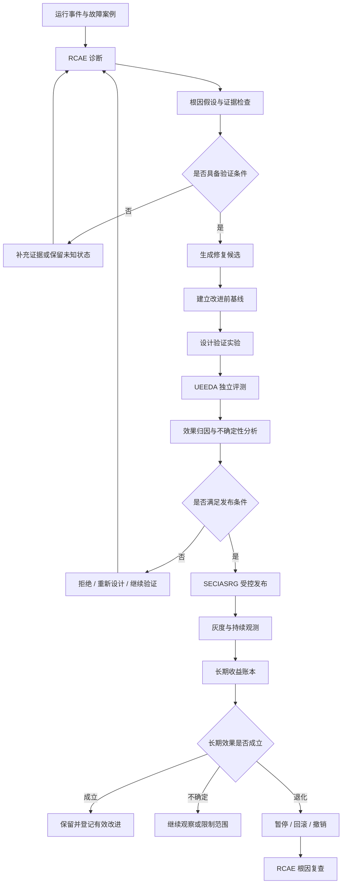

# 问答 132

> 来源: 新 窗口 | 会话: 分支 · 分支 · 分支 · 设计自进化智能体
> 消息: 424e54fb-f210-42c9-834a-c292dbc5ec4e | 时间(UTC): 2026-10-24 12:25

## 用户

继续

## ChatGPT

<WritingBlock id="73184" variant="document"># EvoAgent 第六十七专项：因果归因、修复有效性与长期收益验证体系

**专项编号：CARE-LBV**

**英文名称：Causal Attribution, Repair Effectiveness & Long-Term Benefit Validation**

**文档版本：V1.0**

**文档性质：全量架构专项设计**

**承接专项：** 第六十五专项 RIFISRA（运行时可靠性）、第六十六专项 EOECDDQ（可观测性与诊断数据质量）。

**核心目标：** 让 EvoAgent 不仅能够发现问题、分析原因和提出改进，还能够验证问题是否真正被修复、改进是否确实产生收益、是否引入新的问题，以及这项改进是否值得长期保留。

本文定义目标架构、实验机制、数据模型、工程接口和验收标准，不代表相关模块已经实现或通过测试。

---

# 一、为什么能够自动修复问题，仍然不等于能够自主进化？

假设 EvoAgent 的代码专家最近出现了大量任务失败。

系统通过前两个专项完成了以下工作：

1. 从运行日志中识别失败事件；
2. 将失败事件关联到具体工具和能力版本；
3. 由 RCAE 分析可能的根因；
4. 生成改进候选；
5. 使用 UEEDA 执行回归测试；
6. 发现新版本在测试集上的成功率提高；
7. 通过 SECIASRG 的发布门禁。

从表面看，整个自动进化闭环已经建立。

但还存在一个根本问题：

**新版本表现更好，究竟是因为这次改进有效，还是因为其他因素恰好发生了变化？**

例如：

- 修改了代码专家的工具调用策略；
- 同期更换了模型；
- 测试集中的困难任务比例降低；
- 外部工具的服务质量改善；
- 模型调用预算增加；
- 新版本遇到的任务与旧版本不再具有可比性。

如果没有对这些因素进行控制，系统可能将外部变化产生的收益错误地归因于自身改进。

反过来，也可能出现相反的情况。

某次改进确实有效，但因为测试样本太少，或者评测环境出现波动，系统误判改进无效，将其回滚。

还有一种更隐蔽的情况：

某项修改提高了任务成功率，却使每个成功任务的成本翻倍，或者增加了其他专家的失败率。

如果系统只观察一个指标，就可能把局部优化误认为整体进步。

因此，EvoAgent 需要从“修改后是否表现更好”，进一步走向：

- 原问题是否真实存在？
- 原因是否得到了足够证据支持？
- 新方案是否针对这个原因？
- 在可比条件下，新方案是否优于旧方案？
- 收益是否超过成本与风险？
- 新方案是否损害其他能力？
- 改进是否在真实运行中持续有效？
- 何时应该保留、扩大使用、回滚或撤销这项改进？

这就是 CARE-LBV 要解决的问题。

---

# 二、第一性原理：区分四种不同的成功

EvoAgent 必须区分以下四种结果。

| 层次 | 判断问题 | 示例 |
|---|---|---|
| 问题解决 | 原故障是否消失？ | 工具参数错误不再发生 |
| 局部能力提升 | 相关任务是否表现更好？ | 代码修改任务成功率提高 |
| 系统整体提升 | 全系统的质量、成本和稳定性是否改善？ | 总体返工率下降，其他专家没有退化 |
| 长期收益成立 | 经过持续运行，收益是否仍然存在且值得保留？ | 多周运行后仍有收益，维护成本可接受 |

这四个层次不能相互替代。

一个错误不再出现，可能只是因为系统不再尝试相关任务。

局部任务成功率提高，可能是因为成本显著增加。

系统整体指标短期改善，也可能只是任务分布发生变化。

因此，建议将“真正有效的进化”定义为：

> 在可比的评测条件下，改进能够产生可验证的目标收益，满足安全与资源约束，对相关能力的副作用处于可接受范围，并且在规定的观察窗口内没有出现足以否定原结论的证据。

这里的“可验证”不要求每项改进都采用复杂的统计实验。

个人使用的 EvoAgent 可以根据改动风险、任务数量、验证成本和潜在损失，选择不同强度的验证方法。

关键是不能将证据不足误认为证据充分。

---

# 三、总体架构：因果归因与收益验证控制平面

建议新增 `Causal & Benefit Validation Plane`，简称 CBVP。

它位于诊断、实验、发布和长期运行之间，负责管理改进的验证过程。

CBVP 不直接替代 RCAE、UEEDA 或 SECIASRG。

它们的职责分别是：

- RCAE：提出和分析故障原因；
- EOECDDQ：保证事件和诊断证据可追溯；
- UEEDA：执行独立评测；
- CBVP：判断实验设计能否支持结论、改进是否真正有效，以及长期收益是否成立；
- SECIASRG：根据证据决定发布、扩大范围、回滚或撤销；
- AECGSR：协调进化任务与资源预算。

## 3.1 总体架构图



## 3.2 核心架构原则

1. 诊断假设不能直接成为已确认根因。
2. 修复前必须有明确的基线或说明为什么无法建立基线。
3. 实验必须在执行前定义成功标准。
4. 评测结果必须能够追溯到具体版本、数据和环境。
5. 不能仅依靠一个指标判断进化是否成功。
6. 低风险改进可以自动推进，但必须满足相应的证据与门禁要求。
7. 高风险或证据不足的改进必须受到更严格的限制。
8. 发布成功与长期收益成立是两个不同的状态。
9. 已经被证明无效或有害的改进，应能够撤销并追踪其影响。
10. 所有实验和长期观察都必须受到成本与资源预算约束。

---

# 四、先建立可信基线：没有基线，就无法可靠判断进步

基线是衡量改进效果的参照。

如果没有可信基线，系统就很容易将正常波动误认为改进收益。

## 4.1 基线至少需要包含什么？

建议建立 `BaselineSnapshot`，记录：

| 字段 | 含义 |
|---|---|
| `baseline_id` | 基线唯一标识 |
| `capability_id` | 被评估的能力 |
| `baseline_version` | 当前稳定版本 |
| `model_config_id` | 模型配置 |
| `tool_versions` | 工具版本集合 |
| `workflow_version` | 工作流版本 |
| `evaluation_dataset_id` | 评测数据集 |
| `evaluation_version` | 评测规则版本 |
| `environment_fingerprint` | 关键环境信息 |
| `budget_profile` | 预算配置 |
| `metric_definitions` | 指标定义版本 |
| `measurement_window` | 统计窗口 |
| `sample_count` | 有效样本量 |
| `data_quality_status` | 数据质量状态 |
| `uncertainty_summary` | 结果的不确定性说明 |

基线不仅仅是一个成功率数字。

例如，记录“代码专家成功率为 82%”是不够的。

还需要知道：

- 82% 是在哪些任务上测得的；
- 任务难度如何分布；
- 使用的是什么模型；
- 工具是否处于正常状态；
- 失败任务如何计数；
- 是否存在缺失结果；
- 评测集是否发生变化；
- 预算是否与新版本一致。

只有这些信息足够明确，后续对比才有意义。

## 4.2 区分三类基线

**第一类：固定评测基线。**

使用版本化、固定的评测集，对比新旧版本的表现。

优点是容易复现，适合回归测试和早期改进验证。

缺点是可能无法覆盖真实运行中的新任务。

**第二类：历史运行基线。**

使用真实运行数据，衡量系统在实际任务中的表现。

优点是接近真实使用环境。

缺点是任务分布、模型服务和外部环境可能不断变化。

**第三类：受控实验基线。**

在相同或可比条件下，使用旧版本与候选版本进行配对或对照实验。

优点是更适合识别改进产生的效果。

缺点是需要更多运行成本，并且实验设计本身必须合理。

三类基线应当互相补充，而不是互相替代。

---

# 五、因果归因：从“看起来相关”走向“有证据支持”

EvoAgent 不需要为每一次小修改都建立复杂的因果模型，但必须理解不同证据能够支持什么结论。

## 5.1 三个证据层级

### 层级一：相关性证据

例如：

- 使用某个工具版本的任务失败率更高；
- 某个提示词版本发布后，平均任务耗时下降；
- 某个专家经常在特定模型配置下失败。

这些观察可以帮助提出根因假设，但不能单独证明因果关系。

因为任务类型、模型版本和外部环境可能同时发生变化。

### 层级二：机制与复现证据

例如：

- 失败任务都使用了某个错误参数；
- 使用旧参数可以稳定复现错误；
- 修正参数后，错误在相同测试条件下消失。

这种证据能够更有力地支持修复假设。

但仍需检查是否存在其他同时变化的因素。

### 层级三：受控对比证据

例如：

- 同一组任务分别由旧版本和新版本执行；
- 模型、工具、预算和验收标准保持一致；
- 新版本在目标指标上持续表现更好；
- 相关硬性约束没有被违反。

这类证据通常更适合支持改进效果的归因。

但即使实验设计合理，结论也只适用于实验所覆盖的条件和任务范围，不能自动推广到所有场景。

## 5.2 建立因果假设对象

建议定义 `CausalHypothesis`。

核心字段包括：

- `hypothesis_id`；
- `incident_id`；
- `suspected_cause`；
- `affected_component`；
- `proposed_mechanism`；
- `supporting_evidence`；
- `contradicting_evidence`；
- `alternative_explanations`；
- `expected_observable_effects`；
- `validation_plan`；
- `validation_status`；
- `scope_of_validity`。

例如：

```text
假设：
代码专家的重复失败主要由工具参数生成错误引起。

预期表现：
1. 错误参数与失败事件存在稳定关联。
2. 修复参数生成逻辑后，同类错误显著减少。
3. 工具超时率不应因为本次改动而显著上升。
4. 其他类型任务的成功率不应明显退化。

验证方式：
1. 复现历史失败案例。
2. 对旧版和候选版运行相同评测集。
3. 检查工具参数正确率。
4. 检查成本、时延和副作用指标。
```

这种设计可以防止诊断器只提出一个原因，却没有明确说明应该观察什么结果才能验证它。

---

# 六、实验设计：根据风险选择合适的验证强度

个人使用的 EvoAgent 不适合对所有改进都执行昂贵的大规模实验。

因此，建议建立分级实验策略。

## 6.1 四级验证机制

<box gap={3}>
  <row align=start gap={3}>
    <box background="surface-secondary" radius="lg" padding={3} size="48px" align=center justify=center>
      <icon name="check-circle" size="xl"/>
    </box>
    <box flex="1" gap={1}>
      **L0：静态与确定性检查**

      <text color="secondary" size="sm">适用于格式修复、配置校验、类型检查、静态分析等低风险改动。</text>

      - 运行单元测试和静态检查。
      - 检查接口兼容性。
      - 确认没有违反硬性约束。

      <text color="secondary" size="sm">通过后只能说明基础检查通过，不能直接证明实际任务质量提升。</text>
    </box>
  </row>
  <divider color="subtle"/>
  <row align=start gap={3}>
    <box background="surface-secondary" radius="lg" padding={3} size="48px" align=center justify=center>
      <icon name="flask-conical" size="xl"/>
    </box>
    <box flex="1" gap={1}>
      **L1：固定评测与历史案例复现**

      <text color="secondary" size="sm">适用于工具参数、提示词、路由规则和局部工作流优化。</text>

      - 运行固定回归集。
      - 重放历史失败案例。
      - 对比新旧版本的目标指标和副作用指标。

      <text color="secondary" size="sm">这是大多数低风险自动改进的默认验证层。</text>
    </box>
  </row>
  <divider color="subtle"/>
  <row align=start gap={3}>
    <box background="surface-secondary" radius="lg" padding={3} size="48px" align=center justify=center>
      <icon name="git-compare" size="xl"/>
    </box>
    <box flex="1" gap={1}>
      **L2：受控对比与重复实验**

      <text color="secondary" size="sm">适用于影响范围较大、收益不确定或存在成本权衡的改动。</text>

      - 使用配对任务或受控对照。
      - 检查不同任务类别的表现。
      - 评估结果波动与不确定性。
      - 在必要时进行消融实验。

      <text color="secondary" size="sm">重点是判断改进是否具有可重复的收益，而非只看一次实验结果。</text>
    </box>
  </row>
  <divider color="subtle"/>
  <row align=start gap={3}>
    <box background="surface-secondary" radius="lg" padding={3} size="48px" align=center justify=center>
      <icon name="shield-check" size="xl"/>
    </box>
    <box flex="1" gap={1}>
      **L3：受控发布与长期观察**

      <text color="secondary" size="sm">适用于共享内核、路由器、关键权限链、跨专家工具和其他高影响改动。</text>

      - 经过隔离评测后小范围发布。
      - 持续检查实际运行效果。
      - 设置明确的停止和回滚条件。
      - 满足长期收益标准后再确认保留。

      <text color="secondary" size="sm">高风险改动不能仅凭离线评测结果自动扩大使用范围。</text>
    </box>
  </row>
</box>

具体分级应由改动风险、影响范围、可逆性、证据质量和潜在损失共同决定。

涉及权限、安全边界、重要外部副作用或不可逆操作的改动，必须执行相应的严格审查，不能因为测试集表现更好就降低安全门槛。

## 6.2 配对测试优先

假设旧版本与新版本需要比较代码修复能力。

如果旧版本执行的是简单任务，而新版本执行的是困难任务，直接比较成功率并不公平。

配对测试的思路是：

1. 选择同一批具有代表性的任务；
2. 在尽可能相同的条件下运行旧版本和新版本；
3. 对比同一任务在两个版本下的结果；
4. 统计成功、失败、成本和时延的变化；
5. 检查是否存在系统性退化。

对于随机性较高的模型，可以在预算允许的情况下进行多次运行，并使用相应的统计方法评估波动。

需要注意，配对任务并不意味着必须让两个版本同时执行真实的外部操作。

对于会发送消息、提交订单、修改线上数据等具有副作用的任务，应使用隔离环境、模拟工具、只读重放或经过批准的安全实验方式。

---

# 七、控制混杂因素：确保比较的是改进，而不是环境变化

即使测试任务完全相同，如果其他关键条件发生变化，也可能影响实验结论。

建议建立 `ExperimentContext`，记录所有可能影响结果的重要因素。

至少包括：

- 模型名称与版本；
- 模型参数；
- 系统提示词版本；
- 专家配置；
- 工具版本；
- 工作流版本；
- 路由器版本；
- 记忆与上下文策略版本；
- 评测集版本；
- 任务预算；
- 超时和重试策略；
- 设备与运行环境；
- 外部服务状态；
- 评测时间窗口。

## 7.1 单变量变更与组合变更

对于小型改进，优先一次只改变一个主要因素。

例如，先修复工具参数生成逻辑，再独立评估提示词调整。

这样更容易判断收益来源。

但有时多个模块必须协同修改才能产生效果，例如：

- 新工具接口需要配套提示词；
- 新工作流依赖新的上下文策略；
- 新路由规则需要专家配置同步调整。

这种情况下，可以将它们作为一个完整的候选变更集合进行测试，但必须记录每项变更，并在必要时通过消融实验分析各自贡献。

## 7.2 模型切换必须单独治理

EvoAgent 支持模型适配分支。

因此，如果一个专家在模型切换后成功率提高，不能自动将全部提升归因于提示词或工具改进。

建议采用以下规则：

- 模型版本变化时创建新的评测上下文；
- 需要判断提示词收益时，尽可能固定模型；
- 需要判断模型收益时，尽可能固定其他关键配置；
- 无法固定环境时，明确标记结论的适用范围；
- 不把不同实验条件下的数字直接当作同口径结果。

当旧模型不可用时，可以采用历史基线、配对可用任务或其他合理的对比方法，但必须明确说明归因能力受到什么限制。

---

# 八、统计不确定性：避免把偶然成功当成能力提升

这是自进化系统容易产生错误判断的另一个原因。

假设某项改进在 10 个任务中成功了 9 个，成功率为 90%。

旧版本在 10 个任务中成功了 8 个，成功率为 80%。

这并不能自动证明新版本更好。

样本量较小时，少数任务的差异就可能显著改变统计结果。

因此，CARE-LBV 不能只记录一个成功率，而应同时记录：

- 有效样本量；
- 失败样本量；
- 样本选择规则；
- 任务类别分布；
- 估计的效果大小；
- 适用的统计不确定性；
- 预先定义的决策阈值。

## 8.1 不应为所有改进规定同一个样本量

不同任务的难度和波动差异很大。

例如：

- JSON 格式校验具有较高的确定性；
- 代码修改的结果可能受到环境影响；
- 开放式内容创作具有较大的主观评价差异；
- 手机操作可能受到设备型号、应用版本和界面状态影响。

因此，应根据任务类型、基线表现、预期收益、错误成本和评测方法选择验证规模。

对于样本不足的任务，系统可以：

1. 使用固定回归集检查已知问题；
2. 收集更多代表性样本；
3. 在隔离环境中复现实验；
4. 采用适当的统计区间或配对分析；
5. 保留“证据不足”的状态。

## 8.2 预先定义停止规则

系统不能在反复运行实验的过程中，只挑选最有利的一次结果。

建议在实验开始前定义：

- 主要目标指标；
- 最低可接受收益；
- 硬性约束；
- 最大实验预算；
- 最小必要证据；
- 何时判定无效；
- 何时判定有害；
- 何时需要继续收集样本。

如果实验结果仍然不确定，应根据风险和剩余预算决定是否继续，而不是无限增加实验次数。

---

# 九、修复有效性验证：确认问题真的被修复，而不只是暂时消失

在 CARE-LBV 中，问题修复需要独立于整体任务成功率进行评估。

假设代码专家存在工具参数错误。

修复后，整个代码任务的成功率有所提高。

但如果系统已经改变路由，使原本容易触发参数错误的任务不再进入该专家，就不能证明参数生成逻辑已经修复。

因此，需要建立 `RepairEffectivenessRecord`。

## 9.1 修复记录的核心字段

| 字段 | 含义 |
|---|---|
| `repair_id` | 修复记录 ID |
| `incident_id` | 原故障 ID |
| `root_cause_hypothesis_id` | 关联根因假设 |
| `target_failure_signature` | 目标故障特征 |
| `baseline_failure_rate` | 修复前的目标故障率 |
| `candidate_failure_rate` | 候选版本的目标故障率 |
| `reproduction_result` | 历史故障复现结果 |
| `regression_result` | 回归测试结果 |
| `side_effect_metrics` | 副作用指标 |
| `validation_status` | 修复验证状态 |
| `observation_window` | 观察窗口 |
| `residual_risk` | 剩余风险 |

## 9.2 建议的修复验证流程

1. 明确原故障的可识别特征；
2. 确定原故障出现的条件；
3. 在旧版本中尽可能复现；
4. 在候选版本中使用相同条件验证；
5. 检查目标故障是否减少；
6. 检查是否引入其他故障；
7. 验证相关任务仍然满足最终验收要求；
8. 发布后继续观察同类故障是否复发。

如果历史故障无法复现，应记录原因。

例如，原来的外部服务已经下线，或者相关环境已经发生不可逆变化。

此时可以通过其他证据验证修复，但不能伪称已经完成相同条件下的复现。

## 9.3 区分根因修复与症状缓解

假设模型频繁调用一个失败工具。

系统可以通过增加重试间隔降低错误频率。

这可能缓解问题，却没有解决工具接口不兼容的根因。

建议将修复分类为：

- 根因修复；
- 症状缓解；
- 风险隔离；
- 能力替代；
- 临时规避；
- 尚未确认。

这些方案可能都具有价值，但应采用不同的长期收益评估标准。

---

# 十、整体收益函数：不能只优化成功率

EvoAgent 的长期目标是提高执行质量、效率和稳定性，同时控制成本。

因此，建议建立多目标收益评估机制，而不是只使用单一成功率。

## 10.1 四类核心目标

**质量收益**

- 任务成功率提高；
- 结果缺陷减少；
- 返工率下降；
- 验收完整性提高。

**效率收益**

- 完成时间缩短；
- 无效工具调用减少；
- 重复计划次数减少；
- 恢复时间缩短。

**成本收益**

- 单位成功任务成本降低；
- 失败重试成本降低；
- 无效模型调用减少；
- 维护和存储成本可控。

**稳定性收益**

- 故障复发率下降；
- 工具超时率下降；
- 异常终止率下降；
- 任务状态冲突减少。

此外，安全与权限要求应作为硬性约束，而不是可以被其他收益抵消的普通指标。

## 10.2 建立统一的净收益模型

建议定义：

\[
B_{\text{net}}
=
B_{\text{quality}}
+
B_{\text{efficiency}}
+
B_{\text{stability}}
-
C_{\text{implementation}}
-
C_{\text{runtime}}
-
C_{\text{maintenance}}
-
C_{\text{risk}}
\]

其中：

- \(B_{\text{quality}}\)：质量改善带来的收益；
- \(B_{\text{efficiency}}\)：效率改善带来的收益；
- \(B_{\text{stability}}\)：稳定性改善带来的收益；
- \(C_{\text{implementation}}\)：开发、实验与迁移成本；
- \(C_{\text{runtime}}\)：持续运行的额外成本；
- \(C_{\text{maintenance}}\)：维护负担；
- \(C_{\text{risk}}\)：预期风险成本。

这是一个概念模型。

只有当不同指标能够合理转换为统一价值单位时，才能直接计算单一数值。

如果质量、时延和稳定性无法可靠地转换为同一单位，就应采用多指标决策，而不是为了得到一个数字而随意设定权重。

## 10.3 个人使用场景的建议

对于 EvoAgent，不需要一开始就将所有收益换算成货币。

可以采用分层决策：

1. 首先检查安全和权限硬性约束；
2. 检查目标质量是否达到最低标准；
3. 比较成功率、返工率、时延和成本；
4. 评估维护负担；
5. 结合长期观察决定是否保留。

如果一项改进提高了质量，但增加了模型调用成本，只要收益真实、成本受控且符合用户预算，就可能值得保留。

反之，如果只获得很小的成功率提升，却大幅增加延迟和维护复杂度，就未必是有效进化。

---

# 十一、跨专家影响评估：局部进步不能损害整个系统

EvoAgent 采用独立领域专家与共享通用内核的分层架构。

因此，某项改进可能产生三种影响：

- 对目标专家产生正向影响；
- 对其他专家产生负向影响；
- 对共享内核或路由器产生系统级影响。

例如，调整通用内核的上下文压缩策略，可能改善代码专家的长任务表现，却损害漫剧专家的角色一致性。

如果只测试代码专家，就可能把一次局部改进错误地发布到整个系统。

## 11.1 建立影响范围图

每项改进都应声明：

- 修改的能力资产；
- 直接依赖模块；
- 间接影响的专家；
- 相关工具和工作流；
- 使用该能力的任务类型；
- 需要执行的回归测试集。

建议将依赖关系与 EOACA 的能力资产、能力依赖图结合。

## 11.2 采用分层回归测试

对于领域专家内部的局部改动：

- 先测试目标专家；
- 再测试直接依赖能力；
- 对重要共享依赖执行必要的回归检查。

对于共享内核、路由器、权限机制和全局上下文策略的改动：

- 必须扩大回归范围；
- 检查多个代表性专家；
- 检查系统级质量与成本；
- 对安全边界执行专门测试。

不能要求每次局部改动都运行整个系统的所有测试。

但也不能让共享能力在没有足够回归覆盖的情况下自动发布。

---

# 十二、长期收益账本：让系统知道哪些改进值得保留

建议新增 `EvolutionBenefitLedger`，即进化收益账本。

它不是普通的日志表，而是记录每项改进从提出、验证、发布到长期观察的完整生命周期。

## 12.1 核心数据字段

| 字段 | 含义 |
|---|---|
| `improvement_id` | 改进唯一 ID |
| `capability_id` | 受影响能力 |
| `change_set_id` | 变更集合 |
| `hypothesis_id` | 根因或收益假设 |
| `baseline_id` | 修复前基线 |
| `experiment_id` | 验证实验 |
| `release_id` | 正式发布记录 |
| `target_metrics` | 目标指标 |
| `guardrail_metrics` | 硬性约束与副作用指标 |
| `observed_benefit` | 已观测收益 |
| `estimated_cost` | 实施和持续成本 |
| `observation_status` | 长期观察状态 |
| `confidence_summary` | 证据强度与不确定性 |
| `regression_history` | 后续退化记录 |
| `final_decision` | 保留、回滚、撤销或继续观察 |
| `decision_evidence` | 决策依据 |

## 12.2 改进生命周期状态

建议采用以下状态：

```text
PROPOSED
   ↓
BASELINED
   ↓
EXPERIMENTING
   ↓
VALIDATED
   ↓
RELEASED
   ↓
OBSERVING
   ├── BENEFIT_CONFIRMED
   ├── BENEFIT_UNCERTAIN
   ├── REGRESSION_DETECTED
   └── REJECTED_OR_REVERTED
```

其中：

- `VALIDATED`：候选版本通过预定义的实验门禁；
- `RELEASED`：已进入受控正式运行；
- `OBSERVING`：正在收集真实运行证据；
- `BENEFIT_CONFIRMED`：在适用的观察范围内，收益满足预定义标准；
- `BENEFIT_UNCERTAIN`：证据仍不足以判断；
- `REGRESSION_DETECTED`：出现达到阈值的退化；
- `REJECTED_OR_REVERTED`：候选被拒绝或已经回滚。

不能将 `RELEASED` 自动等同于 `BENEFIT_CONFIRMED`。

## 12.3 记录负收益与失败实验

收益账本不能只记录成功改进。

还必须记录：

- 未能复现的修复；
- 没有产生预期收益的实验；
- 产生副作用的候选；
- 被回滚的版本；
- 后来证明无效的根因假设；
- 成本高于收益的优化；
- 仅在特定任务范围内有效的改进。

这些记录能够帮助系统避免重复尝试已知无效方案。

不过，历史失败经验不能被视为永远有效的禁止规则。

随着模型、工具和环境发生变化，过去失败的方案可能在新条件下重新有效。

因此，系统应保存其适用条件与失败原因，而不是简单地将所有失败方案永久加入黑名单。

---

# 十三、发布后长期观察与自动回滚

通过实验门禁的候选版本，仍可能在真实运行中出现退化。

原因可能包括：

- 真实任务分布与测试集不同；
- 外部服务发生变化；
- 模型服务行为发生变化；
- 新版本与其他专家组合后产生副作用；
- 长期记忆或上下文状态逐渐累积；
- 某些边界条件没有被测试覆盖。

因此，发布后需要继续观察。

## 13.1 发布观察策略

建议根据改动风险设置不同的观察机制。

| 改动类型 | 建议观察方式 |
|---|---|
| 低风险配置修复 | 检查发布后的同类错误与回归指标 |
| 工具参数优化 | 观察工具成功率、重试率和副作用 |
| 专家提示词调整 | 观察任务质量、成本和返工率 |
| 路由器调整 | 观察路由正确率、整体成功率和专家负载 |
| 共享内核变更 | 观察多个专家及系统级指标 |
| 关键控制机制变更 | 采用严格验证与受保护的发布流程 |

## 13.2 自动回滚条件必须预先定义

例如：

- 出现权限边界违规；
- 重复外部副作用达到规定的严重程度；
- 关键任务失败率超过阈值；
- 核心状态存储出现不一致；
- 新版本无法完成关键健康检查；
- 结果验收出现系统性退化。

具体阈值应根据能力类型、基线和风险等级设定。

不能对所有专家使用完全相同的数字。

对于低频任务，短期样本量不足时，不能仅凭一个偶发失败就自动判定版本有害。

但对于明确的安全违规或严重数据损坏，也不能因为样本量小而继续等待。

**硬性安全条件与统计效果条件必须分别处理。**

## 13.3 回滚也需要验证

回滚不能只修改一个版本配置字段。

系统必须检查：

1. 实际运行版本是否已经切回；
2. 旧版本是否仍然兼容当前持久化数据；
3. 回滚后关键任务是否恢复正常；
4. 新版本产生的数据是否需要迁移或隔离；
5. 是否存在无法撤销的外部副作用；
6. 是否需要对受影响任务进行补偿或重新验收。

对于数据库结构、长期记忆格式或外部数据结构发生变化的改动，回滚可能需要专门的兼容与迁移方案。

---

# 十四、工程目录与核心接口

建议新增以下模块：

```text
evoagent/
├── causal_benefit_validation/
│   ├── hypothesis_registry/
│   ├── causal_evidence/
│   ├── baseline_manager/
│   ├── experiment_designer/
│   ├── experiment_context/
│   ├── confounder_registry/
│   ├── paired_evaluation/
│   ├── controlled_comparison/
│   ├── ablation_analysis/
│   ├── uncertainty_analysis/
│   ├── repair_effectiveness/
│   ├── cross_expert_impact/
│   ├── long_term_observation/
│   └── decision_engine/
├── evolution_benefit_ledger/
│   ├── improvement_registry/
│   ├── benefit_record/
│   ├── cost_record/
│   ├── regression_history/
│   ├── evidence_lineage/
│   └── lifecycle_manager/
├── controlled_release/
│   ├── rollout_policy/
│   ├── canary_controller/
│   ├── guardrail_monitor/
│   ├── rollback_trigger/
│   ├── rollback_verifier/
│   └── release_observation/
└── causal_benefit_tests/
    ├── baseline_reproducibility/
    ├── paired_evaluation_tests/
    ├── confounder_detection/
    ├── sample_size_tests/
    ├── repair_effectiveness_tests/
    ├── metric_regression_tests/
    ├── cross_expert_regression/
    ├── benefit_ledger_tests/
    ├── rollout_tests/
    └── rollback_validation/
```

建议提供以下核心接口：

- `register_causal_hypothesis`：登记根因假设；
- `validate_causal_evidence`：检查因果证据；
- `capture_baseline_snapshot`：保存可信基线；
- `validate_baseline_quality`：检查基线质量；
- `build_experiment_context`：构建实验条件；
- `detect_experiment_confounders`：识别混杂因素；
- `design_paired_experiment`：设计配对实验；
- `design_controlled_comparison`：设计受控对比；
- `run_ablation_analysis`：执行消融分析；
- `estimate_effect_size`：估计改进效果；
- `evaluate_uncertainty`：评估结果不确定性；
- `validate_repair_effectiveness`：验证修复效果；
- `evaluate_cross_expert_impact`：评估跨专家影响；
- `calculate_net_benefit`：评估净收益；
- `register_improvement`：登记改进；
- `append_benefit_evidence`：追加收益证据；
- `update_improvement_lifecycle`：更新改进生命周期；
- `start_long_term_observation`：启动长期观察；
- `evaluate_benefit_confirmation`：评估收益确认条件；
- `detect_post_release_regression`：检测发布后退化；
- `trigger_controlled_rollback`：触发受控回滚；
- `verify_rollback_result`：验证回滚结果；
- `reconcile_benefit_ledger`：核对收益账本；
- `generate_improvement_effectiveness_report`：生成改进有效性报告。

所有接口都应当使用统一的任务、事件、版本和实验标识，避免产生无法关联的独立统计结果。

---

# 十五、端到端验收场景

建议至少建立以下十二个验收场景。

## 场景 A：一次提示词改进是否真实有效

**初始条件：** 代码专家因计划执行不完整而出现失败。

**验收过程：**

1. 确认失败案例与基线；
2. 登记根因假设；
3. 创建提示词候选；
4. 在固定评测集上运行新旧版本；
5. 检查任务成功率、返工率和成本；
6. 记录实验结论。

**验收重点：** 不以单次成功案例作为改进成立的充分依据。

## 场景 B：模型切换造成的收益误归因

**初始条件：** 专家更换模型的同时修改了提示词。

**验收过程：**

1. 检查模型和提示词版本；
2. 识别实验中的混杂因素；
3. 在条件允许时分别测试模型变化和提示词变化；
4. 无法完全分离时明确结论范围；
5. 不将全部收益归因于单一变更。

**验收重点：** 能够识别同时发生的多项变更。

## 场景 C：小样本导致的偶然提升

**初始条件：** 新版本只在少量任务上表现更好。

**验收过程：**

1. 检查样本量和任务分布；
2. 计算适当的不确定性指标；
3. 判断现有证据是否满足预设门禁；
4. 必要时追加实验；
5. 证据不足时保留不确定状态。

**验收重点：** 不将不确定结果直接标记为已验证收益。

## 场景 D：修复减少失败，却增加成本

**初始条件：** 新版本通过增加模型调用减少任务失败。

**验收过程：**

1. 对比成功率；
2. 对比单位成功任务成本；
3. 检查时延和预算；
4. 根据预设收益标准进行综合评估；
5. 决定保留、调整或拒绝。

**验收重点：** 质量提升不能掩盖不合理的成本增长。

## 场景 E：根因假设错误

**初始条件：** RCAE 认为工具参数是失败原因，但后续实验显示主要原因是外部接口变化。

**验收过程：**

1. 保存原假设；
2. 记录反向证据；
3. 撤销或修正原诊断；
4. 检查相关候选变更；
5. 防止错误修复进入正式发布。

**验收重点：** 系统能够承认并纠正错误诊断。

## 场景 F：局部优化损害其他专家

**初始条件：** 共享上下文策略的修改改善了代码专家，却降低了漫剧专家的表现。

**验收过程：**

1. 检查能力依赖图；
2. 运行相关专家的回归集；
3. 比较局部收益与跨专家退化；
4. 判断是否应该限制改动范围；
5. 必要时撤销共享变更。

**验收重点：** 局部收益不能直接等同于系统整体收益。

## 场景 G：候选版本实验不可复现

**初始条件：** 某次实验显示成功率提高，但缺少工具版本记录。

**验收过程：**

1. 检查实验上下文；
2. 识别缺失的复现条件；
3. 标记结果证据不足；
4. 禁止直接将其视为已确认收益；
5. 补齐条件后重新实验。

**验收重点：** 实验结果必须具有足够的可追溯性。

## 场景 H：发布后出现持续退化

**初始条件：** 新版本通过离线测试，但实际运行中的返工率持续上升。

**验收过程：**

1. 检查发布后的实际任务分布；
2. 比较新旧版本指标；
3. 检查退化是否达到预设阈值；
4. 暂停扩大使用范围；
5. 在满足条件时回滚；
6. 将证据反馈至 RCAE。

**验收重点：** 离线评测通过不能阻止系统处理真实运行中的退化。

## 场景 I：历史失败方案在新环境中重新评估

**初始条件：** 某个优化方案过去失败，但现在模型和工具已经发生变化。

**验收过程：**

1. 查询历史失败记录；
2. 检查原失败条件；
3. 判断当前环境是否仍满足这些条件；
4. 在需要时重新执行隔离实验；
5. 更新方案的适用范围。

**验收重点：** 不将历史失败记录机械地转化为永久禁止规则。

## 场景 J：回滚后仍存在未撤销副作用

**初始条件：** 新版本在运行中修改了外部数据，随后被回滚。

**验收过程：**

1. 恢复已验证的稳定版本；
2. 检查外部数据的实际状态；
3. 识别不可自动撤销的副作用；
4. 执行经过授权的补偿或人工处理；
5. 验证回滚后的系统状态。

**验收重点：** 软件版本回滚不代表外部副作用自动撤销。

## 场景 K：长期收益不再成立

**初始条件：** 某项优化在发布初期有效，但随着任务分布变化，效果逐渐消失。

**验收过程：**

1. 检查长期指标；
2. 比较当前任务分布与原实验分布；
3. 判断收益变化是否超出正常波动；
4. 重新评估原结论的适用范围；
5. 决定继续观察、调整或撤销改进。

**验收重点：** 已确认的历史收益不意味着在所有未来环境中都持续有效。

## 场景 L：进化实验消耗过多预算

**初始条件：** 某项改进无法得到明确结论，实验次数持续增加。

**验收过程：**

1. 检查实验预算；
2. 检查是否达到预设停止条件；
3. 判断继续实验的预期价值；
4. 停止无收益的实验；
5. 保存当前证据和未解决的问题；
6. 将结论标记为无效或证据不足。

**验收重点：** 系统不能为了追求确定答案而无限消耗资源。

---

# 十六、专项验收标准

CARE-LBV 至少需要满足以下要求：

1. 能够区分问题解决、局部能力提升、系统整体提升和长期收益。
2. 能够建立具有完整版本与环境信息的基线。
3. 能够区分历史运行基线、固定评测基线和受控实验基线。
4. 能够记录根因假设、支持证据、反向证据和验证方法。
5. 能够区分相关性、复现证据和受控对比证据。
6. 能够根据改动风险选择不同强度的验证机制。
7. 能够记录实验中的模型、工具、工作流、预算和环境配置。
8. 能够识别可能影响实验结论的混杂因素。
9. 能够在条件允许时使用配对测试或受控对照。
10. 能够在必要时使用消融实验分析组合变更的影响。
11. 能够记录样本量、结果波动和不确定性。
12. 能够防止通过反复试验挑选偶然有利结果。
13. 能够根据任务风险和证据质量决定是否继续实验。
14. 能够验证原故障是否真正被修复。
15. 能够区分根因修复、症状缓解和风险隔离。
16. 能够检查修复是否引入新的故障。
17. 能够综合比较质量、效率、成本和稳定性。
18. 能够将权限与关键安全条件作为硬性约束。
19. 能够评估局部改动对其他专家和共享内核的影响。
20. 能够建立具有明确生命周期状态的进化收益账本。
21. 能够记录成功、失败、无效和被撤销的改进。
22. 能够在发布后持续观测真实运行效果。
23. 能够根据预定义的风险阈值触发暂停或回滚。
24. 能够验证回滚后的实际运行版本与状态。
25. 能够识别软件回滚无法撤销的外部副作用。
26. 能够重新评估历史失败方案在新环境中的适用性。
27. 能够识别长期收益衰减或任务分布变化。
28. 能够将长期证据反馈至 RCAE、UEEDA 和 SECIASRG。
29. 能够为每项已确认改进提供可追溯的证据链。
30. 能够在证据不足时明确保留不确定结论。
31. 能够对高风险改动执行更严格的发布与恢复控制。
32. 能够防止后台实验耗尽稳定执行轨道的预算。
33. 能够通过重复实验检查收益的可复现性。
34. 能够在 Windows、Android 和 mini Linux 环境中记录必要的实验上下文。
35. 能够在真实运行效果与原实验结论不一致时重新评估改进。

以上为目标架构验收要求，不代表相关模块已经实现或通过测试。

---

# 十七、建议冻结的架构决策

以下建议承接 ADR-1225。

| 编号 | 决策 |
|---|---|
| ADR-1226 | 建立因果归因、修复有效性与长期收益验证体系 CARE-LBV |
| ADR-1227 | 区分问题解决、局部能力提升、系统整体提升和长期收益 |
| ADR-1228 | 重要改进必须具备明确的基线或说明基线缺失原因 |
| ADR-1229 | 基线必须关联模型、工具、工作流、评测集和预算配置 |
| ADR-1230 | 区分历史运行基线、固定评测基线和受控实验基线 |
| ADR-1231 | 诊断相关性不得自动升级为已确认因果关系 |
| ADR-1232 | 根因假设必须包含可观察的预期结果与验证方法 |
| ADR-1233 | 改进实验应根据风险、可逆性和证据要求分级 |
| ADR-1234 | 低风险改进优先采用确定性检查与固定回归测试 |
| ADR-1235 | 重要改进应根据需要采用配对测试、受控对照或消融实验 |
| ADR-1236 | 实验必须记录足以解释和复现结果的上下文 |
| ADR-1237 | 模型、工具、数据集和预算变化必须纳入混杂因素检查 |
| ADR-1238 | 实验必须预先定义目标指标、硬性约束、预算和停止规则 |
| ADR-1239 | 统计样本不足时必须保留不确定性，不得强行确认收益 |
| ADR-1240 | 不得仅通过反复试验选择偶然有利的结果作为发布依据 |
| ADR-1241 | 修复有效性必须独立于整体任务成功率进行评估 |
| ADR-1242 | 必须区分根因修复、症状缓解、风险隔离和临时规避 |
| ADR-1243 | 进化决策必须综合考虑质量、效率、成本、稳定性和维护负担 |
| ADR-1244 | 权限、安全和关键数据完整性必须作为不可随意抵消的硬性约束 |
| ADR-1245 | 共享内核和路由器改动必须执行与影响范围相匹配的跨专家回归 |
| ADR-1246 | 建立统一的进化收益账本，记录改进的完整生命周期 |
| ADR-1247 | 发布成功不得直接等同于长期收益已经成立 |
| ADR-1248 | 已确认、证据不足、已退化和已撤销的改进必须使用不同状态 |
| ADR-1249 | 进化收益账本必须记录失败实验、负收益和被推翻的假设 |
| ADR-1250 | 正式发布后必须持续观测真实运行表现 |
| ADR-1251 | 自动回滚条件必须预先定义，并区分安全约束与统计效果阈值 |
| ADR-1252 | 回滚必须验证实际运行版本、数据兼容性和外部副作用 |
| ADR-1253 | 历史失败方案必须保留适用条件，不得无条件永久禁止 |
| ADR-1254 | 长期收益评估必须考虑任务分布变化和环境变化 |
| ADR-1255 | 实验过程必须受到明确的成本、时限和资源预算约束 |
| ADR-1256 | CARE-LBV 必须与 RCAE、EOECDDQ、UEEDA、SECIASRG、AECGSR 和 EOACA 协同 |
| ADR-1257 | 重要改进必须能够追溯到基线、实验、发布和长期观察证据 |
| ADR-1258 | 进化收益确认必须依据预定义标准，而不是仅依靠模型自我评价 |
| ADR-1259 | 无法可靠归因的收益必须明确标记其结论范围与不确定性 |
| ADR-1260 | CARE-LBV 应采用本地优先的逻辑架构，不要求单独部署服务器 |

以上建议作为 EvoAgent 第六十七专项的架构基线。

---

# 十八、完成第六十七专项后，EvoAgent 的自进化闭环达到什么程度？

到这里，目标架构已经形成四个相互衔接的治理层次。

| 层次 | 解决的问题 |
|---|---|
| RIFISRA | 发生故障时如何隔离、恢复和保护系统 |
| EOECDDQ | 如何判断运行数据与诊断证据是否可信 |
| CARE-LBV | 如何验证修复效果、收益归因和长期价值 |
| SECIASRG + UEEDA | 如何根据验证结果控制发布、回滚与回归测试 |

这四层共同构成一个更严格的自进化闭环。

```text
任务运行
   ↓
故障发现
   ↓
运行证据与数据质量检查
   ↓
根因假设
   ↓
修复候选
   ↓
建立基线
   ↓
设计实验
   ↓
验证修复与改进收益
   ↓
发布门禁
   ↓
受控上线
   ↓
长期运行观察
   ↓
确认收益 / 继续观察 / 回滚
   ↓
更新能力资产与历史证据
```

这意味着 EvoAgent 的目标不再只是让模型不断生成更好的提示词或工具参数。

系统还必须知道：

- 为什么要改；
- 改动针对什么问题；
- 如何验证；
- 何时应该停止；
- 什么情况下应该回滚；
- 如何衡量长期收益；
- 如何避免重复犯错。

但仍需强调：上述内容是目标架构与设计基线，只有各模块实现并通过相应验收后，才能宣称系统具备这些能力。

---

# 十九、下一专项：自进化决策治理、改进优先级与全局资源分配

完成第六十七专项后，还剩下一个影响整个系统长期演化方向的问题。

假设 EvoAgent 同时发现了以下问题：

- 代码专家的失败率偏高；
- 旅游专家的路由准确率下降；
- AI 漫剧生成成本过高；
- Android 手机操作偶尔失败；
- 共享上下文压缩策略导致长任务质量下降；
- 工具日志中存在大量数据质量问题。

每个专项都可以独立生成改进候选。

每个候选也可能通过自己的评测门禁。

但系统总预算有限，不可能同时完成所有优化。

这时，谁来决定先改哪个问题？

如果按失败次数排序，可能优先处理频率高但影响很小的问题。

如果按单次损失排序，可能忽略频率很高的普通故障。

如果按模型判断的预期收益排序，可能反复选择看起来收益巨大、实际上缺乏证据的候选。

如果各专家分别争取资源，可能出现代码专家持续占用预算，而共享内核和其他专家长期得不到优化。

因此，下一专项建议定义为：

**Self-Evolution Decision Governance, Improvement Prioritization & Global Resource Allocation，简称 SEDG-IPGRA。**

核心研究方向包括：

1. 如何建立统一的改进候选注册中心；
2. 如何区分紧急故障处理与普通能力优化；
3. 如何根据影响范围、严重程度、发生频率和修复成本进行排序；
4. 如何将证据质量与预期收益结合，避免过度相信未经验证的改进；
5. 如何评估共享内核改进与领域专家改进之间的优先级；
6. 如何平衡稳定性、执行质量、效率和成本；
7. 如何避免某个专家长期垄断进化资源；
8. 如何为不同专家和共享能力设置动态资源预算；
9. 如何确定哪些问题应该立即修复、继续观察或暂缓处理；
10. 如何避免重复优化已经达到目标的能力；
11. 如何处理相互冲突的改进候选；
12. 如何决定多个改进应当单独测试还是组合测试；
13. 如何计算改进的机会成本；
14. 如何为高风险问题保留必要的应急资源；
15. 如何根据真实运行反馈动态调整进化优先级；
16. 如何建立全局改进路线图；
17. 如何避免进化控制器只优化容易量化的指标，而忽视难以量化但重要的能力；
18. 如何在有限的个人设备、模型调用预算和存储资源下最大化整体收益；
19. 如何防止进化控制器为了提高自身评分而操纵候选排序；
20. 如何使全局进化决策具备可解释、可追溯和可撤销能力。

**核心原则：发现问题的能力决定系统知道自己哪里不好；验证收益的能力决定系统知道哪些改进有效；而进化决策治理决定系统应该把有限资源投入到哪里。**

这将把 EvoAgent 从“能够持续产生和验证改进”，进一步推进到“能够在多个专家、多个问题和有限资源之间，理性地决定整个系统应该如何进化”。

</WritingBlock>
