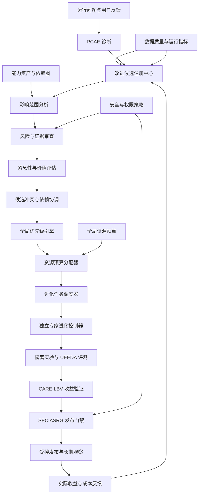

# 问答 133

> 来源: 新 窗口 | 会话: 分支 · 分支 · 分支 · 设计自进化智能体
> 消息: 426c1155-1d6d-4394-89d8-8430e12b4fb0 | 时间(UTC): 2026-10-24 12:39

## 用户

继续

## ChatGPT

<WritingBlock id="58317" variant="document"># EvoAgent 第六十八专项：自进化决策治理、改进优先级与全局资源分配体系

**专项编号：SEDG-IPGRA**

**英文名称：Self-Evolution Decision Governance, Improvement Prioritization & Global Resource Allocation**

**文档版本：V1.0**

**文档性质：全量架构专项设计**

**承接专项：** 第六十六专项 EOECDDQ（可观测性与诊断数据质量）、第六十七专项 CARE-LBV（因果归因、修复有效性与长期收益验证）。

**核心目标：** 建立 EvoAgent 的全局进化决策控制体系，使系统能够从多个专家、共享内核、工具、工作流和运行环境中收集改进需求，统一评估优先级，在有限的模型调用、计算、存储和开发资源下选择最值得执行的改进，并通过冲突协调、预算控制、公平性约束和结果反馈，实现整个系统的持续优化。

本文定义目标架构、决策规则、数据模型、工程接口与验收标准，不代表相关模块已经实现或通过测试。

---

# 一、为什么拥有多个能够独立进化的专家，还不够？

前面的 EvoAgent 架构已经明确：

- 每个领域专家拥有独立的配置、工具、工作流、记忆命名空间和评测集；
- 共享通用内核负责 ReAct、Plan、上下文治理等通用能力；
- 独立进化控制器负责问题诊断、候选生成、实验评测、发布和回滚；
- CARE-LBV 负责验证改进是否有效以及是否值得长期保留。

这种设计解决了一个重要问题：代码专家的改进不应该无条件影响旅游专家或 AI 漫剧专家。

但它又引出了一个新的问题。

**如果每个专家都能独立提出改进，谁来决定整个 EvoAgent 应该优先优化什么？**

假设某个时刻，系统发现以下问题。

| 改进候选 | 问题 | 预期影响 |
|---|---|---|
| A | 代码专家工具调用失败 | 影响部分编程任务 |
| B | 旅游专家路由不准确 | 可能影响大量用户请求 |
| C | AI 漫剧生成成本过高 | 单任务成本较大 |
| D | 手机操作偶尔重复点击 | 可能造成外部副作用 |
| E | 共享上下文压缩导致长任务质量下降 | 可能影响多个专家 |
| F | 日志事件关联不完整 | 降低多个专家的诊断能力 |

如果按照失败次数排序，F 可能长期排在前面，但它未必是当前最紧急的问题。

如果按照单次损失排序，D 可能最严重，但它出现的频率可能很低。

如果按照预期收益排序，E 可能看起来收益最大，但它的改进成本也可能最高，而且还存在较大的回归风险。

如果每个专家各自争取预算，代码专家可能因为任务量大而持续占用资源，使其他专家无法得到改善。

如果系统只优化容易量化的指标，还可能长期忽略记忆一致性、诊断可靠性、工具契约质量等基础能力。

因此，EvoAgent 需要的不只是多个独立进化控制器，还需要一个能够统筹全局的**进化决策治理层**。

它不直接决定每个故障的技术修复方法，而是负责回答：

1. 当前哪些问题最值得处理？
2. 哪些问题必须立即处理？
3. 哪些问题可以暂缓？
4. 哪些改进应该先验证，而不是立即实施？
5. 哪些改进之间存在依赖或冲突？
6. 共享内核与领域专家应该如何分配资源？
7. 如何防止某个专家长期垄断进化预算？
8. 如何控制实验成本与收益风险？
9. 当新的严重故障出现时，如何调整现有进化计划？
10. 如何证明整个系统的资源确实被投入到了最有价值的改进上？

这就是 SEDG-IPGRA 的核心任务。

---

# 二、第一性原理：全局进化不是把所有局部优化简单相加

EvoAgent 的整体能力可以表示为：

\[
\text{EvoAgent}
=
\text{共享内核}
+
\text{领域专家}
+
\text{工具与工作流}
+
\text{路由系统}
+
\text{运行环境}
+
\text{治理体系}
\]

但这不是一个简单的加法关系。

共享内核的改进可能同时提升多个专家的能力；某个专家的优化也可能增加共享工具的负载；路由器的变化可能让任务流向不同的专家，从而改变其他专家的实际负载与成功率。

因此，全局优化必须考虑**能力之间的依赖、资源之间的竞争以及改进之间的相互影响**。

例如：

- 优化代码专家的提示词，可能只影响代码专家；
- 优化全局上下文压缩，可能影响所有依赖该机制的专家；
- 优化路由器，可能同时改变多个专家的任务分布；
- 优化日志采集，可能降低后续所有诊断任务的成本；
- 优化工具调用协议，可能减少多个专家的重复失败。

这意味着，单个专家的局部收益不能直接等同于整个系统的收益。

## 2.1 全局决策必须遵守五项原则

**原则一：安全约束优先于收益排序。**

涉及权限违规、重要数据损坏、不可逆外部副作用等问题时，不能因为预期收益低就无限期延后处理。

**原则二：证据质量优先于收益想象。**

没有足够证据的高收益假设，可以进入低成本验证队列，但不能仅凭模型预测就占用大量正式实验资源。

**原则三：优先修复真正的瓶颈。**

应区分问题发生频率高、单次影响大和系统性影响广三种情况，而不是只根据某一个数字排序。

**原则四：局部优化必须服从全局约束。**

领域专家可以独立改进，但不能绕过共享内核、权限、安全、成本和发布门禁。

**原则五：每项进化活动都必须有停止条件。**

系统不能无限分析、无限实验、无限调用模型，也不能因为某个问题尚未解决就一直消耗资源。

---

# 三、总体架构：全局进化决策控制平面

建议新增 `Self-Evolution Decision Governance Plane`，简称 SEDGP。

SEDGP 是全局进化治理控制平面，SEDG-IPGRA 是其首个完整决策与资源分配专项。

它与已有模块的关系如下：

| 模块 | 主要职责 |
|---|---|
| RCAE | 分析故障根因与候选修复方向 |
| EOECDDQ | 保证运行事件、指标和证据的完整性 |
| CARE-LBV | 验证改进的实际效果和长期收益 |
| UEEDA | 执行独立评测与回归测试 |
| EOACA | 管理能力资产及依赖关系 |
| AECGSR | 协调进化活动与执行资源 |
| SECIASRG | 控制发布、变更影响分析与回滚 |
| SEDGP | 统一候选、优先级、资源分配与决策治理 |

## 3.1 总体架构图



## 3.2 控制平面与执行平面分离

建议明确区分两类职责。

**控制平面负责：**

- 发现和登记改进候选；
- 评估候选的价值、风险和证据质量；
- 分配实验预算；
- 协调专家之间的资源竞争；
- 管理候选依赖与冲突；
- 调整进化优先级；
- 决定是否继续、暂停或终止某项进化活动。

**执行平面负责：**

- 生成具体修复方案；
- 修改提示词、工具、工作流或代码；
- 执行测试；
- 运行隔离实验；
- 产生评测结果；
- 执行经过批准的发布或回滚。

控制平面不应该直接接管专家的全部技术工作。

例如，代码专家负责提出如何修复 AST 分析器的错误；全局控制平面负责判断这项修复是否比当前其他候选更值得优先验证。

这种分离能够减少职责耦合，也方便独立测试决策逻辑。

---

# 四、统一改进候选注册中心

所有专家和共享能力的改进需求，都应进入统一的 `Improvement Candidate Registry`。

不能让每个专家各自维护互不关联的待办列表，否则系统无法比较、合并和协调跨专家的改进。

## 4.1 改进候选的来源

建议支持以下来源：

1. 真实任务失败；
2. 用户明确指出的问题；
3. 任务验收失败；
4. 工具稳定性下降；
5. 路由准确率下降；
6. 长期收益观察发现退化；
7. 共享依赖出现故障；
8. 安全与权限审计发现问题；
9. 运行成本超过预算；
10. 自动评测发现回归；
11. 诊断数据质量不足；
12. 历史失败案例重复出现；
13. 能力依赖图发现的系统性瓶颈；
14. 用户提出的新能力需求；
15. 维护负担过高或技术债累积。

这些来源可以产生不同类型的候选，但最终都需要进入统一治理流程。

## 4.2 候选对象的数据结构

建议建立 `ImprovementCandidate`。

| 字段 | 含义 |
|---|---|
| `candidate_id` | 候选唯一标识 |
| `candidate_type` | 故障修复、质量提升、成本优化等 |
| `source_refs` | 关联故障、反馈和证据 |
| `target_capability_id` | 目标能力 |
| `affected_capabilities` | 可能受影响的能力集合 |
| `problem_statement` | 问题描述 |
| `hypothesis_id` | 关联诊断或收益假设 |
| `expected_benefit` | 预期收益 |
| `risk_profile` | 风险等级与风险说明 |
| `evidence_quality` | 证据质量 |
| `estimated_cost` | 预估实施与验证成本 |
| `dependency_refs` | 前置依赖 |
| `conflict_refs` | 已知冲突 |
| `reversibility` | 可逆性 |
| `priority_status` | 当前优先级状态 |
| `budget_request` | 资源申请 |
| `candidate_version` | 候选方案版本 |
| `decision_history` | 历次决策记录 |

候选对象必须区分“问题事实”和“解决方案”。

例如：

- 问题事实：某类工具参数错误持续出现；
- 诊断假设：参数生成规则不完整；
- 解决方案 A：修改提示词；
- 解决方案 B：增加结构化参数校验；
- 解决方案 C：修改工具适配器。

一个问题可以对应多个候选方案。

因此，系统不应该把“发现问题”和“决定如何修复”合并为同一条记录。

## 4.3 候选去重与合并

假设代码专家、文档专家和漫剧专家都发现同一个共享工具接口存在兼容性问题。

如果系统分别为三个专家创建独立修复任务，可能重复消耗三次实验预算。

建议使用以下信息识别潜在重复候选：

- 相同故障特征；
- 相同工具或能力资产；
- 相同错误码；
- 相同根因假设；
- 相似的修复方案；
- 重叠的影响范围。

候选可以被标记为：

- 独立候选；
- 重复候选；
- 可合并候选；
- 上下游依赖候选；
- 存在冲突的候选。

自动合并只能在语义和技术边界足够明确时执行。

对于根因不同、仅表面症状相似的候选，应保留独立身份。

---

# 五、问题严重程度与处理紧急性

不能把所有问题都当成普通优化任务。

有些问题应该立即处理，有些问题应该先补充证据，还有些问题可以排入长期优化计划。

建议建立独立于收益排序的紧急程度分类。

## 5.1 四级紧急度

| 等级 | 名称 | 典型情况 | 决策方式 |
|---|---|---|---|
| P0 | 紧急安全与完整性事件 | 权限边界失效、严重数据损坏、危险重复副作用 | 立即限制相关操作，进入应急处理 |
| P1 | 关键功能或系统性故障 | 共享内核大面积异常、关键工具不可用 | 优先处理，必要时暂停相关进化 |
| P2 | 重要质量问题 | 专家失败率持续升高、路由明显退化 | 纳入近期重点优化 |
| P3 | 一般优化需求 | 小幅成本优化、低频体验问题 | 按全局价值和资源安排 |

这里的等级是治理分类，不是统一的技术严重程度分数。

具体判断需要考虑：

- 影响范围；
- 可能损失；
- 可逆性；
- 是否触及权限与安全边界；
- 故障是否仍在持续；
- 是否存在安全替代方案；
- 是否可以通过暂停或降级降低风险。

## 5.2 P0 不应进入普通竞争队列

如果出现明确的严重安全事件，不能因为其他候选的预期收益更高，就让安全事件等待排序。

系统应首先执行既定的安全策略，例如：

- 暂停相关工具；
- 限制高风险操作；
- 切换到安全降级模式；
- 保留必要证据；
- 触发相应的恢复或人工处理流程。

修复工作进入紧急队列后，仍然需要验证。

紧急不意味着可以跳过所有安全测试，也不意味着可以不受控制地修改共享内核。

**紧急处理可以改变处理顺序，但不能取消必要的安全边界。**

---

# 六、建立可解释的候选价值评估模型

在紧急事件得到适当控制后，系统需要对普通候选进行排序。

建议评估以下七个维度。

## 6.1 七维评估

| 维度 | 核心问题 |
|---|---|
| 影响范围 | 有多少任务、专家或关键能力受到影响？ |
| 严重程度 | 失败会造成多大的实际损失？ |
| 发生频率 | 问题出现得有多频繁？ |
| 证据质量 | 是否已经有足够证据证明问题存在及其原因？ |
| 预期净收益 | 改进可能带来多少质量、效率或成本收益？ |
| 实施与验证成本 | 需要多少工程、模型、计算和时间资源？ |
| 风险与可逆性 | 改动是否容易造成其他能力退化，能否安全撤销？ |

这些维度不应被压缩成一个由模型随意生成的分数。

建议采用“两阶段决策”。

**第一阶段：硬性约束筛选。**

检查：

- 是否触及安全或权限问题；
- 是否具备必要证据；
- 是否满足实验条件；
- 是否有可接受的资源预算；
- 是否存在未解决的关键依赖；
- 是否存在无法接受的副作用风险。

不满足条件的候选进入补充证据、隔离验证、暂停或拒绝流程。

**第二阶段：候选优先级排序。**

对通过筛选的候选，综合考虑预期收益、影响范围、成本、风险和战略价值，确定下一批执行任务。

## 6.2 预期价值与证据质量必须分开

建议明确区分：

- `expected_value`：假设改进有效时可能产生的价值；
- `evidence_strength`：当前证据支持该假设的程度；
- `success_probability`：经过适当校准后，对候选实现目标的估计；
- `implementation_cost`：实施和实验成本；
- `downside_risk`：失败或副作用的潜在损失。

例如：

候选 A 的理论收益很高，但根因假设几乎没有验证。

候选 B 的收益中等，但历史故障已经稳定复现，修复方案也较为明确。

系统不应该仅仅因为 A 的收益预测更高，就让 A 无限占用资源。

更合理的方式是：

- 对 A 先分配小额预算，验证关键假设；
- 对 B 进入完整修复评测；
- 根据新证据更新二者的优先级。

这样可以让高潜力但不确定的候选获得验证机会，同时避免它们挤占已经具备充分证据的高价值工作。

## 6.3 统一排序分数只是辅助工具

可以为候选定义一个辅助排序函数：

\[
S_i =
\frac{
V_i \cdot P_i \cdot Q_i \cdot R_i
}{
C_i + \lambda D_i
}
\]

其中：

- \(V_i\)：目标收益的估计价值；
- \(P_i\)：实现目标的估计概率；
- \(Q_i\)：证据质量系数；
- \(R_i\)：影响范围修正；
- \(C_i\)：预计实施和验证成本；
- \(D_i\)：潜在负面影响或维护负担；
- \(\lambda\)：对负面影响的权重。

这只是候选排序的辅助模型，不是最终决策规则。

所有参数必须具有明确的定义、取值依据和校准方法。

如果收益、证据质量或风险无法可靠量化，就应使用区间、等级或多指标比较，而不是强行给出精确数字。

另外，P0 安全事件、强制合规要求和硬性预算约束不参与普通分数竞争。

它们应当先经过独立治理。

---

# 七、全局进化资源分配

这是本专项的核心。

EvoAgent 的资源不只有模型调用额度，还包括：

- CPU 与 GPU 时间；
- 内存；
- 磁盘和事件存储；
- 网络与外部服务调用；
- 工程修改时间；
- 评测执行时间；
- 人工复核时间；
- 后台实验并发数；
- 稳定执行轨道的可用资源。

如果只限制模型调用次数，系统仍可能通过大量本地计算、日志处理或并行实验消耗过多资源。

因此，需要建立统一的 `Evolution Resource Budget`。

## 7.1 资源预算分层

建议分为四个层次。

<box gap={3}>
  <row align=start gap={3}>
    <box background="surface-secondary" radius="lg" padding={3} size="44px" align=center justify=center>
      <icon name="shield" size="xl"/>
    </box>
    <box flex="1" gap={1}>
      **第一层：稳定运行保留预算**

      为用户正在执行的任务、关键日志持久化、必要恢复操作和系统健康检查保留资源。

      <text color="secondary" size="sm">后台进化不能随意挤占这部分资源。</text>
    </box>
  </row>
  <divider color="subtle"/>
  <row align=start gap={3}>
    <box background="surface-secondary" radius="lg" padding={3} size="44px" align=center justify=center>
      <icon name="alert-triangle" size="xl"/>
    </box>
    <box flex="1" gap={1}>
      **第二层：应急与安全治理预算**

      用于处理严重故障、紧急诊断、安全隔离、必要恢复和关键验证。

      <text color="secondary" size="sm">不得被普通候选长期占用；使用情况必须记录。</text>
    </box>
  </row>
  <divider color="subtle"/>
  <row align=start gap={3}>
    <box background="surface-secondary" radius="lg" padding={3} size="44px" align=center justify=center>
      <icon name="flask-conical" size="xl"/>
    </box>
    <box flex="1" gap={1}>
      **第三层：进化实验预算**

      用于候选修复、回归测试、受控实验和长期收益验证。

      <text color="secondary" size="sm">根据全局优先级和实际资源动态分配。</text>
    </box>
  </row>
  <divider color="subtle"/>
  <row align=start gap={3}>
    <box background="surface-secondary" radius="lg" padding={3} size="44px" align=center justify=center>
      <icon name="search" size="xl"/>
    </box>
    <box flex="1" gap={1}>
      **第四层：探索与能力研究预算**

      用于低成本验证新能力、探索新的工具使用方式、评估潜在架构改进。

      <text color="secondary" size="sm">优先使用可控、可停止、可复现的小规模实验。</text>
    </box>
  </row>
</box>

上述层次是逻辑预算，不要求一定分成四个独立进程或服务。

## 7.2 预算必须同时包含硬上限与软目标

建议每个实验至少设置：

- 最大模型调用次数；
- 最大 token 或模型费用；
- 最大运行时长；
- 最大并发数；
- 最大存储增量；
- 最大重试次数；
- 最大失败成本；
- 停止条件；
- 允许使用的设备资源范围。

软目标用于正常调度，硬上限用于防止无限消耗。

当实验超过硬上限时，系统必须停止或进入明确的降级流程，不能因为候选仍然很有希望就自动突破预算。

## 7.3 个人设备的默认策略

针对 EvoAgent 的个人使用场景，建议采用：

- 用户当前任务优先；
- 关键日志和恢复能力优先；
- 后台进化默认低优先级；
- 设备繁忙时暂停非紧急实验；
- 网络与模型服务异常时暂停依赖外部服务的实验；
- 本地磁盘不足时优先保护必要状态和关键事件；
- 高成本模型调用需要经过预算检查；
- 资源恢复后从持久化的实验状态继续，而不是全部重跑。

具体阈值应通过设备配置与运行测试确定，不应对所有 Windows、Android 和 mini Linux 设备使用同一组固定数值。

---

# 八、如何防止某个专家长期垄断进化资源？

这是多专家系统容易忽略的问题。

代码专家可能拥有大量评测任务，产生更多故障，也更容易提出改进。

如果系统完全按照候选数量或失败次数分配预算，代码专家可能不断获得资源，而其他专家的关键问题长期得不到处理。

但反过来，也不能要求每个专家平均获得相同预算。

因为不同专家的使用频率、风险、收益和资源需求本来就不同。

因此，建议采用**最低保障、价值竞争和动态再分配**三种机制。

## 8.1 最低保障机制

为每个活跃专家和关键共享能力建立基本治理预算。

最低保障不是平均分配所有资源，而是确保：

- 每个活跃专家能够进行必要的健康检查；
- 关键专家能够验证重要故障；
- 共享内核有基本的维护预算；
- 长期没有被优化的专家能够被重新审视；
- 关键能力的回归测试不会因为其他专家任务量大而长期被跳过。

低使用频率的专家可以获得较少的日常预算，但不能因为使用频率低就永远无法获得必要维护。

## 8.2 价值竞争机制

完成最低保障后，其余预算按照候选的价值、证据质量、风险和成本进行竞争。

例如：

- 一个影响多个专家的共享工具修复；
- 一个只影响少量任务的提示词微调；
- 一个降低严重外部副作用风险的手机操作修复。

这三类候选的价值不能仅靠出现次数判断。

## 8.3 动态再分配机制

如果某专家连续多次获得预算却没有产生有效收益，应重新评估：

- 问题是否真实存在；
- 根因假设是否正确；
- 实验设计是否合理；
- 是否已经达到能力上限；
- 是否需要转向基础工具或共享内核优化。

如果某专家长期没有得到预算，也应检查：

- 是否存在被其他专家掩盖的问题；
- 是否因为评测数据不足而无法进入排序；
- 是否存在基础能力缺失；
- 是否需要补充最低保障资源。

**公平并不意味着平均分配，而是避免资源分配机制系统性地忽略某些重要能力。**

---

# 九、候选之间的依赖、冲突与组合优化

多个改进候选可能不能独立执行。

例如：

- 新工具接口需要配套修改提示词；
- 新路由规则依赖新的专家能力描述；
- 上下文压缩优化依赖新的记忆检索策略；
- 某项修复必须先升级底层工具；
- 两个候选同时修改同一配置，可能相互覆盖。

如果系统只按照优先级逐个执行，就可能反复返工，甚至产生不兼容的候选版本。

## 9.1 建立候选依赖图

建议使用 `ImprovementDependencyGraph`。

节点代表候选改进，边表示：

- `requires`：必须先完成；
- `blocks`：当前阻塞；
- `conflicts_with`：不能直接组合；
- `compatible_with`：已确认兼容；
- `supersedes`：新候选替代旧候选；
- `jointly_validated_with`：必须作为组合进行验证；
- `shares_resource_with`：存在资源竞争。

## 9.2 三类协调策略

**策略一：串行执行。**

适用于存在明确前置依赖或共享文件冲突的候选。

例如，先升级工具接口，再修改依赖该接口的专家提示词。

**策略二：组合实验。**

适用于两个候选单独没有意义，或者必须共同修改才能满足功能要求的情况。

组合实验必须记录所有变更，必要时使用消融实验区分贡献。

**策略三：独立隔离实验。**

适用于目标能力独立、依赖较少、可以安全并行的候选。

系统可以并行执行评测，但必须避免同时修改共享稳定环境。

## 9.3 不要把所有候选合并成一个大改动

如果把十个问题的修复一次性合并，再进行统一测试，即使最终表现变好，也很难判断每项改动的贡献。

如果出现回归，也很难快速定位原因。

因此，默认应保持候选独立，并只在存在明确依赖或组合收益时进行合并。

---

# 十、建立全局进化路线图

候选排序解决的是“下一步做什么”。

全局进化路线图则解决“未来一段时间如何有序推进”。

建议建立 `Evolution Roadmap`，按时间和依赖关系规划：

- 紧急问题处理；
- 基础设施修复；
- 共享能力提升；
- 专家专项优化；
- 新能力探索；
- 长期技术债治理；
- 必要的稳定性与安全验证。

## 10.1 路线图的优先级结构

建议采用以下层次：

1. **安全与可靠性：** 处理会破坏权限边界、关键状态或任务执行可靠性的问题。
2. **系统瓶颈：** 处理限制多个专家能力的共享依赖、路由和上下文问题。
3. **高价值专家问题：** 处理实际影响大、证据充分、收益明确的领域问题。
4. **成本与效率优化：** 降低无效调用、重复执行和长期维护成本。
5. **探索与新能力建设：** 验证新工具、新工作流和新的专家能力。
6. **低优先级体验改进：** 在资源允许时逐步完成。

这不是不可改变的固定顺序。

如果 AI 漫剧任务是当前主要使用场景，漫剧能力可能成为阶段性重点。

如果手机操作发生严重安全问题，则必须立即提升其优先级。

路线图必须允许根据真实运行数据动态调整。

## 10.2 避免永远只修复问题，不建设能力

如果系统只根据故障日志分配预算，就会出现一个偏差：

系统一直修复已经暴露的问题，却很少投资于尚未暴露、但可能显著提高能力上限的基础设施。

例如：

- 更可靠的工具契约；
- 更好的长任务上下文管理；
- 更准确的专家路由；
- 更高效的工作流编排；
- 更完善的评测数据；
- 更可靠的离线恢复机制。

因此，应当为探索性改进保留受控预算。

但探索预算不能成为无限研究的借口。

每个探索项目都必须具有明确的假设、最大预算、预期价值和停止条件。

---

# 十一、全局进化调度器

候选优先级确定后，还需要一个调度器决定实际执行顺序。

建议新增 `Evolution Scheduler`。

它的职责不是简单地按照分数从高到低执行，而是综合考虑：

- 优先级；
- 依赖关系；
- 资源需求；
- 当前设备负载；
- 实验并发限制；
- 稳定运行任务；
- 紧急事件；
- 候选的可中断性；
- 预计完成时间；
- 预算剩余量。

## 11.1 调度流程

```text
候选注册
   ↓
紧急事件检查
   ↓
硬性约束筛选
   ↓
候选价值排序
   ↓
依赖与冲突检查
   ↓
资源预算核验
   ↓
生成可执行队列
   ↓
选择下一项任务
   ↓
启动隔离实验
   ↓
更新预算和任务状态
   ↓
评测结果返回
   ↓
重新计算剩余候选优先级
```

## 11.2 进化任务必须支持中断与恢复

对于后台运行的实验，应保存：

- 当前阶段；
- 已完成步骤；
- 当前版本；
- 已消耗预算；
- 剩余预算；
- 测试结果；
- 临时文件与状态；
- 中断原因；
- 恢复所需的环境信息。

当用户开始执行高优先级任务，或者设备资源不足时，调度器可以暂停非紧急实验。

恢复时必须检查原实验环境是否仍然有效。

如果模型、工具、评测集或关键配置已经发生变化，应重新评估是否可以继续，而不是直接接着旧状态运行。

## 11.3 调度器不能绕过专家的独立进化边界

全局调度器可以决定某个专家获得多少实验预算，但不能直接把另一个专家的私有配置、记忆或工具策略覆盖过去。

领域专家仍然需要拥有独立的候选分支、评测集和发布门禁。

跨专家改动必须通过明确的依赖关系和授权的组合变更流程。

---

# 十二、全局决策记录与可解释性

自进化系统的决策不能只保留一个最终分数。

如果用户询问“为什么先优化路由器，而不是代码专家”，系统应该能够给出具体原因。

建议建立 `EvolutionDecisionRecord`。

核心字段包括：

- `decision_id`；
- `decision_time`；
- `candidate_set_snapshot`；
- `priority_inputs`；
- `risk_assessment`；
- `evidence_assessment`；
- `budget_snapshot`；
- `dependency_analysis`；
- `selected_candidates`；
- `deferred_candidates`；
- `rejected_candidates`；
- `decision_rationale`；
- `policy_version`；
- `decision_engine_version`；
- `override_reason`。

## 12.1 决策解释至少回答五个问题

1. 为什么选择这项改进？
2. 为什么其他候选没有优先执行？
3. 选择依据是什么？
4. 使用了多少资源？
5. 什么条件会让系统改变原决定？

例如：

> 当前优先修复共享工具的参数校验问题，因为它影响多个专家，历史故障可稳定复现，候选修复成本较低，并且可以通过固定回归集验证。漫剧成本优化暂缓，因为当前证据不足以证明主要成本来自工作流设计。下一步先执行低成本归因实验，再决定是否投入完整优化预算。

这种解释必须基于真实记录，不能由模型事后随意编造。

## 12.2 允许人工覆盖，但必须记录

个人使用的 EvoAgent 可以允许用户：

- 将某项候选提升优先级；
- 暂停某个专家的进化；
- 限制某项改进的预算；
- 要求先修复某个问题；
- 禁止某类自动变更；
- 暂时冻结全局进化。

但覆盖决策必须记录操作者授权、原因、范围和有效期。

人工提高某项候选的优先级，不应自动绕过安全检查和必要的发布门禁。

---

# 十三、决策治理与诊断治理必须保持独立

前面的设计已经区分执行能力与诊断能力。

本专项还需要进一步区分诊断与全局决策。

如果同一个模型既负责判断根因，又负责决定自己提出的修复是否最值得优先执行，还负责给自己分配预算，那么系统可能形成自我强化循环。

例如：

1. 诊断器偏好修改提示词；
2. 候选生成器持续提出提示词修改；
3. 优先级引擎认为提示词改动成本低；
4. 实验器反复选择容易通过的提示词测试；
5. 收益评估器只统计短期成功率；
6. 其他基础设施问题长期被忽略。

这并不意味着必须使用不同模型。

关键是模块职责、数据来源和评测机制必须能够相互制衡。

## 13.1 建议的制衡机制

- RCAE 负责提出根因假设；
- 候选生成器负责提出可能的修复方案；
- 优先级引擎负责依据统一规则排序；
- UEEDA 负责独立执行评测；
- CARE-LBV 负责评估收益证据；
- SECIASRG 负责发布与回滚；
- SEDGP 负责全局资源与优先级治理。

对高风险或高影响改动，应采用更严格的独立审查。

对低风险改动，可以采用自动化程度更高的流程，但不能让候选生成器直接宣布自己的方案有效并自动获得无限资源。

---

# 十四、工程目录与核心接口

建议新增以下模块：

```text
evoagent/
├── evolution_governance/
│   ├── candidate_registry/
│   ├── candidate_deduplication/
│   ├── candidate_merging/
│   ├── candidate_lifecycle/
│   ├── urgency_classifier/
│   ├── impact_assessment/
│   ├── value_estimator/
│   ├── evidence_quality_gate/
│   ├── risk_gate/
│   ├── dependency_graph/
│   ├── conflict_resolver/
│   ├── priority_engine/
│   ├── decision_record/
│   ├── roadmap_manager/
│   └── governance_policy/
├── evolution_resource_manager/
│   ├── global_budget/
│   ├── model_call_budget/
│   ├── compute_budget/
│   ├── storage_budget/
│   ├── concurrency_limiter/
│   ├── reserve_budget/
│   ├── fairness_policy/
│   ├── budget_forecaster/
│   └── resource_accounting/
├── evolution_scheduler/
│   ├── queue_manager/
│   ├── dependency_scheduler/
│   ├── task_dispatcher/
│   ├── preemption_policy/
│   ├── checkpoint_manager/
│   ├── resume_validator/
│   └── adaptive_reprioritization/
├── evolution_benefit_feedback/
│   ├── outcome_ingestion/
│   ├── realized_benefit/
│   ├── realized_cost/
│   ├── prediction_calibration/
│   ├── priority_feedback/
│   └── portfolio_review/
└── evolution_governance_tests/
    ├── candidate_deduplication/
    ├── priority_consistency/
    ├── emergency_preemption/
    ├── resource_budget_enforcement/
    ├── expert_fairness/
    ├── dependency_conflict/
    ├── scheduler_recovery/
    ├── decision_explainability/
    ├── governance_independence/
    └── budget_exhaustion/
```

建议提供以下核心接口：

- `register_improvement_candidate`：登记改进候选；
- `deduplicate_candidates`：识别重复候选；
- `merge_compatible_candidates`：合并兼容候选；
- `classify_candidate_urgency`：判定紧急程度；
- `assess_candidate_impact`：评估影响范围；
- `assess_evidence_quality`：评估证据质量；
- `estimate_candidate_value`：估计候选价值；
- `estimate_candidate_cost`：估计实施和验证成本；
- `evaluate_candidate_risk`：评估风险与可逆性；
- `build_improvement_dependency_graph`：构建候选依赖图；
- `detect_candidate_conflicts`：检测候选冲突；
- `calculate_global_priority`：计算全局优先级；
- `allocate_evolution_budget`：分配进化预算；
- `reserve_emergency_budget`：保留应急预算；
- `enforce_resource_limits`：执行资源限制；
- `schedule_evolution_tasks`：生成进化执行队列；
- `pause_background_evolution`：暂停后台进化；
- `resume_evolution_checkpoint`：恢复进化任务；
- `validate_resume_context`：检查恢复环境；
- `reprioritize_pending_candidates`：重新排列待执行候选；
- `record_evolution_decision`：记录全局决策；
- `explain_candidate_selection`：解释候选选择依据；
- `record_manual_override`：记录人工覆盖；
- `update_budget_accounting`：更新资源消耗账本；
- `reconcile_candidate_outcomes`：核对候选结果；
- `calibrate_value_predictions`：校准收益预测；
- `review_evolution_portfolio`：审查全局改进组合；
- `generate_evolution_roadmap`：生成进化路线图。

这些接口应与现有的候选、评测、发布和收益账本保持统一标识，避免重复建立独立的数据体系。

---

# 十五、端到端验收场景

建议至少建立以下十二个验收场景。

## 场景 A：多个专家同时提出改进

**初始条件：** 代码专家、旅游专家和漫剧专家同时存在待优化问题。

**验收过程：**

1. 三个候选进入统一注册中心；
2. 系统检查证据质量、影响范围和成本；
3. 执行全局排序；
4. 按预算安排验证任务；
5. 记录被延后候选的原因。

**验收重点：** 不由最先提交候选的专家自动获得全部资源。

## 场景 B：严重安全事件抢占普通实验

**初始条件：** 后台正在执行低风险提示词实验，手机操作模块发现可能产生重复外部副作用的问题。

**验收过程：**

1. 对相关操作执行安全限制；
2. 触发紧急事件处理；
3. 暂停或中断低优先级实验；
4. 保存实验检查点和资源消耗；
5. 为紧急诊断与验证分配必要预算。

**验收重点：** 普通进化任务不能阻碍紧急安全治理。

## 场景 C：候选重复导致预算浪费

**初始条件：** 三个专家报告同一个共享工具的参数校验故障。

**验收过程：**

1. 识别共同的能力资产；
2. 比较根因假设与故障证据；
3. 合并确实重复的候选；
4. 保留不同的专家特有问题；
5. 只对共享修复执行一次基础验证。

**验收重点：** 重复候选不会造成无意义的重复实验。

## 场景 D：高收益假设但证据不足

**初始条件：** 一个模型生成的候选声称能够显著降低整体成本，但缺少历史数据支持。

**验收过程：**

1. 检查收益估计依据；
2. 标记证据不足；
3. 只分配有限的探索预算；
4. 通过实验验证关键假设；
5. 根据新证据决定是否进入完整优化流程。

**验收重点：** 不因未经验证的高收益预测无限扩大预算。

## 场景 E：共享内核改进与专家改进竞争

**初始条件：** 共享上下文治理存在潜在系统性问题，同时代码专家也有一个明确的局部修复。

**验收过程：**

1. 比较两项改进的影响范围；
2. 检查共享内核改动的风险；
3. 评估局部修复的紧急程度；
4. 确定是否先执行低风险局部修复；
5. 为共享内核安排独立的跨专家回归。

**验收重点：** 不默认共享改进永远优先，也不因为局部修复容易就忽略系统性瓶颈。

## 场景 F：某专家长期占用进化预算

**初始条件：** 代码专家连续多次获得较多实验预算，其他专家长期没有获得必要维护资源。

**验收过程：**

1. 检查历史资源分配；
2. 检查其他专家的最低保障；
3. 分析代码专家的实际收益；
4. 重新评估尚未处理的候选；
5. 在满足紧急任务和价值要求的前提下调整预算。

**验收重点：** 资源分配不会长期偏向候选数量最多的专家。

## 场景 G：两个候选互相冲突

**初始条件：** 两个候选同时修改同一个工具接口，且采用不兼容的配置方案。

**验收过程：**

1. 检测共享文件和接口冲突；
2. 建立候选冲突关系；
3. 禁止未经验证的并行合并；
4. 选择串行或组合实验策略；
5. 验证最终候选的接口兼容性。

**验收重点：** 调度器不会因为资源充足就盲目并行执行互相冲突的改动。

## 场景 H：设备资源不足

**初始条件：** 用户在 Windows 电脑上执行复杂任务，后台进化也正在运行。

**验收过程：**

1. 检查当前资源占用；
2. 暂停低优先级实验；
3. 保留关键运行状态；
4. 限制非必要模型调用；
5. 在资源恢复后验证检查点；
6. 继续执行仍然有效的实验。

**验收重点：** 后台进化不会不受限制地抢占用户任务资源。

## 场景 I：候选实验超出预算

**初始条件：** 某项改进已经消耗大部分预算，但仍未得到明确结果。

**验收过程：**

1. 检查硬性预算上限；
2. 判断是否达到预设停止条件；
3. 评估继续实验的预期价值；
4. 停止、缩小范围或申请重新审批；
5. 保存已有结果和未解决的问题。

**验收重点：** 系统不会自动突破预算继续试验。

## 场景 J：后台实验中断后恢复

**初始条件：** 设备关机，导致进化实验中断。

**验收过程：**

1. 读取持久化检查点；
2. 核对模型、工具和评测集版本；
3. 检查已消耗预算；
4. 判断原实验是否仍然有效；
5. 在资源允许时恢复，或重新建立实验。

**验收重点：** 恢复过程不会重复消耗已完成部分的预算，也不会使用失效的实验上下文。

## 场景 K：人工要求优先修复某项问题

**初始条件：** 用户要求优先处理一个非紧急但影响体验的问题。

**验收过程：**

1. 记录人工优先级调整；
2. 检查硬性安全约束；
3. 重新生成进化队列；
4. 根据用户指定范围分配预算；
5. 保留其他关键治理任务的必要资源。

**验收重点：** 人工可以调整普通任务的优先级，但不能绕过关键安全门禁。

## 场景 L：全局收益低于预期

**初始条件：** 多项候选分别通过了各自的局部测试，但系统整体成功率和成本没有改善。

**验收过程：**

1. 汇总各项改进的实际结果；
2. 检查局部指标是否与全局指标一致；
3. 识别资源浪费、重复优化和未覆盖的瓶颈；
4. 更新收益预测；
5. 调整下一阶段进化路线图。

**验收重点：** 全局治理以实际整体收益为依据，而不是仅统计完成了多少改进任务。

---

# 十六、专项验收标准

SEDG-IPGRA 至少需要满足以下要求：

1. 建立统一的改进候选注册中心。
2. 能够接收来自运行日志、诊断器、评测器、用户反馈和长期观察的候选。
3. 能够区分问题、根因假设和具体修复方案。
4. 能够识别重复候选和可合并候选。
5. 能够区分紧急安全事件与普通优化任务。
6. 能够在严重安全事件出现时启动受控应急流程。
7. 能够根据影响范围、严重程度、发生频率和证据质量评估候选。
8. 能够将预期收益、实施成本和风险分别记录。
9. 能够在证据不足时优先安排低成本验证。
10. 能够建立统一的候选依赖与冲突关系。
11. 能够防止互相冲突的候选未经验证地组合发布。
12. 能够建立稳定运行、应急处理、进化实验和探索研究的逻辑预算。
13. 能够同时限制模型调用、计算、存储、并发和运行时长。
14. 能够在资源不足时暂停低优先级实验。
15. 能够保存并验证实验检查点。
16. 能够防止某个专家长期垄断进化资源。
17. 能够为活跃专家和关键共享能力保留必要的治理资源。
18. 能够在公平性保障与实际价值之间进行合理平衡。
19. 能够在候选价值变化时动态调整进化队列。
20. 能够建立可追溯的全局进化路线图。
21. 能够为每次重要优先级调整生成决策记录。
22. 能够解释为什么选择、延后或拒绝某项改进。
23. 能够记录人工优先级覆盖及其原因。
24. 能够防止候选生成器直接控制自身的发布权限和无限资源。
25. 能够与 CARE-LBV 的实际收益账本联动。
26. 能够根据历史实际收益校准未来候选的收益预测。
27. 能够评估局部改进对整个专家体系的影响。
28. 能够区分已完成实验与已经确认长期收益的改进。
29. 能够对资源耗尽、设备中断和外部服务异常执行受控恢复。
30. 能够在 Windows、Android 和 mini Linux 环境中采用统一的预算与调度语义。
31. 能够通过故障注入测试验证应急任务抢占机制。
32. 能够通过重复候选测试验证去重和合并逻辑。
33. 能够通过资源竞争测试验证预算上限。
34. 能够通过跨专家测试验证全局收益反馈。
35. 能够在证据不足、预算不足或冲突无法解决时明确暂停或拒绝，而不是强行继续执行。

以上为目标架构验收要求，不代表相关模块已经实现或通过测试。

---

# 十七、建议冻结的架构决策

以下建议承接 ADR-1260。

| 编号 | 决策 |
|---|---|
| ADR-1261 | 建立全局自进化决策治理控制平面 SEDGP |
| ADR-1262 | 所有专家和共享能力的改进候选必须进入统一注册中心 |
| ADR-1263 | 必须区分问题事实、根因假设和具体修复方案 |
| ADR-1264 | 候选注册中心必须支持去重、合并、依赖与冲突关系 |
| ADR-1265 | 紧急安全事件不得与普通优化候选进行简单分数竞争 |
| ADR-1266 | 安全与权限约束优先于普通收益排序 |
| ADR-1267 | 普通候选必须经过硬性约束筛选后才能进入优先级排序 |
| ADR-1268 | 候选评估必须区分影响范围、严重程度、频率、证据、收益、成本和风险 |
| ADR-1269 | 未经验证的收益预测不得直接决定大规模实验资源分配 |
| ADR-1270 | 高潜力但证据不足的候选优先获得受限验证预算 |
| ADR-1271 | 建立统一的进化资源预算管理机制 |
| ADR-1272 | 资源预算必须同时覆盖模型调用、计算、存储、并发和时间 |
| ADR-1273 | 稳定运行资源与关键安全治理资源必须受到保护 |
| ADR-1274 | 后台进化不得不受限制地抢占用户任务资源 |
| ADR-1275 | 资源不足时应暂停、降级或终止低优先级实验 |
| ADR-1276 | 进化预算必须具有明确的硬性上限和停止条件 |
| ADR-1277 | 为活跃专家和关键共享能力建立最低治理保障 |
| ADR-1278 | 专家资源分配应综合价值、风险、实际使用和必要维护需求 |
| ADR-1279 | 不得仅依据候选数量或失败次数分配进化资源 |
| ADR-1280 | 建立全局候选依赖图与冲突协调机制 |
| ADR-1281 | 存在关键依赖时必须先完成依赖验证再推进下游候选 |
| ADR-1282 | 多项变更只有在依赖明确或组合验证充分时才能合并 |
| ADR-1283 | 全局调度器不得绕过领域专家的独立进化边界 |
| ADR-1284 | 建立可动态调整的全局进化路线图 |
| ADR-1285 | 进化路线图必须同时覆盖故障治理、基础能力、专家优化和受控探索 |
| ADR-1286 | 建立可中断、可恢复且具有预算记录的进化任务调度器 |
| ADR-1287 | 恢复实验前必须验证原实验上下文是否仍然有效 |
| ADR-1288 | 建立全局进化决策记录与可解释性机制 |
| ADR-1289 | 重要优先级调整必须保留输入证据、资源快照和决策原因 |
| ADR-1290 | 允许人工调整普通候选优先级，但不得绕过关键安全门禁 |
| ADR-1291 | 诊断、候选生成、优先级排序、独立评测和发布治理应保持职责分离 |
| ADR-1292 | 全局优先级应依据实际收益反馈持续校准 |
| ADR-1293 | 局部专家收益不能直接等同于系统整体收益 |
| ADR-1294 | 已完成实验与已确认长期收益必须使用不同状态 |
| ADR-1295 | 全局治理必须能够识别重复优化、资源浪费和系统性瓶颈 |
| ADR-1296 | 进化实验应具有明确的最大预算、最大运行时长和终止条件 |
| ADR-1297 | 全局资源治理应支持设备中断、网络断联和资源恢复后的受控续跑 |
| ADR-1298 | SEDGP 必须与 RCAE、EOECDDQ、CARE-LBV、UEEDA、EOACA、AECGSR 和 SECIASRG 协同 |
| ADR-1299 | 全局决策必须具有可追溯、可复核和可撤销的记录 |
| ADR-1300 | SEDG-IPGRA 采用本地优先的逻辑架构，不要求独立部署专用服务器 |

以上建议作为 EvoAgent 第六十八专项的架构基线。

---

# 十八、完成第六十八专项后，EvoAgent 的全局进化链路

至此，EvoAgent 的目标架构形成了更加完整的治理闭环。

| 阶段 | 核心职责 |
|---|---|
| RIFISRA | 故障隔离、状态恢复与运行安全 |
| EOECDDQ | 事件关联、数据质量与诊断证据 |
| CARE-LBV | 修复验证、收益归因与长期效果 |
| SEDG-IPGRA | 全局优先级、资源分配与进化调度 |
| UEEDA | 独立评测与回归测试 |
| SECIASRG | 受控发布、影响分析与回滚 |
| EOACA | 能力资产管理与依赖治理 |

完整的进化决策链路如下：

```text
真实运行与用户反馈
        ↓
问题识别与数据质量检查
        ↓
根因假设与证据整理
        ↓
统一改进候选注册
        ↓
紧急性与硬性约束检查
        ↓
候选价值与风险评估
        ↓
依赖与冲突协调
        ↓
全局资源分配
        ↓
隔离实验与独立评测
        ↓
修复效果与长期收益验证
        ↓
发布门禁
        ↓
受控上线与持续观察
        ↓
实际收益和资源消耗反馈
        ↓
重新调整全局进化路线图
```

这个体系不再只是一个能够自动修改自身的系统。

它还需要知道：

- 哪些问题值得处理；
- 哪些问题应该先处理；
- 哪些问题必须先验证；
- 哪些问题可以暂时搁置；
- 哪些改进之间存在冲突；
- 如何分配有限资源；
- 如何证明资源投入产生了实际价值；
- 如何避免局部优化损害全局能力。

但这些仍然是目标架构。必须完成具体实现、测试和验收，才能认定相应能力已经具备。

---

# 十九、下一专项：自进化知识沉淀、经验迁移与能力复用体系

完成第六十八专项后，仍然存在一个影响 EvoAgent 长期进化效率的重要问题。

假设系统已经处理过数千次故障。

其中可能包括：

- 代码专家修复过工具参数生成错误；
- 手机操作专家处理过界面变化导致的点击失败；
- 漫剧专家优化过角色一致性；
- 旅游专家改进过信息检索和路线规划；
- 共享内核修复过上下文压缩导致的信息丢失；
- 多个专家共同解决过外部服务超时问题。

这些经验如果只保存在历史日志、任务记忆或收益账本中，系统仍然可能反复犯错。

例如：

代码专家曾经通过结构化参数校验解决过工具调用错误。

后来，手机操作专家也遇到类似的工具参数问题，却重新花费大量模型调用和实验预算，从头探索解决方法。

另一方面，如果直接将代码专家的修复方案复制到手机操作专家，又可能因为两者的执行环境、工具契约和权限边界不同而产生错误。

因此，真正的问题不是简单地“保存更多记忆”，而是：

**如何把一次成功的修复转化为可以检索、验证、迁移、复用，同时不会被错误泛化的能力资产？**

下一专项建议定义为：

**Self-Evolution Knowledge Consolidation, Experience Transfer & Capability Reuse，简称 SKEC-ETCR。**

核心研究方向包括：

1. 如何区分原始运行记录、诊断结论、修复经验和正式能力资产；
2. 如何把重复出现的问题归纳为可复用的故障模式；
3. 如何将成功的修复方案转化为工具、工作流、规则或能力模块；
4. 如何判断不同专家之间的经验是否具有可迁移性；
5. 如何避免将特定环境下有效的经验错误推广到其他环境；
6. 如何为每项经验记录适用条件、前置依赖、验证结果和失效条件；
7. 如何防止错误诊断、偶然成功和低质量实验进入长期知识库；
8. 如何区分可直接复用的确定性能力与需要重新验证的概率性经验；
9. 如何将经验迁移与专家独立记忆命名空间结合；
10. 如何建立共享经验库与专家私有经验库；
11. 如何识别多个专家实际上在重复解决同一个基础问题；
12. 如何通过能力依赖图发现可复用的工具与工作流；
13. 如何评估经验复用带来的成本节省和质量提升；
14. 如何在模型切换后判断哪些经验仍然有效；
15. 如何处理过时、冲突、被推翻或已经失效的经验；
16. 如何建立经验的版本、来源和生命周期管理；
17. 如何让知识沉淀与 EOECDDQ 的证据治理、CARE-LBV 的收益账本和 EOACA 的能力资产管理协同；
18. 如何避免共享经验污染专家独立进化轨道；
19. 如何把经过验证的重复任务转化为稳定工作流或可调用能力；
20. 如何让 EvoAgent 从每次重新解决问题，逐步转变为优先复用已验证能力。

**核心原则：一次成功的执行是一个案例；经过验证、明确适用条件并能够重复使用的解决方案，才有资格成为可复用的能力资产。**

这将把 EvoAgent 从“能够持续发现、修复和验证问题”，进一步推进到“能够积累真正有效的经验，将经验转化为稳定能力，并在不同专家之间安全地迁移与复用”。

</WritingBlock>

<MemoryCite />
