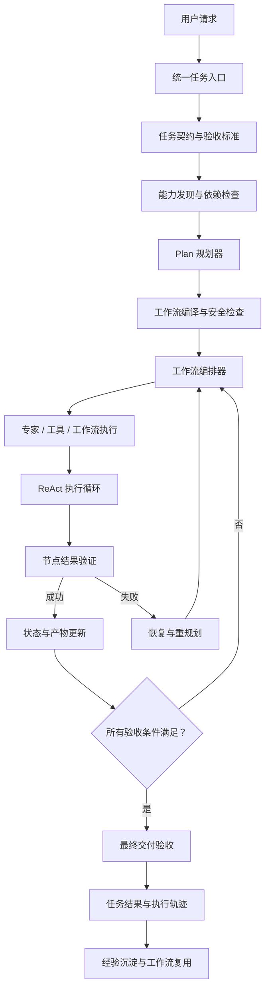

# 问答 135

> 来源: 新 窗口 | 会话: 分支 · 分支 · 分支 · 设计自进化智能体
> 消息: 423cc87c-04d5-4f5d-b6f1-223da0235122 | 时间(UTC): 2026-10-24 13:10

## 用户

继续

## ChatGPT

<WritingBlock id="73164" variant="document"># EvoAgent 第七十专项：可组合能力、动态工作流与跨专家协同执行体系

**专项编号：CCDWO-CEC**

**英文名称：Composable Capabilities, Dynamic Workflow Orchestration & Cross-Expert Collaboration**

**文档版本：V1.0**

**文档性质：全量架构专项设计**

**承接专项：** 第六十八专项 SEDG-IPGRA（全局进化决策与资源分配）、第六十九专项 SKEC-ETCR（知识沉淀、经验迁移与能力复用）。

**关联体系：** 统一任务入口、多层路由、领域专家、ReAct 执行循环、Plan 规划器、任务 DAG、EOACA 能力资产管理、AECGSR 执行资源协调、UEEDA 独立评测、CARE-LBV 收益验证及 SECIASRG 发布治理。

**核心目标：** 让 EvoAgent 能够根据任务目标、能力依赖、执行环境和资源预算，动态组合多个领域专家、工具、规则及工作流，形成可验证、可恢复、可追踪、可持续改进的复杂任务执行系统。

本文定义目标架构、执行协议、状态模型、工程接口及验收标准，不代表相关模块已经实现或通过测试。

---

# 一、为什么拥有多个专家，仍然不等于能够完成复杂任务？

前面的设计已经为 EvoAgent 建立了多个相对独立的领域专家，例如：

- 编程专家；
- 旅游规划专家；
- AI 漫剧制作专家；
- Android 手机操作专家；
- 信息检索专家；
- 内容创作专家；
- 文件与数据处理专家。

同时，EvoAgent 还具备规划中的知识沉淀、能力复用和工作流固化体系。

但这并不意味着它已经能够可靠地组合这些能力。

假设用户提出一个任务：

> 帮我制作一部 45 秒的 AI 漫剧，研究题材，设计角色，编写脚本，生成分镜和视频，完成配音、合成和质量检查，最后整理好项目文件。

这个任务至少涉及六种不同的能力：

1. 研究题材与整理素材；
2. 编写脚本和设计故事结构；
3. 生成角色、场景和分镜；
4. 生成视频与配音；
5. 合成视频并执行质量验收；
6. 管理文件、预算和交付物。

如果直接把全部任务交给 AI 漫剧专家，它可能需要临时完成大量并不擅长的工作。

如果让每个专家轮流处理，又可能产生新的问题：

- 上一个专家的结论没有完整传递给下一个专家；
- 两个专家重复检索相同资料；
- 分镜专家修改了脚本，但视频生成仍然使用旧版本；
- 视频生成失败后，整个任务被迫从头执行；
- 配音长度与视频时长不匹配；
- 一个专家耗尽预算，导致后续专家无法完成；
- 多个专家分别认为任务已完成，但最终交付物仍不符合用户要求。

如果把整个流程固定为一个不可变的 DAG，又无法充分应对开放任务中的不确定性。

因此，EvoAgent 需要一种新的组织方式。

**不是让专家互相聊天，也不是把所有任务写成固定脚本，而是建立一个由能力契约、任务规划、工作流编排、状态管理和结果验证共同构成的协同执行系统。**

这个系统需要回答：

1. 什么时候只需要一个专家？
2. 什么时候必须调用多个专家？
3. 任务应该分解到什么粒度？
4. 固定 DAG、动态 DAG 和开放式 Plan 应该如何选择？
5. 专家之间如何交接任务、上下文和执行结果？
6. 如何保证不同专家使用的是同一份任务事实和正确版本的产物？
7. 如何避免重复执行、循环委派和无意义的专家讨论？
8. 当某个子任务失败时，如何只恢复必要的部分？
9. 如何在预算有限的情况下选择最合适的专家与能力？
10. 如何证明组合后的任务整体成功，而不只是每个专家单独成功？

---

# 二、第一性原理：把复杂任务看作目标、约束与可验证动作的组合

复杂任务的本质不是调用多个模型，而是通过一系列有依赖关系的行动，达到一个可以检查的目标。

例如，“制作一部 45 秒漫剧”不能仅用“生成视频成功”作为验收标准。

它至少包含：

- 最终视频存在；
- 时长满足要求；
- 脚本与分镜一致；
- 角色外观在关键镜头中保持一致；
- 音频能够正常播放；
- 合成文件可以解码；
- 项目文件可以定位和复用；
- 总成本没有超过预算。

因此，系统首先需要把用户的自然语言请求转化为明确的任务契约。

## 2.1 统一任务契约

建议建立 `TaskContract`。

| 字段 | 含义 |
|---|---|
| `task_id` | 全局任务 ID |
| `user_goal` | 用户的原始目标 |
| `acceptance_criteria` | 可验证的验收标准 |
| `constraints` | 时间、成本、质量和权限约束 |
| `required_outputs` | 必须交付的结果 |
| `capability_requirements` | 所需能力 |
| `execution_policy` | 允许的执行方式 |
| `budget_limit` | 任务资源上限 |
| `deadline` | 可选的截止时间 |
| `risk_policy` | 风险处理规则 |
| `completion_policy` | 完成判定规则 |

任务契约是后续规划、执行、恢复和验收的共同依据。

它不能随着每个专家的解释而被随意改变。

如果用户后来修改目标，应创建明确的任务变更记录，重新评估受影响的子任务，而不是让某个专家私自修改全局目标。

## 2.2 区分目标、计划与执行结果

这三个概念必须分离。

- **目标：** 用户最终需要什么。
- **计划：** 系统认为应该执行哪些步骤。
- **结果：** 实际发生了什么，以及是否满足验收标准。

计划不是事实。

模型提出某个步骤已完成，也不等于该步骤真的完成。

例如，视频生成工具返回了一个文件路径，不一定意味着文件可解码、时长正确或内容符合脚本。

因此，EvoAgent 必须依靠实际工具结果、产物检查和独立验收来判断任务状态。

---

# 三、总体架构：跨专家协同执行控制平面

建议新增 `Cross-Expert Orchestration Plane`，简称 CEOP。

CEOP 负责将用户任务转化为可执行的能力组合，并协调各专家、工具和工作流完成任务。

## 3.1 核心模块

| 模块 | 主要职责 |
|---|---|
| Task Contract Manager | 维护目标、约束和验收标准 |
| Capability Registry | 查询可用专家、工具和工作流 |
| Task Planner | 将目标分解为候选子任务 |
| Workflow Compiler | 将计划转换为经过检查的执行图 |
| Workflow Orchestrator | 调度执行、维护状态和管理依赖 |
| Expert Adapter | 统一不同专家的调用与返回协议 |
| Context Handoff Manager | 管理专家之间的上下文交接 |
| Artifact Manager | 管理文件、数据和中间产物 |
| Validation Engine | 验证节点结果与整体任务目标 |
| Recovery Manager | 处理失败、重试、降级和局部恢复 |
| Resource Coordinator | 管理成本、并发和执行资源 |
| Execution Trace | 记录跨专家的完整执行轨迹 |
| Workflow Learning Bridge | 将成功流程反馈给能力复用与进化体系 |

这些模块是逻辑职责，不意味着必须分别部署成独立服务。

对于个人使用的 EvoAgent，建议第一阶段采用模块化单体架构，先建立清晰的接口和状态边界，再根据实际负载决定是否拆分服务。

## 3.2 总体执行流程



这条链路的关键是：规划、执行、验证和恢复分别承担不同职责，不能全部交给一个自由运行的模型。

---

# 四、明确专家、ReAct、Plan、DAG 和工作流的关系

这是 EvoAgent 必须冻结的核心架构决策。

这些概念并不处于同一层级，也不是互相替代的方案。

| 组成部分 | 回答的问题 | 职责 |
|---|---|---|
| 领域专家 | 谁具备完成某项工作的专业能力？ | 提供领域知识、工具使用策略和专业判断 |
| Plan | 为了达到目标，需要做哪些事情？ | 生成和更新任务计划 |
| DAG | 哪些步骤依赖哪些步骤？ | 表达任务之间的依赖关系 |
| 工作流 | 如何重复执行一类任务？ | 封装经过验证的流程模板、规则和恢复策略 |
| ReAct | 当前这一步如何根据观察继续行动？ | 执行局部推理、工具调用、观察和调整 |
| 编排器 | 下一步应该执行什么？ | 管理调度、状态、依赖、并发和恢复 |
| 验收器 | 结果是否真的符合要求？ | 依据明确标准验证节点与整体结果 |

可以将其理解为：

**专家提供专业能力，Plan 负责规划，DAG 表达依赖，工作流封装稳定执行方式，ReAct 负责局部执行与观察，编排器协调整个过程，验收器决定结果是否合格。**

例如，代码专家执行一个代码修改节点时，可以在节点内部运行 ReAct 循环，调用 AST 分析器、修改文件并运行测试。

但代码专家不应自行决定整个漫剧项目的全局预算，也不应绕过编排器擅自启动其他专家的任务。

---

# 五、工作流模式：不是所有任务都应该采用固定 DAG

建议 EvoAgent 支持四种执行模式。

## 5.1 M0：单专家直接执行

适用于目标明确、依赖较少、单个专家即可完成的任务。

例如：

- 解释一段代码；
- 总结一篇文章；
- 修改一段简单文本；
- 查询一个明确的信息。

特点：

- 调度开销低；
- 不需要构建复杂的任务图；
- 仍然保留必要的结果验证和预算约束。

不能为了体现多专家架构而强行拆分简单任务。

## 5.2 M1：固定工作流

适用于输入输出明确、步骤稳定、重复执行频率较高的任务。

例如：

- 将一组图片压缩并转换格式；
- 按固定流程运行代码测试；
- 按既定模板生成标准报告；
- 执行经过验证的文件处理流程。

特点：

- 大部分步骤预先确定；
- 分支和失败恢复已经定义；
- 运行成本较容易预测；
- 适合长期复用和版本化。

## 5.3 M2：参数化或动态 DAG

适用于总体步骤相对明确，但具体节点、数量和执行分支会随输入变化的任务。

例如：

AI 漫剧需要根据脚本生成不同数量的镜头，每个镜头可能独立生成素材，但最终需要统一合成。

特点：

- 主要依赖关系可以预先确定；
- 节点数量可以动态变化；
- 允许部分步骤并行执行；
- 失败后可以局部重试或替换节点。

## 5.4 M3：开放式 Plan 与动态重规划

适用于目标明确但实现路径不确定的复杂任务。

例如：

- 研究一个新领域并提出可验证方案；
- 调查一个复杂系统的故障；
- 规划多领域任务；
- 处理未知工具和未知环境下的问题。

特点：

- 计划初始只是候选方案；
- 执行过程中根据真实结果调整计划；
- 可以新增、删除或替换子任务；
- 受到全局预算、权限和停止条件约束。

开放式 Plan 不是无限自由执行。

它仍然必须遵守任务契约、工具权限、资源预算和终止条件。

## 5.5 如何自动选择执行模式？

建议采用分层判定。

1. 如果一个专家能够直接完成任务，则优先单专家执行。
2. 如果存在经过验证的工作流模板且输入符合模板条件，则优先复用。
3. 如果任务步骤明确但节点数量或分支不固定，则构建动态 DAG。
4. 如果实现路径存在较大不确定性，则采用开放式 Plan。
5. 如果风险较高或缺少必要信息，则先验证前置条件或向用户澄清。

模式选择结果应当记录在任务执行轨迹中。

执行过程中可以从开放式 Plan 转向稳定工作流，也可以在工作流无法覆盖异常时局部切换为动态规划，但必须保留原任务目标与已有有效状态。

---

# 六、能力契约：专家之间不能只传一句自然语言

如果不同专家只通过自然语言描述任务和结果，就很难确保任务交接完整。

例如，脚本专家可能输出：

“故事已经写好，可以开始生成分镜。”

但分镜专家真正需要的是：

- 最终脚本版本；
- 角色设定；
- 镜头数量或时长约束；
- 场景与风格要求；
- 禁止出现的内容；
- 已确认的用户偏好；
- 验收标准；
- 当前预算余量。

因此，建议为所有可调用能力建立统一的 `CapabilityContract`。

## 6.1 契约核心字段

| 字段 | 说明 |
|---|---|
| `capability_id` | 能力唯一标识 |
| `version` | 能力版本 |
| `input_schema` | 输入结构 |
| `output_schema` | 输出结构 |
| `preconditions` | 执行前必须满足的条件 |
| `postconditions` | 成功后必须满足的条件 |
| `side_effects` | 可能产生的外部副作用 |
| `permissions` | 所需权限 |
| `dependencies` | 所需工具和能力 |
| `resource_estimate` | 资源需求估计 |
| `timeout_policy` | 超时策略 |
| `retry_policy` | 重试约束 |
| `idempotency_policy` | 幂等性与重复执行规则 |
| `validation_rules` | 输出验收规则 |
| `failure_modes` | 已知失败模式 |
| `recovery_policy` | 失败恢复策略 |

## 6.2 能力调用的标准协议

建议统一使用以下逻辑结构。

```json
{
  "invocation_id": "invoke-123",
  "task_id": "task-456",
  "node_id": "node-789",
  "capability_id": "storyboard_generator",
  "capability_version": "1.2.0",
  "input_refs": ["artifact-script-v3"],
  "constraints": {
    "max_cost": 5,
    "timeout_seconds": 120
  },
  "acceptance_criteria": [
    "all_scenes_have_duration",
    "all_scenes_reference_character_ids"
  ]
}
```

以上为接口示例，不是已实现的 API。

执行结果也应采用结构化协议，至少包含：

- 执行状态；
- 输出产物引用；
- 验证结果；
- 错误类别；
- 资源消耗；
- 运行时长；
- 使用的能力版本；
- 未解决的问题；
- 建议的后续行动。

这样，编排器不需要从一大段自然语言中猜测某个节点究竟成功了没有。

---

# 七、任务 DAG：建立可执行、可验证的节点模型

建议建立 `WorkflowGraph`。

一个工作流图由节点和有向边组成。

节点可以是：

- 专家任务；
- 工具调用；
- 验证任务；
- 条件判断；
- 等待外部结果；
- 人工确认；
- 结果合并；
- 恢复操作；
- 子工作流。

## 7.1 节点必须包含什么？

每个节点至少应具有：

- `node_id`；
- `node_type`；
- `capability_ref`；
- `input_refs`；
- `output_contract`；
- `preconditions`；
- `postconditions`；
- `dependencies`；
- `timeout`；
- `retry_policy`；
- `budget_limit`；
- `side_effect_policy`；
- `validation_policy`；
- `recovery_policy`。

节点状态建议包括：

`PENDING`、`READY`、`RUNNING`、`SUCCEEDED`、`FAILED`、`BLOCKED`、`CANCELLED`、`SKIPPED`、`WAITING_APPROVAL`。

只有在前置依赖满足、输入有效、资源可用且权限允许时，节点才能进入 `READY`。

## 7.2 DAG 的边也需要语义

不同的依赖关系不能全部用同一种连线表达。

建议支持：

- 数据依赖：下游需要上游产物；
- 顺序依赖：必须先完成某个步骤；
- 条件依赖：只有满足条件才执行；
- 质量依赖：必须通过指定验收后才能继续；
- 资源依赖：必须先释放或获得资源；
- 人工授权依赖：必须取得用户批准。

例如，AI 漫剧的分镜生成依赖最终脚本，而视频生成依赖分镜和角色素材。

如果脚本发生变化，系统需要识别受影响的下游节点，而不是只根据节点的完成状态继续执行。

---

# 八、工作流编译器：不允许模型生成计划后直接执行

这是保障系统稳定性的关键。

大型语言模型可以提出计划，但不应该拥有直接执行任意任务图的权限。

建议建立 `Workflow Compiler`。

它负责把模型提出的候选计划转换为经过校验的执行图。

## 8.1 编译阶段

**第一步：结构检查。**

检查节点和边是否完整，是否存在无效引用或循环依赖。

普通 DAG 不允许循环。如果任务需要重复执行，应使用显式的循环控制节点，并设置迭代上限、停止条件和预算限制。

**第二步：能力检查。**

检查所有能力是否存在，版本是否兼容，输入输出契约是否匹配。

**第三步：权限检查。**

检查节点是否具有执行所需的权限，是否涉及未经授权的外部副作用。

**第四步：依赖检查。**

检查前置条件是否能够满足，是否存在无法解析的依赖。

**第五步：资源检查。**

估计任务的总成本、最大并发数、执行时间和资源占用。

**第六步：验收检查。**

确认最终输出能够覆盖任务契约中的验收条件。

**第七步：生成执行计划。**

输出可执行图、节点执行顺序、并行组、资源预留和恢复策略。

## 8.2 失败时应该怎样处理？

如果计划存在错误，编译器应当拒绝执行或要求修改。

例如：

- 引用了不存在的能力；
- 两个节点的输出类型不兼容；
- 某个高风险操作缺少必要授权；
- 工作流存在无限循环；
- 任务总预算已经超限；
- 最终交付物无法满足用户要求。

编译器可以把错误反馈给 Plan 规划器，让它重新生成方案。

但重新规划次数必须有限，不能因为编译失败就无限调用模型。

---

# 九、跨专家上下文交接：只传递必要、明确、可追溯的信息

多个专家协同最容易发生的问题之一，是上下文不一致。

例如：

脚本专家认为主角穿红色外套。

角色设计专家生成了红色外套的形象。

但分镜专家使用旧版脚本，仍然按照蓝色外套生成镜头。

最终视频中的角色外观发生变化。

这不是简单的记忆问题，而是跨专家任务交接和版本一致性问题。

## 9.1 建立 Context Handoff Packet

建议使用结构化的上下文交接包。

核心字段包括：

| 字段 | 含义 |
|---|---|
| `handoff_id` | 交接记录 ID |
| `task_id` | 全局任务 ID |
| `source_node_id` | 来源节点 |
| `target_node_id` | 目标节点 |
| `source_version` | 来源版本 |
| `artifact_refs` | 必需产物引用 |
| `confirmed_facts` | 已确认事实 |
| `constraints` | 必须遵守的约束 |
| `open_questions` | 尚未解决的问题 |
| `assumptions` | 尚未验证的假设 |
| `validation_status` | 上游验证状态 |
| `lineage_refs` | 来源与依赖关系 |

## 9.2 上下文不等于完整聊天记录

默认不应该将整个会话历史复制给每个专家。

更合理的方式是：

1. 提取当前子任务所需信息；
2. 引用经过确认的事实；
3. 引用所需的文件、数据或产物；
4. 明确哪些内容仍然是假设；
5. 记录上下文对应的版本；
6. 根据目标专家的需要补充领域特定信息。

这样可以降低 token 成本，也能减少无关上下文造成的干扰。

## 9.3 统一事实与专家观点必须分开

例如：

- 已确认事实：最终脚本版本为 v3；
- 专家观点：建议将第 4 镜头改为近景；
- 尚未验证的假设：视频生成模型能够保持该角色外观；
- 用户约束：最终视频必须为 30–60 秒。

这四种信息不能混合成一段不加区分的自然语言总结。

当专家提出新建议时，应创建新的候选变更，而不是直接覆盖已经确认的事实。

---

# 十、共享产物管理与版本一致性

复杂任务的交接不仅涉及文本，还涉及文件、图片、代码、视频、数据集和其他中间产物。

建议建立统一的 `Artifact Manager`。

## 10.1 产物对象

每个产物至少记录：

- `artifact_id`；
- `artifact_type`；
- `version`；
- `content_hash`；
- `storage_ref`；
- `producer_node_id`；
- `source_artifact_refs`；
- `schema_or_format`；
- `validation_status`；
- `created_at`；
- `lifecycle_status`。

对于大型文件，可以只在任务状态中保存引用、校验和与元数据，不必把完整文件内容反复放入模型上下文。

## 10.2 产物版本变化必须触发影响分析

假设脚本从 v3 更新为 v4。

系统需要识别：

- 哪些分镜基于 v3；
- 哪些角色设定依赖旧脚本；
- 哪些镜头仍然可以复用；
- 哪些镜头需要重新生成；
- 配音是否需要重新制作；
- 最终合成是否必须重新执行。

建议通过产物依赖图追踪影响范围。

不能仅因为一个下游节点曾经执行成功，就认为它在上游版本变化后仍然有效。

## 10.3 采用不可变产物与显式晋级

建议已发布的产物版本保持不可变。

修改产物时创建新版本，并明确记录替代关系。

这样可以避免多个专家同时修改同一个文件，导致彼此覆盖。

需要修改共享产物时，应使用明确的变更操作、版本检查和冲突处理，而不是允许多个专家直接写入同一稳定文件。

---

# 十一、编排器：整个协同系统的执行中枢

建议新增 `Workflow Orchestrator`。

它不是另一个领域专家，也不负责代替所有专家进行推理。

它的核心任务是协调执行。

## 11.1 编排器负责什么？

- 维护工作流图；
- 检查节点前置条件；
- 调度就绪节点；
- 限制并发执行；
- 管理任务状态；
- 传递结构化上下文；
- 管理产物引用；
- 检查执行超时；
- 更新资源账本；
- 触发验收；
- 处理失败恢复；
- 请求重新规划；
- 记录完整执行轨迹。

## 11.2 编排器不负责什么？

- 不替代领域专家进行所有专业判断；
- 不把模型提出的计划视为已验证事实；
- 不绕过工具权限；
- 不自动批准高风险外部操作；
- 不把每次失败都解释为需要全局架构修改；
- 不自行修改用户的任务目标；
- 不允许无限循环重规划；
- 不直接宣布没有通过验收的结果为成功。

这些职责边界有助于避免编排器成为一个不断膨胀、难以测试的超级智能体。

---

# 十二、跨专家协同协议

建议建立统一的 `Expert Invocation Protocol`。

一次专家调用需要经历以下过程：

1. 编排器确定目标节点；
2. 检查能力版本与权限；
3. 准备输入契约和上下文交接包；
4. 核验预算与运行环境；
5. 创建带有唯一标识的调用记录；
6. 执行专家或工具；
7. 收集结构化结果；
8. 验证输出契约；
9. 更新产物和节点状态；
10. 决定继续、恢复还是重新规划。

## 12.1 专家返回结果必须区分三种状态

**执行完成。**

专家完成了自己的局部工作，并返回了结构化结果。

**局部验收通过。**

该结果满足当前节点的验收条件。

**全局任务完成。**

整个任务的所有必要条件均已满足。

这三个状态不能混用。

例如，分镜专家完成了所有分镜，并不代表视频已经生成；视频生成成功也不代表最终交付已经通过质量验收。

## 12.2 专家可以提出新任务，但不能直接执行任意新任务

某个专家在执行过程中发现额外需求，可以提交 `SubtaskProposal`。

提案应包含：

- 为什么需要新增任务；
- 预期解决什么问题；
- 依赖哪些能力；
- 预估成本；
- 可能的风险；
- 是否影响原任务目标；
- 是否属于必要步骤。

由 Plan 规划器和编排器决定是否纳入执行图。

这样既保留动态发现问题的能力，也避免专家之间无限相互委派。

---

# 十三、局部失败恢复：不要因为一个节点失败就重做全部任务

复杂任务通常由多个独立步骤组成。

如果视频生成失败，但脚本、角色设定和分镜仍然有效，就没有必要把所有工作全部重做。

建议建立 `Workflow Recovery Manager`。

## 13.1 失败分类

| 失败类型 | 典型情况 | 默认处理方向 |
|---|---|---|
| 输入错误 | 输入缺字段、格式错误 | 修复输入或重新生成上游产物 |
| 能力错误 | 工具调用失败、接口不兼容 | 修复调用、适配或替换能力 |
| 资源错误 | 超时、预算耗尽、设备资源不足 | 暂停、降级或重新调度 |
| 质量错误 | 输出不符合验收标准 | 局部修复、重新生成或替换方案 |
| 依赖错误 | 上游产物版本变化 | 重新验证受影响节点 |
| 权限错误 | 缺少授权 | 请求授权或停止相关操作 |
| 环境错误 | 网络断联、外部服务不可用 | 等待恢复、切换可用方案或降级 |
| 规划错误 | 依赖遗漏、步骤不完整 | 重新规划受影响部分 |

## 13.2 恢复策略

建议支持：

- 局部重试；
- 参数调整后重试；
- 替换工具或专家；
- 回退到上一有效产物；
- 重新执行受影响的下游节点；
- 重新规划局部子图；
- 切换到降级工作流；
- 等待外部条件恢复；
- 请求人工处理；
- 终止任务并保留已有结果。

恢复策略必须根据失败类型和副作用风险决定。

不能把所有失败统一处理为“再调用一次模型”。

## 13.3 幂等性与副作用控制

对于没有外部副作用的纯计算节点，通常可以在明确条件下安全重试。

对于会发送消息、创建订单、修改远程数据或操作手机界面的节点，则必须更谨慎。

建议：

- 为每次调用生成唯一的 `invocation_id`；
- 为支持幂等的操作生成 `idempotency_key`；
- 记录操作是否已提交；
- 超时后先查询实际状态，再决定是否重试；
- 对不可逆操作使用更严格的授权和确认机制；
- 对无法确认是否成功的操作进入 `UNKNOWN_OUTCOME` 状态。

**超时不等于操作失败。**

例如，点击手机界面上的提交按钮后，界面没有及时返回结果，并不代表提交一定没有发生。盲目再次点击可能产生重复副作用。

因此，恢复管理器必须能够区分“确定失败”和“结果未知”。

---

# 十四、动态重规划：让系统适应变化，但不失去控制

动态重规划是开放式任务与固定工作流的重要区别。

但重规划不能无限发生，也不能随意破坏已完成的工作。

建议采用局部优先的重规划机制。

## 14.1 触发重规划的条件

- 当前计划无法继续执行；
- 关键依赖不可用；
- 输出连续未通过验收；
- 发现新的必要子任务；
- 用户修改了目标或约束；
- 资源预算发生重大变化；
- 环境发生变化；
- 新证据推翻了关键假设；
- 原工作流不再满足任务契约。

## 14.2 重规划范围

默认只重新规划受影响的子图。

只有当以下情况出现时，才考虑全局重规划：

- 用户目标发生实质变化；
- 核心假设被推翻；
- 多个主要节点之间存在系统性冲突；
- 原有方案无法满足硬性约束；
- 任务状态已经无法可靠恢复。

## 14.3 重规划必须保留历史

每次重规划应记录：

- 原计划版本；
- 新计划版本；
- 触发原因；
- 保留的已完成节点；
- 作废的节点；
- 新增的节点；
- 资源影响；
- 风险变化；
- 重新验收的要求。

这样可以避免系统不断生成新计划，却无法解释为什么改变执行路径。

---

# 十五、全局资源协调与并行执行

跨专家任务可能同时运行多个子任务。

例如，AI 漫剧的三个镜头可以并行生成，但共享视频生成服务的额度有限。

同时，用户可能正在手机上执行其他任务，或者 Windows 设备的 GPU 正在处理本地视频合成。

因此，CEOP 必须与 SEDG-IPGRA 的预算体系协同。

## 15.1 资源协调维度

- 任务级预算；
- 节点级预算；
- 专家级预算；
- 模型调用预算；
- 外部服务费用；
- CPU/GPU 资源；
- 内存与存储；
- 并发上限；
- 时间预算；
- 重试预算。

## 15.2 并行策略

建议支持三类节点执行策略。

**串行节点：** 存在顺序依赖、共享写入冲突或高风险副作用。

**并行节点：** 输入独立、资源允许且不会产生冲突。

**受限并行节点：** 可以并行，但需要控制并发数、共享服务调用量或资源使用。

## 15.3 任务预算不能被子任务无限拆分

例如，用户为整部漫剧设定了总预算。

工作流不能让每个镜头都独立申请完整预算，导致总费用超出用户限制。

因此，编排器应当维护统一的预算账本，并为子任务分配可用额度。

子任务没有权限自行突破总预算。

预算调整必须经过明确的策略检查；如果需要用户承担额外费用或改变原有约束，应按授权规则处理。

---

# 十六、任务状态与断联恢复

EvoAgent 的目标设备包括 Android、Windows 和个人 mini Linux 主机。

任务执行过程中可能发生：

- App 被系统终止；
- 电脑关机；
- 网络断联；
- 外部服务暂时不可用；
- 后台进程崩溃；
- 某个专家调用超时。

因此，编排器不能仅依靠内存中的对象维护任务状态。

建议建立持久化 `Workflow State Store`。

## 16.1 必须持久化的状态

- 任务契约版本；
- 工作流图版本；
- 节点状态；
- 已完成的节点结果；
- 产物引用；
- 专家调用记录；
- 资源消耗；
- 重试次数；
- 待处理恢复任务；
- 外部副作用状态；
- 未决授权请求；
- 当前任务检查点。

## 16.2 恢复流程

```text
进程或设备恢复
      ↓
读取持久化任务状态
      ↓
检查任务版本与环境
      ↓
核对节点和产物状态
      ↓
检查未完成的外部调用
      ↓
验证预算和权限
      ↓
恢复可安全继续的节点
      ↓
对结果未知的节点执行状态核验
      ↓
重新计算就绪节点
      ↓
继续执行或进入受控降级
```

对于本地优先的第一版，建议将任务状态和必要的执行日志保存在本地持久化存储中。

如果后续增加服务器同步，服务端应当作为经过授权的状态同步和治理组件，而不是默认成为每次任务继续执行的必要条件。

---

# 十七、最终验收：局部成功不代表全局成功

这是跨专家执行体系最容易遗漏的环节。

每个专家都可能返回成功，但最终任务仍然失败。

例如：

- 脚本符合要求；
- 分镜生成成功；
- 视频文件生成成功；
- 配音生成成功；
- 合成成功；

但最终视频时长超过用户要求，或者角色一致性严重不足。

因此，建议建立两级验收体系。

## 17.1 节点级验收

每个节点按照自己的输出契约进行验证。

例如：

- 文件是否存在；
- JSON 是否符合 Schema；
- 代码测试是否通过；
- 图片尺寸是否符合要求；
- 视频是否可以解码；
- 音频是否可以播放；
- 工具调用是否产生预期结果。

## 17.2 任务级验收

最终验收必须回到原始 `TaskContract`。

例如：

- 是否交付了全部必需产物；
- 是否满足目标时长；
- 是否满足质量要求；
- 是否超过预算；
- 是否存在未解决的关键问题；
- 是否遵守权限约束；
- 是否完成必要的用户确认；
- 是否能够复现关键结果。

如果任务没有通过验收，系统应明确报告哪些条件未满足，而不是将所有节点的成功状态简单合并为全局成功。

---

# 十八、工程目录与核心接口

建议新增以下模块：

```text
evoagent/
├── cross_expert_orchestration/
│   ├── task_contract/
│   ├── capability_discovery/
│   ├── task_planner/
│   ├── workflow_compiler/
│   ├── workflow_graph/
│   ├── workflow_orchestrator/
│   ├── execution_policy/
│   ├── adaptive_replanning/
│   ├── concurrency_control/
│   └── completion_evaluator/
├── expert_protocol/
│   ├── invocation_contract/
│   ├── expert_adapter/
│   ├── structured_result/
│   ├── context_handoff/
│   ├── subtask_proposal/
│   └── protocol_validation/
├── artifact_management/
│   ├── artifact_registry/
│   ├── artifact_versioning/
│   ├── artifact_lineage/
│   ├── immutable_artifacts/
│   ├── artifact_validation/
│   └── invalidation_propagation/
├── workflow_runtime/
│   ├── node_executor/
│   ├── state_machine/
│   ├── checkpoint_manager/
│   ├── event_journal/
│   ├── idempotency_manager/
│   ├── side_effect_registry/
│   └── resume_validator/
├── workflow_recovery/
│   ├── failure_classifier/
│   ├── retry_policy/
│   ├── partial_recovery/
│   ├── compensation_manager/
│   ├── unknown_outcome_handler/
│   ├── fallback_workflow/
│   └── recovery_audit/
├── workflow_resource_control/
│   ├── task_budget/
│   ├── node_budget/
│   ├── concurrency_limiter/
│   ├── resource_scheduler/
│   ├── interruption_policy/
│   └── budget_accounting/
├── workflow_learning_bridge/
│   ├── successful_trace_extraction/
│   ├── workflow_candidate_generation/
│   ├── workflow_reproducibility/
│   └── workflow_promotion/
└── orchestration_tests/
    ├── contract_validation/
    ├── dependency_scheduling/
    ├── context_consistency/
    ├── artifact_versioning/
    ├── parallel_execution/
    ├── partial_recovery/
    ├── idempotency/
    ├── unknown_outcome/
    ├── budget_enforcement/
    ├── dynamic_replanning/
    ├── offline_resume/
    └── global_acceptance/
```

## 18.1 核心接口

建议定义以下逻辑接口：

- `create_task_contract`：创建统一任务契约；
- `discover_capabilities`：发现可用能力；
- `select_execution_mode`：选择执行模式；
- `generate_task_plan`：生成候选任务计划；
- `compile_workflow_graph`：编译工作流图；
- `validate_workflow_contracts`：验证能力输入输出契约；
- `validate_workflow_permissions`：验证执行权限；
- `estimate_workflow_budget`：估算工作流资源需求；
- `schedule_ready_nodes`：调度已满足依赖的节点；
- `invoke_expert_capability`：调用专家或能力；
- `create_context_handoff`：创建结构化上下文交接包；
- `validate_node_output`：验证节点输出；
- `register_artifact`：登记任务产物；
- `resolve_artifact_version`：解析指定版本的产物；
- `invalidate_dependent_nodes`：标记受上游变更影响的节点；
- `persist_workflow_state`：持久化任务状态；
- `checkpoint_workflow`：保存执行检查点；
- `resume_workflow`：恢复工作流；
- `classify_execution_failure`：识别失败类别；
- `recover_failed_node`：恢复失败节点；
- `check_side_effect_status`：检查外部副作用状态；
- `request_plan_revision`：请求重新规划；
- `enforce_workflow_budget`：执行工作流预算限制；
- `evaluate_task_completion`：检查最终任务验收条件；
- `record_execution_trace`：记录完整执行轨迹；
- `extract_workflow_candidate`：抽取候选工作流；
- `validate_reusable_workflow`：验证工作流是否适合复用。

这些接口应统一使用任务 ID、节点 ID、调用 ID、能力 ID、产物 ID 和版本 ID，保证端到端可追溯。

---

# 十九、端到端验收场景

建议至少建立以下十四个验收场景。

## 场景 A：单专家任务不被过度拆分

**条件：** 用户要求解释一段代码。

**验收：** 系统选择单专家执行，不强行构建多专家 DAG。

## 场景 B：多个专家完成复杂任务

**条件：** 用户要求制作 45 秒 AI 漫剧。

**验收：** 系统建立跨专家任务图，正确安排脚本、角色、分镜、生成、合成和验收。

## 场景 C：工作流存在无效依赖

**条件：** 规划器生成了依赖不存在的能力节点。

**验收：** 编译器拒绝执行，并返回可处理的错误信息。

## 场景 D：上下游产物版本不一致

**条件：** 脚本更新，但分镜仍然引用旧版本。

**验收：** 系统识别受影响的下游节点，阻止不兼容的结果进入最终合成。

## 场景 E：多个独立镜头并行生成

**条件：** 视频服务允许有限并发。

**验收：** 系统能够并行执行独立节点，同时遵守并发和预算限制。

## 场景 F：一个镜头生成失败

**条件：** 多个镜头中只有一个未通过验收。

**验收：** 系统仅恢复必要节点，不重复生成全部镜头。

## 场景 G：工具调用超时但结果未知

**条件：** 手机操作在提交后未及时返回结果。

**验收：** 系统先检查实际状态，不盲目重复提交。

## 场景 H：某专家不可用

**条件：** 目标专家暂时无法调用。

**验收：** 系统根据能力契约决定等待、切换兼容能力、降级或停止，不自动调用不兼容的替代方案。

## 场景 I：动态重规划

**条件：** 当前工作流无法满足用户的最终约束。

**验收：** 系统生成新的计划版本，保留有效结果并记录变更原因。

## 场景 J：任务预算耗尽

**条件：** 多个子任务累计消耗达到全局预算上限。

**验收：** 系统阻止新增的非必要调用，保留已有结果，并按策略请求调整或终止。

## 场景 K：用户修改任务目标

**条件：** 用户要求将漫剧时长从 45 秒调整到 60 秒。

**验收：** 系统更新任务契约，重新评估受影响的节点和产物，不无条件重做全部工作。

## 场景 L：设备断联后恢复

**条件：** 工作流执行过程中 App 或桌面进程中断。

**验收：** 系统恢复持久化状态，核验未完成调用和产物，继续安全可恢复的节点。

## 场景 M：专家提交未经批准的子任务

**条件：** 某专家希望启动额外的外部服务调用。

**验收：** 子任务必须经过统一的计划、权限与预算检查，不能直接绕过编排器。

## 场景 N：所有节点成功但最终结果不合格

**条件：** 视频生成、配音和合成都返回成功，但最终时长不符合要求。

**验收：** 任务级验收判定失败，系统定位受影响部分并生成恢复计划。

---

# 二十、专项验收标准

CCDWO-CEC 至少需要满足以下要求：

1. 建立统一任务契约。
2. 能够发现并调用经过注册的专家、工具与工作流。
3. 能够区分单专家、固定工作流、动态 DAG 和开放式 Plan。
4. 能够根据任务复杂度、依赖和不确定性选择合理的执行模式。
5. 能够定义统一的能力输入输出契约。
6. 能够验证工作流结构、能力依赖、权限和预算。
7. 能够阻止不合法或超出授权范围的工作流执行。
8. 能够区分专家、Plan、DAG、ReAct、编排器和验收器的职责。
9. 能够建立结构化的跨专家上下文交接协议。
10. 能够区分已确认事实、假设、专家建议和待解决问题。
11. 能够管理产物版本和依赖关系。
12. 能够在上游产物发生变化时识别受影响的下游节点。
13. 能够支持串行、并行和受限并行执行。
14. 能够维护持久化的任务与节点状态。
15. 能够识别输入错误、工具错误、资源错误、权限错误和质量错误。
16. 能够执行局部恢复，避免无必要的全量重跑。
17. 能够处理外部副作用操作的幂等性与结果未知状态。
18. 能够限制重试次数、重规划次数和执行时长。
19. 能够在动态重规划时保留有效节点和历史版本。
20. 能够对任务预算进行统一管理，防止子任务重复占用完整预算。
21. 能够在设备中断和网络异常后恢复任务。
22. 能够分别验证节点级结果和全局任务完成状态。
23. 能够记录完整的跨专家执行轨迹。
24. 能够识别不兼容的专家替代方案。
25. 能够将稳定的成功流程提交为候选工作流资产。
26. 能够与 SKEC-ETCR 协同进行知识和能力复用。
27. 能够与 SEDG-IPGRA 协同进行资源预算和优先级治理。
28. 能够与 CARE-LBV 协同验证组合任务的实际收益。
29. 能够与 SECIASRG 协同管理工作流版本和受控发布。
30. 能够在 Windows、Android 和 mini Linux 环境中使用一致的任务状态和执行语义。
31. 能够通过故障注入测试验证局部恢复。
32. 能够通过并发测试验证资源和状态一致性。
33. 能够通过版本变更测试验证产物依赖传播。
34. 能够通过断联恢复测试验证任务续跑。
35. 能够通过端到端任务测试验证整个工作流确实满足用户的原始目标。

以上为目标架构验收要求，不代表相关模块已经实现或通过测试。

---

# 二十一、建议冻结的架构决策

以下建议承接 ADR-1336。

| 编号 | 决策 |
|---|---|
| ADR-1337 | 建立跨专家协同执行控制平面 CEOP |
| ADR-1338 | 所有复杂任务必须具有统一任务契约和验收标准 |
| ADR-1339 | 专家、Plan、DAG、工作流、ReAct、编排器与验收器采用职责分离设计 |
| ADR-1340 | 支持单专家、固定工作流、动态 DAG 和开放式 Plan 四种执行模式 |
| ADR-1341 | 不得为了使用多专家架构而强制拆分简单任务 |
| ADR-1342 | 所有可调用能力必须提供统一的输入输出契约 |
| ADR-1343 | 模型生成的计划必须经过工作流编译与权限检查后才能执行 |
| ADR-1344 | 普通 DAG 禁止循环依赖，重复执行必须使用受控循环节点 |
| ADR-1345 | 工作流节点必须具有状态、依赖、验收和恢复策略 |
| ADR-1346 | 建立结构化的跨专家调用与返回协议 |
| ADR-1347 | 专家只能通过受控提案机制申请新增子任务 |
| ADR-1348 | 建立结构化上下文交接包，避免默认传递完整聊天历史 |
| ADR-1349 | 已确认事实、假设、专家建议和未知信息必须明确区分 |
| ADR-1350 | 建立统一产物注册、版本管理和依赖追踪机制 |
| ADR-1351 | 已发布产物版本保持不可变，修改必须产生新的可追踪版本 |
| ADR-1352 | 上游产物变化必须触发下游依赖影响分析 |
| ADR-1353 | 建立独立的工作流编排器，负责状态、调度、预算和恢复 |
| ADR-1354 | 专家不能绕过编排器直接执行未授权的跨专家任务 |
| ADR-1355 | 节点成功、节点验收通过与全局任务完成必须分别记录 |
| ADR-1356 | 建立统一的失败分类和局部恢复机制 |
| ADR-1357 | 外部副作用操作必须具有明确的重试和幂等性策略 |
| ADR-1358 | 无法确认执行结果的操作必须进入结果未知状态，禁止盲目重试 |
| ADR-1359 | 动态重规划默认仅影响必要的子图，重大目标变化除外 |
| ADR-1360 | 每次重规划必须记录计划版本、原因和受影响节点 |
| ADR-1361 | 并行执行必须遵守能力依赖、资源限制和共享状态一致性要求 |
| ADR-1362 | 子任务不得绕过全局预算约束 |
| ADR-1363 | 工作流任务状态必须持久化并支持受控恢复 |
| ADR-1364 | 最终任务验收必须回到原始任务契约 |
| ADR-1365 | 工作流编排器不得替代专家的领域判断，也不得绕过安全与权限治理 |
| ADR-1366 | 经过验证的成功流程可以提交为可复用工作流候选 |
| ADR-1367 | 工作流固化必须保留必要的条件分支、恢复机制和版本治理 |
| ADR-1368 | 跨专家执行轨迹必须能够追溯到任务、节点、能力、产物和版本 |
| ADR-1369 | CEOP 必须与 EOACA、AECGSR、UEEDA、CARE-LBV、SEDG-IPGRA、SKEC-ETCR 和 SECIASRG 协同 |
| ADR-1370 | CEOP 采用本地优先的逻辑架构，不要求第一版部署独立编排服务器 |

以上建议作为 EvoAgent 第七十专项的架构基线。

---

# 二十二、完成第七十专项后，EvoAgent 的任务执行架构形成了什么闭环？

此前的专项重点解决：

- 如何发现问题；
- 如何分析原因；
- 如何验证改进；
- 如何分配进化资源；
- 如何积累经验；
- 如何复用能力。

第七十专项进一步解决了这些能力如何在真实任务中被组合起来的问题。

| 层次 | 主要职责 |
|---|---|
| 统一入口与路由 | 理解用户目标，确定初始执行方向 |
| 领域专家 | 提供专业能力和领域判断 |
| Plan | 生成与调整任务计划 |
| DAG 与工作流 | 表达依赖并封装稳定流程 |
| ReAct | 执行局部行动、观察和调整 |
| CEOP | 协调跨专家执行、状态与恢复 |
| 验收引擎 | 验证节点结果和全局任务目标 |
| SKEC-ETCR | 沉淀经验并复用已验证能力 |
| CARE-LBV | 验证实际效果和长期收益 |
| SEDG-IPGRA | 管理全局优先级与资源分配 |

这套设计使 EvoAgent 可以从简单任务的直接执行，逐步扩展到跨专家复杂任务，而不需要为每一种新场景重新设计整个系统。

但需要强调：架构上的职责划分只是第一步。真正的可靠性来自明确的接口契约、持久化状态、独立验收、受控恢复和可重复测试。

---

# 二十三、下一专项：跨设备任务状态一致性、断联恢复与幂等执行体系

完成第七十专项后，仍然有一个关键问题需要继续深入。

假设 EvoAgent 已经在 Android 手机上启动了一个复杂任务，随后用户关闭了 App。

与此同时，Windows 电脑上的任务管理界面仍然显示该任务正在执行；mini Linux 主机可能还在运行后台任务；云端模型请求也可能已经完成，但结果尚未同步回手机。

此时，如果多个设备分别保存自己的任务状态，就可能发生：

- 同一个子任务被执行两次；
- 旧设备状态覆盖新状态；
- 手机认为任务失败，但后台实际上已经完成；
- 文件已经生成，却没有登记到任务产物中；
- 重连后重复提交具有外部副作用的操作；
- 不同设备对当前任务版本产生不同理解。

这说明，跨专家协同之后，系统还需要解决更底层的状态一致性问题。

建议定义下一专项：

**Cross-Device Task Consistency, Offline Recovery & Idempotent Execution，简称 CDTCO-IRE。**

核心研究方向包括：

1. 如何定义任务状态的权威来源；
2. Android、Windows 和 mini Linux 如何共享任务标识与版本；
3. 本地执行状态与服务端状态如何协调；
4. 如何处理离线期间产生的增量事件；
5. 如何检测并解决状态冲突；
6. 如何区分可重试任务与不可盲目重试的外部操作；
7. 如何保证任务恢复时不重复消耗预算；
8. 如何处理执行成功但结果未同步的情况；
9. 如何实现可靠的检查点、续跑与局部恢复；
10. 如何处理不同设备同时修改同一任务或产物；
11. 如何维护事件顺序、版本关系和因果依赖；
12. 如何实现安全的增量同步与冲突审计；
13. 如何在云端服务不可用时维持本地基本执行能力；
14. 如何让恢复后的任务继续遵守原有权限与预算约束；
15. 如何避免状态管理成为整个 EvoAgent 的单点故障。

**核心原则：设备可以分别执行任务，但任务身份、版本关系、操作结果和恢复语义必须能够被可靠地协调。断联不应自动意味着失败，重连也不应自动意味着重新执行。**

这一专项将把 EvoAgent 的任务执行体系进一步推进到真正适合 Android 优先、跨设备扩展和本地优先部署的工程架构。

</WritingBlock>

<MemoryCite />
