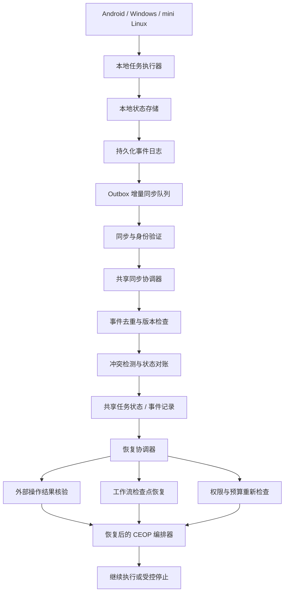

# 问答 136

> 来源: 新 窗口 | 会话: 分支 · 分支 · 分支 · 设计自进化智能体
> 消息: 6ed20059-82e9-4e6d-98c2-88282c6c0e9d | 时间(UTC): 2026-10-24 13:15

## 用户

继续

## ChatGPT

<WritingBlock id="58317" variant="document"># EvoAgent 第七十一专项：跨设备任务状态一致性、断联恢复与幂等执行体系

**专项编号：CDTCO-IRE**

**英文名称：Cross-Device Task Consistency, Offline Recovery & Idempotent Execution**

**文档版本：V1.0**

**文档性质：全量架构专项设计**

**承接专项：** 第六十九专项 SKEC-ETCR（知识沉淀、经验迁移与能力复用）、第七十专项 CCDWO-CEC（可组合能力、动态工作流与跨专家协同执行）。

**适用设备：** Android 手机、Windows 10/11 桌面设备、个人 mini Linux 主机，以及未来接入的其他执行设备。

**核心目标：** 在设备离线、进程崩溃、网络中断、重复消息、并发操作、模型请求超时和任务跨设备切换等情况下，保证 EvoAgent 的任务状态、执行记录、预算、产物和权限信息能够得到可靠管理，避免重复执行、状态覆盖、结果丢失和未经授权的恢复操作。

**架构原则：** 本地优先、状态可恢复、事件可追溯、冲突可检测、操作可去重、结果可核验、权限不继承、失败可隔离。

本文定义目标架构、数据模型、同步协议、恢复流程、工程接口与验收标准，不代表相关模块已经实现或通过测试。

---

# 一、为什么有了工作流编排器，仍然不能保证任务可靠执行？

第七十专项已经建立跨专家协同执行控制平面 CEOP。

它能够管理任务计划、节点依赖、专家调用、工作流状态、预算和失败恢复。

但如果任务状态只保存在一个运行进程的内存中，那么设备一旦关机、App 被系统终止或网络中断，之前的执行结果就可能无法被正确恢复。

更复杂的是，EvoAgent 不是永远只运行在一台设备上。

未来可能同时存在：

- Android 手机上的任务入口与本地执行器；
- Windows 电脑上的桌面控制台和本地工具；
- mini Linux 主机上的后台任务与持久化存储；
- 云端模型 API；
- 外部视频生成、文件存储和其他服务。

这些组件之间并不总是实时连通。

考虑下面这个场景。

用户在 Android 手机上要求 EvoAgent 制作一部 45 秒的 AI 漫剧。

1. 手机生成任务计划。
2. 任务被拆分成脚本、分镜、素材生成、视频生成和合成等节点。
3. 视频生成请求已经发送给外部服务。
4. 外部服务实际上已经完成生成，但手机恰好断网。
5. 手机本地只记录到请求超时。
6. 用户打开 Windows 桌面端，看到任务仍然显示为运行中。
7. Windows 端无法判断视频是否已经生成。
8. 如果系统直接重试，可能再次付费生成同一段视频。
9. 如果系统把任务标记为失败，已经生成的结果又可能被遗漏。
10. 如果手机恢复联网后将旧状态直接覆盖到新状态，还可能破坏其他节点已经完成的记录。

这类问题并不是单纯的网络异常，而是分布式任务执行中的状态一致性问题。

因此，必须区分三个概念：

- **执行状态：** 某个操作实际上发生了什么。
- **记录状态：** 系统已经知道并保存了什么。
- **同步状态：** 不同设备已经交换并确认了哪些记录。

三者可能暂时不一致。

例如，外部服务已经完成视频生成，但本地尚未收到结果。此时真实执行状态是成功，记录状态可能仍是未知，同步状态则可能处于等待恢复。

**EvoAgent 必须能够容忍这种暂时不一致，并通过可验证的恢复流程逐步收敛，而不是假设网络中的每个请求都能可靠地完成一次。**

---

# 二、第一性原理：真正需要保证的是什么？

在分布式系统中，不能简单承诺所有操作都能实现严格的“恰好执行一次”。

原因是：请求可能已经被外部服务执行，但返回结果在网络中丢失。客户端无法仅凭超时判断操作究竟有没有发生。

因此，本专项不以不现实的全局 exactly-once 执行为目标，而是建立更可实施的保证。

## 2.1 六项核心保证

| 保证 | 设计目标 |
|---|---|
| 状态可恢复 | 进程崩溃后，能够从持久化记录恢复任务 |
| 事件不静默丢失 | 已确认提交到本地持久化日志的事件能够重新同步 |
| 重复消息可去重 | 同一事件被多次发送或接收时，不会重复应用状态变更 |
| 操作结果可核验 | 外部操作超时后，先判断真实结果，再决定是否重试 |
| 冲突可检测 | 不同设备产生互相冲突的修改时，不允许旧状态无条件覆盖新状态 |
| 权限可重新验证 | 任务恢复或设备切换时，重新检查当前授权与执行边界 |

其中，重复消息去重与外部操作幂等是两个不同的问题。

消息去重只能防止系统重复处理同一条消息。

它不能自动保证外部服务没有收到两次不同的请求。

因此，任务事件、执行调用和外部副作用必须分别建立去重与恢复机制。

## 2.2 不追求所有数据始终实时一致

EvoAgent 的设备可能长时间离线。

因此，不应该要求每次状态变化都立即同步到所有设备。

更合理的目标是：

1. 每台设备在授权范围内维护自己的本地任务状态；
2. 重要事件先可靠持久化，再确认提交；
3. 离线期间继续执行允许的本地任务；
4. 网络恢复后增量同步；
5. 对冲突进行识别和处理；
6. 对未知外部结果执行核验；
7. 在同步和核验完成后恢复安全执行。

这属于以本地持久化和最终收敛为基础的设计。

但某些操作，例如支付、发送消息或其他不可逆外部动作，不能仅依赖最终一致性。它们必须在执行前进行权限检查，并采用适合该操作的状态确认与去重策略。

---

# 三、总体架构：跨设备任务一致性控制平面

建议新增 `Cross-Device Consistency & Recovery Plane`，简称 CDCRP。

它与第七十专项的 CEOP 协同，但不取代工作流编排器。

CEOP 决定下一步执行什么。

CDCRP 负责保证执行状态、事件记录、设备协作和恢复过程可靠。

## 3.1 核心模块

| 模块 | 主要职责 |
|---|---|
| Task Identity Registry | 管理任务、节点、调用与设备的统一标识 |
| Local Durable Journal | 持久化本地事件和状态变更 |
| Task State Store | 保存任务与节点的可恢复状态 |
| Device Ownership Manager | 管理任务执行权与设备租约 |
| Sync Outbox | 保存等待发送的事件 |
| Sync Inbox | 接收并去重远端事件 |
| Incremental Sync Engine | 执行增量同步与确认 |
| Conflict Resolver | 检测并处理并发修改冲突 |
| Idempotency Manager | 管理调用去重与幂等键 |
| External Outcome Reconciler | 核验外部操作的真实结果 |
| Checkpoint Manager | 保存可恢复的执行检查点 |
| Recovery Coordinator | 协调任务恢复和局部续跑 |
| Budget Ledger | 记录已分配、已消耗和待核实的资源 |
| Artifact Reconciler | 对账文件、产物引用与实际存储 |
| Permission Revalidator | 恢复时重新检查授权 |
| Sync Security Manager | 负责身份验证、完整性和访问控制 |
| Audit & Telemetry | 记录同步、冲突、恢复与异常事件 |

这些模块是逻辑职责。

对于个人使用的 EvoAgent，第一阶段可以采用模块化单体结构，不必为每个模块单独部署服务。

## 3.2 总体架构图



共享同步协调器可以运行在 mini Linux 主机、Windows 设备或未来的服务器上。

第一版不要求必须存在一个始终在线的中心服务。

没有共享协调器时，设备仍可保存本地状态并继续执行授权范围内的任务；恢复联网后，再通过明确的同步规则交换事件。

---

# 四、任务身份：所有设备必须知道自己在操作同一个什么对象

如果 Android、Windows 和 mini Linux 分别为同一个任务生成不同的 ID，后续同步几乎必然出现重复任务。

因此，必须建立统一标识体系。

## 4.1 核心标识

| 标识 | 含义 |
|---|---|
| `task_id` | 全局任务 ID |
| `workflow_id` | 工作流 ID |
| `workflow_version` | 工作流版本 |
| `node_id` | 工作流节点 ID |
| `invocation_id` | 一次逻辑调用的 ID |
| `attempt_id` | 某次执行尝试的 ID |
| `event_id` | 事件唯一 ID |
| `device_id` | 设备 ID |
| `artifact_id` | 产物 ID |
| `artifact_version` | 产物版本 |
| `idempotency_key` | 幂等操作键 |
| `lease_id` | 执行租约 ID |
| `checkpoint_id` | 恢复检查点 ID |

这些标识不能混用。

例如：

- 一个节点可能有多个执行尝试；
- 一次逻辑调用可能对应一个或多个网络请求；
- 同一个事件可能被同步多次；
- 同一个产物可以有多个不可变版本。

如果把 `attempt_id` 当作 `invocation_id`，那么每次重试都会被识别为全新逻辑操作，去重机制也就失去了作用。

## 4.2 离线设备如何生成不冲突的 ID？

本地创建任务时，不需要先向服务器申请 ID。

可以使用足够高随机性的全局唯一标识，例如 UUIDv4。

同时为每台设备分配独立的 `device_id`。

对于事件，还应记录：

- 事件创建时间；
- 设备本地序列号；
- 任务版本；
- 前置事件或因果依赖；
- 事件所属设备。

时间戳只用于辅助排序和分析，不能单独决定哪个事件更新。

因为不同设备的系统时钟可能存在偏差。

---

# 五、任务状态：不能只保存一个 status 字段

传统任务管理经常只保存：

```json
{
  "task_id": "task-001",
  "status": "running"
}
```

这种结构无法描述任务为什么运行、哪些节点已经完成、是否存在未确认的外部操作，以及任务能否安全恢复。

建议将任务状态拆分成多个维度。

## 5.1 任务级状态

| 状态 | 含义 |
|---|---|
| `CREATED` | 任务已创建 |
| `READY` | 满足执行条件，等待启动 |
| `RUNNING` | 正在执行 |
| `WAITING_EXTERNAL` | 等待外部服务或结果 |
| `WAITING_APPROVAL` | 等待必要的用户授权 |
| `PAUSED` | 主动暂停 |
| `RECOVERING` | 正在核验状态并恢复 |
| `COMPLETED` | 全局验收通过 |
| `FAILED` | 按策略确认无法继续 |
| `CANCELLED` | 已取消 |
| `NEEDS_REVIEW` | 存在无法自动解决的关键问题 |

`OFFLINE` 不应该直接等同于任务失败。

设备离线是连接状态，不是任务本身的业务结果。

建议将连接状态、执行状态、同步状态分别维护。

例如，一个任务可以同时处于：

- 执行状态：`WAITING_EXTERNAL`；
- 连接状态：`OFFLINE`；
- 同步状态：`PENDING_SYNC`。

这比用单一的 `FAILED` 状态表达所有问题更准确。

## 5.2 节点级状态

每个工作流节点还应独立记录：

- 是否满足前置条件；
- 是否已经开始；
- 是否已经提交外部请求；
- 是否已经收到执行结果；
- 是否已经通过验收；
- 是否需要重新验证；
- 是否存在未知副作用；
- 是否可以安全重试；
- 是否已被上游版本变化影响。

节点状态不能仅由任务级状态推断。

一个任务可能整体处于恢复阶段，但其中大部分节点已经成功且无需重新执行。

## 5.3 状态迁移必须经过合法性检查

例如：

`RUNNING → COMPLETED`

不能只因为某个模型返回“已完成”就直接发生。

它至少需要满足对应的执行结果和验收条件。

对于外部副作用节点，如果操作已经提交但结果未知，则应进入类似 `UNKNOWN_OUTCOME` 的独立状态，而不是直接标记为失败。

建议使用显式状态迁移规则，禁止任意组件直接覆盖状态字段。

---

# 六、事件日志：状态是结果，事件才是可追溯的依据

为了支持断联恢复、冲突分析和执行审计，建议建立本地持久化事件日志。

每次重要状态变化都应生成事件。

例如：

- `TaskCreated`
- `WorkflowCompiled`
- `NodeReady`
- `InvocationPrepared`
- `InvocationSubmitted`
- `ExternalOperationConfirmed`
- `NodeValidationPassed`
- `NodeValidationFailed`
- `ArtifactRegistered`
- `BudgetReserved`
- `BudgetSettled`
- `TaskPaused`
- `TaskResumed`
- `SyncAcknowledged`
- `ConflictDetected`
- `RecoveryStarted`
- `RecoveryCompleted`

事件记录应该具有明确的语义。

不能只记录一段“执行成功”的自然语言。

## 6.1 事件结构

建议建立 `TaskEvent`。

| 字段 | 含义 |
|---|---|
| `event_id` | 唯一事件 ID |
| `task_id` | 所属任务 |
| `entity_type` | 任务、节点、产物或调用 |
| `entity_id` | 对应实体 ID |
| `event_type` | 事件类型 |
| `device_id` | 事件产生设备 |
| `local_sequence` | 设备内单调递增序号 |
| `causal_parent_ids` | 直接因果前置事件 |
| `entity_revision` | 实体修订版本 |
| `payload` | 事件内容 |
| `created_at` | 事件创建时间 |
| `schema_version` | 事件结构版本 |
| `integrity_hash` | 可选的完整性校验值 |

事件日志建议采用追加写入方式。

已经提交的历史事件不应被直接覆盖。发现错误时，应追加更正或撤销事件，并保留完整的审计轨迹。

## 6.2 事件日志与状态快照的关系

只使用事件日志可以恢复状态，但随着事件不断累积，重放成本会增加。

只保存状态快照又容易丢失变更原因。

因此建议采用混合模式：

- 事件日志保存变更历史；
- 状态快照保存某个版本的任务状态；
- 快照关联对应的事件序号或事件集合；
- 恢复时从最近的有效快照开始，重放后续事件；
- 对账时核验关键外部操作与产物的真实状态。

快照是加速恢复的手段，不是替代事件日志的依据。

---

# 七、任务执行权：如何防止两个设备同时执行同一个节点？

这是跨设备一致性中的核心问题。

假设用户在 Android 上启动了任务，又在 Windows 上打开同一个任务。

如果两台设备都认为自己拥有执行权，就可能同时生成同一个视频，或者同时修改相同的项目文件。

建议建立 `Device Ownership Manager`。

## 7.1 区分任务查看权与执行权

一台设备能够查看任务，不意味着它能够执行任务。

建议区分：

- 只读查看；
- 编辑任务计划；
- 申请执行权；
- 持有执行权；
- 执行只读操作；
- 执行有副作用的操作；
- 管理任务与取消任务。

权限应该由明确的访问策略控制，而不是由设备是否打开任务决定。

## 7.2 执行租约

在共享协调器可用时，可以使用执行租约管理某个任务或节点的执行权。

租约至少包括：

- `lease_id`；
- `task_id`；
- `node_id`；
- `holder_device_id`；
- `lease_epoch`；
- `issued_at`；
- `expires_at`；
- `lease_status`。

租约具有有限的有效期。

设备需要定期续约，过期后不能继续假设自己拥有执行权。

`lease_epoch` 用于区分不同一代的执行权，避免旧持有者在新持有者接管后继续提交被接受的状态变更。

## 7.3 重要限制：租约不能单独保证外部副作用安全

例如，某个设备持有租约时发出了视频生成请求，随后网络断开。

租约过期后，另一台设备接管任务。

旧设备仍可能已经成功提交请求。

因此，新设备不能只根据租约过期就重新提交相同操作。

它还必须检查：

- 原调用是否已经提交；
- 外部服务是否支持查询；
- 是否存在幂等键；
- 是否有明确的操作结果；
- 预算是否已经预留或扣除。

租约解决的是谁有权继续协调执行，而不是自动解决所有外部请求的重复执行问题。

## 7.4 无共享协调器时的策略

在完全离线的场景下，两台设备可能无法及时知道对方的状态。

此时无法无条件保证全局唯一执行权。

因此建议采用以下规则：

1. 每个任务默认指定一个主要执行设备；
2. 其他设备可以查看、准备计划或提交执行权申请；
3. 无法确认执行权时，不执行具有外部副作用的节点；
4. 本地只读分析和不冲突的独立任务可以继续运行；
5. 重新连接后通过事件对账确认任务状态；
6. 只有满足接管条件时才转移执行权。

**本地优先并不意味着所有设备可以在离线时无约束地同时修改同一个任务。**

---

# 八、增量同步：Outbox、Inbox 与同步确认

为了避免网络中断时丢失状态变更，建议采用 Outbox/Inbox 模式。

## 8.1 Outbox：先保存，再发送

当设备产生重要事件时：

1. 在本地事务中保存事件；
2. 更新本地状态；
3. 将待同步记录写入 Outbox；
4. 提交本地事务；
5. 返回操作结果；
6. 后台尝试同步。

关键是事件和待发送记录必须在同一个可靠的本地提交过程中建立关联。

否则，可能出现事件已经写入，但 Outbox 没有记录，导致系统不知道还需要同步什么。

对于不需要同步的临时事件，可以使用单独的日志策略，但关键任务状态不能依赖易失性内存。

## 8.2 Inbox：接收后先去重，再应用

接收到远端事件时：

1. 验证设备身份和消息完整性；
2. 验证事件结构版本；
3. 检查事件 ID 是否已经处理；
4. 检查任务权限；
5. 检查因果依赖与版本条件；
6. 在本地事务中保存事件并登记去重记录；
7. 应用合法的状态变更；
8. 返回接收确认。

如果同一事件被重复发送，系统应识别为重复事件，不再重复应用。

但如果事件 ID 相同、内容却不同，应视为完整性或数据一致性异常，进入隔离处理。

## 8.3 同步确认不等于执行完成

必须区分：

- 本地事件已持久化；
- 远端已收到事件；
- 远端已接受事件；
- 远端已应用事件；
- 外部操作已完成；
- 任务已通过验收。

这些是不同的状态。

例如，Windows 已经收到 Android 发出的 `InvocationSubmitted` 事件，不代表视频生成已经完成。

同步确认不能替代真实的执行结果确认。

## 8.4 增量同步协议

建议使用以下逻辑协议：

```text
SYNC_HELLO
    ↓
验证设备身份与协议版本
    ↓
交换同步游标与任务版本
    ↓
协商需要发送的事件范围
    ↓
上传本地待同步事件
    ↓
接收远端事件
    ↓
事件去重、权限检查与冲突检测
    ↓
返回接收确认和冲突清单
    ↓
应用可安全合并的状态
    ↓
安排未决操作核验与任务恢复
    ↓
保存新的同步游标
```

同步游标应当是可恢复的。

如果网络中断，下一次从已确认的位置继续，而不是重新上传所有历史数据。

同时，系统不能仅依赖一个全局整数游标代表所有设备的全部事件，因为不同设备可能并行产生事件。

建议使用按设备或同步分区维护的序列进度，并为每个任务保留必要的因果关系。

---

# 九、冲突检测：不能用“最后写入者获胜”解决所有问题

不同设备可能在离线期间修改同一任务。

例如：

- Android 将任务暂停；
- Windows 将任务继续执行；
- 两边都修改了任务预算；
- 一边更新了工作流版本；
- 另一边仍然执行旧版本；
- 两边分别生成了同一个产物的不同版本。

如果系统直接采用最新时间戳覆盖旧状态，就可能产生错误。

原因是设备时钟可能不一致，而且较晚写入的事件不一定具有更高的业务有效性。

## 9.1 四类冲突

| 冲突类型 | 示例 | 处理原则 |
|---|---|---|
| 可合并冲突 | 两台设备新增不同的执行日志 | 合并事件 |
| 同一事实冲突 | 两边为同一节点写入不同的最终状态 | 核验真实结果 |
| 版本冲突 | 两台设备基于不同工作流版本继续执行 | 检查版本兼容性 |
| 权限与控制冲突 | 一边取消任务，另一边继续提交外部操作 | 执行安全优先策略并核验实际状态 |

## 9.2 冲突解决优先级

建议按以下顺序处理：

1. 验证事件是否真实、合法；
2. 检查因果关系；
3. 检查任务和实体版本；
4. 检查当前执行权；
5. 检查操作是否已经产生外部副作用；
6. 判断是否可以安全合并；
7. 必要时查询外部真实状态；
8. 无法自动判定时进入 `NEEDS_REVIEW`。

不同类型的数据应使用不同的合并策略。

例如：

- 只追加的事件可以合并；
- 不可变产物应保留两个版本并建立分支；
- 预算账本需要根据真实交易或使用记录对账；
- 任务取消事件应触发执行检查，但不能假设已经提交的外部操作会自动撤销；
- 工作流计划冲突需要保留不同版本，再决定采用哪个版本。

## 9.3 什么时候需要人工介入？

以下情况建议停止自动恢复并请求人工处理：

- 无法确认外部副作用是否已经发生；
- 两台设备分别提交了互相冲突的不可逆操作；
- 当前授权状态不明确；
- 任务预算的真实消耗无法核实；
- 产物内容冲突可能导致重要数据丢失；
- 新旧工作流版本存在无法自动判断的兼容性问题。

自动化的目标不是掩盖不确定性，而是识别哪些不确定性可以安全解决，哪些必须停止并明确报告。

---

# 十、幂等执行：如何避免重复调用和重复扣费？

本专项需要建立两层机制：

1. 消息与事件去重；
2. 业务操作幂等与结果核验。

它们共同工作，但不能互相替代。

## 10.1 逻辑调用与执行尝试

建议采用如下关系：

```text
task_id
  └── node_id
        └── invocation_id
              ├── attempt_id_1
              ├── attempt_id_2
              └── attempt_id_3
```

`invocation_id` 表示一次逻辑操作。

`attempt_id` 表示为完成这次逻辑操作而进行的具体尝试。

如果只是网络超时后重新查询同一个外部任务，通常仍属于同一逻辑操作。

如果原方案明确失败，系统决定采用不同参数重新执行，则可能需要创建新的逻辑调用，并关联原调用及其失败原因。

## 10.2 幂等键

对于外部服务支持幂等键的调用，应当在第一次提交前生成并持久化 `idempotency_key`。

重试时继续使用同一个键，而不是每次都生成新的键。

幂等键的作用范围应当明确，包括：

- 所属用户或租户；
- 目标服务；
- 逻辑操作；
- 参数或请求内容版本；
- 有效期限。

不同参数的操作不应无条件共享同一个幂等键。

还需要注意，部分外部服务的幂等键只在有限时间内有效。因此，系统不能假设一个长期保存的键永远能够阻止重复操作。

## 10.3 三类外部能力的处理方式

**A 类：支持幂等和状态查询。**

例如，某些任务生成 API 支持客户端任务 ID、幂等键和状态查询。

策略：

1. 先持久化调用记录；
2. 使用稳定的幂等键提交；
3. 超时后查询原任务；
4. 确认结果后更新本地状态；
5. 只有明确符合重试条件时才重新提交。

**B 类：支持状态查询，但不支持幂等键。**

策略：

1. 提交前记录操作意图；
2. 提交后记录请求状态；
3. 超时后优先查询；
4. 在无法确认原操作结果时，不盲目创建新的操作；
5. 必要时暂停并请求人工确认。

**C 类：既不支持幂等键，也无法查询真实状态。**

这类操作无法通过客户端单方面实现可靠的恰好一次执行。

策略：

- 尽可能避免自动重复提交；
- 采用保守的重试策略；
- 将未知结果明确记录；
- 对不可逆操作要求额外确认；
- 必要时进入人工处理。

对于这些外部能力，系统必须诚实记录自己能够保证什么、不能保证什么。

---

# 十一、预算一致性：不能因为断联让同一个任务重复花钱

跨设备恢复不仅涉及任务状态，还涉及资源消耗。

假设 AI 漫剧任务的总预算为 100 个单位。

Android 已经发起了视频生成请求，但因为断联，没有及时记录外部服务实际扣费。

Windows 恢复任务后，如果直接把预算视为未使用，就可能再次分配完整预算。

因此，建议建立独立的 `Budget Ledger`。

## 11.1 预算状态

每次外部调用可以记录：

- 预估成本；
- 已预留成本；
- 已确认消耗；
- 待核实消耗；
- 已释放的预留；
- 退款或冲正记录。

预算不能仅靠一个不断覆盖的 `remaining_budget` 字段维护。

更可靠的方式是记录每次预算分配、消费确认和调整事件，再根据账本计算可用额度。

## 11.2 预算处理原则

1. 执行前检查可用额度；
2. 对预计产生费用的调用进行预算预留；
3. 提交外部请求后保留对应的操作关联；
4. 只有在得到可信的结果或账单证据后，才确认实际消耗；
5. 对结果未知的调用保留待核实状态；
6. 预算预留只能在满足释放条件时释放；
7. 重复收到同一消费事件时不能重复记账；
8. 退款、撤销和费用调整必须保留独立记录。

如果外部服务无法提供真实账单信息，系统可以使用估算值，但必须标明估算性质，不能把估算成本当成已确认的实际费用。

## 11.3 预算与并发控制

多个设备可能同时为不同任务申请资源。

建议采用：

- 任务级预算；
- 节点级预算；
- 外部调用级预留；
- 设备级资源限制；
- 全局预算协调策略。

如果共享协调器不可用，设备只能使用已经分配给自己的离线预算额度，不能假设整个账户的剩余预算都可以自由使用。

---

# 十二、产物对账：文件存在，不代表任务记录完整

EvoAgent 的任务产物可能是：

- 代码文件；
- 图片；
- 音频；
- 视频；
- 项目文件；
- 结构化数据；
- 日志与报告。

断联时，文件可能已经生成，但产物注册事件尚未同步。

也可能出现相反的情况：任务状态显示产物已经存在，但实际文件已经被移动或删除。

建议建立 `Artifact Reconciler`。

## 12.1 产物核验流程

1. 检查产物注册记录；
2. 检查存储引用是否有效；
3. 计算或验证内容哈希；
4. 检查产物版本；
5. 检查来源节点；
6. 检查上游依赖；
7. 验证文件格式和关键属性；
8. 更新产物状态；
9. 重新评估受影响的下游节点。

## 12.2 产物状态

建议区分：

- `REGISTERED`：已登记；
- `AVAILABLE`：可以访问；
- `VALIDATED`：已通过相应验收；
- `MISSING`：记录存在但文件不可访问；
- `CORRUPTED`：完整性检查失败；
- `STALE`：依赖的上游版本已经变化；
- `QUARANTINED`：暂时隔离，等待核验；
- `SUPERSEDED`：已被新版本替代。

这些状态不能混为一谈。

例如，文件存在不等于文件通过质量验收；文件通过验收也不代表它仍然符合最新任务目标。

## 12.3 文件同步与状态同步分开治理

对于大型视频文件，不应该强制所有设备通过同一个任务事件通道传输完整文件。

建议分离：

- 任务状态同步；
- 产物元数据同步；
- 文件内容传输；
- 文件完整性验证；
- 文件可用性确认。

如果某台设备没有视频文件，但已经收到产物元数据，它可以知道该文件存在并且尚未下载。

此时应当显示为不可本地访问，而不是直接判定任务失败。

---

# 十三、检查点与断联恢复：如何安全地继续执行？

建议建立 `Checkpoint Manager` 与 `Recovery Coordinator`。

检查点不仅是当前任务状态的快照，还应包括恢复所需的关键依赖。

## 13.1 检查点内容

- 任务契约版本；
- 工作流版本；
- 节点状态快照；
- 已完成节点的输出引用；
- 当前执行位置；
- 未完成调用列表；
- 未决外部操作；
- 当前预算账本位置；
- 产物版本和依赖；
- 授权状态引用；
- 最近已确认事件位置；
- 恢复策略版本。

检查点应尽量引用已有产物，而不是复制全部数据。

## 13.2 恢复流程

```text
设备或进程恢复
        ↓
读取最近的有效检查点
        ↓
重放检查点之后的持久化事件
        ↓
核验工作流版本与任务契约
        ↓
核验本地文件和产物
        ↓
检查未完成的外部调用
        ↓
对账预算与执行记录
        ↓
重新检查权限和执行租约
        ↓
识别可安全恢复的节点
        ↓
识别结果未知的节点
        ↓
恢复执行 / 等待 / 请求确认 / 终止
        ↓
重新计算全局验收条件
```

## 13.3 检查点不能替代真实结果核验

例如：

检查点显示视频生成节点处于 `RUNNING`。

恢复后，系统不能简单地再次调用视频生成接口。

它应当先查询原调用是否已经完成，或者确认原调用是否能够安全重试。

只有在真实状态足够明确后，才能决定下一步行动。

## 13.4 恢复时重新检查权限

即使某个节点在之前已经获得过执行授权，也不能假设恢复后该授权一定仍然有效。

例如：

- 用户撤销了无障碍权限；
- 用户取消了任务；
- 外部服务凭证已经过期；
- 文件访问权限发生变化；
- 某个操作从只读变成了写入；
- 新版本安全策略不再允许原有动作。

因此，恢复流程必须重新检查当前权限和任务约束。

---

# 十四、离线执行策略：不是所有能力都必须依赖云端

EvoAgent 的总体部署方向是 Android 优先，同时保留 Windows 本地执行和 mini Linux 后台能力。

因此，系统需要定义明确的离线能力边界。

## 14.1 离线能力分级

| 级别 | 能力类型 | 离线策略 |
|---|---|---|
| L0 | 本地任务查看、历史记录、日志导出 | 原则上可以继续 |
| L1 | 本地文件操作、确定性校验、已安装工具 | 在权限和资源允许时继续 |
| L2 | 已下载的本地工作流、缓存规则与有限本地模型 | 根据依赖条件继续 |
| L3 | 必须访问云端模型的推理任务 | 暂停相关节点或使用经过批准的降级方案 |
| L4 | 依赖外部生成服务、远程设备或实时数据的任务 | 等待连接、查询状态或停止相关节点 |

离线状态不应自动导致整个任务失败。

例如，AI 漫剧项目可能已经完成脚本、角色设定和分镜。

即使视频生成服务暂时不可用，系统仍然可以整理项目文件、执行本地格式检查或准备后续合成所需的输入。

但不能伪造外部服务已经完成的结果。

## 14.2 离线队列

建议区分：

- 可立即执行的本地任务；
- 等待网络的远程任务；
- 等待状态核验的外部调用；
- 等待授权的任务；
- 等待资源的任务；
- 需要人工处理的任务。

这样，离线时系统仍然可以有序工作，而不是把所有未完成任务统一塞进一个重试队列。

---

# 十五、Android、Windows 与 mini Linux 的职责划分

跨设备一致性需要统一协议，但不要求所有设备承担相同职责。

## 15.1 Android 手机

主要职责：

- 用户语音和 App 入口；
- 本地任务状态缓存；
- 授权范围内的手机操作；
- 本地事件记录；
- 断联期间的受控执行；
- 任务状态和结果展示；
- 增量同步与恢复。

Android 后台执行需要遵守系统对后台任务、权限和进程生命周期的限制。

不能假设 App 被关闭后，所有工作都能够无限期持续运行。

## 15.2 Windows 桌面

主要职责：

- 本地开发与文件处理；
- 项目和产物管理；
- 本地工具执行；
- 任务查看与恢复；
- 批量测试和资源密集型任务；
- 桌面端独有的文件系统操作。

如果 Windows 端接管任务，应检查执行租约、未完成调用和当前任务版本。

## 15.3 mini Linux 主机

可选职责：

- 持久化同步协调器；
- 长时间运行的后台任务；
- 共享任务状态存储；
- 日志汇聚；
- 配置和评测服务；
- 任务恢复与调度；
- 可选的文件存储。

但不应要求 mini Linux 主机始终在线，才能查看或继续所有本地任务。

对于本地优先的架构，它是一个可增加可靠性和后台能力的组件，而不是整个系统唯一的执行入口。

---

# 十六、离线日志与增量同步的关系

任务状态事件、执行日志和诊断日志有不同的用途。

建议分成三类数据流。

## 16.1 关键任务事件

例如：

- 节点开始；
- 外部请求提交；
- 节点结果确认；
- 产物注册；
- 预算变化；
- 权限变更；
- 任务状态迁移。

这类事件需要可靠持久化、去重和增量同步。

## 16.2 运行诊断日志

例如：

- 异常堆栈；
- 模型响应耗时；
- 工具调用失败；
- OCR 识别结果；
- UI 元素定位错误；
- 资源不足。

这类日志应关联任务和节点，但可以采用单独的保留与上传策略。

对于日志容量受限的移动设备，可以压缩、分级保留或按策略导出，但不能因此删除恢复任务所必需的关键事件。

## 16.3 大型产物与附件

例如：

- 视频文件；
- 图片；
- 数据集；
- 完整模型输出；
- 大型调试附件。

这类内容应使用独立的文件传输与完整性验证流程。

不能为了同步一个任务状态，就要求把整个视频重新上传。

## 16.4 离线缓存达到上限时怎么办？

建议设置分级策略：

1. 优先保护未确认的关键任务事件；
2. 保留外部副作用操作记录；
3. 保留必要的预算和恢复信息；
4. 对诊断日志执行压缩或按策略清理；
5. 对大型附件采用可恢复上传；
6. 如果关键状态已经无法可靠持久化，则停止新增的高风险操作并明确告警。

**存储不足时，应该降低可执行范围，而不是静默丢弃恢复任务所依赖的关键记录。**

---

# 十七、安全与隐私：同步不意味着所有数据都应该上传

跨设备系统会传递任务记录、文件引用、日志和部分上下文。

因此，必须区分同步对象与同步权限。

## 17.1 数据分级

建议将数据划分为：

- 任务元数据；
- 工作流状态；
- 专家私有记忆；
- 用户提供的原始内容；
- 工具调用记录；
- 诊断日志；
- 产物元数据；
- 文件内容；
- 授权和凭证引用。

不同类别采用不同的同步策略。

例如，某些任务只需要同步状态和文件引用，不需要把全部模型上下文传输到其他设备。

## 17.2 安全要求

- 设备必须具有经过验证的身份；
- 同步通道必须进行认证与完整性保护；
- 任务访问权限必须在接收端重新检查；
- 外部服务凭证不应以普通任务事件明文传播；
- 日志上传应遵守数据保留与脱敏策略；
- 文件访问应使用受控引用和权限校验；
- 设备撤销授权后，应阻止其继续提交新的同步操作；
- 重要状态变更应保留审计记录。

## 17.3 离线授权的边界

离线期间，设备可以依据之前获得的、仍然有效的本地授权执行有限操作。

但如果授权已经过期、被明确撤销，或系统无法确认某项高风险操作是否被允许，就不能仅因为设备处于离线状态而绕过权限要求。

必要时应暂停相关操作，等待重新授权或安全核验。

---

# 十八、与知识治理和自进化系统的协同

本专项不仅影响任务运行，也影响 EvoAgent 的长期进化。

如果跨设备日志不完整，系统就可能把断联导致的结果缺失误判为执行失败。

如果重复请求没有被正确去重，系统可能误认为某种策略产生了多次成功。

如果预算记录不准确，系统就可能低估某项能力的实际成本。

如果任务产物版本不一致，经验抽取也可能基于错误的输入输出关系。

因此，需要与前面几个专项建立明确的协作机制。

| 体系 | 协同职责 |
|---|---|
| CEOP | 管理工作流执行与节点状态 |
| SKEC-ETCR | 沉淀可靠的任务经验和能力资产 |
| CARE-LBV | 基于真实结果验证改进收益 |
| SEDG-IPGRA | 分配预算并评估资源使用 |
| UEEDA | 对恢复、同步和幂等机制进行独立评测 |
| SECIASRG | 管理版本发布、回滚和配置变更 |
| EOACA | 管理能力依赖与版本兼容 |
| RCAE | 诊断跨设备执行失败的原因 |

## 18.1 不要把同步失败直接当作能力失败

例如，外部服务已经成功生成视频，但本地由于网络中断没有收到结果。

如果系统只根据本地状态统计成功率，就会错误地把这次执行记为失败。

因此，失败归因需要区分：

- 能力本身执行失败；
- 外部服务执行失败；
- 结果返回失败；
- 同步失败；
- 本地记录失败；
- 结果核验失败；
- 最终质量验收失败。

只有在失败类型明确之后，才能决定应当优化模型、工具、工作流还是同步系统。

## 18.2 经验沉淀必须使用经过对账的结果

在外部操作结果尚未核实之前，不应该把该任务作为已经成功或已经失败的确定案例，用于升级通用知识。

可以先保存为待确认事件，等到状态核验完成后再更新其证据状态。

这能够减少错误经验进入 SKEC-ETCR 知识库的风险。

---

# 十九、工程目录与核心接口

建议新增以下模块：

```text
evoagent/
├── cross_device_consistency/
│   ├── task_identity/
│   ├── device_identity/
│   ├── task_state_store/
│   ├── durable_event_journal/
│   ├── state_snapshot/
│   ├── state_transition/
│   ├── ownership_manager/
│   ├── execution_lease/
│   └── consistency_audit/
├── event_sync/
│   ├── sync_protocol/
│   ├── outbox/
│   ├── inbox/
│   ├── incremental_sync/
│   ├── sync_cursor/
│   ├── event_deduplication/
│   ├── event_validation/
│   ├── sync_acknowledgement/
│   └── offline_queue/
├── conflict_resolution/
│   ├── causal_ordering/
│   ├── revision_check/
│   ├── task_conflicts/
│   ├── artifact_conflicts/
│   ├── budget_conflicts/
│   ├── ownership_conflicts/
│   └── manual_review/
├── idempotent_execution/
│   ├── invocation_registry/
│   ├── attempt_registry/
│   ├── idempotency_keys/
│   ├── request_fingerprints/
│   ├── external_status_query/
│   ├── unknown_outcome/
│   └── duplicate_operation_guard/
├── recovery/
│   ├── checkpoint_manager/
│   ├── event_replay/
│   ├── state_reconciliation/
│   ├── artifact_reconciliation/
│   ├── budget_reconciliation/
│   ├── permission_revalidation/
│   ├── lease_revalidation/
│   └── workflow_resume/
├── resource_accounting/
│   ├── budget_ledger/
│   ├── reservation_manager/
│   ├── consumption_confirmation/
│   ├── pending_cost/
│   └── budget_audit/
├── artifact_sync/
│   ├── artifact_metadata/
│   ├── content_hash/
│   ├── resumable_transfer/
│   ├── content_integrity/
│   ├── availability_check/
│   └── dependency_invalidation/
├── device_adapters/
│   ├── android/
│   ├── windows/
│   ├── linux/
│   └── shared_runtime/
└── consistency_tests/
    ├── process_crash/
    ├── duplicate_events/
    ├── network_partition/
    ├── concurrent_devices/
    ├── stale_lease/
    ├── duplicate_external_request/
    ├── unknown_external_outcome/
    ├── budget_reconciliation/
    ├── artifact_integrity/
    ├── offline_resume/
    ├── permission_revocation/
    ├── schema_migration/
    └── convergence_validation/
```

## 19.1 核心接口

建议建立以下逻辑接口：

- `create_task_identity`：创建全局任务标识；
- `append_durable_event`：持久化关键事件；
- `create_state_checkpoint`：创建任务检查点；
- `replay_events_after_checkpoint`：重放检查点后的事件；
- `transition_task_state`：执行合法的任务状态迁移；
- `acquire_execution_lease`：申请执行权；
- `renew_execution_lease`：续约；
- `validate_execution_lease`：验证当前执行权；
- `release_execution_lease`：释放执行权；
- `enqueue_sync_event`：将事件加入待同步队列；
- `build_incremental_sync_batch`：生成增量同步批次；
- `receive_sync_events`：接收远端事件；
- `deduplicate_event`：识别重复事件；
- `acknowledge_sync_batch`：确认已接收的同步批次；
- `detect_state_conflicts`：识别状态冲突；
- `resolve_event_conflict`：处理事件冲突；
- `prepare_idempotent_invocation`：准备具有幂等策略的调用；
- `record_invocation_submission`：记录外部请求提交；
- `query_external_operation_status`：查询外部操作状态；
- `reconcile_unknown_outcome`：核验结果未知的操作；
- `reconcile_budget_ledger`：对账预算；
- `reconcile_artifact_state`：对账产物；
- `revalidate_permissions`：重新检查权限；
- `resume_recoverable_workflow_nodes`：恢复可安全继续的节点；
- `detect_stale_workflow_revision`：识别过期工作流版本；
- `reconcile_task_state_across_devices`：对账跨设备任务状态；
- `export_recovery_bundle`：导出恢复所需的数据；
- `generate_sync_audit_report`：生成同步审计报告。

所有接口必须区分“请求已提交”“远端已接收”“操作已执行”和“结果已确认”，不能使用一个通用的 `success` 状态覆盖所有语义。

---

# 二十、端到端验收场景

建议至少建立以下十六个验收场景。

## 场景 A：本地任务创建后立即断网

**条件：** Android 创建任务后，网络立即中断。

**验收：** 任务和关键事件已经可靠保存，恢复联网后可以增量同步。

## 场景 B：事件重复上传

**条件：** 同一事件由于网络重试被上传多次。

**验收：** 接收端只应用一次状态变更，并返回一致的确认结果。

## 场景 C：同一事件 ID 对应不同内容

**条件：** 接收端发现相同事件 ID 携带不同内容。

**验收：** 系统将事件隔离，记录完整性异常，不静默覆盖。

## 场景 D：外部请求成功但响应丢失

**条件：** 视频生成服务已完成任务，但客户端超时。

**验收：** 系统进入结果未知状态，优先查询原任务，不直接重复提交。

## 场景 E：旧设备租约过期

**条件：** Windows 获得新的执行租约，而 Android 仍保留旧状态。

**验收：** Android 不能继续提交未经允许的状态更新；已提交的外部操作仍须核验。

## 场景 F：两台设备同时修改工作流

**条件：** Android 和 Windows 离线期间分别生成了不同版本的计划。

**验收：** 系统保留版本差异，识别冲突，不直接使用时间戳覆盖其中一个版本。

## 场景 G：预算记录重复同步

**条件：** 同一笔外部调用费用被重复同步。

**验收：** 账本不会重复记账，实际消费和待核实消费能够区分。

## 场景 H：预算消耗结果未知

**条件：** 外部服务已经收到请求，但客户端不知道是否扣费。

**验收：** 系统保留待核实预算，不把未知消耗直接视为零。

## 场景 I：文件生成成功但产物未登记

**条件：** 视频文件已生成，产物注册事件尚未同步。

**验收：** 恢复后可以通过受控扫描、任务引用或外部状态核验重新登记，并检查文件完整性。

## 场景 J：产物记录存在但文件缺失

**条件：** 任务状态显示文件已存在，但本地文件被移动或删除。

**验收：** 系统将产物标记为不可用，并判断是否需要重新下载或重新生成。

## 场景 K：恢复时权限已被撤销

**条件：** 手机无障碍权限或其他必要授权已经被撤销。

**验收：** 恢复流程不得绕过权限，相关节点必须等待重新授权或受控终止。

## 场景 L：进程崩溃后恢复

**条件：** 任务执行过程中 App 或桌面进程突然终止。

**验收：** 系统从持久化检查点与事件日志恢复，正确识别已完成和未完成节点。

## 场景 M：两台设备同时尝试执行同一节点

**条件：** Android 和 Windows 都试图启动同一逻辑调用。

**验收：** 在共享协调可用时执行权控制能够阻止不合法的并发执行；离线时按预设策略限制具有副作用的操作。

## 场景 N：网络中断导致事件顺序变化

**条件：** 多条具有因果依赖的事件以不同顺序到达。

**验收：** 系统能够依据事件依赖和实体版本处理事件，而不是仅依赖到达顺序。

## 场景 O：离线缓存空间不足

**条件：** 设备无法继续保存全部诊断日志和附件。

**验收：** 系统优先保护恢复所必需的关键事件，降低不必要的后台活动，并对高风险操作实施受控停止。

## 场景 P：外部服务结果与本地记录不一致

**条件：** 本地记录显示调用失败，但外部服务查询结果显示任务已完成。

**验收：** 系统执行状态对账，修正任务视图并保留原始事件和修正依据。

---

# 二十一、专项验收标准

CDTCO-IRE 至少需要满足以下要求：

1. 所有设备采用统一的任务、节点、调用、事件和产物标识体系。
2. 能够区分任务执行状态、连接状态和同步状态。
3. 能够将关键任务事件可靠地持久化到本地存储。
4. 能够通过事件日志和状态快照恢复任务。
5. 能够识别事件重复提交和重复接收。
6. 能够区分消息去重与外部操作幂等。
7. 能够建立明确的执行租约和设备接管规则。
8. 能够在离线时限制无法确认执行权的高风险操作。
9. 能够使用 Outbox/Inbox 实现可恢复的增量同步。
10. 能够验证远端身份、事件结构、权限与完整性。
11. 能够区分事件接收、事件应用、外部执行和任务验收。
12. 能够识别并处理不同设备之间的状态冲突。
13. 能够防止旧状态无条件覆盖新状态。
14. 能够通过事件因果关系处理乱序同步。
15. 能够管理逻辑调用与具体执行尝试。
16. 能够为支持幂等的外部服务复用稳定的幂等键。
17. 能够在超时后优先核验原操作，而不是盲目重新提交。
18. 能够明确标记外部操作结果未知的情况。
19. 能够记录预算预留、实际消耗和待核实消耗。
20. 能够避免重复同步导致重复记账。
21. 能够对账文件、产物引用和实际存储状态。
22. 能够在恢复时检查工作流版本与上游产物变化。
23. 能够重新验证权限和授权有效性。
24. 能够在设备离线时继续执行明确允许的本地任务。
25. 能够在网络恢复后继续增量同步，而不需要重新上传全部历史数据。
26. 能够在关键存储空间不足时保护必要的恢复信息。
27. 能够与 CEOP 协同完成任务续跑和局部恢复。
28. 能够与 SKEC-ETCR 协同避免错误执行结果污染长期知识。
29. 能够与 CARE-LBV 协同验证跨设备任务的真实收益。
30. 能够与 SEDG-IPGRA 协同管理预算和资源预留。
31. 能够与 SECIASRG 协同管理工作流和配置版本。
32. 能够在 Android、Windows 和 mini Linux 上使用一致的任务语义。
33. 能够通过进程崩溃测试验证状态恢复。
34. 能够通过网络分区测试验证离线状态管理。
35. 能够通过重复请求测试验证幂等与去重。
36. 能够通过并发设备测试验证执行权和冲突处理。
37. 能够通过未知外部结果测试验证恢复安全性。
38. 能够通过预算对账测试验证费用不会因为重复同步而被重复计入。
39. 能够通过产物完整性测试验证任务结果不会被错误标记为可用。
40. 能够通过端到端测试验证断联、重连、恢复和最终验收的完整流程。

以上为目标架构验收要求，不代表相关模块已经实现或通过测试。

---

# 二十二、建议冻结的架构决策

以下建议承接 ADR-1370。

| 编号 | 决策 |
|---|---|
| ADR-1371 | 建立跨设备一致性与恢复控制平面 CDCRP |
| ADR-1372 | 任务执行状态、连接状态和同步状态必须分别建模 |
| ADR-1373 | 建立统一任务、节点、调用、事件、设备和产物标识体系 |
| ADR-1374 | 关键任务事件必须先可靠持久化，再确认本地提交 |
| ADR-1375 | 采用事件日志与状态快照相结合的恢复机制 |
| ADR-1376 | 已提交事件采用追加式记录，不直接覆盖历史事件 |
| ADR-1377 | 状态变化必须经过合法的状态迁移规则 |
| ADR-1378 | 区分任务查看权、编辑权、执行权与高风险操作权限 |
| ADR-1379 | 在共享协调可用时采用有期限的执行租约管理任务接管 |
| ADR-1380 | 执行租约不能替代外部副作用核验与幂等控制 |
| ADR-1381 | 无法确认全局执行权时，不执行需要唯一执行权的高风险操作 |
| ADR-1382 | 采用 Outbox/Inbox 模式实现可靠增量同步 |
| ADR-1383 | 接收端必须对事件进行去重、权限检查和版本检查 |
| ADR-1384 | 同步确认、外部操作完成和任务验收必须分别记录 |
| ADR-1385 | 事件冲突不能仅依据时间戳或最后写入者解决 |
| ADR-1386 | 根据数据类型采用独立的冲突处理策略 |
| ADR-1387 | 建立逻辑调用与执行尝试的分层标识 |
| ADR-1388 | 支持幂等的外部调用必须在首次提交前持久化幂等键 |
| ADR-1389 | 对外部操作结果未知的情况必须执行状态核验或受控停止 |
| ADR-1390 | 对不支持幂等且无法查询状态的外部能力，不承诺严格的恰好一次执行 |
| ADR-1391 | 建立独立预算账本，区分预留、已确认消耗和待核实消耗 |
| ADR-1392 | 预算账本必须能够识别重复消费事件并进行对账 |
| ADR-1393 | 建立独立产物对账机制，区分文件存在、可访问、已验证和已过期 |
| ADR-1394 | 检查点必须关联工作流版本、事件位置和关键外部调用状态 |
| ADR-1395 | 恢复时必须核验任务版本、产物、预算、执行权和当前权限 |
| ADR-1396 | 离线不等于任务失败，重连不等于重新执行 |
| ADR-1397 | 离线期间仅允许在明确授权、资源和依赖条件满足时继续执行 |
| ADR-1398 | 本地关键事件、运行诊断日志和大型产物采用不同的同步策略 |
| ADR-1399 | 存储不足时优先保护任务恢复所必需的关键记录 |
| ADR-1400 | 设备身份、事件完整性、数据访问权限和同步授权必须独立验证 |
| ADR-1401 | 跨设备任务状态和恢复结果必须与原始事件保持可追溯关联 |
| ADR-1402 | 经验沉淀必须使用经过对账和适当验证的结果 |
| ADR-1403 | 跨设备恢复机制必须与 CEOP、SKEC-ETCR、CARE-LBV、SEDG-IPGRA、UEEDA、EOACA 和 SECIASRG 协同 |
| ADR-1404 | 第一阶段采用本地优先架构，不要求始终在线的中央服务器 |
| ADR-1405 | 设备之间无法建立实时协调时，必须采用明确的离线接管和冲突策略 |
| ADR-1406 | 所有无法自动判定的高风险状态冲突必须保留证据并进入受控处理流程 |

以上建议作为 EvoAgent 第七十一专项的架构基线。

---

# 二十三、完成第七十一专项后，EvoAgent 的可靠执行闭环

前三个专项逐步解决了三个不同层次的问题：

| 专项 | 核心问题 |
|---|---|
| 第六十九专项 SKEC-ETCR | 如何将有效经验沉淀为长期可复用的能力？ |
| 第七十专项 CCDWO-CEC | 如何组合多个专家完成复杂任务？ |
| 第七十一专项 CDTCO-IRE | 如何在断联、崩溃和跨设备协作时可靠地继续执行？ |

三者结合后，EvoAgent 的执行链路进一步完善：

```text
用户提出任务
      ↓
统一任务契约
      ↓
专家发现与能力组合
      ↓
工作流编译与权限检查
      ↓
本地持久化任务状态
      ↓
跨专家协同执行
      ↓
事件记录与产物管理
      ↓
断联、超时或异常时受控恢复
      ↓
跨设备增量同步与状态对账
      ↓
节点验收与全局任务验收
      ↓
知识沉淀与能力复用
      ↓
长期收益验证与进化资源分配
```

这套架构不保证网络永远在线，也不保证所有外部服务都能够可靠响应。

它的目标是让系统在不可避免的失败和不确定性中，仍然知道：

- 哪些事情已经发生；
- 哪些事情只是被请求；
- 哪些事情的结果尚不确定；
- 哪些任务可以安全恢复；
- 哪些操作不能盲目重试；
- 哪些结果需要重新核验；
- 哪些问题必须暂停并请求人工处理。

对于 EvoAgent 而言，这比简单地增加重试次数更重要。

**可靠的自进化智能体，不仅需要知道如何完成任务，还必须知道任务执行到了哪里、哪些结果可信、哪些操作可能已经产生副作用，以及在系统恢复后如何安全地继续。**

---

# 二十四、下一专项：智能体运行时的安全边界、权限治理与高风险操作控制体系

完成第七十一专项后，仍然存在一个更基础的问题。

EvoAgent 已经具备多个领域专家、动态工作流、工具调用、跨设备恢复和持续进化机制。

但随着自主程度提高，系统也可能执行越来越多具有真实副作用的操作。

例如：

- 修改或删除文件；
- 执行代码；
- 安装软件；
- 操作 Android 应用；
- 发送消息；
- 修改系统设置；
- 调用收费的外部服务；
- 发布工作流或更新工具配置；
- 自动部署新的能力版本。

如果系统仅依靠提示词告诉模型“谨慎操作”，就无法形成可靠的安全边界。

如果每一步都要求用户手动确认，又会严重降低自动化效率。

因此，下一专项需要解决的不是简单地增加确认弹窗，而是建立一套贯穿任务规划、能力调用、工具执行、跨设备恢复和后台进化的统一权限治理体系。

建议定义为：

**Agent Runtime Security, Permission Governance & High-Risk Action Control，简称 ARSPG-HRAC。**

核心研究方向包括：

1. 如何定义 EvoAgent 的安全边界与信任模型；
2. 如何区分模型提出的行动与真正获准执行的行动；
3. 如何建立任务级、专家级、工具级和资源级权限；
4. 如何根据操作风险自动决定允许、限制、确认或拒绝；
5. 如何防止提示词注入和恶意外部内容改变执行权限；
6. 如何限制工具访问范围和文件系统访问范围；
7. 如何管理云端模型 API、外部服务凭证与敏感数据；
8. 如何在 Android 无障碍操作中控制具有副作用的行为；
9. 如何在 Windows 本地执行代码时隔离高风险操作；
10. 如何防止多个专家通过组合能力绕过单个工具的权限限制；
11. 如何在任务恢复和设备切换后重新验证权限；
12. 如何在断联期间限制过期或无法确认的授权；
13. 如何对自动进化产生的能力设置独立的发布与执行权限；
14. 如何建立高风险操作的审批、审计、撤销与恢复机制；
15. 如何区分可自动发布的低风险改进与必须人工审批的变更；
16. 如何确保预算、权限、执行租约和工作流状态相互一致；
17. 如何在保证安全的同时减少不必要的人工干预；
18. 如何建立可测试、可审计、可持续改进的安全策略。

**核心原则：模型可以提出行动，但不能自行授予自己权限；工作流可以组合能力，但不能组合出超出授权范围的能力；任务可以自动恢复，但不能因为恢复而绕过原有安全边界；系统可以自动进化，但不能通过修改自身策略来取消必须遵守的权限约束。**

这一专项将把 EvoAgent 从“能够可靠执行复杂任务”，进一步推进到“能够在明确、可验证、不可随意绕过的安全边界内自主执行复杂任务”。

</WritingBlock>

<MemoryCite />
