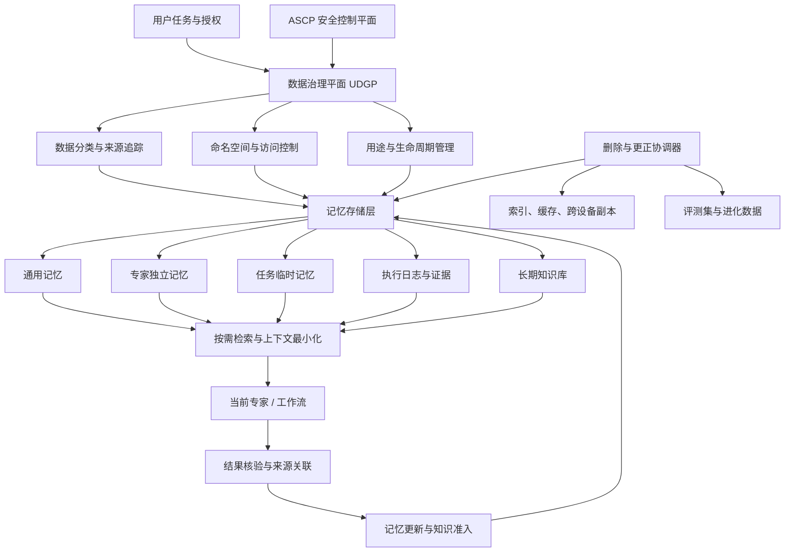
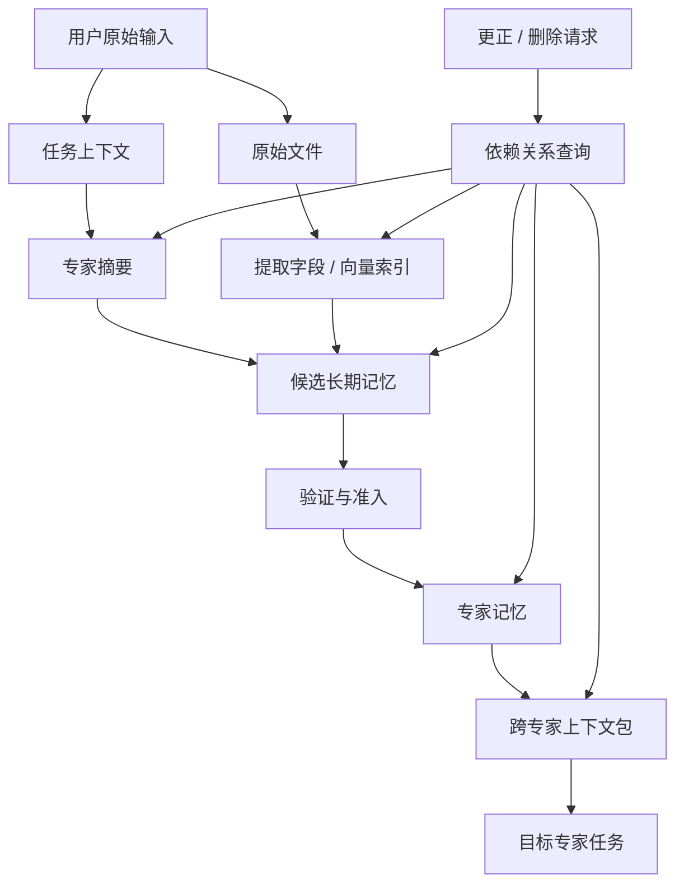

# 问答 138

> 来源: 新 窗口 | 会话: 分支 · 分支 · 分支 · 设计自进化智能体
> 消息: 7b891842-0d6c-47d7-b359-9b0788dabb1b | 时间(UTC): 2026-10-24 13:40

## 用户

可以继续

## ChatGPT

<WritingBlock id="73164" variant="document"># EvoAgent 第七十三专项：用户数据治理、隐私保护与跨专家记忆隔离体系

**专项编号：UDPG-CEMI**

**英文名称：User Data Governance, Privacy Protection & Cross-Expert Memory Isolation**

**文档版本：V1.0**

**文档性质：全量架构专项设计**

**承接专项：** 第六十九专项 SKEC-ETCR（知识沉淀、经验迁移与能力复用）、第七十专项 CCDWO-CEC（可组合能力与跨专家协同执行）、第七十一专项 CDTCO-IRE（跨设备状态一致性与恢复）、第七十二专项 ARSPG-HRAC（安全边界与权限治理）。

**适用范围：** Android、Windows 10/11、mini Linux、云端模型 API、通用内核、领域专家、长期记忆、上下文治理、日志系统、知识库、自动评测与后台进化控制器。

**核心目标：** 为 EvoAgent 建立统一的数据治理体系，使系统能够根据任务需要获取最少的数据，将不同专家的记忆进行合理隔离，在经过授权的范围内共享有效经验，并确保数据来源可追溯、记忆更新可验证、隐私使用可控、跨设备同步可治理、错误信息可纠正、删除请求可传播。

**架构原则：** 数据最小化、默认隔离、按需共享、来源可追溯、推断与事实分离、生命周期可管理、删除可传播、进化使用受控。

本文定义目标架构、数据模型、记忆隔离机制、共享协议、工程接口与验收标准，不代表相关模块已经实现或通过测试。

---

# 一、为什么多专家智能体不能共用一个无限扩张的记忆库？

EvoAgent 已经采用以下总体架构：

- 统一任务入口与多层路由；
- 受保护的共享通用内核；
- 独立领域专家；
- 能力依赖图；
- 独立进化控制器；
- 跨设备状态一致性与恢复机制；
- 独立的安全策略和权限治理体系。

在这个架构中，记忆系统不仅用于保存对话历史，还会影响专家选择、任务规划、工具调用、执行策略和长期能力进化。

如果所有专家共用一个没有明确边界的记忆库，就可能产生以下问题。

### 问题一：无关数据互相污染

旅游专家记录了用户的出行习惯，编程专家却在无关任务中检索到了这些内容。

这些信息即使真实，也不一定与当前任务相关。

### 问题二：错误推断被当作用户事实

某次任务中，模型推断用户偏好某种技术方案。

如果这个推断直接进入长期记忆，其他专家可能把它当成用户明确表达过的要求。

### 问题三：一次任务的失败污染其他专家

某个专家使用特定模型或工具失败，系统将失败原因错误归结为用户偏好或通用能力缺陷，进而影响其他专家的行为。

### 问题四：敏感数据被不必要地共享

编程专家为了修复项目，读取了环境配置文件。

如果系统将完整任务上下文直接写入通用长期记忆，可能把敏感信息传播到其他专家或远端系统。

### 问题五：删除原始数据，却留下记忆副本

用户要求删除某份资料，但系统只删除原文件，没有删除从中抽取的摘要、向量索引、知识条目和跨设备副本。

表面上原文件已经不存在，实际上相关内容仍然可能被检索出来。

### 问题六：后台进化将私人数据转化为长期训练资产

某个任务使用了用户的私人文件。

如果系统自动将其输入、输出和诊断日志全部纳入评测集或经验库，就可能超出原始任务的合理使用范围。

这些问题不能仅依靠增加一个记忆模块解决。

**EvoAgent 需要把记忆看作具有所有权、来源、权限、生命周期和使用条件的数据资产，而不是模型可以随时读取的文本集合。**

---

# 二、第一性原理：记忆系统必须回答七个问题

对于任何准备写入或读取的记忆，系统至少需要回答：

1. **来源是什么？** 用户明确表达、工具返回、模型推断，还是外部资料？
2. **属于谁？** 用户个人、某个任务、某个专家，还是系统通用能力？
3. **为什么保存？** 为了完成当前任务，还是为了长期改善未来表现？
4. **谁可以访问？** 当前专家、指定任务、共享内核，还是其他设备？
5. **可以用于什么？** 检索、执行、评测、经验沉淀，还是模型适配？
6. **何时失效？** 任务结束、信息过期、版本变化，还是授权撤销？
7. **如何纠正或删除？** 原始数据、派生记忆、索引和同步副本如何保持一致？

如果系统无法回答这些问题，就不应该把相关内容无条件写入长期共享记忆。

## 2.1 七项基础原则

| 原则 | 架构要求 |
|---|---|
| 数据最小化 | 只收集和提供完成任务所必需的数据 |
| 默认隔离 | 专家记忆默认独立，不因架构共享就自动开放 |
| 按需访问 | 在实际需要时检索经过授权的记忆 |
| 来源可追溯 | 每条重要记忆都能够关联来源和证据 |
| 事实与推断分离 | 模型推断不能自动变成用户确认的事实 |
| 生命周期治理 | 记忆具有创建、更新、失效、归档和删除规则 |
| 使用目的受控 | 保存数据不等于允许将其用于所有未来任务 |

## 2.2 三个必须区分的概念

**数据存储权**：系统是否可以保存某项信息。

**数据访问权**：某个专家或组件是否可以读取这项信息。

**数据使用权**：读取后是否可以用于特定目的，例如任务执行、跨专家共享、长期知识沉淀或后台评测。

三者不是同一项权限。

例如，系统为了恢复任务而保存一条执行日志，并不意味着所有专家都可以读取该日志，更不意味着它可以自动进入长期知识库。

---

# 三、总体架构：建立独立的数据治理平面

建议新增 `User Data Governance Plane`，简称 UDGP。

UDGP 负责管理数据的分类、来源、所有权、访问授权、生命周期、共享规则和删除传播。

它与第七十二专项 ASCP 安全控制平面协同，但不替代 ASCP。

ASCP 主要判断某个操作是否安全、是否有权执行。

UDGP 主要判断某项数据能否被收集、访问、共享、保留或用于特定目的。

例如，某个专家可能有权访问一个文件，但仍然不能将文件全部内容写入跨专家共享记忆。

## 3.1 核心模块

| 模块 | 职责 |
|---|---|
| Data Classification Registry | 定义数据分类与敏感等级 |
| Data Provenance Manager | 记录数据来源、转换过程和证据链 |
| Memory Namespace Manager | 管理不同专家、任务与用户的记忆命名空间 |
| Memory Access Controller | 根据任务、专家和授权判断记忆访问范围 |
| Purpose & Consent Registry | 管理数据用途、用户授权与使用限制 |
| Memory Lifecycle Manager | 管理记忆的创建、更新、失效、归档和删除 |
| Context Data Minimizer | 为当前任务提取最小必要上下文 |
| Memory Compression Engine | 压缩记忆并保留来源、事实状态与不确定性 |
| Cross-Expert Sharing Gateway | 受控地在专家之间传递记忆 |
| Knowledge Admission Gate | 判断哪些经验可以进入长期知识库 |
| Data Lineage Graph | 维护原始数据与派生数据之间的依赖关系 |
| Deletion & Correction Coordinator | 协调更正、删除和传播 |
| Privacy Audit | 记录数据访问、共享、保留与使用行为 |
| Evolution Data Gate | 控制数据进入自动评测和进化流程 |

这些是逻辑模块。第一阶段建议采用本地优先的模块化单体架构，不必为每个模块部署独立服务。

## 3.2 总体架构图



核心原则是：**记忆存储、记忆检索、跨专家共享和知识沉淀必须经过各自适用的治理规则。**

不能因为某条信息已经存储在数据库中，就认为所有使用者都有权访问它。

---

# 四、数据分类：先区分数据是什么，再决定如何处理

EvoAgent 的数据不仅包含对话，还包含任务状态、工具结果、产物、长期偏好、推断和诊断信息。

建议建立统一的数据分类体系。

## 4.1 按数据性质分类

| 数据类别 | 示例 | 默认处理方式 |
|---|---|---|
| 会话上下文 | 当前对话、当前任务中的临时信息 | 随会话或任务生命周期管理 |
| 用户明确事实 | 用户明确给出的稳定偏好或约束 | 记录来源，按用途和保留策略管理 |
| 用户偏好 | 喜欢的工作方式、输出格式 | 允许相关任务按需检索 |
| 任务记忆 | 当前工作流的计划、进度和结果 | 限定在相关任务和授权范围内 |
| 专家记忆 | 编程专家的技术经验、旅游专家的领域上下文 | 默认只在对应专家命名空间内使用 |
| 通用能力记忆 | 不依赖特定用户私人内容的通用执行策略 | 经验证后进入共享能力库 |
| 工具执行记录 | 工具参数、执行结果、错误码 | 按任务关联与审计要求管理 |
| 原始用户资料 | 文件、文档、图像、语音输入 | 根据敏感等级和使用目的管理 |
| 派生数据 | 摘要、嵌入向量、提取字段、推断 | 必须保留来源和删除依赖 |
| 诊断数据 | 异常堆栈、失败原因、性能指标 | 尽量减少敏感内容，独立设置保留策略 |
| 评测数据 | 回归样例、质量评分、失败案例 | 经过准入检查后使用 |
| 安全与审计数据 | 授权记录、策略决策、删除操作记录 | 严格限制访问并按策略保留 |

## 4.2 按敏感程度分类

建议建立四级数据敏感度。

<box border radius="xl" padding={3} gap={3}>
  <row align=start gap={3}>
    <box background="surface-secondary" radius="md" size="42px" align=center justify=center>
      <icon name="database" size="lg"/>
    </box>
    <box flex="1" gap={1}>
      **D0 — 一般非敏感数据**

      <text color="secondary" size="sm">例如公开资料、通用技术知识和不包含私人信息的工具能力描述。</text>

      可按公开数据或内部共享数据的相应规则管理。
    </box>
  </row>
  <divider color="subtle"/>
  <row align=start gap={3}>
    <box background="surface-secondary" radius="md" size="42px" align=center justify=center>
      <icon name="user-round" size="lg"/>
    </box>
    <box flex="1" gap={1}>
      **D1 — 用户个人数据**

      <text color="secondary" size="sm">例如用户偏好、项目历史、个人工作流程和私人文档摘要。</text>

      默认限制在用户授权范围内，跨专家使用需要符合用途规则。
    </box>
  </row>
  <divider color="subtle"/>
  <row align=start gap={3}>
    <box background="surface-secondary" radius="md" size="42px" align=center justify=center>
      <icon name="lock-keyhole" size="lg"/>
    </box>
    <box flex="1" gap={1}>
      **D2 — 敏感或受限数据**

      <text color="secondary" size="sm">例如凭证引用、私人通信、敏感项目配置、需要严格限制访问的业务资料。</text>

      采用更严格的存储、访问、脱敏与保留策略。
    </box>
  </row>
  <divider color="subtle"/>
  <row align=start gap={3}>
    <box background="surface-secondary" radius="md" size="42px" align=center justify=center>
      <icon name="shield-alert" size="lg"/>
    </box>
    <box flex="1" gap={1}>
      **D3 — 高度受限数据**

      <text color="secondary" size="sm">例如高权限凭证、特别敏感的原始资料，以及被策略明确禁止进入普通记忆的内容。</text>

      默认禁止进入普通长期记忆和跨专家共享通道，只允许经过专门设计的受控处理流程。
    </box>
  </row>
</box>

敏感等级与权限等级必须分开。

某条数据可以对用户本人完全可见，但对通用内核、其他专家或后台评测系统不可见。

## 4.3 数据分类必须支持组合

一个任务可能同时包含公开技术文档、用户私人代码、访问令牌和执行日志。

不能给整个任务只贴一个标签，然后将所有内容采用同一套规则。

应当在可能的情况下，对字段、附件、产物和记忆条目进行细粒度分类。

---

# 五、记忆架构：全局共享与专家隔离应该如何设计？

这是本专项最重要的架构决策之一。

答案不是所有记忆都全局共享，也不是所有记忆完全隔离。

更合理的方案是建立**分层记忆体系 + 独立命名空间 + 受控共享机制**。

## 5.1 五层记忆结构

<box border radius="xl" padding={3} gap={3}>
  <box background="surface" border radius="lg" padding={3} gap={1}>
    <title size="md">L0 — 当前上下文</title>
    <text color="secondary" size="sm">当前会话、当前任务的临时内容与推理所需材料。</text>
    生命周期短，默认不自动成为长期记忆。
  </box>
  <box align=center>
    <icon name="arrow-down-up" size="lg" color="secondary"/>
  </box>
  <box background="surface" border radius="lg" padding={3} gap={1}>
    <title size="md">L1 — 任务记忆</title>
    <text color="secondary" size="sm">任务契约、计划、节点结果、待办事项、恢复检查点。</text>
    以任务 ID 为边界，服务于当前任务的持续执行。
  </box>
  <box align=center>
    <icon name="arrow-down-up" size="lg" color="secondary"/>
  </box>
  <box background="surface" border radius="lg" padding={3} gap={1}>
    <title size="md">L2 — 专家记忆</title>
    <text color="secondary" size="sm">各领域专家的偏好、任务经验、领域上下文和专用工作方法。</text>
    按专家和用户分别隔离。
  </box>
  <box align=center>
    <icon name="arrow-down-up" size="lg" color="secondary"/>
  </box>
  <box background="surface" border radius="lg" padding={3} gap={1}>
    <title size="md">L3 — 用户通用记忆</title>
    <text color="secondary" size="sm">经过确认或适当验证的跨任务偏好、长期目标和通用工作习惯。</text>
    允许相关专家按需访问，不代表所有专家默认读取全部内容。
  </box>
  <box align=center>
    <icon name="arrow-down-up" size="lg" color="secondary"/>
  </box>
  <box background="surface" border radius="lg" padding={3} gap={1}>
    <title size="md">L4 — 通用能力知识库</title>
    <text color="secondary" size="sm">通用工具说明、经过验证的工作流模式、领域无关的执行经验和能力定义。</text>
    经过知识准入和来源审查，不应默认包含用户私人原始数据。
  </box>
</box>

这五层是逻辑层级，不意味着数据必须按顺序流动。

例如，某个任务可以直接检索经过授权的通用能力知识，而不需要读取全部专家记忆。

## 5.2 每个领域专家建立独立命名空间

建议采用如下命名空间结构：

```text
memory/
├── user/
│   ├── general/
│   ├── preferences/
│   ├── goals/
│   └── shared_context/
├── tasks/
│   └── {task_id}/
│       ├── context/
│       ├── checkpoints/
│       ├── evidence/
│       └── outputs/
├── experts/
│   ├── coding/
│   │   ├── user_context/
│   │   ├── task_experience/
│   │   └── domain_knowledge/
│   ├── travel/
│   ├── mobile_operations/
│   ├── ai_animation/
│   └── other_experts/
├── common_capabilities/
│   ├── tool_contracts/
│   ├── workflow_patterns/
│   └── validated_practices/
├── diagnostics/
└── audit/
```

这里的目录表达的是逻辑隔离关系。

实际实现可以采用关系数据库、文档存储、向量数据库或它们的组合。

关键不是目录名称，而是每次读写都能够执行命名空间与访问权限校验。

---

# 六、跨专家共享：什么时候共享，什么时候不共享？

跨专家共享是多专家智能体发挥整体能力的关键。

但共享必须有明确的目的和边界。

建议把共享分成四类。

| 共享类型 | 示例 | 默认规则 |
|---|---|---|
| 任务协作共享 | 漫剧专家向配音专家传递角色名称、台词和镜头时间 | 只传递完成子任务所需的最小数据 |
| 用户偏好共享 | 多个专家使用相同的输出格式偏好 | 经过适当确认后，相关专家可按需访问 |
| 通用能力共享 | 所有专家使用统一的重试策略、工具契约和工作流模式 | 经过验证后进入共享能力库 |
| 私人原始数据共享 | 将完整项目、私人文档或对话提供给其他专家 | 默认不共享，需要明确的访问依据与范围 |

## 6.1 推荐的共享机制：Context Capsule

建议建立 `Context Capsule`，即受控上下文包。

当某个专家需要将信息传递给另一个专家时，不直接复制整个上下文，而是生成一个限定用途的数据包。

例如，AI 漫剧专家需要配音专家完成角色配音。

上下文包可以包含：

- 任务 ID；
- 角色标识；
- 角色名称；
- 台词文本；
- 语气要求；
- 镜头时间范围；
- 所需输出格式；
- 来源引用；
- 有效期；
- 允许用途；
- 敏感等级；
- 数据访问条件。

它不应默认包含：

- 与配音无关的用户私人对话；
- 其他专家的全部长期记忆；
- 无关项目文件；
- 外部服务凭证；
- 未经授权的历史任务内容。

## 6.2 上下文包的核心字段

| 字段 | 含义 |
|---|---|
| `capsule_id` | 上下文包唯一 ID |
| `task_id` | 关联任务 |
| `source_namespace` | 来源命名空间 |
| `target_namespace` | 目标命名空间 |
| `data_refs` | 被引用的数据或记忆条目 |
| `purpose` | 允许的使用目的 |
| `sensitivity` | 敏感等级 |
| `provenance_refs` | 来源和证据引用 |
| `created_at` | 创建时间 |
| `expires_at` | 失效时间 |
| `policy_version` | 适用策略版本 |
| `revocation_ref` | 撤销状态引用 |

上下文包只是数据传递的治理对象，不是绕过权限检查的通行证。

目标专家接收后，仍然需要检查自己是否有权访问和使用其中的数据。

## 6.3 共享原则

- 能够只传递字段时，不传递完整文档；
- 能够只传递摘要时，不传递全部原文；
- 能够只传递引用时，不复制大型文件；
- 能够使用通用知识时，不读取用户私人记忆；
- 能够在任务结束后自动失效时，不永久保存；
- 能够由来源专家保留原始数据时，不在目标专家处创建无管理的副本。

---

# 七、来源追踪：每条长期记忆都必须知道自己从哪里来

如果记忆系统无法追踪来源，就很难判断内容是否可靠，也无法在原始数据更正或删除时找到派生副本。

建议建立统一的 `Memory Provenance` 模型。

## 7.1 来源类型

至少区分：

- 用户明确表达；
- 用户提供的文件；
- 用户确认过的结构化信息；
- 外部服务返回；
- 工具实际执行结果；
- 模型推断；
- 多个证据综合得出的结论；
- 自动生成的摘要；
- 经过验证的通用能力知识。

这些来源的可信程度与使用权限并不相同。

例如，用户明确表达的偏好可以作为用户意图的直接证据，但仍然可能随时间变化。

模型推断即使看起来合理，也不能自动升级为用户确认的事实。

## 7.2 记忆条目结构

建议定义 `MemoryRecord`：

| 字段 | 含义 |
|---|---|
| `memory_id` | 记忆唯一 ID |
| `namespace_id` | 所属命名空间 |
| `memory_type` | 事实、偏好、任务状态、经验或推断 |
| `content_ref` | 内容或受控内容引用 |
| `source_type` | 来源类型 |
| `source_refs` | 来源记录 |
| `confidence` | 经过定义的置信度或证据等级 |
| `verification_status` | 待验证、已验证、已否定等状态 |
| `sensitivity` | 敏感等级 |
| `allowed_purposes` | 允许的使用目的 |
| `retention_policy_id` | 保留策略 |
| `created_at` | 创建时间 |
| `updated_at` | 更新时间 |
| `expires_at` | 可选的到期时间 |
| `version` | 记忆版本 |
| `lineage_refs` | 派生关系 |
| `deletion_status` | 正常、待删除、已删除或隔离等状态 |

置信度必须有明确含义。

不能把模型自报的“95% 确信”直接视为经过校准的概率。

对于不同类型的记忆，应采用相应的验证方法。

例如：

- 用户偏好可以由用户明确确认；
- 任务状态可以由执行事件核验；
- 文件存在性可以由实际文件检查验证；
- 通用技术知识可以通过测试、权威资料或其他证据验证。

## 7.3 建立记忆来源图

建议使用 `Data Lineage Graph` 维护以下关系：



有了来源图，系统才有可能在原始数据失效、被更正或被删除时识别相关的摘要、索引、派生记忆和跨专家副本。

---

# 八、事实、偏好、推断和经验必须分开管理

这是长期记忆可靠性的关键。

建议建立五种不同的记忆语义。

## 8.1 五类记忆

**A. 明确事实**

例如用户明确指定某个项目使用 Windows 作为桌面目标平台。

记录时保留来源和时间。

**B. 用户偏好**

例如用户明确要求技术方案优先考虑稳定性。

偏好可以用于未来任务，但应该允许更新和覆盖。

**C. 任务状态**

例如某个工作流已经完成脚本生成，但视频合成尚未完成。

它应以任务事件和执行证据为依据，而不是只依赖模型摘要。

**D. 模型推断**

例如模型推测用户可能偏好某种开发框架。

推断必须明确标记，不能自动写入用户事实区域。

**E. 可复用经验**

例如某种文件处理流程在特定环境下通过了回归测试。

它应记录适用条件、版本、验证结果和已知限制，而不是只保留一句“这个方法有效”。

## 8.2 记忆状态机

建议采用以下状态：

```text
CANDIDATE
   ↓
NEEDS_VERIFICATION
   ↓
VERIFIED
   ↓
ACTIVE
   ↓
STALE / CONFLICTED
   ↓
UPDATED / SUPERSEDED / RETIRED
```

对于已经确认不成立的记忆，可以进入 `REJECTED` 状态。

对于用户要求删除的记忆，则进入独立的删除生命周期，不能只把它标记为“不再使用”后继续留在普通检索结果中。

## 8.3 冲突记忆不能简单地覆盖

例如：

- 旧记忆：用户偏好本地部署；
- 新任务：用户明确要求当前项目采用云端 API。

两条信息可能并不真正冲突，因为它们对应不同项目和不同时间。

因此，系统需要检查：

- 是否属于同一用户；
- 是否属于同一项目；
- 是否适用于相同任务范围；
- 是否为明确指令或推断；
- 是否存在时间变化；
- 是否需要用户澄清。

建议采用分层覆盖规则：

1. 当前任务中的明确约束优先决定当前任务行为；
2. 项目级偏好优先作用于对应项目；
3. 用户通用偏好用于没有更具体约束的任务；
4. 过期或未经验证的推断不能覆盖明确指令；
5. 无法判定时，保留冲突并请求澄清。

---

# 九、上下文压缩：全局可以共享压缩机制，但不能共享所有压缩结果

EvoAgent 需要处理长对话、长任务和多个专家之间的上下文传递。

因此，压缩机制应当有共享部分和隔离部分。

## 9.1 可以全局共享的内容

建议共享：

- 压缩算法；
- 记忆结构规范；
- 来源标记规则；
- 置信度与不确定性表示方式；
- 过期检测机制；
- 冲突识别方法；
- 隐私过滤规则；
- 压缩质量评测方法。

这些属于通用基础设施。

## 9.2 不应默认全局共享的内容

以下对象应当根据任务和命名空间隔离：

- 用户私人对话摘要；
- 编程专家的项目上下文；
- 旅游专家的个人行程资料；
- 手机操作专家读取的界面内容；
- AI 漫剧专家的角色设定与私人素材；
- 含敏感信息的任务摘要；
- 由特定任务产生的未验证推断。

**压缩规则可以共享，压缩后的内容不能因此自动共享。**

## 9.3 压缩不能丢失关键语义

压缩时必须保留：

- 明确事实与推断的区别；
- 来源与时间；
- 当前有效的任务约束；
- 重要的授权限制；
- 未完成任务状态；
- 关键错误和恢复条件；
- 重要的不确定性；
- 信息适用范围。

例如，不能把：

“用户暂时允许在测试环境中安装项目依赖，但不允许修改系统级配置”

压缩成：

“用户允许安装依赖和修改环境”。

后者扩大了授权范围，属于语义损失和权限错误。

## 9.4 压缩质量评测

建议针对压缩前后进行以下检查：

1. 事实保留率；
2. 任务状态一致性；
3. 约束保留率；
4. 来源可追溯率；
5. 敏感信息泄露率；
6. 错误推断增加率；
7. 记忆冲突率；
8. 对下游任务成功率的影响。

对于权限、隐私和不可逆操作相关的内容，应采用更严格的保留与核验策略，不能只以摘要长度减少作为压缩成功的标准。

---

# 十、记忆检索：不要把所有记忆一次性塞进模型上下文

长期记忆越多，不代表智能体越聪明。

无差别地注入所有记忆，会带来：

- 上下文成本上升；
- 无关信息干扰；
- 专家之间的记忆污染；
- 过期信息被误用；
- 敏感数据暴露；
- 模型对错误记忆产生过度依赖。

因此，建议采用按需检索。

## 10.1 检索流程

```text
当前任务
   ↓
识别所需信息类型
   ↓
确定允许访问的命名空间
   ↓
执行访问权限与用途检查
   ↓
按任务相关性检索
   ↓
检查敏感等级和有效期
   ↓
检查来源与验证状态
   ↓
处理冲突与过期记忆
   ↓
生成最小必要上下文
   ↓
提供给当前专家
```

## 10.2 检索评分

可以将检索排序设计为：

\[
S(m,q)=
w_r R(m,q)+
w_f F(m)+
w_v V(m)+
w_t T(m)
\]

其中：

- \(R(m,q)\)：记忆与当前任务的相关性；
- \(F(m)\)：时效性；
- \(V(m)\)：证据与验证质量；
- \(T(m)\)：与当前任务的适用范围匹配度。

权重应根据任务类型进行评测，而不是固定适用于所有专家。

需要特别注意：**检索分数不能代替访问授权。**

即使某条记忆与任务高度相关，如果当前专家没有访问权限，仍然不能返回它。

## 10.3 防止检索侧信道

当某个专家无权访问一条私人记忆时，系统不仅要阻止读取内容，还应避免通过检索数量、相似度分数、错误信息或其他间接反馈泄露其存在与内容。

对敏感命名空间，应限制错误信息的详细程度，并避免将未授权的检索结果纳入模型上下文。

---

# 十一、长期知识沉淀：经验可以复用，私人数据不应被默认复制

第六十九专项 SKEC-ETCR 已经建立知识沉淀和能力复用方向。

本专项进一步规定：知识沉淀必须经过数据治理准入。

## 11.1 从任务经验到通用知识的四个阶段

| 阶段 | 内容 | 规则 |
|---|---|---|
| G0：原始任务证据 | 原始输入、输出、日志、产物 | 按原始任务授权管理 |
| G1：候选经验 | 从任务中抽取的流程、错误和改进建议 | 默认不自动共享 |
| G2：验证经验 | 已经过测试或证据核验的经验 | 仍需检查隐私与适用范围 |
| G3：通用能力资产 | 可在其他任务复用的工具模式、流程和规则 | 经过准入后进入共享能力库 |

一个经验在执行层面有效，不代表它已经适合跨用户或跨任务共享。

例如，某个项目的构建失败原因可能与该项目的私有目录、内部依赖或特殊配置有关。

在沉淀为通用经验时，应尽量抽取真正可复用的规则，同时删除不必要的私人内容。

## 11.2 通用化处理

建议在知识准入阶段执行：

1. 检查原始数据的使用权限；
2. 识别个人信息和敏感内容；
3. 检查是否包含凭证或私人文件内容；
4. 提取与经验有关的最小必要事实；
5. 将项目特定条件与通用规则分离；
6. 验证经验是否有可复现的证据；
7. 记录适用条件与限制；
8. 通过准入门禁后发布到相应知识库。

脱敏不一定等于匿名化。

即使删除了姓名和路径，某些罕见的项目细节仍可能识别出原始数据来源。

因此，不能只依赖简单的字符串替换来判断数据已经适合共享。

## 11.3 自动进化使用数据的边界

后台进化系统可以利用经过授权的运行指标和诊断证据改进工具与工作流。

但不应默认把所有原始对话、私人文件和模型上下文纳入自动评测集。

建议将进化数据分成：

- 可直接用于通用评测的非敏感数据；
- 经过脱敏和准入审核的数据；
- 仅允许在本地或指定命名空间使用的数据；
- 需要额外授权的数据；
- 禁止用于跨任务复用的数据。

如果某条数据只允许用于完成当前任务，就不能因为系统希望提高长期能力而自动改变其使用目的。

---

# 十二、数据生命周期：每类记忆都需要明确的保留与失效规则

记忆系统如果只负责新增和检索，就会不断累积旧信息。

最终，过期的偏好、无效的任务状态和已被替代的知识会影响未来判断。

建议建立 `Memory Lifecycle Manager`。

## 12.1 生命周期状态

建议包括：

- `ACTIVE`：当前有效；
- `STALE`：可能过期；
- `SUPERSEDED`：已被更新版本替代；
- `ARCHIVED`：归档保存；
- `PENDING_DELETION`：等待删除传播；
- `DELETED`：已完成规定范围内的删除；
- `QUARANTINED`：隔离等待检查。

这些状态应当有明确的转换规则。

例如，`STALE` 不代表可以直接删除；`ARCHIVED` 不代表仍可被普通检索访问；`DELETED` 也不能仅靠修改一个数据库字段来实现。

## 12.2 不同数据采用不同保留策略

| 数据类型 | 建议的保留策略 |
|---|---|
| 临时上下文 | 会话或任务结束后按策略清理 |
| 任务检查点 | 任务结束并满足恢复保留条件后清理或归档 |
| 用户偏好 | 直到用户更正、撤销或达到适用的失效条件 |
| 专家经验 | 定期验证，失效时标记并停止默认使用 |
| 工具执行日志 | 根据诊断、审计与隐私需求设置期限 |
| 原始文件 | 由用户和任务存储策略决定 |
| 评测数据 | 根据授权、用途、验证状态和保留策略管理 |
| 审计记录 | 根据安全和审计要求保留，严格限制访问 |

不应为所有记忆设置一个统一的永久保留规则。

也不应简单地认为所有数据在任务结束后都可以立即删除，因为某些任务还需要后续恢复、验收或审计。

关键是明确保留目的、范围和失效条件。

---

# 十三、更正与删除：必须删除派生副本，而不仅是原始文件

这是长期记忆体系必须具备的能力。

如果用户要求更正某项偏好，系统应当更新相关记忆，并避免继续使用旧版本。

如果用户要求删除某项资料，系统则需要追踪并处理相关副本。

## 13.1 删除对象范围

可能涉及：

- 原始文件；
- 原始会话内容；
- 任务记忆；
- 专家记忆；
- 通用用户记忆；
- 摘要；
- 提取字段；
- 向量嵌入；
- 搜索索引；
- 缓存；
- 跨专家上下文包；
- 跨设备副本；
- 由相关数据生成的候选评测样例；
- 其他可识别的派生数据。

删除协调器应根据来源图查找相关对象，而不是只删除用户指定的一个记录 ID。

## 13.2 删除流程

```text
接收删除请求
   ↓
验证请求与目标范围
   ↓
定位原始数据
   ↓
查询派生数据依赖图
   ↓
创建删除任务与传播标记
   ↓
阻止普通检索继续返回相关内容
   ↓
删除或按策略隔离本地副本
   ↓
处理摘要、索引、向量和缓存
   ↓
向授权设备传播删除事件
   ↓
处理可识别的派生数据与评测副本
   ↓
核验规定范围内的删除结果
   ↓
生成删除审计记录
```

## 13.3 跨设备删除

Android、Windows 和 mini Linux 可能在删除请求发生时处于离线状态。

因此，建议采用删除标记和增量传播机制。

删除请求应当先在当前可信协调端持久化，并在适用范围内阻止相关内容继续被检索或共享。

当离线设备重新连接后，应当处理尚未同步的删除事件。

在无法确认某个设备是否已经应用删除请求时，系统应明确记录其状态，不能声称所有副本已经删除。

对于无法直接访问的外部服务或已经生成的不可变备份，也需要明确实际能力边界与相应的保留政策。

## 13.4 删除与审计之间的平衡

删除原始数据后，系统有时仍需要保留最小化的审计证据，以证明删除请求已经处理或某项安全事件曾经发生。

但这种审计记录应当：

- 不保留不必要的原始内容；
- 不包含已经要求删除的敏感正文；
- 只保留必要的操作标识、时间和处理结果；
- 具有独立的访问和保留规则。

**删除不是简单地把状态改成 `deleted`，而是需要对所有受治理的数据副本和派生对象执行可追踪的生命周期操作。**

---

# 十四、跨设备记忆同步：同步协议必须携带数据治理语义

第七十一专项已经建立事件日志、增量同步和跨设备恢复机制。

本专项进一步要求：数据同步不仅传输内容，还要传输必要的治理信息。

## 14.1 同步对象

建议分别管理：

- 记忆元数据；
- 记忆内容；
- 来源与证据引用；
- 访问授权；
- 生命周期状态；
- 版本信息；
- 删除与更正事件；
- 搜索索引；
- 大型附件。

不是每个设备都需要获得所有对象的完整副本。

## 14.2 同步前检查

每次同步应检查：

1. 接收设备身份；
2. 数据所属命名空间；
3. 接收设备是否有权访问；
4. 允许的使用目的；
5. 数据敏感等级；
6. 当前数据版本；
7. 数据是否已经失效；
8. 是否存在更新的更正或删除事件；
9. 是否需要脱敏；
10. 当前同步策略是否允许传输内容本身。

## 14.3 版本冲突

例如，Android 记录用户偏好为版本 4，而 Windows 在离线期间产生了版本 5。

系统不能仅依赖时间戳决定谁覆盖谁。

应当比较：

- 记忆来源；
- 版本关系；
- 更新原因；
- 用户是否明确确认；
- 是否为推断或事实；
- 是否存在更正或删除请求；
- 是否属于相同的适用范围。

删除标记和访问限制不能被普通旧版本无条件覆盖。

如果同步发生冲突，应该先保留证据、限制可能产生的错误访问，再按照冲突规则解决。

---

# 十五、记忆污染与知识投毒防护

长期记忆可能受到错误信息、恶意输入或偶然相关性的污染。

例如，某个外部文档中包含一条虚假的技术建议，编程专家将其写入长期记忆，其他任务随后不断复用。

因此，记忆系统需要区分“内容已经被保存”和“内容已经被验证”。

## 15.1 污染来源

- 外部网页中的错误信息；
- 恶意提示词注入；
- 模型生成的错误推断；
- 工具返回的异常数据；
- 任务执行结果未经过验收；
- 跨专家误传的信息；
- 过期知识；
- 自动摘要造成的语义偏差；
- 失败任务中的错误归因。

## 15.2 防护策略

建议：

1. 为记忆保留来源和验证状态；
2. 将未经验证的内容放入候选区；
3. 对高影响经验要求可复现的证据；
4. 不允许外部内容自行修改记忆访问权限；
5. 不允许单次任务的偶然成功自动变成通用规则；
6. 定期检测相互冲突的记忆；
7. 为记忆更新保留版本与更正依据；
8. 在知识准入时检查隐私与敏感信息；
9. 对被否定的记忆停止默认检索；
10. 对疑似污染的知识条目进行隔离和重新验证。

## 15.3 错误经验不能无限扩散

当系统发现某条记忆可能错误时，应检查它是否已经被：

- 其他专家引用；
- 其他任务复制；
- 写入长期知识库；
- 纳入评测集；
- 用于生成新工作流；
- 用于自动修改工具参数。

这需要通过来源图与版本关系进行追踪。

对于已经扩散的错误经验，应建立纠正和失效传播机制，而不是只修正最初的那条记录。

---

# 十六、隐私保护与本地优先架构

EvoAgent 的整体方向是 Android 优先，同时支持 Windows 和 mini Linux，并通过云端模型 API 扩展能力。

这意味着系统需要明确哪些数据可以本地处理，哪些数据需要发送到外部服务。

## 16.1 云端调用前的数据最小化

每次调用云端模型时，建议执行：

1. 确定当前任务实际需要的信息；
2. 检查允许发送的数据类别；
3. 移除无关对话和历史记忆；
4. 对不必要的敏感字段进行脱敏或排除；
5. 使用受控的文件和工具引用；
6. 记录数据发送的目的与策略版本；
7. 处理外部响应时执行来源与敏感信息检查。

不能因为模型 API 能够接受大量上下文，就把全部长期记忆和历史日志发送过去。

## 16.2 本地数据保护

根据设备条件，建议使用：

- 受保护的本地存储；
- 适当的数据库访问控制；
- 设备级加密能力；
- 限制文件访问权限；
- 敏感内容与普通日志分离；
- 对导出文件设置明确的用户操作和访问边界；
- 对本地缓存执行生命周期管理。

具体安全性取决于操作系统、设备配置、密钥管理和实现方式，不能仅因为数据位于本地就认为它天然安全。

## 16.3 数据导出

用户可能需要导出任务记录、诊断日志或长期记忆。

建议提供按范围导出：

- 仅导出任务元数据；
- 导出指定任务的完整记录；
- 导出指定专家的记忆；
- 导出用户通用记忆；
- 导出诊断日志；
- 导出产物索引。

导出时应支持预览、敏感信息检查和明确的文件保存位置。

不应将所有私人记忆、凭证和完整上下文无条件打包进一个默认导出文件。

---

# 十七、与其他专项的协同关系

本专项必须与前面的执行、安全、知识和进化体系协同，而不是建立一个独立运行的记忆孤岛。

| 体系 | 协同方式 |
|---|---|
| SKEC-ETCR | 只允许符合准入条件的经验进入长期知识体系 |
| CCDWO-CEC | 通过受控上下文包进行跨专家数据共享 |
| CDTCO-IRE | 通过来源、版本和删除事件保证跨设备数据一致性 |
| ARSPG-HRAC | 强制执行记忆访问权限与数据操作安全策略 |
| CARE-LBV | 评估记忆更新是否真正改善任务效果 |
| UEEDA | 测试记忆检索、压缩、冲突和隔离质量 |
| SEDG-IPGRA | 评估记忆检索和上下文使用的成本收益 |
| EOACA | 管理专家、工具和记忆依赖关系 |
| SECIASRG | 对记忆结构、索引和策略变更实施版本治理 |
| RCAE | 诊断错误记忆、错误推断和上下文污染的原因 |
| CEOP | 将任务记忆与工作流状态关联，支持安全恢复 |

## 17.1 记忆更新不能只看模型反馈

某个专家认为某条记忆“很有帮助”，不代表它真的提升了执行质量。

建议结合：

- 任务成功率；
- 用户纠正频率；
- 错误记忆命中率；
- 过期记忆使用率；
- 跨专家污染率；
- 上下文成本；
- 隐私违规事件；
- 记忆压缩后的语义一致性；
- 记忆更新后的回归结果。

通过这些指标判断某类记忆是否值得保留、扩大适用范围或进入共享能力库。

---

# 十八、工程目录与核心接口

建议在 EvoAgent 工程中新增：

```text
evoagent/
├── data_governance/
│   ├── classification/
│   ├── ownership/
│   ├── purpose_registry/
│   ├── consent_registry/
│   ├── retention_policy/
│   ├── deletion_coordinator/
│   └── privacy_audit/
├── memory/
│   ├── context_memory/
│   ├── task_memory/
│   ├── user_memory/
│   ├── expert_memory/
│   ├── shared_memory/
│   ├── memory_versioning/
│   ├── memory_state_machine/
│   └── memory_validation/
├── memory_namespace/
│   ├── namespace_registry/
│   ├── namespace_access/
│   ├── namespace_isolation/
│   ├── namespace_migration/
│   └── namespace_audit/
├── memory_provenance/
│   ├── source_registry/
│   ├── provenance_graph/
│   ├── derived_data_tracking/
│   ├── evidence_links/
│   └── provenance_validation/
├── memory_retrieval/
│   ├── query_planning/
│   ├── access_filtered_search/
│   ├── relevance_ranking/
│   ├── freshness_check/
│   ├── conflict_detection/
│   └── context_minimization/
├── memory_compression/
│   ├── summarization/
│   ├── fact_preservation/
│   ├── uncertainty_preservation/
│   ├── sensitive_data_filter/
│   ├── compression_validation/
│   └── compression_evaluation/
├── cross_expert_sharing/
│   ├── context_capsule/
│   ├── sharing_policy/
│   ├── purpose_binding/
│   ├── recipient_validation/
│   ├── capsule_expiration/
│   └── capsule_revocation/
├── knowledge_admission/
│   ├── candidate_experience/
│   ├── privacy_screening/
│   ├── evidence_validation/
│   ├── generalization/
│   ├── knowledge_review/
│   └── publication_gate/
├── data_lifecycle/
│   ├── expiration/
│   ├── correction/
│   ├── deletion/
│   ├── tombstone_propagation/
│   ├── index_cleanup/
│   ├── cache_cleanup/
│   └── deletion_verification/
├── privacy_protection/
│   ├── data_minimization/
│   ├── sensitive_field_detection/
│   ├── redaction/
│   ├── cloud_context_filter/
│   ├── export_control/
│   └── local_storage_policy/
├── evolution_data_gate/
│   ├── dataset_admission/
│   ├── consent_validation/
│   ├── data_scope_validation/
│   ├── privacy_review/
│   ├── evaluation_dataset/
│   └── retention_enforcement/
└── data_governance_tests/
    ├── namespace_isolation/
    ├── unauthorized_memory_access/
    ├── provenance_integrity/
    ├── stale_memory/
    ├── memory_conflict/
    ├── compression_semantics/
    ├── cross_expert_sharing/
    ├── deletion_propagation/
    ├── offline_sync/
    ├── sensitive_data_leakage/
    └── evolution_data_admission/
```

## 18.1 核心接口

- `classify_data`：识别数据类型与敏感等级；
- `register_data_provenance`：登记数据来源；
- `create_memory_namespace`：创建记忆命名空间；
- `authorize_memory_access`：判断记忆访问权限；
- `create_memory_record`：创建记忆条目；
- `update_memory_record`：更新记忆版本；
- `validate_memory_evidence`：核验记忆证据；
- `mark_memory_stale`：标记过期记忆；
- `resolve_memory_conflict`：处理记忆冲突；
- `retrieve_authorized_memory`：检索授权范围内的记忆；
- `build_minimal_context`：生成最小必要上下文；
- `compress_memory_with_provenance`：压缩记忆并保留来源；
- `create_context_capsule`：创建跨专家上下文包；
- `validate_context_capsule`：检查目标专家访问权限；
- `revoke_context_capsule`：撤销尚可控制的上下文包访问；
- `admit_candidate_knowledge`：执行长期知识准入；
- `trace_derived_data`：查找派生数据；
- `request_memory_correction`：发起记忆更正；
- `request_data_deletion`：发起数据删除；
- `propagate_deletion_tombstone`：传播删除标记；
- `verify_deletion_completion`：核验规定范围内的删除结果；
- `filter_cloud_context`：过滤发送给云端模型的上下文；
- `validate_evolution_dataset`：检查进化数据准入条件；
- `export_governed_data`：按授权范围导出数据；
- `audit_memory_access`：审计记忆访问行为。

这些接口应由可信运行时调用，并具有明确的输入输出契约、权限检查和失败语义。

---

# 十九、端到端验收场景

建议至少建立以下十八个验收场景。

## 场景 A：专家记忆隔离

**条件：** 旅游专家保存一条与当前编程任务无关的私人记忆。

**验收：** 编程专家默认无法检索该条记忆。

## 场景 B：受控跨专家共享

**条件：** AI 漫剧专家需要向配音专家传递角色台词。

**验收：** 只传递完成配音所需的上下文，不自动复制其他私人记忆。

## 场景 C：推断与事实分离

**条件：** 模型推测用户偏好某种开发框架。

**验收：** 推断保持独立状态，不自动成为用户确认的事实。

## 场景 D：过期记忆处理

**条件：** 某条专家经验依赖已经失效的工具版本。

**验收：** 记忆被标记为过期或需要重新验证，不继续作为默认有效规则使用。

## 场景 E：记忆压缩语义保持

**条件：** 压缩任务摘要时存在重要权限约束。

**验收：** 压缩结果保留约束，不扩大原有授权范围。

## 场景 F：敏感数据过滤

**条件：** 任务上下文中包含访问令牌。

**验收：** 令牌不会因为普通摘要或共享操作而自动进入长期记忆。

## 场景 G：知识准入

**条件：** 某次任务成功产生候选经验。

**验收：** 系统先检查证据、来源、隐私和适用范围，再决定是否进入共享知识库。

## 场景 H：删除原始文件

**条件：** 用户要求删除一份原始文件。

**验收：** 系统能够定位受治理的摘要、索引和派生对象，并按策略处理。

## 场景 I：删除请求期间设备离线

**条件：** Windows 离线时，用户在 Android 上发起删除请求。

**验收：** 删除请求被持久化并在重连后传播；未确认处理的设备不会被错误标记为已经完成删除。

## 场景 J：删除后的检索验证

**条件：** 某条记忆已完成规定范围内的删除。

**验收：** 普通检索不再返回该记忆或其已删除副本。

## 场景 K：记忆冲突

**条件：** 两台设备在离线期间分别更新了同一偏好。

**验收：** 系统检查来源、版本和适用范围，不仅凭时间戳覆盖。

## 场景 L：跨专家推断污染

**条件：** 一个专家生成了错误推断，并尝试将其共享给其他专家。

**验收：** 未经验证的推断被明确标记，不能自动进入通用事实库。

## 场景 M：云端上下文最小化

**条件：** 编程任务只需要部分项目文件。

**验收：** 云端模型调用不会默认携带全部项目历史和私人记忆。

## 场景 N：来源追踪

**条件：** 某条长期记忆被发现存在错误。

**验收：** 能够追踪其来源、派生摘要和已知共享副本，并执行纠正。

## 场景 O：自动评测数据治理

**条件：** 后台进化系统准备将某次私人任务加入通用评测集。

**验收：** 数据必须通过适用的授权、敏感信息和知识准入检查，否则不得进入该评测集。

## 场景 P：记忆索引残留

**条件：** 原始记忆已删除，但向量索引中仍存在对应条目。

**验收：** 删除协调器能够识别并处理索引残留，不能仅依赖原始记录状态。

## 场景 Q：跨专家访问审计

**条件：** 专家 A 向专家 B 共享某条记忆。

**验收：** 系统能够追溯共享来源、目标、用途、范围和时间。

## 场景 R：记忆结构升级

**条件：** 系统升级记忆数据结构和索引版本。

**验收：** 升级不会意外扩大命名空间访问范围，也不会使已删除数据重新进入普通检索。

---

# 二十、专项验收标准

UDPG-CEMI 至少需要满足以下要求：

1. 建立统一的数据分类与敏感等级体系。
2. 区分存储权、访问权和使用权。
3. 建立用户、任务、专家和通用能力的分层记忆体系。
4. 为不同领域专家建立独立记忆命名空间。
5. 默认禁止未经授权的跨专家记忆访问。
6. 支持按任务目的和数据范围进行授权检索。
7. 建立数据来源与派生关系追踪机制。
8. 能够区分用户明确事实、用户偏好、任务状态、模型推断和可复用经验。
9. 未经验证的推断不能自动成为用户确认的事实。
10. 建立记忆版本、状态与生命周期管理。
11. 支持过期记忆检测与冲突处理。
12. 建立受控的跨专家上下文包机制。
13. 上下文包只能传递满足任务需要的最小数据。
14. 目标专家必须重新验证上下文包的访问与使用权限。
15. 支持通用压缩规则与隔离压缩内容的架构。
16. 压缩过程能够保留关键约束、来源和不确定性。
17. 支持按授权范围进行记忆检索。
18. 检索相关性不能绕过访问权限检查。
19. 建立长期知识准入与隐私检查机制。
20. 区分原始任务证据、候选经验、验证经验和通用能力资产。
21. 不默认将所有私人任务数据用于后台进化。
22. 建立数据保留、过期、归档、更正和删除规则。
23. 能够追踪需要处理的摘要、索引、缓存与派生副本。
24. 支持跨设备删除和更正事件传播。
25. 能够区分删除请求已发起、已传播和已完成核验。
26. 云端调用前能够执行上下文最小化。
27. 支持敏感数据过滤与受控导出。
28. 能够发现错误记忆的已知传播路径。
29. 能够与 CEOP、CDTCO-IRE、ARSPG-HRAC 和 SKEC-ETCR 协同。
30. 能够通过专家隔离、记忆冲突和提示词注入相关测试。
31. 能够通过记忆压缩前后语义一致性测试。
32. 能够通过派生数据删除与索引清理测试。
33. 能够通过跨设备离线同步测试。
34. 能够通过自动评测数据准入测试。
35. 能够通过端到端测试验证记忆创建、共享、更新、失效和删除的完整生命周期。

以上为目标架构验收要求，不代表相关模块已经实现或通过测试。

---

# 二十一、建议冻结的架构决策

以下建议承接 ADR-1440。

| 编号 | 决策 |
|---|---|
| ADR-1441 | 建立独立的 User Data Governance Plane（UDGP） |
| ADR-1442 | 数据存储权、访问权和使用权必须分别建模 |
| ADR-1443 | 建立统一数据分类与敏感等级体系 |
| ADR-1444 | 采用当前上下文、任务记忆、专家记忆、用户通用记忆和通用能力知识的分层结构 |
| ADR-1445 | 不同领域专家默认采用独立记忆命名空间 |
| ADR-1446 | 记忆压缩算法可以共享，但压缩后的私人内容不自动共享 |
| ADR-1447 | 跨专家共享必须遵守用途、范围、敏感等级和有效期约束 |
| ADR-1448 | 建立受控 Context Capsule 机制进行跨专家数据传递 |
| ADR-1449 | 目标专家接收共享数据后必须重新执行访问和用途检查 |
| ADR-1450 | 重要记忆必须保留来源、验证状态和版本信息 |
| ADR-1451 | 用户明确事实、用户偏好、任务状态、模型推断和通用经验必须分开管理 |
| ADR-1452 | 模型推断不得自动升级为用户确认的事实 |
| ADR-1453 | 建立记忆来源图和派生数据依赖追踪机制 |
| ADR-1454 | 记忆检索必须先检查权限，再执行相关性排序和上下文生成 |
| ADR-1455 | 上下文压缩必须保留重要约束、来源、适用范围和不确定性 |
| ADR-1456 | 建立独立的长期知识准入机制 |
| ADR-1457 | 进入通用能力库的经验必须通过适用的证据、隐私和范围检查 |
| ADR-1458 | 不默认将私人原始任务数据用于跨任务评测或自动进化 |
| ADR-1459 | 建立记忆保留、失效、归档、更正和删除生命周期 |
| ADR-1460 | 删除必须覆盖受治理的原始数据、派生对象、索引、缓存和可识别副本 |
| ADR-1461 | 跨设备删除使用可追踪的删除事件和传播状态 |
| ADR-1462 | 无法确认离线设备已处理删除请求时，不得声称所有副本均已删除 |
| ADR-1463 | 云端模型调用前必须执行适用的数据最小化与敏感信息检查 |
| ADR-1464 | 数据导出必须遵守范围、用途和敏感等级约束 |
| ADR-1465 | 记忆和知识更新必须能够追溯到来源、版本和验证依据 |
| ADR-1466 | 发现错误记忆时，应检查已知派生和共享路径并执行纠正 |
| ADR-1467 | 数据治理规则必须与 ASCP 安全控制平面协同执行 |
| ADR-1468 | 记忆与知识变更必须与 SECIASRG 版本治理和回滚机制协同 |
| ADR-1469 | 第一阶段采用本地优先的模块化数据治理架构 |
| ADR-1470 | 无法确定数据是否允许共享或用于新目的时，默认限制该用途并进入核验流程 |

以上建议作为 EvoAgent 第七十三专项的架构基线。

---

# 二十二、前三个专项与本专项如何共同形成完整的记忆与执行治理体系？

| 专项 | 解决的问题 |
|---|---|
| 第六十九专项 SKEC-ETCR | 如何积累、验证和复用有效经验 |
| 第七十专项 CCDWO-CEC | 如何通过专家与工作流组合完成复杂任务 |
| 第七十一专项 CDTCO-IRE | 如何在断联、崩溃和跨设备切换时可靠恢复 |
| 第七十二专项 ARSPG-HRAC | 如何确保执行行为不越过安全和权限边界 |
| 第七十三专项 UDPG-CEMI | 如何治理数据来源、记忆隔离、跨专家共享与生命周期 |

五个专项组合后，EvoAgent 的记忆闭环变成：

```text
任务执行
   ↓
产生原始数据与执行证据
   ↓
数据分类与来源登记
   ↓
进入任务级临时记忆
   ↓
必要时提取候选经验
   ↓
检查授权、隐私与适用范围
   ↓
验证事实与执行结果
   ↓
更新专家记忆或共享能力知识
   ↓
通过受控检索服务未来任务
   ↓
观察真实效果与错误率
   ↓
更正、失效、归档或删除
```

这套机制同时支持两个方向。

**方向一：让记忆帮助智能体变得更好。**

通过有效经验、经过验证的工作流和真实执行结果，提高未来任务的成功率、稳定性与效率。

**方向二：防止记忆让智能体变得更差。**

避免错误推断、过期经验、私人数据泄露和跨专家污染不断积累，最终影响系统判断。

因此，记忆系统的成功指标不能只看记忆数量、向量库大小或检索命中率。

更重要的是：

- 记忆是否真实有效；
- 是否在正确的任务中被使用；
- 是否减少了重复错误；
- 是否没有越过数据访问边界；
- 是否能够纠正错误；
- 是否能够在需要时完成删除；
- 是否真正改善了执行质量。

---

# 二十三、下一专项：智能体质量评测、因果归因与持续改进验证体系

到目前为止，EvoAgent 已经逐步建立了：

- 专家分层与任务编排；
- 跨设备状态一致性；
- 运行时安全边界；
- 数据治理与记忆隔离；
- 知识沉淀和能力复用；
- 后台独立进化与稳定版本保护。

但还有一个核心问题需要深入解决：

**当 EvoAgent 修改自己的提示词、路由器、工具参数、工作流或记忆策略之后，怎么证明它真的变好了？**

一次任务成功，并不能证明某次改进有效。

例如：

- 修改提示词后，一类任务的成功率上升，但另一类任务下降；
- 更换模型后，回答质量提高，但成本翻倍；
- 增加重试次数后，表面成功率提高，但重复扣费也增加；
- 修改路由规则后，旅游任务变好，却把部分编程任务路由给了错误专家；
- 压缩记忆后，响应速度变快，但关键约束丢失；
- 放宽工具权限后，任务成功率上升，却增加了越权风险；
- 优化上下文检索后，成本下降，但错误记忆更频繁地影响决策。

如果系统只看总体成功率，就可能把一种退化误判为进步。

因此，下一专项建议定义为：

**Agent Quality Evaluation, Causal Attribution & Continuous Improvement Validation，简称 AQE-CCIV。**

核心研究方向包括：

1. 如何定义不同专家、工作流和通用内核的质量指标；
2. 如何建立覆盖正常任务、边界任务和失败任务的回归集；
3. 如何区分模型、提示词、工具、路由、记忆和工作流造成的失败；
4. 如何避免把网络故障、权限拒绝和外部服务异常误判为模型能力缺陷；
5. 如何比较改进前后的成功率、成本、时延、稳定性与安全性；
6. 如何处理任务难度不同、样本不足和评测数据偏差；
7. 如何使用影子测试、对照实验和分阶段发布验证改进；
8. 如何判断某项改进是否只对特定模型、设备或任务成立；
9. 如何防止自动评测被提示词、工具或模型输出操纵；
10. 如何建立专家级、工作流级、通用内核级和系统级的独立评测；
11. 如何验证记忆系统与上下文压缩策略的真实收益；
12. 如何把运行中发现的问题转化为可复现的评测案例；
13. 如何为自动发布设定可量化的质量门禁；
14. 如何判断改进带来的收益是否足以抵消额外成本；
15. 如何在出现回归时自动暂停发布并执行回滚；
16. 如何验证低风险自动改进不会扩大权限或降低安全性；
17. 如何建立长期趋势监控，识别缓慢退化；
18. 如何防止系统为了追求单一指标而牺牲其他重要指标；
19. 如何将真实运行数据转化为有证据、有边界的改进结论；
20. 如何形成可审计、可复现、可持续优化的进化验证闭环。

**核心原则：改进候选不等于改进成功，评测分数上升不等于系统整体变好，只有在明确适用范围、可信证据、回归检查、成本约束和安全门禁下验证有效的变化，才应该进入稳定版本。**

这一专项将把 EvoAgent 的自进化机制从“能够生成改进”，推进到“能够证明改进是否有效、知道改进影响了什么，并在效果不佳时安全撤回”。</WritingBlock>

<MemoryCite />
