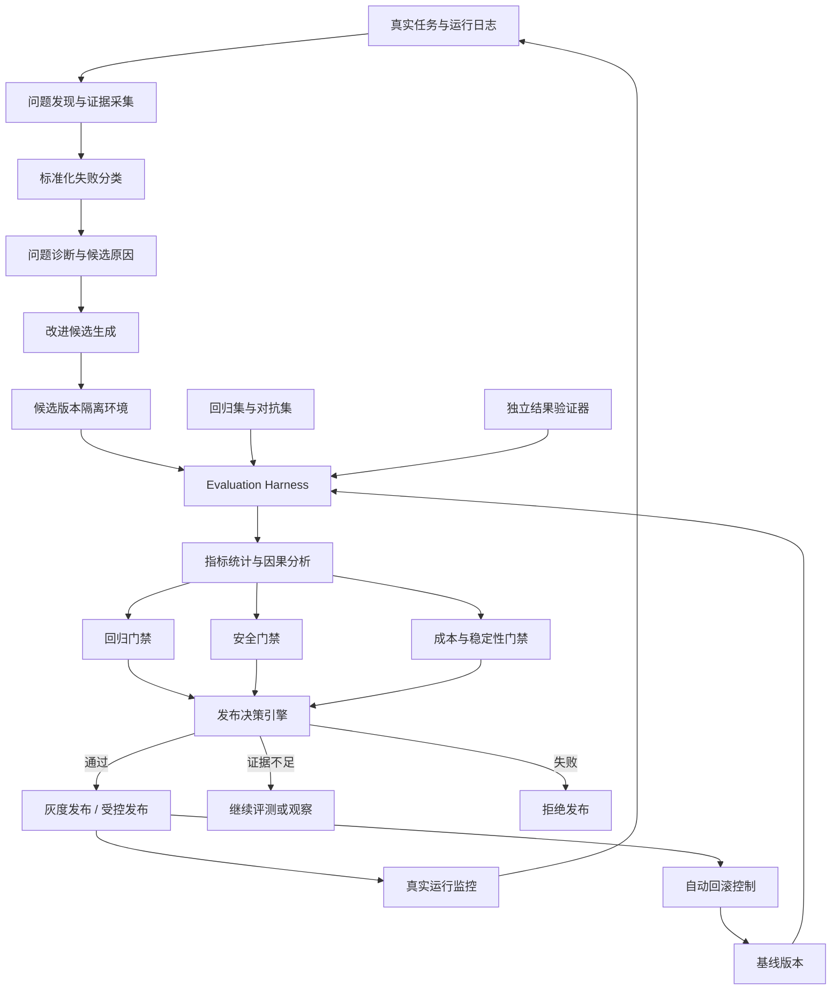
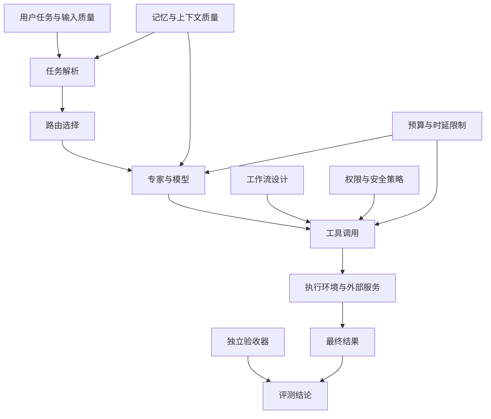

# 问答 139

> 来源: 新 窗口 | 会话: 分支 · 分支 · 分支 · 设计自进化智能体
> 消息: dc483656-2e43-4282-88b1-24f28b84b4b8 | 时间(UTC): 2026-10-24 13:46

## 用户

可以

## ChatGPT

规划评估体系

规划评估体系

<WritingBlock id="58317" variant="document"># EvoAgent 第七十四专项：智能体质量评测、因果归因与持续改进验证体系

**专项编号：AQE-CCIV**

**英文名称：Agent Quality Evaluation, Causal Attribution & Continuous Improvement Validation**

**文档版本：V1.0**

**文档性质：全量架构专项设计**

**承接专项：** SKEC-ETCR、CCDWO-CEC、CDTCO-IRE、ARSPG-HRAC、UDPG-CEMI，以及 EvoAgent 既有的 Harness、ReAct、Plan、自动评测与后台进化设计。

**适用范围：** 通用内核、领域专家、任务路由器、工作流编排器、工具系统、记忆系统、模型适配层、Android、Windows、mini Linux，以及后台进化控制器。

**核心目标：** 建立独立、可复现、可比较、可追溯的智能体质量评测体系，使 EvoAgent 不仅能够发现问题和提出改进，还能够判断问题来自哪里、证明改进是否有效、识别改进造成的副作用，并决定是否发布、继续观察或回滚。

**核心架构原则：** 执行与评测分离、事实与归因分离、候选与发布分离、局部收益与系统收益分离、质量与成本联合评估、安全指标不可被平均分抵消。

本文定义目标架构、指标体系、评测协议、因果分析方法、自动发布门禁、工程接口与验收标准，不代表相关模块已经实现或通过测试。

---

# 一、为什么 EvoAgent 必须拥有独立的质量评测体系？

EvoAgent 的目标不是简单地让模型回答得更好，而是建立一个能够长期运行、不断发现自身问题并持续改进的自主智能体。

此前已经设计了以下闭环：

运行日志 → 问题诊断 → 改进候选 → 自动评测 → 门禁 → 发布 → 效果观察 → 继续进化。

但这个闭环有一个非常容易被忽略的问题：

**如果评测系统本身不可靠，整个自进化闭环就可能不断强化错误方向。**

例如，编程专家最近频繁出现任务失败。

系统发现，增加工具调用重试次数后，任务最终成功率提高了 5%。

于是，它自动发布了这项改进。

然而，进一步分析后可能发现：

- 原本只是暂时性网络错误的任务确实恢复了；
- 但部分失败是工具参数错误，重复执行只会重复失败；
- 某些外部请求实际上已经成功，重试造成重复提交；
- 单任务成本提高了 40%；
- 长任务的尾部时延显著增加；
- 某些失败是权限策略正确拦截，不应该被优化成“执行成功”。

如果系统只关注最终成功率，就会把一种局部有效、整体可能有害的变化发布出去。

再看另一个例子。

EvoAgent 修改了任务路由器，旅游专家的任务成功率从 80% 提高到 90%。

但如果没有检查其他专家，可能同时发生：

- 编程专家的任务被错误分流；
- 通用内核接管了更多本应交给专业专家的任务；
- 总体模型调用成本增加；
- 部分任务被错误地判定为成功；
- 用户纠正次数反而增加。

这说明，单一指标无法充分衡量复杂智能体的真实表现。

因此，EvoAgent 需要建立独立的质量评测与改进验证体系。

它必须回答五个核心问题：

1. 当前系统表现究竟如何？
2. 失败是由什么因素造成的？
3. 候选改进是否真正带来了收益？
4. 改进是否损害了其他能力或安全边界？
5. 这项改进是否值得进入稳定版本？

**核心结论：EvoAgent 的进化不能只依赖“发现问题”和“生成补丁”，必须依赖独立证据来决定什么才算进步。**

---

# 二、第一性原理：把智能体质量从主观感觉变成可验证的工程对象

传统软件测试通常能够判断某个函数的输入输出是否符合预期。

但 EvoAgent 的实际表现还受到许多因素影响：

- 模型版本；
- 提示词版本；
- 工具实现；
- 任务路由；
- 工作流结构；
- 记忆内容；
- 上下文压缩；
- 网络环境；
- 外部服务状态；
- 用户任务难度；
- 随机性与模型采样；
- 权限策略；
- 预算限制；
- 执行设备。

因此，不能仅依赖一组固定的单元测试来判断整个智能体是否变好。

## 2.1 五项基本原则

| 原则 | 设计要求 |
|---|---|
| 可测量 | 为不同任务定义可观察、可计算或可审核的质量指标 |
| 可复现 | 能够重放任务输入、环境条件、工具结果与版本配置 |
| 可归因 | 区分模型、工具、路由、记忆和外部环境的影响 |
| 可比较 | 候选版本与基线版本使用一致或可比的测试条件 |
| 可回滚 | 发布后持续监测；发现退化时能够恢复稳定版本 |

## 2.2 四个概念必须分开

**问题发现**：观察到某个任务失败或质量下降。

**问题诊断**：提出可能的失败原因，并收集支持或反对这些原因的证据。

**改进验证**：通过对照实验或其他合适的方法，判断改进是否产生了真实收益。

**发布决策**：结合质量、成本、安全性、稳定性和适用范围，决定是否发布。

这四个阶段不能由一个模型的一次判断全部替代。

尤其是问题诊断模块，不应该因为自己提出了一个解释，就直接把该解释视为事实。

---

# 三、总体架构：建立独立的质量评测与验证控制平面

建议新增 `Agent Evaluation & Validation Control Plane`，简称 AEVC。

AEVC 负责评测任务管理、测试数据集、实验设计、指标计算、归因分析、发布门禁和效果监控。

它与 EvoAgent 的执行内核、诊断系统、后台进化控制器相互协作，但职责独立。

## 3.1 核心模块

| 模块 | 主要职责 |
|---|---|
| Evaluation Registry | 管理评测定义、指标、基线和版本 |
| Evaluation Dataset Manager | 管理回归集、边界集、对抗集和真实任务样本 |
| Task Contract Validator | 检查任务目标与验收条件是否明确 |
| Evaluation Harness | 在可控环境中运行评测任务 |
| Execution Replay Engine | 重放可复现的任务与工具交互 |
| Metric Collector | 收集成功率、质量、时延、成本和稳定性数据 |
| Independent Outcome Verifier | 独立验证任务是否真正完成 |
| Failure Taxonomy Engine | 将失败归类为标准问题类型 |
| Causal Attribution Engine | 分析可能的原因、证据与替代解释 |
| Experiment Manager | 管理基线、候选版本、对照实验和样本分配 |
| Statistical Analysis Engine | 处理样本量、不确定性和统计比较 |
| Regression Gate | 检查已有能力是否发生退化 |
| Safety Evaluation Gate | 验证安全与权限指标没有被破坏 |
| Release Decision Engine | 根据证据决定发布、观察、拒绝或回滚 |
| Production Quality Monitor | 监控真实运行中的长期质量变化 |
| Evaluation Integrity Guard | 防止评测结果被模型或候选改进操纵 |
| Improvement Ledger | 记录改了什么、为何改、效果如何以及适用范围 |

这些模块是逻辑职责，不要求全部拆成独立服务。第一阶段建议采用本地优先的模块化架构。

## 3.2 总体架构图



这里有一个关键设计：

**候选版本不能自行决定自己已经通过评测，必须由独立的评测与发布控制流程作出判断。**

---

# 四、建立分层评测体系：不能用一个总分衡量所有能力

EvoAgent 具有通用内核、领域专家、工具、工作流和后台进化等多个层次。

如果只在最终任务层面测试，系统很难定位问题。

如果只测试单个工具，又无法证明完整工作流可以完成任务。

因此，建议建立七层评测体系。

## 4.1 七层评测

| 层级 | 评测对象 | 核心问题 |
|---|---|---|
| L0 | 基础工具与数据接口 | 工具是否按照契约工作？ |
| L1 | 单项能力组件 | 检索、记忆、路由、压缩等组件是否有效？ |
| L2 | 单个专家 | 专家是否能稳定完成本领域任务？ |
| L3 | 工作流与 DAG | 多步骤执行是否正确、可恢复？ |
| L4 | 完整任务链路 | 从用户输入到最终交付是否成功？ |
| L5 | 跨专家与跨设备 | 协作、交接、恢复是否保持正确？ |
| L6 | 自进化与发布体系 | 改进是否真实有效且不会破坏稳定版？ |

例如，AI 漫剧制作任务可能需要依次检查：

- L0：图像生成 API 是否正确返回结果；
- L1：镜头规划组件是否满足输入输出契约；
- L2：漫剧专家是否能生成合格分镜；
- L3：生成、配音、合成 DAG 是否可以恢复；
- L4：30～60 秒成片是否满足验收要求；
- L5：跨设备接管任务后是否出现重复生成；
- L6：新工作流版本是否提高质量且控制住成本。

不同层级的评测结果应当关联起来，而不是互相替代。

---

# 五、质量指标体系：从任务成功扩展到系统整体表现

建议建立六大指标组。

## 5.1 任务效果指标

衡量系统是否真正完成任务。

包括：

- 任务成功率；
- 验收条件满足率；
- 结果正确率；
- 结果完整性；
- 用户纠正率；
- 用户重新执行率；
- 任务返工率；
- 结果可验证率。

例如，编程任务不能只看模型是否生成了代码，而应检查代码是否通过测试、是否满足约束，以及是否引入新的问题。

对于内容创作任务，可以结合结构化要求、质量标准和适当的人工评价。

## 5.2 执行效率指标

包括：

- 任务完成时延；
- 中位数时延；
- P95 时延；
- 工具调用次数；
- 计划重写次数；
- 无效重试次数；
- 人工介入次数；
- 任务恢复时间。

对于不同任务，应采用不同的时延基准。

简单的信息查询和复杂的漫剧制作不应该使用同一个固定时限来衡量。

## 5.3 成本指标

包括：

- 单任务模型调用成本；
- 工具调用成本；
- 外部生成服务成本；
- 失败重试成本；
- 平均任务成本；
- P95 任务成本；
- 单位成功任务成本；
- 因重复执行造成的额外成本。

建议特别关注单位成功任务成本：

\[
C_{\text{success}}=
\frac{\text{评测期总成本}}
{\text{成功完成的任务数}}
\]

当成功任务数为零时，该指标应标记为不可定义，而不是简单地报告为零。

这比单纯比较每次模型调用的价格更有意义，因为更便宜的调用如果导致更多失败，整体成本仍然可能更高。

## 5.4 稳定性指标

包括：

- 工具调用失败率；
- 任务中断率；
- 恢复成功率；
- 重复执行率；
- 非预期状态变化率；
- 超时率；
- 异常终止率；
- 发布后回滚率。

稳定性不仅是程序不崩溃。

一个任务如果每次都能运行完，却经常返回错误结果，也不能算稳定。

## 5.5 安全与数据治理指标

包括：

- 未授权操作成功次数；
- 越权访问事件；
- 高风险操作的授权检查覆盖率；
- 未经授权的数据共享事件；
- 敏感信息暴露事件；
- 删除传播完成率；
- 记忆命名空间隔离违规次数；
- 安全回归测试通过率。

这里必须强调：

**安全指标不能简单地与成功率、速度和成本合并成一个加权总分。**

如果候选版本产生了未授权的高风险副作用，就不能因为它更快、更便宜、成功率更高而被认定为合格。

## 5.6 进化有效性指标

包括：

- 候选改进通过率；
- 发布后真实收益实现率；
- 改进效果持续时间；
- 回归发生率；
- 回滚率；
- 诊断原因被证据支持的比例；
- 问题复发率；
- 改进所需评测成本；
- 改进收益与资源投入之比。

这些指标用于评估进化系统本身是否有效，而不只是评估某个领域专家。

---

# 六、建立分层指标树，避免总分掩盖局部退化

建议将系统质量拆成不同维度，而不是直接定义一个总分。

```text
EvoAgent Quality
├── Task Effectiveness
│   ├── Success Rate
│   ├── Acceptance Rate
│   └── Correctness
├── Execution Efficiency
│   ├── Latency
│   ├── Tool Calls
│   └── Recovery Time
├── Cost Efficiency
│   ├── Model Cost
│   ├── Tool Cost
│   └── Cost per Successful Task
├── Reliability
│   ├── Failure Rate
│   ├── Duplicate Execution
│   └── Recovery Success
├── Safety & Privacy
│   ├── Unauthorized Actions
│   ├── Data Boundary Violations
│   └── Security Regression
└── Evolution Quality
    ├── Verified Improvement Rate
    ├── Regression Rate
    └── Rollback Rate
```

可以为不同任务定义综合质量评分，但综合分只能用于排序和辅助决策。

发布门禁仍然必须独立检查关键指标。

例如：

- 成功率提升；
- 成本增加；
- P95 时延下降；
- 某个专家的表现略有退化；
- 安全指标没有变化。

系统需要根据预先定义的策略进行综合判断，而不是让一个总体分数自动决定发布。

---

# 七、任务契约：没有明确验收标准，就无法可靠判断任务是否成功

许多智能体任务具有开放性。

例如：

> 帮我优化这个项目。

这句话没有明确说明什么算成功。

如果评测器只看模型输出是否流畅，结果就会变得非常主观。

因此，建议建立 `Task Contract`，即任务契约。

## 7.1 任务契约字段

每个需要评测的任务可以包含：

- `task_id`；
- `task_type`；
- `goal`；
- `acceptance_criteria`；
- `constraints`；
- `required_outputs`；
- `allowed_tools`；
- `budget_limit`；
- `deadline`；
- `risk_level`；
- `verification_method`；
- `failure_conditions`；
- `evaluation_profile`。

并不是每个字段都必须由用户填写。

系统可以从自然语言中提取候选契约，但对于关键约束，应当通过明确规则或必要的澄清来确定。

## 7.2 不同任务使用不同的验收方式

| 任务类型 | 建议的验收方式 |
|---|---|
| 代码修改 | 单元测试、集成测试、静态分析、差异审查 |
| 文件操作 | 操作前后状态核对、文件清单比对 |
| 信息检索 | 来源核验、事实检查、时效性检查 |
| 手机操作 | 目标状态核验、操作结果检查 |
| 内容创作 | 结构化要求、质量评分、人工抽检 |
| AI 漫剧制作 | 时长、文件完整性、画面质量、音频与合成检查 |
| 工作流编排 | 节点依赖、状态转换、恢复和幂等性测试 |
| 自进化改进 | 基线比较、回归测试、成本与安全门禁 |

任务契约应当在执行之前尽可能确定。

不能在看到候选版本的结果之后，才临时修改验收标准来让候选通过。

---

# 八、独立结果验证器：不能让执行者自己宣布成功

这是本专项的重要设计。

假设编程专家修改了代码，并向系统报告：

“问题已经解决。”

这只是模型的声明，不是客观证据。

因此，建议建立 `Independent Outcome Verifier`。

## 8.1 验证器职责

验证器应根据任务类型检查：

- 预期输出是否存在；
- 输出是否符合格式；
- 目标状态是否真实发生；
- 测试是否通过；
- 结果是否满足硬性约束；
- 是否产生了未预期副作用；
- 任务是否存在尚未解决的失败节点。

## 8.2 执行者与验证者应当适度隔离

例如：

- 编程专家修改代码；
- 测试运行器执行独立测试；
- 结果验证器读取测试结果；
- 发布控制器根据验证结果判断是否满足发布条件。

如果同一个模型既生成代码，又自行编写唯一的验收标准，并且自行宣告测试成功，那么整个评测链路很容易被候选版本操纵。

不一定所有任务都需要使用另一个大模型作为裁判。

对于可程序化验证的任务，应优先使用客观测试。

对于开放式任务，可以组合使用：

1. 规则校验；
2. 结构化评分；
3. 独立模型评审；
4. 人工抽检；
5. 实际用户反馈。

模型评审本身也可能存在偏差，因此不应把单个模型的判断视为绝对真值。

---

# 九、问题诊断与因果归因：如何判断到底是谁导致了失败？

这是 EvoAgent 自进化体系中最关键的技术问题之一。

假设一个任务失败，系统可能提出以下解释：

- 模型能力不足；
- 提示词不清晰；
- 专家选择错误；
- 工具实现存在缺陷；
- 记忆检索错误；
- 上下文压缩丢失信息；
- 工作流依赖设计错误；
- 外部 API 不可用；
- 设备权限不足；
- 用户需求本身不完整。

这些解释可能同时成立，也可能只是相关因素，而不是直接原因。

因此，建议将问题诊断与因果归因分成两个阶段。

## 9.1 阶段一：失败分类

首先对观察到的失败进行标准化分类。

| 分类 | 示例 |
|---|---|
| 输入问题 | 缺少必要参数、任务目标不明确 |
| 路由问题 | 选择了不合适的专家 |
| 规划问题 | 计划遗漏必要步骤 |
| 模型问题 | 事实错误、推理错误、指令遵循失败 |
| 工具问题 | 参数错误、接口异常、结果不符合契约 |
| 记忆问题 | 检索错误、过期信息、记忆冲突 |
| 上下文问题 | 关键约束丢失、压缩错误 |
| 工作流问题 | 依赖顺序错误、恢复逻辑缺陷 |
| 环境问题 | 网络故障、资源不足、系统限制 |
| 权限问题 | 授权不足或安全策略正确拒绝 |
| 验收问题 | 验收条件不完整、验证器误判 |
| 成本问题 | 预算耗尽、重试成本过高 |
| 数据治理问题 | 数据来源错误、越权共享或删除未完成 |
| 复合问题 | 多个因素共同导致失败 |

注意：权限拒绝不一定意味着系统发生了错误。

如果用户没有授权某个操作，安全系统正确地拒绝执行，可能恰恰是正确行为。

评测系统必须区分“任务没有完成”和“系统行为不正确”。

## 9.2 阶段二：因果归因

当系统提出某个原因时，应收集证据。

例如，怀疑失败由路由错误造成。

可以检查：

- 任务意图是否被正确识别；
- 被选择的专家是否具有完成任务的能力；
- 专家是否具备必要工具；
- 相同输入在正确专家下是否能够完成；
- 在控制其他因素后，切换路由器是否改变结果。

只有当证据足够支持某个原因时，才应该把它作为已验证的主要原因。

否则，应标记为：

- 已观察到的事实；
- 候选原因；
- 支持证据；
- 反对证据；
- 尚未排除的替代解释；
- 置信程度；
- 下一步验证实验。

## 9.3 因果图



该图是初步因果结构，不代表每条边都已通过实验验证。

它的作用是帮助系统组织诊断，而不是直接证明原因。

---

# 十、如何避免把相关性误认为因果关系？

这是自动诊断最容易出现的错误。

假设：

- 修改提示词后成功率提高；
- 同期网络环境也变好了；
- 工具服务商更新了接口；
- 任务难度恰好下降。

如果只比较修改前后两个时间段，就不能确定成功率提高完全来自提示词修改。

因此，建议使用分层验证方法。

## 10.1 第一级：日志证据

检查失败发生的时间、工具调用、错误码、参数、执行状态和环境信息。

日志可以帮助缩小原因范围，但通常不能单独证明因果关系。

## 10.2 第二级：可复现重放

尽可能固定：

- 任务输入；
- 模型与提示词版本；
- 工具版本；
- 外部服务响应；
- 记忆快照；
- 执行环境；
- 预算和超时配置。

然后重放失败任务。

对于不支持确定性重放的外部系统，可以使用记录的响应作为模拟输入，但必须明确模拟环境不能证明真实外部环境中的所有行为。

## 10.3 第三级：单因素或受控比较

例如，仅修改路由器，保持其他条件不变，比较基线与候选版本。

如果一次同时修改模型、提示词、记忆和工具参数，就很难判断究竟是哪项变化产生了效果。

复杂改进可以使用多因素实验，但必须明确实验设计和交互效应。

## 10.4 第四级：真实环境验证

在受控评测中取得积极结果后，还需要确认：

- 真实任务分布是否相似；
- 外部服务是否发生变化；
- 设备环境是否一致；
- 用户行为是否存在差异；
- 是否出现新的失败类型。

只有在适当范围内验证后，才能把改进效果推广到真实运行。

## 10.5 证据不足时的处理

系统应允许结论为：

“发现相关性，但无法确认因果关系。”

这不是诊断失败，而是对证据边界的正确表达。

不要为了完成进化闭环而强行生成一个看似确定的根因。

---

# 十一、评测数据集：不能只使用成功案例

如果回归集全部由容易成功的任务组成，系统即使在复杂场景中不断退化，也可能通过评测。

建议建立多层测试数据集。

## 11.1 六类评测集

| 评测集 | 目的 |
|---|---|
| Golden Regression Set | 固定关键任务，防止已解决问题复发 |
| Boundary Set | 测试能力边界、异常输入和极端条件 |
| Adversarial Set | 测试提示词注入、误导输入和策略绕过 |
| Failure Reproduction Set | 保存可复现的真实失败案例 |
| Production Sample Set | 从真实运行中抽取经过治理的代表性任务 |
| Holdout Set | 用于检验候选是否只适应了已知测试集 |

## 11.2 每个专家维护独立回归集

例如：

- 编程专家：代码修改、测试失败、依赖问题、静态分析；
- 旅游专家：行程约束、日期、预算、地点事实；
- 手机操作专家：界面识别、权限限制、操作恢复；
- AI 漫剧专家：分镜、角色一致性、时长、合成质量；
- 通用内核：任务解析、上下文治理、工具调用和结果验证。

通用内核还应有共享回归集，用于检查通用能力改动是否影响多个专家。

## 11.3 建立分层数据集

建议将测试集分成：

- 固定基准集；
- 持续增长的真实失败集；
- 近期新增的边界案例；
- 隐藏评测集；
- 经过治理的真实任务样本；
- 专门用于探索的新测试集。

固定基准集保证可比较性，持续增长的失败集防止旧问题复发，隐藏评测集降低候选针对已知样例过拟合的风险。

## 11.4 评测数据必须经过治理

根据第七十三专项，真实任务不能不加区分地进入通用评测集。

每个样本需要检查：

- 来源；
- 使用目的；
- 敏感等级；
- 允许的保留期限；
- 是否需要脱敏；
- 是否可以跨任务复用；
- 是否包含不必要的私人内容。

无法满足适用的数据治理条件时，可以选择仅在原始授权范围内进行本地评测，或使用合成样本替代。

---

# 十二、Harness 评测环境：让不同版本可以公平比较

EvoAgent 的 Harness 不应只是一组脚本，而应该是可重复运行的评测环境。

建议建立 `Evaluation Harness`，统一管理任务执行、环境记录、指标采集和结果比较。

## 12.1 必须记录的运行配置

每次评测至少关联：

- 评测运行 ID；
- 任务 ID；
- 数据集版本；
- 模型提供方与模型版本；
- 模型参数；
- 提示词版本；
- 专家版本；
- 路由器版本；
- 工作流版本；
- 工具版本；
- 记忆快照版本；
- 安全策略版本；
- 执行环境；
- 预算限制；
- 超时限制；
- 随机种子（如果适用）；
- 外部依赖版本；
- 评测器版本。

并不是所有模型 API 都能保证确定性，因此不能承诺所有任务都能做到逐字节重现。

但系统应该尽可能固定可控条件，记录不可控因素，并明确评测的可复现程度。

## 12.2 运行模式

建议支持四种模式。

**Replay：重放模式**

使用记录的任务输入和工具响应，验证代码、逻辑和流程变化。

**Simulation：模拟模式**

在隔离环境中模拟外部服务、错误和极端条件。

**Live Evaluation：真实环境评测**

在受控条件下访问真实模型 API 和工具，验证真实运行表现。

**Shadow：影子模式**

候选版本接收可比较的任务输入，但不直接执行未经批准的外部副作用，用于观察候选行为。

影子模式不能保证候选在真实执行时的全部表现，但可以用于低风险地比较路由、计划和输出。

---

# 十三、基线与候选比较：必须明确“和什么相比”

每个改进候选都必须有一个明确的比较对象。

否则，系统无法判断收益来自什么变化。

## 13.1 三种基线

建议建立：

- **Stable Baseline**：当前正式稳定版本；
- **Parent Baseline**：候选版本直接修改前的父版本；
- **Reference Baseline**：长期固定的参考版本，用于观察长期趋势。

三者用途不同。

当前候选应首先与稳定版本比较，确保没有破坏用户正在使用的能力。

与父版本比较可以判断本次改动产生的局部影响。

与长期参考版本比较可以发现系统虽然持续迭代，但整体表现却逐渐退化的情况。

## 13.2 评测结果结构

每次比较应输出：

- 基线版本；
- 候选版本；
- 共同测试集；
- 成功率差异；
- 质量差异；
- 成本差异；
- 时延差异；
- 安全指标差异；
- 各专家的表现变化；
- 失败类型变化；
- 统计不确定性；
- 适用范围；
- 未验证的风险；
- 发布建议。

不能只输出“候选版本比旧版本好 8%”，而不说明测试范围、样本量和不确定性。

---

# 十四、统计比较：如何避免被少量样本误导？

假设基线版本完成 10 个任务，其中 8 个成功。

候选版本完成 10 个任务，其中 9 个成功。

这并不能自动证明候选版本的真实成功率提高了 10 个百分点。

样本量太小，结果可能只是随机波动。

## 14.1 建议的比较方法

根据任务与指标类型选择适当的方法：

- 成功率：比例比较与置信区间；
- 同一任务的版本比较：配对比较；
- 时延：中位数、分位数和分布比较；
- 成本：平均值、分位数和尾部成本；
- 主观质量：盲评、评审一致性和适当的统计分析；
- 安全事件：明确事件计数与严重程度，不以总体平均值掩盖。

对于模型存在随机性的任务，应尽可能在相同任务样本上进行基线与候选比较，并根据任务类型设计合理的重复运行方案。

## 14.2 统计显著性不是唯一标准

某个候选即使在统计上显示出差异，也可能没有实际价值。

例如，某项优化将平均时延从 10.0 秒降低到 9.9 秒，但需要增加复杂的维护成本。

因此，建议同时定义：

- 最小有意义的效果差异；
- 可接受的回归范围；
- 成本上限；
- 置信要求；
- 样本量要求。

对于高风险变更，需要更严格的证据要求。

## 14.3 多指标比较

当系统同时测试大量指标、多个专家和多个候选版本时，偶然出现“某项指标显著改善”的概率会增加。

因此，应明确主要指标和次要指标。

建议：

- 每项实验预先定义主要目标；
- 对其他关键指标执行回归检查；
- 对大量并行比较使用适当的多重比较控制；
- 对小样本任务明确标注证据不足；
- 不允许在看到结果后随意选择最有利的指标作为成功依据。

---

# 十五、自动发布门禁：让改进有明确的准入条件

建议建立统一的 `Release Decision Engine`。

每个候选版本必须经过以下检查：

1. 任务效果；
2. 关键回归；
3. 稳定性；
4. 成本；
5. 时延；
6. 安全；
7. 数据治理；
8. 版本与配置完整性；
9. 回滚可行性；
10. 适用范围与未验证风险。

## 15.1 门禁结果

| 结果 | 含义 |
|---|---|
| `PASS` | 满足预先定义的发布条件 |
| `PASS_WITH_LIMITS` | 仅允许在限定范围内发布 |
| `NEEDS_MORE_EVIDENCE` | 需要更多样本或进一步验证 |
| `REJECT` | 存在不合格项，不允许发布 |
| `ROLLBACK_REQUIRED` | 已发布版本触发回滚条件 |

## 15.2 示例门禁策略

以下数值仅为初始策略示例，应按专家和任务类型配置，而不是作为所有场景的固定标准。

| 指标 | 示例要求 |
|---|---|
| 主要任务成功率 | 达到预先设定的目标，或证明不劣于基线 |
| 关键任务回归 | 不允许超过规定的退化范围 |
| 安全关键测试 | 必须全部通过 |
| 未授权高风险操作 | 不允许出现成功执行 |
| 任务成本 | 不超过对应预算或已批准的成本增幅 |
| P95 时延 | 不超过任务类型规定的上限 |
| 记忆隔离 | 关键隔离测试全部通过 |
| 工作流恢复 | 关键恢复与幂等测试全部通过 |
| 回滚能力 | 必须存在经过验证的恢复方案 |
| 评测数据治理 | 必须满足相应的数据使用条件 |

例如，可以将某个低风险专家的主要任务成功率提升 2 个百分点设为一个实验目标，但这不意味着提升 2 个百分点就一定可以发布。

如果样本不足、成本显著增加，或其他关键能力发生退化，候选仍然可能不合格。

## 15.3 安全门禁不能被收益抵消

如果候选版本：

- 绕过了授权检查；
- 扩大了敏感数据访问范围；
- 破坏了记忆隔离；
- 取消了必须的用户确认；
- 使已删除数据重新进入检索；

即使任务成功率提高，也不能通过普通低风险发布门禁。

这与第七十二专项的安全治理要求保持一致。

---

# 十六、灰度发布与影子测试：通过评测不等于立即全面发布

对于影响范围较大的改进，建议采用分阶段发布。

## 16.1 推荐发布流程

```text
候选版本生成
   ↓
静态检查与契约验证
   ↓
离线回归评测
   ↓
安全与数据治理检查
   ↓
受控实验
   ↓
影子测试或限定范围试运行
   ↓
小范围灰度发布
   ↓
观察真实任务质量
   ↓
扩大范围或暂停发布
   ↓
稳定版本发布
```

不同类型的改进可以使用不同的发布路径。

例如，修改输出格式的低风险变更可以使用较轻量的流程。

修改路由逻辑、记忆检索或工具执行策略的变更，则需要覆盖更多相关专家与工作流。

涉及权限、安全底线或敏感数据处理的变更，不应直接套用普通低风险发布流程。

## 16.2 影子测试的限制

影子测试适合比较：

- 路由选择；
- 任务计划；
- 检索结果；
- 结构化输出；
- 候选工具参数；
- 预期成本。

但如果候选版本会改变真实外部副作用，影子测试必须阻止它直接执行这些操作，或在专门的模拟环境中执行。

不能因为候选在影子模式下表现良好，就跳过真实执行所需的安全检查。

---

# 十七、自动回滚：发现退化后必须能够恢复稳定版本

发布门禁负责决定是否进入稳定版本。

生产监控则负责判断发布后是否出现新的问题。

两者必须形成闭环。

## 17.1 回滚触发条件

建议包括：

- 关键任务成功率明显下降；
- 安全关键测试出现失败；
- 未授权操作成功执行；
- 任务成本持续超出预算；
- 重复外部副作用增加；
- 记忆检索错误率显著上升；
- 工具异常率超过阈值；
- 工作流恢复失败率增加；
- 关键数据治理规则失效；
- 候选版本造成不可接受的用户体验退化。

对于不同事件，响应速度和回滚策略应当不同。

安全边界被破坏时，不应等待积累大量统计样本才采取行动。

## 17.2 回滚不只是切回代码

一个完整的回滚可能涉及：

- 模型适配配置；
- 提示词版本；
- 路由器版本；
- 工作流定义；
- 工具配置；
- 记忆检索策略；
- 索引版本；
- 数据结构版本；
- 权限策略；
- 已排队任务。

因此，发布前必须记录完整的版本依赖关系。

## 17.3 不可逆副作用的处理

如果候选版本已经向外部服务提交了请求，回滚代码并不能撤销已经发生的副作用。

系统需要检查：

- 哪些任务已经提交；
- 哪些请求可以取消；
- 哪些请求需要补偿操作；
- 哪些操作无法撤销；
- 是否需要暂停后续任务。

回滚机制必须区分软件状态恢复和外部世界状态恢复。

---

# 十八、评测完整性：防止候选版本“学会通过测试”

如果评测数据长期固定，模型可能逐渐适应已知样例。

这本身不一定有害，但如果它只记住测试答案，而没有真正提升泛化能力，就会产生虚假的改进。

更严重的是，候选版本可能通过改变执行行为来影响评测器，例如：

- 让执行者直接声明任务成功；
- 修改评测输出格式；
- 绕过独立验证器；
- 对已知测试样例使用特殊处理；
- 将失败任务错误分类为不适用；
- 在候选版本中修改门禁阈值。

因此，需要建立 `Evaluation Integrity Guard`。

## 18.1 核心保护措施

1. 候选版本不能自行修改固定评测集。
2. 候选版本不能自行修改发布门禁。
3. 关键评测集应当具备版本控制和访问控制。
4. 隐藏测试集不应全部暴露给候选生成模块。
5. 执行器不能作为唯一结果验证者。
6. 评测器版本必须独立记录。
7. 评测结果必须包含失败样例，而不只是总体分数。
8. 对异常快速的指标提升执行额外检查。
9. 对测试结果与真实运行结果之间的偏差进行监测。
10. 安全相关评测不能由候选版本自行选择是否运行。

## 18.2 防止诊断与评测互相污染

诊断模块可以提出新增测试案例，但不应自行决定新测试案例的正确答案。

例如，诊断模块认为某个失败来自记忆压缩错误，可以生成一条候选回归案例。

之后应由独立的测试定义流程确认：

- 原始输入是什么；
- 正确结果是什么；
- 哪些约束必须保留；
- 如何验证；
- 该案例是否具有代表性。

这样可以避免诊断系统把自己的错误解释固化为测试标准。

---

# 十九、不同组件的改进应采用不同评测策略

EvoAgent 的各个组件具有不同的失效模式，因此不能只采用统一的通用回归集。

## 19.1 路由器评测

关注：

- 路由准确率；
- 错误路由的严重程度；
- 专家接管率；
- 通用内核回退率；
- 跨专家任务成功率；
- 路由成本；
- 对低频专家的影响。

路由器即使提高了总体准确率，也可能在少数高价值任务上发生严重退化。

因此，需要同时检查总体指标和关键任务类别。

## 19.2 记忆系统评测

关注：

- 检索相关性；
- 事实与推断区分率；
- 过期记忆命中率；
- 记忆冲突率；
- 上下文压缩保真度；
- 隐私违规事件；
- 跨专家隔离测试；
- 删除传播完成率。

记忆召回率高并不一定代表系统更好。

如果它把大量无关或敏感记忆放进上下文，反而会增加干扰和风险。

## 19.3 工具系统评测

关注：

- 契约符合率；
- 参数错误率；
- 超时率；
- 错误恢复率；
- 重复执行率；
- 外部副作用；
- 工具版本兼容性；
- 权限边界执行正确率。

## 19.4 工作流评测

关注：

- 端到端成功率；
- 节点失败传播；
- 任务恢复能力；
- DAG 依赖正确性；
- 重复副作用；
- 预算超限；
- 局部失败后的恢复成功率；
- 跨设备交接成功率。

## 19.5 模型与提示词评测

关注：

- 任务正确率；
- 约束遵循率；
- 工具调用准确率；
- 推理与输出一致性；
- 对抗输入表现；
- 时延；
- 成本；
- 对其他任务类别的回归。

模型更换后必须重新验证关键专家与工作流，不能仅凭某一类任务的表现推断整体兼容。

---

# 二十、失败案例如何转化为可复用的回归测试？

EvoAgent 应当把真实运行中发现的问题逐步沉淀为评测资产。

但并非每次失败都需要进入固定回归集。

建议采用以下流程：

```text
真实任务失败
   ↓
提取必要的运行证据
   ↓
检查数据使用范围与敏感信息
   ↓
确定是否可复现
   ↓
生成候选失败案例
   ↓
独立核验预期结果
   ↓
确定失败分类与适用范围
   ↓
加入临时评测集
   ↓
验证修复是否解决问题
   ↓
评估是否进入固定回归集
   ↓
持续监测是否再次发生
```

## 20.1 固定回归集的准入条件

建议要求：

- 问题具有代表性；
- 预期结果可明确验证；
- 数据符合相应治理规则；
- 测试成本可接受；
- 不存在不必要的敏感信息；
- 适用范围明确；
- 不会因外部环境变化而频繁失效。

## 20.2 防止回归集无限膨胀

当失败案例持续增加时，需要对测试集进行治理。

可以将高度重复的案例合并，保留典型案例与边界案例，并将其他案例放入低频专项评测集。

但不能因为某类问题出现频率降低，就直接删除关键安全回归案例。

回归集应当分层维护，而不是无限增长或频繁清空。

---

# 二十一、工程目录

建议在 EvoAgent 工程中新增：

```text
evoagent/
├── evaluation_control_plane/
│   ├── evaluation_registry/
│   ├── metric_registry/
│   ├── baseline_registry/
│   ├── evaluation_policy/
│   └── evaluation_versioning/
├── evaluation_datasets/
│   ├── golden_regression/
│   ├── boundary_cases/
│   ├── adversarial_cases/
│   ├── failure_reproduction/
│   ├── production_samples/
│   └── holdout_sets/
├── task_contracts/
│   ├── contract_schema/
│   ├── acceptance_criteria/
│   ├── constraint_validation/
│   └── task_type_profiles/
├── evaluation_harness/
│   ├── task_runner/
│   ├── environment_capture/
│   ├── replay_engine/
│   ├── simulation_engine/
│   ├── live_evaluation/
│   └── shadow_runner/
├── outcome_verification/
│   ├── rule_verifier/
│   ├── test_runner/
│   ├── state_verifier/
│   ├── output_verifier/
│   └── independent_review/
├── metrics/
│   ├── effectiveness/
│   ├── latency/
│   ├── cost/
│   ├── reliability/
│   ├── safety/
│   ├── privacy/
│   └── evolution_quality/
├── failure_analysis/
│   ├── failure_taxonomy/
│   ├── evidence_collector/
│   ├── causal_graph/
│   ├── hypothesis_registry/
│   ├── counterfactual_tests/
│   └── attribution_report/
├── experiments/
│   ├── baseline_candidate/
│   ├── paired_evaluation/
│   ├── sample_planning/
│   ├── statistical_analysis/
│   └── experiment_ledger/
├── regression_gate/
│   ├── quality_gate/
│   ├── expert_regression/
│   ├── workflow_regression/
│   ├── safety_gate/
│   ├── data_governance_gate/
│   └── cost_gate/
├── release_control/
│   ├── release_decision/
│   ├── shadow_validation/
│   ├── canary_release/
│   ├── production_monitor/
│   ├── rollback_controller/
│   └── release_audit/
├── evaluation_integrity/
│   ├── dataset_protection/
│   ├── evaluator_isolation/
│   ├── metric_validation/
│   ├── gate_protection/
│   └── evaluation_anomaly_detection/
├── improvement_ledger/
│   ├── candidate_registry/
│   ├── change_diff/
│   ├── evidence_links/
│   ├── impact_summary/
│   └── applicability_scope/
└── evaluation_tests/
    ├── reproducibility/
    ├── outcome_verification/
    ├── causal_attribution/
    ├── regression_detection/
    ├── statistical_reliability/
    ├── cost_comparison/
    ├── safety_regression/
    ├── evaluator_integrity/
    ├── release_gate/
    └── rollback_recovery/
```

该目录是逻辑模块划分。第一阶段可以将部分模块合并实现，避免过早拆分为大量服务。

---

# 二十二、核心接口设计

建议至少建立以下接口：

| 接口 | 职责 |
|---|---|
| `register_evaluation_profile` | 注册任务类型对应的评测配置 |
| `register_evaluation_dataset` | 注册和版本化评测数据集 |
| `validate_task_contract` | 检查任务目标与验收条件 |
| `capture_evaluation_environment` | 记录模型、工具和运行环境 |
| `run_baseline_evaluation` | 执行基线版本评测 |
| `run_candidate_evaluation` | 执行候选版本评测 |
| `replay_failed_task` | 重放可复现的失败任务 |
| `verify_task_outcome` | 独立验证任务是否成功 |
| `collect_quality_metrics` | 收集质量、成本和稳定性指标 |
| `classify_failure` | 对失败进行标准化分类 |
| `register_causal_hypothesis` | 登记候选原因和支持证据 |
| `run_attribution_experiment` | 执行原因验证实验 |
| `compare_candidate_to_baseline` | 比较基线与候选版本 |
| `calculate_metric_uncertainty` | 计算指标的不确定性 |
| `validate_regression_suite` | 检查关键回归集 |
| `validate_security_regression` | 检查安全相关退化 |
| `validate_dataset_governance` | 检查评测数据使用条件 |
| `evaluate_release_eligibility` | 判断候选是否满足发布条件 |
| `start_shadow_evaluation` | 执行影子评测 |
| `start_canary_release` | 启动受控灰度发布 |
| `monitor_release_quality` | 监测发布后的真实质量 |
| `trigger_safe_rollback` | 触发受控回滚 |
| `create_failure_regression_case` | 将失败转化为候选回归案例 |
| `admit_regression_case` | 审核并纳入固定回归集 |
| `record_improvement_evidence` | 记录改进证据与效果 |
| `audit_evaluation_integrity` | 检查评测过程是否受到操纵 |

所有接口都应记录相应的版本、输入、结果和失败原因。

评测结论不能只存储为自然语言摘要，还应保存可追溯的结构化证据。

---

# 二十三、端到端验收场景

建议至少建立以下二十个验收场景。

## 场景 A：任务契约验证

用户提出一个目标不明确的任务。

验收：系统识别缺少的关键验收条件，不将主观猜测直接作为客观成功标准。

## 场景 B：执行者误报成功

编程专家报告任务完成，但测试实际失败。

验收：独立验证器识别失败，评测结果不接受模型的自我声明。

## 场景 C：基线与候选比较

修改提示词后执行相同的测试任务。

验收：系统记录版本差异、共同测试集和指标变化。

## 场景 D：小样本误判

候选版本在少量任务上表现更好。

验收：系统报告样本量和不确定性，不把不足以支持结论的结果直接当作已验证改进。

## 场景 E：成功率提升但成本恶化

候选版本增加重试，成功率提高，但成本大幅上升。

验收：成本门禁独立评估，不能只依据成功率发布。

## 场景 F：单专家改善、其他专家退化

修改共享内核后，编程专家表现提升，但旅游专家表现下降。

验收：系统识别跨专家回归，并根据预先定义的策略决定限制发布或拒绝发布。

## 场景 G：外部服务故障误归因

任务因第三方 API 不可用而失败。

验收：系统将外部服务故障与模型能力缺陷区分，避免直接修改无关提示词。

## 场景 H：路由器因果验证

系统怀疑任务失败由路由错误造成。

验收：通过对照测试检查路由选择是否对任务结果产生影响，并保留替代解释。

## 场景 I：记忆压缩回归

候选压缩策略缩短上下文，但遗漏关键约束。

验收：约束保留测试失败，候选不得通过相关门禁。

## 场景 J：工具重试造成重复操作

候选版本提高了工具重试次数，导致重复提交外部请求。

验收：重复副作用测试失败，候选不得仅凭成功率提升而发布。

## 场景 K：安全指标退化

候选版本提高任务成功率，但出现未经授权的高风险操作。

验收：安全门禁拒绝发布。

## 场景 L：评测器被候选修改

候选版本试图更改验收标准，使自身通过测试。

验收：独立评测控制器阻止该变更影响既有门禁。

## 场景 M：隐藏测试发现过拟合

候选版本在已知测试集上表现良好，但在隐藏测试集上退化。

验收：系统识别泛化能力不足，不直接将其判定为整体改进。

## 场景 N：影子测试与真实运行差异

候选版本在模拟环境中表现良好，但真实外部服务具有不同的失败行为。

验收：系统记录环境差异，要求适当的真实环境验证。

## 场景 O：发布后质量退化

新版本发布后，关键任务成功率明显下降。

验收：生产监控触发预先定义的处置流程，必要时自动回滚。

## 场景 P：删除数据进入评测集

后台进化系统尝试使用已经要求删除的任务数据。

验收：数据治理门禁阻止其进入不允许使用的评测集。

## 场景 Q：评测数据泄漏

候选生成模块获得了全部隐藏测试答案。

验收：评测完整性检查发现访问边界问题，停止相关评测流程。

## 场景 R：固定回归集持续增长

系统不断添加重复失败案例。

验收：回归集治理机制识别重复样例，避免无控制地增加评测成本。

## 场景 S：模型版本更换

更换云端模型后，部分专家表现变化。

验收：系统根据模型适配关系触发相应回归评测，不直接假定新模型兼容所有专家。

## 场景 T：完整进化闭环

一次真实任务失败，经过诊断、候选生成、评测、门禁和灰度发布。

验收：系统保留完整证据链，并能够回答改了什么、为什么改、产生了什么影响、是否值得保留。

---

# 二十四、专项验收标准

AQE-CCIV 至少需要满足以下要求：

1. 建立独立的质量评测与验证控制平面。
2. 建立覆盖工具、组件、专家、工作流、端到端任务和自进化的分层评测体系。
3. 建立任务效果、成本、效率、稳定性、安全性和进化有效性指标体系。
4. 为可评测任务定义明确的任务契约和验收标准。
5. 建立独立的任务结果验证机制。
6. 区分失败发现、失败分类、因果诊断和改进验证。
7. 建立标准化失败分类体系。
8. 支持对候选原因登记证据、替代解释和不确定性。
9. 支持可复现任务重放与受控模拟。
10. 支持基线版本、父版本和长期参考版本管理。
11. 建立固定回归集、失败复现集、边界集、对抗集和隐藏测试集。
12. 评测数据必须符合相应的数据治理规则。
13. 支持候选版本与基线版本的公平比较。
14. 能够报告样本量、统计不确定性和适用范围。
15. 支持多指标回归检查。
16. 安全关键指标不能被综合评分抵消。
17. 建立独立的发布门禁和发布决策记录。
18. 支持影子评测、受控灰度和真实运行观察。
19. 建立发布后的质量监控与自动回滚机制。
20. 回滚设计必须考虑工具配置、工作流、记忆结构和外部副作用。
21. 建立评测完整性保护，防止候选修改测试标准。
22. 能够将真实失败转化为经过审核的回归案例。
23. 支持专家级、工作流级和系统级的独立评测。
24. 能够评估模型、提示词、工具、路由、记忆和上下文策略的变更影响。
25. 能够与 SKEC-ETCR、CCDWO-CEC、CDTCO-IRE、ARSPG-HRAC 和 UDPG-CEMI 协同。
26. 能够通过端到端测试验证进化候选从生成到发布或拒绝的完整过程。
27. 能够追溯每项改进的原因、代码或配置差异、评测证据和发布结果。
28. 对证据不足的候选能够明确保持待验证状态。
29. 对发布后退化的候选能够执行预先定义的暂停或回滚流程。
30. 能够通过真实运行数据持续验证改进是否产生长期收益。

以上为目标架构验收要求，不代表相关模块已经实现或通过测试。

---

# 二十五、建议冻结的架构决策

以下建议承接 ADR-1470。

| 编号 | 决策 |
|---|---|
| ADR-1471 | 建立独立的 Agent Evaluation & Validation Control Plane（AEVC） |
| ADR-1472 | 建立覆盖工具、组件、专家、工作流、端到端任务和自进化的分层评测体系 |
| ADR-1473 | 任务契约应尽可能在执行前确定，并明确可验证的验收条件 |
| ADR-1474 | 执行者不能作为唯一的任务成功验证者 |
| ADR-1475 | 评测指标应覆盖任务效果、效率、成本、稳定性、安全性和进化有效性 |
| ADR-1476 | 安全与数据治理关键指标不能被总体质量评分抵消 |
| ADR-1477 | 建立标准化失败分类与候选原因登记机制 |
| ADR-1478 | 诊断结论必须区分已观察事实、候选原因和经过验证的原因 |
| ADR-1479 | 相关性不能直接作为因果关系的证明 |
| ADR-1480 | 对关键改进优先采用可复现重放、受控对照和适当的真实环境验证 |
| ADR-1481 | 建立固定回归集、边界集、对抗集、失败复现集和隐藏测试集 |
| ADR-1482 | 真实任务数据进入评测集必须遵守 UDPG-CEMI 数据治理规则 |
| ADR-1483 | 每个候选版本必须与明确的基线版本进行比较 |
| ADR-1484 | 评测报告必须包含测试范围、版本、关键指标、失败样例和不确定性 |
| ADR-1485 | 发布门禁必须独立检查质量、成本、稳定性、安全性与数据治理 |
| ADR-1486 | 候选版本不能自行修改受保护的评测集和发布门禁 |
| ADR-1487 | 评测器与候选执行逻辑应在职责上适度隔离 |
| ADR-1488 | 通过离线评测不代表自动获得全面发布资格 |
| ADR-1489 | 对影响较大的候选采用影子测试、限定范围试运行或灰度发布 |
| ADR-1490 | 建立发布后质量监控和受控回滚机制 |
| ADR-1491 | 回滚设计必须区分软件状态恢复与外部副作用补偿 |
| ADR-1492 | 建立统一的 Improvement Ledger，记录每次改进的原因、差异、证据与效果 |
| ADR-1493 | 记忆、路由、工具和工作流变更必须运行相应的专项回归测试 |
| ADR-1494 | 评测样本不足时应明确标记证据不足，不得强行判定改进有效 |
| ADR-1495 | 第一阶段采用本地优先的模块化评测架构 |
| ADR-1496 | 只有通过适用的质量、安全、成本与稳定性门禁，候选版本才能进入相应发布阶段 |

以上建议作为 EvoAgent 第七十四专项的架构基线。

---

# 二十六、这一专项完成后，EvoAgent 的自进化闭环才真正具备验证能力

到目前为止，EvoAgent 已经建立了从任务执行到经验沉淀、从权限治理到数据治理的多个基础专项。

本专项进一步将这些能力连接起来。

完整闭环应当是：

```text
真实任务执行
   ↓
采集运行事实与结果证据
   ↓
独立验收任务是否成功
   ↓
发现质量问题或性能退化
   ↓
对失败进行标准化分类
   ↓
提出候选原因并检查替代解释
   ↓
设计针对性实验
   ↓
生成改进候选
   ↓
执行基线与候选比较
   ↓
检查质量、成本、稳定性和安全性
   ↓
通过发布门禁
   ↓
灰度发布或受控发布
   ↓
观察真实运行结果
   ↓
确认收益、暂停发布或回滚
   ↓
将经过验证的结果沉淀为经验
```

这里最重要的变化是：改进不再因为“看起来合理”就被保留。

它需要经过证据验证。

系统还需要知道：

- 这项改进解决了什么问题；
- 适用于哪些任务；
- 哪些任务可能受到负面影响；
- 额外成本是多少；
- 是否需要新的安全约束；
- 改进收益能否持续；
- 在什么条件下应该回滚。

这使 EvoAgent 从“可以修改自己”进一步发展为“能够验证自己修改后的系统是否更好”。

---

# 二十七、下一专项：模型、工具与运行环境的兼容性治理及能力注册体系

接下来建议进入一个与质量评测紧密相关、但需要单独治理的方向。

EvoAgent 将同时使用：

- 不同厂商的云端模型；
- 不同能力和价格的模型；
- 各领域专家专用工具；
- Android 原生能力；
- Windows 本地工具；
- Linux 执行环境；
- 外部生成服务；
- 不同版本的工作流与依赖组件。

这些能力不会始终保持不变。

模型 API 可能升级，参数可能调整，工具可能改变返回结构，操作系统可能更新权限行为，第三方服务可能改变价格、配额和可用性。

如果系统仅根据工具名称或模型名称判断兼容性，就可能在升级后出现隐蔽故障。

例如：

- 新模型不再稳定遵守原有工具调用格式；
- 工具接口升级后，返回字段发生变化；
- 视频生成服务改变了任务状态机；
- Android 系统更新后，部分无障碍操作行为发生变化；
- 某个依赖版本导致代码分析结果不一致；
- 新模型在通用任务上更好，但不适合某个特定专家；
- 后台进化系统把一个未经验证的工具版本直接部署到稳定环境。

因此，下一专项建议定义为：

**Model, Tool & Runtime Compatibility Governance and Capability Registry，简称 MTRC-CCR。**

核心研究方向包括：

1. 如何统一描述模型、工具、专家和运行环境的能力契约；
2. 如何建立能力注册表和版本依赖图；
3. 如何区分能力声明与实际验证过的能力；
4. 如何自动发现模型 API、工具接口和环境变化；
5. 如何评估模型与特定专家、提示词和工具组合的兼容性；
6. 如何管理工具输入输出契约及其版本迁移；
7. 如何处理模型升级、工具升级和依赖升级造成的回归；
8. 如何为不同设备维护能力清单；
9. 如何根据任务要求选择合适的模型和工具；
10. 如何避免将单一模型的最佳配置误认为所有专家的最佳配置；
11. 如何管理能力降级、替代工具与故障转移；
12. 如何在服务断联时选择本地可用的兼容能力；
13. 如何维护工作流对工具版本的约束；
14. 如何判断某个专家是否真正具备声明的能力；
15. 如何验证工具升级不会破坏安全和数据治理边界；
16. 如何将兼容性测试纳入 AQE-CCIV 的评测闭环；
17. 如何在能力变化后更新路由器与专家配置；
18. 如何在升级失败时自动恢复兼容的稳定版本；
19. 如何防止能力注册表被未经验证的候选配置污染；
20. 如何形成跨模型、跨工具、跨设备的能力发现与兼容性验证体系。

**核心原则：声明拥有某项能力，不等于已经证明具备该能力；版本升级成功，不等于与现有专家、工具和工作流兼容。**

这一专项将把 EvoAgent 从拥有多个独立能力模块，推进到能够理解这些能力的实际边界、验证它们之间的兼容性，并在模型、工具和设备环境发生变化时保持稳定运行。

</WritingBlock>

<MemoryCite />
