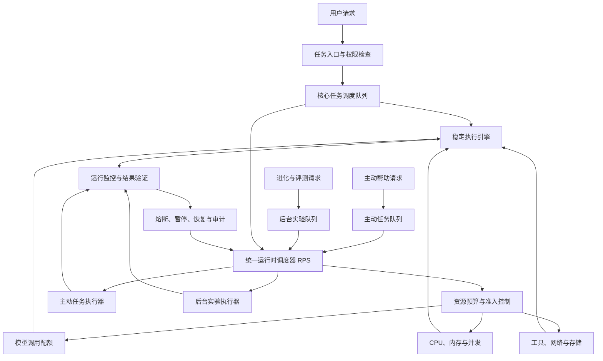

# 问答 145

> 来源: 新 窗口 | 会话: 分支 · 分支 · 分支 · 设计自进化智能体
> 消息: deefca5d-c0fd-446d-a9fc-2a0ca6e76cfd | 时间(UTC): 2026-10-24 14:13

## 用户

继续

## ChatGPT

推进运行时架构

细化资源调度

推进运行时架构并细化资源调度

下一步，我们不再继续扩张产品概念，而是把刚刚确定的最高优先级原则落实到可实施的工程设计中。

我建议接下来先解决一个基础问题：

**当用户正在执行重要任务时，后台的无限优化、主动分析、对话整理和机会发现，究竟如何做到不争抢关键资源、不阻塞任务、不把未经验证的改进带入运行中的智能体？**

这需要的不只是三个独立模块，而是一套统一的运行时调度、资源隔离和故障保护机制。否则，即使架构图上写着三条轨道，它们依然可能争抢同一个模型 API、CPU、内存、网络连接和任务队列。

<WritingBlock id="62184" variant="document"># EvoAgent 第七十五专项：核心执行优先的运行时调度与资源隔离设计

**专项编号：RPSG-CRPI**

**英文名称：Runtime Priority Scheduling and Resource Isolation — Core Run Priority and Isolation**

**版本：V1.0**

**文档性质：核心架构专项设计**

**关联架构决策：ADR-1497**

**适用范围：** Android 客户端、Windows 客户端、个人 Linux 主机、云端模型 API、领域专家、工作流引擎、主动智能系统、后台进化控制器。

## 一、设计目标

本专项要解决的不是如何让 EvoAgent 同时运行更多任务，而是如何保证：

1. 用户当前任务始终获得必要的执行资源。
2. 后台进化不会因为运行评测、分析日志或生成候选方案而拖慢核心任务。
3. 主动智能可以在适当的时候工作，但不会成为核心任务的前置依赖。
4. 系统资源紧张时，能够自动暂停非必要工作。
5. 未经验证的优化不能直接影响稳定版本。
6. 系统能够通过监测和对照实验，验证后台活动是否影响核心执行质量。

**核心原则：先保障核心任务，再利用剩余资源；先隔离，再协同；先验证，再发布。**

需要明确一个工程事实：如果核心任务和后台任务共用同一台低配置设备、同一个模型 API 配额或同一条网络连接，仅仅把它们放进不同进程，并不能保证完全没有相互影响。

因此，本专项的目标是建立可量化、可限制、可监测的非干扰机制。对于必须达到更强隔离要求的任务，应使用独立资源池，必要时使用独立设备或服务。

## 二、运行时优先级体系

系统采用分级调度，但优先级不能覆盖安全约束。

| 级别 | 类型 | 处理规则 |
|---|---|---|
| P0 | 安全控制、用户停止、取消、权限撤销 | 必须优先处理，不得被普通任务阻塞 |
| P1 | 用户当前明确交办的任务 | 优先获得必要资源，保证执行质量与时效 |
| P2 | 当前任务必需的支持工作 | 例如必要的工具恢复、任务状态恢复与关键依赖检查 |
| P3 | 已授权的主动帮助 | 可以延迟、限流或暂停，不得阻塞 P1 |
| P4 | 后台进化与非必要评测 | 使用隔离资源和剩余预算，必要时暂停 |

这里有三个重要约束。

第一，P0 是控制与安全优先级，不意味着系统可以无条件执行任何所谓的紧急操作。所有操作仍必须遵守权限和安全策略。

第二，P2 只包含当前任务真正需要的支持工作。不能因为后台进化系统声称某项实验有价值，就把实验提升为 P2。

第三，P3 与 P4 的优先级可以进一步细分，但不能通过自行修改优先级来绕过调度规则。

## 三、总体架构

建议增加一个统一的运行时调度器 `Runtime Priority Scheduler`，简称 RPS。

RPS 不负责决定任务的最终内容，也不负责诊断所有执行问题。它负责管理任务的运行资格、资源预算、并发、暂停、恢复和降级。

图中的三个队列可以共享调度器，但执行环境应当尽可能隔离。

尤其是候选版本的评测环境，不能直接覆盖稳定执行环境的配置。

## 四、调度器的核心职责

### 4.1 任务准入

每个新任务在运行前都应声明：

- 任务类型与优先级；
- 预计模型调用次数；
- 预计计算资源；
- 预算上限；
- 超时限制；
- 是否需要外部副作用；
- 是否允许暂停；
- 是否可以安全恢复；
- 依赖的模型、工具和配置版本。

无法精确估计资源消耗时，可以使用历史统计和保守估算，并在执行过程中持续更新。

如果当前资源不足以保障核心任务，调度器应拒绝、延迟或降级低优先级任务，而不是让所有任务同时启动。

### 4.2 资源预留

为核心执行预留必要的资源能力，例如：

- 模型 API 并发额度；
- 模型调用预算；
- 本地 CPU 和内存余量；
- 工具调用并发；
- 网络连接；
- 关键存储空间。

预留资源不一定全部闲置。空闲资源可以临时借给低优先级任务，但必须满足可回收条件。

对于无法中途取消的模型调用或外部任务，调度器应尽量避免在资源紧张时启动它们。

### 4.3 动态降级

当出现资源压力时，按以下顺序处理：

1. 停止启动新的非必要后台实验。
2. 暂停可暂停的主动分析。
3. 限制低优先级模型调用和工具并发。
4. 停止重复评测、非必要摘要和低价值预计算。
5. 在不影响核心任务质量的前提下，调整非关键任务的执行时段。
6. 如果核心任务仍无法获得必要资源，明确报告资源不足，并采用经过验证的恢复或降级策略。

**不能为了让任务看起来仍在运行，而偷偷跳过核心任务必须的验证步骤。**

## 五、资源隔离设计

资源隔离应当覆盖五个层面。

### 5.1 计算资源隔离

主动智能和后台进化优先使用独立进程、任务队列和受限的执行环境。

在支持的宿主系统中，可以进一步使用进程优先级、CPU 配额、内存限制或容器资源限制。

但 Android 的后台执行能力受到操作系统生命周期、电量策略和厂商限制。不能假设一个后台进程始终能够获得 CPU 时间。

因此，手机端的非必要主动任务应支持延迟、合并和取消，而不能依赖长期不间断运行。

### 5.2 模型调用隔离

不同任务应有独立的预算账本和并发额度。

例如：

- 核心任务具有优先保障的调用额度；
- 主动智能具有明确的调用上限；
- 后台进化具有独立的实验预算；
- 低优先级工作不得耗尽核心任务所需的可用额度。

如果多个轨道共用同一个 API 账号或供应商限流池，仍可能发生配额竞争。

因此，条件允许时应采用独立配额、独立凭证或不同资源池；无法物理隔离时，必须由统一调度器管理共享额度，并明确承认其剩余风险。

### 5.3 数据隔离

主动智能和后台进化可以读取经过授权的必要数据，但不能随意修改核心任务正在使用的状态。

例如：

- 主动智能生成新的项目摘要时，采用独立的候选版本；
- 后台进化生成新的提示词时，保存为候选配置；
- 核心任务继续使用其启动时确定的稳定配置；
- 新配置只有通过适用门禁后，才能在后续任务中生效。

### 5.4 外部副作用隔离

后台实验不能未经批准发送消息、删除文件、修改用户数据或执行其他真实外部操作。

优先采用模拟工具、记录的工具响应和隔离测试环境。

确需真实环境验证时，应根据风险级别限制范围，并遵守授权和确认规则。

### 5.5 存储与日志隔离

日志记录本身也会占用资源。

建议将关键执行日志与非关键诊断日志分开管理，优先保证任务状态、错误信息和恢复检查点可以保存。

当存储空间不足时，应先清理允许删除的临时评测数据，而不是删除尚未完成任务的关键恢复信息。

所有清理行为都必须遵守数据保留规则和用户删除要求。

## 六、任务执行期间的配置冻结

用户任务开始执行时，系统应为该任务固定一组可追溯的运行配置：

- 模型适配版本；
- 专家版本；
- 提示词版本；
- 工具接口版本；
- 工作流版本；
- 关键记忆与上下文快照；
- 权限策略版本；
- 预算与验收规则。

这并不意味着整个任务期间所有外部状态都必须冻结。网络、外部 API 和操作系统环境仍可能变化。

系统需要记录实际发生的变化，并在必要时触发兼容性检查。

但是，后台优化不能因为发现了新候选，就在一个任务执行到一半时悄悄替换其核心提示词、路由策略或工具实现。

确需变更时，应走明确的任务迁移流程，评估兼容性、状态一致性和恢复风险。

## 七、核心执行的质量保护

资源隔离只是第一层保护。

第二层是直接监测核心执行是否发生退化。

### 7.1 监控指标

- 核心任务完成率；
- 首次验收通过率；
- P50、P95 任务时延；
- 核心任务排队时延；
- 模型调用失败率；
- 工具超时率；
- 资源不足事件；
- 恢复成功率；
- 核心任务成本；
- 因后台活动导致的任务延迟或失败。

### 7.2 非干扰验收

不能只检查后台任务是否使用独立进程。

必须进行对照测试：

- 仅运行核心任务；
- 核心任务与主动智能并行运行；
- 核心任务与后台评测并行运行；
- 核心任务、主动智能与后台评测同时运行。

在可比任务和资源条件下，比较核心任务的成功率、时延、成本和稳定性。

如果并行运行造成超出预先设定门槛的退化，应当限制并发、缩小资源配额、迁移后台工作，或直接停止相关后台活动。

具体阈值应根据目标设备、模型服务和任务类型建立基线后确定，不能随意使用一个统一百分比。

## 八、主动智能的运行规则

主动智能应采用事件驱动和异步任务机制，而不是每次用户说话都启动一次完整的后台分析。

### 8.1 推荐触发条件

- 用户开启定期项目整理；
- 复杂任务完成后存在有价值的遗漏检查；
- 项目状态发生了具有实际意义的变化；
- 用户明确要求持续跟踪某个事项；
- 系统发现重复任务，且有足够证据支持自动化建议。

### 8.2 抑制条件

出现以下任一条件时，应延迟或停止非必要主动活动：

- 核心任务正处于关键执行阶段；
- 当前模型调用额度不足；
- 设备资源达到预设压力阈值；
- 用户关闭主动智能；
- 同类建议近期已经提供；
- 机会的证据不足；
- 预期收益不足以覆盖成本和打扰；
- 数据不在授权范围内。

### 8.3 结果处理

主动分析得到的结果分为：

- 无需行动；
- 候选建议；
- 待用户确认的准备成果；
- 已授权且可以执行的低风险任务；
- 需要更严格授权的高影响任务。

这些状态不能混为一谈。

生成一份建议，不代表用户已经同意执行。准备好一个文件，也不代表可以自动对外发送。

## 九、后台进化的运行规则

后台进化采用独立的实验调度和候选管理机制。

每个实验必须声明：

- 优化目标；
- 影响范围；
- 资源预算；
- 对照版本；
- 评测集；
- 停止条件；
- 安全检查；
- 发布门禁；
- 回滚方案。

实验只能修改其被授权的候选环境。

当核心任务负载升高、资源不足或出现质量异常时，后台实验应自动暂停或降低并发。

实验恢复时，应检查候选配置、数据快照和运行状态是否仍然有效。

不能因为实验已经运行了一段时间，就默认它应该优先完成。

## 十、关键接口

建议新增以下调度接口：

| 接口 | 职责 |
|---|---|
| `submit_runtime_task` | 提交带有优先级和预算的任务 |
| `admit_runtime_task` | 判断当前资源是否允许任务启动 |
| `reserve_core_capacity` | 为核心执行预留必要资源 |
| `allocate_runtime_budget` | 分配模型、工具和计算预算 |
| `yield_background_capacity` | 在核心负载升高时回收后台可用额度 |
| `pause_background_task` | 暂停允许暂停的后台任务 |
| `resume_background_task` | 在检查状态后恢复后台任务 |
| `cancel_low_priority_task` | 取消已不值得继续运行的低优先级任务 |
| `freeze_task_configuration` | 固定任务启动时的关键配置版本 |
| `evaluate_runtime_pressure` | 判断当前资源压力和运行风险 |
| `trigger_runtime_circuit_breaker` | 触发运行时熔断 |
| `verify_non_interference` | 检查后台活动是否影响核心执行 |
| `record_resource_contention` | 记录资源竞争事件 |
| `audit_runtime_priority` | 检查任务是否违反优先级规则 |

每次调度决策都应记录原因，包括任务为什么获准、为什么被延迟、使用了多少资源，以及是否触发降级。

## 十一、端到端验收场景

至少需要通过以下测试：

1. 核心任务运行时提交大量后台实验，核心任务仍获得必要资源。
2. 主动智能在核心任务执行期间生成建议，但不阻塞任务。
3. 模型 API 配额不足时，后台任务不能耗尽核心任务预留额度。
4. Android 设备进入资源压力状态时，非必要后台分析能够延迟。
5. 用户取消任务后，相关可取消工作能够及时停止。
6. 不支持安全暂停的外部任务不会被误判为可无损中断。
7. 后台生成候选配置后，正在运行的任务仍使用原有稳定配置。
8. 候选版本未通过门禁时，不能进入稳定执行环境。
9. 主动智能关闭后，核心任务和必要的核心进化流程仍然可用。
10. 后台日志写入过量时，系统优先保留关键执行和恢复信息。
11. 核心任务与后台活动并行运行时，系统能够检测可测量的时延或成功率退化。
12. 触发熔断后，系统能够暂停非必要工作并记录原因。
13. 恢复后台任务时，不会重复执行已经产生外部副作用的操作。
14. 用户撤销授权后，相关主动任务与后台访问会按策略停止。
15. 在目标设备和实际模型服务条件下，非干扰测试达到预先设定的验收门槛。

## 十二、架构冻结决策

**ADR-1498：统一运行时优先级调度与资源隔离**

1. 建立统一运行时调度器 RPS。
2. 核心任务、主动智能和后台进化采用独立队列。
3. 后台活动必须具有明确的资源预算、并发上限和停止条件。
4. 核心任务应获得必要的资源保障。
5. 低优先级任务不得耗尽核心任务预留的资源。
6. 支持的环境中应采用进程、容器或其他资源控制机制加强隔离。
7. 任务启动时固定关键配置版本，禁止未经授权的运行中变更。
8. 主动智能默认采用异步、可延迟的运行方式。
9. 后台进化必须在隔离候选环境中运行。
10. 建立运行时资源压力监控、自动降级和熔断机制。
11. 非干扰必须通过对照测试验证，不能只依赖架构声明。
12. 资源紧张时优先暂停主动分析和非必要实验。
13. 所有任务都必须遵守安全、隐私、授权和预算约束。
14. 不能保证绝对无干扰的共享资源场景，应明确其风险并设置可测量的保护阈值。
15. 只有通过质量、效率、稳定性和安全门禁的候选改进，才允许进入稳定执行轨道。

**最终目标：让 EvoAgent 能够长期持续进化，但任何时候都不能为了后台的未来收益，牺牲用户当前任务的必要质量与可靠性。**</WritingBlock>

## 下一步

完成运行时隔离设计后，建议进入下一项基础专项：**模型、工具与运行环境兼容性治理**。

原因是，资源隔离只能防止后台工作干扰当前任务，却不能解决模型升级、工具接口变化或 Android 系统更新造成的能力退化。接下来需要把能力声明、版本依赖、兼容性验证和升级回滚机制建立起来，并将其纳入同一套稳定执行与后台进化治理体系。
