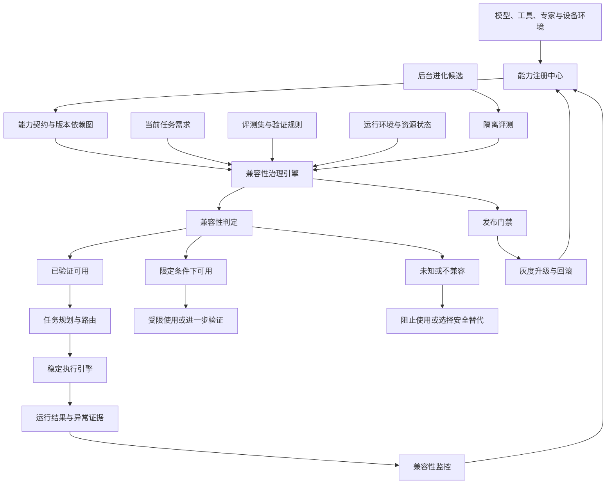

# 问答 146

> 来源: 新 窗口 | 会话: 分支 · 分支 · 分支 · 设计自进化智能体
> 消息: 9a826335-d79b-47bf-8cda-09c8a5e8a1d2 | 时间(UTC): 2026-10-24 14:18

## 用户

可以，继续

## ChatGPT

设计兼容性治理

设计了兼容性治理方案

这一步我们继续，但有一个边界必须明确：**模型、工具和运行环境兼容性治理，不是为了增加一个新技术模块，而是为了保证 EvoAgent 在持续升级、自动优化和扩展能力时，核心任务始终可靠。**

它需要与刚刚确定的运行时调度器、独立评测系统和主动智能体系协同。完成这项基础设计后，我建议暂停继续扩张架构专项，转向产品功能与技术实现的逐项对齐。

<WritingBlock id="72641" variant="document"># EvoAgent 第七十六专项：模型、工具与运行环境兼容性治理及能力注册体系

**专项编号：MTRC-CCR**

**英文名称：Model, Tool & Runtime Compatibility Governance and Capability Registry**

**文档版本：V1.0**

**文档性质：基础架构专项设计**

**关联决策：** ADR-1497、ADR-1498

**适用范围：** Android、Windows、个人 Linux 主机、云端模型 API、通用内核、领域专家、工具网关、工作流引擎、主动智能系统、后台进化控制器。

## 一、专项目标

EvoAgent 需要持续优化模型选择、提示词、工具参数、工作流和执行策略，同时还要支持未来新增专家、扩展设备以及更换模型供应商。

但是，任何一项组件升级，都可能影响其他组件的行为。

例如：

- 新模型在一般对话中表现更好，却无法稳定遵守某个专家的工具调用协议。
- 工具接口升级后，返回字段发生变化，原有工作流继续读取旧字段。
- 视频生成服务调整了任务状态，原有工作流错误地把生成中的任务判定为失败。
- Android 系统更新后，某项原本可用的界面操作不再可靠。
- 编程专家升级了静态分析工具，但新的分析结果格式与现有修复流程不兼容。
- 后台进化系统发现一种更快的模型配置，却没有验证它对关键任务的影响，直接替换了稳定配置。

这些问题并不是单个模型或工具本身的质量问题，而是**组件之间的兼容性问题**。

本专项建立统一的能力注册、版本依赖、兼容性验证、升级控制和故障回退机制，确保系统在不断变化的环境中仍然能够可靠执行任务。

核心目标包括：

1. 让系统知道每个模型、工具、专家和运行环境具备哪些能力。
2. 区分组件声明的能力与已经验证过的实际能力。
3. 明确哪些组件版本组合经过测试，哪些存在限制，哪些尚未验证。
4. 在模型或工具升级前，识别可能受影响的专家与工作流。
5. 将兼容性验证接入后台进化与发布门禁。
6. 在发生故障时选择经过验证的替代方案，而不是盲目重试。
7. 保证当前正在执行的任务不会因为后台升级而突然改变关键配置。

**本专项的最终验收标准，不是注册了多少能力，而是系统能否正确判断某种能力在当前环境中是否可用、是否兼容，以及是否值得启用。**

---

# 二、总体架构

建议新增两个相互协作的逻辑组件：

- `Capability Registry`：能力注册中心。
- `Compatibility Governance Engine`：兼容性治理引擎。

前者回答“系统有什么能力、依赖什么、版本是什么”。

后者回答“这些能力在当前任务、当前设备和当前版本组合下，能否可靠地一起工作”。

## 2.1 架构图



能力注册中心不是一个可以自行宣布系统升级成功的组件。

兼容性判定必须基于明确的契约、验证记录、适用范围和环境条件。注册信息缺失时，系统应明确标记未知，而不是默认兼容。

## 2.2 与现有系统的关系

| 现有系统 | 本专项的职责关系 |
|---|---|
| 通用内核 | 根据任务要求获取兼容的能力组合 |
| 领域专家 | 声明专属能力、依赖与版本要求 |
| 路由器 | 只选择满足任务要求且具备适用验证证据的专家或能力组合 |
| 工作流引擎 | 声明节点对工具、模型和运行环境的依赖 |
| RPS 运行时调度器 | 判断资源是否允许启动任务，本专项判断能力组合是否兼容 |
| AEVC 质量评测体系 | 提供验证结果、回归证据和发布门禁 |
| 后台进化控制器 | 在隔离环境生成候选，不能直接覆盖已验证的能力配置 |
| 主动智能 | 发现能力机会或升级需求，但不能绕过兼容性检查 |
| 稳定版本管理 | 保存经过验证的版本组合，支持恢复 |

两项判断必须分开：

- **兼容性通过，不代表质量一定优秀。**
- **某个模型或工具单独表现优秀，不代表与当前工作流兼容。**

最终启用能力时，两项都需要满足相应要求。

---

# 三、建立统一的能力注册模型

EvoAgent 不应仅通过模型名称、工具名称或专家名称判断能力。

需要为每类组件建立标准化的能力声明。

## 3.1 能力注册对象

建议至少支持以下对象：

| 对象 | 主要描述内容 |
|---|---|
| Model Profile | 模型能力、接口特征、成本、时延、限制和已验证任务类型 |
| Tool Profile | 工具输入输出契约、权限、外部副作用和依赖 |
| Expert Profile | 专家目标、能力范围、模型要求、工具依赖与评测集 |
| Workflow Profile | 工作流节点、依赖关系、恢复机制和验收规则 |
| Runtime Profile | 操作系统、设备能力、可用权限、资源限制和依赖版本 |
| Capability Bundle | 一组经过验证、可以共同工作的组件配置 |
| Compatibility Evidence | 支持某个兼容性结论的测试结果与适用条件 |

其中，`Capability Bundle` 尤其重要。

实际执行任务时，系统往往不是单独调用一个模型，而是同时依赖：

- 模型版本；
- 专家提示词；
- 工具接口；
- 工作流定义；
- 运行环境；
- 权限策略；
- 验收器版本。

因此，系统需要记录经过验证的**组合配置**，而不仅仅记录每个组件的版本。

## 3.2 必须区分三种能力状态

第一种是 `Declared`：组件或供应商声明支持某项能力。

第二种是 `Observed`：系统在实际运行中观察到了相关行为。

第三种是 `Verified`：在明确的测试条件、验收标准和适用范围内，相关能力已经通过验证。

三者不能混为一谈。

例如，模型供应商声明某模型支持工具调用，不意味着它已经通过 EvoAgent 编程专家的工具调用回归测试。

系统应当保留来源、证据和时间信息，避免把过期的验证结果无限期地当作当前事实。

## 3.3 能力状态

建议采用以下兼容性状态：

| 状态 | 含义 | 默认行为 |
|---|---|---|
| `VERIFIED` | 在明确范围内通过兼容性验证 | 允许按已验证条件使用 |
| `VERIFIED_WITH_LIMITS` | 只在限定条件下通过验证 | 必须满足限制条件 |
| `UNKNOWN` | 缺少充分验证证据 | 不用于要求严格保证的关键任务 |
| `INCOMPATIBLE` | 已发现契约或行为不兼容 | 禁止在相关范围内使用 |
| `DEPRECATED` | 能力仍可能工作，但计划停用 | 按迁移计划处理 |
| `REVOKED` | 因安全、质量或其他重大问题撤销使用资格 | 阻止新任务使用 |

状态必须带有作用范围。

某个模型可能在旅游专家中为 `VERIFIED`，在代码修改工作流中却为 `UNKNOWN`。

因此，不应简单地把某个模型标记为“全局兼容”或“全局不兼容”。

---

# 四、能力契约：把组件依赖变成可检查的工程定义

建议为组件建立版本化的 `Capability Manifest`。

它可以使用 JSON、YAML 或数据库结构保存。以下为概念示例，并非已经实现的配置文件。

```yaml
capability_id: tool.video.generate
version: 2.1.0

kind: tool

declared_capabilities:
  - video_generation
  - asynchronous_job_status

contract:
  input_schema_version: "2"
  output_schema_version: "3"
  completion_semantics: "verified_terminal_state"

requirements:
  network: required
  storage: temporary
  external_side_effects: true

constraints:
  timeout_seconds: 600
  retry_policy: idempotency_required
  budget_policy: mandatory

compatibility:
  tested_runtime_profiles:
    - linux_ffmpeg_profile
  tested_workflow_versions:
    - video_pipeline_3

verification:
  required_tests:
    - contract_validation
    - asynchronous_status_test
    - timeout_recovery_test
    - duplicate_submission_test
    - final_output_verification

release_policy:
  require_verified_compatibility: true
```

每个能力声明还应记录：

- 提供方；
- 版本来源；
- 契约版本；
- 认证与权限要求；
- 依赖组件；
- 适用任务类型；
- 已知限制；
- 失败模式；
- 验证证据；
- 版本有效性；
- 撤销和迁移策略。

**能力声明是系统建立候选方案的依据，兼容性验证才是允许方案进入稳定执行环境的依据。**

---

# 五、建立能力依赖图与兼容性矩阵

EvoAgent 已经采用独立专家和工作流的分层架构，因此需要把依赖关系显式化。

## 5.1 能力依赖图

例如，一个 AI 漫剧工作流可能具有以下依赖：

```text
AI 漫剧专家
├── 脚本规划模型
├── 分镜生成能力
├── 图像或视频生成工具
├── 配音工具
├── 素材存储
├── FFmpeg 合成环境
├── 文件完整性检查
└── 成片质量验收器
```

如果视频生成工具升级，系统应当能够查询哪些工作流、专家和验收器依赖该工具。

但依赖关系并不意味着所有下游能力都会失效。

例如，工具升级只改变内部实现、保持契约不变，并且通过相关测试后，部分工作流可能不需要进行完整重测。

反之，如果输出字段、任务状态机、错误码或副作用语义发生变化，就应扩大验证范围。

## 5.2 兼容性矩阵

建议记录以下组合：

| 组件组合 | 检查内容 |
|---|---|
| 模型 × 专家 | 是否满足该专家的任务要求 |
| 模型 × 提示词 | 指令遵循与输出结构是否稳定 |
| 模型 × 工具 | 工具调用格式、参数和错误处理是否兼容 |
| 工具 × 工作流 | 输入输出契约、状态转换和恢复逻辑是否匹配 |
| 工作流 × 运行环境 | 依赖、文件系统、权限与资源是否满足 |
| 专家 × 任务类型 | 是否有适用的质量验证证据 |
| 能力组合 × 安全策略 | 是否符合权限和数据边界 |
| 能力组合 × 预算 | 是否满足成本、时延和调用限制 |

兼容性矩阵不能只记录一个布尔值。

至少需要关联：

- 被测试的精确版本；
- 测试环境；
- 测试集版本；
- 验收结果；
- 已知限制；
- 验证时间；
- 适用条件；
- 证据记录。

如果模型、工具或运行环境发生了实质性变化，原有证据需要重新评估，而不能永久沿用。

---

# 六、兼容性验证必须分层

建议将兼容性验证划分为五层。

## L0：接口与契约兼容

检查输入输出格式、必填参数、返回字段、错误码和状态转换。

目标是尽早发现明显的接口不匹配。

## L1：组件行为兼容

验证组件在真实或受控条件下是否按照契约工作。

例如：

- 模型是否返回符合要求的结构化输出；
- 工具是否正确处理超时；
- 文件处理组件是否保留必要的元数据。

## L2：专家级兼容

验证模型、提示词、工具与专家组合能否完成该领域的代表性任务。

例如，代码专家更换模型后，应检查代码修改、测试修复、工具使用和错误恢复等任务。

## L3：工作流与端到端兼容

验证完整任务链是否仍然有效。

例如，视频生成工具升级后，需要确认生成任务能够被正确提交、跟踪、恢复，并最终生成可验证的视频文件。

## L4：生产环境兼容

在受控条件下验证目标设备、实际网络、资源预算和外部依赖。

此层用于发现模拟环境难以覆盖的真实运行问题。

不是每次小改动都必须执行全部五层测试。

应根据变更影响范围和风险等级选择测试深度，但任何缩减都必须符合预先定义的策略。

---

# 七、模型选择：从“哪个模型最好”转为“哪个模型适合当前任务”

EvoAgent 不应为整个系统寻找一个永久固定的最佳模型。

不同任务对模型的要求不同。

例如：

- 简单信息整理更关注成本和响应速度；
- 复杂编程更关注代码正确性、工具使用和修改质量；
- 复杂规划更关注约束遵循与计划执行；
- 视觉任务可能依赖特定的多模态能力；
- 某些本地任务要求数据不离开设备。

因此，模型选择应当经过四个阶段。

### 第一步：任务需求匹配

确定任务需要的能力、数据处理方式、输出格式、预算和时延约束。

### 第二步：兼容性筛选

剔除不具备必要能力、缺少关键验证证据或违反安全要求的模型配置。

### 第三步：质量与资源比较

在符合约束的候选中，比较已验证的任务表现、成本、时延、稳定性和资源消耗。

### 第四步：运行时验证

实际运行中持续检查工具调用、错误率、结果质量和外部依赖状态。

如果模型出现退化，应按照已验证的回退策略处理。

**路由器不能仅根据模型名称、单一排行榜或供应商宣传来决定任务应该交给谁。**

它应当使用任务要求与兼容性证据来选择能力组合。

---

# 八、工具兼容性：不能只检查函数能不能调用

工具系统是 EvoAgent 实际完成任务的关键，因此需要特别关注契约和副作用。

建议为工具建立以下契约：

1. 输入参数及其类型。
2. 输出结构与字段语义。
3. 错误码及其含义。
4. 超时与取消行为。
5. 重试规则。
6. 幂等性保证。
7. 权限要求。
8. 外部副作用。
9. 数据保留与清理规则。
10. 版本迁移与回退策略。

尤其需要区分三种重试情况：

- 请求尚未发出，可以安全重试；
- 请求已发出，但结果未知，需要先核实执行状态；
- 请求已成功产生外部副作用，不应简单地再次提交。

例如，支付、消息发送、文件删除和外部任务提交，不能仅仅因为调用超时就重新执行。

兼容性治理必须把副作用语义纳入契约，而不是只检查返回值格式。

---

# 九、运行环境兼容性：Android、Windows 与 Linux 不能假定行为一致

EvoAgent 采用 Android 优先策略，但未来还需要支持 Windows 和个人 Linux 主机。

不同环境具有不同的能力边界。

| 环境 | 必须检查的兼容性 |
|---|---|
| Android | 权限、应用生命周期、后台限制、无障碍能力、存储访问、网络变化 |
| Windows | 文件系统权限、进程管理、依赖安装、桌面交互与恢复机制 |
| Linux | 运行时依赖、权限、服务管理、文件系统和资源限制 |
| 云端模型 API | 模型版本、接口变化、限流、可用性、超时和成本 |
| 外部生成服务 | 异步任务状态、配额、输出格式、取消和恢复 |
| 本地模型环境 | 硬件能力、显存、驱动、运行时版本与资源预算 |

这里必须遵守一个原则：

**设备支持某种操作系统，不代表它一定支持某种具体能力。**

例如，两台 Android 设备即使运行同一个系统大版本，也可能因为厂商限制、权限状态和应用环境不同而表现不同。

因此，应当根据实际运行环境进行能力探测和验证。

对于未通过验证的能力，系统应当提供替代方案、受限模式或明确说明不可用，而不是假定它一定可以执行。

---

# 十、如何与无限优化结合？

本专项最重要的作用之一，是让后台进化不再只优化模型、提示词和工具参数，而是同时检查它们是否仍然兼容。

## 10.1 候选改进流程

假设后台进化系统发现，更换某个模型可以提高编程任务的完成率。

正确流程应为：

```text
发现改进机会
    ↓
生成候选模型配置
    ↓
注册候选能力与版本依赖
    ↓
识别受影响的专家和工作流
    ↓
运行兼容性测试
    ↓
运行质量、成本和稳定性评测
    ↓
检查安全与权限约束
    ↓
通过发布门禁
    ↓
影子测试或限定范围试运行
    ↓
观察真实结果
    ↓
保留、限制发布或回滚
```

如果候选模型在一般对话中表现更好，但在代码修改工作流中存在工具调用回归，就不能直接替换整个系统的默认模型。

系统可以保留它在已验证场景中的用途，而将不兼容的场景继续交给原有稳定配置。

## 10.2 兼容性问题也应该成为优化目标

如果某个专家经常因为工具版本变化而失败，系统可以考虑：

- 改善工具适配器；
- 更新契约转换层；
- 为工作流增加状态检查；
- 修复错误处理与恢复机制；
- 优化能力发现与路由逻辑；
- 为关键组件增加更合适的回归测试。

但兼容性修复仍然必须经过独立验证。

不能因为一个修复看起来合理，就直接把它写入稳定配置。

## 10.3 优化与运行时隔离

兼容性治理必须遵守 ADR-1497 与 ADR-1498：

- 后台实验不修改正在执行任务的关键配置；
- 资源不足时暂停非必要兼容性扫描和实验；
- 新版本通过测试后，仍需满足发布门禁；
- 稳定版本保留可恢复的配置组合；
- 如果升级造成退化，应能够恢复先前的兼容组合。

这样，兼容性治理既支持无限优化，也限制了优化可能引入的风险。

---

# 十一、未知兼容性如何处理？

未知不等于不兼容，但也不等于可以直接使用。

建议按风险分级处理。

| 风险级别 | 示例 | 处理策略 |
|---|---|---|
| 低 | 生成一份可重新生成的内部草稿 | 可以在隔离或受限条件下试验 |
| 中 | 修改项目文件、执行复杂工作流 | 先完成必要的兼容性与回归测试 |
| 高 | 对外发送、删除数据、付款等高影响操作 | 必须满足严格的能力、权限和执行验证要求 |
| 安全关键 | 涉及权限边界、敏感数据或安全控制 | 不允许以未知兼容性为由绕过验证 |

具体风险级别应由任务和副作用决定，而不是简单按照工具名称分类。

对于未知能力，系统可以：

- 选择已有验证证据的替代工具；
- 在模拟环境中进行测试；
- 请求用户提供必要的授权；
- 限制任务范围；
- 暂停执行并说明原因。

系统不应因为缺少兼容性信息，就自动尝试所有可能的工具组合。

---

# 十二、核心数据结构与接口

建议建立以下逻辑数据实体：

- `CapabilityManifest`：能力声明。
- `ComponentVersion`：组件及版本。
- `DependencyEdge`：依赖关系。
- `CompatibilityAssertion`：兼容性结论。
- `CompatibilityEvidence`：验证证据。
- `CapabilityBundle`：经过验证的组合配置。
- `RuntimeProfile`：运行环境描述。
- `MigrationPlan`：版本迁移方案。
- `FallbackPolicy`：故障回退策略。
- `RevocationRecord`：能力撤销记录。

主要接口包括：

| 接口 | 职责 |
|---|---|
| `register_capability` | 注册能力及其版本 |
| `update_capability_manifest` | 更新能力声明 |
| `get_capability_profile` | 获取能力及限制信息 |
| `resolve_capability_dependencies` | 查询依赖关系 |
| `evaluate_compatibility` | 判断指定组件组合的兼容性 |
| `get_verified_capability_bundles` | 获取符合要求的已验证组合 |
| `create_compatibility_test_plan` | 根据变更影响生成测试计划 |
| `run_compatibility_suite` | 执行兼容性测试 |
| `record_compatibility_evidence` | 保存验证证据 |
| `validate_runtime_profile` | 检查当前环境是否满足能力要求 |
| `plan_component_migration` | 生成版本迁移计划 |
| `validate_fallback_bundle` | 验证回退组合是否仍可用 |
| `revoke_capability` | 撤销不再允许使用的能力 |
| `detect_capability_drift` | 发现实际行为与已验证能力之间的偏差 |
| `audit_capability_usage` | 检查实际使用是否符合注册与授权规则 |

所有兼容性结论都必须关联具体版本、运行环境和验证证据。

不能仅保存“兼容”两个字，而不记录它在哪些条件下成立。

---

# 十三、工程目录建议

```text
evoagent/
├── capability_registry/
│   ├── manifests/
│   ├── model_profiles/
│   ├── tool_profiles/
│   ├── expert_profiles/
│   ├── workflow_profiles/
│   ├── runtime_profiles/
│   └── capability_bundles/
├── compatibility_governance/
│   ├── contract_validation/
│   ├── dependency_graph/
│   ├── compatibility_matrix/
│   ├── evidence_registry/
│   ├── runtime_validation/
│   ├── compatibility_drift/
│   ├── migration_planner/
│   └── revocation_manager/
├── compatibility_tests/
│   ├── contract_tests/
│   ├── component_tests/
│   ├── expert_tests/
│   ├── workflow_tests/
│   ├── runtime_tests/
│   └── fallback_tests/
├── capability_selection/
│   ├── requirement_matcher/
│   ├── verified_bundle_selector/
│   ├── model_selection/
│   ├── tool_selection/
│   └── fallback_resolver/
├── release_integration/
│   ├── change_impact_analysis/
│   ├── compatibility_gate/
│   ├── canary_validation/
│   ├── release_manifest/
│   └── rollback_integration/
└── compatibility_audit/
    ├── usage_records/
    ├── evidence_audit/
    ├── drift_reports/
    └── migration_reports/
```

该目录表示逻辑职责，不要求每个目录都成为独立服务。

第一阶段建议使用模块化单体结构，优先建立注册、验证、选择和回退的最小完整链路。

---

# 十四、专项验收标准

至少应通过以下验收：

1. 系统能够注册模型、工具、专家、工作流和运行环境的能力信息。
2. 能够区分能力声明、实际观察和经过验证的能力。
3. 能够记录能力之间的版本依赖关系。
4. 能够根据任务需求筛选兼容的能力组合。
5. 未知兼容性不会被默认标记为已验证。
6. 能够识别模型升级对相关专家和工作流的影响。
7. 能够识别工具输入输出契约发生变化造成的风险。
8. 能够验证异步任务状态、超时、取消和恢复行为。
9. 能够区分安全重试与可能产生重复副作用的重试。
10. 能够识别 Android、Windows 和 Linux 之间的能力差异。
11. 能够为关键任务选择已经验证的能力组合。
12. 能够将兼容性测试纳入后台进化发布门禁。
13. 后台候选配置不能直接覆盖稳定运行配置。
14. 兼容性证据必须包含版本、环境、测试集和验收结果。
15. 能够在升级失败时恢复经过验证的兼容组合。
16. 能够发现实际运行表现与已有兼容性证据之间的偏差。
17. 能够撤销存在严重问题的能力，并阻止新任务继续使用。
18. 兼容性扫描和实验不能突破 RPS 的资源配额与优先级规则。
19. 能够证明兼容性治理没有导致核心任务质量或时延越过既定门槛。
20. 能够通过端到端测试验证从候选升级到兼容性检查、发布或回滚的完整流程。

以上为目标架构验收标准，不代表相关模块已经实现。

---

# 十五、建议冻结的架构决策

| 编号 | 决策 |
|---|---|
| ADR-1499 | 建立统一能力注册中心 Capability Registry |
| ADR-1500 | 建立独立兼容性治理引擎 |
| ADR-1501 | 区分能力声明、运行观察与已验证能力 |
| ADR-1502 | 兼容性结论必须关联版本、环境、测试范围和证据 |
| ADR-1503 | 建立模型、工具、专家、工作流和运行环境之间的依赖图 |
| ADR-1504 | 以经过验证的能力组合为稳定执行的配置单位 |
| ADR-1505 | 模型选择必须同时满足任务能力要求和兼容性要求 |
| ADR-1506 | 工具契约必须覆盖错误、超时、取消、重试和外部副作用语义 |
| ADR-1507 | 关键任务不得依赖未经验证的能力组合 |
| ADR-1508 | 兼容性变更应根据影响范围触发相应层级的测试 |
| ADR-1509 | 兼容性未知时，应按任务风险采取隔离、限制、替代或暂停策略 |
| ADR-1510 | 后台进化必须将兼容性验证纳入候选发布门禁 |
| ADR-1511 | 当前任务使用的关键配置不得被后台升级直接替换 |
| ADR-1512 | 已发现严重问题的能力可以撤销，并触发相应的停止使用与回滚策略 |
| ADR-1513 | 兼容性治理必须服从 RPS 资源隔离与优先级调度规则 |
| ADR-1514 | 第一阶段采用本地优先的模块化能力注册与兼容性治理架构 |

以上为本专项建议的架构基线，正式冻结前仍需与实际工程目录、数据模型和现有实现进行一次一致性审查。

---

# 十六、本专项完成后，接下来应该做什么？

到这里，我们已经为 EvoAgent 建立了三项关键的工程保护能力：

- **质量评测体系：** 判断改进是否真正有效。
- **运行时调度与资源隔离：** 保证后台工作不损害核心执行。
- **能力注册与兼容性治理：** 防止模型、工具和环境变化造成隐蔽故障。

这三者共同支撑核心执行能力的持续改善。

但现在不应该继续无限增加技术专项。

接下来更有价值的工作，是将产品蓝图中的每项用户功能，与已有的 PRD、架构决策、能力模块和验收测试建立追踪关系。

建议下一阶段交付：

**《EvoAgent 产品功能—技术能力—验收标准追踪矩阵与实施缺口审计》**。

这份文档应当逐项回答：

1. 用户需要的功能是什么？
2. 当前产品设计是否已经定义清楚？
3. 哪些技术模块已经有设计？
4. 哪些模块只是文档方案，尚未实现？
5. 哪些功能依赖真实的外部模型或工具？
6. 哪些功能可以在 Android 本地运行？
7. 哪些功能需要个人 Linux 主机或云端能力？
8. 如何验收功能真实可用？
9. 哪些能力必须先完成，哪些可以延后？
10. 如何从现有设计收敛出一个可运行、可验证、能够持续改进的个人智能体产品？

**接下来的进度应当以用户能够使用的真实功能为单位，而不是以新增了多少架构专项为单位。**</WritingBlock>

这份专项完成后，我建议正式切换到产品实现审计：逐项检查现有设计中哪些只是概念、哪些已有代码、哪些能端到端运行，以及距离真正可用的 EvoAgent 还缺什么。这样才能把已经积累的架构工作转化成实际产品。
