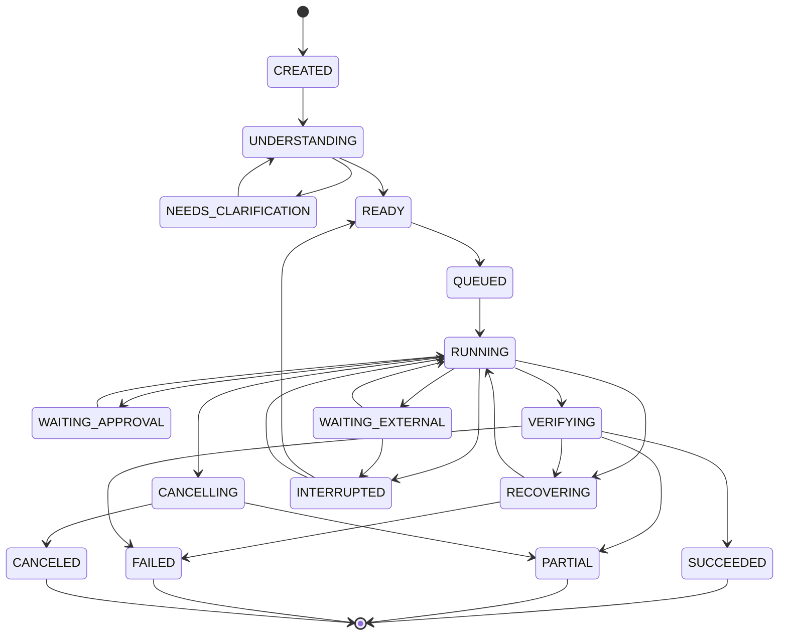

# 问答 149

> 来源: 新 窗口 | 会话: 分支 · 分支 · 分支 · 设计自进化智能体
> 消息: 99869049-ebdc-4310-9343-b2c30d1715fc | 时间(UTC): 2026-10-24 14:35

## 用户

继续

## ChatGPT

整理产品规格

整理了产品规格

这次我们直接进入正式 PRD 的执行细化阶段，把上一轮确定的产品目标落到具体页面、任务状态、功能规则和验收测试中。

我会保留 EvoAgent 的完整产品方向，不把整个产品缩减成一个简单的 MVP；但在开发顺序上，先打通真实任务执行链，再逐步开放长期记忆、工作流复用、主动智能和自动进化。这样既不会丢掉最终目标，也不会再次陷入只有架构、没有可用产品的循环。

<WritingBlock id="58326" variant="document"># EvoAgent 正式产品 PRD：页面、任务状态机、功能规则与验收用例

**文档编号：** EA-PRD-EXEC-001  
**版本：** 1.2  
**文档类型：** 产品需求规格与工程验收基线  
**产品形态：** Android 优先的个人通用智能体  
**核心原则：** 核心任务质量优先、执行效率持续优化、主动智能受控运行、进化必须经过验证。

> 本文是 EvoAgent 全量产品设计中的实施细化文件，不替代完整 PRD，也不代表对应功能已经完成编码或测试。

## 一、产品范围与基本原则

### 1.1 产品目标

EvoAgent 应当帮助个人用户完成真实任务，并在长期使用中逐步减少用户重复指导、纠错和管理的负担。

完整产品包含：

- 统一的聊天、语音与任务工作入口；
- 通用任务理解、规划、执行和验收；
- 独立领域专家与能力路由；
- 工具调用、任务 DAG 和 ReAct 执行机制；
- 上下文管理、分层记忆与项目状态；
- 可保存、复用、评测和升级的工作流；
- 任务日志、故障诊断与结果验证；
- 独立的自动评测、候选改进、发布门禁和回滚；
- 受控主动智能与个人工作状态管理；
- Android 离线可靠性、权限管理与后续跨端扩展。

### 1.2 不可违反的产品规则

1. 安全、隐私、用户授权和停止指令属于硬约束。
2. 核心任务执行质量、效率和稳定性是首要产品目标。
3. 后台进化不能为了改善未来版本而损害当前任务。
4. 主动智能不能成为核心任务执行的强制前置步骤。
5. 模型回答成功不等于任务成功，必须验证实际结果。
6. 未经过必要验证的候选版本不能直接进入稳定执行环境。
7. 资源不足时，先暂停主动分析和非必要实验。
8. 用户关闭主动智能后，核心执行功能仍应正常工作。
9. 所有任务都必须具有可识别的状态、预算边界和结束条件。
10. 产品功能必须有明确的用户价值和可执行的验收标准。

## 二、产品信息架构

首发应用采用面向用户的简洁导航，不向普通用户暴露全部技术模块。

| 页面 | 核心用途 | 优先级 |
|---|---|---|
| P01 首页 | 输入目标、语音入口、最近任务 | P0 |
| P02 对话与任务工作区 | 理解需求、查看执行计划、持续交互 | P0 |
| P03 任务详情 | 查看状态、进度、异常与取消操作 | P0 |
| P04 操作授权页 | 确认需要额外授权的动作 | P0 |
| P05 结果交付页 | 查看成果、验收情况和失败原因 | P0 |
| P06 项目空间 | 管理项目状态、决策、待办和上下文 | P1 |
| P07 工作流库 | 保存、复用、编辑和运行工作流 | P1 |
| P08 主动智能设置 | 设置主动等级、频率和数据范围 | P1 |
| P09 能力与权限设置 | 管理能力开放情况和权限授权 | P0 |
| P10 诊断与日志导出 | 查看错误、导出诊断数据 | P0 基础版 |

这里的 P0 表示首发所需的产品能力。部分页面可以采用轻量实现，例如操作授权页可以是任务执行时弹出的独立界面，而不一定需要复杂的独立导航。

## 三、页面需求规格

### P01：首页与任务入口

**目标：** 用户无需了解技术架构，就能开始一项任务。

主要元素：

- 文本输入框；
- 语音输入入口；
- 聊天与工作模式切换；
- 最近任务列表；
- 当前运行任务提示；
- 新建任务入口；
- 必要的网络或能力状态提示。

功能规则：

1. 用户提交任务后，立即创建可追踪的任务记录。
2. 不得要求用户先选择模型、专家、DAG 或 ReAct。
3. 简单任务默认直接处理。
4. 只有缺少关键条件时才要求澄清。
5. 用户可以重新打开最近任务，查看实际进度与结果。
6. 正在执行的任务应显示真实状态，不能仅显示一个不确定的加载动画。
7. 语音能力不可用时，应允许用户直接改用文字输入。

验收标准：

- 提交任务后生成唯一任务标识。
- 连续提交的不同任务不会错误共享任务状态。
- 重新打开应用后，已持久化的任务仍可查看。
- 输入失败或网络不可用时，系统给出明确反馈。

### P02：对话与任务工作区

**目标：** 让用户在自然交流中完成任务，而不是为了执行任务而学习复杂的控制面板。

功能规则：

- 聊天模式用于问答、讨论、创作和澄清。
- 工作模式用于多步骤执行、工具调用、文件处理和结果验收。
- 简单任务不必展示完整计划。
- 复杂任务可以展示目标、关键步骤和预计交付物。
- 用户可以补充约束或纠正理解。
- 已经执行的外部动作不能因为用户修改了目标就假装没有发生。
- 影响任务安全、预算或副作用的实质性变更，应重新评估执行计划。

工作区应支持：

- 当前目标；
- 关键约束；
- 任务进度；
- 需要用户确认的事项；
- 已完成步骤；
- 失败或等待原因；
- 最终交付入口。

验收标准：

- 用户补充约束后，后续执行能够使用更新后的任务要求。
- 不必要的澄清不会无限循环。
- 任务执行中的重要异常能够被用户发现。
- 用户不需要阅读内部模型推理过程，也能理解任务当前状态。

### P03：任务详情与执行控制

**目标：** 让用户能够理解、管理和恢复任务。

功能规则：

1. 显示任务当前状态和最近一次状态变化。
2. 显示必要的进度信息，不把不确定的百分比伪装成精确进度。
3. 支持取消任务。
4. 对可恢复任务支持继续执行。
5. 对无法安全恢复的任务，说明原因并提供重新运行选项。
6. 显示任务的预算状态和必要的资源限制。
7. 任务失败时展示可理解的原因，不将内部异常栈直接作为唯一说明。

验收标准：

- 任务状态与持久化状态一致。
- 取消后不再启动新的非必要动作。
- 取消请求无法立即生效时，显示正在停止，而不是谎报已经停止。
- 恢复任务不会重复产生已经发生的外部副作用。
- 任务结束后保留必要的历史结果和诊断关联。

### P04：操作授权页

**目标：** 在需要额外权限或用户确认时，提供明确、可追踪的授权界面。

授权信息至少包括：

- 将要执行的具体动作；
- 动作涉及的目标对象；
- 可能产生的外部影响；
- 需要的权限；
- 是否可以撤销；
- 是否存在不可逆后果；
- 用户确认、拒绝或取消的选项。

功能规则：

- 授权必须绑定具体动作或明确的动作范围。
- 任务目标改变后，原授权不能自动扩展到新动作。
- 权限被撤销后，相关执行必须停止或进入安全等待状态。
- 用户拒绝授权后，系统可以提供不需要该权限的替代方案。
- 不能把用户同意查看建议，解释为用户同意执行建议。

验收标准：

- 未获得必要授权的高风险动作不会执行。
- 授权记录能够关联任务、动作和策略版本。
- 权限撤销后不会继续发起新的相关操作。
- 拒绝授权不会导致系统尝试通过其他未授权工具绕过限制。

### P05：结果交付页

**目标：** 让用户获得可以实际使用、检查和保存的成果。

结果页面至少支持：

- 文本结果；
- 文件产物；
- 任务完成状态；
- 验收结果；
- 部分完成说明；
- 失败原因；
- 可选的下一步建议。

功能规则：

1. 只有通过对应验收规则的任务，才能标记为成功。
2. 部分完成必须与完整成功区分。
3. 文件产物必须真实存在且能够被访问。
4. 验收失败时，应明确说明哪些条件没有满足。
5. 额外建议不得覆盖或替代用户原本要求的成果。
6. 用户可以重新运行任务，但系统必须检查重复副作用风险。

验收标准：

- 文档、代码、视频等产物能够实际打开或通过适用验证。
- 验收结果能够追溯到具体规则和任务版本。
- 部分完成状态不会被错误展示为全部完成。
- 用户可以查看失败原因和已完成的部分。

### P06：项目空间

**目标：** 支持长期任务和持续项目，减少用户反复解释背景。

项目状态至少包括：

- 项目目标；
- 已确认决策；
- 重要约束；
- 已完成事项；
- 当前工作；
- 待解决问题；
- 相关任务与成果；
- 需要确认的推断。

功能规则：

- 用户明确确认的信息与系统推断必须区分。
- 旧信息不能自动被当作当前状态。
- 重要决策发生变化时，应记录新旧版本。
- 用户可以纠正项目摘要。
- 项目摘要的生成不得影响核心任务的执行资源。
- 只有在授权范围内，才能读取和整理相关资料。

验收标准：

- 系统能区分已完成、进行中和待确认事项。
- 过时状态不会被直接作为当前事实。
- 用户纠正后，后续任务能够使用更新后的项目状态。
- 项目整理失败不会影响当前任务的核心状态。

### P07：工作流库

**目标：** 把经过验证的重复任务转化为可复用资产。

工作流应记录：

- 工作流名称与用途；
- 输入参数；
- 节点与依赖；
- 工具和模型要求；
- 验收规则；
- 失败恢复方式；
- 版本；
- 兼容性证据；
- 使用记录。

功能规则：

- 一次任务成功不等于工作流已稳定。
- 新工作流必须经过测试才能标记为已验证。
- 用户可以复制工作流后再修改。
- 升级失败时可以恢复已验证版本。
- 工作流不能绕过权限、预算和运行时调度机制。

验收标准：

- 工作流可以重复运行。
- 相同输入在相同条件下具有可追踪的执行配置。
- 工作流版本变更后能触发适当的回归测试。
- 失败不会导致工作流资产被静默覆盖。

### P08：主动智能设置

**目标：** 让用户决定 EvoAgent 可以主动到什么程度。

建议提供以下设置：

| 设置 | 可选范围 |
|---|---|
| 主动智能总开关 | 开启 / 关闭 |
| 主动等级 | L0 / L1 / L2 / L3 |
| 完成后增强 | 开启 / 关闭 |
| 项目进度整理 | 关闭 / 手动 / 定期 |
| 主动提醒 | 关闭 / 重要事项 / 已授权事项 |
| 数据范围 | 当前会话 / 指定项目 / 明确授权的数据源 |
| 额外分析预算 | 关闭 / 受限预算 / 用户设定上限 |

功能规则：

- 主动智能默认不能影响核心任务执行。
- 定期整理必须由用户开启。
- 主动分析使用独立预算。
- 用户关闭后，系统不得继续启动新的非必要主动分析。
- 已经启动的可取消任务应按安全策略停止。
- 高风险动作始终遵守适用的授权和确认规则。

验收标准：

- 关闭主动智能后，核心任务仍能运行。
- 主动分析不能占尽核心任务所需的资源。
- 用户能够查看并修改主动等级。
- 主动行为受到频率、预算和数据范围约束。

### P09：能力与权限设置

**目标：** 让用户清楚知道当前产品具备哪些能力，以及每项能力的实际限制。

每项能力至少展示：

- 能力名称；
- 支持状态；
- 所需权限；
- 外部服务依赖；
- 适用范围；
- 已知限制；
- 当前版本；
- 是否经过必要验证。

功能规则：

- 未经验证的能力不得伪装成稳定能力。
- 用户撤销权限后，能力状态应更新。
- 外部服务不可用时，应展示降级状态。
- 能力升级必须经过兼容性治理。
- 用户可以禁用非必要能力，而不影响无关功能。

验收标准：

- 能力声明与实际运行状态一致。
- 未知兼容性不会默认标记为已验证。
- 权限变化能够影响后续任务的准入判断。
- 能力不可用时，系统不会无限尝试同一条失败路径。

### P10：诊断与日志导出

**目标：** 让用户在任务失败时能够获取必要信息，并支持离线问题诊断。

日志应包括必要的：

- 任务标识；
- 运行标识；
- 专家与工作流版本；
- 模型和工具配置标识；
- 状态变化；
- 错误分类；
- 时间与耗时；
- 资源和预算情况；
- 恢复操作；
- 验收结果。

功能规则：

- 日志采集必须遵守隐私和数据最小化原则。
- 不应默认保存不必要的完整私密对话或敏感内容。
- 日志导出应允许用户选择范围。
- 离线期间产生的必要事件应支持持久化。
- 后台诊断不能直接修改稳定运行配置。

验收标准：

- 失败任务可以关联到必要的运行记录。
- 导出的日志能够用于定位问题。
- 用户能够查看导出范围。
- 日志采集不会阻塞核心执行。

---

## 四、统一任务状态机

任务状态是前端、执行引擎、日志、恢复和验收机制共同依赖的基础。

### 4.1 状态定义

| 状态 | 含义 | 是否终态 |
|---|---|---|
| `CREATED` | 已创建任务 | 否 |
| `UNDERSTANDING` | 正在解析目标与约束 | 否 |
| `NEEDS_CLARIFICATION` | 等待用户补充必要信息 | 否 |
| `READY` | 已形成任务契约，可以调度 | 否 |
| `QUEUED` | 已进入执行队列 | 否 |
| `RUNNING` | 正在执行 | 否 |
| `WAITING_APPROVAL` | 等待必要授权 | 否 |
| `WAITING_EXTERNAL` | 等待外部服务或异步结果 | 否 |
| `RECOVERING` | 正在执行允许的恢复操作 | 否 |
| `VERIFYING` | 正在独立验收 | 否 |
| `CANCELLING` | 正在处理取消请求 | 否 |
| `INTERRUPTED` | 因断网、进程退出等原因中断 | 否 |
| `SUCCEEDED` | 全部验收条件满足 | 是 |
| `PARTIAL` | 仅部分目标完成 | 是 |
| `FAILED` | 任务失败 | 是 |
| `CANCELED` | 任务已安全取消 | 是 |

### 4.2 允许的关键状态转换

该状态机是逻辑基线，工程实现时还需要针对取消、进程重启、外部副作用对账和重复事件定义原子性与幂等规则。

### 4.3 状态机硬性规则

1. `SUCCEEDED` 只能由通过验收的结果进入。
2. 不允许从 `RUNNING` 直接跳转到 `SUCCEEDED`。
3. 等待授权时不得执行受该授权保护的动作。
4. `CANCELED` 表示取消已得到确认，不只是收到取消请求。
5. 任务已经产生不可逆副作用时，不能假装回到执行前状态。
6. `INTERRUPTED` 任务恢复前，必须检查检查点和外部副作用状态。
7. 终态任务不能被普通运行事件直接改写。
8. 重新执行失败任务时，应创建可追踪的新运行记录，而不是抹除旧失败记录。

### 4.4 任务节点状态

DAG 中的每个节点还需要独立状态：

- `PENDING`
- `READY`
- `RUNNING`
- `WAITING`
- `SUCCEEDED`
- `FAILED`
- `SKIPPED`
- `CANCELED`

节点状态必须与任务状态一致。

例如，一个可选的主动增强节点失败，不应导致已经验收通过的核心任务被标记为失败；但核心任务必需的节点未完成时，不能将整个任务标记为成功。

---

## 五、统一任务契约

每个任务都应具备标准化的内部数据结构。具体字段可根据工程语言和存储方案实现，但语义必须保持一致。

| 字段 | 用途 |
|---|---|
| `task_id` | 任务的稳定标识 |
| `run_id` | 单次执行标识 |
| `parent_task_id` | 关联的父任务或上游任务 |
| `goal` | 用户的目标 |
| `constraints` | 任务约束 |
| `deliverables` | 预期成果 |
| `acceptance_criteria` | 验收条件 |
| `risk_level` | 风险级别 |
| `permission_scope` | 授权范围 |
| `budget` | 时间、成本、模型调用和工具调用预算 |
| `capability_bundle_id` | 已选择的能力组合 |
| `workflow_version` | 工作流版本 |
| `runtime_manifest_id` | 本次执行配置 |
| `checkpoint_id` | 恢复检查点 |
| `side_effect_records` | 外部副作用记录 |
| `status` | 当前任务状态 |
| `result_ref` | 最终成果或结果索引 |
| `created_at` / `updated_at` | 时间信息 |

必须明确区分任务本身和单次运行。

同一任务可能有多次运行，但每次运行应记录自己的模型配置、工具版本、成本、错误和结果，避免重试覆盖历史证据。

---

## 六、运行规则与失败处理

### 6.1 核心任务调度

稳定执行轨道优先保障当前用户任务。主动智能和后台进化必须使用受控的独立预算与队列。

系统资源不足时：

1. 不启动新的非必要后台实验。
2. 暂停可暂停的主动分析。
3. 限制低优先级模型和工具调用。
4. 保护当前任务必要的验收和恢复资源。
5. 如果仍然无法继续，明确报告资源限制。

不得为了维持任务“正在运行”的表象而跳过必要的验证。

### 6.2 模型与工具失败

失败处理应当区分：

- 临时网络错误；
- 模型服务限流；
- 工具参数错误；
- 工具接口不兼容；
- 权限不足；
- 预算耗尽；
- 结果验收失败；
- 外部副作用状态未知。

不同错误采用不同策略。

只有在确认重试安全时才自动重试。达到重试次数或预算上限后，应停止继续调用并进入恢复、部分完成或失败状态。

### 6.3 离线与恢复

离线时，系统应根据已声明并验证的本地能力决定能否继续。

必须支持的基础机制：

- 保存任务状态；
- 保存必要事件；
- 持久化可恢复检查点；
- 记录待同步事件；
- 重新联网后进行幂等同步；
- 对状态未知的外部操作先进行对账。

不能保证离线完成的任务，应明确标记等待网络或无法继续，而不是伪造成功。

### 6.4 后台进化

后台进化只允许生成候选版本、执行隔离测试并提出发布申请。

候选版本必须经过：

1. 独立回归测试；
2. 兼容性验证；
3. 质量和效率比较；
4. 成本与稳定性检查；
5. 安全与权限检查；
6. 必要的灰度验证；
7. 发布或回滚决策。

后台进化不得自行批准并绕过门禁。

---

## 七、主动智能与核心执行的协同规则

### 7.1 默认行为

首发产品默认采用 L1：主任务完成后，允许提供少量高价值增强建议。

L2 的项目内主动提醒由用户开启。L3 的有限自主执行必须有明确的权限、任务范围和停止条件。

### 7.2 主动任务准入

每个主动任务必须满足：

- 用户已经允许相应的数据访问；
- 有明确的触发条件；
- 具有独立预算；
- 不依赖阻塞核心任务；
- 可以延迟、取消或暂停；
- 有清晰的完成条件；
- 不会因为反复尝试而无限消耗资源。

### 7.3 主动帮助的效果评价

不能只看建议点击率或建议数量。

至少需要记录：

- 机会是否有实际依据；
- 用户是否采纳；
- 是否产生可观察的额外价值；
- 是否减少了返工或遗漏；
- 是否增加了打扰；
- 是否增加核心任务时延；
- 是否超出额外预算。

如果主动帮助不能证明实际收益，或者导致核心任务指标退化，应降低频率、调整策略或关闭该类行为。

---

## 八、P0 自动化验收测试清单

以下测试是首发产品进入可用阶段前必须具备的基础测试。

{@body const tests = [
{id:"EA-P0-001",name:"任务创建",criterion:"提交有效目标后生成唯一任务记录，并保存任务契约。"},
{id:"EA-P0-002",name:"必要澄清",criterion:"关键条件缺失时请求澄清；条件充分时直接推进。"},
{id:"EA-P0-003",name:"实际模型调用",criterion:"调用真实配置的模型服务，并记录运行结果。"},
{id:"EA-P0-004",name:"工具调用保护",criterion:"未注册工具、非法参数或未授权动作被拦截。"},
{id:"EA-P0-005",name:"真实产物交付",criterion:"生成的文件真实存在、可访问，并满足适用验收条件。"},
{id:"EA-P0-006",name:"独立验收",criterion:"验收失败时任务不能标记为成功。"},
{id:"EA-P0-007",name:"任务取消",criterion:"取消请求得到正确处理，不继续启动新的非必要动作。"},
{id:"EA-P0-008",name:"副作用幂等",criterion:"恢复或重试不会盲目重复产生外部副作用。"},
{id:"EA-P0-009",name:"预算上限",criterion:"达到预算后停止新的非必要模型和工具调用。"},
{id:"EA-P0-010",name:"状态持久化",criterion:"应用重启后恢复已保存任务及其实际状态。"},
{id:"EA-P0-011",name:"断网处理",criterion:"网络中断后保存必要状态，并明确标记等待或中断。"},
{id:"EA-P0-012",name:"权限撤销",criterion:"权限撤销后阻止后续相关操作。"},
{id:"EA-P0-013",name:"版本可追溯",criterion:"每次运行能够追溯模型、工具、专家和工作流版本。"},
{id:"EA-P0-014",name:"后台资源隔离",criterion:"后台活动不能使核心任务越过既定资源和时延门槛。"},
{id:"EA-P0-015",name:"主动智能关闭",criterion:"关闭主动智能后，核心任务仍可正常执行。"},
{id:"EA-P0-016",name:"主动建议非阻塞",criterion:"额外建议失败或超时不改变已通过验收的核心结果。"},
{id:"EA-P0-017",name:"候选版本隔离",criterion:"未经发布门禁的候选不能覆盖稳定执行配置。"},
{id:"EA-P0-018",name:"失败诊断",criterion:"失败能够关联到运行记录、错误分类和相关版本。"},
{id:"EA-P0-019",name:"部分完成",criterion:"已完成与未完成的目标被准确区分。"},
{id:"EA-P0-020",name:"恢复验证",criterion:"恢复前核对检查点、外部副作用和依赖状态。"}
]}
{@body const [checked,setChecked] = DIL.useState([])}
<box border radius="xl" padding={3} gap={3}>
  <row align=center>
    <title size="lg">P0 验收追踪表</title>
    <spacer/>
    <text color="secondary" size="sm">{checked.length}/{tests.length} 已人工确认</text>
  </row>
  <box background="surface-tertiary" radius="full" height="6px" clip>
    <box background="surface-inverted" height="6px" radius="full" width={`${checked.length/tests.length*100}%`}/>
  </box>
  <text color="secondary" size="sm">勾选仅表示你在此清单中标记为已核验，不会自动执行测试或证明代码已通过测试。</text>
  {#each tests as test}
    <checkbox key={test.id} checked={checked.includes(test.id)} onChange={v=>setChecked(prev=>v?[...prev,test.id]:prev.filter(id=>id!==test.id))} lineThrough={false}>
      <box gap={1}>
        <text weight="medium">{test.id} · {test.name}</text>
        <text color="secondary" size="sm">{test.criterion}</text>
      </box>
    </checkbox>
  {/each}
  <row gap={2}>
    <button block variant="outline" onClick={()=>GenUI.copy(tests.map(t=>`${checked.includes(t.id)?"[x]":"[ ]"} ${t.id} ${t.name} — ${t.criterion}`).join("\n"))}>复制验收清单</button>
    <button block onClick={()=>GenUI.issueNewTurn("请基于 EvoAgent PRD 的 P0 验收清单，生成可执行的自动化测试设计，包括测试框架建议、测试数据、模拟服务、测试步骤、断言和报告格式。当前人工标记已核验项："+(checked.length?checked.join(", "):"无")+"。注意：人工勾选不代表实际测试已经通过。")}>生成测试设计</button>
  </row>
</box>

## 九、产品验收指标

实际运行后，应建立可复现的基线，按任务类型统计以下指标：

| 指标 | 统计目的 |
|---|---|
| 任务验收通过率 | 衡量实际成果质量 |
| 首次验收通过率 | 衡量一次完成能力 |
| 任务完成时延 | 衡量效率 |
| 单任务模型与工具成本 | 衡量资源消耗 |
| 平均重试次数 | 衡量稳定性与失败恢复 |
| 取消成功与取消延迟 | 衡量任务控制能力 |
| 副作用重复率 | 衡量外部操作可靠性 |
| 恢复成功率 | 衡量中断后的可恢复能力 |
| 后台活动引起的核心任务退化 | 衡量资源隔离是否有效 |
| 主动帮助增量价值 | 衡量额外帮助是否真正有用 |

指标必须分任务类别统计，不能将简单问答与复杂代码修改混在一起计算一个成功率。

对照实验应同时报告样本量、任务分布、版本、运行环境和成本变化。任何关键安全指标退化都必须单独阻断发布。

## 十、需求变更与版本治理

任何新增功能或优化都必须关联：

- 产品需求编号；
- 影响的用户旅程；
- 相关架构模块；
- 数据契约变化；
- 权限与安全影响；
- 兼容性测试；
- 回归测试；
- 发布与回滚策略。

产品需求发生变化时，不能只更新 PRD 文本而不更新测试与接口契约。

同样，底层架构升级不能在没有明确用户价值或必要工程收益的情况下，自动扩大产品范围。

## 十一、实施与验收状态管理

每个功能在项目追踪表中必须使用以下状态之一：

- `NOT_STARTED`：尚未开始；
- `DESIGNING`：设计中；
- `IMPLEMENTING`：实现中；
- `IMPLEMENTED_UNVERIFIED`：代码已完成但未验证；
- `TESTING`：正在测试；
- `ACCEPTED`：通过验收；
- `BLOCKED`：被依赖、权限或外部服务阻塞；
- `DEPRECATED`：已废弃。

只有具有实际实现证据和对应验收记录的功能，才能标记为 `ACCEPTED`。

不能用文档完成度、代码提交次数或模型回答质量替代产品验收。

## 十二、本 PRD 的实施结论

EvoAgent 的完整产品方向不变，但实施顺序必须收敛：

1. 先核验现有工程与真实实现状态。
2. 建立统一任务状态机、任务契约和核心执行闭环。
3. 打通真实模型调用、工具执行、结果验收与产物交付。
4. 完成失败、取消、预算、权限和恢复测试。
5. 建立稳定执行、后台进化和主动智能的资源隔离。
6. 在真实运行基线上持续优化核心任务质量、效率和稳定性。
7. 逐步开放项目记忆、工作流复用、主动增强和更高自主等级。
8. 最后根据实际需求扩展更多专家和跨端能力。

**验收的最终标准不是 EvoAgent 看起来具备多少能力，而是它能否在明确的授权与资源边界内，可靠地完成用户真正需要的任务，并用可复现的证据证明结果。**</WritingBlock>

## 下一步：从 PRD 进入实际工程

现在，页面、任务状态机、功能规则和首批验收用例已经形成一套工程基线。下一步应当直接建立**代码实现状态清单与首条端到端任务链**，而不是继续增加抽象架构文档。

如果现有工程代码已经在你的本地电脑上，需要以实际目录、构建结果和测试记录为准；当前对话中还没有足够的工程证据证明这些功能已经实现。

我建议下一步按这个顺序推进：

1. 核验已有工程和目录，避免重复开发。
2. 确定现有实现中最接近可运行的核心任务链。
3. 补齐缺失模块，接入真实模型和工具。
4. 运行端到端测试并记录真实结果。
5. 根据测试失败修复问题，再进入下一轮优化。

这样才能真正把 EvoAgent 从设计阶段推进到可运行、可验证、可持续改进的产品。<MemoryCite />
